# 豆豆龙英语 · 第 1 集课件（EP001 草稿）

- 来源：`001_Journey to the West 1_The Monkey.pptx`（主课件，20 页）
- OCR：`blocked`（no local OCR provider importable (pytesseract missing): No module named 'pytesseract'）
- 分类：待人工审核（unknown）
- 审核状态：`unreviewed`

## Slide 001

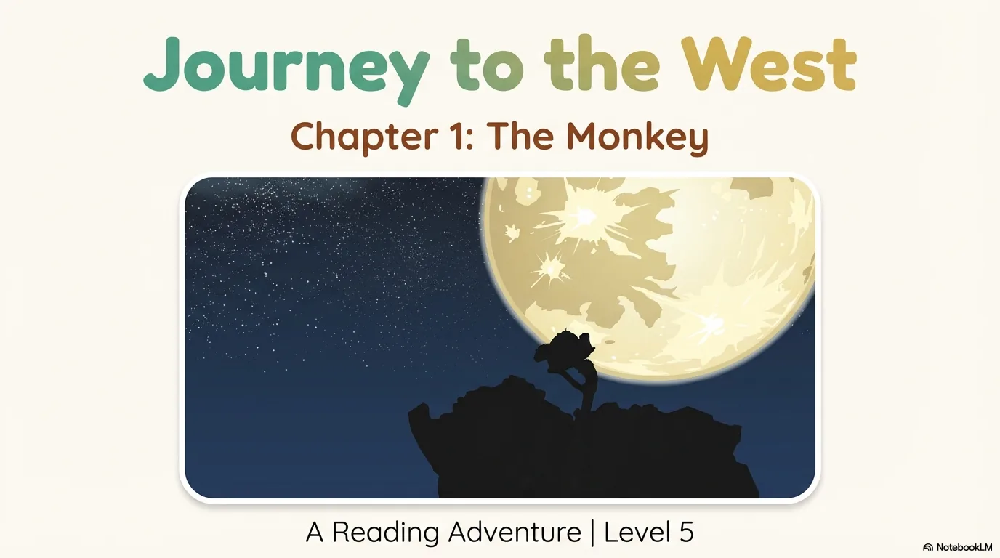

- 来源：`ppt/media/image1.png`（relationship `rId2`）
- 尺寸：1376×768
- 源 SHA-256：`bf0aad7c6c45c5e283244be7a2e956d0bc62ceb97348e3302908edb4be7597bc`
- 输出 SHA-256：`0546c4a4fc554ee2790b5b7241be29b17b09d0402715dfa1ce01303d7c96fc98`
- 分类：unknown ｜ OCR：blocked ｜ 审核：unreviewed

## Slide 002

- 来源：`ppt/media/image3.png`（relationship `rId2`）
- 尺寸：1376×768
- 源 SHA-256：`ad4e00c83d8a6422684ba52bb23e75dd2e3ebd8cc3efdf7a060a37e077573a3b`
- 输出 SHA-256：`2daf58475267629abf14964fec1f0e257919d7368f511ec6a036236540be063b`
- 分类：unknown ｜ OCR：blocked ｜ 审核：unreviewed

## Slide 003

- 来源：`ppt/media/image4.png`（relationship `rId2`）
- 尺寸：1376×768
- 源 SHA-256：`f200004cfc620194b9332bf2a4424af2fb0e56244bf625b9eb2634619fbf02ae`
- 输出 SHA-256：`b3bbd1f8a624f917903bc46e9c8fad7971f56ef6e37d2c16b922232bd1bfb8f4`
- 分类：unknown ｜ OCR：blocked ｜ 审核：unreviewed

## Slide 004

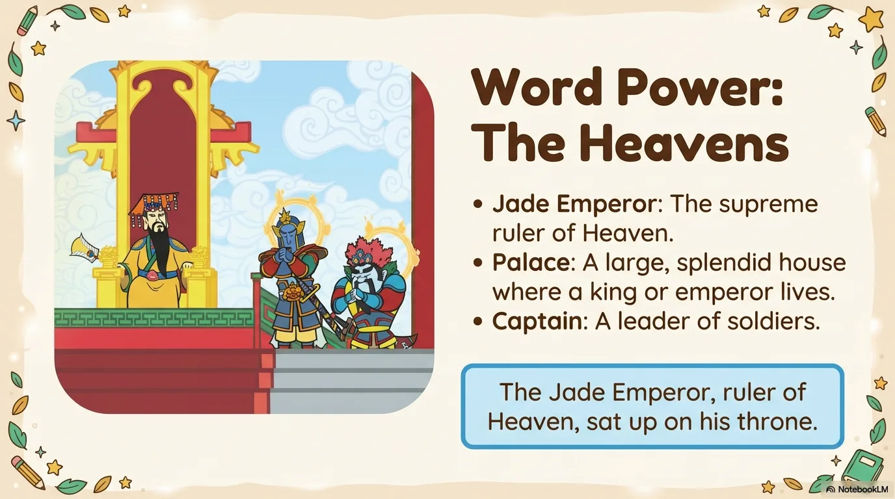

- 来源：`ppt/media/image5.png`（relationship `rId2`）
- 尺寸：1376×768
- 源 SHA-256：`1edd588b18a872df056d5488a7e23c27962d56596e0d64c1ade4b168dcfd2ead`
- 输出 SHA-256：`287503a9b1203ad25a561aec721647625e48813a5d2bc2f2925345fce56a682e`
- 分类：unknown ｜ OCR：blocked ｜ 审核：unreviewed

## Slide 005

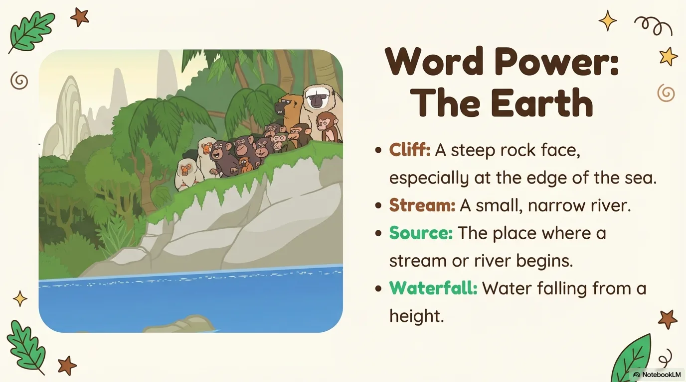

- 来源：`ppt/media/image6.png`（relationship `rId2`）
- 尺寸：1376×768
- 源 SHA-256：`1eeac3c9588a95e419f798b892d4fe070452caee371f3c5bb5f170095d68d581`
- 输出 SHA-256：`ae1a5ad74681e5a62a3fb7cbcc0c420ef66a7e2e30b76837d932bb8ec0ddcac6`
- 分类：unknown ｜ OCR：blocked ｜ 审核：unreviewed

## Slide 006

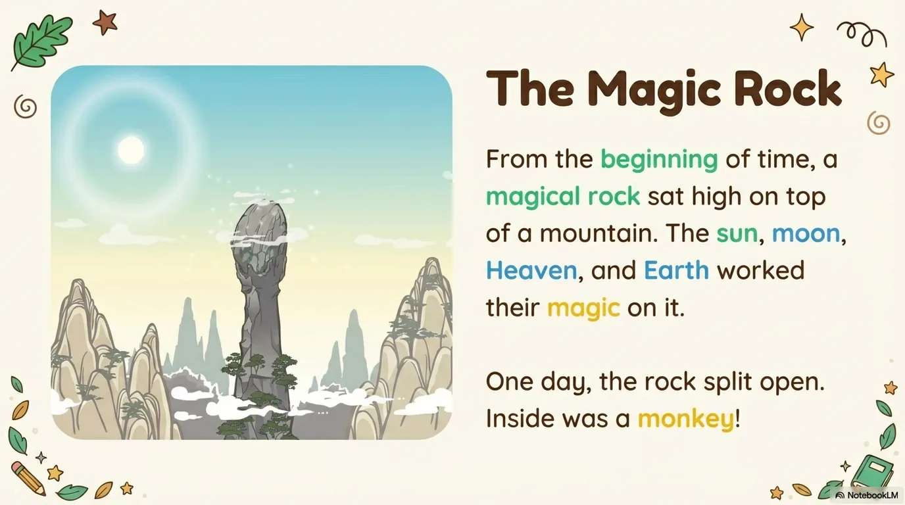

- 来源：`ppt/media/image7.png`（relationship `rId2`）
- 尺寸：1376×768
- 源 SHA-256：`6fd503dfddddb220eb5d79af98ca09ffd5d76d6955ef2faa2ecb9763ad81d568`
- 输出 SHA-256：`6e93442419a851f1d89793566da7cb2ec16842523df0934638436e42aa045eab`
- 分类：unknown ｜ OCR：blocked ｜ 审核：unreviewed

## Slide 007

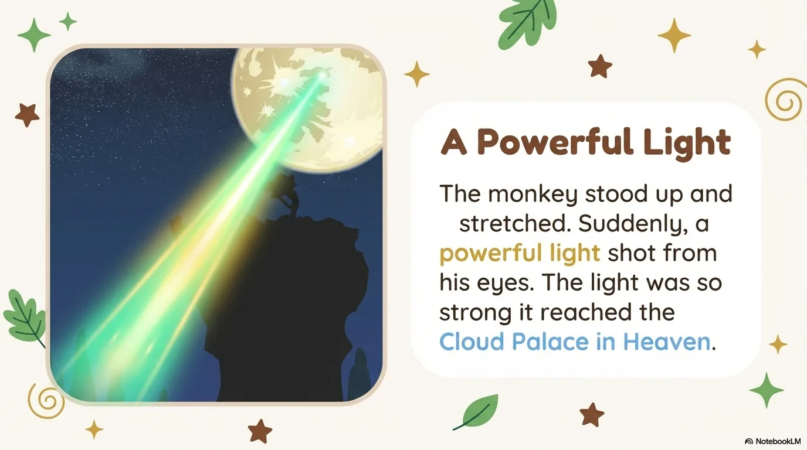

- 来源：`ppt/media/image8.png`（relationship `rId2`）
- 尺寸：1376×768
- 源 SHA-256：`996e2eb72daef9e4b40f0dd9d0894804b70686ae4ba287db8db3b0f259b7ce49`
- 输出 SHA-256：`d504afa5b871aa706228acc059ebe653d141d9633bed0524d2141bce715be16b`
- 分类：unknown ｜ OCR：blocked ｜ 审核：unreviewed

## Slide 008

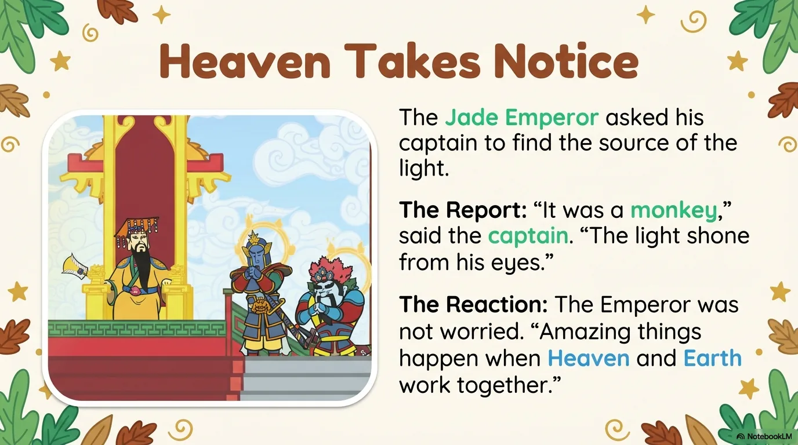

- 来源：`ppt/media/image9.png`（relationship `rId2`）
- 尺寸：1376×768
- 源 SHA-256：`702c68aa8bc43609432abe849c13b8ca9c801e3cd8f5595ca8a52121f2db43ba`
- 输出 SHA-256：`35c1701d2fee71e01a048e9007507cae9b16dbf5ba63f52b92ea83922d0e0af7`
- 分类：unknown ｜ OCR：blocked ｜ 审核：unreviewed

## Slide 009

- 来源：`ppt/media/image10.png`（relationship `rId2`）
- 尺寸：1376×768
- 源 SHA-256：`4913c2ba417444460fe7fccf09a02a5a84918a79041ae3347bc8dd296d9f750f`
- 输出 SHA-256：`b2b42423e10a80db037ad50cfafe7fc4a936e0f544fc46a8025cf0630ece21b8`
- 分类：unknown ｜ OCR：blocked ｜ 审核：unreviewed

## Slide 010

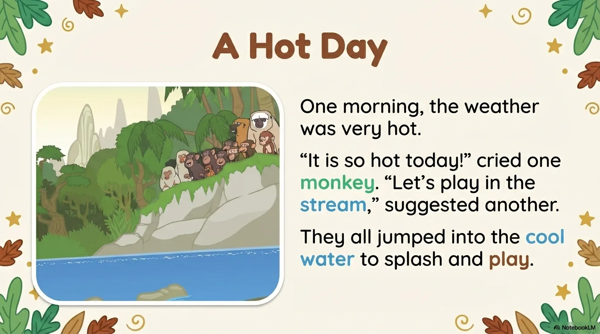

- 来源：`ppt/media/image11.png`（relationship `rId2`）
- 尺寸：1376×768
- 源 SHA-256：`a9cfa76efe68b4e2ef36472f68fa8bda7331f30f968d2ab08b66f579dcc9da0a`
- 输出 SHA-256：`3f67388463ddd181979ce734d20ae1b26143666ec5424799c39b0e1bebc7cd4e`
- 分类：unknown ｜ OCR：blocked ｜ 审核：unreviewed

## Slide 011

- 来源：`ppt/media/image12.png`（relationship `rId2`）
- 尺寸：1376×768
- 源 SHA-256：`62e95789081dee08d87343f53e4c854d78c29283082e5bd3d5001586aa5c6e05`
- 输出 SHA-256：`41e68efbb697a9f1c148a5b3a00325f97ea62149abcf29f806b70c268043f3ef`
- 分类：unknown ｜ OCR：blocked ｜ 审核：unreviewed

## Slide 012

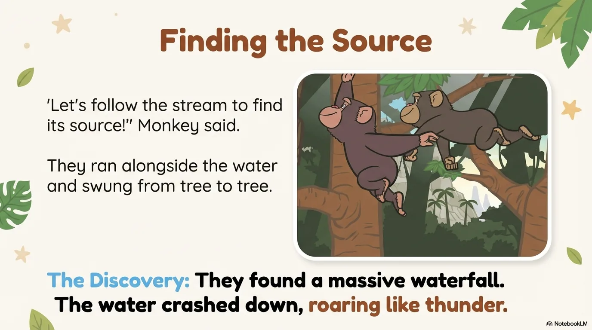

- 来源：`ppt/media/image13.png`（relationship `rId2`）
- 尺寸：1376×768
- 源 SHA-256：`f8be3d6d1449163668cf5d14bc6cd694ff4655f556a2da38996f0b6e6776cb23`
- 输出 SHA-256：`be5ac2fdc131ceb987279edd4b21ec17317f718cba6ad1ee4f23a47b3bb9276a`
- 分类：unknown ｜ OCR：blocked ｜ 审核：unreviewed

## Slide 013

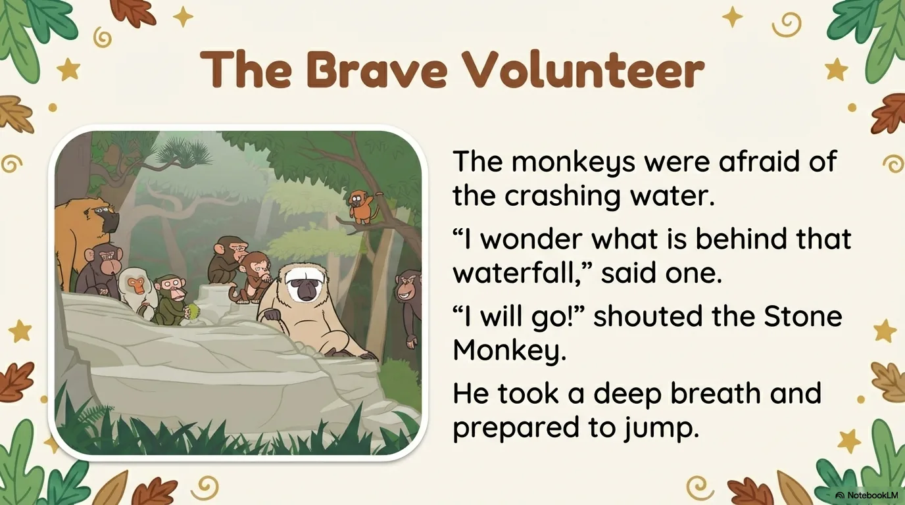

- 来源：`ppt/media/image14.png`（relationship `rId2`）
- 尺寸：1376×768
- 源 SHA-256：`e55074a771ee01360474c7aee2564e256f62fb2ce8b1e353958a94a18bbaa536`
- 输出 SHA-256：`b843a5f492184fac0711df35c195403ccabcdcba9bf0e007673ccee303aca8c8`
- 分类：unknown ｜ OCR：blocked ｜ 审核：unreviewed

## Slide 014

- 来源：`ppt/media/image15.png`（relationship `rId2`）
- 尺寸：1376×768
- 源 SHA-256：`c38c39072ef6da6be2297df31c6d6cee43e6e18a0f07c9b51d788ca886c3e050`
- 输出 SHA-256：`066b16e77280e983a7c557025b72ebd190f7e437a8ecd75d6d03fa4d5f023c6b`
- 分类：unknown ｜ OCR：blocked ｜ 审核：unreviewed

## Slide 015

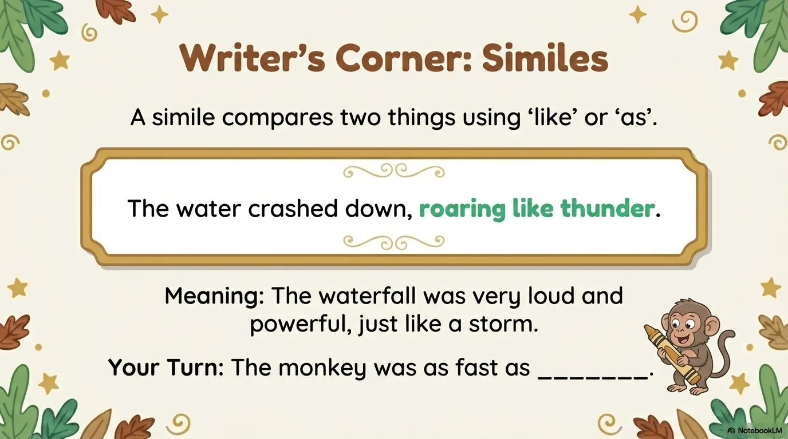

- 来源：`ppt/media/image16.png`（relationship `rId2`）
- 尺寸：1376×768
- 源 SHA-256：`80418e199f1875944aac3e94143df4545e7f642b398539798fdb66f3a7cc0288`
- 输出 SHA-256：`6eaffb183a4014bf46cead929fd30499329842a2d8d94fb14b346137daf1dd13`
- 分类：unknown ｜ OCR：blocked ｜ 审核：unreviewed

## Slide 016

- 来源：`ppt/media/image17.png`（relationship `rId2`）
- 尺寸：1376×768
- 源 SHA-256：`5f1e6b68b40016784e85839385cfe54d2d59775c1152318e5f247f77bdb30eff`
- 输出 SHA-256：`aad57bb6e160017ec6074136dfb580eab9d566459b38802b28789341e38c8b91`
- 分类：unknown ｜ OCR：blocked ｜ 审核：unreviewed

## Slide 017

- 来源：`ppt/media/image18.png`（relationship `rId2`）
- 尺寸：1376×768
- 源 SHA-256：`3ece9e19247e4e5b6519efd5162080f901680155586ff60ce1dd21c2db55fc4e`
- 输出 SHA-256：`54cb790ea40ffd7e238c6cd2124b34e49d0c9db517099508399e797c4f72fd51`
- 分类：unknown ｜ OCR：blocked ｜ 审核：unreviewed

## Slide 018

- 来源：`ppt/media/image19.png`（relationship `rId2`）
- 尺寸：1376×768
- 源 SHA-256：`b6c757d1b6b2b17568d6d7b98278af98c0e504873806dd6c07f554984f4cab84`
- 输出 SHA-256：`68a01965e1a8747a037c8f540394e7f6484058fbed105446e05a43c7ff53e161`
- 分类：unknown ｜ OCR：blocked ｜ 审核：unreviewed

## Slide 019

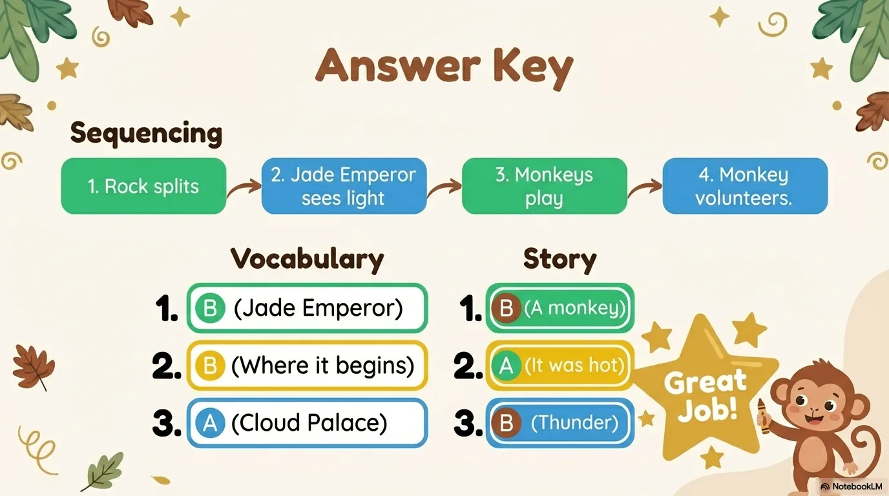

- 来源：`ppt/media/image20.png`（relationship `rId2`）
- 尺寸：1376×768
- 源 SHA-256：`5602c78cd226d6e4f5d70b2940b61e1bbed331e244ccf47a1a4175540cc4a49c`
- 输出 SHA-256：`fc12476e207ce2a8e24b9e4dd53afe80ddd5086a66a5ddd04b64fe91b234274b`
- 分类：unknown ｜ OCR：blocked ｜ 审核：unreviewed

## Slide 020

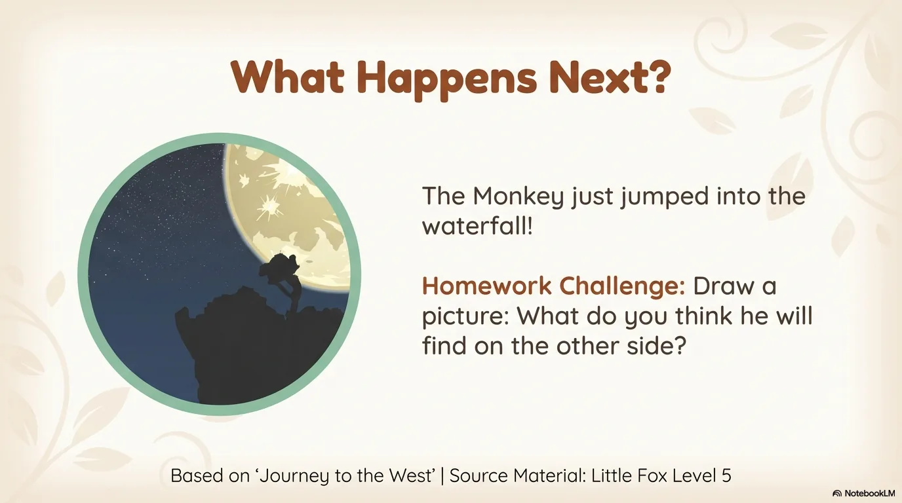

- 来源：`ppt/media/image21.png`（relationship `rId2`）
- 尺寸：1376×768
- 源 SHA-256：`a8c0e21d846f0e9c8d46893a603443d8bb75b608fed069ced6db43aba11b0072`
- 输出 SHA-256：`077390af89f240ee71ea9fee306e937171dccacf96b28d5b8d02a1667f26ae75`
- 分类：unknown ｜ OCR：blocked ｜ 审核：unreviewed
