# 豆豆龙英语 · 第 2 集课件（EP002 草稿）

- 来源：`002_Journey to the West 2_The Waterfall Cave.pptx`（主课件，20 页）
- OCR：`blocked`（no local OCR provider importable (pytesseract missing): No module named 'pytesseract'）
- 分类：待人工审核（unknown）
- 审核状态：`unreviewed`

## Slide 001

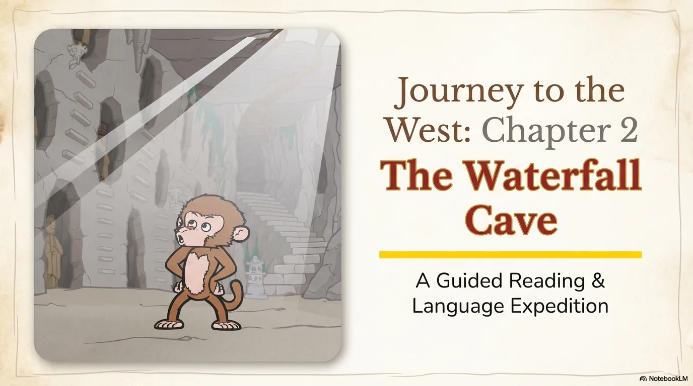

- 来源：`ppt/media/image1.png`（relationship `rId2`）
- 尺寸：1376×768
- 源 SHA-256：`81c2d870968c38373f53aea5e63659338ee4c9d6211e91fd7f46682e41d9c4f3`
- 输出 SHA-256：`c038a16adab4bec4815a7431bedfd38937ad56cf5e08aecc757f47383b390b0b`
- 分类：unknown ｜ OCR：blocked ｜ 审核：unreviewed

## Slide 002

- 来源：`ppt/media/image3.png`（relationship `rId2`）
- 尺寸：1376×768
- 源 SHA-256：`36922dfab756cd585c9de45ad3bc9311adf2ddac89f49d6fba547c94fc8d78cb`
- 输出 SHA-256：`9c374a634e0fcd93ac282c70faa1a537e51aca23abedc6bc53c600ab5b272887`
- 分类：unknown ｜ OCR：blocked ｜ 审核：unreviewed

## Slide 003

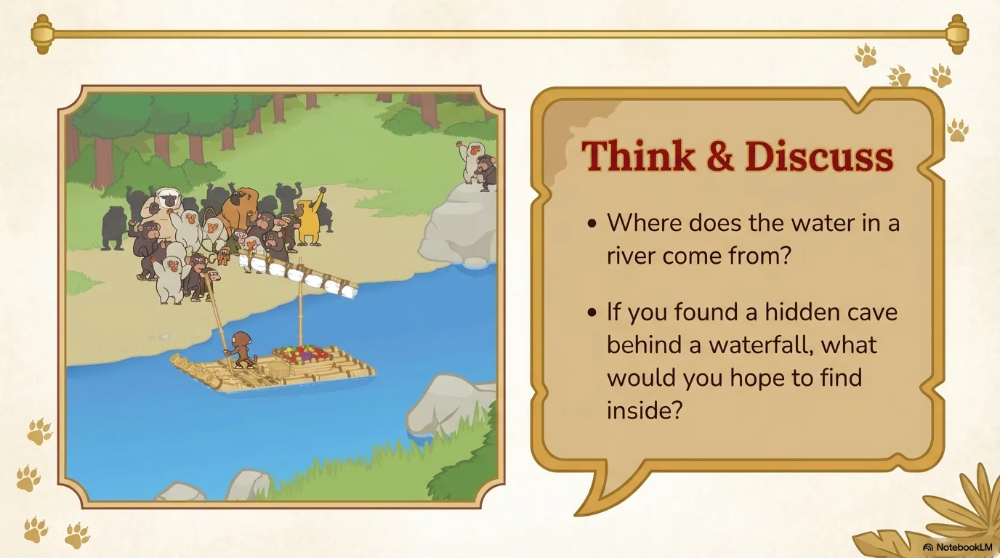

- 来源：`ppt/media/image4.png`（relationship `rId2`）
- 尺寸：1376×768
- 源 SHA-256：`bfa4d20d12af181694756d1dad92ab34108b37dff7112cbfe42c06f53d661110`
- 输出 SHA-256：`f83ec65fd6315ae37bfea4a5d3c1c22f989bc47d4b005584e137c888ac43dd32`
- 分类：unknown ｜ OCR：blocked ｜ 审核：unreviewed

## Slide 004

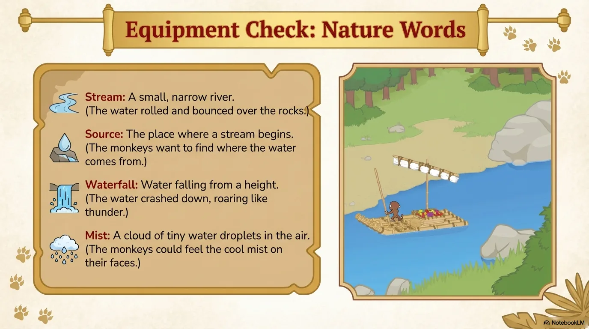

- 来源：`ppt/media/image5.png`（relationship `rId2`）
- 尺寸：1376×768
- 源 SHA-256：`b38aab8e7e0f98e921fa719bc034d50d5201033f34f21bdacbba6415026a0772`
- 输出 SHA-256：`211e86bed66035693a053b43d42a10e67327a88a811a72135e79d1cad2663590`
- 分类：unknown ｜ OCR：blocked ｜ 审核：unreviewed

## Slide 005

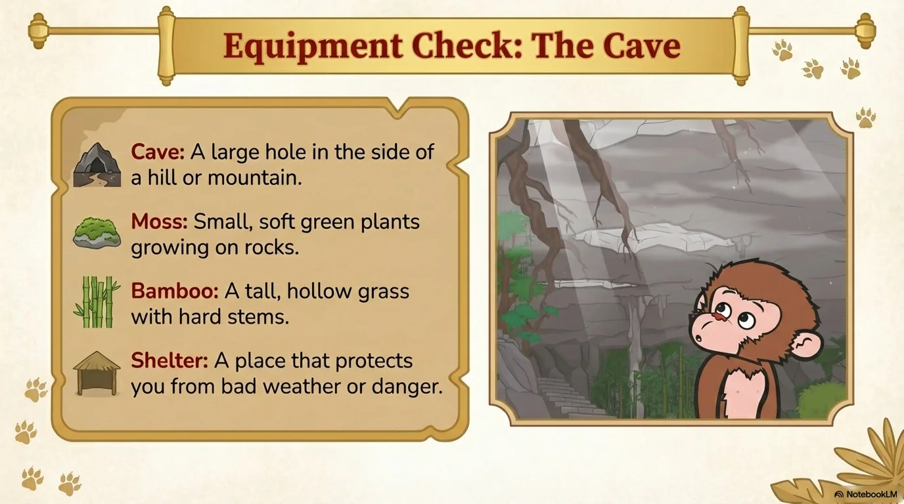

- 来源：`ppt/media/image6.png`（relationship `rId2`）
- 尺寸：1376×768
- 源 SHA-256：`87b28abf32409e604a845f0d418ab31551bc4d6085028f98c5064278f107c5e9`
- 输出 SHA-256：`121c9a9d225b2f629e23fd6c4fd1395799c73a811669f1cb7ef1396dcd0dbf3e`
- 分类：unknown ｜ OCR：blocked ｜ 审核：unreviewed

## Slide 006

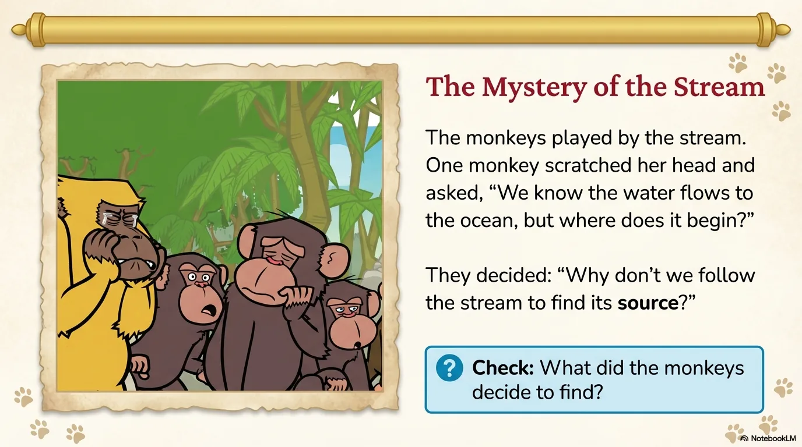

- 来源：`ppt/media/image7.png`（relationship `rId2`）
- 尺寸：1376×768
- 源 SHA-256：`1cd6cd111374a184dac9868ce11a48f37e124954898f5f69083c6a0f5048439e`
- 输出 SHA-256：`030d2b8031375e6ca204f0732ae0f980c4eaf75e32899813e86f5e7dd14506d5`
- 分类：unknown ｜ OCR：blocked ｜ 审核：unreviewed

## Slide 007

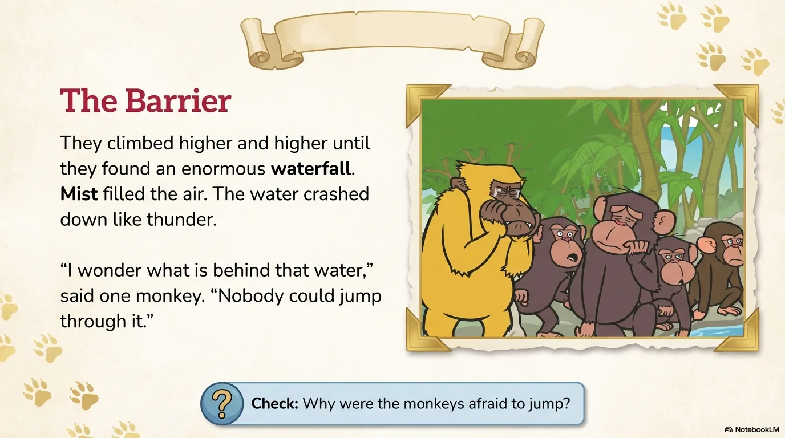

- 来源：`ppt/media/image8.png`（relationship `rId2`）
- 尺寸：1376×768
- 源 SHA-256：`7c43f48c31cef5b0f2a7b7680dde4a049679cb2ca90a68479896ab30ef15f748`
- 输出 SHA-256：`a8943868ec8e2022439def8f78756c684174343389c8a91b243fe099be7820e7`
- 分类：unknown ｜ OCR：blocked ｜ 审核：unreviewed

## Slide 008

- 来源：`ppt/media/image9.png`（relationship `rId2`）
- 尺寸：1376×768
- 源 SHA-256：`7bfa100ca94c4b4987c656404d7c324105818c49a75368b2dcd07022778effb7`
- 输出 SHA-256：`5fc64b17957cc6c80ca4da88c99d9225ee14b10f9f468d62611cff37b50f1f7f`
- 分类：unknown ｜ OCR：blocked ｜ 审核：unreviewed

## Slide 009

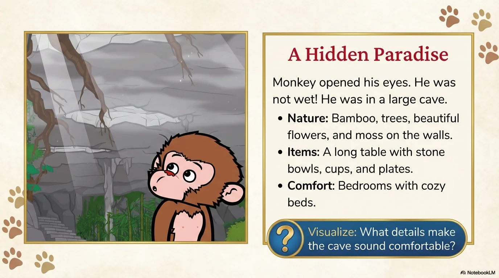

- 来源：`ppt/media/image10.png`（relationship `rId2`）
- 尺寸：1376×768
- 源 SHA-256：`9c659f3e3461af77c17f52ad9a7e2e0c3052a066143354ecccc0e06c41ad80e2`
- 输出 SHA-256：`10f256d49f6d95cf370b9d1cd9a6f1db32ddba116247ee980aafcf2ba194c39b`
- 分类：unknown ｜ OCR：blocked ｜ 审核：unreviewed

## Slide 010

- 来源：`ppt/media/image11.png`（relationship `rId2`）
- 尺寸：1376×768
- 源 SHA-256：`1f25ecdff0e0a9ee0ede6b701c7cac972e105a81fc67490e49c9aac4b523f0d4`
- 输出 SHA-256：`62f345e61d295fec5a088ec58ec91413e779015ca3066c56e810af97409379cd`
- 分类：unknown ｜ OCR：blocked ｜ 审核：unreviewed

## Slide 011

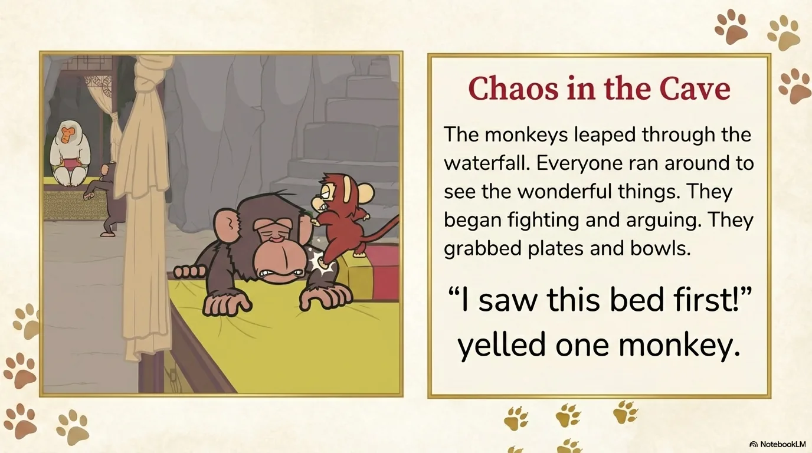

- 来源：`ppt/media/image12.png`（relationship `rId2`）
- 尺寸：1376×768
- 源 SHA-256：`e355722a1a505228aaa1036244188e5c7020c62a91e032bb9f5beef403b7726b`
- 输出 SHA-256：`23c0fdd044b59533cec717d2b731af0cf10bcca40a076903969dd4b7595bd8d2`
- 分类：unknown ｜ OCR：blocked ｜ 审核：unreviewed

## Slide 012

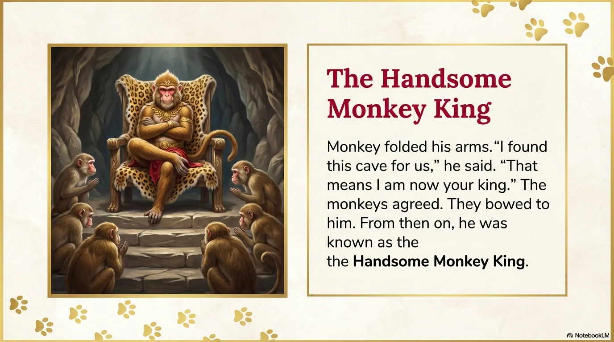

- 来源：`ppt/media/image13.png`（relationship `rId2`）
- 尺寸：1376×768
- 源 SHA-256：`fd35d2b1476fe4863216d31b9697483655895950f408e9bce2b08033f3aed10f`
- 输出 SHA-256：`d9b7354ad61ce08106f226e5f806db7eb1b27aecb2a6577275949eda2082845a`
- 分类：unknown ｜ OCR：blocked ｜ 审核：unreviewed

## Slide 013

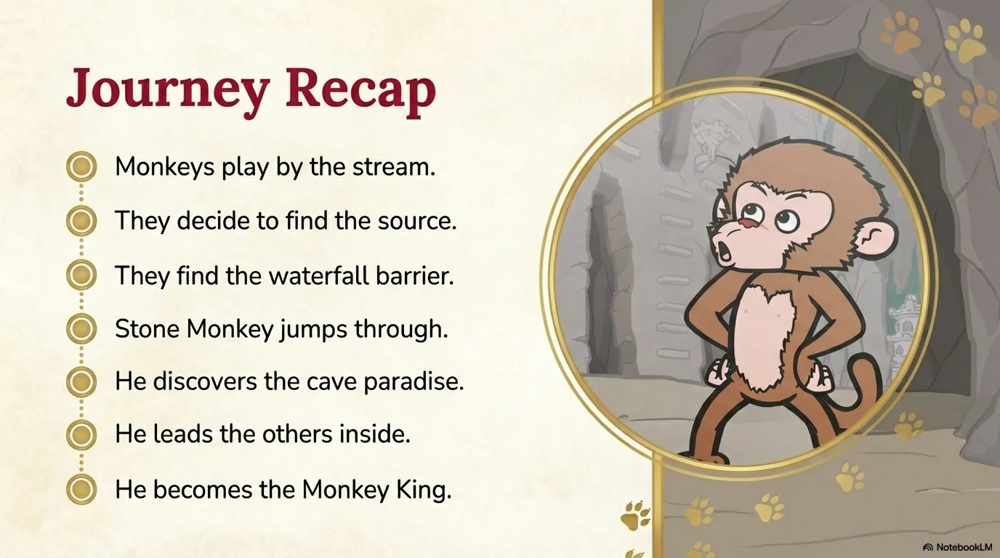

- 来源：`ppt/media/image14.png`（relationship `rId2`）
- 尺寸：1376×768
- 源 SHA-256：`c49199596a8eb2e7ad41896288645a10fff57c505ec21b51bdea34628ea01b2a`
- 输出 SHA-256：`ab1d8f63edd2bc35be7777f0e2aa5a28c1b406f15e77a3e906b4004cad03abed`
- 分类：unknown ｜ OCR：blocked ｜ 审核：unreviewed

## Slide 014

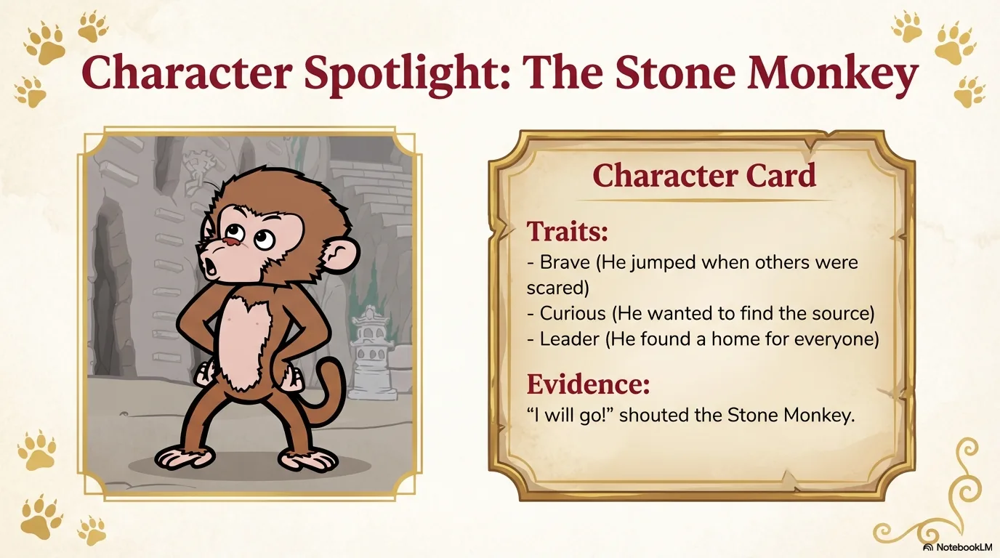

- 来源：`ppt/media/image15.png`（relationship `rId2`）
- 尺寸：1376×768
- 源 SHA-256：`5c9af2ad3b5c92126fbb71789b5f73412f62d18570ed2ce226325f9049576321`
- 输出 SHA-256：`b6ec5fb0647e47337f2b418dea10f8a70e923d1a5018dbda11006674aae3f631`
- 分类：unknown ｜ OCR：blocked ｜ 审核：unreviewed

## Slide 015

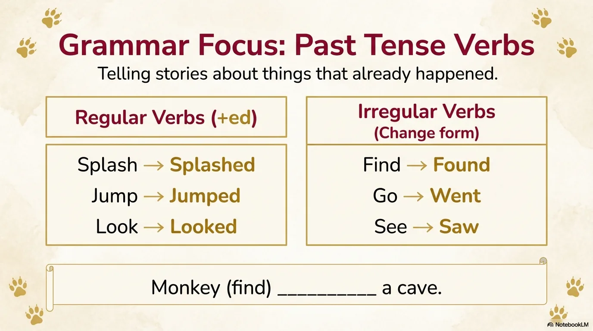

- 来源：`ppt/media/image16.png`（relationship `rId2`）
- 尺寸：1376×768
- 源 SHA-256：`96e4444be364ce7dcdc55d73440e30ef71e52a21a148fa23572d198470e44cf9`
- 输出 SHA-256：`4be467619b40557b84b765ab8b715bec0779d4354d33d26df7332a7c7f3e065f`
- 分类：unknown ｜ OCR：blocked ｜ 审核：unreviewed

## Slide 016

- 来源：`ppt/media/image17.png`（relationship `rId2`）
- 尺寸：1376×768
- 源 SHA-256：`745242854d362aec86cf99f1bf2859e1c3eeb074792ecc005aea752ddd9344be`
- 输出 SHA-256：`3538eeb5bf0397672843206582a1c980bc7d131ab573513be8a24c45c83c00c9`
- 分类：unknown ｜ OCR：blocked ｜ 审核：unreviewed

## Slide 017

- 来源：`ppt/media/image18.png`（relationship `rId2`）
- 尺寸：1376×768
- 源 SHA-256：`171b5e8234a8e12ca0af9be65c43208c3bce84e1918ac08d331bb36d042913fb`
- 输出 SHA-256：`77e44c0cfc757c11e236eb7c0c667934be0008ec2aa35f0fd978b73090a1d3ea`
- 分类：unknown ｜ OCR：blocked ｜ 审核：unreviewed

## Slide 018

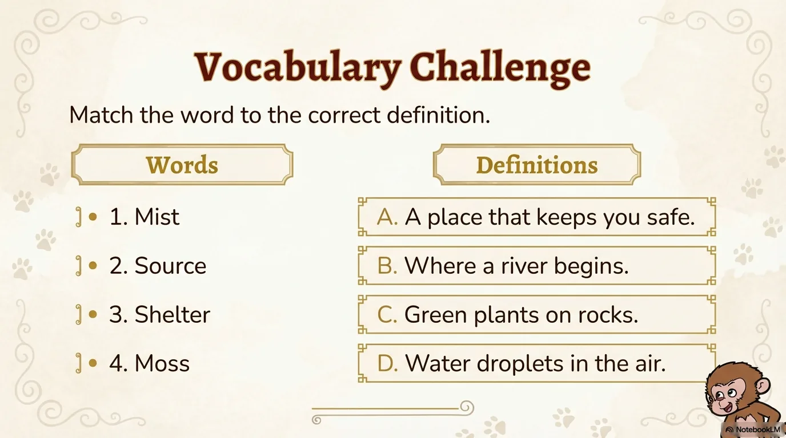

- 来源：`ppt/media/image19.png`（relationship `rId2`）
- 尺寸：1376×768
- 源 SHA-256：`d7fe284c9b7e928a81f6b7e380739f655f15098fbffb22970e6e8d0198e832d6`
- 输出 SHA-256：`018bdd2d44ed24670e7607e9ad7417c9295ec1654d5d7ef700ab56d68f616ec4`
- 分类：unknown ｜ OCR：blocked ｜ 审核：unreviewed

## Slide 019

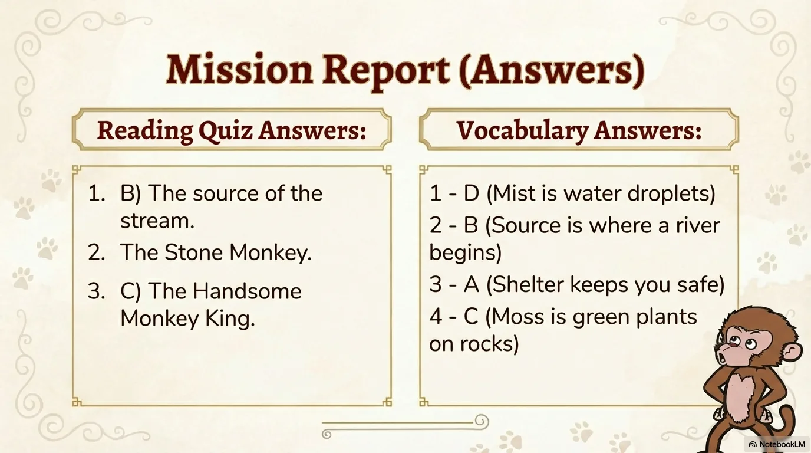

- 来源：`ppt/media/image20.png`（relationship `rId2`）
- 尺寸：1376×768
- 源 SHA-256：`8b63fe3c18a01861cec99543319f5cdb9423708553ca62287b854fb457882f54`
- 输出 SHA-256：`e96bc11b38b82a3f2714aad47e344fc0891c28ef45fa5a725613043e7055f420`
- 分类：unknown ｜ OCR：blocked ｜ 审核：unreviewed

## Slide 020

- 来源：`ppt/media/image21.png`（relationship `rId2`）
- 尺寸：1376×768
- 源 SHA-256：`46da57134f5dc304083209b9ffcb04ee43b77c7006b07b2b364eb1387b834b3f`
- 输出 SHA-256：`851d273187ab0c5df2077b666a1b7cca3af133893804893848791e1d6e2a047b`
- 分类：unknown ｜ OCR：blocked ｜ 审核：unreviewed
