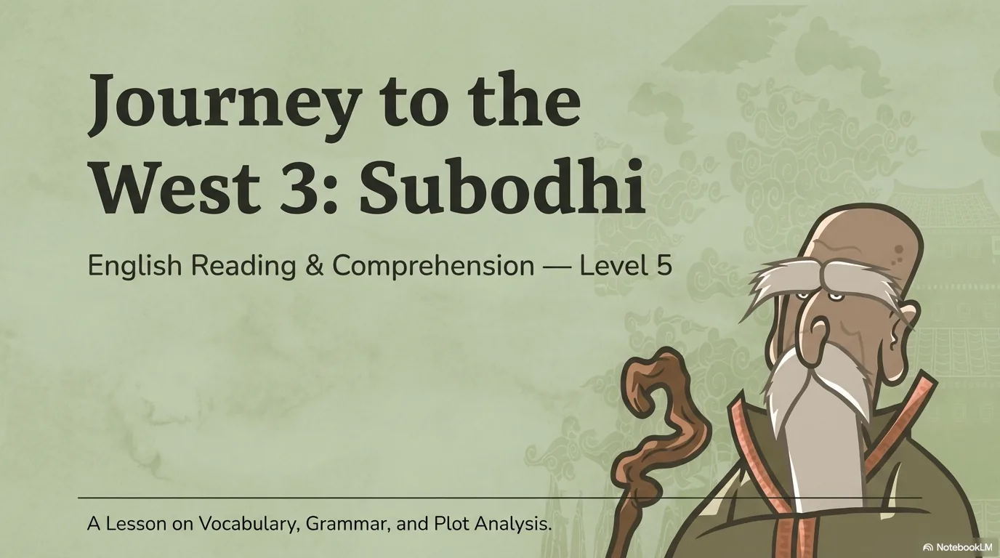
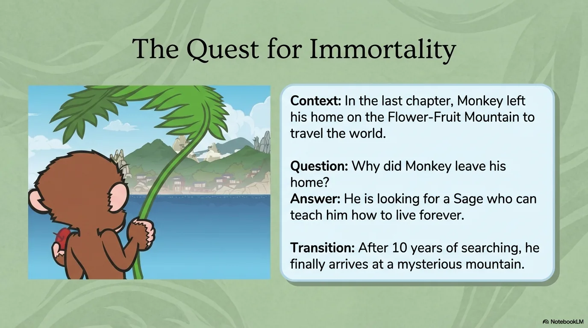
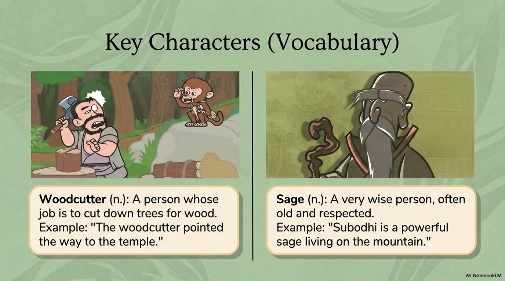
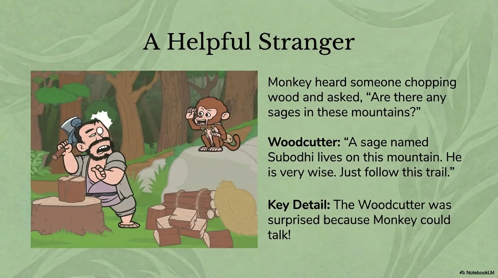
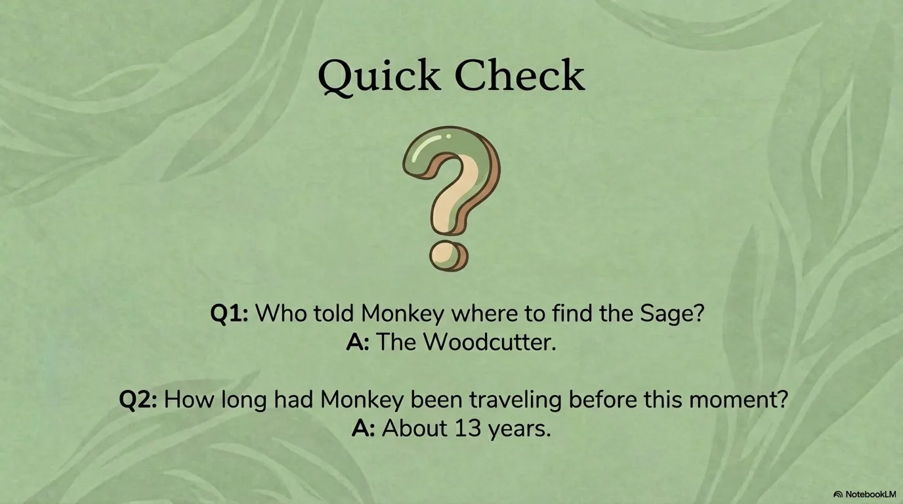
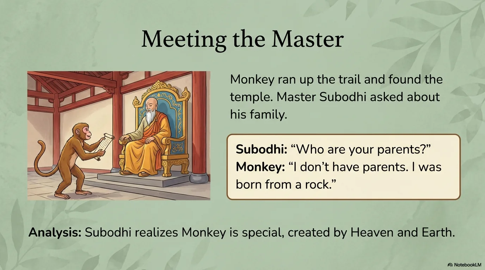
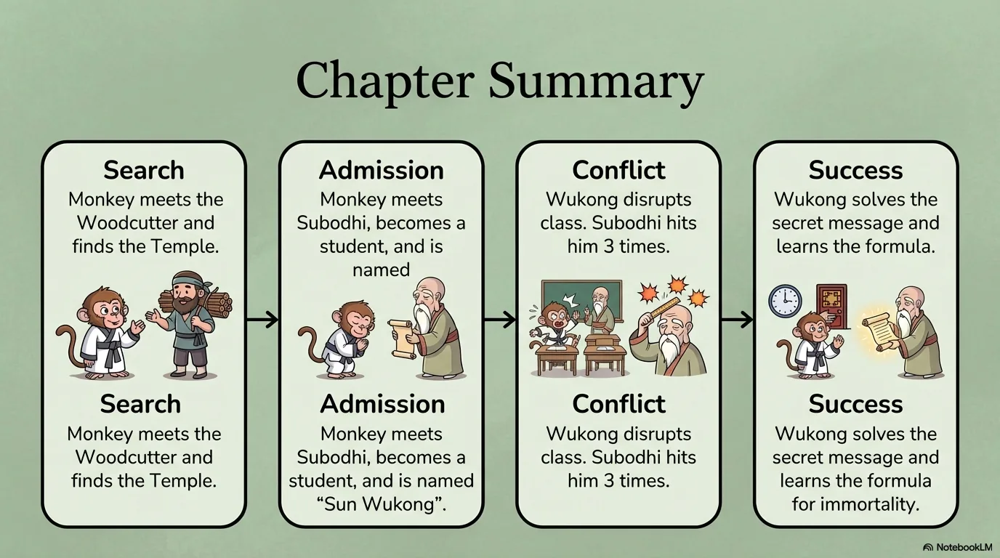
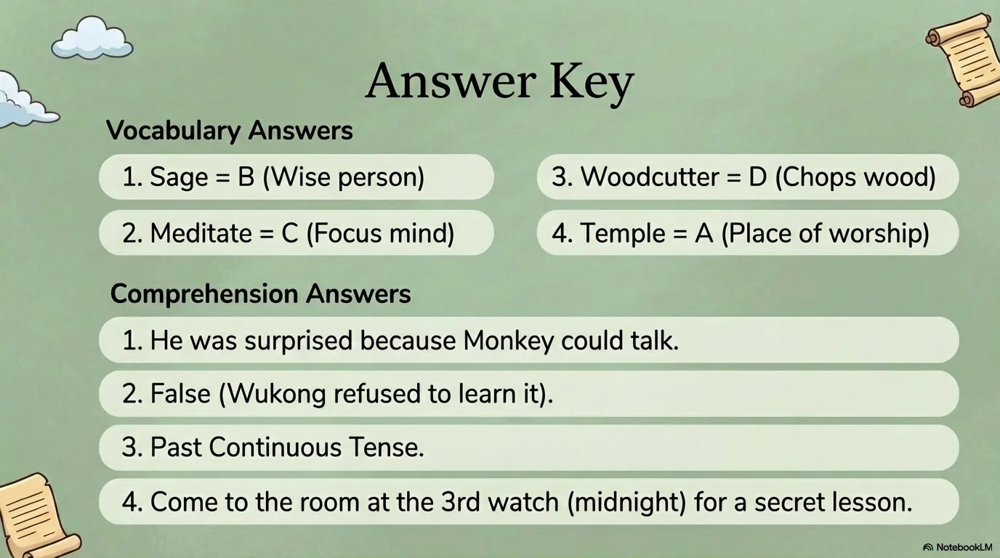

# 豆豆龙英语 · 第 3 集课件（EP003 草稿）

- 来源：`003_Journey to the West 3_Subodhi.pptx`（主课件，20 页）
- OCR：`blocked`（no local OCR provider importable (pytesseract missing): No module named 'pytesseract'）
- 分类：待人工审核（unknown）
- 审核状态：`unreviewed`

## Slide 001

- 来源：`ppt/media/image1.png`（relationship `rId2`）
- 尺寸：1376×768
- 源 SHA-256：`4d9677cd301528bc73b7e7c5ed670cdcbd5a90ae8f71523bb413c9b9d89e6745`
- 输出 SHA-256：`406d5a1a669bb36e2242c400f3f88e7bcc38d9fc9160b885b8cde41962255aad`
- 分类：unknown ｜ OCR：blocked ｜ 审核：unreviewed

## Slide 002

- 来源：`ppt/media/image3.png`（relationship `rId2`）
- 尺寸：1376×768
- 源 SHA-256：`fa628c1cf9103d32debb97eb06bda81bc5194e91c6669e8da1e26eff1c303fef`
- 输出 SHA-256：`d3d78403b9d09018bc64bcb39b83b75c709264bd2c5aaef9f64504671b6d3b6d`
- 分类：unknown ｜ OCR：blocked ｜ 审核：unreviewed

## Slide 003

- 来源：`ppt/media/image4.png`（relationship `rId2`）
- 尺寸：1376×768
- 源 SHA-256：`b3a6bb4192be08dadc73ece73f02a9299d6d3802df7be860531703a83b2cc364`
- 输出 SHA-256：`9c63214735be56144faf381c2f56128affe352f095f9e0841e6bc9da42904350`
- 分类：unknown ｜ OCR：blocked ｜ 审核：unreviewed

## Slide 004

- 来源：`ppt/media/image5.png`（relationship `rId2`）
- 尺寸：1376×768
- 源 SHA-256：`19a1212f10a0adda97e46945c42dde7ea2a300c5d8f6f555a55e24d57a50e5b6`
- 输出 SHA-256：`8fb9c0515a5382e883e720bc9078fede4812bd0c0235e832cb8da6892ff153b1`
- 分类：unknown ｜ OCR：blocked ｜ 审核：unreviewed

## Slide 005

- 来源：`ppt/media/image6.png`（relationship `rId2`）
- 尺寸：1376×768
- 源 SHA-256：`5840c51d902dcfcac217720a8b66127353bedbf83412dbaf0507d00477bbe17a`
- 输出 SHA-256：`64bbaeb53e84b65fea16dc7e16d9cfa3acdc7345011a1b5cebe3be67f52aec02`
- 分类：unknown ｜ OCR：blocked ｜ 审核：unreviewed

## Slide 006

- 来源：`ppt/media/image7.png`（relationship `rId2`）
- 尺寸：1376×768
- 源 SHA-256：`50a3a8e767d81d42eb0d14dcc54ff780095e903e015512c4429e89ad6d6ecc7a`
- 输出 SHA-256：`df8d8dd8e1a8070c2683eec2d27506790178ee3f4d7c3f7f56ee737aef3396dc`
- 分类：unknown ｜ OCR：blocked ｜ 审核：unreviewed

## Slide 007

- 来源：`ppt/media/image8.png`（relationship `rId2`）
- 尺寸：1376×768
- 源 SHA-256：`b18a770a48d7e191794fc0a72c8be14634bc4ca79c78b4b449b15b934b9a5e00`
- 输出 SHA-256：`7b40a915a58b898b55c521bc3db1c93bb9fd19922895c7fbc1fbde79156297ba`
- 分类：unknown ｜ OCR：blocked ｜ 审核：unreviewed

## Slide 008

- 来源：`ppt/media/image9.png`（relationship `rId2`）
- 尺寸：1376×768
- 源 SHA-256：`6bd60c7988f7eb1219175a1dbba2f63f7f4ab955d1909789e5303cf1b3a4021d`
- 输出 SHA-256：`9a293df77884b2103926972ea1347e1a5726b33e4ab1053bbb759086717440b7`
- 分类：unknown ｜ OCR：blocked ｜ 审核：unreviewed

## Slide 009

- 来源：`ppt/media/image10.png`（relationship `rId2`）
- 尺寸：1376×768
- 源 SHA-256：`09c3a182ed58763f10dba7abe81749da1fda75374dabc430c17ec1570029c6dd`
- 输出 SHA-256：`bad3211da4cb2b55508eac4d8ab7ce0f833c1ed3cd0fa323b2907da6067aab48`
- 分类：unknown ｜ OCR：blocked ｜ 审核：unreviewed

## Slide 010

- 来源：`ppt/media/image11.png`（relationship `rId2`）
- 尺寸：1376×768
- 源 SHA-256：`f5c81836574dd4bf83cd0c1df585b8e1f0b0ae7a771c93d348ae24f944d99953`
- 输出 SHA-256：`169b9c90fa11247f383450c7884e3abd46615c07d9de56cb3ae6543eee5fb258`
- 分类：unknown ｜ OCR：blocked ｜ 审核：unreviewed

## Slide 011

- 来源：`ppt/media/image12.png`（relationship `rId2`）
- 尺寸：1376×768
- 源 SHA-256：`3a47537c2999350dc8a582b80fc16fb13795372102d75663b3bcb02e1402368d`
- 输出 SHA-256：`6fcaca576b52c068be2cb2715977a0c58b0b4b44e0e6a07608126df6c7bf4a4a`
- 分类：unknown ｜ OCR：blocked ｜ 审核：unreviewed

## Slide 012

- 来源：`ppt/media/image13.png`（relationship `rId2`）
- 尺寸：1376×768
- 源 SHA-256：`27bed06a9dbb6e922e21351e61fe4b55688730b823909dbe975f5fe2eac18d8f`
- 输出 SHA-256：`c1214585352ff8699c370d0ca6b713b3ebcd48648650c335c1b7d31c8c538309`
- 分类：unknown ｜ OCR：blocked ｜ 审核：unreviewed

## Slide 013

- 来源：`ppt/media/image14.png`（relationship `rId2`）
- 尺寸：1376×768
- 源 SHA-256：`004824eac27da856758df2b87e6359b076b74fa29cbb48ba021f6c0ebd58c34a`
- 输出 SHA-256：`118a936c861fe3ff9a44b11296913a3ca917e25c0aaba957f3d1f1dab72fed51`
- 分类：unknown ｜ OCR：blocked ｜ 审核：unreviewed

## Slide 014

- 来源：`ppt/media/image15.png`（relationship `rId2`）
- 尺寸：1376×768
- 源 SHA-256：`074f5561952b8b65f36c15c5b37b96b114ff2cdf7e0572aa7224531d6b5961b0`
- 输出 SHA-256：`97bfd73e835029cf5ba799e0241962d048c3cd6e9bc63d64029205e6e6d2b545`
- 分类：unknown ｜ OCR：blocked ｜ 审核：unreviewed

## Slide 015

- 来源：`ppt/media/image16.png`（relationship `rId2`）
- 尺寸：1376×768
- 源 SHA-256：`a44072a530543b10000554dd14832f02383f1e8c957f5744beb7bf9f64130bb5`
- 输出 SHA-256：`089b6460198e95fe5500d519626b708568510fa7b454026d14330749bed20638`
- 分类：unknown ｜ OCR：blocked ｜ 审核：unreviewed

## Slide 016

- 来源：`ppt/media/image17.png`（relationship `rId2`）
- 尺寸：1376×768
- 源 SHA-256：`d815c09cf853bf053f18604d86ed00023ad128fc8a8a818bcaa96a3d7774d111`
- 输出 SHA-256：`486004e1ec5e37c9e2ae25a000dfd4fe5eb0aaef7b136a71f3d7e283bdd948a4`
- 分类：unknown ｜ OCR：blocked ｜ 审核：unreviewed

## Slide 017

- 来源：`ppt/media/image18.png`（relationship `rId2`）
- 尺寸：1376×768
- 源 SHA-256：`9d4a3b2a1876547f6573c7b0a42a8c3f507f5833c510a97ba83953f26b736a4b`
- 输出 SHA-256：`9218fd144a8dea11c63cbe2a18c8a427c6442213f99cd416bbb52c58298a0403`
- 分类：unknown ｜ OCR：blocked ｜ 审核：unreviewed

## Slide 018

- 来源：`ppt/media/image19.png`（relationship `rId2`）
- 尺寸：1376×768
- 源 SHA-256：`766b43c8dc976f8c9c36843fe3296fefa1aac5ea476bd7cca9c4edf320e7db1b`
- 输出 SHA-256：`0556d18b8d7baf569be3e0333649a7cb63df9f9843c490b292c42ce32818ee2d`
- 分类：unknown ｜ OCR：blocked ｜ 审核：unreviewed

## Slide 019

- 来源：`ppt/media/image20.png`（relationship `rId2`）
- 尺寸：1376×768
- 源 SHA-256：`cccd593167167fa4ae5cca8f33cc014ec52ff2ffc74af3343bd3a0d2a1f195a5`
- 输出 SHA-256：`3e4a1316cdbedf5f7184791540fc3d72637ca6bd8cd06815dd4ba978abbe299e`
- 分类：unknown ｜ OCR：blocked ｜ 审核：unreviewed

## Slide 020

- 来源：`ppt/media/image21.png`（relationship `rId2`）
- 尺寸：1376×768
- 源 SHA-256：`ab75430f33647bf2ecb93943cb07d451d51c033f8f2e0c232119c2b768a68726`
- 输出 SHA-256：`f385453de30707af953e52e3a49170bd5484b5cc7118f6997c2ddc3ed8c45cd5`
- 分类：unknown ｜ OCR：blocked ｜ 审核：unreviewed
