# 豆豆龙英语 · 第 4 集课件（EP004 草稿）

- 来源：`004_Journey to the West 4_Secret Formulas.pptx`（主课件，20 页）
- OCR：`blocked`（no local OCR provider importable (pytesseract missing): No module named 'pytesseract'）
- 分类：待人工审核（unknown）
- 审核状态：`unreviewed`

## Slide 001

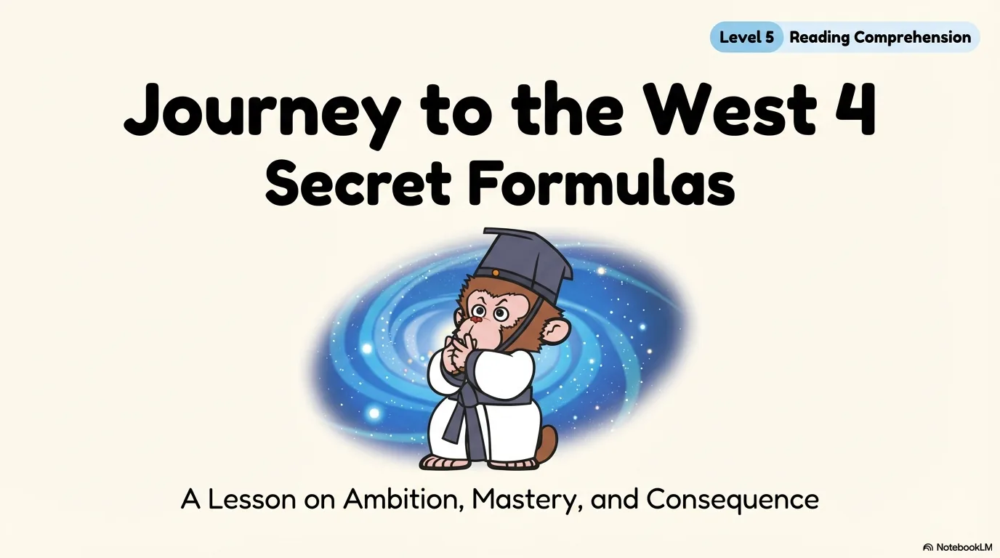

- 来源：`ppt/media/image1.png`（relationship `rId2`）
- 尺寸：1376×768
- 源 SHA-256：`75fc390762a935729f0fd565407319c9147308c9dbc796f8d971df60298943de`
- 输出 SHA-256：`eb3c4698a1ab8d6e8f3833e7d4bf569640fa77db0986efe6af9dac7936f91499`
- 分类：unknown ｜ OCR：blocked ｜ 审核：unreviewed

## Slide 002

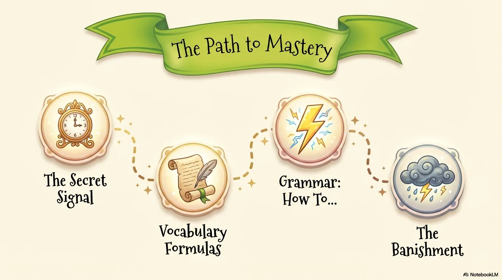

- 来源：`ppt/media/image3.png`（relationship `rId2`）
- 尺寸：1376×768
- 源 SHA-256：`73f081d5fc9b26f8bf0f18637f0a031ed77c5fa7be64a940e89f33ded269d744`
- 输出 SHA-256：`2af85609398165458d7b1cd23ba779c542ac2d03edc6106cf0a7b20cfbc8ea70`
- 分类：unknown ｜ OCR：blocked ｜ 审核：unreviewed

## Slide 003

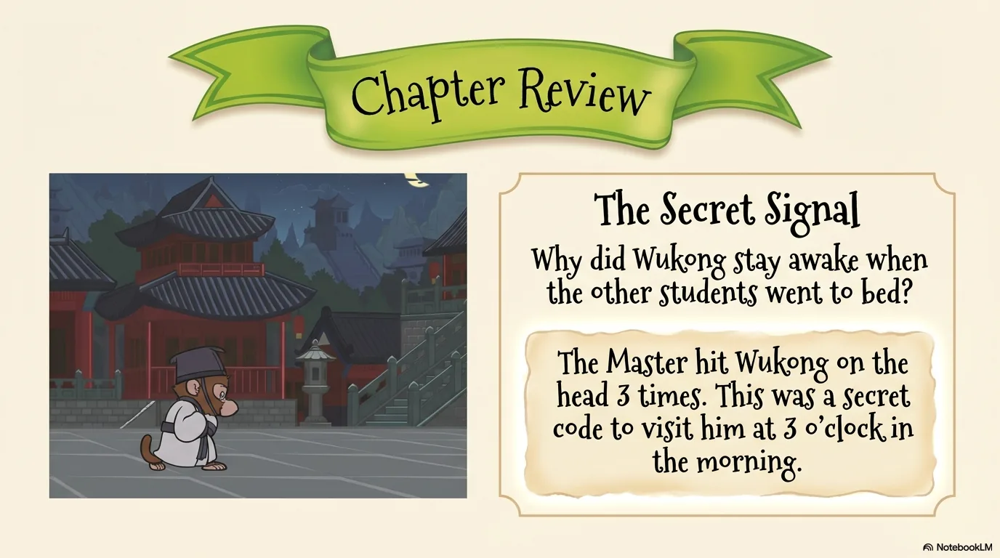

- 来源：`ppt/media/image4.png`（relationship `rId2`）
- 尺寸：1376×768
- 源 SHA-256：`bf0f8ff5ab7ae5b74876f939cf4b56f17748ec1cbb4e706b0385b0080180740b`
- 输出 SHA-256：`3d94885f4411fb0e8cdbe03d11f20f43983fa9b12275504ce32ef7bb9c7daada`
- 分类：unknown ｜ OCR：blocked ｜ 审核：unreviewed

## Slide 004

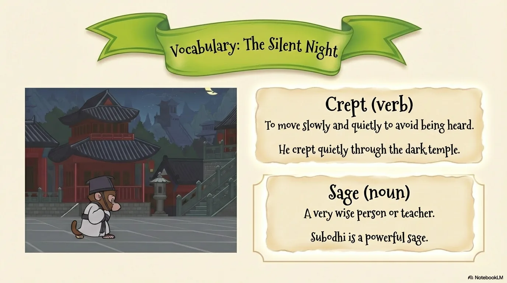

- 来源：`ppt/media/image5.png`（relationship `rId2`）
- 尺寸：1376×768
- 源 SHA-256：`9bcd623581c4cc996c8a786bd4a7289789d4d18d5cab81f0db8f896fc5802aad`
- 输出 SHA-256：`4c1bac2f7468224ade1182913000df3bcc90d4b4f13e19ba8f6877749a097c45`
- 分类：unknown ｜ OCR：blocked ｜ 审核：unreviewed

## Slide 005

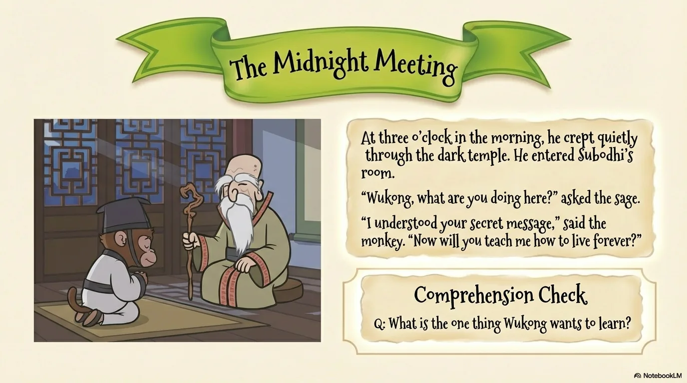

- 来源：`ppt/media/image6.png`（relationship `rId2`）
- 尺寸：1376×768
- 源 SHA-256：`b2709c97b40f8152973d176cc139a64f3f8d5db237da7df66aeb27cfc54fe535`
- 输出 SHA-256：`313efd6523eede3fe4d13b382b6ec27de8bb33663777132e10563c5fcee8f13c`
- 分类：unknown ｜ OCR：blocked ｜ 审核：unreviewed

## Slide 006

- 来源：`ppt/media/image7.png`（relationship `rId2`）
- 尺寸：1376×768
- 源 SHA-256：`374d2dbbe66342912497cbca72f6f03bfed215523a4f0334c146703a818e76e3`
- 输出 SHA-256：`67c3ce55bb19b0a2589b3416035903491d271a29f3f1f443c5b0b595d99ec134`
- 分类：unknown ｜ OCR：blocked ｜ 审核：unreviewed

## Slide 007

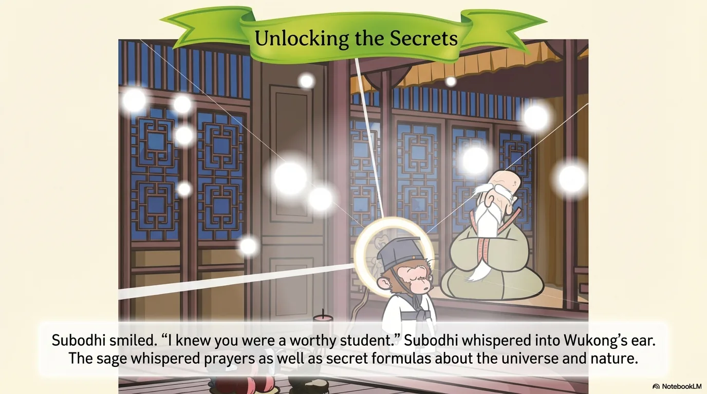

- 来源：`ppt/media/image8.png`（relationship `rId2`）
- 尺寸：1376×768
- 源 SHA-256：`4f463f08df1ccaf515d0010f92579f01f1a7cee665c2d7d50c418a9801d2cb74`
- 输出 SHA-256：`ac7898160b2af474dcdb57303536d3e0a78ab1aee7c90ef65385d44db46eb140`
- 分类：unknown ｜ OCR：blocked ｜ 审核：unreviewed

## Slide 008

- 来源：`ppt/media/image9.png`（relationship `rId2`）
- 尺寸：1376×768
- 源 SHA-256：`40e2054a93291cdef4dafcb13e1de9f6226a6735b766707be952a4586bd41cbe`
- 输出 SHA-256：`d4084dbb43dd7981b90aff623aa5bcb549438c14d5ce2419e032d226f8ef6515`
- 分类：unknown ｜ OCR：blocked ｜ 审核：unreviewed

## Slide 009

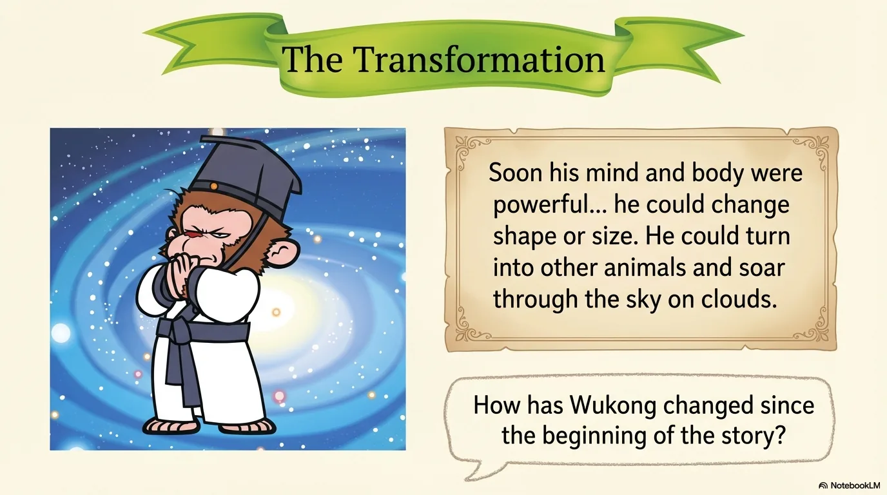

- 来源：`ppt/media/image10.png`（relationship `rId2`）
- 尺寸：1376×768
- 源 SHA-256：`c6ee1713d0953b68f5389b05022a3d651e777a0f80172b6fa6f5e150cf035c70`
- 输出 SHA-256：`b5189217322c5b9bdda28698a94c8c29c008bd5796ad25e906d3515699e0bd1a`
- 分类：unknown ｜ OCR：blocked ｜ 审核：unreviewed

## Slide 010

- 来源：`ppt/media/image11.png`（relationship `rId2`）
- 尺寸：1376×768
- 源 SHA-256：`a9fbf63035bc9e54ed2b49b9c9657404a5b3094133be4935d1453199b2781390`
- 输出 SHA-256：`196de75ce3a8eba127921a7ca96ec8e88cedbde5ae07aa6aaadb798bb7fd9b8b`
- 分类：unknown ｜ OCR：blocked ｜ 审核：unreviewed

## Slide 011

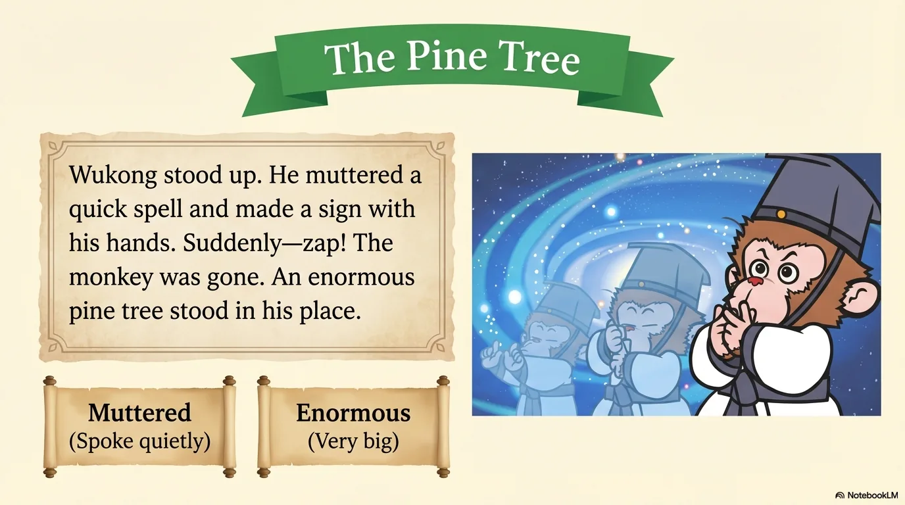

- 来源：`ppt/media/image12.png`（relationship `rId2`）
- 尺寸：1376×768
- 源 SHA-256：`8b3d22bacb6fa6396b6a932edca81806c8126ceb5091596a4e59d467a64efef3`
- 输出 SHA-256：`1b415d505202cb62d45fc09972a1de43553448909ab6682f3c04715699994c47`
- 分类：unknown ｜ OCR：blocked ｜ 审核：unreviewed

## Slide 012

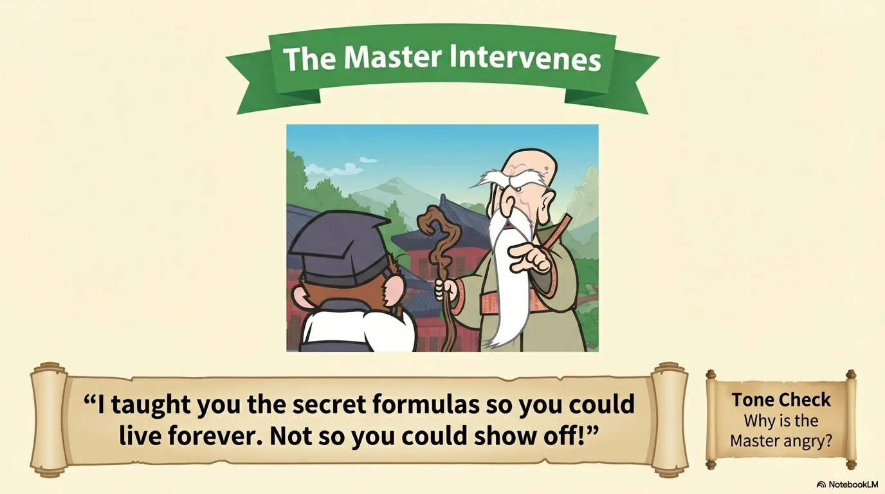

- 来源：`ppt/media/image13.png`（relationship `rId2`）
- 尺寸：1376×768
- 源 SHA-256：`d11f00707485d63c5a4874fda601632600f8135f1e2bb12e82586e3a3da0ee66`
- 输出 SHA-256：`769948393c3298c2675d08b8ead13ce2ad4e4b97cb045dc8e406b3c8ab3c4f28`
- 分类：unknown ｜ OCR：blocked ｜ 审核：unreviewed

## Slide 013

- 来源：`ppt/media/image14.png`（relationship `rId2`）
- 尺寸：1376×768
- 源 SHA-256：`d59b1aec01fc821054102a0bd39e9bce85f9bbef397f0b4974a93c37b169a1ba`
- 输出 SHA-256：`e474df07c078fd506d701a95ea81c31fd405091f33660f5c59c112fe8de54c8e`
- 分类：unknown ｜ OCR：blocked ｜ 审核：unreviewed

## Slide 014

- 来源：`ppt/media/image15.png`（relationship `rId2`）
- 尺寸：1376×768
- 源 SHA-256：`bc31fe4495487e700313da4dc8283e09c63b68a9cbe29c6132740590a0594c4f`
- 输出 SHA-256：`5532ffff4ef3ea31e9b9eebf989b5ecf0c1f7febc0de553872c7c325e364c0f6`
- 分类：unknown ｜ OCR：blocked ｜ 审核：unreviewed

## Slide 015

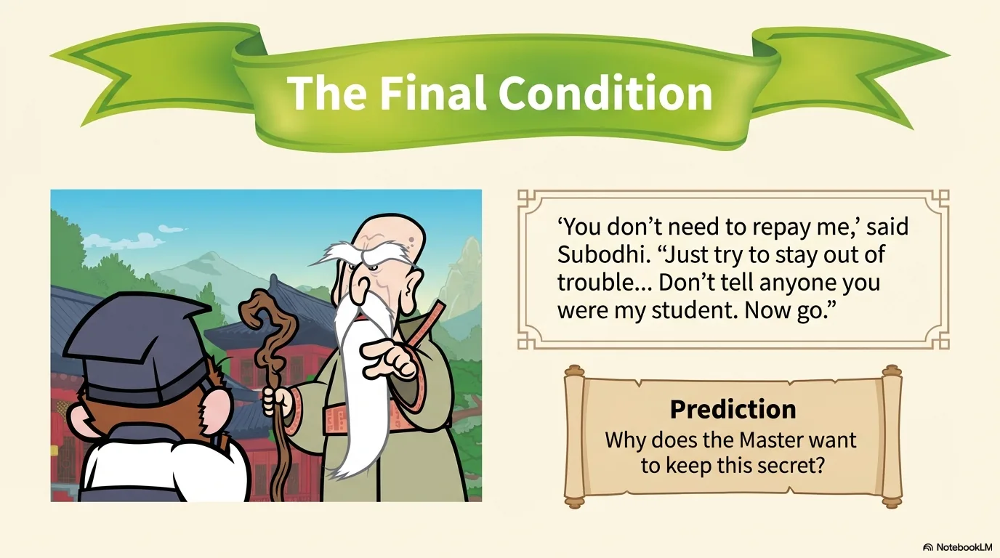

- 来源：`ppt/media/image16.png`（relationship `rId2`）
- 尺寸：1376×768
- 源 SHA-256：`cc4e9b4d335fa31e5558d63dfc2e0eab1ab54c5fc27245b050e5bfd98cb32d32`
- 输出 SHA-256：`06f36762f145b97155d0bd2dd9e438aa2947908727887549d76f10112d854ebd`
- 分类：unknown ｜ OCR：blocked ｜ 审核：unreviewed

## Slide 016

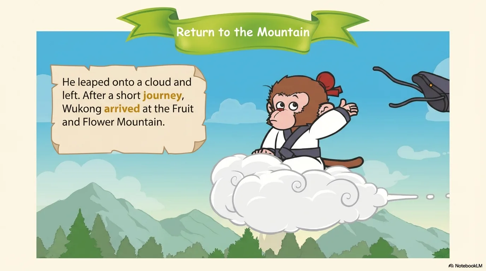

- 来源：`ppt/media/image17.png`（relationship `rId2`）
- 尺寸：1376×768
- 源 SHA-256：`4c5897a9455ce4c4f6d714a9a8fb073949458f3764ba7cee409ec96c3f6e53d5`
- 输出 SHA-256：`5d1a8e5675e00241340c04a7d1e8be50d91825ac2885b290e71b65fd890c6b8c`
- 分类：unknown ｜ OCR：blocked ｜ 审核：unreviewed

## Slide 017

- 来源：`ppt/media/image18.png`（relationship `rId2`）
- 尺寸：1376×768
- 源 SHA-256：`0b438a712e56c5c77da7ae13542deb09f5bf44aa9fca30369affd8c200eb00db`
- 输出 SHA-256：`e63d46dab51eb817789bc3aade7c79dea6c116e7cd64ea1810a968f9601c2b8a`
- 分类：unknown ｜ OCR：blocked ｜ 审核：unreviewed

## Slide 018

- 来源：`ppt/media/image19.png`（relationship `rId2`）
- 尺寸：1376×768
- 源 SHA-256：`48359b9e2c8b37f03b5da2865c0d185e79580128a8ae2f9961176bda250eb268`
- 输出 SHA-256：`4589554e2c3b5fcdad347c440d38a371de3aae884b1d137017798b0f43813273`
- 分类：unknown ｜ OCR：blocked ｜ 审核：unreviewed

## Slide 019

- 来源：`ppt/media/image20.png`（relationship `rId2`）
- 尺寸：1376×768
- 源 SHA-256：`598e3625a36d66a6900a0658fc24617f7cf7a823f4a258760f09330432872479`
- 输出 SHA-256：`8d1716dac942c0766ce70e3b1803e5a41ecf175f430ae68c58cca93e71f4d1f0`
- 分类：unknown ｜ OCR：blocked ｜ 审核：unreviewed

## Slide 020

- 来源：`ppt/media/image21.png`（relationship `rId2`）
- 尺寸：1376×768
- 源 SHA-256：`9a6d863093b0b4319764e823ec959149401ce176f134fa2fe56f69c830eaec54`
- 输出 SHA-256：`860d6e790a1807257eb13bd7304a7927c2b31c830c287820dfb6e04ceef7b141`
- 分类：unknown ｜ OCR：blocked ｜ 审核：unreviewed
