# 豆豆龙英语 · 第 5 集课件（EP005 草稿）

- 来源：`005_Journey to the West 5_The Demon of Chaos.pptx`（主课件，15 页）
- OCR：`blocked`（no local OCR provider importable (pytesseract missing): No module named 'pytesseract'）
- 分类：待人工审核（unknown）
- 审核状态：`unreviewed`

## Slide 001

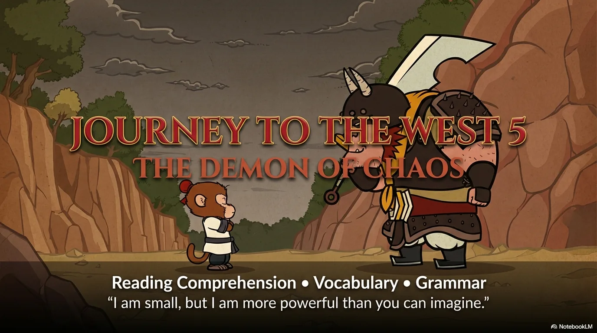

- 来源：`ppt/media/image1.png`（relationship `rId2`）
- 尺寸：1376×768
- 源 SHA-256：`bc2fdd086a40a8ef2a3f7cf60dbb023d7a82b201af9e6c6350d8526a335a74af`
- 输出 SHA-256：`5d848fff5a62d9a92e3180a57a176eb2db7948c04588cd730bb1fe47be552f9c`
- 分类：unknown ｜ OCR：blocked ｜ 审核：unreviewed

## Slide 002

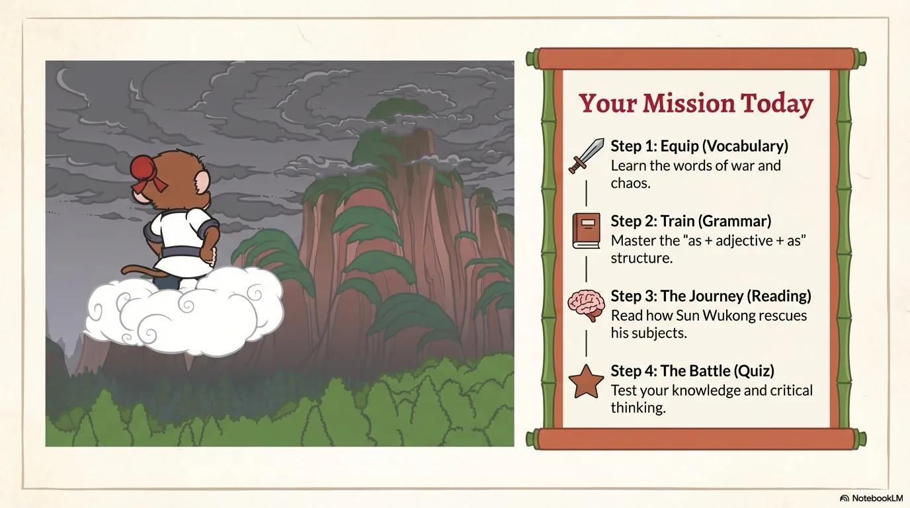

- 来源：`ppt/media/image3.png`（relationship `rId2`）
- 尺寸：1376×768
- 源 SHA-256：`99ca3ae8e34bfd2544c0de76846b48ec10ba9fb9167463e4241d1ffeba6af134`
- 输出 SHA-256：`e2cf38be6c693c69769a370a8fb4354ce1900d54e3a7de805c75ae1f2789ffe7`
- 分类：unknown ｜ OCR：blocked ｜ 审核：unreviewed

## Slide 003

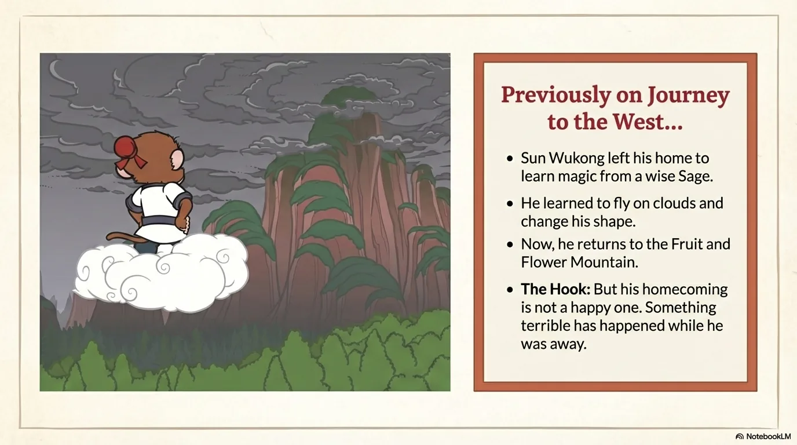

- 来源：`ppt/media/image4.png`（relationship `rId2`）
- 尺寸：1376×768
- 源 SHA-256：`081540d899ed920bd835353f3418cbcfe6c730144cf8126e50e76a7e7f70d26d`
- 输出 SHA-256：`8e4154183925d3f01a4af751ade38c1463493d6fa1aac43c32d8ffded19aa229`
- 分类：unknown ｜ OCR：blocked ｜ 审核：unreviewed

## Slide 004

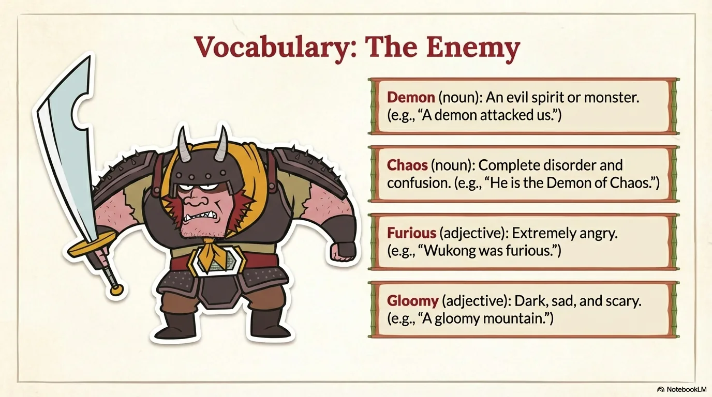

- 来源：`ppt/media/image5.png`（relationship `rId2`）
- 尺寸：1376×768
- 源 SHA-256：`22c77977ff95715a065b58a66105d793f4718d731dad164702d117dbc6c7db0c`
- 输出 SHA-256：`3c2ebf31ec1010a50cb49c85175414cde57217fa9436937b1dd4bdf450bfe5a4`
- 分类：unknown ｜ OCR：blocked ｜ 审核：unreviewed

## Slide 005

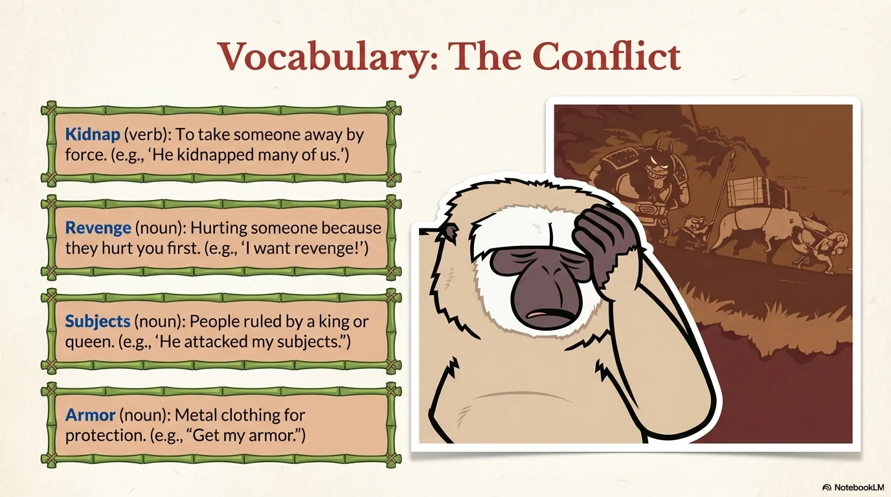

- 来源：`ppt/media/image6.png`（relationship `rId2`）
- 尺寸：1376×768
- 源 SHA-256：`14a2acd180f6a7b987f577aa37a1d553dd1256e385a9352a9e484b711371ff11`
- 输出 SHA-256：`3e8b4254101788365d87f45dbb71504c761498abab55c374adefb4edbc9dd968`
- 分类：unknown ｜ OCR：blocked ｜ 审核：unreviewed

## Slide 006

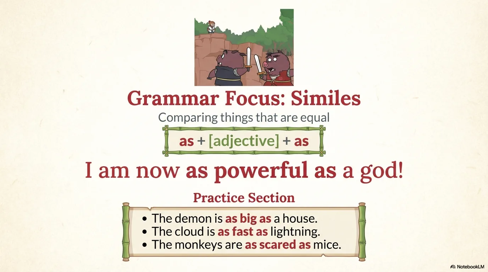

- 来源：`ppt/media/image7.png`（relationship `rId2`）
- 尺寸：1376×768
- 源 SHA-256：`5e5d909eb087f537dd2cab4c03ca1a770cdf1ca664bed59617d82bf23e7b07d6`
- 输出 SHA-256：`ac16bd897ed2f12d27caae6779139ab516291969cc94f1ebebf737688fa6ef2b`
- 分类：unknown ｜ OCR：blocked ｜ 审核：unreviewed

## Slide 007

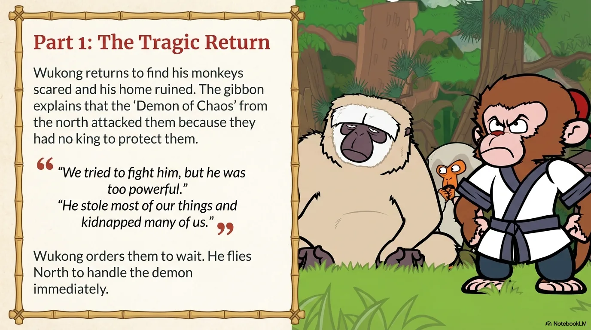

- 来源：`ppt/media/image8.png`（relationship `rId2`）
- 尺寸：1376×768
- 源 SHA-256：`453b22656cd142447897cf0328eb1e0471c98415057849d61a236cda34e92ece`
- 输出 SHA-256：`7ba63602eef20d2b4b934fb55b7b304998dbbe858a880abf7085e991e8cfea53`
- 分类：unknown ｜ OCR：blocked ｜ 审核：unreviewed

## Slide 008

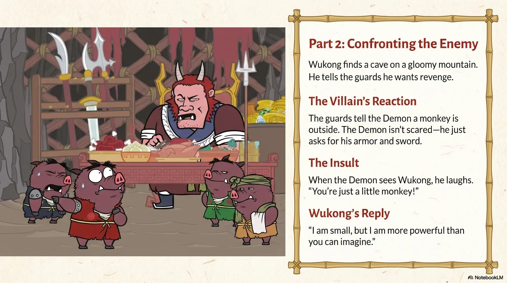

- 来源：`ppt/media/image9.png`（relationship `rId2`）
- 尺寸：1376×768
- 源 SHA-256：`7fffeeb28ecc4cf496b57c00b8f57de8de33ce4135c472db7ee8919f30f2dce8`
- 输出 SHA-256：`df0d33b5b97610c7a921480d56dc9dde488739bad1dc4aa4405eba2c46eca36e`
- 分类：unknown ｜ OCR：blocked ｜ 审核：unreviewed

## Slide 009

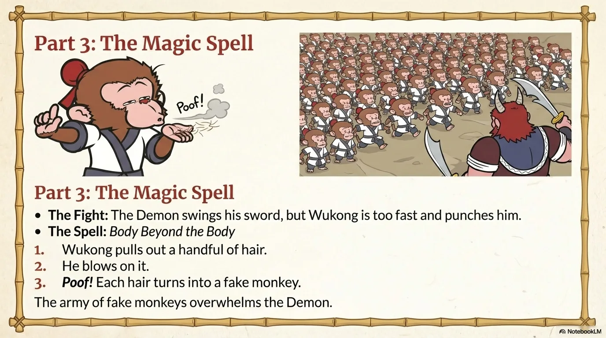

- 来源：`ppt/media/image10.png`（relationship `rId2`）
- 尺寸：1376×768
- 源 SHA-256：`d0a22bec3ccc9e8e0216934be8ba34cc50d8f540739ec677a51697c6761f876e`
- 输出 SHA-256：`97b8ce28e852881c22deccfdca7fc60bca8bad709ec2ccc7295d1565344a860b`
- 分类：unknown ｜ OCR：blocked ｜ 审核：unreviewed

## Slide 010

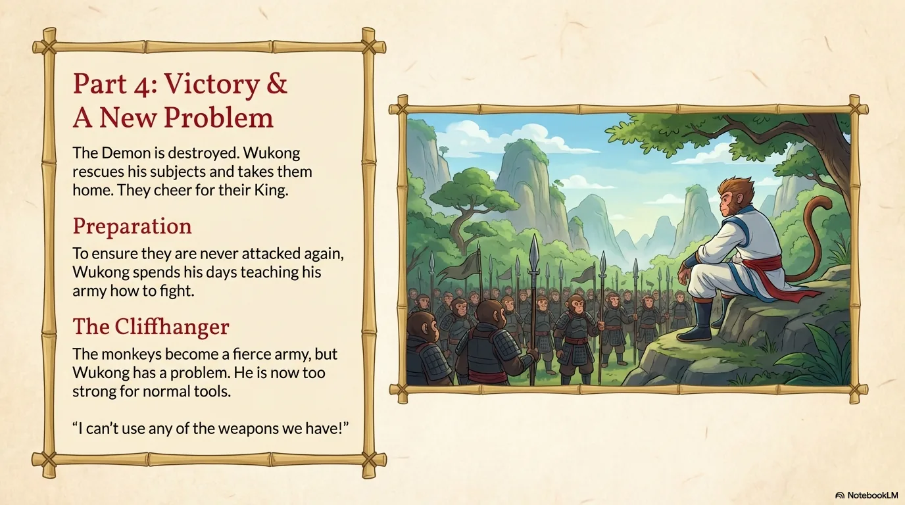

- 来源：`ppt/media/image11.png`（relationship `rId2`）
- 尺寸：1376×768
- 源 SHA-256：`526934744fd507eec160bb06662931bf0a6d91c1eba3ef6b5714b188ea93db3b`
- 输出 SHA-256：`ac1fe08ffe980ec4c06b590e206ed8942427d6a99797c431172f76b629db4af7`
- 分类：unknown ｜ OCR：blocked ｜ 审核：unreviewed

## Slide 011

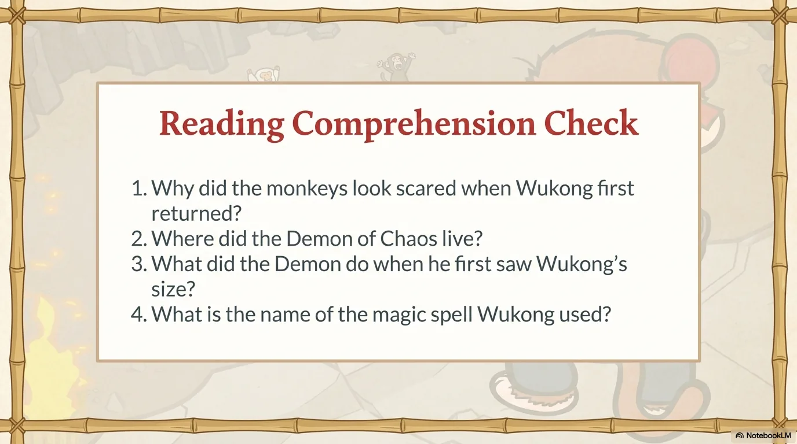

- 来源：`ppt/media/image12.png`（relationship `rId2`）
- 尺寸：1376×768
- 源 SHA-256：`0170c997bc7043caa245e47ed993156ecdf0ba957a6c7276719019b8d1a199ab`
- 输出 SHA-256：`60ab38306a5e8590cf807cebd00ad7832f321ba0a3643f71770b575a0e631347`
- 分类：unknown ｜ OCR：blocked ｜ 审核：unreviewed

## Slide 012

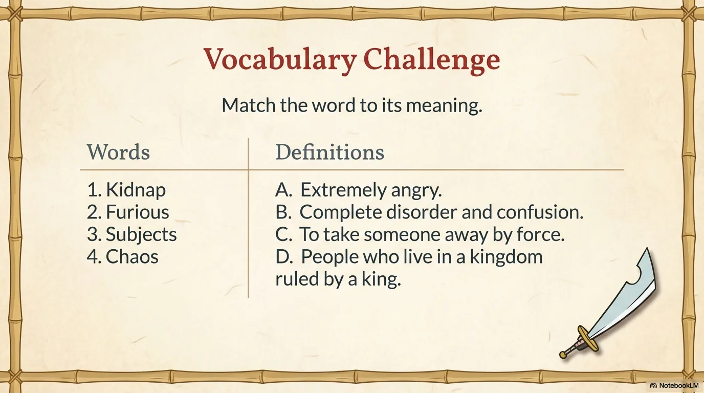

- 来源：`ppt/media/image13.png`（relationship `rId2`）
- 尺寸：1376×768
- 源 SHA-256：`53b3b80e81d413475b5458c0855a5e6e13dec12ba25aff99661a0fe10772cd07`
- 输出 SHA-256：`12ed86ec45c8ff2b7fc7dc3ecd832aa6c56740a33e0cec8b3199a1493d5cf41c`
- 分类：unknown ｜ OCR：blocked ｜ 审核：unreviewed

## Slide 013

- 来源：`ppt/media/image14.png`（relationship `rId2`）
- 尺寸：1376×768
- 源 SHA-256：`007a758217af00085e125c23d210242defc9613595805e88aac3262d73404767`
- 输出 SHA-256：`7388324dce8142117911e764ee798ce0c7ba1d60031ada5c02766a9f0cf16198`
- 分类：unknown ｜ OCR：blocked ｜ 审核：unreviewed

## Slide 014

- 来源：`ppt/media/image15.png`（relationship `rId2`）
- 尺寸：1376×768
- 源 SHA-256：`f83220690ad803a4aeeddbd8dbeed744523e0b5089f4bc1f566854afacfb1125`
- 输出 SHA-256：`dd3b2d360f55d4313ad7cc893d48484903006f8588846447f6fc4c2bbecba3db`
- 分类：unknown ｜ OCR：blocked ｜ 审核：unreviewed

## Slide 015

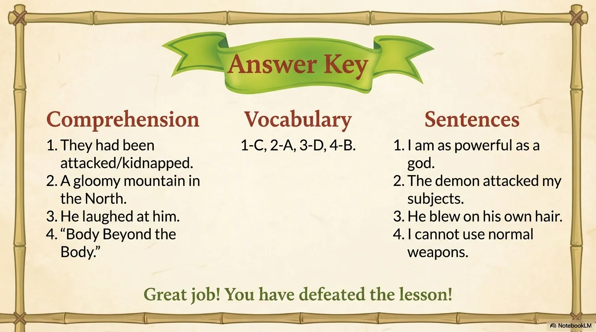

- 来源：`ppt/media/image16.png`（relationship `rId2`）
- 尺寸：1376×768
- 源 SHA-256：`8d7871f77cc9abd7724d7352dddb3d0f85f7e9b128a2102561245164d6cda1df`
- 输出 SHA-256：`289f88b4e42454158443f4d78d56b0204e4089877c869c8d833ff5b4886f3030`
- 分类：unknown ｜ OCR：blocked ｜ 审核：unreviewed
