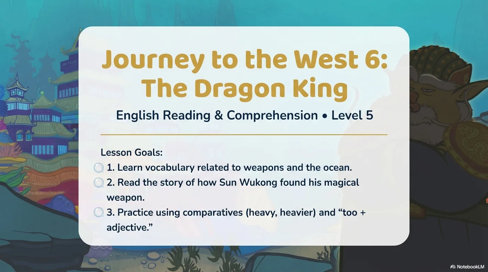
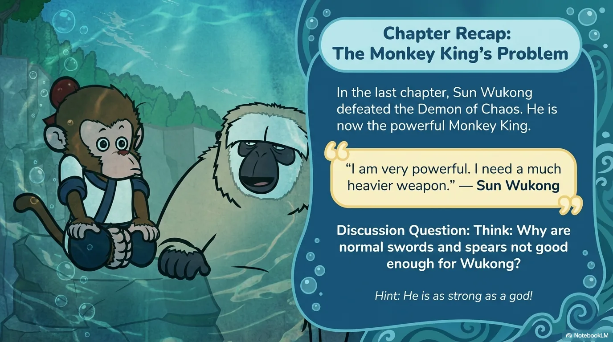
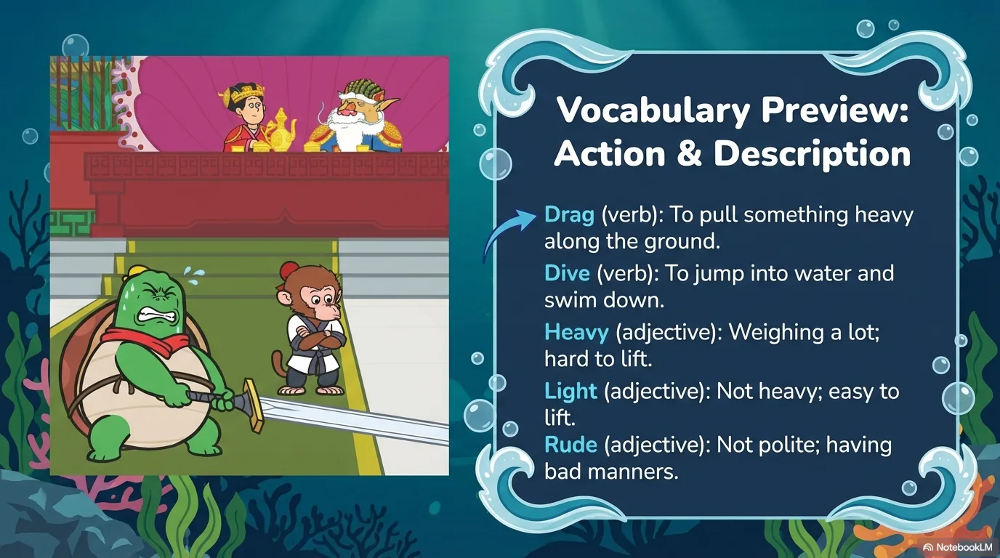
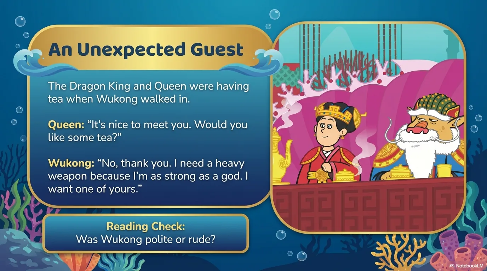
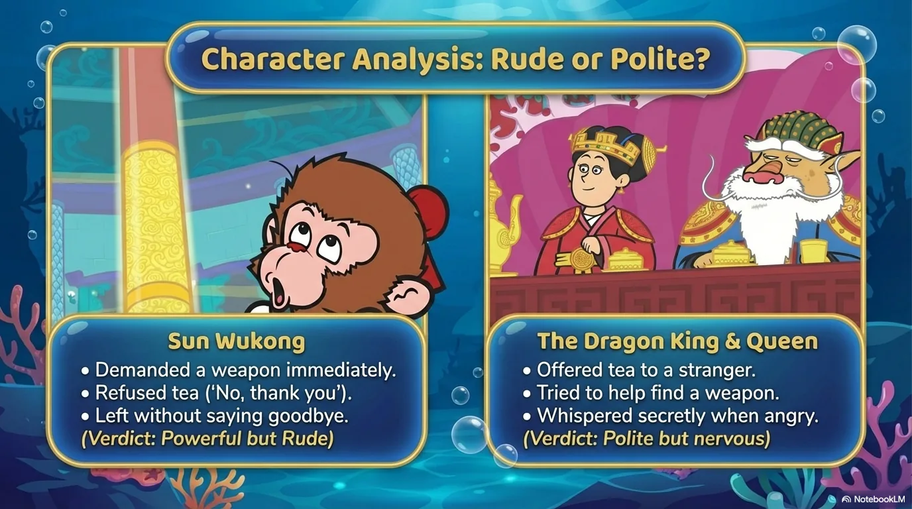
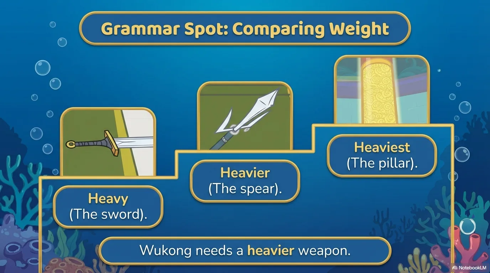
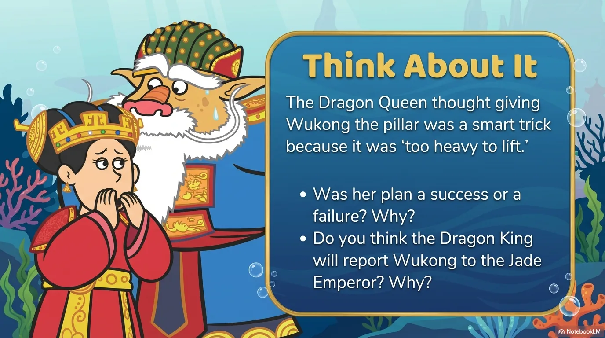
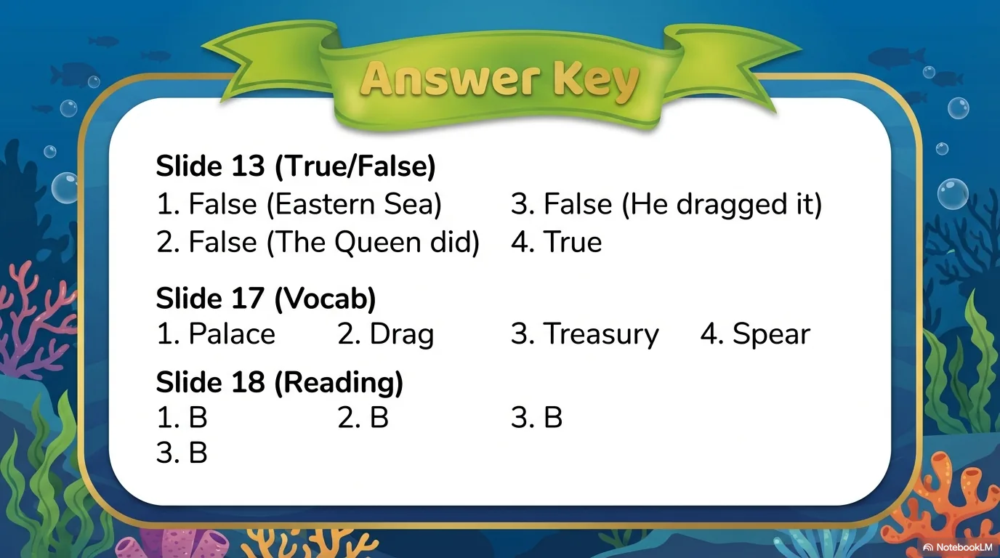

# 豆豆龙英语 · 第 6 集课件（EP006 草稿）

- 来源：`006_Journey to the West 6_The Dragon King.pptx`（主课件，20 页）
- OCR：`blocked`（no local OCR provider importable (pytesseract missing): No module named 'pytesseract'）
- 分类：待人工审核（unknown）
- 审核状态：`unreviewed`

## Slide 001

- 来源：`ppt/media/image1.png`（relationship `rId2`）
- 尺寸：1376×768
- 源 SHA-256：`c8fa8771146808e9fefe0d38141db2029838ee7b26a332e619e8037587656944`
- 输出 SHA-256：`910051d3025a849eb08855d075965e328e23267f8a63841ce10dab4d55e86064`
- 分类：unknown ｜ OCR：blocked ｜ 审核：unreviewed

## Slide 002

- 来源：`ppt/media/image3.png`（relationship `rId2`）
- 尺寸：1376×768
- 源 SHA-256：`92e22e1c57395541d2266ae7206aaf178f6c137b3a1884fde6783c7151c99042`
- 输出 SHA-256：`20b32c200bde2ef2c756e97dc23187284f610fd09c08ddef5f2ff55ccfc18b3a`
- 分类：unknown ｜ OCR：blocked ｜ 审核：unreviewed

## Slide 003

- 来源：`ppt/media/image4.png`（relationship `rId2`）
- 尺寸：1376×768
- 源 SHA-256：`c4ff649cc185b18ca68948f0250d0ab548529653552fe6523ab80a74f8e7c3e9`
- 输出 SHA-256：`cf6780cced65f03ac4f2589f083e7ad73e88c45428053596fbd1c5c7cbac46a9`
- 分类：unknown ｜ OCR：blocked ｜ 审核：unreviewed

## Slide 004

- 来源：`ppt/media/image5.png`（relationship `rId2`）
- 尺寸：1376×768
- 源 SHA-256：`8e372c1fd3f58c5d40680aa82f06da48dac0f9e983677ee7084ff3b560738ebd`
- 输出 SHA-256：`ef59744a3b1a0d6ee8eab72ecafa35cde29ab3e823748b4b92853e2d07610511`
- 分类：unknown ｜ OCR：blocked ｜ 审核：unreviewed

## Slide 005

- 来源：`ppt/media/image6.png`（relationship `rId2`）
- 尺寸：1376×768
- 源 SHA-256：`6193b047080689fc03b9533367ac9625515f63b2dfc7c0ca6f26a98e5a8fe682`
- 输出 SHA-256：`e545e294678ced6c0db0eceaef120ae05008f04634ce7794ca5d1ebe814e2360`
- 分类：unknown ｜ OCR：blocked ｜ 审核：unreviewed

## Slide 006

- 来源：`ppt/media/image7.png`（relationship `rId2`）
- 尺寸：1376×768
- 源 SHA-256：`3f8099bb151ca61d7f8f148aa3609c993c5fd0bf5b7aaa800915cb4052df82bb`
- 输出 SHA-256：`e05f37566b63ee00b54dd7237d5f329e2153248d263e01bef5db7e59d911bdbb`
- 分类：unknown ｜ OCR：blocked ｜ 审核：unreviewed

## Slide 007

- 来源：`ppt/media/image8.png`（relationship `rId2`）
- 尺寸：1376×768
- 源 SHA-256：`7834e268ef1bd39131c4ac63f6d597f213a930a4cf8d4aacefc3b45062bda1d1`
- 输出 SHA-256：`980113dfac0733ae67f5b8b6a71638cc2b837502d424e91c14792ce0ee11af29`
- 分类：unknown ｜ OCR：blocked ｜ 审核：unreviewed

## Slide 008

- 来源：`ppt/media/image9.png`（relationship `rId2`）
- 尺寸：1376×768
- 源 SHA-256：`e7fd7d0da5817e911937e865325b2aec6669a31cd267df947ef516f5fcf9315a`
- 输出 SHA-256：`5f167aa92fbd3dd6ec58cc1d589a19ee0b13077767aebce0d93d488df843c039`
- 分类：unknown ｜ OCR：blocked ｜ 审核：unreviewed

## Slide 009

- 来源：`ppt/media/image10.png`（relationship `rId2`）
- 尺寸：1376×768
- 源 SHA-256：`a0950bd27e4aa5b847e81303a87ccc04774f950f5a86d02987048b7da04dece4`
- 输出 SHA-256：`83984a34367f72d1b8b8d9812c3e40d52901ff99c724c0f9d182ac63b94dbeb7`
- 分类：unknown ｜ OCR：blocked ｜ 审核：unreviewed

## Slide 010

- 来源：`ppt/media/image11.png`（relationship `rId2`）
- 尺寸：1376×768
- 源 SHA-256：`61c1895d3b878894cfb9a238817c7955b6fafd6e366721a2fcd43d423dd0e84e`
- 输出 SHA-256：`bbb35ca0e11a264c488831df6f444f54464d9d8e13e34b95c228ab7263c0a78b`
- 分类：unknown ｜ OCR：blocked ｜ 审核：unreviewed

## Slide 011

- 来源：`ppt/media/image12.png`（relationship `rId2`）
- 尺寸：1376×768
- 源 SHA-256：`925fc02b5f25595e7fcdfeec33eb0147bb28c6c545f653b1ff4d73086250497c`
- 输出 SHA-256：`2e5b90a8ee7069572d8a64a17857ec7e810c4b86deee9ddc662e9ea8851f9e31`
- 分类：unknown ｜ OCR：blocked ｜ 审核：unreviewed

## Slide 012

- 来源：`ppt/media/image13.png`（relationship `rId2`）
- 尺寸：1376×768
- 源 SHA-256：`8c668e562eaf9fbb842acaddb17a3e70673ffcc2e7e44b659646acbb2135fd75`
- 输出 SHA-256：`82c3059b31b3b3e25b5157081727623cd0f96a4a436103dc9c1b2c1109d5bc57`
- 分类：unknown ｜ OCR：blocked ｜ 审核：unreviewed

## Slide 013

- 来源：`ppt/media/image14.png`（relationship `rId2`）
- 尺寸：1376×768
- 源 SHA-256：`9f1150c840aa135667a4606f45b4220d8a0ff6332c0bb94ad82c7553e729c428`
- 输出 SHA-256：`6ee81f55d5e2da142b697c39062d446b2aaf52793e304e965ec3e338ec619457`
- 分类：unknown ｜ OCR：blocked ｜ 审核：unreviewed

## Slide 014

- 来源：`ppt/media/image15.png`（relationship `rId2`）
- 尺寸：1376×768
- 源 SHA-256：`88450d4084adfd3d6f42b5e590074ea64fa61f03564e11e5a12182e4409257dd`
- 输出 SHA-256：`0280a6b8de848ae663ccab2eb88670c3fe277c8313b6efef23fb74c9268bb765`
- 分类：unknown ｜ OCR：blocked ｜ 审核：unreviewed

## Slide 015

- 来源：`ppt/media/image16.png`（relationship `rId2`）
- 尺寸：1376×768
- 源 SHA-256：`ec21d4c24c9bf33a0c781b7a9233b08d4e16ca859d8e5a798b21698f885ad253`
- 输出 SHA-256：`10c9f5a43687ea920b46fb6520010f506af67ad2d2b1084454a5f0ad8efbeaa1`
- 分类：unknown ｜ OCR：blocked ｜ 审核：unreviewed

## Slide 016

- 来源：`ppt/media/image17.png`（relationship `rId2`）
- 尺寸：1376×768
- 源 SHA-256：`b422c5bbc3fb262697f510e4efdfd4cfbbc8eb359c40161b217eccfef831a378`
- 输出 SHA-256：`5bc2b939985aff7ff451597858ac7475d19e4bc7c07031fadd1b3c0f179e67a2`
- 分类：unknown ｜ OCR：blocked ｜ 审核：unreviewed

## Slide 017

- 来源：`ppt/media/image18.png`（relationship `rId2`）
- 尺寸：1376×768
- 源 SHA-256：`5a7ea7e9e494709e093b1da50e4c6968ed3c36e17d5c131c3739f9ef8990ee46`
- 输出 SHA-256：`4cab60f75eb58513799e2f9197feac2eb673d16a7cc6708fabb81dfcd79d0836`
- 分类：unknown ｜ OCR：blocked ｜ 审核：unreviewed

## Slide 018

- 来源：`ppt/media/image19.png`（relationship `rId2`）
- 尺寸：1376×768
- 源 SHA-256：`6a0871acce2ee6860879153dfcf852232ac73de9be06105269ed579ea5d98d27`
- 输出 SHA-256：`b466ccca8a5cbf796f7576a1e406c427a5974884faa47e0aeef441c9082c4003`
- 分类：unknown ｜ OCR：blocked ｜ 审核：unreviewed

## Slide 019

- 来源：`ppt/media/image20.png`（relationship `rId2`）
- 尺寸：1376×768
- 源 SHA-256：`d0e8bd4caea14b1a1252df2c29687d12f6015f7ca4f5f75e70830cb5aa5cec77`
- 输出 SHA-256：`8d892197dd40f29137cb5cc5fcb6b3e5d5b165d1f5abb62020e95a01714031f9`
- 分类：unknown ｜ OCR：blocked ｜ 审核：unreviewed

## Slide 020

- 来源：`ppt/media/image21.png`（relationship `rId2`）
- 尺寸：1376×768
- 源 SHA-256：`5526e873b576e4dfa107fbbd6f218593f4e72380f72bbb1fffb0e5427b810872`
- 输出 SHA-256：`519d58fd1c0e2874d79b3d2b0d6cbbe955a13317d699a3909d1fd111bd05344d`
- 分类：unknown ｜ OCR：blocked ｜ 审核：unreviewed
