# 豆豆龙英语 · 第 7 集课件（EP007 草稿）

- 来源：`007_Journey to the West 7_The Land of Darkness.pptx`（主课件，20 页）
- OCR：`blocked`（no local OCR provider importable (pytesseract missing): No module named 'pytesseract'）
- 分类：待人工审核（unknown）
- 审核状态：`unreviewed`

## Slide 001

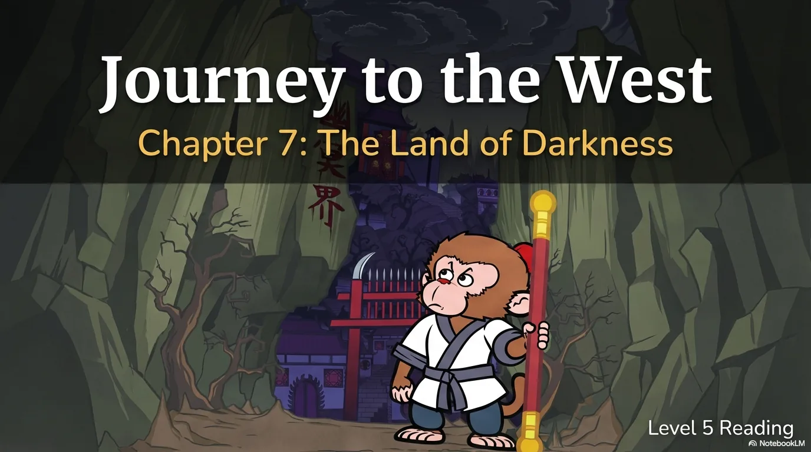

- 来源：`ppt/media/image1.png`（relationship `rId2`）
- 尺寸：1376×768
- 源 SHA-256：`17727722267e824fe0afa97728a2005411e5a0c585575cdf70981b14d409aef6`
- 输出 SHA-256：`5a802ed0d4d618a9bc3e2f27f9e9e3b18b2815cc339c9882fb1e39c3222d833e`
- 分类：unknown ｜ OCR：blocked ｜ 审核：unreviewed

## Slide 002

- 来源：`ppt/media/image3.png`（relationship `rId2`）
- 尺寸：1376×768
- 源 SHA-256：`174ed8c7391b13837347e48e82a28ac96f0045a1089ec3b0e800f5f22d3fc410`
- 输出 SHA-256：`eed54d5392d9c3532d9d8afbb52481fdf68319a7d0891fe4f4f53a2e5b88efe6`
- 分类：unknown ｜ OCR：blocked ｜ 审核：unreviewed

## Slide 003

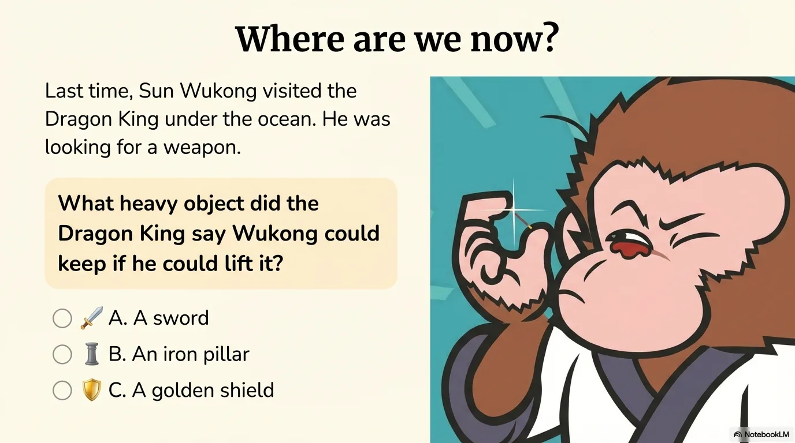

- 来源：`ppt/media/image4.png`（relationship `rId2`）
- 尺寸：1376×768
- 源 SHA-256：`89b57b00090c850e286a1caa227813d13ec5a43df16f03421192b04d551f33f6`
- 输出 SHA-256：`e51bf0588fe1b47ae96d51bc433335162672baba549bd491c36e46f9d1830c88`
- 分类：unknown ｜ OCR：blocked ｜ 审核：unreviewed

## Slide 004

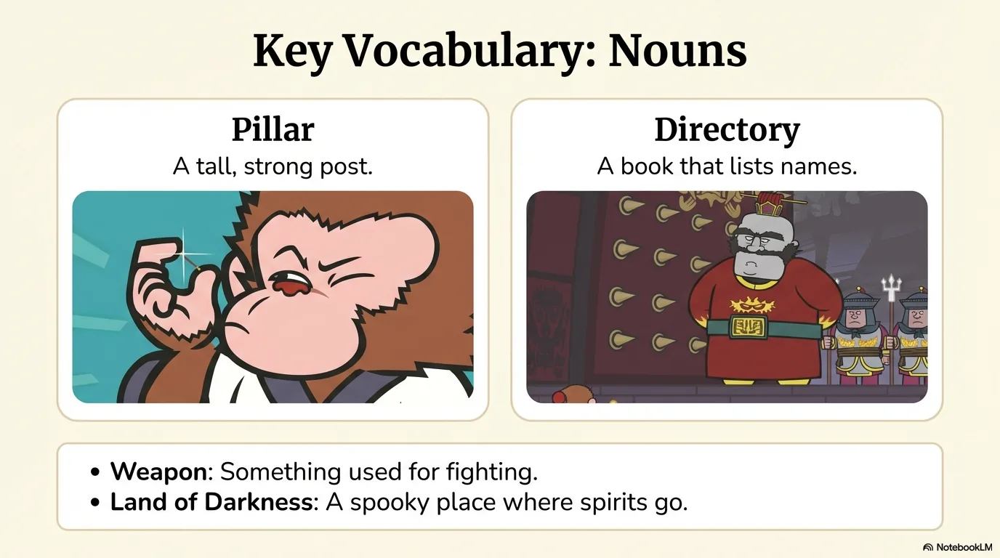

- 来源：`ppt/media/image5.png`（relationship `rId2`）
- 尺寸：1376×768
- 源 SHA-256：`f5cbd129a31a16460d9d209368a4d27d216080723ac0a2fca01795001186af28`
- 输出 SHA-256：`96bc1e37404f764a19fdb0b3d7e8e993bc11933576a9c49497b05a78ac9201e3`
- 分类：unknown ｜ OCR：blocked ｜ 审核：unreviewed

## Slide 005

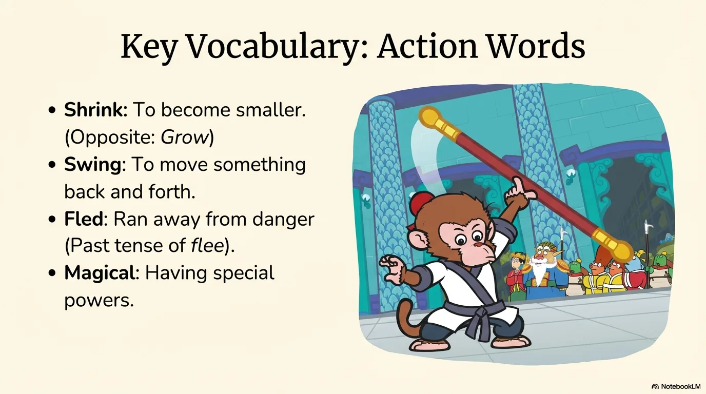

- 来源：`ppt/media/image6.png`（relationship `rId2`）
- 尺寸：1376×768
- 源 SHA-256：`51d041d271af723e1da28f6ed3d98d5623da909a909097708a142a888e2332dd`
- 输出 SHA-256：`cf154e4a934acb8ace198251e24341e917500984dd208a8cdfcd3bde30b780a7`
- 分类：unknown ｜ OCR：blocked ｜ 审核：unreviewed

## Slide 006

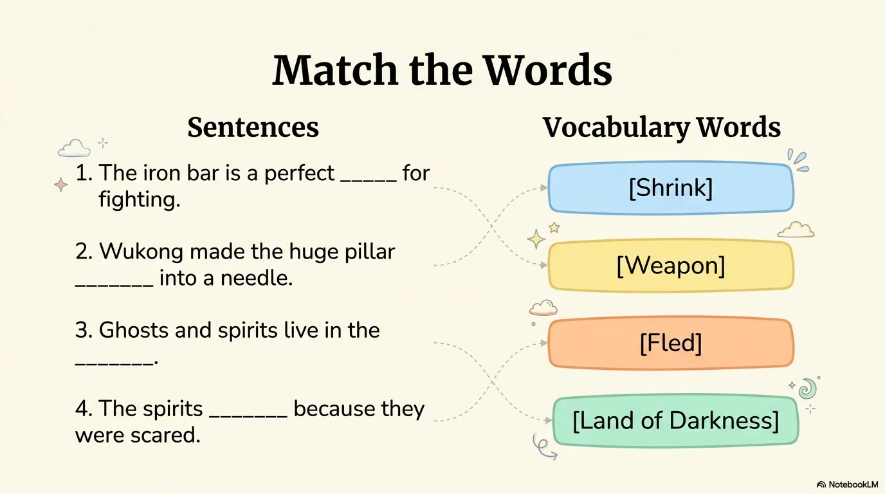

- 来源：`ppt/media/image7.png`（relationship `rId2`）
- 尺寸：1376×768
- 源 SHA-256：`99a628ee4d684b0759d97c9d2e42a1e80e3cef4579f99b17da031359a23b6dc9`
- 输出 SHA-256：`ba4ccda8f21ca597f1c4bfd03127953f5e91aac2344f19ae7c26378270c919cc`
- 分类：unknown ｜ OCR：blocked ｜ 审核：unreviewed

## Slide 007

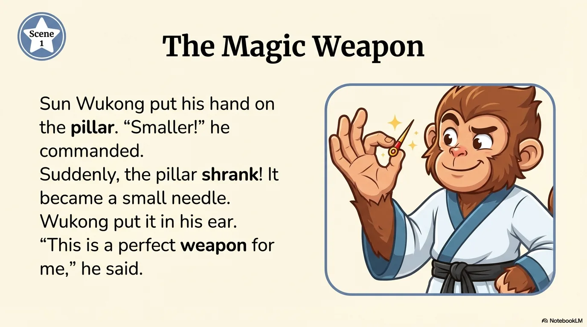

- 来源：`ppt/media/image8.png`（relationship `rId2`）
- 尺寸：1376×768
- 源 SHA-256：`1e86701569f26cba169f494ba36c572868dd9018f086f5c18f84ccd439cd1548`
- 输出 SHA-256：`1d2722de0805ed85cf073ec6f8ea7a5a450408a7f2426e0ed30a5a97a120625d`
- 分类：unknown ｜ OCR：blocked ｜ 审核：unreviewed

## Slide 008

- 来源：`ppt/media/image9.png`（relationship `rId2`）
- 尺寸：1376×768
- 源 SHA-256：`555772402b62146235ba848113d60c4afc7d11048b3cfa28fe92d513996d6a43`
- 输出 SHA-256：`5f53e5629a331fd17d7a71cf3332d390699a474323e4802d2d4874825dc8b13c`
- 分类：unknown ｜ OCR：blocked ｜ 审核：unreviewed

## Slide 009

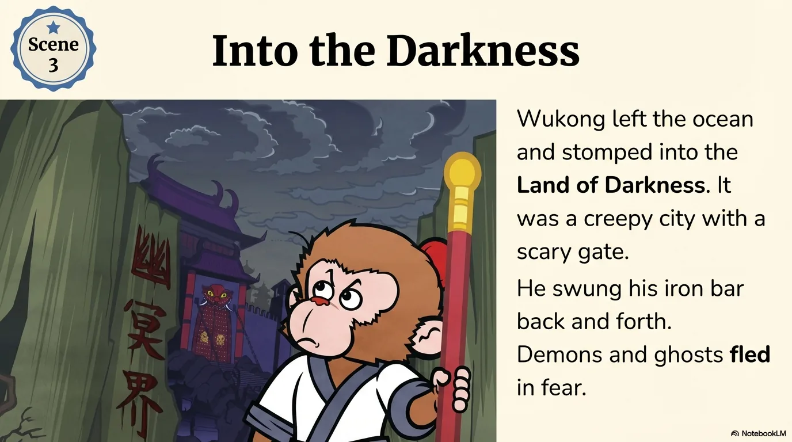

- 来源：`ppt/media/image10.png`（relationship `rId2`）
- 尺寸：1376×768
- 源 SHA-256：`53e026e2dd2c7525f89da0c78e7bd6ffd5ce0e6c53ac17d9569f496c4cf51baa`
- 输出 SHA-256：`90f1740fd012818e78c4d289363383031ffaf568c6909d0d40436695b0d2c386`
- 分类：unknown ｜ OCR：blocked ｜ 审核：unreviewed

## Slide 010

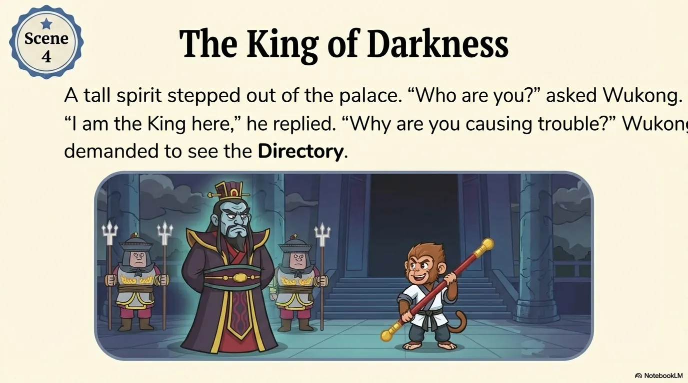

- 来源：`ppt/media/image11.png`（relationship `rId2`）
- 尺寸：1376×768
- 源 SHA-256：`d7766092d8f09e9a37b1faa6a7b1327a929010cb4c754a3bfdcdec2fc0753236`
- 输出 SHA-256：`c69538fef13ffdc6f53aca5a9b67df8971b3f91f622484c019354bd139dd64a0`
- 分类：unknown ｜ OCR：blocked ｜ 审核：unreviewed

## Slide 011

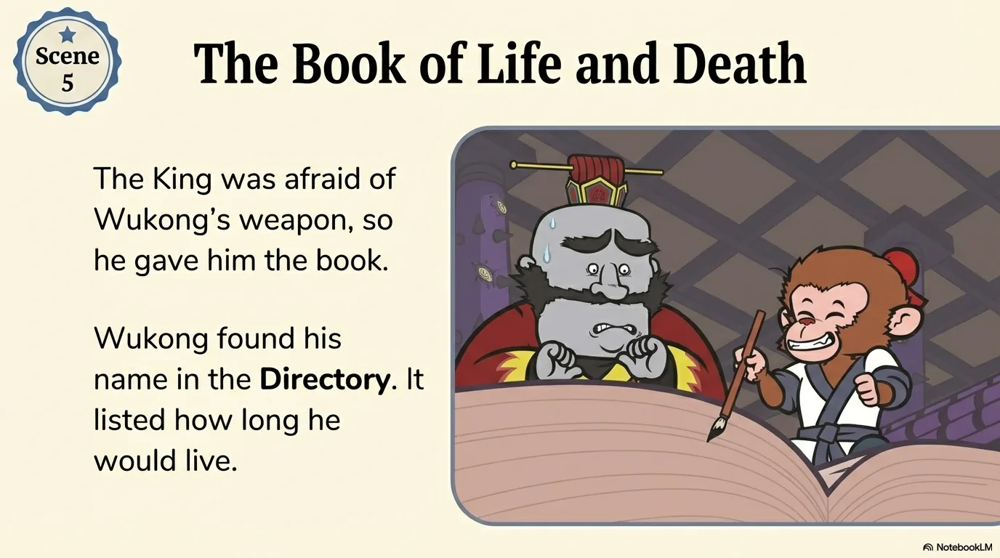

- 来源：`ppt/media/image12.png`（relationship `rId2`）
- 尺寸：1376×768
- 源 SHA-256：`0b77a305ac56da03d179469040ada76ae4253ef54c0f07f64c3f076c986d6a50`
- 输出 SHA-256：`3798fed976cbf8d884fb81f898ed5dfc8ae92b57fb9efca6469f50ecc0266b31`
- 分类：unknown ｜ OCR：blocked ｜ 审核：unreviewed

## Slide 012

- 来源：`ppt/media/image13.png`（relationship `rId2`）
- 尺寸：1376×768
- 源 SHA-256：`0b4f1b6046d710675cff0cf6826505cb41aa096143248fdca36cc9a351b9864f`
- 输出 SHA-256：`9c5eeb78c36ae871f504db4a93a09ccb52fe58b51014bdeee00362b10c95e617`
- 分类：unknown ｜ OCR：blocked ｜ 审核：unreviewed

## Slide 013

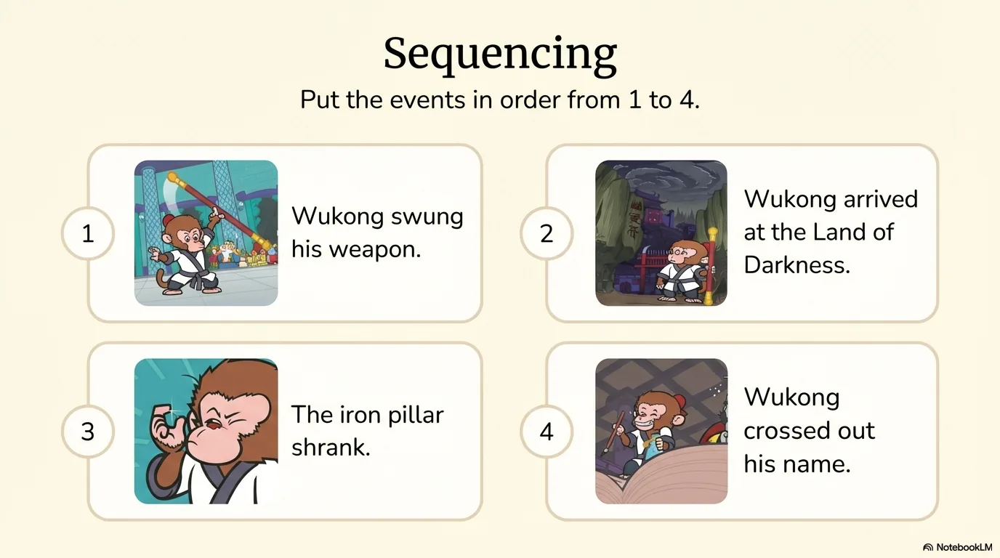

- 来源：`ppt/media/image14.png`（relationship `rId2`）
- 尺寸：1376×768
- 源 SHA-256：`2113daec7fa463b01cf074df056599e59882034beaa3bcf15c42ede802825eb1`
- 输出 SHA-256：`b58229ec9a86dc46a12313c54c6443e6263e21664351284f32b1375226584415`
- 分类：unknown ｜ OCR：blocked ｜ 审核：unreviewed

## Slide 014

- 来源：`ppt/media/image15.png`（relationship `rId2`）
- 尺寸：1376×768
- 源 SHA-256：`8347c524f196128629842d5ebb2b476150ab02dade701d10b53bfa16df9dcb4c`
- 输出 SHA-256：`302240a8692b36d623d7eeb8bd7823314b0192393ac7607dc28f2752fcd8c547`
- 分类：unknown ｜ OCR：blocked ｜ 审核：unreviewed

## Slide 015

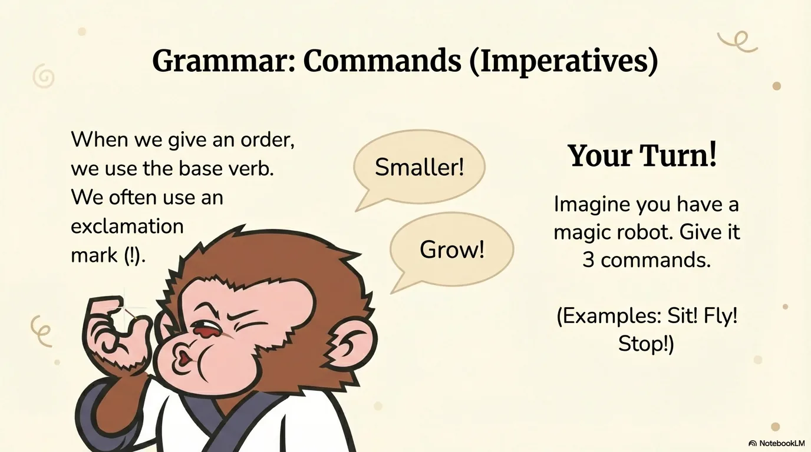

- 来源：`ppt/media/image16.png`（relationship `rId2`）
- 尺寸：1376×768
- 源 SHA-256：`d44db0d443880c3e1490b7b0cb172c854b74fb8cd8cdbb1fa2ba129ace4827c1`
- 输出 SHA-256：`551d8d7dae89f2901b0a3c4868ed581766cc34401ef5b0837a8c00113410119d`
- 分类：unknown ｜ OCR：blocked ｜ 审核：unreviewed

## Slide 016

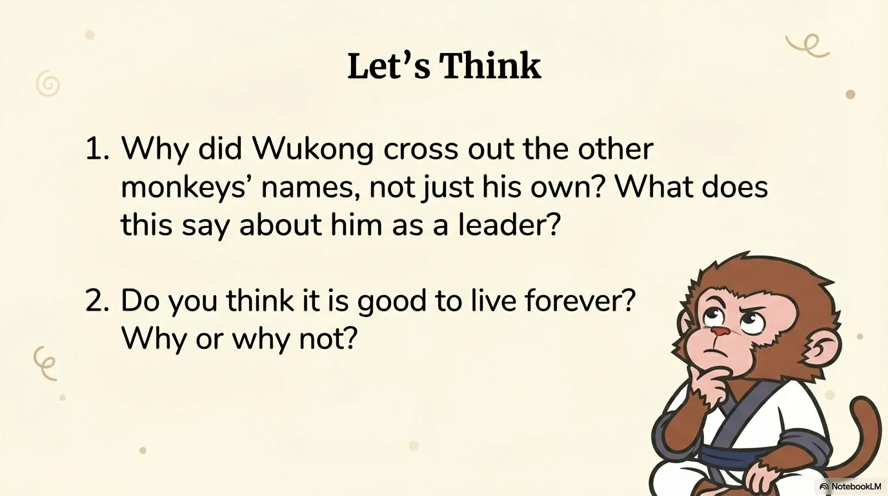

- 来源：`ppt/media/image17.png`（relationship `rId2`）
- 尺寸：1376×768
- 源 SHA-256：`369efb72132fe551263045d8dd75b35d33351078f8681023e99a671fd6e5838c`
- 输出 SHA-256：`47ac68d2ab6a6b45432c734f49319bb0560f6f22c36350d044346d4780a1929c`
- 分类：unknown ｜ OCR：blocked ｜ 审核：unreviewed

## Slide 017

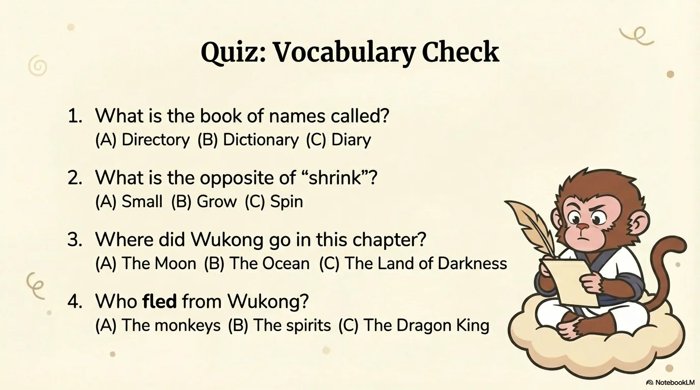

- 来源：`ppt/media/image18.png`（relationship `rId2`）
- 尺寸：1376×768
- 源 SHA-256：`2a79e69b31e4f5035f3dfe7b248de7103ac61c4cad84cce5411fcd4dca1cb8eb`
- 输出 SHA-256：`2702e85cd6283a0c54210ceb4b51aa921dacfa3e6cdc515c496c00647b0b0270`
- 分类：unknown ｜ OCR：blocked ｜ 审核：unreviewed

## Slide 018

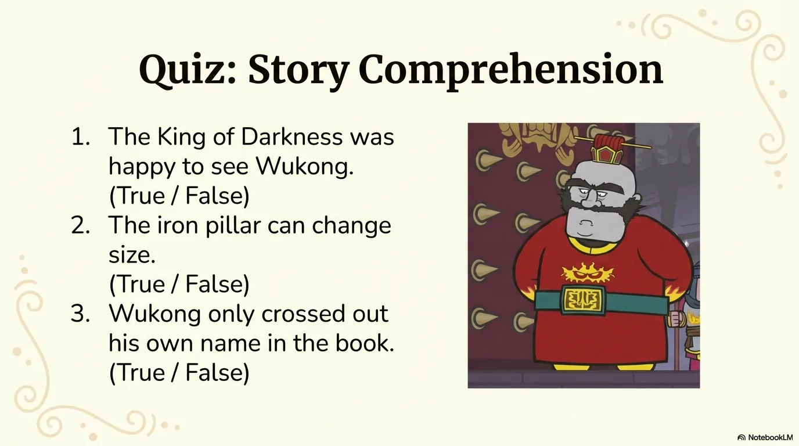

- 来源：`ppt/media/image19.png`（relationship `rId2`）
- 尺寸：1376×768
- 源 SHA-256：`c1c6ae1cc7800422697e7380bcdf46c95d440e6f23986ac3a69c2d22c2ece569`
- 输出 SHA-256：`56160d13127ffc3a82d764627ac4856bd002fae6c82057987aaf1aaeb7834698`
- 分类：unknown ｜ OCR：blocked ｜ 审核：unreviewed

## Slide 019

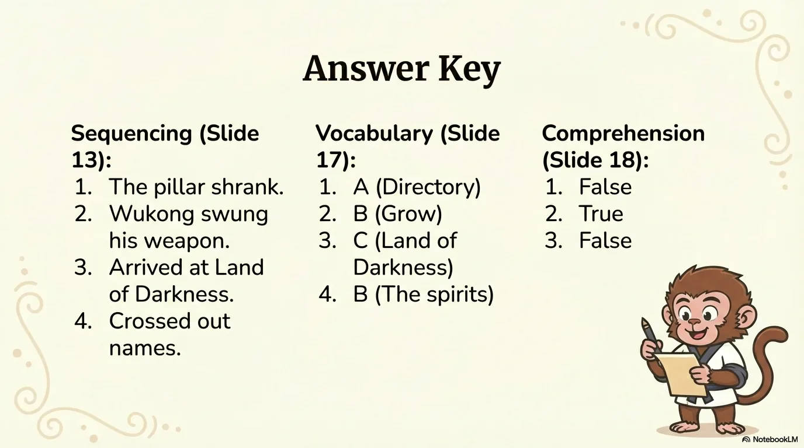

- 来源：`ppt/media/image20.png`（relationship `rId2`）
- 尺寸：1376×768
- 源 SHA-256：`9ea9a22190ee532eb399172bc6dd62d761bde3ed9133f1909443a74672186eb2`
- 输出 SHA-256：`d12b5a7caac474eefee8ae0dfcc352152a4d4718b99c800015486827638a9298`
- 分类：unknown ｜ OCR：blocked ｜ 审核：unreviewed

## Slide 020

- 来源：`ppt/media/image21.png`（relationship `rId2`）
- 尺寸：1376×768
- 源 SHA-256：`81474797ed35bb627c573cc82c9e3621821857b115b9db7a75f7ef20d27a7da9`
- 输出 SHA-256：`12133cf6eb46419023d45b35228236955ece0b1cb1481445cfccca46c3cb3e67`
- 分类：unknown ｜ OCR：blocked ｜ 审核：unreviewed
