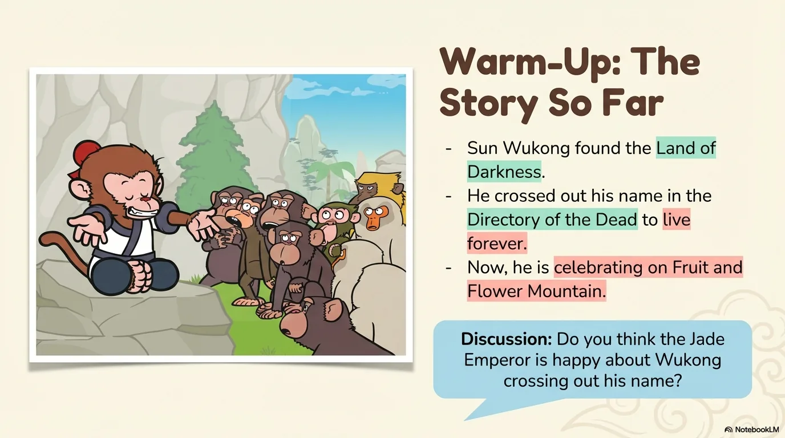
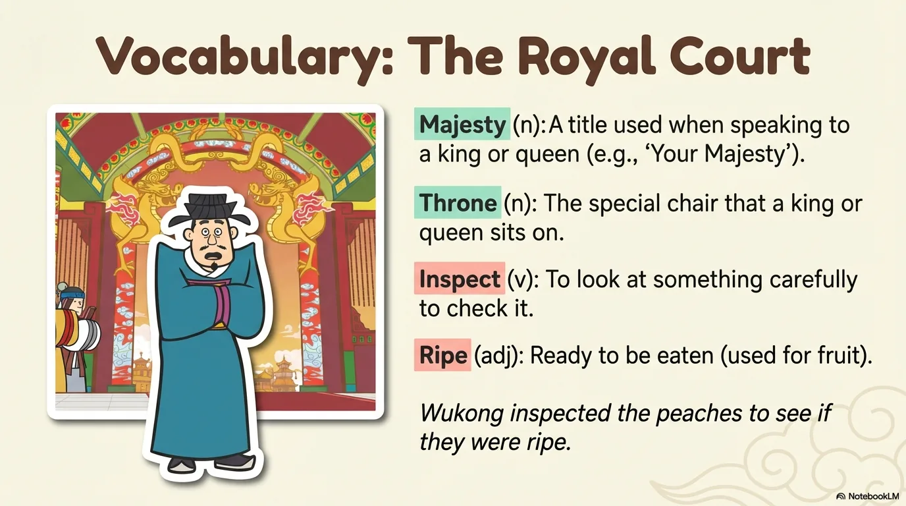
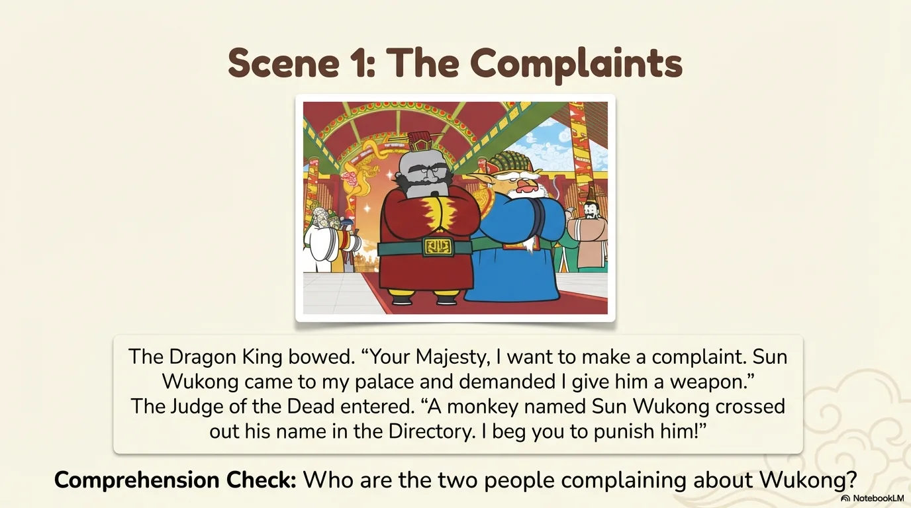
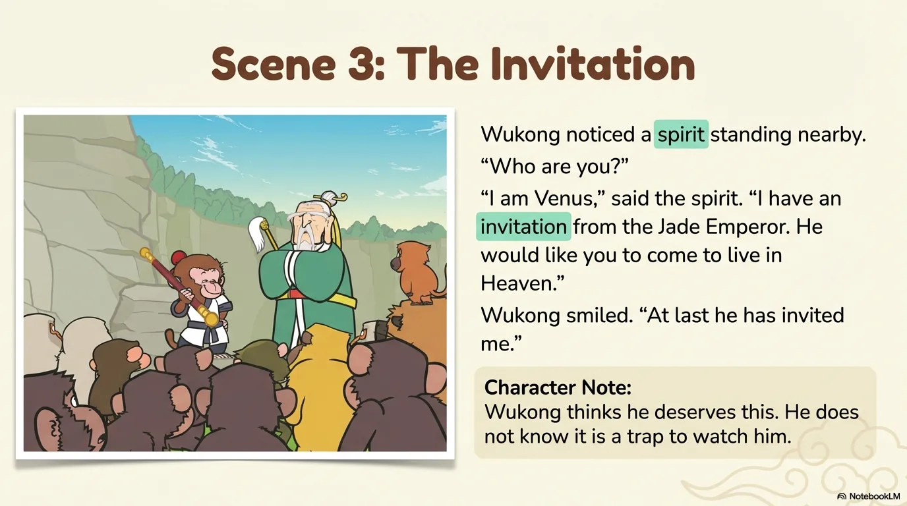
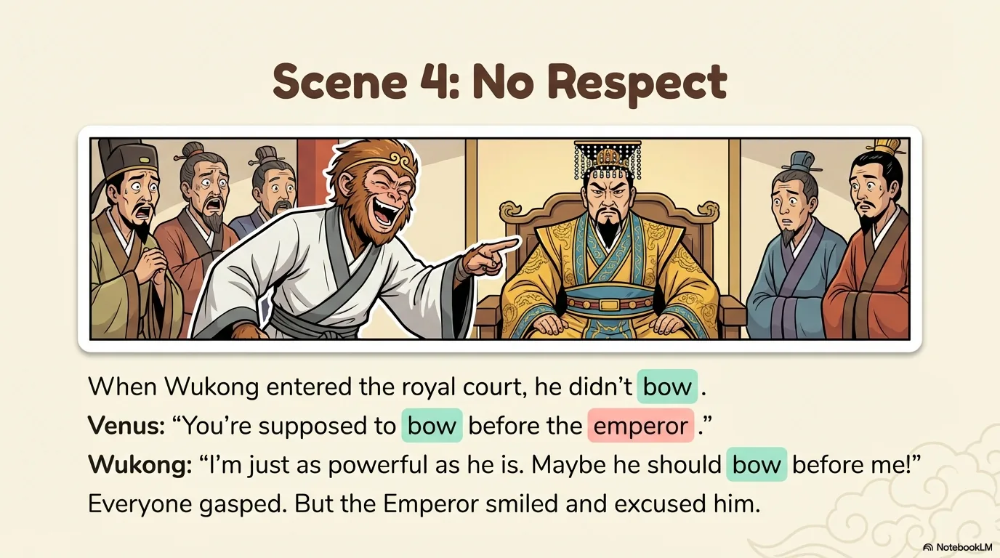
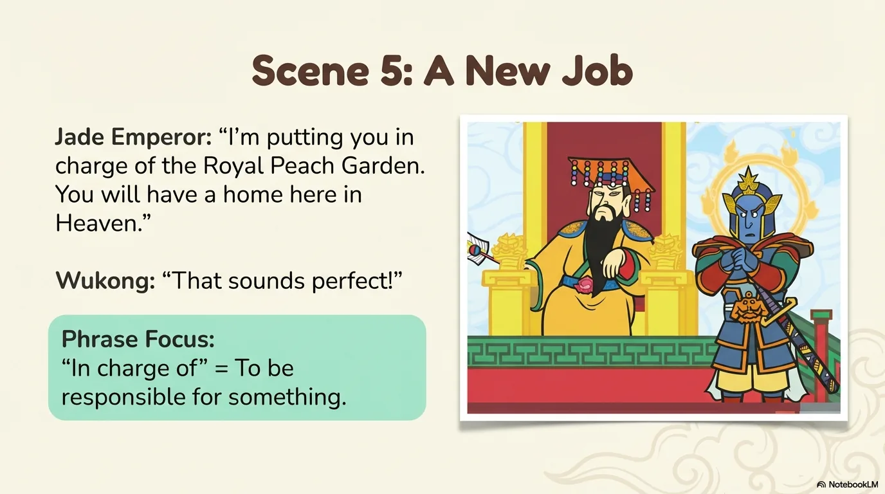
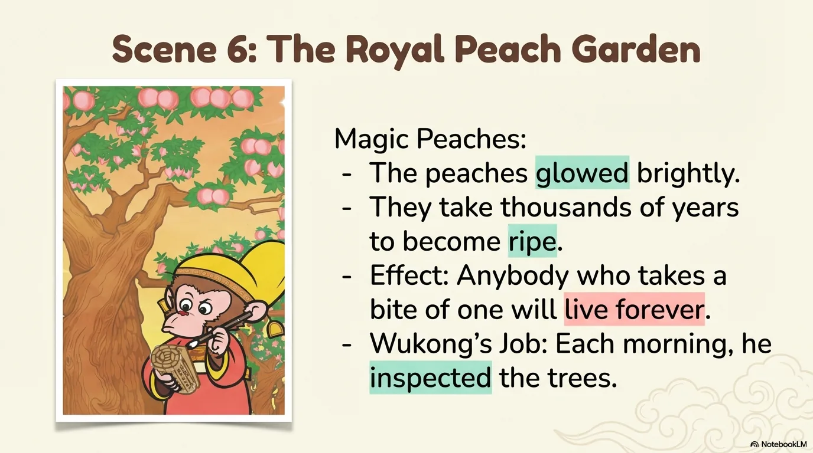
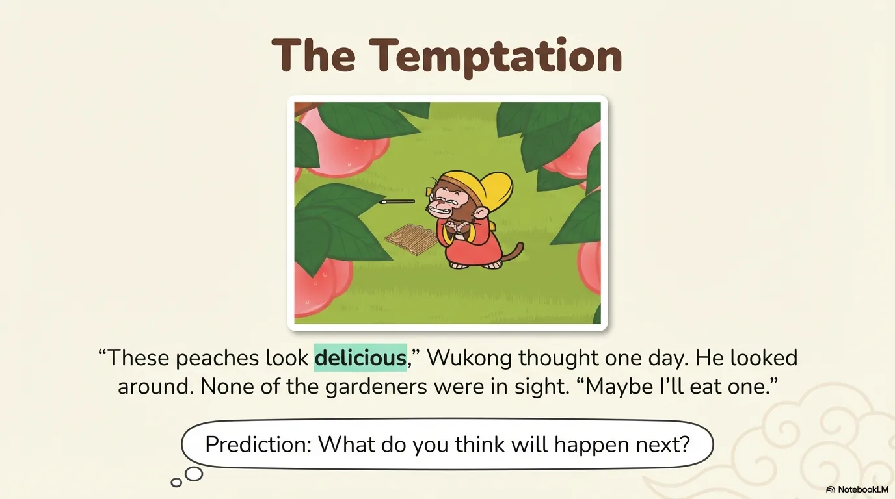
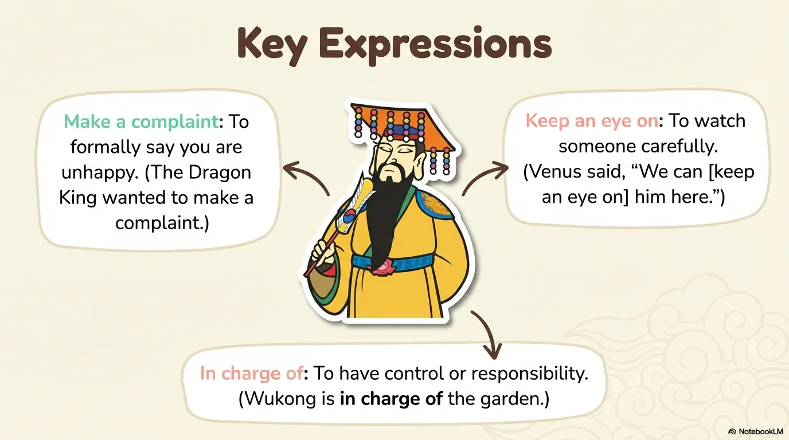
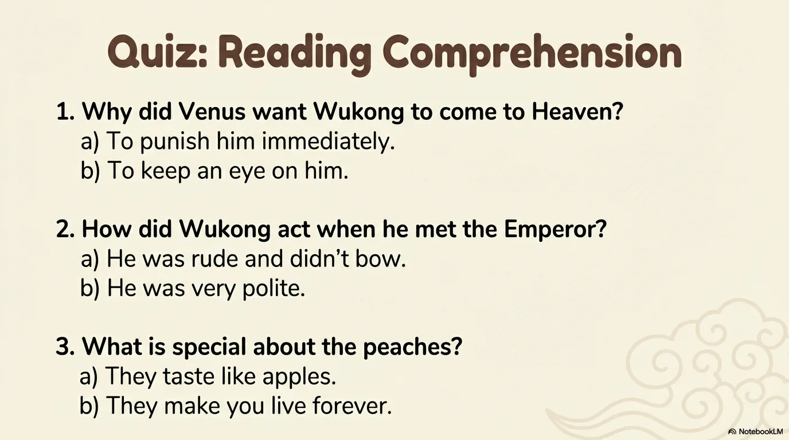

# 豆豆龙英语 · 第 8 集课件（EP008 草稿）

- 来源：`008_Journey to the West 8_A Job in Heaven.pptx`（主课件，17 页）
- OCR：`blocked`（no local OCR provider importable (pytesseract missing): No module named 'pytesseract'）
- 分类：待人工审核（unknown）
- 审核状态：`unreviewed`

## Slide 001

- 来源：`ppt/media/image1.png`（relationship `rId2`）
- 尺寸：1376×768
- 源 SHA-256：`774f9195b28c70b03df3640a0d25a716b7e32570aeb09e88d510ece1a6eac932`
- 输出 SHA-256：`ed0ce695711f370c4b7e6fefac23387494ad339b35982a95cb52e48634dcaa0a`
- 分类：unknown ｜ OCR：blocked ｜ 审核：unreviewed

## Slide 002

- 来源：`ppt/media/image3.png`（relationship `rId2`）
- 尺寸：1376×768
- 源 SHA-256：`03da3a4d1894795fb470309533f8791d4c92bf95063017ea2d080a00af6cbd05`
- 输出 SHA-256：`8dcac6559e0decea8dd861f3e37530ab3152cc969b067c55c497554b9cbd4d8a`
- 分类：unknown ｜ OCR：blocked ｜ 审核：unreviewed

## Slide 003

- 来源：`ppt/media/image4.png`（relationship `rId2`）
- 尺寸：1376×768
- 源 SHA-256：`6dd77c143e1bc72e6ea31133915f28bca4bd20b3891b5e4e66e970a96afcdbf3`
- 输出 SHA-256：`9b6e4342e40dc9273128dc8edc96770ac34b512b1c62b27136885f911eda6fb6`
- 分类：unknown ｜ OCR：blocked ｜ 审核：unreviewed

## Slide 004

- 来源：`ppt/media/image5.png`（relationship `rId2`）
- 尺寸：1376×768
- 源 SHA-256：`8773abbb04611246869bc97f6c979872fb0e87c52999d4a51dff29401ea38465`
- 输出 SHA-256：`beb0233aaf0b454195c51517e61b57c8226b59c305647ebf4677bae5edffb996`
- 分类：unknown ｜ OCR：blocked ｜ 审核：unreviewed

## Slide 005

- 来源：`ppt/media/image6.png`（relationship `rId2`）
- 尺寸：1376×768
- 源 SHA-256：`88ff14f57dd299fc4f272ff1d30fc8d2483b103692a66a1b8ffcc11e165100ce`
- 输出 SHA-256：`42acf94a3645f9d84e7b131c549cb3d0b66f991536c47ad49bd7a063442ed2f9`
- 分类：unknown ｜ OCR：blocked ｜ 审核：unreviewed

## Slide 006

- 来源：`ppt/media/image7.png`（relationship `rId2`）
- 尺寸：1376×768
- 源 SHA-256：`cf6b58783cdc1574604f61c4de9d656e5c3f9348541b9799b66b11960a180097`
- 输出 SHA-256：`3d1e68173a6782c23ac7ada84ba15847bd8d7b3c3f12dcfbb3e3b0a20280d2be`
- 分类：unknown ｜ OCR：blocked ｜ 审核：unreviewed

## Slide 007

- 来源：`ppt/media/image8.png`（relationship `rId2`）
- 尺寸：1376×768
- 源 SHA-256：`e2ddbe957b37c86e78b84b930c30f5e7bd79665278c42922b6918b3663ca7378`
- 输出 SHA-256：`7ef4b6c8206a7069369d3b3b92e69d70d1952bb3d9f37bbb96994306d7eb2286`
- 分类：unknown ｜ OCR：blocked ｜ 审核：unreviewed

## Slide 008

- 来源：`ppt/media/image9.png`（relationship `rId2`）
- 尺寸：1376×768
- 源 SHA-256：`b54ab044bbf84ade1b5d32f5bedc5c86a54b9d2e468bff081a4c38c85165c357`
- 输出 SHA-256：`5cef89812d9aa1ba5619015b8c871c7fb2d7bf709eac502bc3dacacc4bcb42bb`
- 分类：unknown ｜ OCR：blocked ｜ 审核：unreviewed

## Slide 009

- 来源：`ppt/media/image10.png`（relationship `rId2`）
- 尺寸：1376×768
- 源 SHA-256：`58264c3340c10253f901039d8e1ab3ae21574fc06db487cb16af550c3cf7ebae`
- 输出 SHA-256：`1701aaa6aa0cf7119b5e6b449e064a63dd27c282dec42f4ccbf3d76e015466a9`
- 分类：unknown ｜ OCR：blocked ｜ 审核：unreviewed

## Slide 010

- 来源：`ppt/media/image11.png`（relationship `rId2`）
- 尺寸：1376×768
- 源 SHA-256：`aba7470fcf96108f32c59685112186ce040dd05017c9c313a415b532d75261c6`
- 输出 SHA-256：`1dc099b4d3f36c93d3dc763b050d9d3be2745fc2a0f4d882e7597d9680e494a9`
- 分类：unknown ｜ OCR：blocked ｜ 审核：unreviewed

## Slide 011

- 来源：`ppt/media/image12.png`（relationship `rId2`）
- 尺寸：1376×768
- 源 SHA-256：`5f74098ce3acbf953c664695205028a7a58ad5974f3a135065483ae046120c6c`
- 输出 SHA-256：`af453acb6ed7463332e6224f55f35888bc98fe02b9098b56654fe32b658d7bc4`
- 分类：unknown ｜ OCR：blocked ｜ 审核：unreviewed

## Slide 012

- 来源：`ppt/media/image13.png`（relationship `rId2`）
- 尺寸：1376×768
- 源 SHA-256：`368b11c64b42b3cf7c207d0fef462b1d8509967e6d3632fab51c9509634e508a`
- 输出 SHA-256：`a18b3b921f1fcca186927314a6b87d602a8ebb6af5974810f90c88fa716380e2`
- 分类：unknown ｜ OCR：blocked ｜ 审核：unreviewed

## Slide 013

- 来源：`ppt/media/image14.png`（relationship `rId2`）
- 尺寸：1376×768
- 源 SHA-256：`f3a62ba08e514adc20aec4e55e38eef7574fd9c25eadeac32d27d0f0a1ba7c14`
- 输出 SHA-256：`0b5ec6e38c4d83a34a0904ef906ae6969dc30553d7f3d4a9f0796c1d15a22669`
- 分类：unknown ｜ OCR：blocked ｜ 审核：unreviewed

## Slide 014

- 来源：`ppt/media/image15.png`（relationship `rId2`）
- 尺寸：1376×768
- 源 SHA-256：`3378d27bb20ae8094ec045887343308d1e64f95d9fd158f652cac2bae1ecbd5f`
- 输出 SHA-256：`2785c4039e18dff6ebe4682f7863994098509f5b45cac7d7723cb5955622e7a1`
- 分类：unknown ｜ OCR：blocked ｜ 审核：unreviewed

## Slide 015

- 来源：`ppt/media/image16.png`（relationship `rId2`）
- 尺寸：1376×768
- 源 SHA-256：`9e6a23b1612403140cf7644e574bf70423e13fcde1c6598ce8e8988125ed62a4`
- 输出 SHA-256：`a7f6bdc802f429c1d0d045b243d21949342691df6747401389bba15eba9b1e9b`
- 分类：unknown ｜ OCR：blocked ｜ 审核：unreviewed

## Slide 016

- 来源：`ppt/media/image17.png`（relationship `rId2`）
- 尺寸：1376×768
- 源 SHA-256：`27e53c855226bd04b5e5521e74a9719ce54bd91fba27991c50ecf37ad8dcf5d3`
- 输出 SHA-256：`aac1de3b7011e25fc04a7a1dab6a134a3f51acd1ec36679fe15091d641439189`
- 分类：unknown ｜ OCR：blocked ｜ 审核：unreviewed

## Slide 017

- 来源：`ppt/media/image18.png`（relationship `rId2`）
- 尺寸：1376×768
- 源 SHA-256：`7a0d95d89611d558141a6430af0c3483943cee3b12d7914554e061bb4b6683e4`
- 输出 SHA-256：`57ad4fb216e2fdf4c47c1d9a9956660a74395032701fb4fe4de191433eb17cdd`
- 分类：unknown ｜ OCR：blocked ｜ 审核：unreviewed
