# 豆豆龙英语 · 第 9 集课件（EP009 草稿）

- 来源：`009_Journey to the West 9_The Peach Garden.pptx`（主课件，20 页）
- OCR：`blocked`（no local OCR provider importable (pytesseract missing): No module named 'pytesseract'）
- 分类：待人工审核（unknown）
- 审核状态：`unreviewed`

## Slide 001

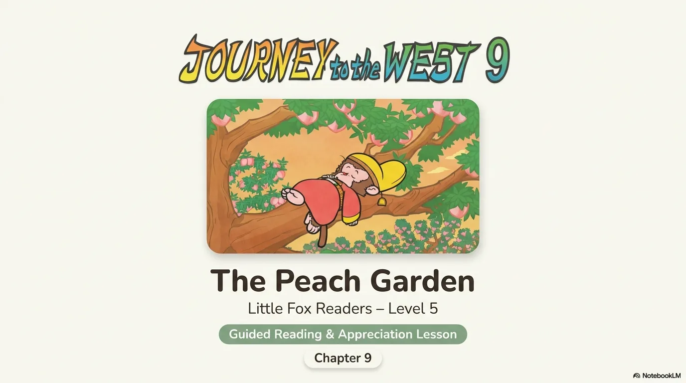

- 来源：`ppt/media/image1.png`（relationship `rId2`）
- 尺寸：1376×768
- 源 SHA-256：`97f3c399e576786f34bbaea394d29b806e132a2cb18f88d43469fb3b68948d98`
- 输出 SHA-256：`378be79c1aed602cb67538a50cd825ab7a03ab769f9211ee7758e42b94679e22`
- 分类：unknown ｜ OCR：blocked ｜ 审核：unreviewed

## Slide 002

- 来源：`ppt/media/image3.png`（relationship `rId2`）
- 尺寸：1376×768
- 源 SHA-256：`2190dec3119ab40d74c928ff23a0ddc4eb32c091271b7d4d3885785f41d6afa3`
- 输出 SHA-256：`d1c31b0cc665227cc0d01abecbd0b13f050a0bd732f89c682e441854e600bf56`
- 分类：unknown ｜ OCR：blocked ｜ 审核：unreviewed

## Slide 003

- 来源：`ppt/media/image4.png`（relationship `rId2`）
- 尺寸：1376×768
- 源 SHA-256：`df9ffd3c871aa526bd6a995b6e897b9319ffa60b14e5555a4e817a394c0d62d3`
- 输出 SHA-256：`4a203ec195b98dc45219c62494c2131ed0214d50bdbb2feebe17f6c819c6bb00`
- 分类：unknown ｜ OCR：blocked ｜ 审核：unreviewed

## Slide 004

- 来源：`ppt/media/image5.png`（relationship `rId2`）
- 尺寸：1376×768
- 源 SHA-256：`0dc6600fa71b1b69f10cb3a443a1001fc5f001ef4d34d919c5de8b6bcdb815f6`
- 输出 SHA-256：`5024e722b952bda313107fabcd68ecafefacaf053b286fde15f5a20103e8f5e5`
- 分类：unknown ｜ OCR：blocked ｜ 审核：unreviewed

## Slide 005

- 来源：`ppt/media/image6.png`（relationship `rId2`）
- 尺寸：1376×768
- 源 SHA-256：`b9886c8f2275d95bafba0932299f12ce7f44f294bf31536758e8e69a58a68260`
- 输出 SHA-256：`2dbb0a7a347bda31791b7bb74428ad0bdc227a7bfc3e9f7e31532680faa64df8`
- 分类：unknown ｜ OCR：blocked ｜ 审核：unreviewed

## Slide 006

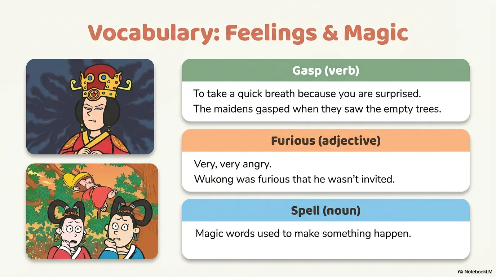

- 来源：`ppt/media/image7.png`（relationship `rId2`）
- 尺寸：1376×768
- 源 SHA-256：`540e2bb66e51a9ddd2080e2282c9c21b2aa8e08b636ddb5354af006daf0f9db3`
- 输出 SHA-256：`987fbca79bb04508c61f6229cabfc51037974ed9ba5eaf7b13c8a001f446cf3f`
- 分类：unknown ｜ OCR：blocked ｜ 审核：unreviewed

## Slide 007

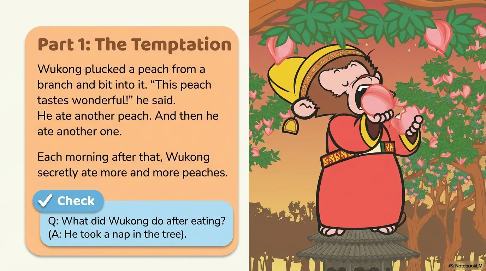

- 来源：`ppt/media/image8.png`（relationship `rId2`）
- 尺寸：1376×768
- 源 SHA-256：`fd0cb06b20516ddcb77217d5996d54a9ecc5688abdf3d7c4e0344c7b383d0e7c`
- 输出 SHA-256：`8b690f0c2aca42e8167f072e78db67d62e3f342b090272c39a3c89c7fcb478de`
- 分类：unknown ｜ OCR：blocked ｜ 审核：unreviewed

## Slide 008

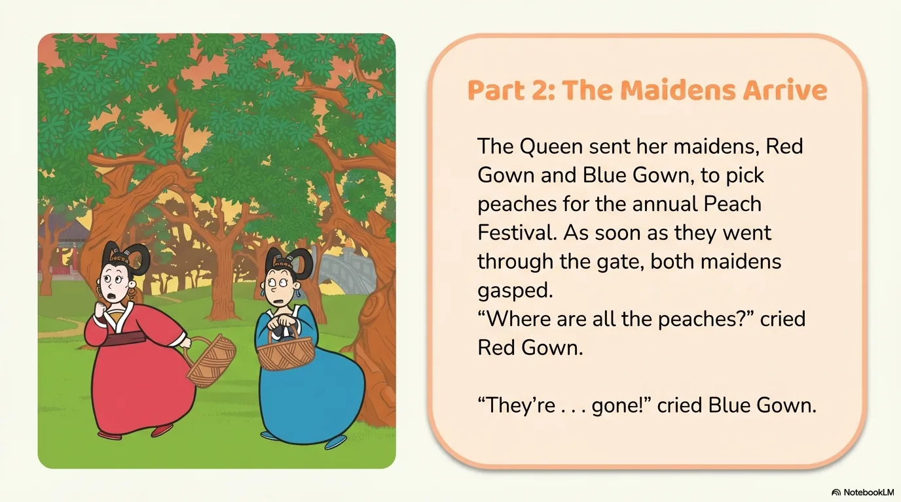

- 来源：`ppt/media/image9.png`（relationship `rId2`）
- 尺寸：1376×768
- 源 SHA-256：`f71316521e16aecb1765e737dc731c178d6a973531df5d832898d22cc506ec03`
- 输出 SHA-256：`38425d957dbf9912483572480c03f8dc4003abeaba8c7fa9cf8913e56ba05d3c`
- 分类：unknown ｜ OCR：blocked ｜ 审核：unreviewed

## Slide 009

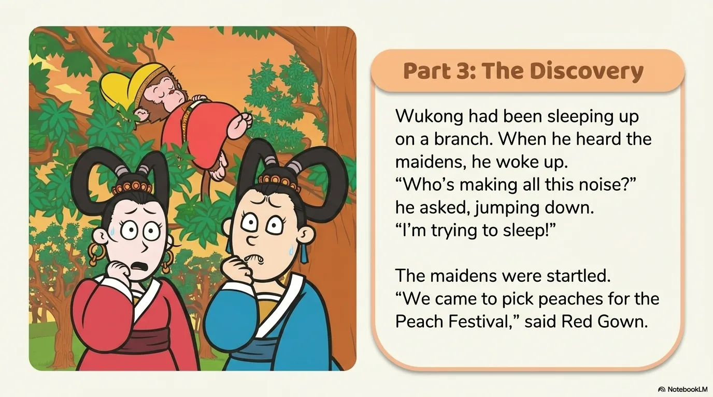

- 来源：`ppt/media/image10.png`（relationship `rId2`）
- 尺寸：1376×768
- 源 SHA-256：`f3d109420dce0a18e4b148e95b5995e6348352cf0382fb42007136b368e54deb`
- 输出 SHA-256：`9bc8396d2f92ac448389950f2f911b1b40b21579bd796e15b76fd50757145552`
- 分类：unknown ｜ OCR：blocked ｜ 审核：unreviewed

## Slide 010

- 来源：`ppt/media/image11.png`（relationship `rId2`）
- 尺寸：1376×768
- 源 SHA-256：`44d6c668a0546cf088b1e4be84d37c22836f8a6d7031ef0d5f042965c4a2ce57`
- 输出 SHA-256：`bf8656ac476844845026173a9c400b8445ad838ca7da07342d1fe9546365fbd5`
- 分类：unknown ｜ OCR：blocked ｜ 审核：unreviewed

## Slide 011

- 来源：`ppt/media/image12.png`（relationship `rId2`）
- 尺寸：1376×768
- 源 SHA-256：`c464ca388a4bee29959df8f359435f067bf9c9b2553798eaef01c71d70df53c2`
- 输出 SHA-256：`13d85380caf9936cf4b71a28164d7b1b402c987ec12df81092c2dc345f62c3c4`
- 分类：unknown ｜ OCR：blocked ｜ 审核：unreviewed

## Slide 012

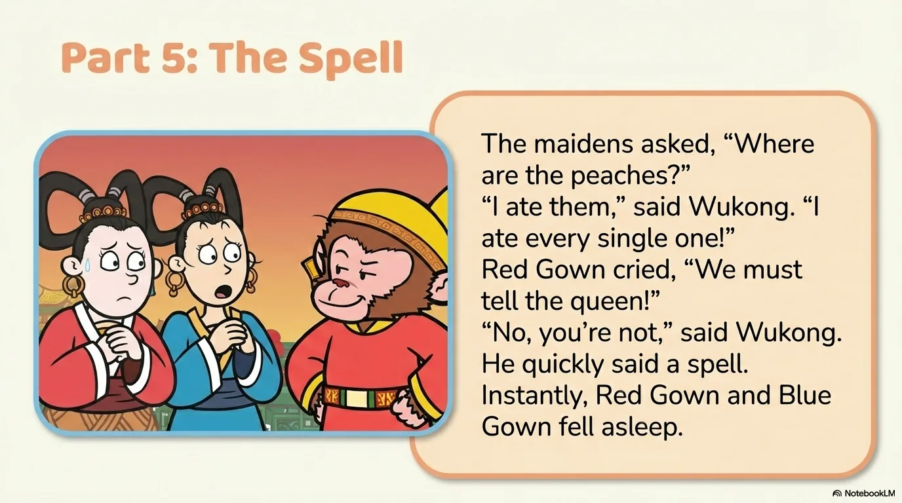

- 来源：`ppt/media/image13.png`（relationship `rId2`）
- 尺寸：1376×768
- 源 SHA-256：`c35a5a4af7d52d5487c06feb8f41d2cf49808caa238c387de66ebb545d152362`
- 输出 SHA-256：`111c5fe609cebc6c2ddc5ce2945713124c3652a0a4549c67801e18ebba7d5c36`
- 分类：unknown ｜ OCR：blocked ｜ 审核：unreviewed

## Slide 013

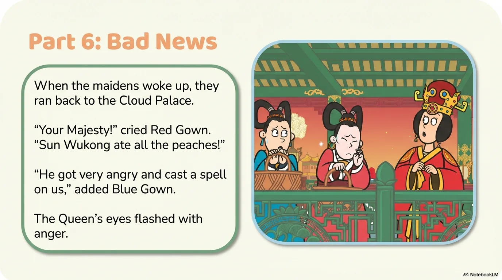

- 来源：`ppt/media/image14.png`（relationship `rId2`）
- 尺寸：1376×768
- 源 SHA-256：`56520e9c0adf18d148cb46df44d98c2803c49c3d6c30429f023b3cf89ecd55dd`
- 输出 SHA-256：`b41e25332e388cac6694d8e59b60e355a0ca3e6656bb171010bbbe31734f258f`
- 分类：unknown ｜ OCR：blocked ｜ 审核：unreviewed

## Slide 014

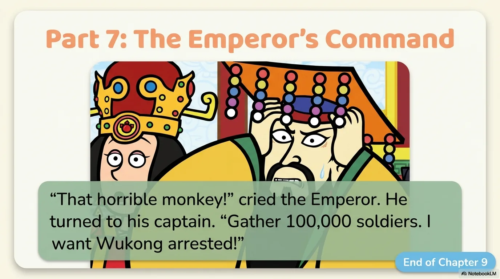

- 来源：`ppt/media/image15.png`（relationship `rId2`）
- 尺寸：1376×768
- 源 SHA-256：`cbbdddc85760c62684cb0a51d5afd20422e0175c9c0d5d0c98638883b2d66b4f`
- 输出 SHA-256：`7037bfaf1568ce314f1d2fde3e2d8348ce0af58d74329d3a73859049474846b0`
- 分类：unknown ｜ OCR：blocked ｜ 审核：unreviewed

## Slide 015

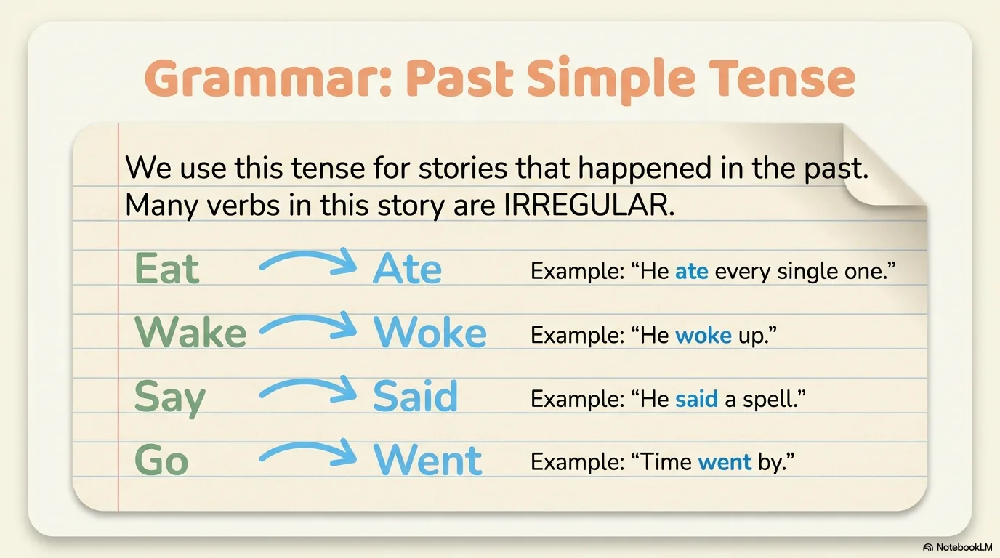

- 来源：`ppt/media/image16.png`（relationship `rId2`）
- 尺寸：1376×768
- 源 SHA-256：`d1b5b8569451a93ea4a1a461d6819abaa5f8ed5451ad784b2364652d7b4a7a1e`
- 输出 SHA-256：`97f4337f0c200d45959a7457ba846c4839fe783ae7500fb8167acf5b498b71cb`
- 分类：unknown ｜ OCR：blocked ｜ 审核：unreviewed

## Slide 016

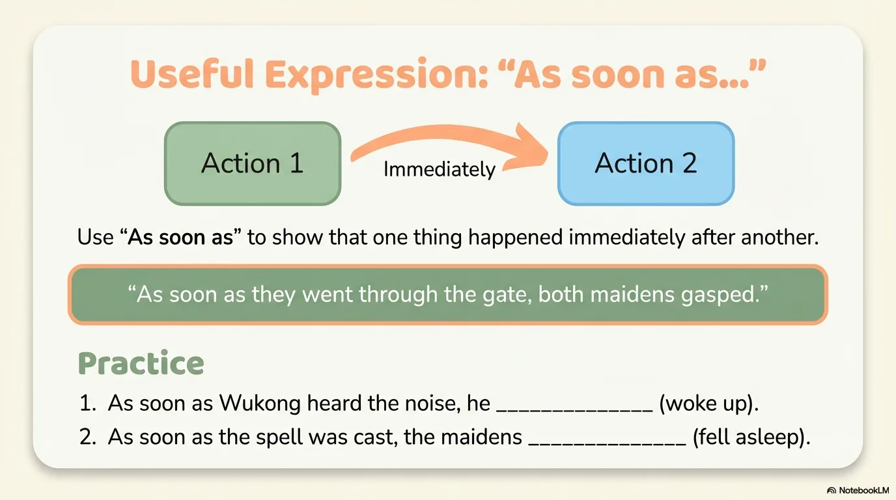

- 来源：`ppt/media/image17.png`（relationship `rId2`）
- 尺寸：1376×768
- 源 SHA-256：`834c2ad02ee9f8363cc70d5ae3bdbc3f5a3b2cc34218cbe35a4920107b43a892`
- 输出 SHA-256：`15285a44a4888085fad35b71b3f143dd469f83fdfd22b72f52692c1a75e57802`
- 分类：unknown ｜ OCR：blocked ｜ 审核：unreviewed

## Slide 017

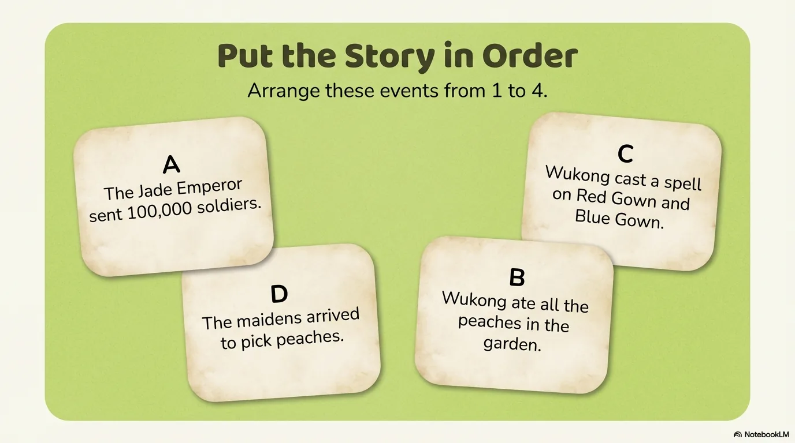

- 来源：`ppt/media/image18.png`（relationship `rId2`）
- 尺寸：1376×768
- 源 SHA-256：`dfbba9db1f472c6ddce046b0e5d657b03c64fe266a8df5ffcd924a8e9929802b`
- 输出 SHA-256：`9ffb7e570a41fc12c2431b89c526e5c1785b586f48560ade8dbf35d9a76b8d77`
- 分类：unknown ｜ OCR：blocked ｜ 审核：unreviewed

## Slide 018

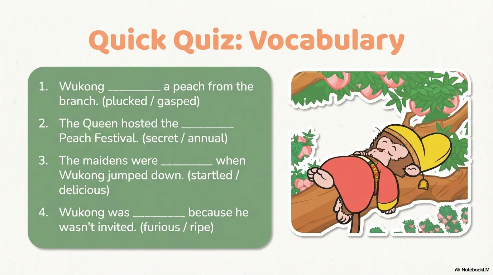

- 来源：`ppt/media/image19.png`（relationship `rId2`）
- 尺寸：1376×768
- 源 SHA-256：`1712d3c8542a830a85ba2587806fc9230a3eaafd3b9e79b55df293edbe174610`
- 输出 SHA-256：`6409f06b632919ac0fe4509d18ea21162b7aff891e77f9da2980ffe0bb84b544`
- 分类：unknown ｜ OCR：blocked ｜ 审核：unreviewed

## Slide 019

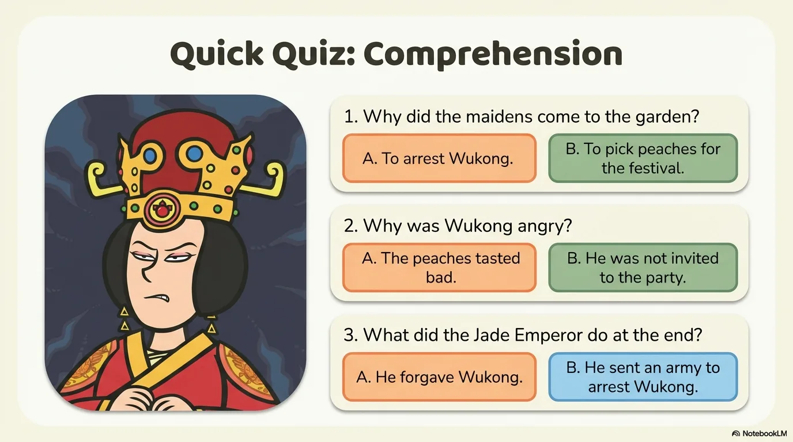

- 来源：`ppt/media/image20.png`（relationship `rId2`）
- 尺寸：1376×768
- 源 SHA-256：`b648c8f631a96b6766b76e5103d19a35cbbd21488edf85f9b9e8ec6024fcc4b7`
- 输出 SHA-256：`50ba99b53e76180c1c863ab17f2123c83d2370ef99d7a8736c70fff53f99d92c`
- 分类：unknown ｜ OCR：blocked ｜ 审核：unreviewed

## Slide 020

- 来源：`ppt/media/image21.png`（relationship `rId2`）
- 尺寸：1376×768
- 源 SHA-256：`22ceb826aea3801d9e2eec18156f44cea5fcdf69e075832b54f2d17c96c674e3`
- 输出 SHA-256：`38a47606f12c2708063fb8059bc021a4cb6acd2c3ee47f2fa7ebad26394312b0`
- 分类：unknown ｜ OCR：blocked ｜ 审核：unreviewed
