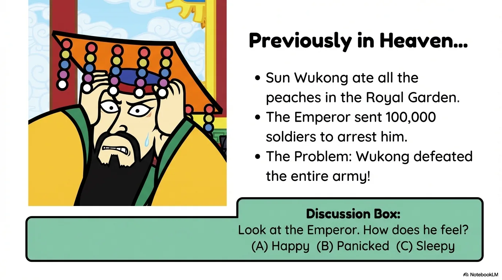
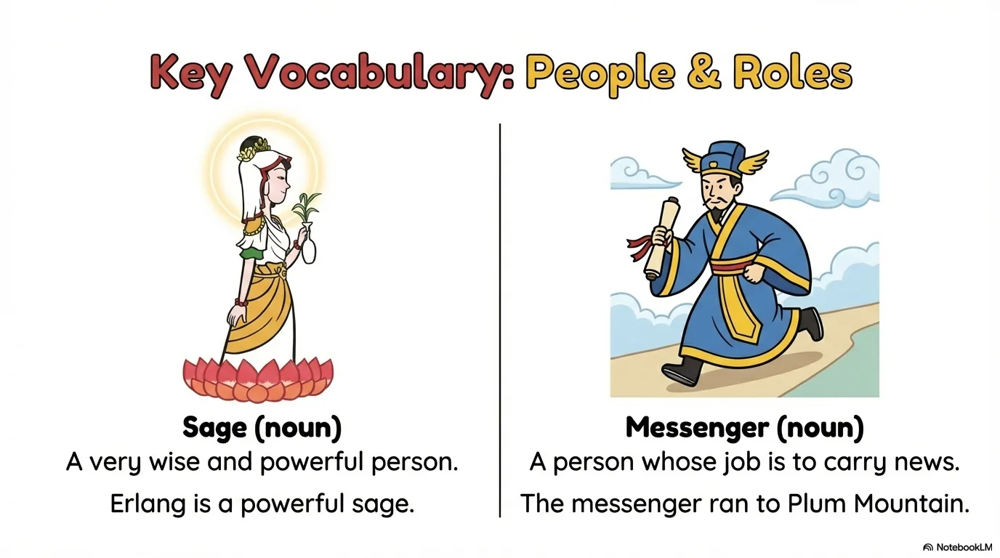
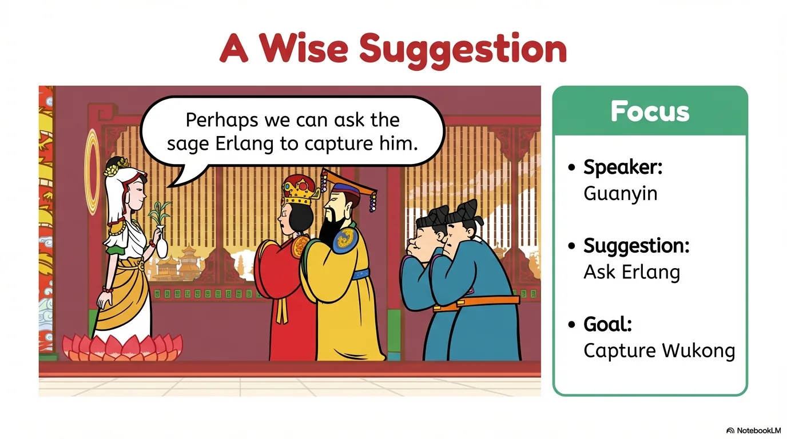
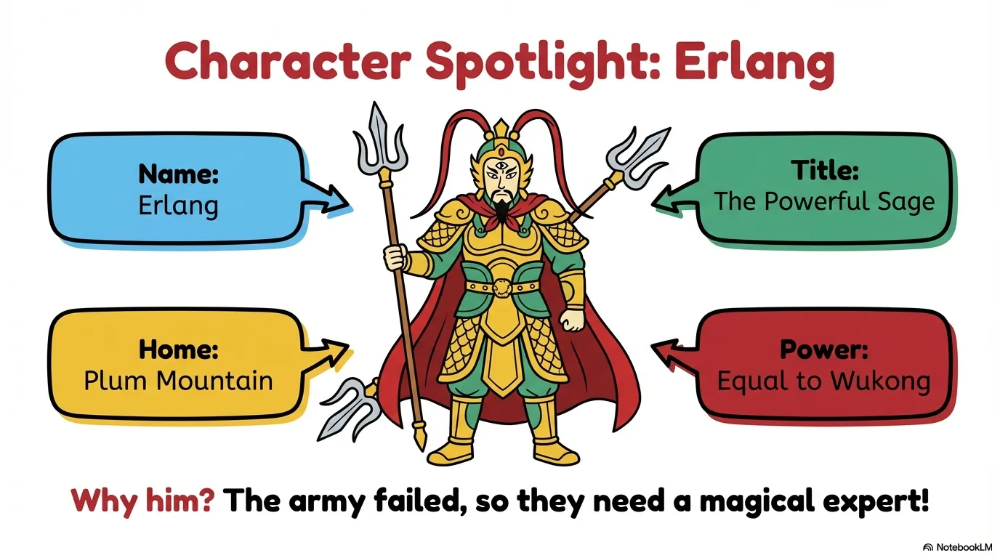
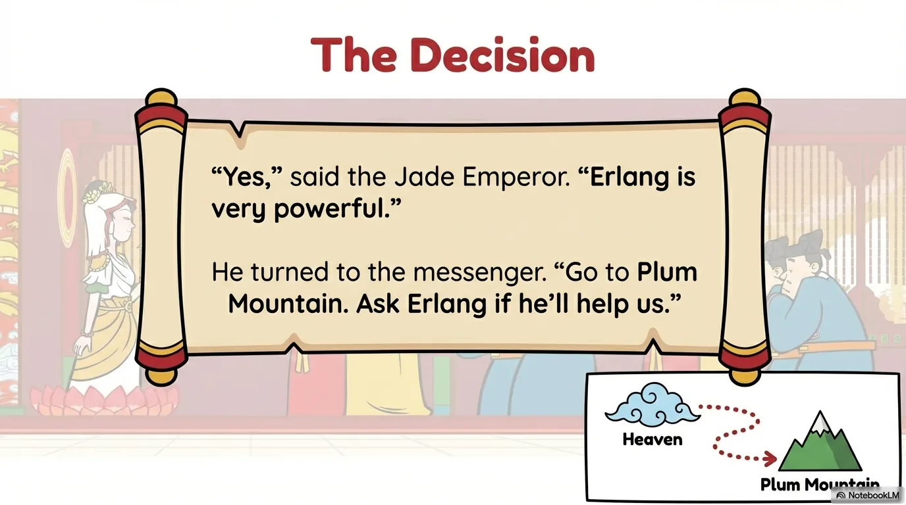
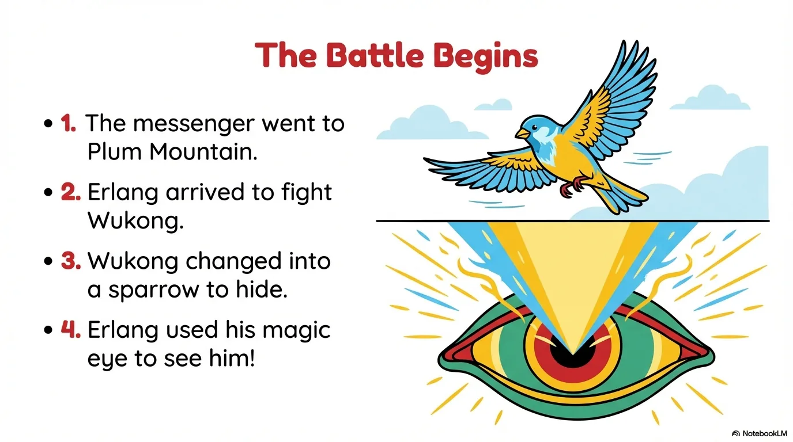
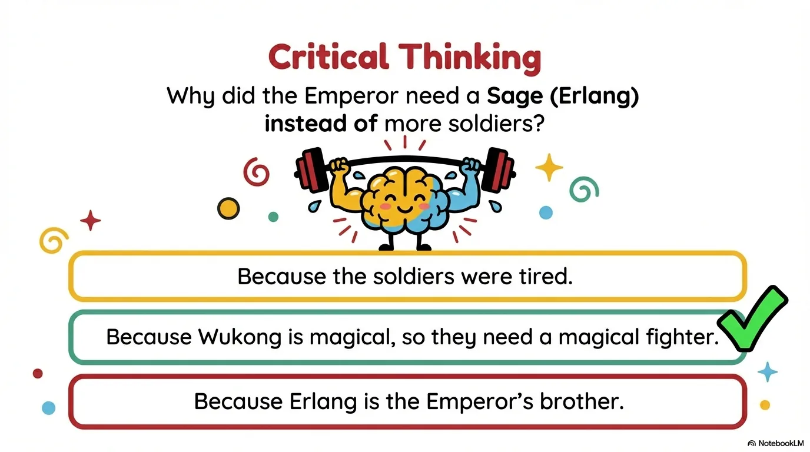
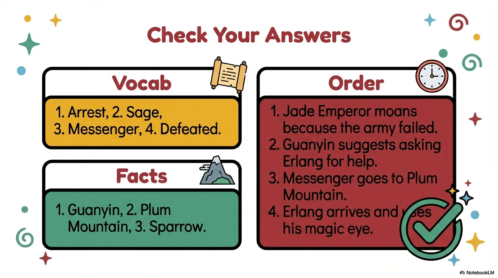

# 豆豆龙英语 · 第 10 集课件（EP010 草稿）

- 来源：`010_Journey to the West 10_The Powerful Sage.pptx`（主课件，20 页）
- OCR：`blocked`（no local OCR provider importable (pytesseract missing): No module named 'pytesseract'）
- 分类：待人工审核（unknown）
- 审核状态：`unreviewed`

## Slide 001

- 来源：`ppt/media/image1.png`（relationship `rId2`）
- 尺寸：1376×768
- 源 SHA-256：`c97124b0b314ae57d4b50626b1f51866156c7a388dfb315659093dc4d715980e`
- 输出 SHA-256：`898f12a73e06a20921f7fcd6da3ae2ac07d81f76882dd32a5674faca1633f59f`
- 分类：unknown ｜ OCR：blocked ｜ 审核：unreviewed

## Slide 002

- 来源：`ppt/media/image3.png`（relationship `rId2`）
- 尺寸：1376×768
- 源 SHA-256：`a486cbf88cb6d4e1140b2db3af878048ea3e03efdf772422542b3ac17e35a6d0`
- 输出 SHA-256：`511bca3059201b447f7b77f6570d5d15a690a663ed44b95a637c19b7dfe4f735`
- 分类：unknown ｜ OCR：blocked ｜ 审核：unreviewed

## Slide 003

- 来源：`ppt/media/image4.png`（relationship `rId2`）
- 尺寸：1376×768
- 源 SHA-256：`de77024d3775fc1ae23c13f7818ce3771474dd200241a0bcdb25d0fd407e3301`
- 输出 SHA-256：`883cad1315d9a12d16c5a76fb23e75ccdfba6acf5c0419a57365649f0caacdb5`
- 分类：unknown ｜ OCR：blocked ｜ 审核：unreviewed

## Slide 004

- 来源：`ppt/media/image5.png`（relationship `rId2`）
- 尺寸：1376×768
- 源 SHA-256：`9ae782633150c5fb30b496af85f8ef4150a03c63161f4ca822cd4c94140fc456`
- 输出 SHA-256：`bb997d00803174972f49a3b920d3105300015e5650d818f281f342819859b1f3`
- 分类：unknown ｜ OCR：blocked ｜ 审核：unreviewed

## Slide 005

- 来源：`ppt/media/image6.png`（relationship `rId2`）
- 尺寸：1376×768
- 源 SHA-256：`782d59b0ec2ba4ac0b72e25cae43092b6b16fdd7fb978b59b5e60f941a64370b`
- 输出 SHA-256：`933b14345b3b5ba95c0f70dac538a184c769d0c56954b62cfef4f83286260bd2`
- 分类：unknown ｜ OCR：blocked ｜ 审核：unreviewed

## Slide 006

- 来源：`ppt/media/image7.png`（relationship `rId2`）
- 尺寸：1376×768
- 源 SHA-256：`4be56e41968a5a3d730641b08be3de0a1c40cbe5086441532cec0b3c98f891ba`
- 输出 SHA-256：`f5a485470136872adef3f5b7b5b80e2337eef61c03795644596b938caf6f7b07`
- 分类：unknown ｜ OCR：blocked ｜ 审核：unreviewed

## Slide 007

- 来源：`ppt/media/image8.png`（relationship `rId2`）
- 尺寸：1376×768
- 源 SHA-256：`cbca402200bda96b3e093c8a8d1fbeef25d7f6334ab6f4dca7ffbf2290c7825b`
- 输出 SHA-256：`ac861df5d781b59bca94ac0eeb24871420f7bc5528288774f3d09162a284da94`
- 分类：unknown ｜ OCR：blocked ｜ 审核：unreviewed

## Slide 008

- 来源：`ppt/media/image9.png`（relationship `rId2`）
- 尺寸：1376×768
- 源 SHA-256：`ffb5ae06eb15ab22dbebd42d6d2c41fcb95ac988ef71b5b75a7c2ced7fbccc02`
- 输出 SHA-256：`e56c70e1d29ca0c8522ab70895609b4f331267ae5acebbe7cdb0307db0af578e`
- 分类：unknown ｜ OCR：blocked ｜ 审核：unreviewed

## Slide 009

- 来源：`ppt/media/image10.png`（relationship `rId2`）
- 尺寸：1376×768
- 源 SHA-256：`43dce09f7743f37fa77e8b5db60138625fb2425f263c888b00da4ab9e3801df3`
- 输出 SHA-256：`1474439488fb32b972ecc0301ac05413896b76bc398468ed9664192f98ff2926`
- 分类：unknown ｜ OCR：blocked ｜ 审核：unreviewed

## Slide 010

- 来源：`ppt/media/image11.png`（relationship `rId2`）
- 尺寸：1376×768
- 源 SHA-256：`abb8ebc65e30ffb9c2d246592239097c8eec40f41f1e93e75b57539f97ba25c7`
- 输出 SHA-256：`412122bfe4902a24f2ceb993dfd4fb7c1e10ae60824e9b24e5f6507b2c63a476`
- 分类：unknown ｜ OCR：blocked ｜ 审核：unreviewed

## Slide 011

- 来源：`ppt/media/image12.png`（relationship `rId2`）
- 尺寸：1376×768
- 源 SHA-256：`f043bbdda0249ac9a05724d5e1ee40ea9fc1cfd194b6615a40cc4f91920422a1`
- 输出 SHA-256：`73c639e54aef0c61ead51305fb3d2fdc69c370da8eb09f61147d7004954921b2`
- 分类：unknown ｜ OCR：blocked ｜ 审核：unreviewed

## Slide 012

- 来源：`ppt/media/image13.png`（relationship `rId2`）
- 尺寸：1376×768
- 源 SHA-256：`65a1832369ddbd250c5dc8fa074276cc35b1c01da0210f6d12d954999eecb18e`
- 输出 SHA-256：`ad432fed2941432bfd7e5e873df25bf15ef2468f588a35e229e6648198fdaf45`
- 分类：unknown ｜ OCR：blocked ｜ 审核：unreviewed

## Slide 013

- 来源：`ppt/media/image14.png`（relationship `rId2`）
- 尺寸：1376×768
- 源 SHA-256：`e6e6922a81004046a59a85c4e5e43744190c94ebd655a068b79266c3a832a374`
- 输出 SHA-256：`2ef77690a34d96953a2f6a3c6aae4fcee864bc993fbab36ece9b2abf42d59e27`
- 分类：unknown ｜ OCR：blocked ｜ 审核：unreviewed

## Slide 014

- 来源：`ppt/media/image15.png`（relationship `rId2`）
- 尺寸：1376×768
- 源 SHA-256：`77cefd7d2f6a2568e27f97d6ee733fe23504c4135f04a36485ff471ff20d2051`
- 输出 SHA-256：`0cd81a259e9a0d8f3fa070665674a92941f9e0276a5a00f0f859343b1468c60a`
- 分类：unknown ｜ OCR：blocked ｜ 审核：unreviewed

## Slide 015

- 来源：`ppt/media/image16.png`（relationship `rId2`）
- 尺寸：1376×768
- 源 SHA-256：`8ffc806b39f26195845b3142f97c89749e31920a5076dce8a78600be572892da`
- 输出 SHA-256：`af88ef52b3cbfe3a26b097d028830ab0b7f834952c53bb9c84b330aabe145a10`
- 分类：unknown ｜ OCR：blocked ｜ 审核：unreviewed

## Slide 016

- 来源：`ppt/media/image17.png`（relationship `rId2`）
- 尺寸：1376×768
- 源 SHA-256：`218915be127bd1eee03cf299fd490a321684566d3b4b664e717375ea5c8b055d`
- 输出 SHA-256：`ac643c52de8803f71b50fd80efb8972af353b09325699884881e224acfdcca55`
- 分类：unknown ｜ OCR：blocked ｜ 审核：unreviewed

## Slide 017

- 来源：`ppt/media/image18.png`（relationship `rId2`）
- 尺寸：1376×768
- 源 SHA-256：`91ab60250eee8c98bb06e331c5975d090f4639ea9352738d01fec1e9f9e50d3d`
- 输出 SHA-256：`fc53432f4184e6d24f79fa4e26451becfa57c0d3d7896d4b4f5215114e9bc4db`
- 分类：unknown ｜ OCR：blocked ｜ 审核：unreviewed

## Slide 018

- 来源：`ppt/media/image19.png`（relationship `rId2`）
- 尺寸：1376×768
- 源 SHA-256：`2ee5a43a461892193705fc2a477ac94de7808217fc76580b794413113b03bbec`
- 输出 SHA-256：`de61c5600eecd94cee5f593a4882f0c6d78f1fb464f41dfd21683b3f949e8c4a`
- 分类：unknown ｜ OCR：blocked ｜ 审核：unreviewed

## Slide 019

- 来源：`ppt/media/image20.png`（relationship `rId2`）
- 尺寸：1376×768
- 源 SHA-256：`5ddbbe27f37229e122974b757a2d151f3bf55f30bce53896c3fd1ba543a4c43b`
- 输出 SHA-256：`30de4e9fc0b2b993ef5ea881b0e573be12445d0fde68136db5d1432242309e3c`
- 分类：unknown ｜ OCR：blocked ｜ 审核：unreviewed

## Slide 020

- 来源：`ppt/media/image21.png`（relationship `rId2`）
- 尺寸：1376×768
- 源 SHA-256：`06111ce98d6f8090a8a832e6cafb63b1f474b9339081d72f0d840a5a33e7725b`
- 输出 SHA-256：`ee119d8f3540f8791bb9e32f42f0a8582b931797f242a86bf922d4223c6d7423`
- 分类：unknown ｜ OCR：blocked ｜ 审核：unreviewed
