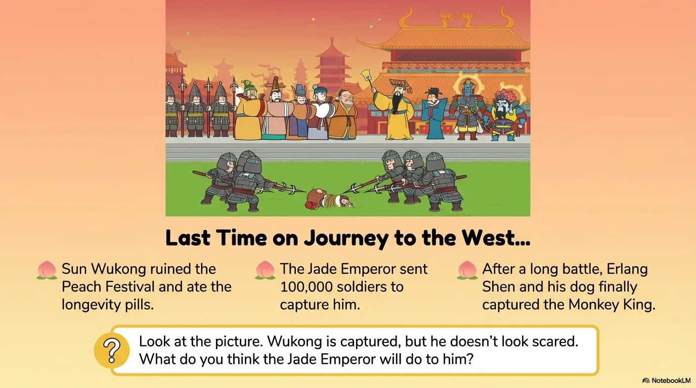
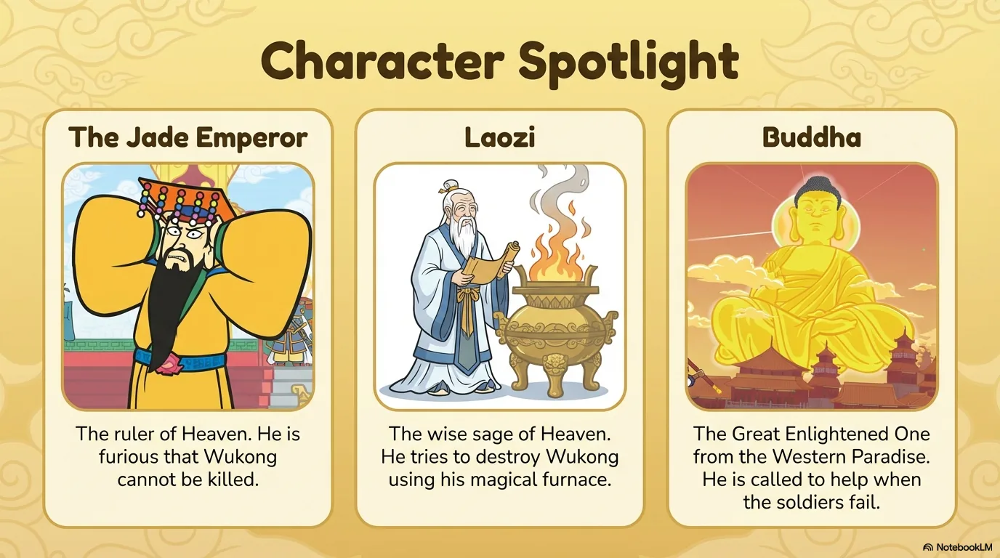
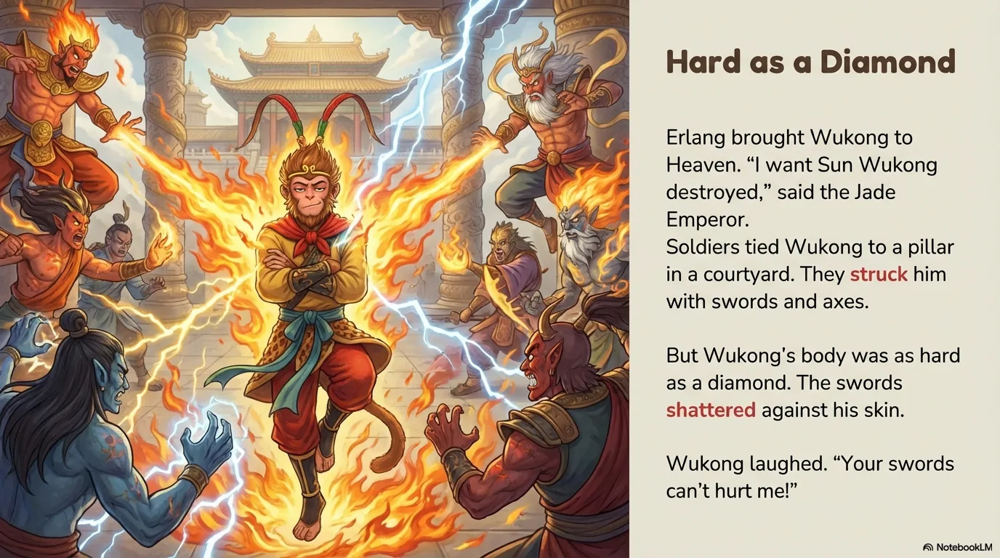
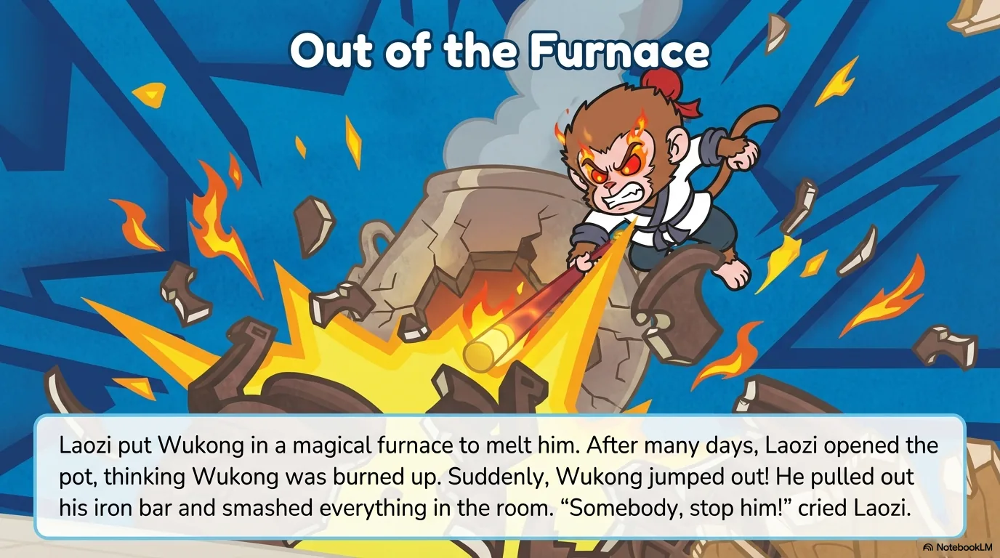
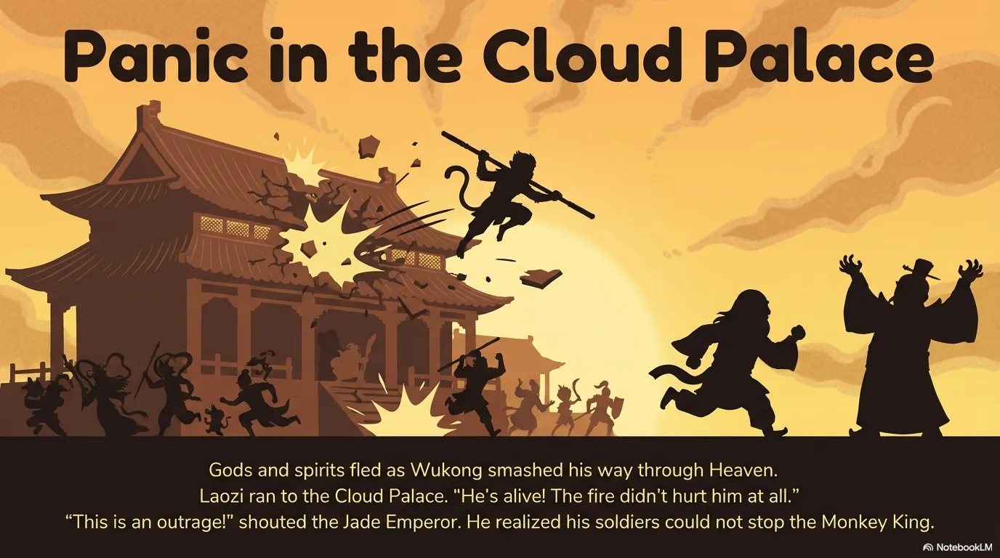
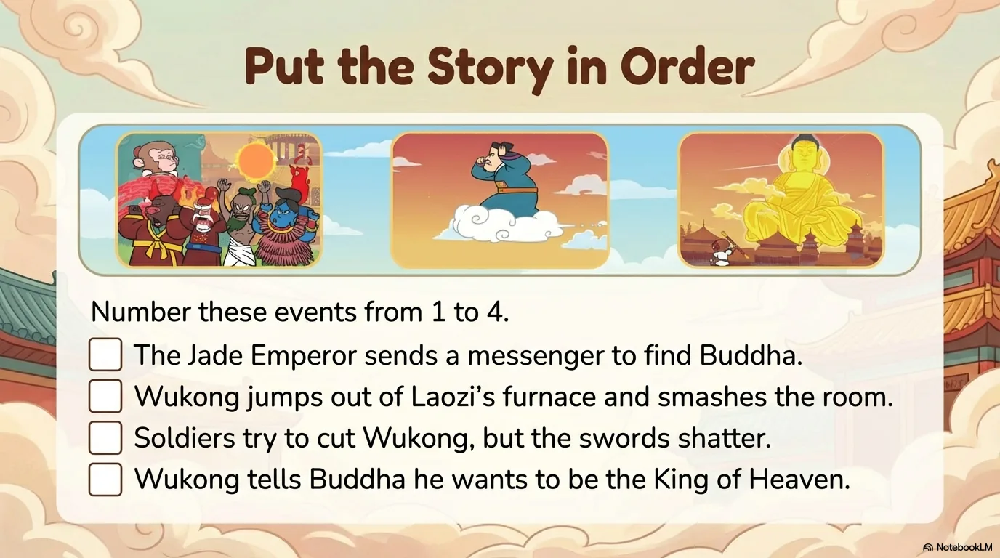
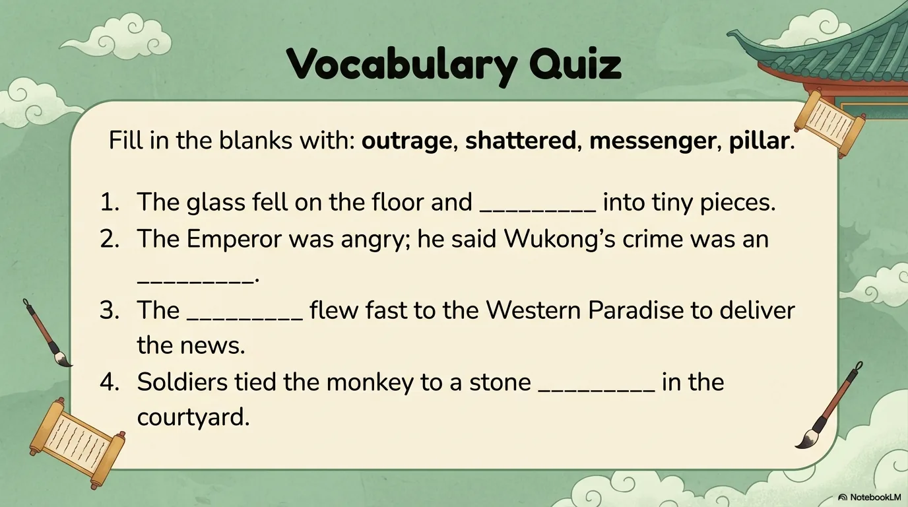
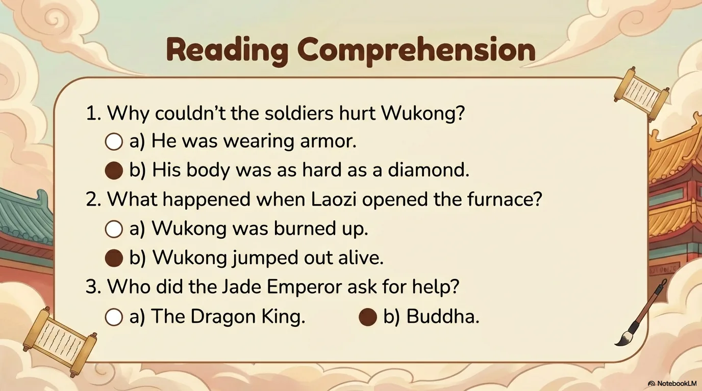

# 豆豆龙英语 · 第 11 集课件（EP011 草稿）

- 来源：`011_Journey to the West 11_Trouble in Heaven.pptx`（主课件，15 页）
- OCR：`blocked`（no local OCR provider importable (pytesseract missing): No module named 'pytesseract'）
- 分类：待人工审核（unknown）
- 审核状态：`unreviewed`

## Slide 001

- 来源：`ppt/media/image1.png`（relationship `rId2`）
- 尺寸：1376×768
- 源 SHA-256：`1bc3fc4080ec995775af4a546cba5b8fa3bb2ff864e08014c7668d2316d0f0c5`
- 输出 SHA-256：`5c270c6841fe764c68621cd66ce136863dd25d00751b4b250ea3f42b1e022bdd`
- 分类：unknown ｜ OCR：blocked ｜ 审核：unreviewed

## Slide 002

- 来源：`ppt/media/image3.png`（relationship `rId2`）
- 尺寸：1376×768
- 源 SHA-256：`4bcae9041a36ea72dc5fd75de6f684d287d73a41863541bd4bb1b46663253c04`
- 输出 SHA-256：`27b27e4894a1a3e006c61db709df23c974f9222ec29dd2e0dfd188298e1eb3ae`
- 分类：unknown ｜ OCR：blocked ｜ 审核：unreviewed

## Slide 003

- 来源：`ppt/media/image4.png`（relationship `rId2`）
- 尺寸：1376×768
- 源 SHA-256：`8c975618db7df2af3442af85f1bcfdfe77d2b718cbe825a07fac8414f74859fa`
- 输出 SHA-256：`7a279b82aba2cf18860e2e013870089d7558771755ea6a5e4e86d6d543eb89c1`
- 分类：unknown ｜ OCR：blocked ｜ 审核：unreviewed

## Slide 004

- 来源：`ppt/media/image5.png`（relationship `rId2`）
- 尺寸：1376×768
- 源 SHA-256：`2fe9be2a7c6e5fd80f663982733e83b63c7ef2d53ec65cf14528c50631ed0dcb`
- 输出 SHA-256：`7ead8800833a219827ade6f3238cfb9b2d504e61af6fec9252fafac9c85bb4d0`
- 分类：unknown ｜ OCR：blocked ｜ 审核：unreviewed

## Slide 005

- 来源：`ppt/media/image6.png`（relationship `rId2`）
- 尺寸：1376×768
- 源 SHA-256：`1a43914bf494bf4bc21037b3c3fceb4685964e1d62cec42c28329f399272262b`
- 输出 SHA-256：`d0ff2fbff79cd8da01382e523fdf9ed996d019ed528ea4880bd6fdb16b966cbd`
- 分类：unknown ｜ OCR：blocked ｜ 审核：unreviewed

## Slide 006

- 来源：`ppt/media/image7.png`（relationship `rId2`）
- 尺寸：1376×768
- 源 SHA-256：`33b3273ea080a226ffb6994b4e7d9cf43bd287bf218d3f23f83b190ebe4568e0`
- 输出 SHA-256：`223be0c82e98c30b4194dd9d4a056ea56bf39b4231ded7e55afc7f9b59df34ac`
- 分类：unknown ｜ OCR：blocked ｜ 审核：unreviewed

## Slide 007

- 来源：`ppt/media/image8.png`（relationship `rId2`）
- 尺寸：1376×768
- 源 SHA-256：`ae630e4c3593b23a9846dc9531232168140d63e8c1a55b99a86c0fd15c327955`
- 输出 SHA-256：`10469aa728813cd7a1fc2db086a20ec2b13f218ccae129dac16fb310aef477b9`
- 分类：unknown ｜ OCR：blocked ｜ 审核：unreviewed

## Slide 008

- 来源：`ppt/media/image9.png`（relationship `rId2`）
- 尺寸：1376×768
- 源 SHA-256：`9a3875aa78572be9737248cad97f525d77abc99d65168fdf72031502f1aa54e6`
- 输出 SHA-256：`5a1c7364457879764a64e73684ca7dfe31022dc1d65db8713d7e9a4212825917`
- 分类：unknown ｜ OCR：blocked ｜ 审核：unreviewed

## Slide 009

- 来源：`ppt/media/image10.png`（relationship `rId2`）
- 尺寸：1376×768
- 源 SHA-256：`94f09f8cf0a656907b9a9d139c30c4f613cc71dfb9c8cd85e63df3c097120549`
- 输出 SHA-256：`d8126c7e02e3ff27be21693dc3825174b27e8a7464995e62649113d110f5b193`
- 分类：unknown ｜ OCR：blocked ｜ 审核：unreviewed

## Slide 010

- 来源：`ppt/media/image11.png`（relationship `rId2`）
- 尺寸：1376×768
- 源 SHA-256：`adcd42cb61eec5e415e224e137dfde312ba517d4b653432962fd4e95da99ba0b`
- 输出 SHA-256：`80bf13cda201e580ba9291cac451f95393157288f7b70f9e0e0d4f7d2328ff72`
- 分类：unknown ｜ OCR：blocked ｜ 审核：unreviewed

## Slide 011

- 来源：`ppt/media/image12.png`（relationship `rId2`）
- 尺寸：1376×768
- 源 SHA-256：`02c9096d20de8205bf7b26e7c70928559ad6ba0ac74831e7c140f090822dd1ff`
- 输出 SHA-256：`949aa2539f382ac9fe941e7042463995a69574be0a67eb6c53faad22c60d0aa5`
- 分类：unknown ｜ OCR：blocked ｜ 审核：unreviewed

## Slide 012

- 来源：`ppt/media/image13.png`（relationship `rId2`）
- 尺寸：1376×768
- 源 SHA-256：`4ea780a3e78fcad3704214faceaf7d8c6674e5778156ce20facca56d00e13352`
- 输出 SHA-256：`0dc86a3b2c0044e79892a8399422e4e6ec926fed38329914dd849097ead9e028`
- 分类：unknown ｜ OCR：blocked ｜ 审核：unreviewed

## Slide 013

- 来源：`ppt/media/image14.png`（relationship `rId2`）
- 尺寸：1376×768
- 源 SHA-256：`ffb270a0e81649ad6244f05065130586d302ccc2e701323b9e0c7a9fac8266cd`
- 输出 SHA-256：`d04c8737c3f4a7e89267d67454aca0455dd1cef965dfe4ba55f7fd00dd0e9afe`
- 分类：unknown ｜ OCR：blocked ｜ 审核：unreviewed

## Slide 014

- 来源：`ppt/media/image15.png`（relationship `rId2`）
- 尺寸：1376×768
- 源 SHA-256：`0f7958ad2a2e6d5cb6556acea30828c0ccffc7254e8c2937d892730faeb645e0`
- 输出 SHA-256：`ea1c80baeee290d13dd325bbd2f7a45ca6b3f40a6266402423fa794d2c57f0bb`
- 分类：unknown ｜ OCR：blocked ｜ 审核：unreviewed

## Slide 015

- 来源：`ppt/media/image16.png`（relationship `rId2`）
- 尺寸：1376×768
- 源 SHA-256：`7d125eaab2dc891685c366ef58fdf7f62d8557038a602f96690ab668a2d73d77`
- 输出 SHA-256：`d633fcfa465fb2e763c88fcc274974790574e92e4733807148030222aff7128e`
- 分类：unknown ｜ OCR：blocked ｜ 审核：unreviewed
