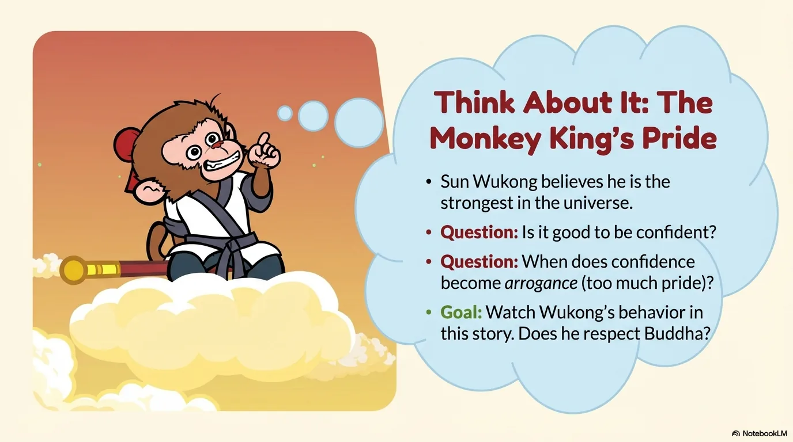
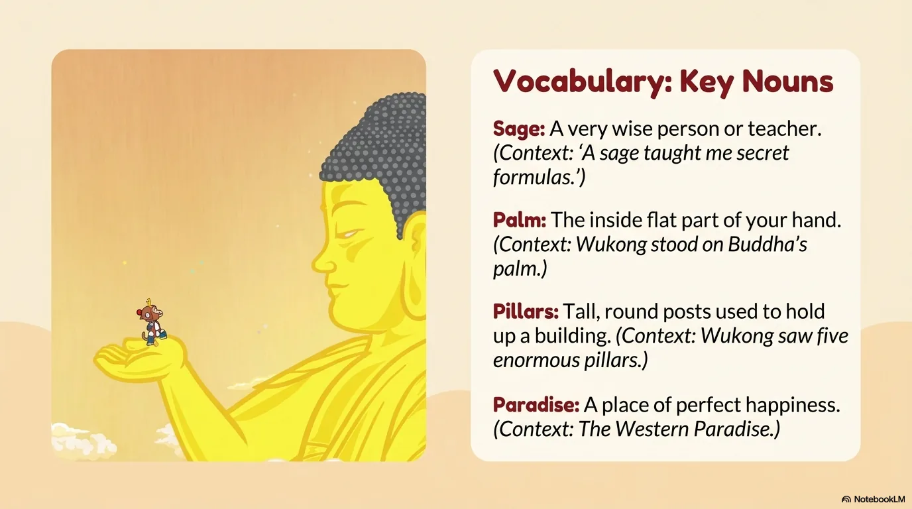
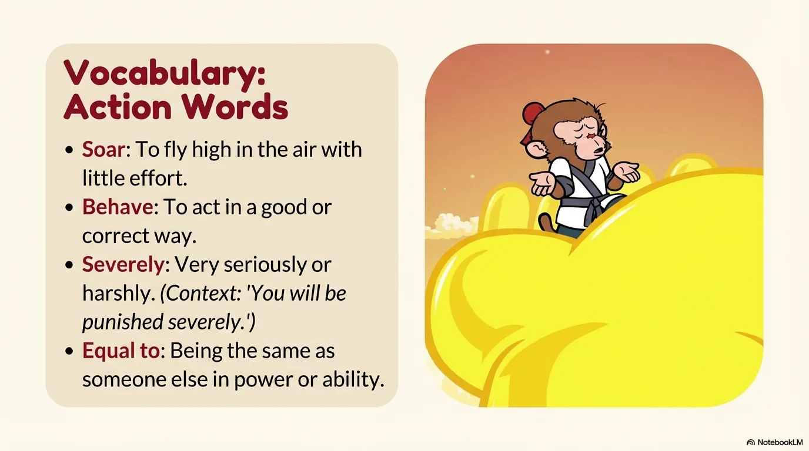
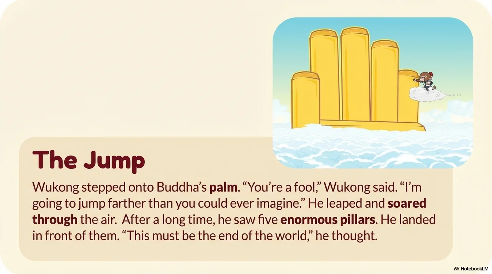
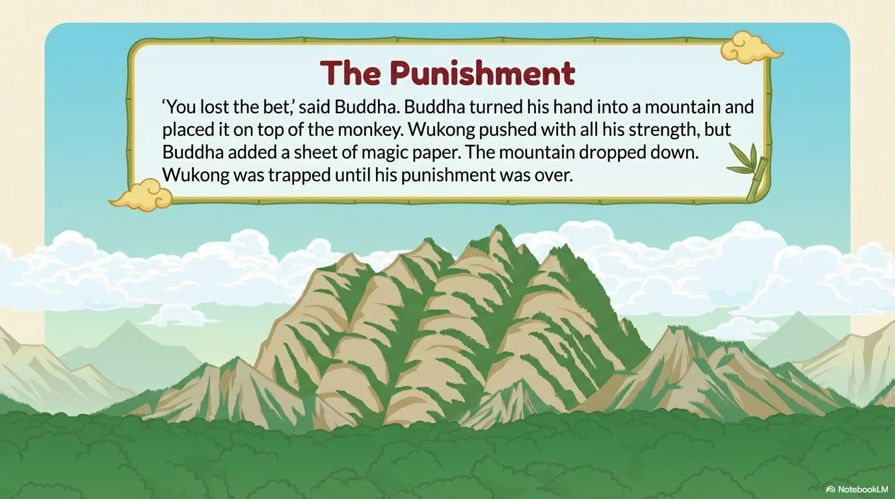
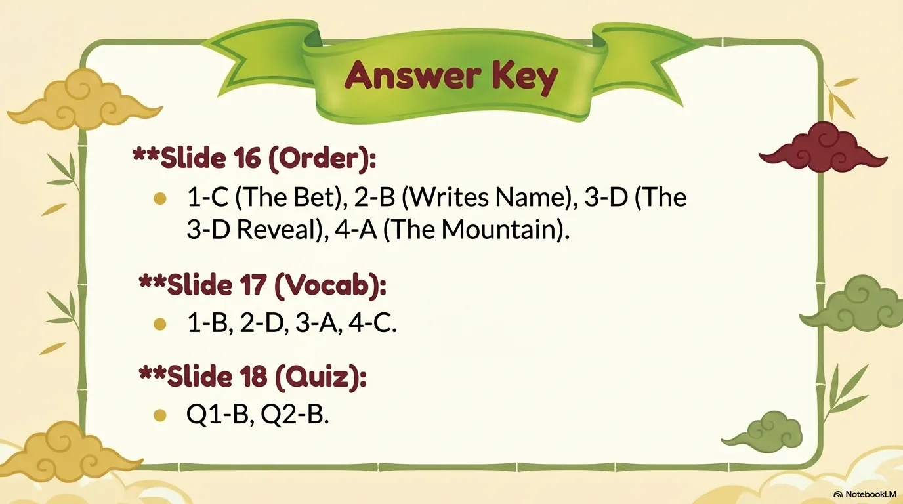

# 豆豆龙英语 · 第 12 集课件（EP012 草稿）

- 来源：`012_Journey to the West 12_The Bet.pptx`（主课件，20 页）
- OCR：`blocked`（no local OCR provider importable (pytesseract missing): No module named 'pytesseract'）
- 分类：待人工审核（unknown）
- 审核状态：`unreviewed`

## Slide 001

- 来源：`ppt/media/image1.png`（relationship `rId2`）
- 尺寸：1376×768
- 源 SHA-256：`eb7d6da8a3f2299aa5c6b6575dd06ceffb8725eadb386e299ce5a48365739505`
- 输出 SHA-256：`e86f26a9c2ce51edd676256f454407009cdf6708388efb0f4157e7512a69b03c`
- 分类：unknown ｜ OCR：blocked ｜ 审核：unreviewed

## Slide 002

- 来源：`ppt/media/image3.png`（relationship `rId2`）
- 尺寸：1376×768
- 源 SHA-256：`91118faf11e41434cb56eed4fc6e302148210d2e34f4ccefdfaf1e6b3ebe8c34`
- 输出 SHA-256：`31b2f96eead15cc76cca8f818b1c68eb4c9c753cd4e1eb992eafc7caa5b583fb`
- 分类：unknown ｜ OCR：blocked ｜ 审核：unreviewed

## Slide 003

- 来源：`ppt/media/image4.png`（relationship `rId2`）
- 尺寸：1376×768
- 源 SHA-256：`9bd997a9e6fd1cea2fa0873a6cb16f7a379bcd0bb2c71925614e934d825e5f28`
- 输出 SHA-256：`ad8083b189a233bce7449383beb55351c1ad829f52196f3573ee0f483720a9f2`
- 分类：unknown ｜ OCR：blocked ｜ 审核：unreviewed

## Slide 004

- 来源：`ppt/media/image5.png`（relationship `rId2`）
- 尺寸：1376×768
- 源 SHA-256：`39d416400f02b6cac27279b13a12991cdb8923fb81fb68943aa762ba1a7b53f1`
- 输出 SHA-256：`d8a5c7cbd2b5482b9e393cc3a3071ba76752f78c1214654e1491c0ba75c42b7b`
- 分类：unknown ｜ OCR：blocked ｜ 审核：unreviewed

## Slide 005

- 来源：`ppt/media/image6.png`（relationship `rId2`）
- 尺寸：1376×768
- 源 SHA-256：`c1f5fb39e3d58c9158e8e98277fde2d8b86e2ced0822a76d874ef948d8fd7869`
- 输出 SHA-256：`6028b3980b9c8dad9b9d9fe1887d01720732dd325ae2ac458ee10a1f2f7fc7b7`
- 分类：unknown ｜ OCR：blocked ｜ 审核：unreviewed

## Slide 006

- 来源：`ppt/media/image7.png`（relationship `rId2`）
- 尺寸：1376×768
- 源 SHA-256：`3f5b95a7ff00ba8da2ad3f324fb50a40c6daed20d3fa8b2d0d19595e9602b7c4`
- 输出 SHA-256：`1bb2d44800524c8eda9178002fef9053929baf65f5c817fe2814d0cb56ab473a`
- 分类：unknown ｜ OCR：blocked ｜ 审核：unreviewed

## Slide 007

- 来源：`ppt/media/image8.png`（relationship `rId2`）
- 尺寸：1376×768
- 源 SHA-256：`d865861d908c46859a381638512375e3f5b2b011cef3eeb22406459d16fed1af`
- 输出 SHA-256：`29a0fe6ee846a00e469f6f73836b88823a111c68081a246779065ec4a90cdc56`
- 分类：unknown ｜ OCR：blocked ｜ 审核：unreviewed

## Slide 008

- 来源：`ppt/media/image9.png`（relationship `rId2`）
- 尺寸：1376×768
- 源 SHA-256：`20954c1a163567ee108f6f103e9cc6c930140a867fe1d8367756336811d2f355`
- 输出 SHA-256：`bd21a42c31d99a593097cb1d5db56d6ae34f9985ede440fba8d5b2316ebf4c1e`
- 分类：unknown ｜ OCR：blocked ｜ 审核：unreviewed

## Slide 009

- 来源：`ppt/media/image10.png`（relationship `rId2`）
- 尺寸：1376×768
- 源 SHA-256：`2adb0b2014a1157ce510b1b30a75a4a4634df27c814b2e410c26241a4da2a23a`
- 输出 SHA-256：`4324621e1d4e7c2c57cb64ed5c158126fd74ce17aea9a2005766db2c18295ed8`
- 分类：unknown ｜ OCR：blocked ｜ 审核：unreviewed

## Slide 010

- 来源：`ppt/media/image11.png`（relationship `rId2`）
- 尺寸：1376×768
- 源 SHA-256：`95ca9ce5347745e8e7fc48558b6958da311fd6a32255af9a74a210b93830ff3a`
- 输出 SHA-256：`8981323fc71bd41b73f17ca69458f74396573a0c1ca8f0b4966c3e4ec145308b`
- 分类：unknown ｜ OCR：blocked ｜ 审核：unreviewed

## Slide 011

- 来源：`ppt/media/image12.png`（relationship `rId2`）
- 尺寸：1376×768
- 源 SHA-256：`fd8e262e4b81fd4733f61b058813ce4e207d0056452c75f711bd1cfc3073847e`
- 输出 SHA-256：`fa0d2eb0929c7148a498804c4deae8817697b5c1f2fc2db9d96b9cde48f23ccf`
- 分类：unknown ｜ OCR：blocked ｜ 审核：unreviewed

## Slide 012

- 来源：`ppt/media/image13.png`（relationship `rId2`）
- 尺寸：1376×768
- 源 SHA-256：`15c6f0c231e7a20f5f83c0991a3a4aeb18a24f333074c84d020413d548bdc99e`
- 输出 SHA-256：`5b49c15e0751382702a64b758760159b26f0e72814a1833c876c4319cfaa465f`
- 分类：unknown ｜ OCR：blocked ｜ 审核：unreviewed

## Slide 013

- 来源：`ppt/media/image14.png`（relationship `rId2`）
- 尺寸：1376×768
- 源 SHA-256：`b50de5ed6792b8ae0ef2dc042273a5d07302ca7eebc3d4f8890f9353c6cdf198`
- 输出 SHA-256：`2e7e72ac450a6d1e777472c49e34ae59214bf44a974e2b107750e21773feb9ca`
- 分类：unknown ｜ OCR：blocked ｜ 审核：unreviewed

## Slide 014

- 来源：`ppt/media/image15.png`（relationship `rId2`）
- 尺寸：1376×768
- 源 SHA-256：`3f154e38593d7899d89c54fc0acc6595ffbb857e68d59cb31890327a8eb2d0ca`
- 输出 SHA-256：`04c967d59e3a20a3840fef47b88d0f895cf5e71620c0bd4ae0d63f7e07c5c7b4`
- 分类：unknown ｜ OCR：blocked ｜ 审核：unreviewed

## Slide 015

- 来源：`ppt/media/image16.png`（relationship `rId2`）
- 尺寸：1376×768
- 源 SHA-256：`3650ba7a5ca6a32966cce2ab874f90092cab12c881caf90e7ece0c5886862a98`
- 输出 SHA-256：`2d72ec59dbaad0a0bc026bee982f3b27793ec2d76ba156978852a79c400aac5a`
- 分类：unknown ｜ OCR：blocked ｜ 审核：unreviewed

## Slide 016

- 来源：`ppt/media/image17.png`（relationship `rId2`）
- 尺寸：1376×768
- 源 SHA-256：`f8f3f8c251661f13b09a349c8293d256e520b44e1ec049d02c066ec21ae96cde`
- 输出 SHA-256：`f6e84d68424fb618a462c234714ce17427e8745ffb6aec9291e8e2edc8a28d0f`
- 分类：unknown ｜ OCR：blocked ｜ 审核：unreviewed

## Slide 017

- 来源：`ppt/media/image18.png`（relationship `rId2`）
- 尺寸：1376×768
- 源 SHA-256：`5d2ea951b40a98a6da94a4c9f39ce2a47765c6f0e66ed7e9326d6644e88d562f`
- 输出 SHA-256：`37f958a1ad8757ec4ebdcb412d79cb65d20d6f0110a85530f9ee54551d0ea860`
- 分类：unknown ｜ OCR：blocked ｜ 审核：unreviewed

## Slide 018

- 来源：`ppt/media/image19.png`（relationship `rId2`）
- 尺寸：1376×768
- 源 SHA-256：`2568907853b4141e23768c779a7d3267514f204ef0dd38bf661f645a4da4dc12`
- 输出 SHA-256：`ddc0d55b9755be80fa553b86f36558c5983331059f323623320821d6e9cdccf5`
- 分类：unknown ｜ OCR：blocked ｜ 审核：unreviewed

## Slide 019

- 来源：`ppt/media/image20.png`（relationship `rId2`）
- 尺寸：1376×768
- 源 SHA-256：`62f82a742d629c126ae04851b34883394a286b398d30857fc5d6633d57becdbe`
- 输出 SHA-256：`67af030072c952ad7dce1d99c0a170e0b3a895c0d10878486704c10c8d6fcbc5`
- 分类：unknown ｜ OCR：blocked ｜ 审核：unreviewed

## Slide 020

- 来源：`ppt/media/image21.png`（relationship `rId2`）
- 尺寸：1376×768
- 源 SHA-256：`8cabca0f5c38aa86daea2b0652a8bbe9033e8285222e4c74e4b26fb33e4bcc51`
- 输出 SHA-256：`c155ce39b328d8835fbba0373856f89abe6a18c4432aa150384704d2d4b133c8`
- 分类：unknown ｜ OCR：blocked ｜ 审核：unreviewed
