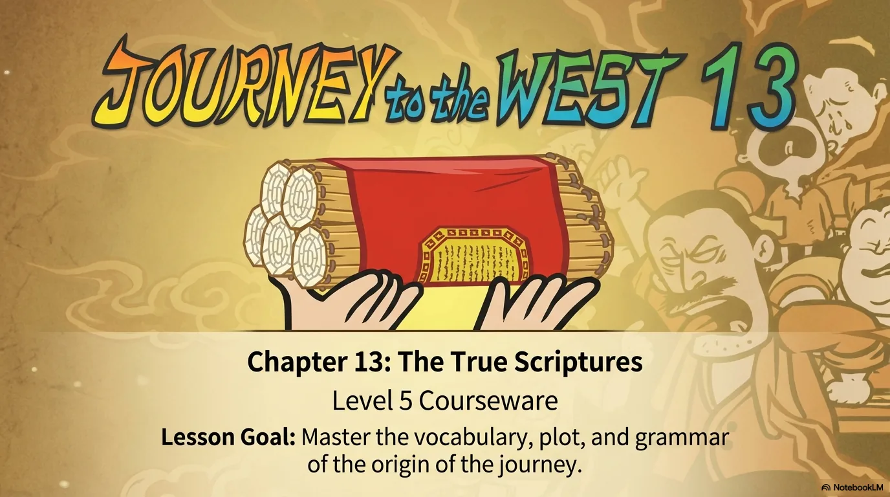
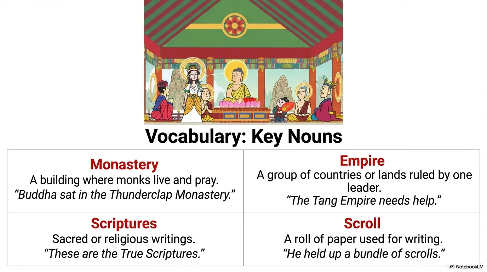
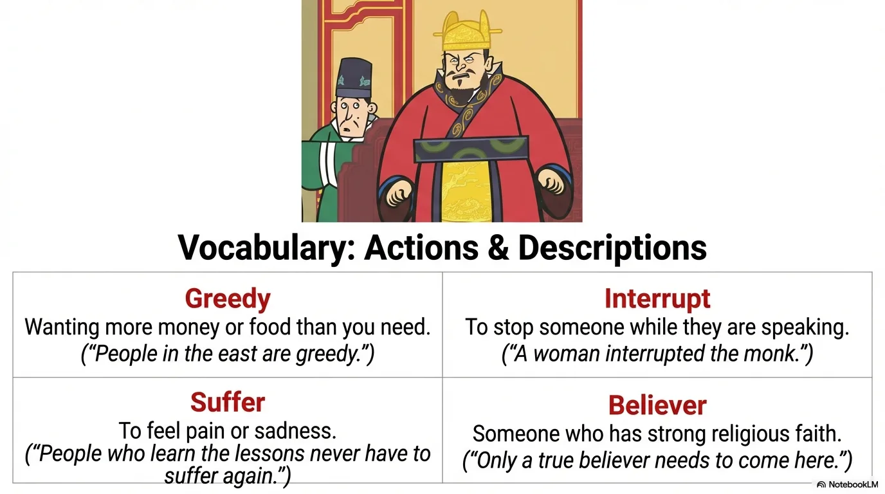
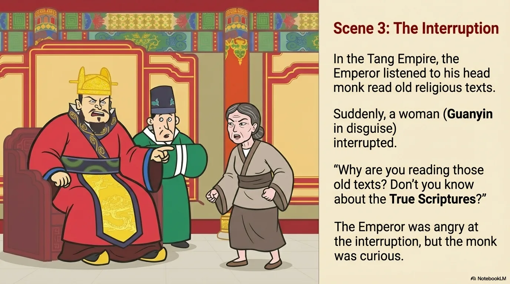
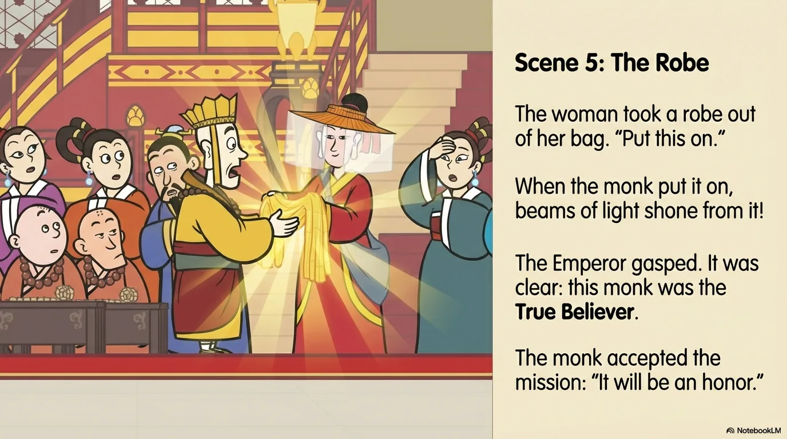
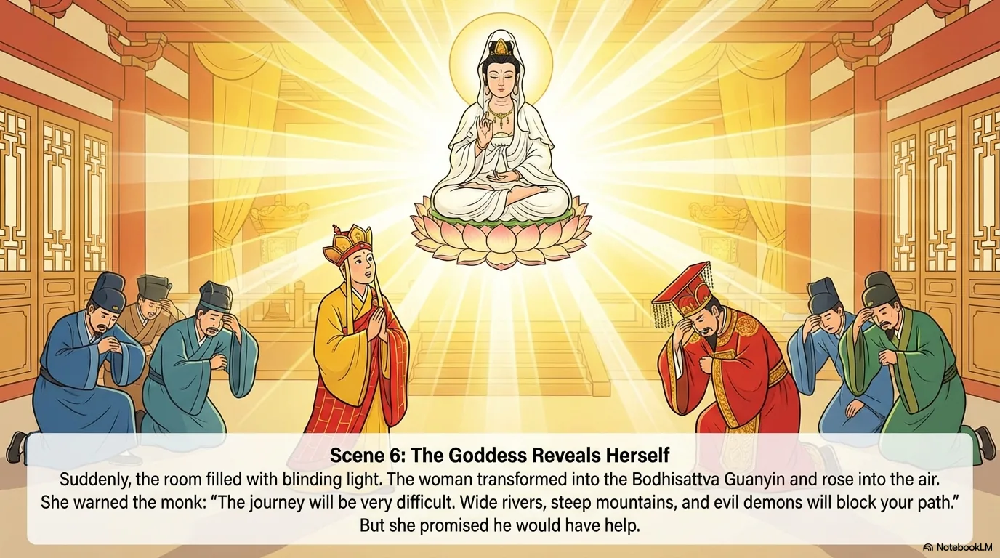
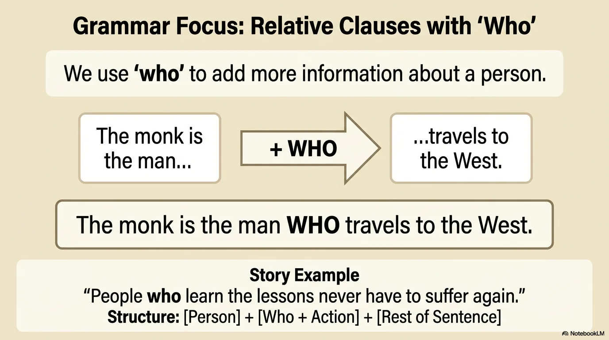
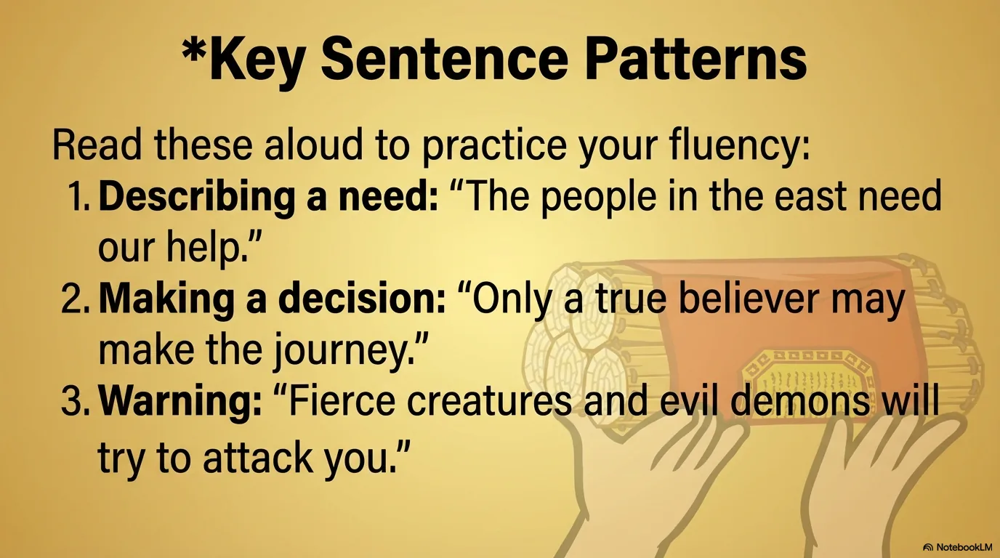
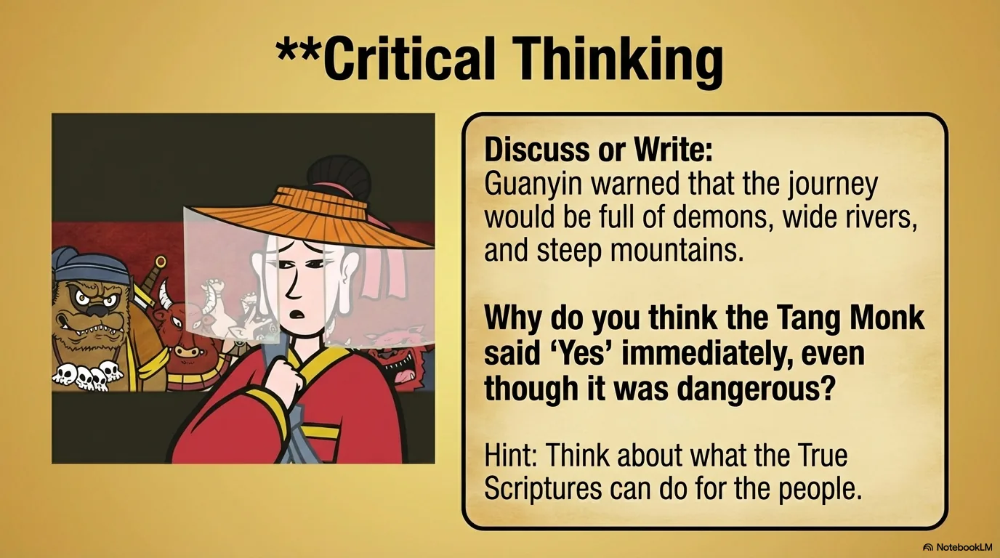
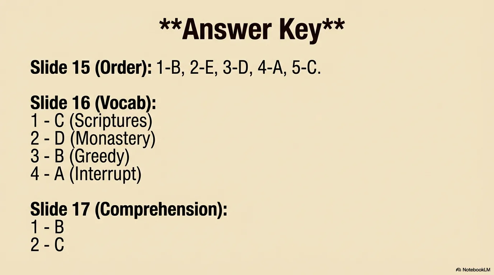

# 豆豆龙英语 · 第 13 集课件（EP013 草稿）

- 来源：`013_Journey to the West 13_The True Scriptures.pptx`（主课件，20 页）
- OCR：`blocked`（no local OCR provider importable (pytesseract missing): No module named 'pytesseract'）
- 分类：待人工审核（unknown）
- 审核状态：`unreviewed`

## Slide 001

- 来源：`ppt/media/image1.png`（relationship `rId2`）
- 尺寸：1376×768
- 源 SHA-256：`7565fc4bae916a034a0726a4de2c829a9c5bb76009a677c6a962a8247a87830b`
- 输出 SHA-256：`d885bdec75510780c9b3f54ccc1c0ac363cea8220ae40465dbd91ec5e1f5923c`
- 分类：unknown ｜ OCR：blocked ｜ 审核：unreviewed

## Slide 002

- 来源：`ppt/media/image3.png`（relationship `rId2`）
- 尺寸：1376×768
- 源 SHA-256：`719a1f10fbef098cac54782e0e4c64880e3a7dc468d4f2e5898c9fa77b8ca7ab`
- 输出 SHA-256：`6174bcea7cf2a679dd46ac691b2d19b30a6370ca4ab9c2eb7f0200bba18913a4`
- 分类：unknown ｜ OCR：blocked ｜ 审核：unreviewed

## Slide 003

- 来源：`ppt/media/image4.png`（relationship `rId2`）
- 尺寸：1376×768
- 源 SHA-256：`c4228fa7175a0dd908607aa9517d87cdd045fb1c77d470d4dd6377929cd4984a`
- 输出 SHA-256：`1cc08600157a81da3058a81449949632fb0701db8c908ac31e4b03f3a1643378`
- 分类：unknown ｜ OCR：blocked ｜ 审核：unreviewed

## Slide 004

- 来源：`ppt/media/image5.png`（relationship `rId2`）
- 尺寸：1376×768
- 源 SHA-256：`022567dfdccc382dd34d960f94734e0dfd58360f84cabbffa21806449dda1f00`
- 输出 SHA-256：`6b4c15cabf47761c374ad272952f02ab4dfa24b09ff5866b627c52ad500e8662`
- 分类：unknown ｜ OCR：blocked ｜ 审核：unreviewed

## Slide 005

- 来源：`ppt/media/image6.png`（relationship `rId2`）
- 尺寸：1376×768
- 源 SHA-256：`5d9c2f6f0b39fae03d0222ca422b42904a2c7e6ed35c7ff22b48b49290ed5784`
- 输出 SHA-256：`b411bb1a63d2b537acd9893a7088cd5b25d38005118694eb52bbf6f4633811b7`
- 分类：unknown ｜ OCR：blocked ｜ 审核：unreviewed

## Slide 006

- 来源：`ppt/media/image7.png`（relationship `rId2`）
- 尺寸：1376×768
- 源 SHA-256：`398965bc40c4b0bc57392388b37c458b9149652c22a98dc130b64b78a7469b15`
- 输出 SHA-256：`1ca2105251366486ce6ccf061e81a7f6edc2bc1fd4b1c06f22e9439c0958564a`
- 分类：unknown ｜ OCR：blocked ｜ 审核：unreviewed

## Slide 007

- 来源：`ppt/media/image8.png`（relationship `rId2`）
- 尺寸：1376×768
- 源 SHA-256：`c98ada49313bf8d849ea5da6baed3a9eea0e3e1316d30974fa130a402b18f229`
- 输出 SHA-256：`ffcaacf36d96aa47becb6e29fb549246c0f4adf7c6659cb9902c411384da2324`
- 分类：unknown ｜ OCR：blocked ｜ 审核：unreviewed

## Slide 008

- 来源：`ppt/media/image9.png`（relationship `rId2`）
- 尺寸：1376×768
- 源 SHA-256：`cd24086ea5ab09f7aed3f4f535bfceb98b2f7e8083d04f2c3d8324ae6f4599f9`
- 输出 SHA-256：`38367f437d753769dd2c2ab27be3f2b677bee75c94728951529180a168f9d3f3`
- 分类：unknown ｜ OCR：blocked ｜ 审核：unreviewed

## Slide 009

- 来源：`ppt/media/image10.png`（relationship `rId2`）
- 尺寸：1376×768
- 源 SHA-256：`486829ca9c68b665a50e0690661b674dddc14ded0bf7760f3e23b8fb74f7ba08`
- 输出 SHA-256：`bdf43474247b69d7a10e86b38b78d5bcf32b994e6f9d700739ea32216c69a3ea`
- 分类：unknown ｜ OCR：blocked ｜ 审核：unreviewed

## Slide 010

- 来源：`ppt/media/image11.png`（relationship `rId2`）
- 尺寸：1376×768
- 源 SHA-256：`0f4291b674adf6c6a09de25d9c049d1794a5fd37ac01829be71f82556312b3c3`
- 输出 SHA-256：`105bcc92f7c44e8287032774cb2e0ab95cfbac5765313c6753783370f5ccabdf`
- 分类：unknown ｜ OCR：blocked ｜ 审核：unreviewed

## Slide 011

- 来源：`ppt/media/image12.png`（relationship `rId2`）
- 尺寸：1376×768
- 源 SHA-256：`30cacb886c082a73d44924c710ee67db321ce17652b9b3e16372c3ffc80bdc4b`
- 输出 SHA-256：`8f4ebf436c79b5fa468807434f03b10bbae6f2a6b26f66075789f5663795a3bb`
- 分类：unknown ｜ OCR：blocked ｜ 审核：unreviewed

## Slide 012

- 来源：`ppt/media/image13.png`（relationship `rId2`）
- 尺寸：1376×768
- 源 SHA-256：`c79fe713053e3c82b189175d38cb406535504905c5a828245547a9d5757ef7b9`
- 输出 SHA-256：`c1a7a43e1b9182dfab2012c4b43d9fcabd54aa1fd4080525a6e1ef85e2d9caf1`
- 分类：unknown ｜ OCR：blocked ｜ 审核：unreviewed

## Slide 013

- 来源：`ppt/media/image14.png`（relationship `rId2`）
- 尺寸：1376×768
- 源 SHA-256：`2c94fd24095c00649c884ccc8bf4bd8a0a5c20604562d74e5c78e969dc878eed`
- 输出 SHA-256：`6c642ded35a8c01d3dcbc33f88720e97c8f246be5100fa0b9371406d03870fdb`
- 分类：unknown ｜ OCR：blocked ｜ 审核：unreviewed

## Slide 014

- 来源：`ppt/media/image15.png`（relationship `rId2`）
- 尺寸：1376×768
- 源 SHA-256：`2d7df106afa93af1c5ef3adbcda283d2d94bb13f9edf9ff10c3e15cce5d8a05a`
- 输出 SHA-256：`7fb9ccafa6850c86308b1c8882fb92ce6dfeebe016d789ae3e7230042956d7eb`
- 分类：unknown ｜ OCR：blocked ｜ 审核：unreviewed

## Slide 015

- 来源：`ppt/media/image16.png`（relationship `rId2`）
- 尺寸：1376×768
- 源 SHA-256：`643a2ddd46517d23e5f5a34b7329fa41f3689eaf8bb297dc93aacdf07100e4d2`
- 输出 SHA-256：`ad5c2f77b0ac7ef51cfe9a19c62398b21102a523318f19b59fdf0b63c2d08568`
- 分类：unknown ｜ OCR：blocked ｜ 审核：unreviewed

## Slide 016

- 来源：`ppt/media/image17.png`（relationship `rId2`）
- 尺寸：1376×768
- 源 SHA-256：`f578c4c61f81faf6480454b1734315a0766b7c99efa9fed85357ad34c320e980`
- 输出 SHA-256：`f29e8b38ead58b0ecd2ea693ee1a99322aeea293460aebb8e1d1d93217c64e72`
- 分类：unknown ｜ OCR：blocked ｜ 审核：unreviewed

## Slide 017

- 来源：`ppt/media/image18.png`（relationship `rId2`）
- 尺寸：1376×768
- 源 SHA-256：`41de4e93097b0240fb2e2ec37dfecf7ded897eed6fa8e295b4b9cbea23a225dd`
- 输出 SHA-256：`73a2dc35a15d37e59ba5545c2e1d3d8797befbc2ac2a6cedf74ce71cca0b8f3f`
- 分类：unknown ｜ OCR：blocked ｜ 审核：unreviewed

## Slide 018

- 来源：`ppt/media/image19.png`（relationship `rId2`）
- 尺寸：1376×768
- 源 SHA-256：`21bb4e76971e6330b1eda3cb0148b66dbe2ad2eaa14548927d602ed8df3333f3`
- 输出 SHA-256：`3ff73c2b5afbc004a3cef69b305c81bced63583ab6ff0011176fbacf8f92bb64`
- 分类：unknown ｜ OCR：blocked ｜ 审核：unreviewed

## Slide 019

- 来源：`ppt/media/image20.png`（relationship `rId2`）
- 尺寸：1376×768
- 源 SHA-256：`669f40dad23efc7888f74772c2af947f154aff8f33cb8627cf48e65cb9286c42`
- 输出 SHA-256：`a63637a16a04d011bb96dc3de98351be7fbbc758e21ef5324040fafec1ab5dab`
- 分类：unknown ｜ OCR：blocked ｜ 审核：unreviewed

## Slide 020

- 来源：`ppt/media/image21.png`（relationship `rId2`）
- 尺寸：1376×768
- 源 SHA-256：`faefb48f14c73409ae1e38deff4e1ea2cb70cc1b48a7bfb65309db8015e53d7a`
- 输出 SHA-256：`bcd116c323b11b0f259928902bb1b64a8eb1ce3f3cbd89280018b2083864a4d8`
- 分类：unknown ｜ OCR：blocked ｜ 审核：unreviewed
