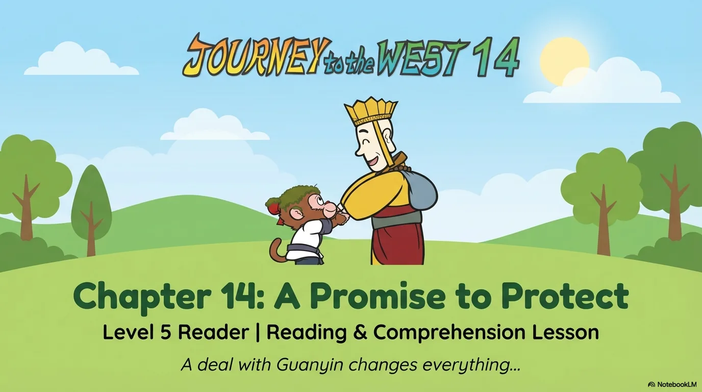
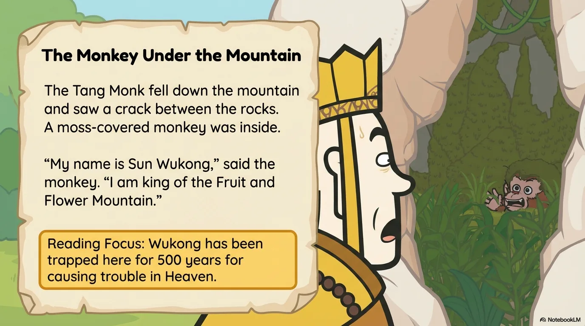
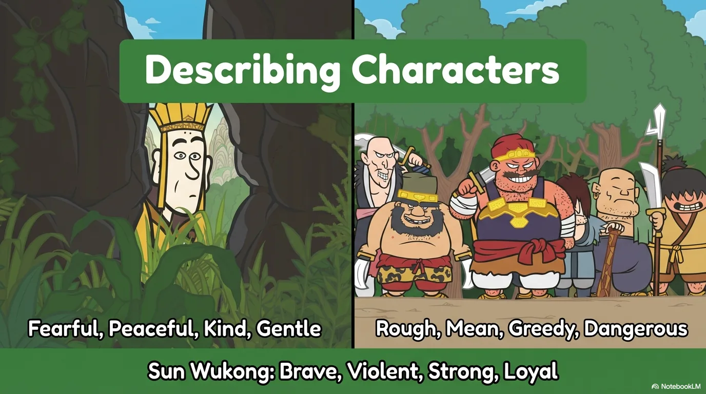
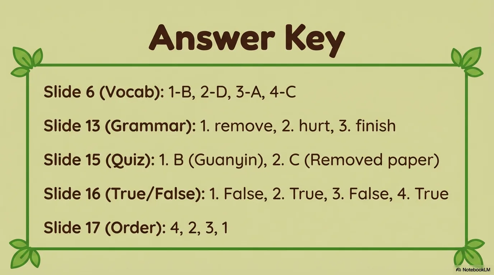

# 豆豆龙英语 · 第 14 集课件（EP014 草稿）

- 来源：`014_Journey to the West 14_A Promise to Protect.pptx`（主课件，20 页）
- OCR：`blocked`（no local OCR provider importable (pytesseract missing): No module named 'pytesseract'）
- 分类：待人工审核（unknown）
- 审核状态：`unreviewed`

## Slide 001

- 来源：`ppt/media/image1.png`（relationship `rId2`）
- 尺寸：1376×768
- 源 SHA-256：`563af1e77f5dc056d48edb6e5b77fbe117a0980738cd0871d4fa104f94241a27`
- 输出 SHA-256：`b9f9222423ec30263008be118ab09cb807bbe782faab2b12f787fca7c155e275`
- 分类：unknown ｜ OCR：blocked ｜ 审核：unreviewed

## Slide 002

- 来源：`ppt/media/image3.png`（relationship `rId2`）
- 尺寸：1376×768
- 源 SHA-256：`215a1efdbdb4b4a78248fc50c697026cb644908ddaf1c53d343edc5482406709`
- 输出 SHA-256：`fe53b5cdaa76872f55075d91330af6c34104992314c2b3ec44ab73b272dcb340`
- 分类：unknown ｜ OCR：blocked ｜ 审核：unreviewed

## Slide 003

- 来源：`ppt/media/image4.png`（relationship `rId2`）
- 尺寸：1376×768
- 源 SHA-256：`d7d0308157f9edc6acdd3a41da18b02724ad2e33668b382c7ba7096430c1d21b`
- 输出 SHA-256：`73fba2b2303c0acf7aa1000c81d1a135881f581b2b2242a770b4479bf8f72bd6`
- 分类：unknown ｜ OCR：blocked ｜ 审核：unreviewed

## Slide 004

- 来源：`ppt/media/image5.png`（relationship `rId2`）
- 尺寸：1376×768
- 源 SHA-256：`bf0e2e79e4e716eed18de02a47bf1a740d87672628c58152c9265e6e8a7a2b6c`
- 输出 SHA-256：`1b8d8b300088da485faa7dd7a3058c0a1861d5ccd0d7bb9143f82de1bc43af15`
- 分类：unknown ｜ OCR：blocked ｜ 审核：unreviewed

## Slide 005

- 来源：`ppt/media/image6.png`（relationship `rId2`）
- 尺寸：1376×768
- 源 SHA-256：`b30689840a12380ec83a6c9a8dc7a480d96dcd7201f0aa30ddb1b301e44d6e1f`
- 输出 SHA-256：`4809c294739004c07bbb0a3a08534b5dacf93c2d3cd182e5f175f35cca7401e9`
- 分类：unknown ｜ OCR：blocked ｜ 审核：unreviewed

## Slide 006

- 来源：`ppt/media/image7.png`（relationship `rId2`）
- 尺寸：1376×768
- 源 SHA-256：`008df5e9c10a2c06a6debe5a8974163240bec70d05c0484330cb9c83dcc5083b`
- 输出 SHA-256：`8fde5eed12239524804417afdc3e0504158912f749e69bd87482f4cabcadd985`
- 分类：unknown ｜ OCR：blocked ｜ 审核：unreviewed

## Slide 007

- 来源：`ppt/media/image8.png`（relationship `rId2`）
- 尺寸：1376×768
- 源 SHA-256：`e99d9cd650b734ba1a7c10a46c55005bc08dcd978f2fab4e9109078b641ddd4b`
- 输出 SHA-256：`231126d46e3e8e864ef64acbe082131ebb6893e5937848364b5517535e4e1763`
- 分类：unknown ｜ OCR：blocked ｜ 审核：unreviewed

## Slide 008

- 来源：`ppt/media/image9.png`（relationship `rId2`）
- 尺寸：1376×768
- 源 SHA-256：`b25a52604825ec2ecb6bff6503c0a01429b6808d8f416906e00e069c887bd5ae`
- 输出 SHA-256：`3a8cb622588c02dd1381f304f6c05a2548f58922612d83b886e32d39166b39f6`
- 分类：unknown ｜ OCR：blocked ｜ 审核：unreviewed

## Slide 009

- 来源：`ppt/media/image10.png`（relationship `rId2`）
- 尺寸：1376×768
- 源 SHA-256：`32d333704d6bb98dec7afdd8463e8e75a1befa924c7776758fd0b6b09e99d63a`
- 输出 SHA-256：`b339b3e6ae1ba873f875f71739a990a766b3cd1ac6d082e2f5e3bf41a8eaa462`
- 分类：unknown ｜ OCR：blocked ｜ 审核：unreviewed

## Slide 010

- 来源：`ppt/media/image11.png`（relationship `rId2`）
- 尺寸：1376×768
- 源 SHA-256：`f1287f5da6bd722f601188c5a06e023655c65cd9d32d0da81aeee8deac57d35f`
- 输出 SHA-256：`faf004994c619d418b70275ca6b559163ab0b0baba652e77faf53723d45dc47a`
- 分类：unknown ｜ OCR：blocked ｜ 审核：unreviewed

## Slide 011

- 来源：`ppt/media/image12.png`（relationship `rId2`）
- 尺寸：1376×768
- 源 SHA-256：`e590ac070fe54a798ab96a52dc4be3d0b55ff1a39ba7f1ef0277b79fe9993729`
- 输出 SHA-256：`d07f6bd27364930122e33283d3b441a6e7a42024e22e6aa683bc141ec04235f8`
- 分类：unknown ｜ OCR：blocked ｜ 审核：unreviewed

## Slide 012

- 来源：`ppt/media/image13.png`（relationship `rId2`）
- 尺寸：1376×768
- 源 SHA-256：`b0d6a92dfbc08d2969f4ffbe463f1b06e940e20cfc280b4b8bbe1dab7ad96c9a`
- 输出 SHA-256：`57d4e4d043f47323dc5836a96c535d1577bdda0074ae3e4addf6f89b5ec47a41`
- 分类：unknown ｜ OCR：blocked ｜ 审核：unreviewed

## Slide 013

- 来源：`ppt/media/image14.png`（relationship `rId2`）
- 尺寸：1376×768
- 源 SHA-256：`54f7d913c7e4e4968d32c53ac88beb6eb3c5b90c48580787e33dde68c167fe32`
- 输出 SHA-256：`01c803f8e9d5c3b5d417aba5e089a1a924348009d5ac982fe0822f68bd264c7a`
- 分类：unknown ｜ OCR：blocked ｜ 审核：unreviewed

## Slide 014

- 来源：`ppt/media/image15.png`（relationship `rId2`）
- 尺寸：1376×768
- 源 SHA-256：`b7409784efc1998271bc2fbb3f5095144bd26f1da0d870aa723f32fa818a9b77`
- 输出 SHA-256：`e9026cf2b82cefb5f23b747c39013a342ba9f531af93687d50658afb0d9d0765`
- 分类：unknown ｜ OCR：blocked ｜ 审核：unreviewed

## Slide 015

- 来源：`ppt/media/image16.png`（relationship `rId2`）
- 尺寸：1376×768
- 源 SHA-256：`1ba3cb31652e6aa3c4321c833eb5fe8e007ed14c3ea1b83246a5fd85483689c5`
- 输出 SHA-256：`6a90cd785df44aa825fd15cd055ecd1d9f1ad116f07a0b89b43f7387ef749582`
- 分类：unknown ｜ OCR：blocked ｜ 审核：unreviewed

## Slide 016

- 来源：`ppt/media/image17.png`（relationship `rId2`）
- 尺寸：1376×768
- 源 SHA-256：`7a437d11ea5059309d179d687021cbca7c17d1be18139f6e990fd8a3cd7195e5`
- 输出 SHA-256：`37c08b21ba7cc29f9e01710be1f71280244e81cfdae01fdea5904646eb493d85`
- 分类：unknown ｜ OCR：blocked ｜ 审核：unreviewed

## Slide 017

- 来源：`ppt/media/image18.png`（relationship `rId2`）
- 尺寸：1376×768
- 源 SHA-256：`5d9e697318843824d43e0e4b10ae1ad142fcad77faae6286290dfd80074fef93`
- 输出 SHA-256：`2c5fc0b0f4974735b9fd91aa670eaa2912b36ff50c793b194059b8516be2826c`
- 分类：unknown ｜ OCR：blocked ｜ 审核：unreviewed

## Slide 018

- 来源：`ppt/media/image19.png`（relationship `rId2`）
- 尺寸：1376×768
- 源 SHA-256：`2775a76bac9a1714ec401aa36079746e0f9136814c4e1fa00bf421ae109be00e`
- 输出 SHA-256：`f491b98937e153ae3f4ef422a3e73625709efb441d125557da80ab3bf2065bf6`
- 分类：unknown ｜ OCR：blocked ｜ 审核：unreviewed

## Slide 019

- 来源：`ppt/media/image20.png`（relationship `rId2`）
- 尺寸：1376×768
- 源 SHA-256：`a1eabee04fdd539520bc57896b3abc1e61a70711e029e645fd4c6ef8114c14b3`
- 输出 SHA-256：`deceda4a3fc81b9020bba1b2e6f55365bc9aa5c7eb621dd2769ecbb2afeaaa23`
- 分类：unknown ｜ OCR：blocked ｜ 审核：unreviewed

## Slide 020

- 来源：`ppt/media/image21.png`（relationship `rId2`）
- 尺寸：1376×768
- 源 SHA-256：`5abc669ca6a70758490f34c2f26b7fe9fecafde945e0dc591fe516d678e4322d`
- 输出 SHA-256：`9deb7a1c05ab69427a2fbd08b92b0e07444b2ebe098ae47c8048a8265d42d7cb`
- 分类：unknown ｜ OCR：blocked ｜ 审核：unreviewed
