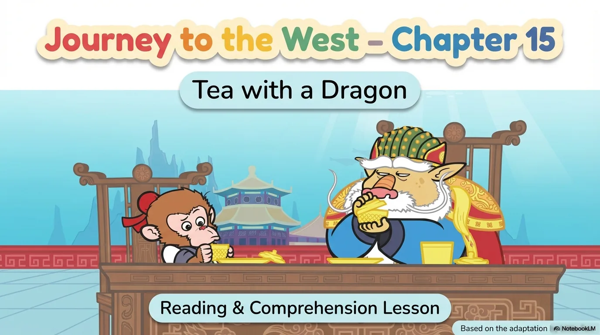
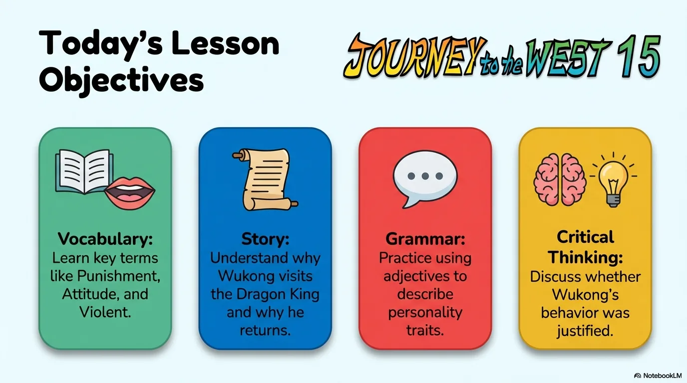
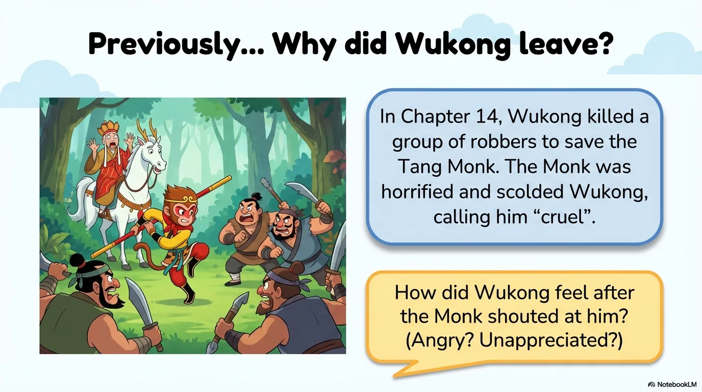
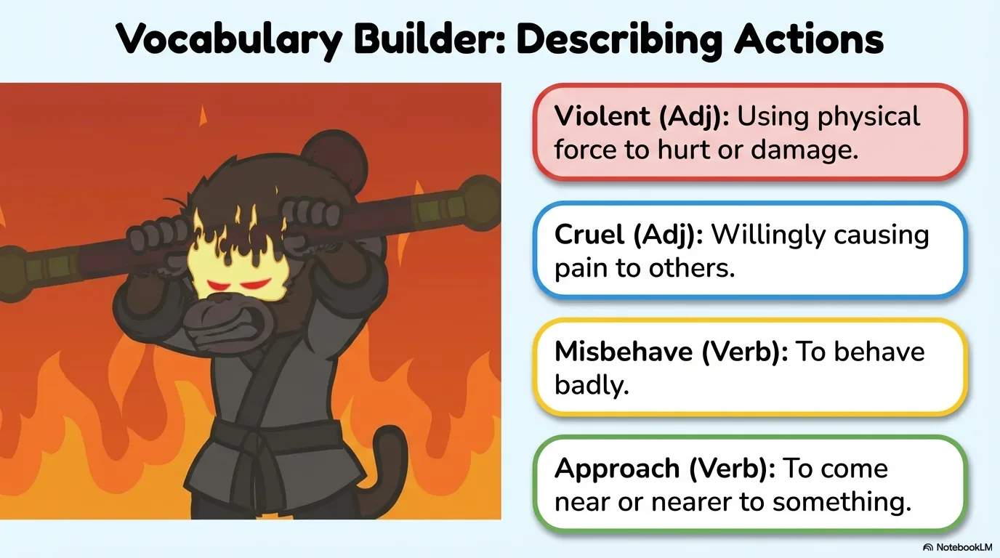
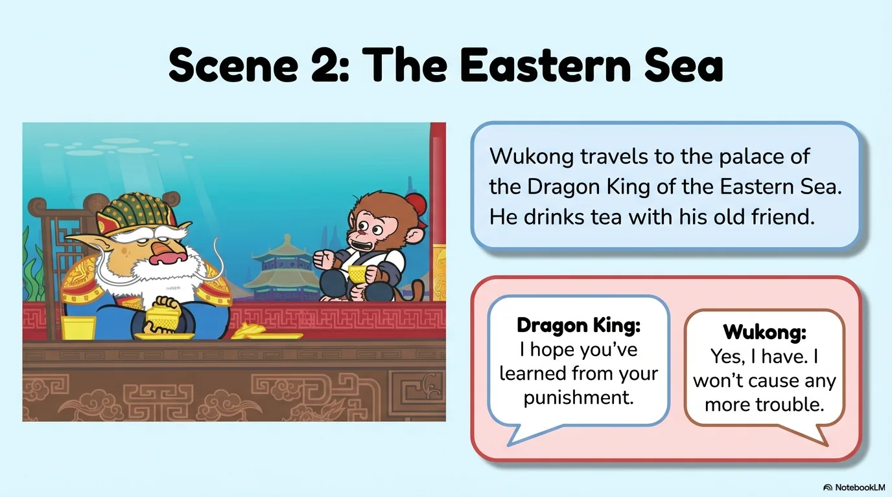
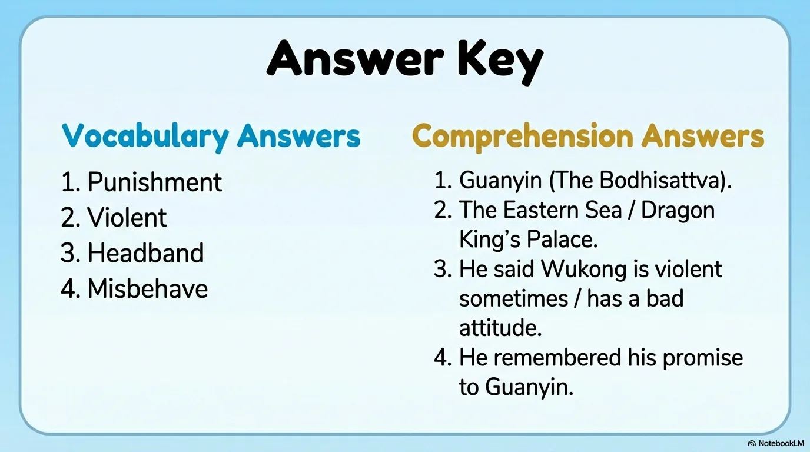

# 豆豆龙英语 · 第 15 集课件（EP015 草稿）

- 来源：`015_Journey to the West 15_Tea with a Dragon.pptx`（主课件，20 页）
- OCR：`blocked`（no local OCR provider importable (pytesseract missing): No module named 'pytesseract'）
- 分类：待人工审核（unknown）
- 审核状态：`unreviewed`

## Slide 001

- 来源：`ppt/media/image1.png`（relationship `rId2`）
- 尺寸：1376×768
- 源 SHA-256：`81f553311e65d92779fddc91732768845d2c198733052b8dc1ee9325ddba1940`
- 输出 SHA-256：`fef95ded665aab6d40f510c124837ddd05b7d3d20204dbd68a8b5aa9af47236f`
- 分类：unknown ｜ OCR：blocked ｜ 审核：unreviewed

## Slide 002

- 来源：`ppt/media/image3.png`（relationship `rId2`）
- 尺寸：1376×768
- 源 SHA-256：`82e6b7e0b4546b57c603a71ead041de7d96203be899df3a4739eb67a54af7125`
- 输出 SHA-256：`5b424a4bfe8312baf2122143fe5c4cb083c4fbf9c49075a7920a97a440e7c0cb`
- 分类：unknown ｜ OCR：blocked ｜ 审核：unreviewed

## Slide 003

- 来源：`ppt/media/image4.png`（relationship `rId2`）
- 尺寸：1376×768
- 源 SHA-256：`7294e8da2b8faa45113f903743cac09d0cf9e6bc169a007ddaf3177ba93d09d1`
- 输出 SHA-256：`9bd0da03f3a115186f9a62b7361ad61b3cc691abbff128ebadd15c792f0bfdd6`
- 分类：unknown ｜ OCR：blocked ｜ 审核：unreviewed

## Slide 004

- 来源：`ppt/media/image5.png`（relationship `rId2`）
- 尺寸：1376×768
- 源 SHA-256：`f392b4caaf3599a55e81183c4b838e6bdd870b4047b664fc85e85b25dbcdebb6`
- 输出 SHA-256：`c970909672803368424c60a76561112027496aa072376cac02e9c0c4ea141c09`
- 分类：unknown ｜ OCR：blocked ｜ 审核：unreviewed

## Slide 005

- 来源：`ppt/media/image6.png`（relationship `rId2`）
- 尺寸：1376×768
- 源 SHA-256：`05c969756e9307f09bba268305c49df1a76efb7cc9f8518edbd53a902b3ff69f`
- 输出 SHA-256：`6b700289e0b922b55b12def36b24a7665bce031b1ae44948c2822fecf3857ada`
- 分类：unknown ｜ OCR：blocked ｜ 审核：unreviewed

## Slide 006

- 来源：`ppt/media/image7.png`（relationship `rId2`）
- 尺寸：1376×768
- 源 SHA-256：`69ac17fc5d267fbd3040e9b44d09608b51e2f9c5ef7be1ac16d8d37d396ee6a4`
- 输出 SHA-256：`4b8f6726671c27f22b9362ea8218d35091e20c75b7a62d3c419262d2cd6d5a7a`
- 分类：unknown ｜ OCR：blocked ｜ 审核：unreviewed

## Slide 007

- 来源：`ppt/media/image8.png`（relationship `rId2`）
- 尺寸：1376×768
- 源 SHA-256：`c3176e4459db60a50729cff0ce57c832edcd3bf790433498c5f2d360f26a1510`
- 输出 SHA-256：`80dc49a6a936421296adda0bd7a67c616d3b918e35123375ea8bb324cffeb246`
- 分类：unknown ｜ OCR：blocked ｜ 审核：unreviewed

## Slide 008

- 来源：`ppt/media/image9.png`（relationship `rId2`）
- 尺寸：1376×768
- 源 SHA-256：`8e1392c3221bceb1ae4cbb045c5932fc262b2d33ff376f2df6f857f6de273ead`
- 输出 SHA-256：`e46e89c87c370acdaa6d09cb2d56125837c535442e0d980d555e7ca4b102ec1c`
- 分类：unknown ｜ OCR：blocked ｜ 审核：unreviewed

## Slide 009

- 来源：`ppt/media/image10.png`（relationship `rId2`）
- 尺寸：1376×768
- 源 SHA-256：`01d9ff413c6d4b763ccb75a3095c30a84429817cd8ab52e75b39152cd63950bc`
- 输出 SHA-256：`e568312f3777a79b7bec746607e9ec84f9b6ba3b3285309089d477eb6739aab0`
- 分类：unknown ｜ OCR：blocked ｜ 审核：unreviewed

## Slide 010

- 来源：`ppt/media/image11.png`（relationship `rId2`）
- 尺寸：1376×768
- 源 SHA-256：`2feb22cd5da52e76b9ce33f4da6dbb9b245a4ded3e324204b9425a2509537d75`
- 输出 SHA-256：`3a1467d0cec8e19db3284c1efcdcd0b044bba4e5da14b1765fe32461421a5b2d`
- 分类：unknown ｜ OCR：blocked ｜ 审核：unreviewed

## Slide 011

- 来源：`ppt/media/image12.png`（relationship `rId2`）
- 尺寸：1376×768
- 源 SHA-256：`e4a92e0ed433f39230f646f489daa803621d8dd001644de3db6d119cb5146d8c`
- 输出 SHA-256：`667aab01b6b4e01576cbe24514f500eb121e32873e93340ba05f09e1a2842ef3`
- 分类：unknown ｜ OCR：blocked ｜ 审核：unreviewed

## Slide 012

- 来源：`ppt/media/image13.png`（relationship `rId2`）
- 尺寸：1376×768
- 源 SHA-256：`5cfcadbcce59ec575d493ce7e57169d66039338eda3c87180bca01b85d48daa3`
- 输出 SHA-256：`fe506f7e5dd4199d27ffd9cd96e0690e088fd0e030ad40e8c91d53441cf9d3b8`
- 分类：unknown ｜ OCR：blocked ｜ 审核：unreviewed

## Slide 013

- 来源：`ppt/media/image14.png`（relationship `rId2`）
- 尺寸：1376×768
- 源 SHA-256：`cf36d6950f8b80882d278d4c47980f6a28565caa91a88dc5a440898f6f37fdfb`
- 输出 SHA-256：`610e420d75e8e7b9ea46c2eab40b2c88f499cfaee73e6e43983a066949af989a`
- 分类：unknown ｜ OCR：blocked ｜ 审核：unreviewed

## Slide 014

- 来源：`ppt/media/image15.png`（relationship `rId2`）
- 尺寸：1376×768
- 源 SHA-256：`0b971cca1cff86c4f0c926660e2da59ccc756cfdfad8ea474825a51c220b4825`
- 输出 SHA-256：`6d3c513348aa48a778a65138e4e0f2be7bd3b681e9364d3b96603b4d1139f3f3`
- 分类：unknown ｜ OCR：blocked ｜ 审核：unreviewed

## Slide 015

- 来源：`ppt/media/image16.png`（relationship `rId2`）
- 尺寸：1376×768
- 源 SHA-256：`50856ffc126ed414b3db1a120cdd9406e66a136615129a6599faf15feb6adc9b`
- 输出 SHA-256：`4a71741268709869b511051cf91acc825ffebfa3fbe2f11ea34b541b6d13fdd9`
- 分类：unknown ｜ OCR：blocked ｜ 审核：unreviewed

## Slide 016

- 来源：`ppt/media/image17.png`（relationship `rId2`）
- 尺寸：1376×768
- 源 SHA-256：`b0f332799cf8c7190b3712d309745177ec4582b399be3d27685da7a2cfa6a2ce`
- 输出 SHA-256：`5fc700e5835d91b3cfa33ce82055bd5940fb5050490fc9dca70e2ec007140343`
- 分类：unknown ｜ OCR：blocked ｜ 审核：unreviewed

## Slide 017

- 来源：`ppt/media/image18.png`（relationship `rId2`）
- 尺寸：1376×768
- 源 SHA-256：`793273f519f825d3dea08249cc905fdcda8765fdcb3d3b3aff49e3d41ebd1325`
- 输出 SHA-256：`d819a215264c193fd8963ee646e4d806f8b2191b7102908e7cf63aae872b0418`
- 分类：unknown ｜ OCR：blocked ｜ 审核：unreviewed

## Slide 018

- 来源：`ppt/media/image19.png`（relationship `rId2`）
- 尺寸：1376×768
- 源 SHA-256：`725e80eab7cb78197dd63b862f9daf24ad884cc53389a38a37878eda0636aa1a`
- 输出 SHA-256：`ce1423d3a95bc052a35e4625419a1ec3bdf86640e0c892ab2e02cc9836f91dea`
- 分类：unknown ｜ OCR：blocked ｜ 审核：unreviewed

## Slide 019

- 来源：`ppt/media/image20.png`（relationship `rId2`）
- 尺寸：1376×768
- 源 SHA-256：`1db0d22ee2935caa40f8c94623dff9ee1e4787c841fffcb5d87c86061a763b4b`
- 输出 SHA-256：`952ef0126e12b04a1553f69ad4a2335e5543dacd32be536d0f84054ee2720a42`
- 分类：unknown ｜ OCR：blocked ｜ 审核：unreviewed

## Slide 020

- 来源：`ppt/media/image21.png`（relationship `rId2`）
- 尺寸：1376×768
- 源 SHA-256：`ac5b788232f928e486c2223f8db61385ba8d162f9afb8625f969255381ab6091`
- 输出 SHA-256：`4dfde15b411f41c2e1ca489a4273153678c4f65c5fac096591500786145fa1fa`
- 分类：unknown ｜ OCR：blocked ｜ 审核：unreviewed
