# 豆豆龙英语 · 第 16 集课件（EP016 草稿）

- 来源：`016_Journey to the West 16_Wukong Gets Tricked.pptx`（主课件，20 页）
- OCR：`blocked`（no local OCR provider importable (pytesseract missing): No module named 'pytesseract'）
- 分类：待人工审核（unknown）
- 审核状态：`unreviewed`

## Slide 001

- 来源：`ppt/media/image1.png`（relationship `rId2`）
- 尺寸：1376×768
- 源 SHA-256：`56678a5546d5f623c5923df0e914e8e0c0be7605e7776ba5909769c846d96dab`
- 输出 SHA-256：`6e6c49471353adabbe04519438d2ad177ea7dc8b12baf1711b3baa4a2fa02a8c`
- 分类：unknown ｜ OCR：blocked ｜ 审核：unreviewed

## Slide 002

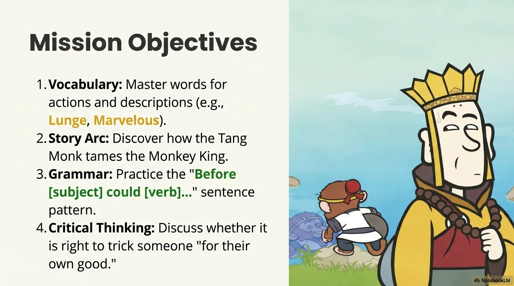

- 来源：`ppt/media/image3.png`（relationship `rId2`）
- 尺寸：1376×768
- 源 SHA-256：`be904820112bd15867255e6a2a96598635a6cf58ff00092278a5fe3fe2f94876`
- 输出 SHA-256：`88b885b3972837b0da335780aa80dc2365befc02f20ab30652a7584a656c7dea`
- 分类：unknown ｜ OCR：blocked ｜ 审核：unreviewed

## Slide 003

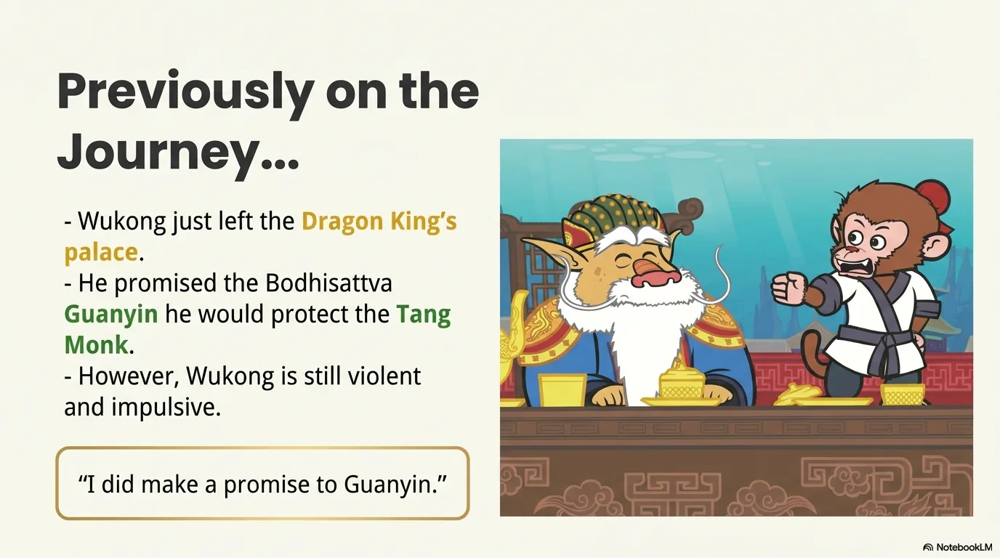

- 来源：`ppt/media/image4.png`（relationship `rId2`）
- 尺寸：1376×768
- 源 SHA-256：`276393dc1cc41b5f7d224b93a01f95516fc2d42b5ddf7837464c129683d8eb32`
- 输出 SHA-256：`e8af2600a89c672ad4571a1b8e49ef3787056fa7297b57a93a4c22ac514d7a25`
- 分类：unknown ｜ OCR：blocked ｜ 审核：unreviewed

## Slide 004

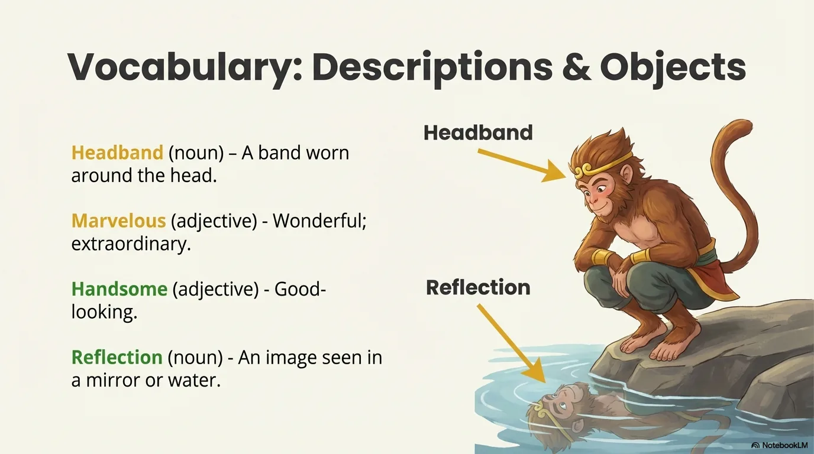

- 来源：`ppt/media/image5.png`（relationship `rId2`）
- 尺寸：1376×768
- 源 SHA-256：`129fea61e7ccc9d7f085dcaa3b89b6b4008e34e170d8cb4596a94131a36abbe9`
- 输出 SHA-256：`c1218b963e4b37fcff1a932b90a2b7c034677f0b88628a6646b273febb3b0b54`
- 分类：unknown ｜ OCR：blocked ｜ 审核：unreviewed

## Slide 005

- 来源：`ppt/media/image6.png`（relationship `rId2`）
- 尺寸：1376×768
- 源 SHA-256：`86090a31eb8529921b7cea168f32eaf410075f73a145e0c2b6d3ef75e8dcd4c4`
- 输出 SHA-256：`ba639e543e4fe70ee67b1151848d322ad910b68f25a91eb9183cf338b9ade987`
- 分类：unknown ｜ OCR：blocked ｜ 审核：unreviewed

## Slide 006

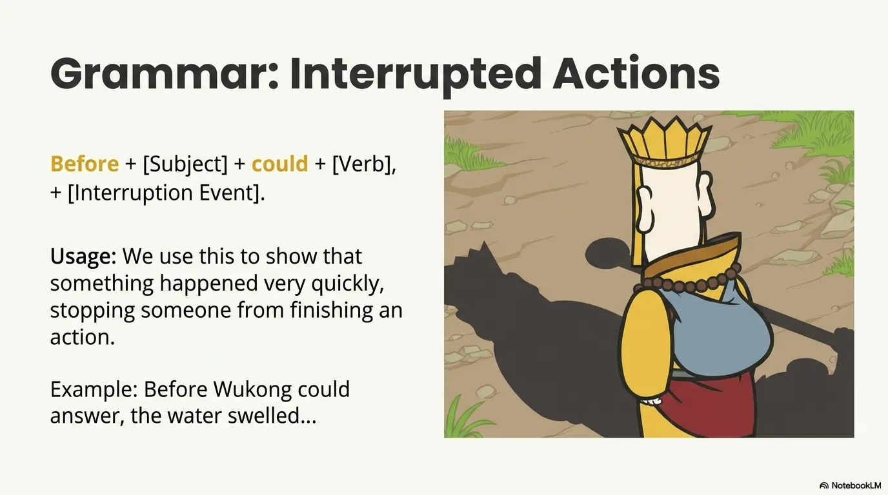

- 来源：`ppt/media/image7.png`（relationship `rId2`）
- 尺寸：1376×768
- 源 SHA-256：`5028285af95f107dc8526105f0defea04696a95051b3c72565629fe68fda18ef`
- 输出 SHA-256：`852eee321501fe7dc424bd0fe5aa2dd64fe4db0fc846795d03441d6ffbf31811`
- 分类：unknown ｜ OCR：blocked ｜ 审核：unreviewed

## Slide 007

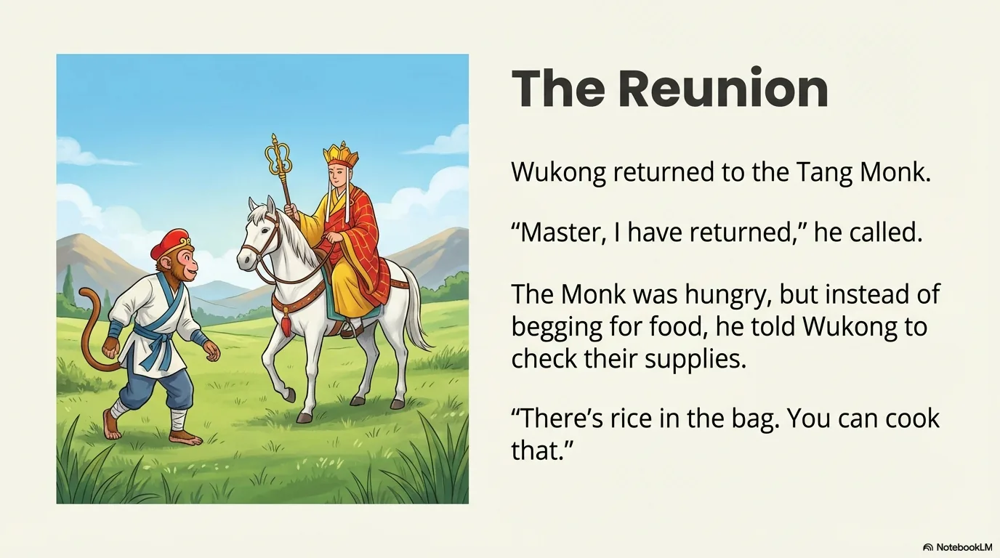

- 来源：`ppt/media/image8.png`（relationship `rId2`）
- 尺寸：1376×768
- 源 SHA-256：`c29cb8ddb54f1c0016fdf6dd6dcd0553e09f3f44fcaea078b19ff143e6f61dcb`
- 输出 SHA-256：`9e9f0f14d88fb2c319b95a7594a8d50b2abfe3e0fa4fd9ef6c4fb0d78cfba100`
- 分类：unknown ｜ OCR：blocked ｜ 审核：unreviewed

## Slide 008

- 来源：`ppt/media/image9.png`（relationship `rId2`）
- 尺寸：1376×768
- 源 SHA-256：`9a941cda8614bc990e836e88c7f9de17fb84a985b900c18b8a4eeb34dc92e7d9`
- 输出 SHA-256：`ddff9d5f2d0ea853cffea646fa9d001c7d59930904e8d5fed1577d58d598fda2`
- 分类：unknown ｜ OCR：blocked ｜ 审核：unreviewed

## Slide 009

- 来源：`ppt/media/image10.png`（relationship `rId2`）
- 尺寸：1376×768
- 源 SHA-256：`19df201aee88e56ce00aa2184935c94973d2a2fe46d0a2cc7928d52771a53033`
- 输出 SHA-256：`effd87c530822cd47b5f81a69761f12a3344616bc96c748e4f46d64d1e9328a7`
- 分类：unknown ｜ OCR：blocked ｜ 审核：unreviewed

## Slide 010

- 来源：`ppt/media/image11.png`（relationship `rId2`）
- 尺寸：1376×768
- 源 SHA-256：`f15582eb5d295b2d7b8fbd2c12f91d3210b6432f6a665b8cd1334dfec1b58d7a`
- 输出 SHA-256：`b3eed79ba1e43ef9315aa3cfddb0f4214b1687a452717923209d8d4810a3619a`
- 分类：unknown ｜ OCR：blocked ｜ 审核：unreviewed

## Slide 011

- 来源：`ppt/media/image12.png`（relationship `rId2`）
- 尺寸：1376×768
- 源 SHA-256：`fff62d93170326edd8a4348a5c77e21da76cedbabad9accf2a0c10a99ee76338`
- 输出 SHA-256：`1898c97c039b6f066694a273fc18c686c9e3b220acc4b7326d59586918cba858`
- 分类：unknown ｜ OCR：blocked ｜ 审核：unreviewed

## Slide 012

- 来源：`ppt/media/image13.png`（relationship `rId2`）
- 尺寸：1376×768
- 源 SHA-256：`7829a96f58e4ea15782f9913246a5c55c7e7df9678ff84dea89970ba4efe03b8`
- 输出 SHA-256：`f731bc42590bdc6987857005ac7ece3732f4ec4b4889976d975e24ec6aa28d5e`
- 分类：unknown ｜ OCR：blocked ｜ 审核：unreviewed

## Slide 013

- 来源：`ppt/media/image14.png`（relationship `rId2`）
- 尺寸：1376×768
- 源 SHA-256：`32f9a2a0222eb99f51648858938fb6ab0390ed7469b7a3a3f906cf8ec3ef188f`
- 输出 SHA-256：`6cc3570fc3aaf8c2e79374c062299f44f65fc6393127562e56183655dcbc45e2`
- 分类：unknown ｜ OCR：blocked ｜ 审核：unreviewed

## Slide 014

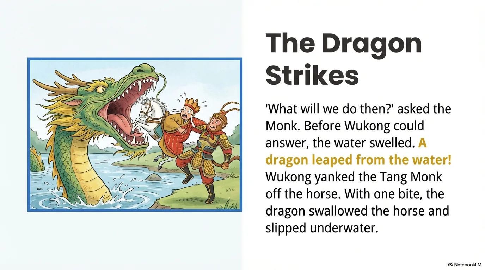

- 来源：`ppt/media/image15.png`（relationship `rId2`）
- 尺寸：1376×768
- 源 SHA-256：`0192269257829c43bff9510e4aad18fc56c8304b25906d7b67d274fe3be763be`
- 输出 SHA-256：`4a7e8e4d48c41add595a89e05cf9a7f5bb31e573282f40e6723596d185b6039d`
- 分类：unknown ｜ OCR：blocked ｜ 审核：unreviewed

## Slide 015

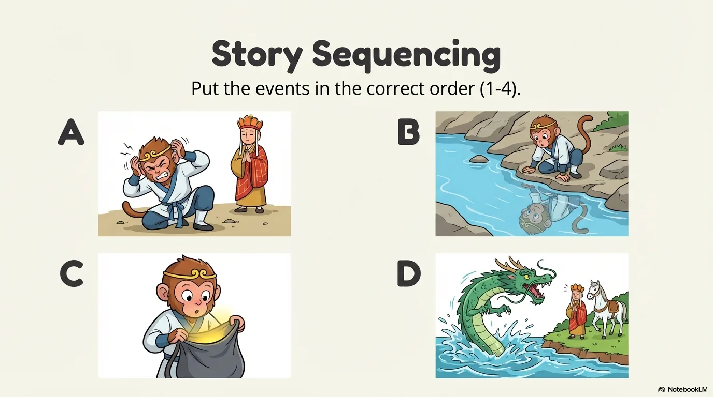

- 来源：`ppt/media/image16.png`（relationship `rId2`）
- 尺寸：1376×768
- 源 SHA-256：`2e1d8dbab51fdc7984cacc714078fe62a7e071d80fcec40e91b1b8ba76c23752`
- 输出 SHA-256：`19f6a6cd4214849d42d3a5d082b1813e59e6b2ae004d693046c208219c1a4842`
- 分类：unknown ｜ OCR：blocked ｜ 审核：unreviewed

## Slide 016

- 来源：`ppt/media/image17.png`（relationship `rId2`）
- 尺寸：1376×768
- 源 SHA-256：`5d992b7b17609de9a2f5d44ca8b4b31d27a9d49ca0d8651ff50bc259aae116c8`
- 输出 SHA-256：`946d44e1e02cfc87fbee795c7a3bb75931283294c74cc9959155cf4d66ddb8a3`
- 分类：unknown ｜ OCR：blocked ｜ 审核：unreviewed

## Slide 017

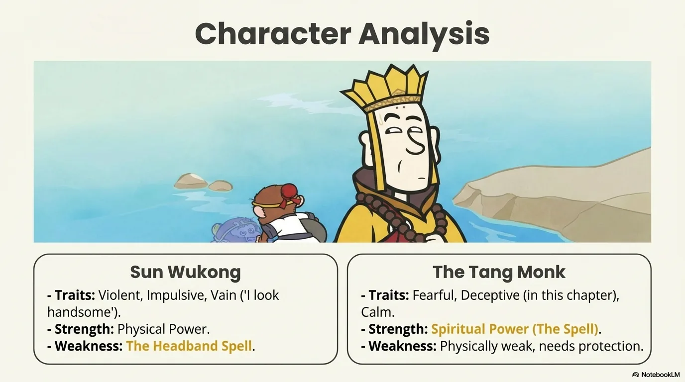

- 来源：`ppt/media/image18.png`（relationship `rId2`）
- 尺寸：1376×768
- 源 SHA-256：`6d33c65d79ff616969d09bbc7094c5a7be6bcd0e7b6c279bcea65e58a62ac8bd`
- 输出 SHA-256：`51d74d7ba75c2816a1e559ca79fe408ae2bb9b783bc1a57420325f21e0d9f722`
- 分类：unknown ｜ OCR：blocked ｜ 审核：unreviewed

## Slide 018

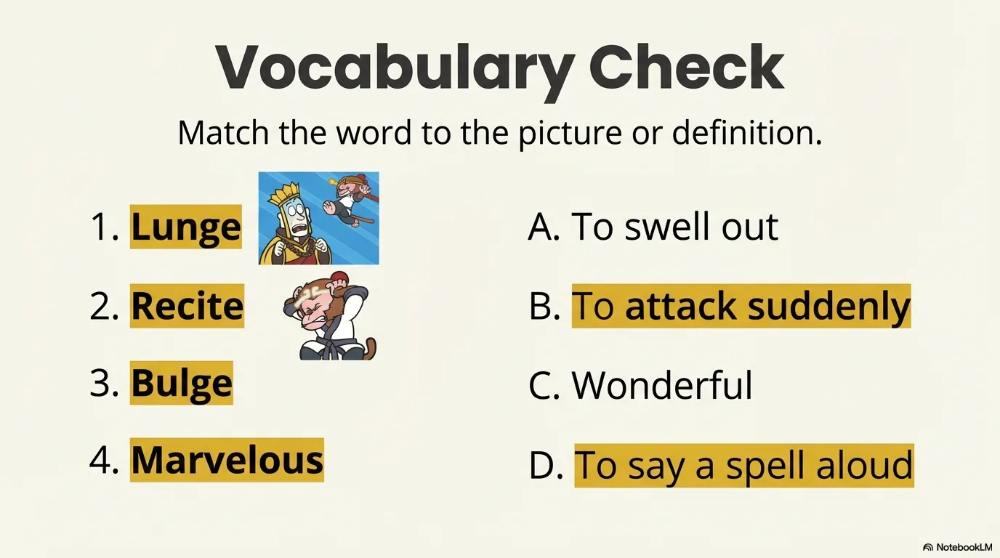

- 来源：`ppt/media/image19.png`（relationship `rId2`）
- 尺寸：1376×768
- 源 SHA-256：`041f09aeb4e99bb88787d39a07795204b06f603790bb56d77bbcfef09e3fe99d`
- 输出 SHA-256：`38a7058ff23adc4c54864029b8281f22448753b3935d32f0a23dd599382f23e3`
- 分类：unknown ｜ OCR：blocked ｜ 审核：unreviewed

## Slide 019

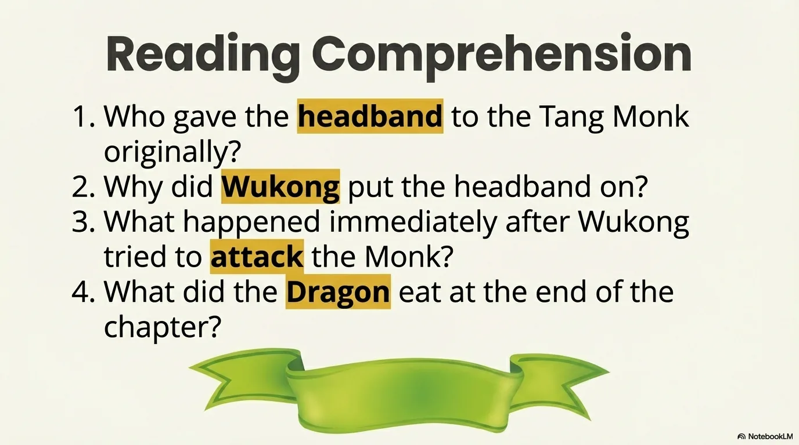

- 来源：`ppt/media/image20.png`（relationship `rId2`）
- 尺寸：1376×768
- 源 SHA-256：`02fe42a489dafa4146e355343b9aec00e88f3c47947b6349a948f3aaa6c71e7c`
- 输出 SHA-256：`7513dbb33b59f70ce29cb03e690d4f3474526c2eebb8e76f0c54e952e51964b5`
- 分类：unknown ｜ OCR：blocked ｜ 审核：unreviewed

## Slide 020

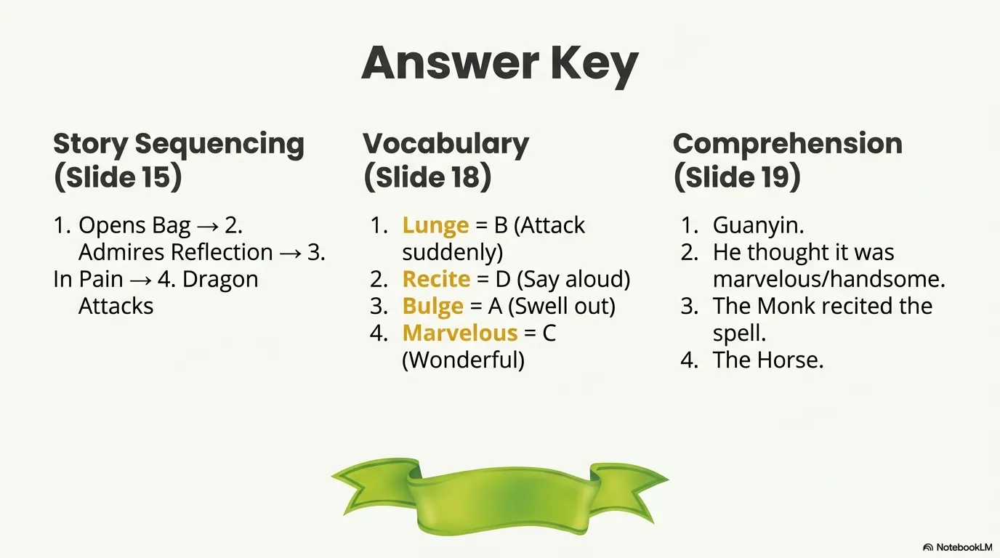

- 来源：`ppt/media/image21.png`（relationship `rId2`）
- 尺寸：1376×768
- 源 SHA-256：`0f8e0b115ba70ce0f208813086914502e7e5bc8b33c2df38b5ea9c10b5b1cabc`
- 输出 SHA-256：`a187413028873bc726738e99b15c2e24d92e492e9f30e827d972bb3121414d38`
- 分类：unknown ｜ OCR：blocked ｜ 审核：unreviewed
