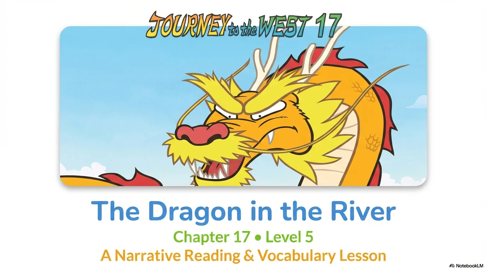
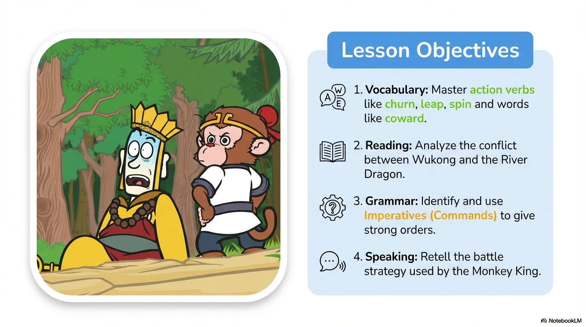
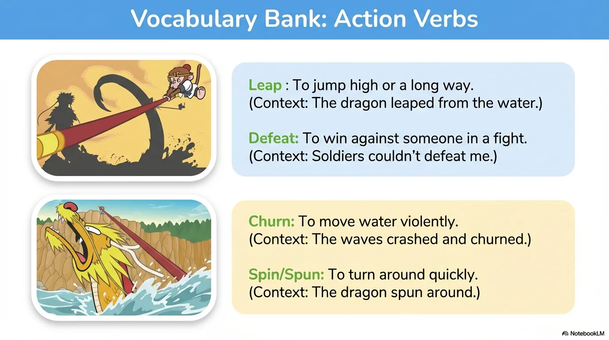
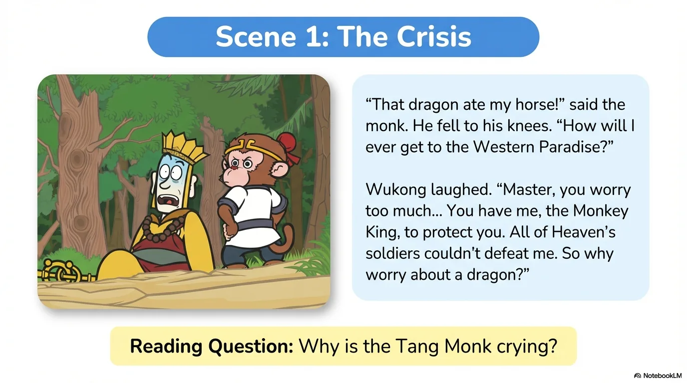
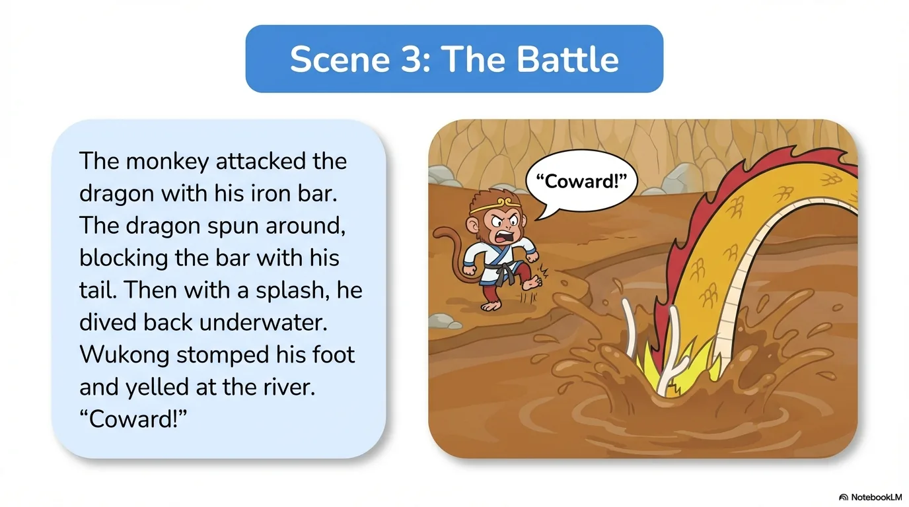
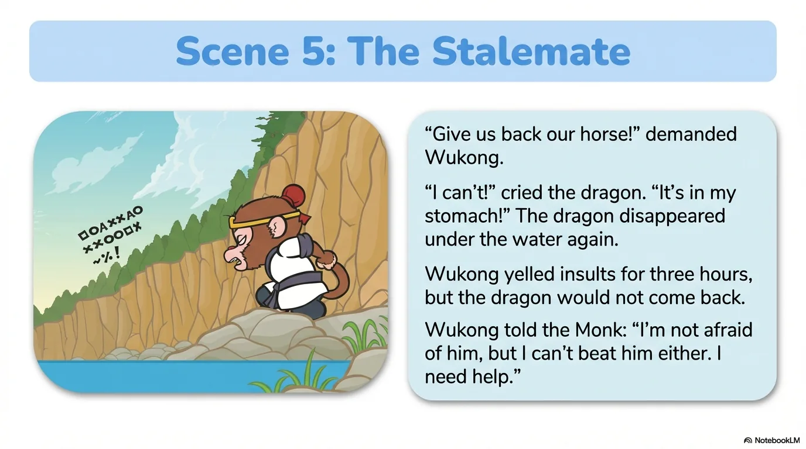
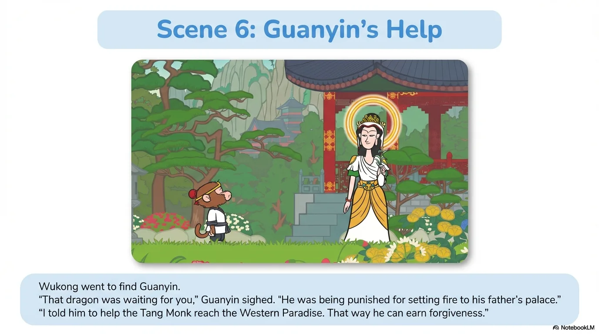

# 豆豆龙英语 · 第 17 集课件（EP017 草稿）

- 来源：`017_Journey to the West 17_The Dragon in the River.pptx`（主课件，15 页）
- OCR：`blocked`（no local OCR provider importable (pytesseract missing): No module named 'pytesseract'）
- 分类：待人工审核（unknown）
- 审核状态：`unreviewed`

## Slide 001

- 来源：`ppt/media/image1.png`（relationship `rId2`）
- 尺寸：1376×768
- 源 SHA-256：`785bab8855ae4379e7a67f32a01d38614d76367719b2634e5c4f1fe682fc31de`
- 输出 SHA-256：`3b97f0fc1c0e4dacb92852d6e37101eaa6b73d2c6b1b85203160fd955ad5d0b5`
- 分类：unknown ｜ OCR：blocked ｜ 审核：unreviewed

## Slide 002

- 来源：`ppt/media/image3.png`（relationship `rId2`）
- 尺寸：1376×768
- 源 SHA-256：`3d8b4f61468bfd2fbb3ec1cc6560adabdea239af13e3381af1f246fae98f8e1e`
- 输出 SHA-256：`ce4ee5bbebb27e62f0e4221bd6d1195f8d9bce18d1ae36cf7fd429f54660aaed`
- 分类：unknown ｜ OCR：blocked ｜ 审核：unreviewed

## Slide 003

- 来源：`ppt/media/image4.png`（relationship `rId2`）
- 尺寸：1376×768
- 源 SHA-256：`39b1774a1ba2d7e3ca913aebc1be9e0001252986a8939d20904639b1cac7e86d`
- 输出 SHA-256：`40b8042076cf8a4153c391a6e397c2b52ae8431efbfce597cd0c6059b003232f`
- 分类：unknown ｜ OCR：blocked ｜ 审核：unreviewed

## Slide 004

- 来源：`ppt/media/image5.png`（relationship `rId2`）
- 尺寸：1376×768
- 源 SHA-256：`82ae64f2c4b94f99324039f1ebbace3597fefc12ad9982697541e8ef7944121e`
- 输出 SHA-256：`15a8c83f1bb21e7a80ec6b2411719d448b04612a610d1ed63aa369e9f7eb9d93`
- 分类：unknown ｜ OCR：blocked ｜ 审核：unreviewed

## Slide 005

- 来源：`ppt/media/image6.png`（relationship `rId2`）
- 尺寸：1376×768
- 源 SHA-256：`f897e0d2dac587b37d440538c5dba53df53d8fced1946e323bc4b2fa884a044d`
- 输出 SHA-256：`e5265c81eaa1accc735079d0642bc6b75b58617df0a3f77005bd6e91a36819be`
- 分类：unknown ｜ OCR：blocked ｜ 审核：unreviewed

## Slide 006

- 来源：`ppt/media/image7.png`（relationship `rId2`）
- 尺寸：1376×768
- 源 SHA-256：`266758ef4620ebc740e020b8a3e2c76cb27f3d5ad06078c5b6a207b5c69dc8ec`
- 输出 SHA-256：`b63bf8bede5ec7923b5f3dadce1430bc4c2fa22fbf104b0a215fa507a1044030`
- 分类：unknown ｜ OCR：blocked ｜ 审核：unreviewed

## Slide 007

- 来源：`ppt/media/image8.png`（relationship `rId2`）
- 尺寸：1376×768
- 源 SHA-256：`8e5283d24c8a59a8e56eb2bd6afa6cd3c7bb2f27cbaf1b88588dd3fda01ff46f`
- 输出 SHA-256：`d9769d67f76c3950e32fe9ed49aa877a886f1d84e8e1aa56eea7fe6d89ff2779`
- 分类：unknown ｜ OCR：blocked ｜ 审核：unreviewed

## Slide 008

- 来源：`ppt/media/image9.png`（relationship `rId2`）
- 尺寸：1376×768
- 源 SHA-256：`c9166f96f79f62945b7ae9135c2fc57fa590cb574500f495005104c5c2f7734a`
- 输出 SHA-256：`d69bb851639afa30ccffb7a82924ddb92ef7d2427aad4123a51b84d2831230c7`
- 分类：unknown ｜ OCR：blocked ｜ 审核：unreviewed

## Slide 009

- 来源：`ppt/media/image10.png`（relationship `rId2`）
- 尺寸：1376×768
- 源 SHA-256：`bd8193f0fe5d63f75b1d3205acd7d11429839543765ab641b0514b8df4005b7d`
- 输出 SHA-256：`f51e2763de0e3497eb84578981b620788d8a79ba0ce99f96c2eb4111915b4eef`
- 分类：unknown ｜ OCR：blocked ｜ 审核：unreviewed

## Slide 010

- 来源：`ppt/media/image11.png`（relationship `rId2`）
- 尺寸：1376×768
- 源 SHA-256：`bded94d23fdabdb665b3814b15c951dc984d33f8dfaa82f91e7bc47910ace092`
- 输出 SHA-256：`9f83229d7340d84dd1a5c402e6d0a9c745ee8e8bec5e6bf77498038d59c68d8f`
- 分类：unknown ｜ OCR：blocked ｜ 审核：unreviewed

## Slide 011

- 来源：`ppt/media/image12.png`（relationship `rId2`）
- 尺寸：1376×768
- 源 SHA-256：`8c57471a99e4cfc642d86e6fde5d6c088b80f5b47ff74c2cc5d40580c14cc078`
- 输出 SHA-256：`df8804595b621d5ba57642568e4df9b71ede2d7701fef3d1adab57525edf23b8`
- 分类：unknown ｜ OCR：blocked ｜ 审核：unreviewed

## Slide 012

- 来源：`ppt/media/image13.png`（relationship `rId2`）
- 尺寸：1376×768
- 源 SHA-256：`f14f88127df5e496c8414316b361812d3b77645d0238be493ed6981c6c5ce40c`
- 输出 SHA-256：`ef7f46af7833ac02683bdbee1e66ab0bfafdacb16e04992b80a82ce3d3a73180`
- 分类：unknown ｜ OCR：blocked ｜ 审核：unreviewed

## Slide 013

- 来源：`ppt/media/image14.png`（relationship `rId2`）
- 尺寸：1376×768
- 源 SHA-256：`d6f0a72e2e875a2c589dd9bdfd199b8f65cf3ebedf37685140e89b9a88ffabed`
- 输出 SHA-256：`2b655b4f0ff74cf93d50bb3ee2045d074a2de0d2685d697a6fd21138b49487f5`
- 分类：unknown ｜ OCR：blocked ｜ 审核：unreviewed

## Slide 014

- 来源：`ppt/media/image15.png`（relationship `rId2`）
- 尺寸：1376×768
- 源 SHA-256：`a00aa735d5e309b9d787a7ee3daa736f1657d7d9011404fe11fb0a1ea0ab37a5`
- 输出 SHA-256：`23c33ffe1a9842b85f351b11a016ed82a94981aee7518af0844f08b3b02665a1`
- 分类：unknown ｜ OCR：blocked ｜ 审核：unreviewed

## Slide 015

- 来源：`ppt/media/image16.png`（relationship `rId2`）
- 尺寸：1376×768
- 源 SHA-256：`fbc42404527e9ae54ca1f2bf16a98cf83ef1ccbfe32d975389d245afcdc55d1d`
- 输出 SHA-256：`07661c78344624c44da803bceb5484d2e58501d2d11a0a971f51ab398bf7da3e`
- 分类：unknown ｜ OCR：blocked ｜ 审核：unreviewed
