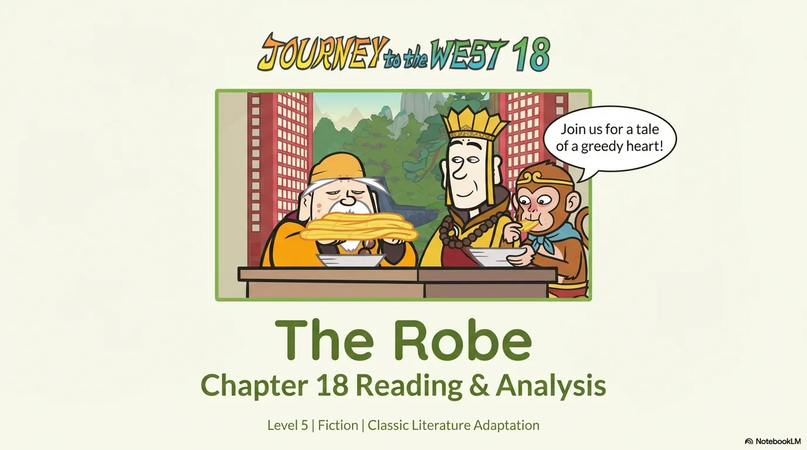
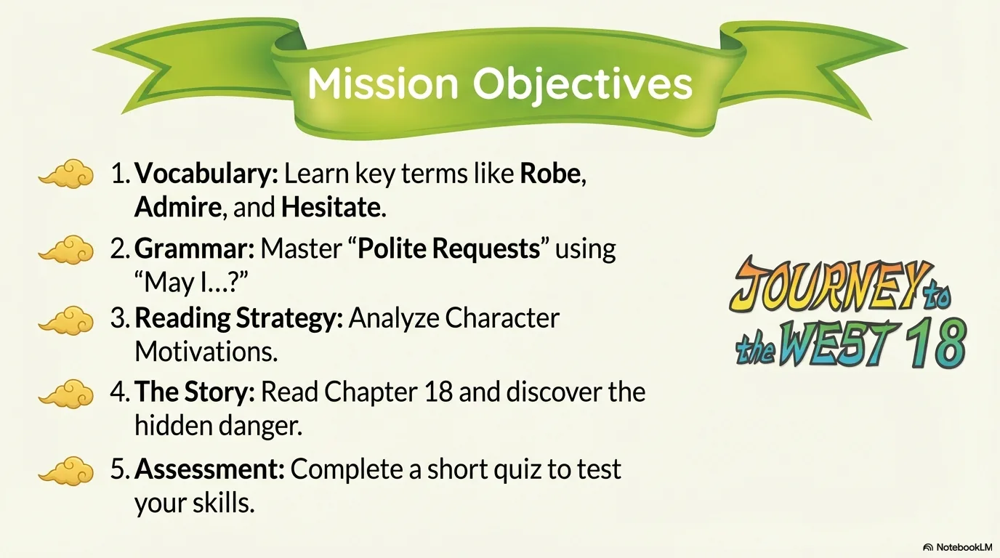
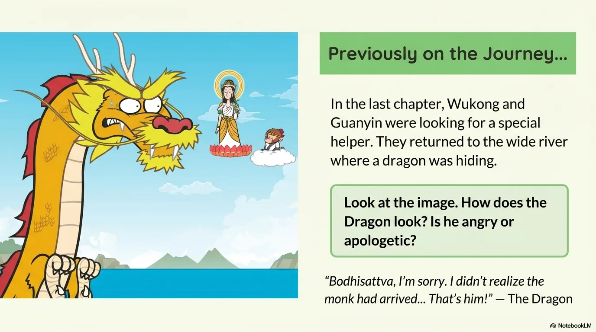
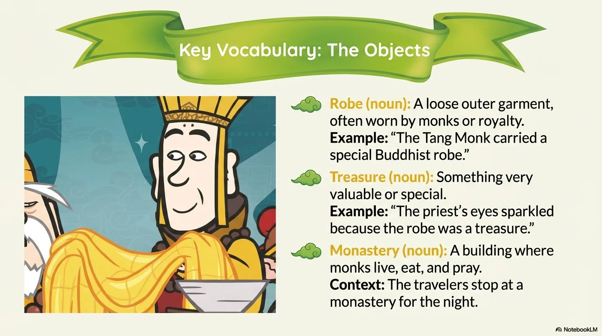
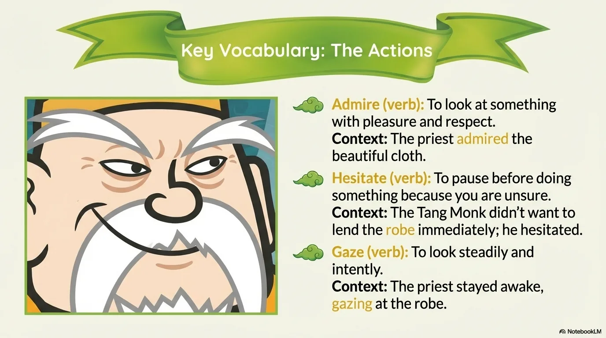
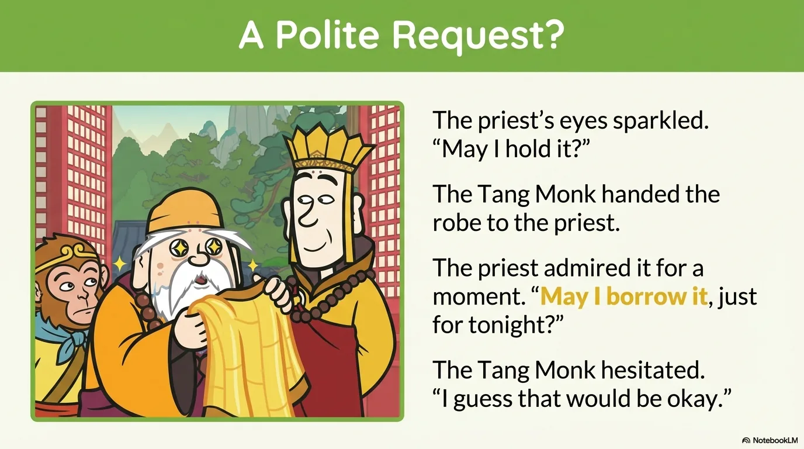
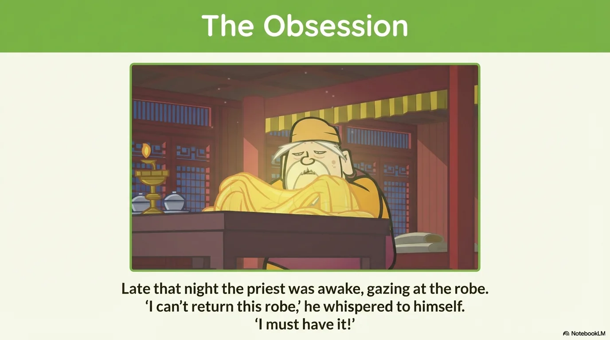
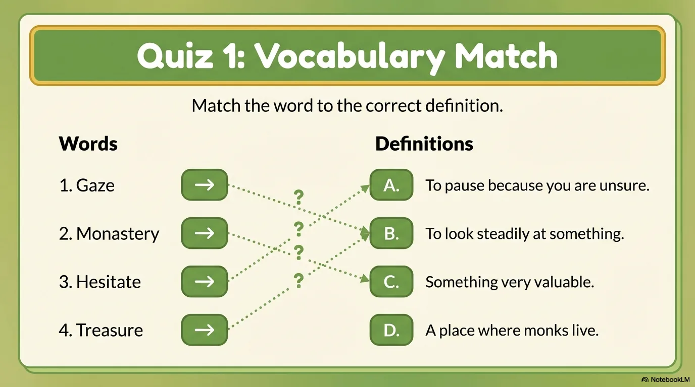
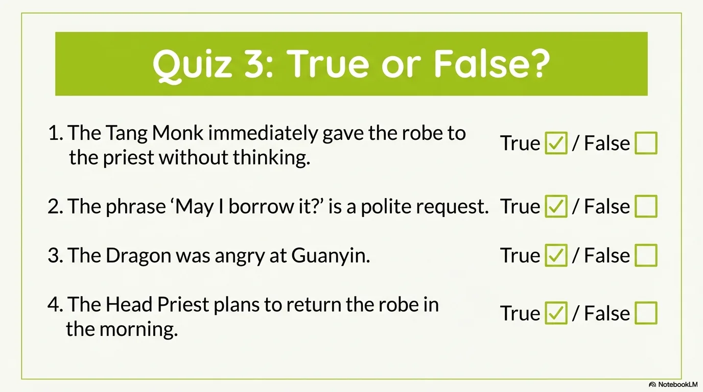
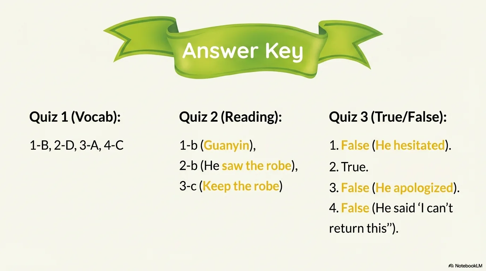

# 豆豆龙英语 · 第 18 集课件（EP018 草稿）

- 来源：`018_Journey to the West 18_The Robe.pptx`（主课件，20 页）
- OCR：`blocked`（no local OCR provider importable (pytesseract missing): No module named 'pytesseract'）
- 分类：待人工审核（unknown）
- 审核状态：`unreviewed`

## Slide 001

- 来源：`ppt/media/image1.png`（relationship `rId2`）
- 尺寸：1376×768
- 源 SHA-256：`e02180e385f54953ef71a2ebe571ea045708309447de5f0d5ed41e565ba9913d`
- 输出 SHA-256：`d7cbe5f2165307b98f3b1e2b4e5b2c983e0957f55dd98a73d9ba879116edab5d`
- 分类：unknown ｜ OCR：blocked ｜ 审核：unreviewed

## Slide 002

- 来源：`ppt/media/image3.png`（relationship `rId2`）
- 尺寸：1376×768
- 源 SHA-256：`2361d81c7e3442b3a0685ccf57fc9b8599aa963b4c7ffb95251fb1f175708c19`
- 输出 SHA-256：`1ed447ffac5c5635ff65980fe8b2051358ecb034902a4a502e9ba9128fb3d132`
- 分类：unknown ｜ OCR：blocked ｜ 审核：unreviewed

## Slide 003

- 来源：`ppt/media/image4.png`（relationship `rId2`）
- 尺寸：1376×768
- 源 SHA-256：`60c8c7351ba0cfb0fe359d97cc66a34d4d1b867768018876550fda5570d03b51`
- 输出 SHA-256：`26d01d460f5c10cee19d5a6e2c48bd5381f35e30f6a7aa036903e39faf753859`
- 分类：unknown ｜ OCR：blocked ｜ 审核：unreviewed

## Slide 004

- 来源：`ppt/media/image5.png`（relationship `rId2`）
- 尺寸：1376×768
- 源 SHA-256：`3ce2a8bfde923e2bfa8635bca3907898d20fc1ead44736455fcefcbe15f0bfe1`
- 输出 SHA-256：`f168092f6aeed4111b205ba7032afd789476d10a1d5845bcc09cdf07aeea1e7c`
- 分类：unknown ｜ OCR：blocked ｜ 审核：unreviewed

## Slide 005

- 来源：`ppt/media/image6.png`（relationship `rId2`）
- 尺寸：1376×768
- 源 SHA-256：`1b28e06ece894d101f4a1b7a5a90c0ec1c7eb51f5596a2fe9fe7d287100c221a`
- 输出 SHA-256：`a0da868c0a86498fd54a76947d58a3cf54818ba8de2b508109c9f5051ea5a12f`
- 分类：unknown ｜ OCR：blocked ｜ 审核：unreviewed

## Slide 006

- 来源：`ppt/media/image7.png`（relationship `rId2`）
- 尺寸：1376×768
- 源 SHA-256：`fd58252cdc7a875a553bec92e33ff8d4daee8547000721f2351f6a337478201e`
- 输出 SHA-256：`9735a035aad4d6a02cebb12f17792a5968ad5f898232095a506e022d8f6b2210`
- 分类：unknown ｜ OCR：blocked ｜ 审核：unreviewed

## Slide 007

- 来源：`ppt/media/image8.png`（relationship `rId2`）
- 尺寸：1376×768
- 源 SHA-256：`71361e963800b556ed5c96f72b556ebe90fdad0d6e1ae7ce9b4a4dccc6ec4318`
- 输出 SHA-256：`b2d0a68296e9142064acfea7032110dac4211ea65db7d088497b9182bdec971d`
- 分类：unknown ｜ OCR：blocked ｜ 审核：unreviewed

## Slide 008

- 来源：`ppt/media/image9.png`（relationship `rId2`）
- 尺寸：1376×768
- 源 SHA-256：`12c48203d9d48b9384dcab126acd2c14613d584fe96cfdb06fbe149cc5f5309e`
- 输出 SHA-256：`37bfb4d8e8b535bd15b0529bc07a2d9ca133d9afb9ede1528fe2440e4d741ef0`
- 分类：unknown ｜ OCR：blocked ｜ 审核：unreviewed

## Slide 009

- 来源：`ppt/media/image10.png`（relationship `rId2`）
- 尺寸：1376×768
- 源 SHA-256：`a8a6a475c2c7cee8fb637cf5fa95c027b6a70a022fe2a95a2e9c5a9d33f64b52`
- 输出 SHA-256：`ac63a1a2d7edf8090bd1ea1ef01403bd2dfbc5f306ee900ff8561c4eca9e16a3`
- 分类：unknown ｜ OCR：blocked ｜ 审核：unreviewed

## Slide 010

- 来源：`ppt/media/image11.png`（relationship `rId2`）
- 尺寸：1376×768
- 源 SHA-256：`470febdf8423bae547568558e326a9f85ac6f037f071ffd7e91225ae1479a3d0`
- 输出 SHA-256：`2650bd8b2c6ed624bd8253823f212786ee124cc832a1232f69808823638b83f2`
- 分类：unknown ｜ OCR：blocked ｜ 审核：unreviewed

## Slide 011

- 来源：`ppt/media/image12.png`（relationship `rId2`）
- 尺寸：1376×768
- 源 SHA-256：`aa01bfa3c350e3db590095be8554387543114b5b9639ac653a02f3072f364abb`
- 输出 SHA-256：`afd58719bb08f0f9e5e77ab5132b805a848da2e6a908eda60b0158c7acd0b2d1`
- 分类：unknown ｜ OCR：blocked ｜ 审核：unreviewed

## Slide 012

- 来源：`ppt/media/image13.png`（relationship `rId2`）
- 尺寸：1376×768
- 源 SHA-256：`6f7cdb2baef9cff3b277a6ddd33832d6f153d878f20d2086da8d22b3a46da599`
- 输出 SHA-256：`95bce80f2a033d2c6c831b08f50eb0d639250bdf6563eb6f5755f85c13ecf328`
- 分类：unknown ｜ OCR：blocked ｜ 审核：unreviewed

## Slide 013

- 来源：`ppt/media/image14.png`（relationship `rId2`）
- 尺寸：1376×768
- 源 SHA-256：`5786d9e172569afe748ab625f451903894fc5db660e0919973c55c2df0da7a46`
- 输出 SHA-256：`e2322118784f88ea114ddb4f8d44ab2da774804592dc2e823bcbd323a6ec5cf5`
- 分类：unknown ｜ OCR：blocked ｜ 审核：unreviewed

## Slide 014

- 来源：`ppt/media/image15.png`（relationship `rId2`）
- 尺寸：1376×768
- 源 SHA-256：`4d884435f55ce6f2567891e2c4b96f9b90a08886f4dfd561cd522f9cdc308664`
- 输出 SHA-256：`e0bd8dd88ce89f852f32ed9f6ebfa8a06edb4f676fa97ad7602b1c5d7eff39cf`
- 分类：unknown ｜ OCR：blocked ｜ 审核：unreviewed

## Slide 015

- 来源：`ppt/media/image16.png`（relationship `rId2`）
- 尺寸：1376×768
- 源 SHA-256：`8c5a0962dc75fdfa02818d50bc5653c3970be161e2d68cf121be3fa4abe99051`
- 输出 SHA-256：`1c3f45c10c0efa3f5f391993622d8c86b749fd1090fd156398da8d483af47cf4`
- 分类：unknown ｜ OCR：blocked ｜ 审核：unreviewed

## Slide 016

- 来源：`ppt/media/image17.png`（relationship `rId2`）
- 尺寸：1376×768
- 源 SHA-256：`283510994c8d55304cc87100b7b307619a0ab6f0b46e28f64ef0cd6a5641f3cc`
- 输出 SHA-256：`7fc1d716ee0014780f0c88a40a432fc61cdae7ff6398d0f9e10796419f29bf85`
- 分类：unknown ｜ OCR：blocked ｜ 审核：unreviewed

## Slide 017

- 来源：`ppt/media/image18.png`（relationship `rId2`）
- 尺寸：1376×768
- 源 SHA-256：`8fd9ccf723f89e006a37faa974146037218bf402f8765c09181dddd0f1924e26`
- 输出 SHA-256：`7653d9535527a23285a356e00775127df86e1e85885e591539953762db5c4d0e`
- 分类：unknown ｜ OCR：blocked ｜ 审核：unreviewed

## Slide 018

- 来源：`ppt/media/image19.png`（relationship `rId2`）
- 尺寸：1376×768
- 源 SHA-256：`760c700f6434b44046094b7b9d3b78fb303482d6518acd55be25d10d1de4ca45`
- 输出 SHA-256：`82cfcdd63caf97f745b034abddc6ab471fc2d21a6263691125139d1bcde7f4f2`
- 分类：unknown ｜ OCR：blocked ｜ 审核：unreviewed

## Slide 019

- 来源：`ppt/media/image20.png`（relationship `rId2`）
- 尺寸：1376×768
- 源 SHA-256：`fc55e7d09170bb38a1cbbc6b7721e411db39b1986021ccb8a5ff55c424dd66c2`
- 输出 SHA-256：`718908055ac9bc84149a48f52fca40be5dd5656feb11e4b4aa965ca42e508eaf`
- 分类：unknown ｜ OCR：blocked ｜ 审核：unreviewed

## Slide 020

- 来源：`ppt/media/image21.png`（relationship `rId2`）
- 尺寸：1376×768
- 源 SHA-256：`df1c6e174a9a4f8e6e73687afdba3f99f06ca325aba580f46fafffe868d41da8`
- 输出 SHA-256：`171a1030913d59b9217f0c942b59b4ce9d3634637de12e20886190fc26aca736`
- 分类：unknown ｜ OCR：blocked ｜ 审核：unreviewed
