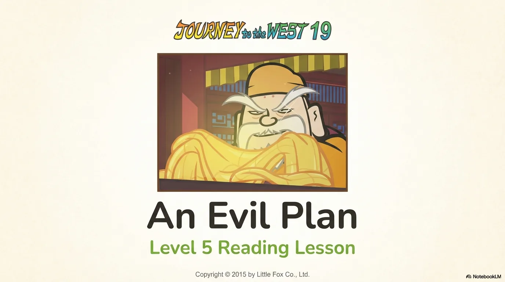
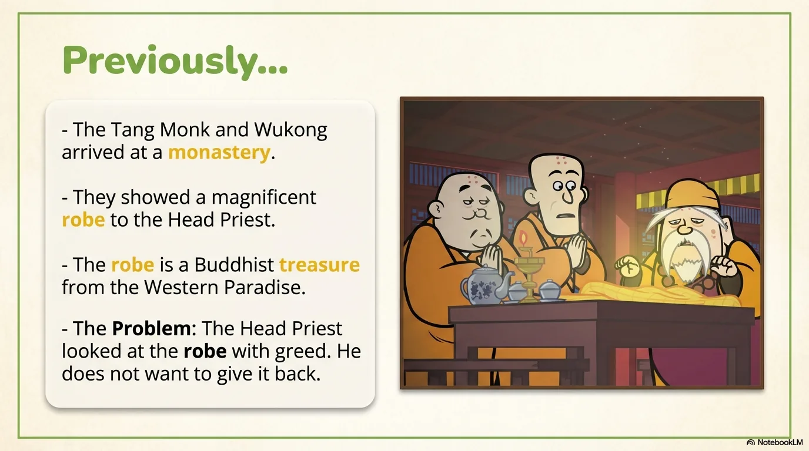
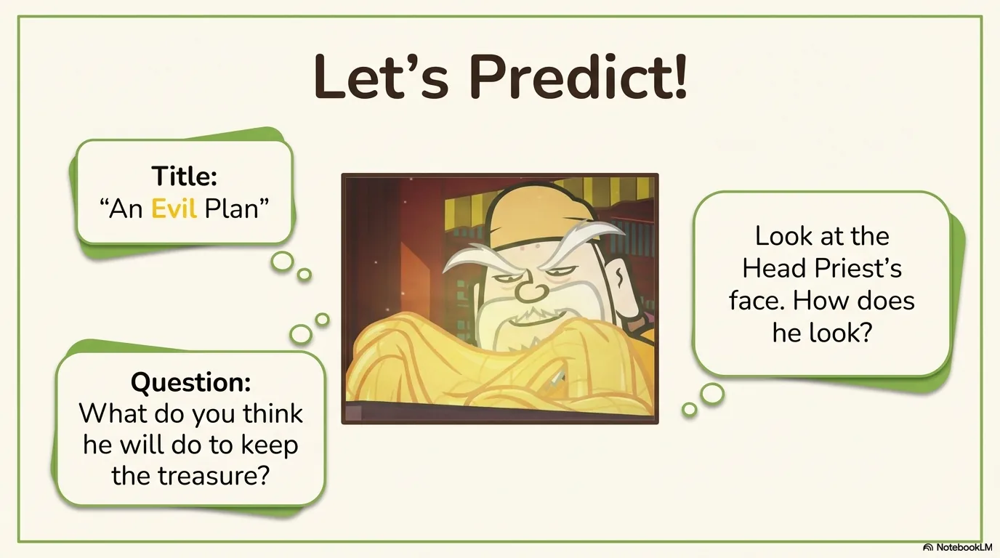
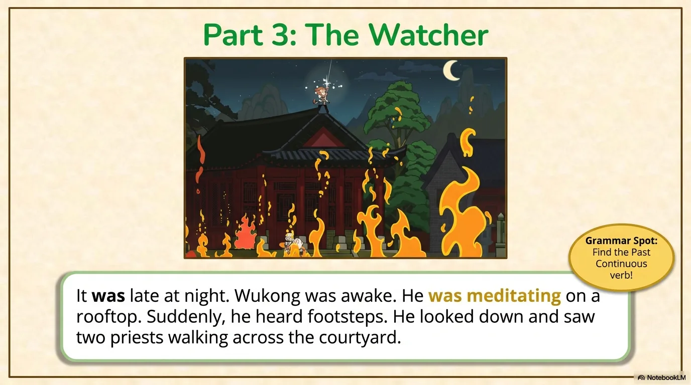
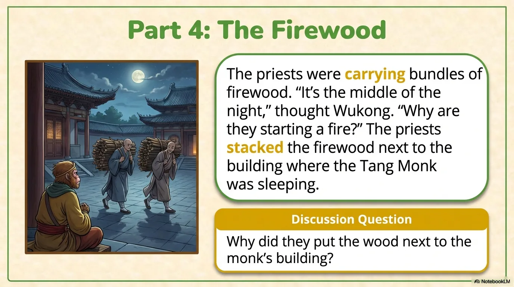
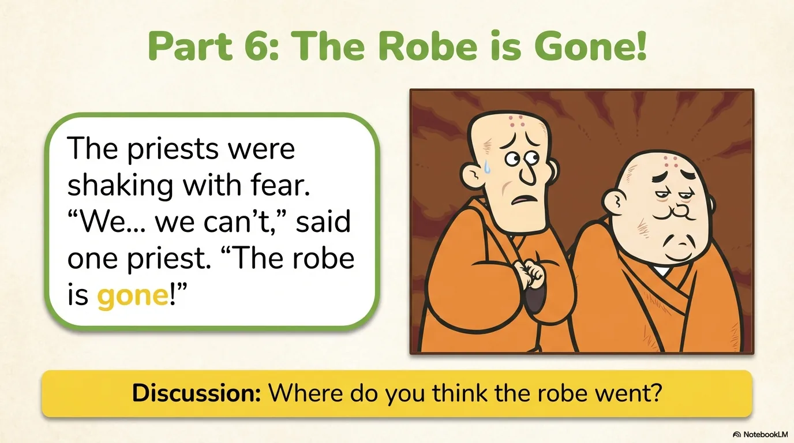
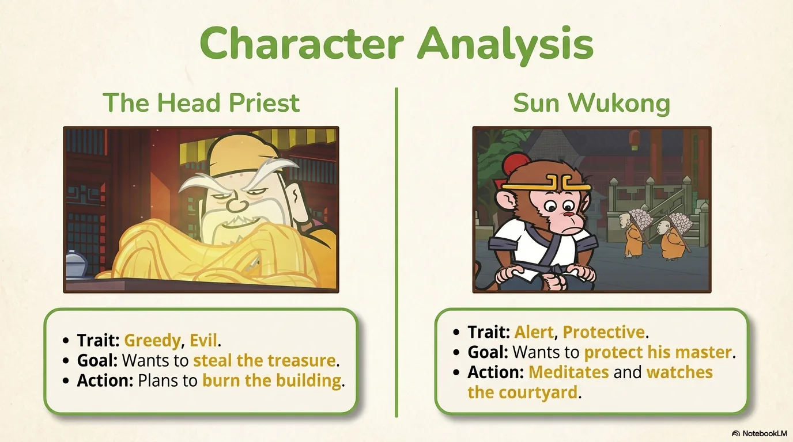
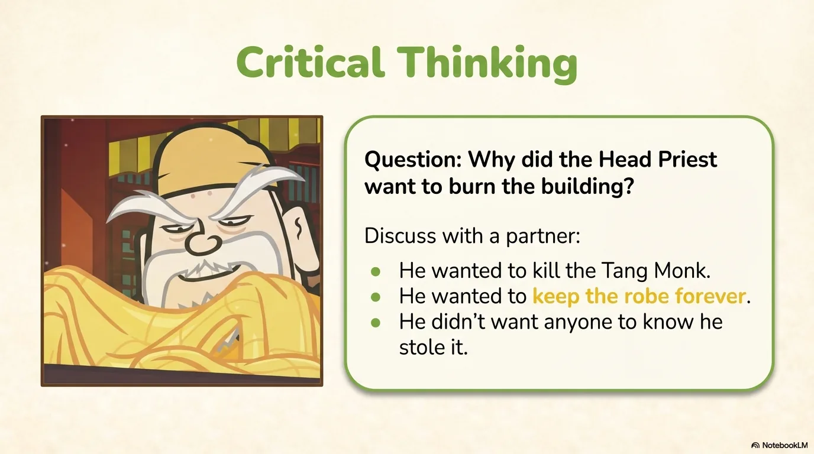
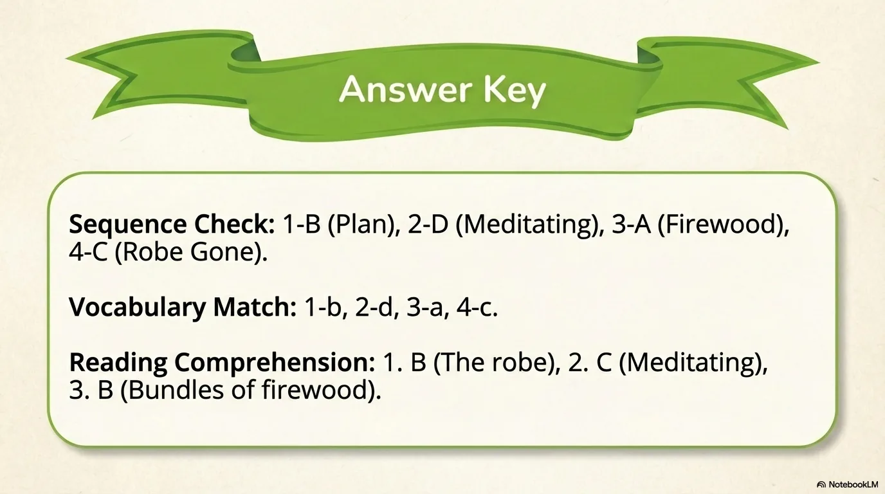

# 豆豆龙英语 · 第 19 集课件（EP019 草稿）

- 来源：`019_Journey to the West 19_An Evil Plan.pptx`（主课件，20 页）
- OCR：`blocked`（no local OCR provider importable (pytesseract missing): No module named 'pytesseract'）
- 分类：待人工审核（unknown）
- 审核状态：`unreviewed`

## Slide 001

- 来源：`ppt/media/image1.png`（relationship `rId2`）
- 尺寸：1376×768
- 源 SHA-256：`78b73013fbf9b6af31173d71426fe0b54c33bee0939642934f6a941324054cbf`
- 输出 SHA-256：`1fda5c5ee978242c8a384391f547d4bc86bc668d1796c50a544b1190fff25f6b`
- 分类：unknown ｜ OCR：blocked ｜ 审核：unreviewed

## Slide 002

- 来源：`ppt/media/image3.png`（relationship `rId2`）
- 尺寸：1376×768
- 源 SHA-256：`0da8f095ce4cfab6fd4d7e0547935ee2c9d7040b74162c5c266b5675e5c99116`
- 输出 SHA-256：`e467b2c11c0a4dced7bf838badf7f8e4d34a64207c75ba18f933b83278fc822d`
- 分类：unknown ｜ OCR：blocked ｜ 审核：unreviewed

## Slide 003

- 来源：`ppt/media/image4.png`（relationship `rId2`）
- 尺寸：1376×768
- 源 SHA-256：`3597d89c98300e1665bc45691b56da8ea633b0acde91268e7eb75d7c89f39110`
- 输出 SHA-256：`6956bfc0456bb7178a17b482b7965a7046d8a1e8ac7ff63ee74d94f4ef07c691`
- 分类：unknown ｜ OCR：blocked ｜ 审核：unreviewed

## Slide 004

- 来源：`ppt/media/image5.png`（relationship `rId2`）
- 尺寸：1376×768
- 源 SHA-256：`8a66d4a1ca093a187c3a81f930002a6120a560db1cf92ac8518124695a19b199`
- 输出 SHA-256：`0635c97a4244c8d0422620440fd8605fa355a26a4df635636f94caf6b863e824`
- 分类：unknown ｜ OCR：blocked ｜ 审核：unreviewed

## Slide 005

- 来源：`ppt/media/image6.png`（relationship `rId2`）
- 尺寸：1376×768
- 源 SHA-256：`6d438c0319e3c23c20aded4093a5b6e9a1dcb64e86a19945bb2abe5a460ed0b9`
- 输出 SHA-256：`60a74004b9ea5a3ac7014177b83faf3c33c9ac220fc27b8e780580f324697875`
- 分类：unknown ｜ OCR：blocked ｜ 审核：unreviewed

## Slide 006

- 来源：`ppt/media/image7.png`（relationship `rId2`）
- 尺寸：1376×768
- 源 SHA-256：`07ab74331b361c3f61253720ee6a537546c696c4c5c3856c995b091c1951702b`
- 输出 SHA-256：`b6fd78bf2c21210958a73205775ed9e48ba879f8efb684a0a3c77b3074850253`
- 分类：unknown ｜ OCR：blocked ｜ 审核：unreviewed

## Slide 007

- 来源：`ppt/media/image8.png`（relationship `rId2`）
- 尺寸：1376×768
- 源 SHA-256：`7a97c9a56153b95fac5de8aff6d498ec3cb698dac9a72fafdf171faded5ebde7`
- 输出 SHA-256：`ad30f40d8d7323e3014e9103f6d3824e2bb7e7031a84c4f372ff0e6b039a3742`
- 分类：unknown ｜ OCR：blocked ｜ 审核：unreviewed

## Slide 008

- 来源：`ppt/media/image9.png`（relationship `rId2`）
- 尺寸：1376×768
- 源 SHA-256：`7ae37713a625dc5c20780b2a9e5b051b97d73ecdc791344d631cde55fa622987`
- 输出 SHA-256：`faf650f8fb5d1a2577e6f19416ada3238435a0f382f321e0fcd2ee586ac33e21`
- 分类：unknown ｜ OCR：blocked ｜ 审核：unreviewed

## Slide 009

- 来源：`ppt/media/image10.png`（relationship `rId2`）
- 尺寸：1376×768
- 源 SHA-256：`8507daa7af5f6c5e8bfd97193c550558fc5050f157ac839a6ee5e0b0d3b87eeb`
- 输出 SHA-256：`2bb4569dfcc73e80638b117ef8dd050fdfefb348fa177df61a4d0b85b7289dc8`
- 分类：unknown ｜ OCR：blocked ｜ 审核：unreviewed

## Slide 010

- 来源：`ppt/media/image11.png`（relationship `rId2`）
- 尺寸：1376×768
- 源 SHA-256：`8f42fe85d4adabf5199c966b963ef89208ca883540853cbf93f18336220968c5`
- 输出 SHA-256：`de22ea54d1933bd227ab87c12ffc58abf92777f4443121b40d65a0baf3e73aeb`
- 分类：unknown ｜ OCR：blocked ｜ 审核：unreviewed

## Slide 011

- 来源：`ppt/media/image12.png`（relationship `rId2`）
- 尺寸：1376×768
- 源 SHA-256：`18176ebcf0773ca0176f1e05466eb1f9e49cd97d4ea4b3d88b28de1721b2d7c0`
- 输出 SHA-256：`dc30cef4273f5af2e6ed1c1a45bf9f6d7c8af21f483fbcfa3a897628baf49914`
- 分类：unknown ｜ OCR：blocked ｜ 审核：unreviewed

## Slide 012

- 来源：`ppt/media/image13.png`（relationship `rId2`）
- 尺寸：1376×768
- 源 SHA-256：`f2f8e25fb906ef9d5e93ae74e24348d854dc9e7900d2c44019ca7ac4eb70a52c`
- 输出 SHA-256：`8e086d47a221150b3c221e437b6eac658c52c314814e5c8f1ed39926516faf40`
- 分类：unknown ｜ OCR：blocked ｜ 审核：unreviewed

## Slide 013

- 来源：`ppt/media/image14.png`（relationship `rId2`）
- 尺寸：1376×768
- 源 SHA-256：`1f27b28fc0c462f4032ae30faa6bb6a6dc8535f3c495db1f302c1b955fa3700d`
- 输出 SHA-256：`ba7ad021fa5d18dfc3e4aad5a8eb4ef310ec9fed29658e42cec114909ae88215`
- 分类：unknown ｜ OCR：blocked ｜ 审核：unreviewed

## Slide 014

- 来源：`ppt/media/image15.png`（relationship `rId2`）
- 尺寸：1376×768
- 源 SHA-256：`0bc2f3266734de28224c8e89a0ca0dc0a88109e4e41421f9101b6a1d5ac3c165`
- 输出 SHA-256：`8e9af7da53dc7d40a779d05ba52dc9a3027fea83a49992b9cc34745ceaeca6b3`
- 分类：unknown ｜ OCR：blocked ｜ 审核：unreviewed

## Slide 015

- 来源：`ppt/media/image16.png`（relationship `rId2`）
- 尺寸：1376×768
- 源 SHA-256：`027628b749f4ec463ac2d18d7573133f2f253bd9c929ac7c8a1fedf12ec87544`
- 输出 SHA-256：`a79ad4aa21a60eca1a7cad15c0ff1e919d4614d9c1262541c1f3c86174ec3b68`
- 分类：unknown ｜ OCR：blocked ｜ 审核：unreviewed

## Slide 016

- 来源：`ppt/media/image17.png`（relationship `rId2`）
- 尺寸：1376×768
- 源 SHA-256：`43f34dbf246c17477a0238c39dc84f465287831b9d6ec2b56c560ed96780c889`
- 输出 SHA-256：`c80cc8021c29f236fa602224841d807c6f3c01db04038b8dfa33bc3eb948612a`
- 分类：unknown ｜ OCR：blocked ｜ 审核：unreviewed

## Slide 017

- 来源：`ppt/media/image18.png`（relationship `rId2`）
- 尺寸：1376×768
- 源 SHA-256：`164dbbdb36410549f2f1fbb97f1555060a42a6adc583c38206bea185d8cc4c51`
- 输出 SHA-256：`0a8baae1f50259230028161091d7309e7efc9b735f6a69b5cb52b4b05430439f`
- 分类：unknown ｜ OCR：blocked ｜ 审核：unreviewed

## Slide 018

- 来源：`ppt/media/image19.png`（relationship `rId2`）
- 尺寸：1376×768
- 源 SHA-256：`0aac19b94d7e5febf6a73f01d8672036622a4ec10b80fa9d99631e9741f7fba0`
- 输出 SHA-256：`7f1389db2c32ffc9628eddc033c193d45653c3ca5af651665a1c545a25f4f9da`
- 分类：unknown ｜ OCR：blocked ｜ 审核：unreviewed

## Slide 019

- 来源：`ppt/media/image20.png`（relationship `rId2`）
- 尺寸：1376×768
- 源 SHA-256：`0c1df808adbf47303316b47454bbf24eb10272ebd621cbcb28699d67e175c175`
- 输出 SHA-256：`b0080c0c4a51b8f091a43bb7ee42609f8b687a2060109eaab0de3abd753f2f4c`
- 分类：unknown ｜ OCR：blocked ｜ 审核：unreviewed

## Slide 020

- 来源：`ppt/media/image21.png`（relationship `rId2`）
- 尺寸：1376×768
- 源 SHA-256：`62a3834a0b845c573f058cb89ccaf91eed3ba32d1dc090b9005ee3d551f72a27`
- 输出 SHA-256：`bc8badc431739ffec0f25fb3d633eac7d5e5fddc037d9fc492543910b0fccaeb`
- 分类：unknown ｜ OCR：blocked ｜ 审核：unreviewed
