# 豆豆龙英语 · 第 20 集课件（EP020 草稿）

- 来源：`020_Journey to the West 20_The Black Bear Spirit.pptx`（主课件，15 页）
- OCR：`blocked`（no local OCR provider importable (pytesseract missing): No module named 'pytesseract'）
- 分类：待人工审核（unknown）
- 审核状态：`unreviewed`

## Slide 001

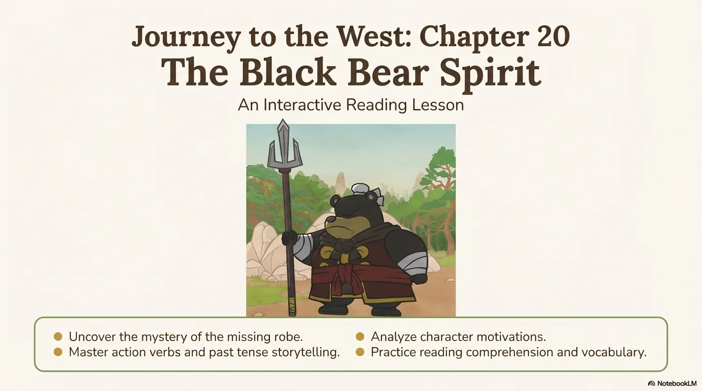

- 来源：`ppt/media/image1.png`（relationship `rId2`）
- 尺寸：1376×768
- 源 SHA-256：`4adfd8f42b5961e17133be3bd8a67f28cca3eca66a73f00f735d97a0e9368286`
- 输出 SHA-256：`09c58274e0739a89c2a9f7b3dea725d395dbddcb266e35b1c4783bab844cd3ad`
- 分类：unknown ｜ OCR：blocked ｜ 审核：unreviewed

## Slide 002

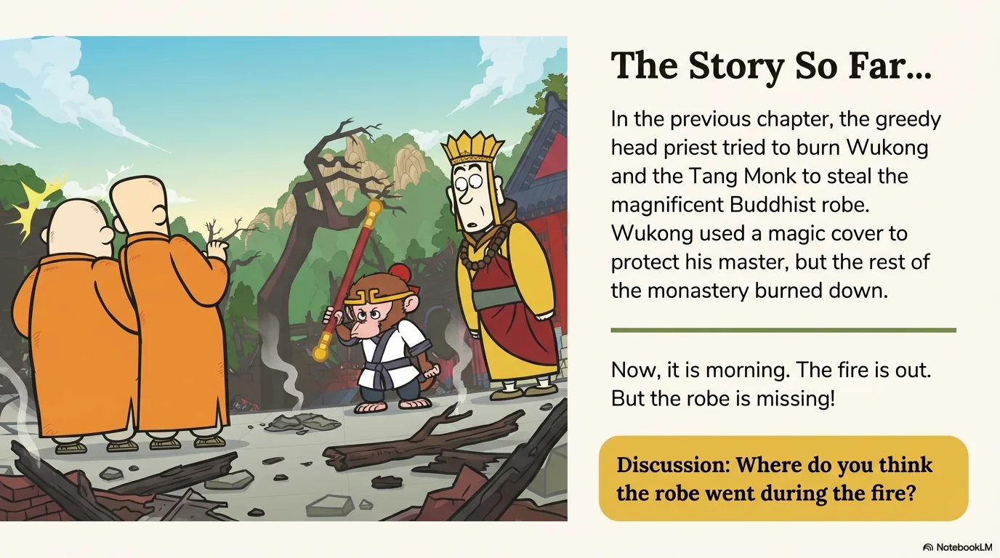

- 来源：`ppt/media/image3.png`（relationship `rId2`）
- 尺寸：1376×768
- 源 SHA-256：`f91c2f5ee0e8c2192686b34075d657dbdb113cc7b96e2aadd8743eb3f99812a9`
- 输出 SHA-256：`7155a26b9cd6dc4661141087870d2254833a25434d81bdd598c57d468dd5b20d`
- 分类：unknown ｜ OCR：blocked ｜ 审核：unreviewed

## Slide 003

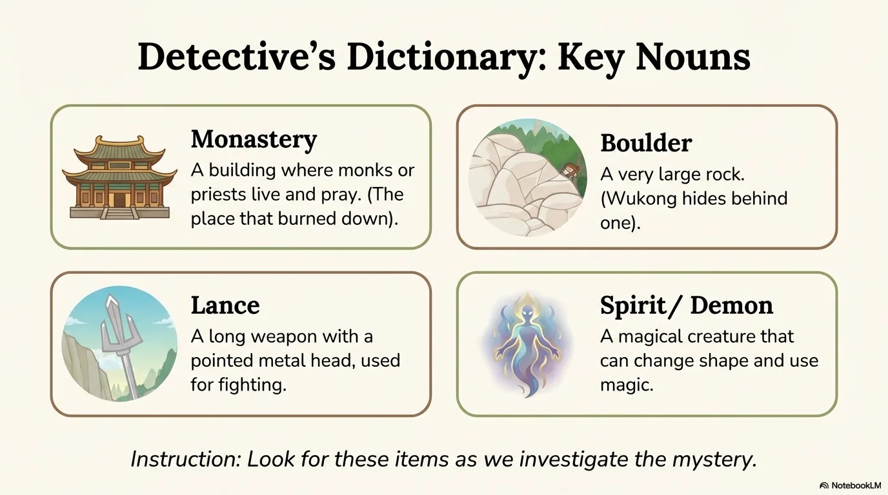

- 来源：`ppt/media/image4.png`（relationship `rId2`）
- 尺寸：1376×768
- 源 SHA-256：`d75bf0dec819e1359cbe9c59f12c306c429d2963ba06b4a3375c25852c0e44b9`
- 输出 SHA-256：`4ade23fe42790aee117d26021f55a15517c349e624defa269564e2c3e13adc51`
- 分类：unknown ｜ OCR：blocked ｜ 审核：unreviewed

## Slide 004

- 来源：`ppt/media/image5.png`（relationship `rId2`）
- 尺寸：1376×768
- 源 SHA-256：`e25a14162ce6d49230ca850fd807a8211717aad58899d98f5ccdb7334cfec23a`
- 输出 SHA-256：`842bcb3fc8f32a707d89fae9678273f4d43267f75035742a04e0d55505e8b9d4`
- 分类：unknown ｜ OCR：blocked ｜ 审核：unreviewed

## Slide 005

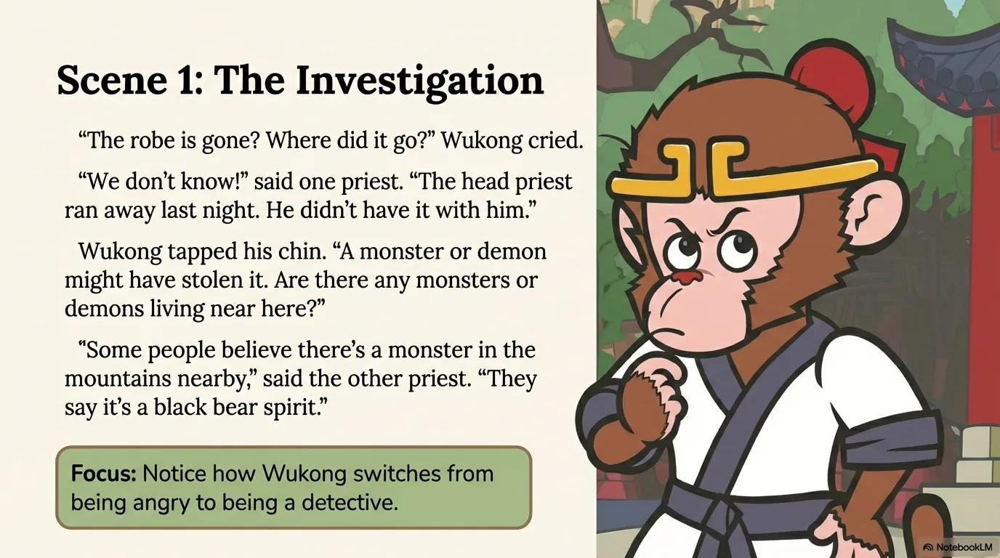

- 来源：`ppt/media/image6.png`（relationship `rId2`）
- 尺寸：1376×768
- 源 SHA-256：`87ecc9b859cc36cc5de47efd57995253de2187c35083cdcec472252c9b0fe00f`
- 输出 SHA-256：`99cf9cfd8102ec78ee5be943e0fa9b5053e99c433fee758f5caa36888b97a347`
- 分类：unknown ｜ OCR：blocked ｜ 审核：unreviewed

## Slide 006

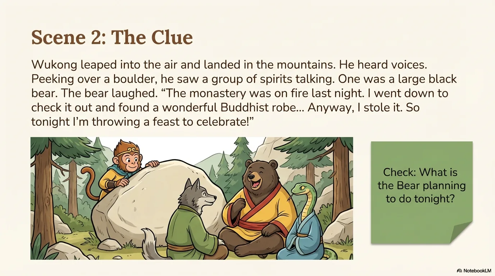

- 来源：`ppt/media/image7.png`（relationship `rId2`）
- 尺寸：1376×768
- 源 SHA-256：`baaaf0a05d456be00bca5365dbe0d7c71305ee2bc348e3210a8ef983e9f2c510`
- 输出 SHA-256：`2ace3967d871713bc9f7481136de28dc77de484014d3ecbcf42dffd24b8c6b0e`
- 分类：unknown ｜ OCR：blocked ｜ 审核：unreviewed

## Slide 007

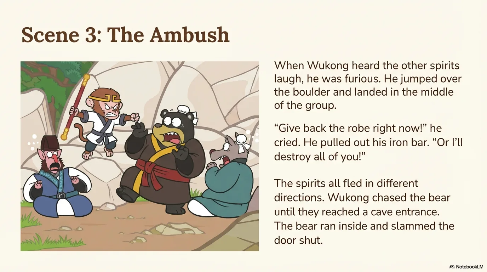

- 来源：`ppt/media/image8.png`（relationship `rId2`）
- 尺寸：1376×768
- 源 SHA-256：`a9c356be5fbbda21e618e5e03a08a4afb8be094a0849feca075e7a080c54c056`
- 输出 SHA-256：`8aa925dc80edbcb07b45252c3a61f4bc4969129922424c4b9c307f07ce9abced`
- 分类：unknown ｜ OCR：blocked ｜ 审核：unreviewed

## Slide 008

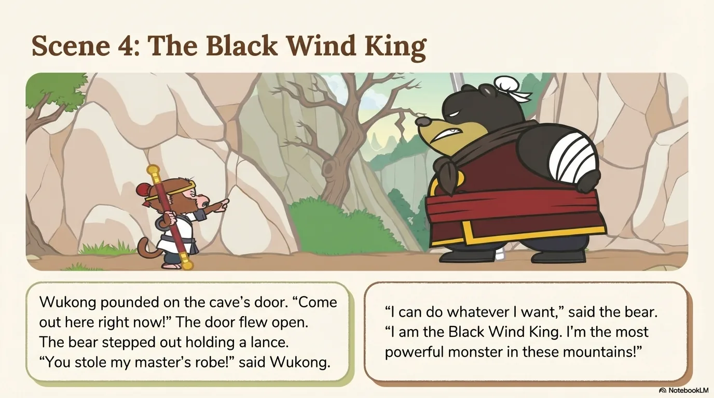

- 来源：`ppt/media/image9.png`（relationship `rId2`）
- 尺寸：1376×768
- 源 SHA-256：`dbba39380795dda6a9f74a1f9a7c3472c6848eca8b0b80cebd66e9cd0a3cc485`
- 输出 SHA-256：`1245b87e6496a5f0ae9f0a7b8a534c7ebe6699331f85766550b9240826da7ce9`
- 分类：unknown ｜ OCR：blocked ｜ 审核：unreviewed

## Slide 009

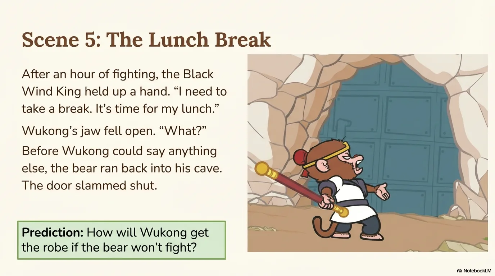

- 来源：`ppt/media/image10.png`（relationship `rId2`）
- 尺寸：1376×768
- 源 SHA-256：`2c1b41ba2528ff42e9b65bc5111ba81c430a268cd57829782d6a5dd0bef16b8b`
- 输出 SHA-256：`04e6986b9ba4b25505589a239fc75fceb7e5ae90a8c5d2578360ea40385a6832`
- 分类：unknown ｜ OCR：blocked ｜ 审核：unreviewed

## Slide 010

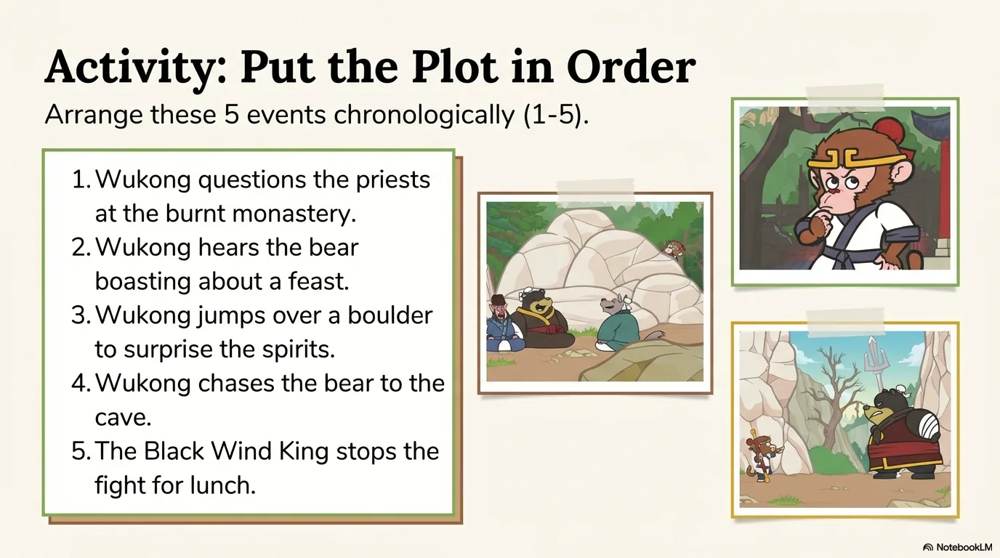

- 来源：`ppt/media/image11.png`（relationship `rId2`）
- 尺寸：1376×768
- 源 SHA-256：`25fb9f17ee74a5260ef77c9ec875ee4701b9f27b1e82933563a3c941359d6662`
- 输出 SHA-256：`bc6a3146cd0d2220a2950cb862bbceddda04a35ad6c52e28fafbda63f2add421`
- 分类：unknown ｜ OCR：blocked ｜ 审核：unreviewed

## Slide 011

- 来源：`ppt/media/image12.png`（relationship `rId2`）
- 尺寸：1376×768
- 源 SHA-256：`9c2996f8dd3444c01c3fa924d61cc4e6b3ff044328e557d541725bfffd369096`
- 输出 SHA-256：`0b3b19ef08478843decc32f8173bfd37cf07f20040f32082f6470ad3451226e7`
- 分类：unknown ｜ OCR：blocked ｜ 审核：unreviewed

## Slide 012

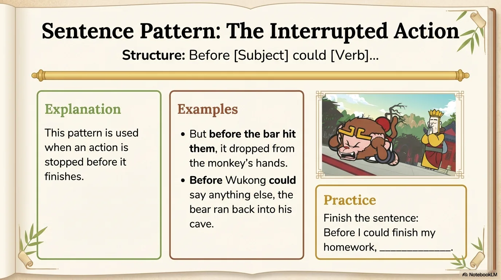

- 来源：`ppt/media/image13.png`（relationship `rId2`）
- 尺寸：1376×768
- 源 SHA-256：`a18d888e8a6d4c0bfc759ffec28b27a1d9e2d6c65b023f44693e95bb94d6d8f7`
- 输出 SHA-256：`5ba04c8a25d3b7310802e590fb9d75525b44a85d1b3471fcd091d19a93d21ca2`
- 分类：unknown ｜ OCR：blocked ｜ 审核：unreviewed

## Slide 013

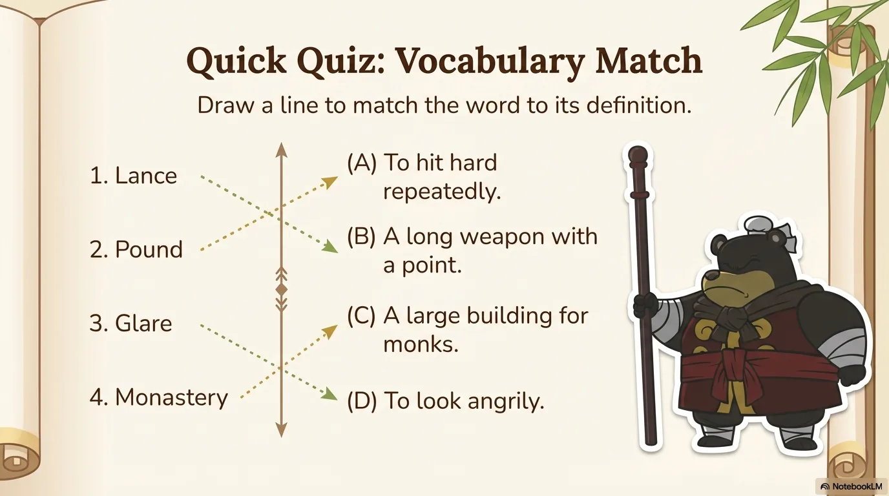

- 来源：`ppt/media/image14.png`（relationship `rId2`）
- 尺寸：1376×768
- 源 SHA-256：`a7296745c6142045e0b150d7422257098b5a5f8862c1ba2b62decf2f308875f7`
- 输出 SHA-256：`c8bad417e18fd44e34c2f5a2b3f75440a55a8903f0de782f8278d63d5ac5b3ac`
- 分类：unknown ｜ OCR：blocked ｜ 审核：unreviewed

## Slide 014

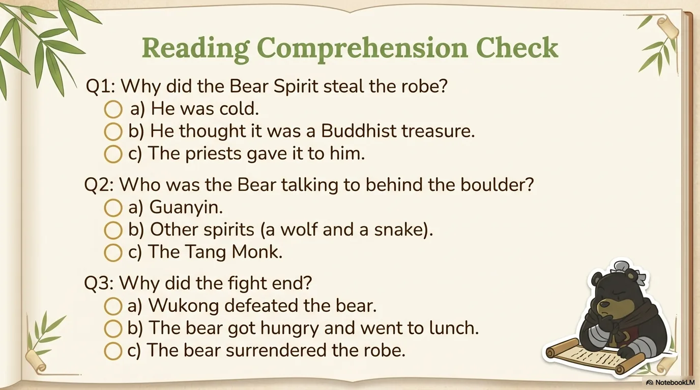

- 来源：`ppt/media/image15.png`（relationship `rId2`）
- 尺寸：1376×768
- 源 SHA-256：`2df47874ea8f2c62422b32f61e1fae14583503ec92a636260288d32be24a0e79`
- 输出 SHA-256：`5c9bf4fc796c8d93936636d5d7d8cc8e6b30d41a380078fdce812c89c1a984b9`
- 分类：unknown ｜ OCR：blocked ｜ 审核：unreviewed

## Slide 015

- 来源：`ppt/media/image16.png`（relationship `rId2`）
- 尺寸：1376×768
- 源 SHA-256：`5289b6de0d1e41f7b9112eab75bc97cd54a7a77766588452273e3b97ce0721df`
- 输出 SHA-256：`0a4e48ce8d7ce03223ea416b643b389c25358cbf556a9260541f601f7bc0c0c5`
- 分类：unknown ｜ OCR：blocked ｜ 审核：unreviewed
