# 豆豆龙英语 · 第 21 集课件（EP021 草稿）

- 来源：`021_Journey to the West 21_The Monster's Friend.pptx`（主课件，20 页）
- OCR：`blocked`（no local OCR provider importable (pytesseract missing): No module named 'pytesseract'）
- 分类：待人工审核（unknown）
- 审核状态：`unreviewed`

## Slide 001

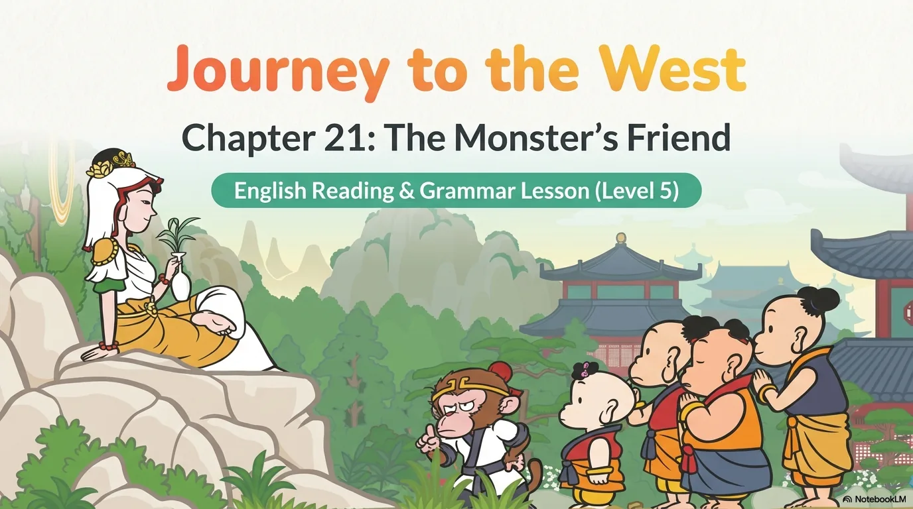

- 来源：`ppt/media/image1.png`（relationship `rId2`）
- 尺寸：1376×768
- 源 SHA-256：`3f92d4956a9945915082ca09ec0ca42f50192028dd084275d60c8674e642d6b8`
- 输出 SHA-256：`e1ca23719bf040e2c1821f56d78d16c67a5cb4bc19e6247786f70e79029d7c83`
- 分类：unknown ｜ OCR：blocked ｜ 审核：unreviewed

## Slide 002

- 来源：`ppt/media/image3.png`（relationship `rId2`）
- 尺寸：1376×768
- 源 SHA-256：`13e21567765f373af16df3449f5d30c6ed39dbcdce52da7054172740b7ed58fa`
- 输出 SHA-256：`643eb031a189a3317bf17f7fc51e64dec4c37f31e32159a697a7728453c55a53`
- 分类：unknown ｜ OCR：blocked ｜ 审核：unreviewed

## Slide 003

- 来源：`ppt/media/image4.png`（relationship `rId2`）
- 尺寸：1376×768
- 源 SHA-256：`88394c20b6888cb66508368417c172a8bc34d9cca85a50423cc048a7ac031b7f`
- 输出 SHA-256：`22c0083d21f8e3246d02099c9259fabe56b824e913c0e4c974e2207fcb669f73`
- 分类：unknown ｜ OCR：blocked ｜ 审核：unreviewed

## Slide 004

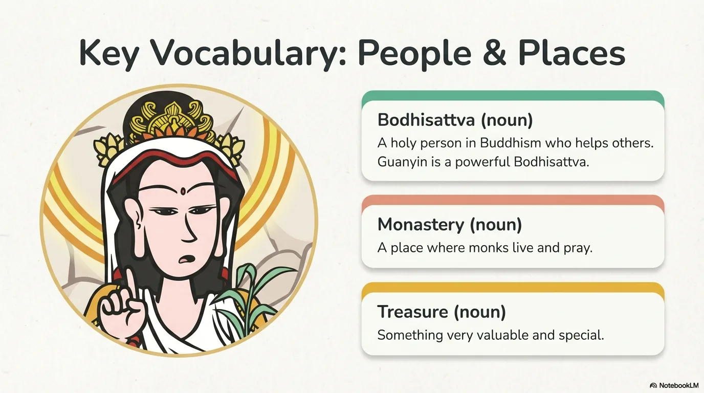

- 来源：`ppt/media/image5.png`（relationship `rId2`）
- 尺寸：1376×768
- 源 SHA-256：`a231ef675a88ec7aaef47cce2167566d6755fb4bcf96d995e9a9d053c94655ce`
- 输出 SHA-256：`76e54d610e779382d258430d336bc9a3f75ffbc079656523f88845cd3eb0de85`
- 分类：unknown ｜ OCR：blocked ｜ 审核：unreviewed

## Slide 005

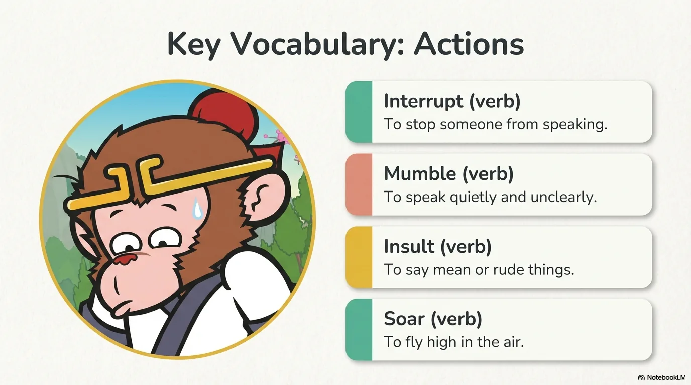

- 来源：`ppt/media/image6.png`（relationship `rId2`）
- 尺寸：1376×768
- 源 SHA-256：`1026d000efa924b0e96bd9d6005c10dfbfcbc874b2dd88a83a9491ed184243b4`
- 输出 SHA-256：`93d77798dc9c3c05572ef931343e90e7b1a4c528562c2ad031214b7a7ef365c5`
- 分类：unknown ｜ OCR：blocked ｜ 审核：unreviewed

## Slide 006

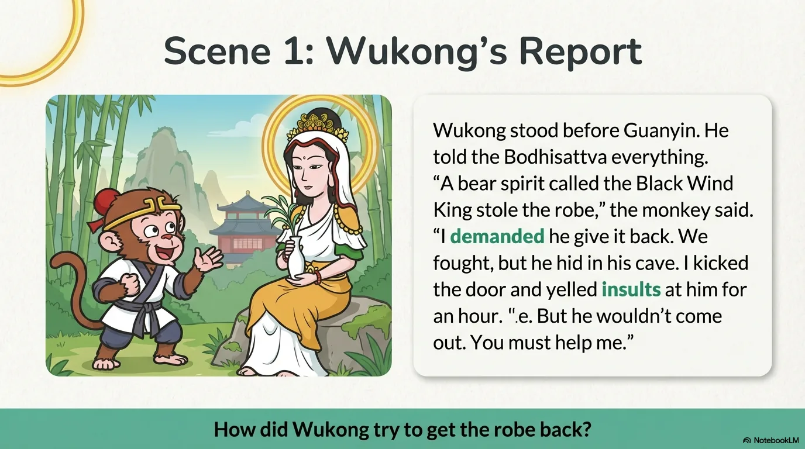

- 来源：`ppt/media/image7.png`（relationship `rId2`）
- 尺寸：1376×768
- 源 SHA-256：`210f075136003fd59ce48121c95336da5d4e158117a300c27e5d1d89ce671038`
- 输出 SHA-256：`a6d3afd18a410fd5dcf660fa85e68896888208177258b9231e57f89be4367cc9`
- 分类：unknown ｜ OCR：blocked ｜ 审核：unreviewed

## Slide 007

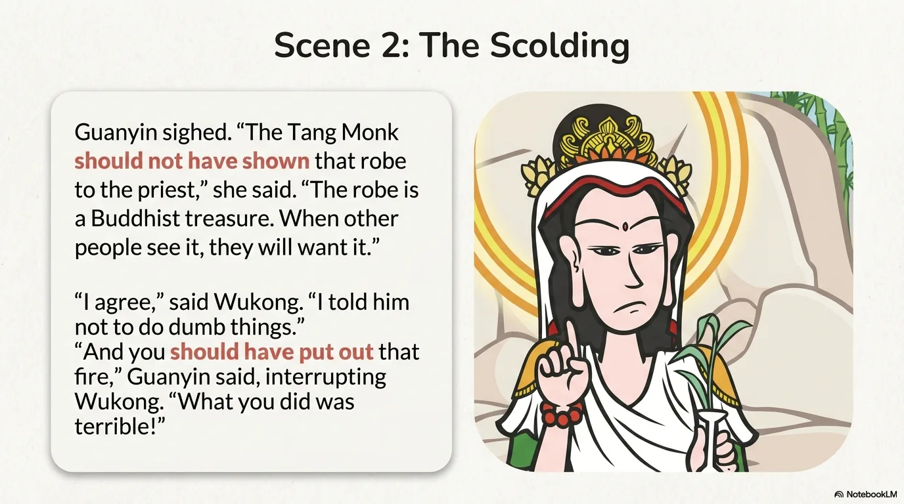

- 来源：`ppt/media/image8.png`（relationship `rId2`）
- 尺寸：1376×768
- 源 SHA-256：`30751fa2552eb716e57736d5657fbe2fb5c68015dd8d6eaad7d051e849485082`
- 输出 SHA-256：`8af38ff038639a30e4744574ca63178dc2e05d8752e75abfc47500313644a736`
- 分类：unknown ｜ OCR：blocked ｜ 审核：unreviewed

## Slide 008

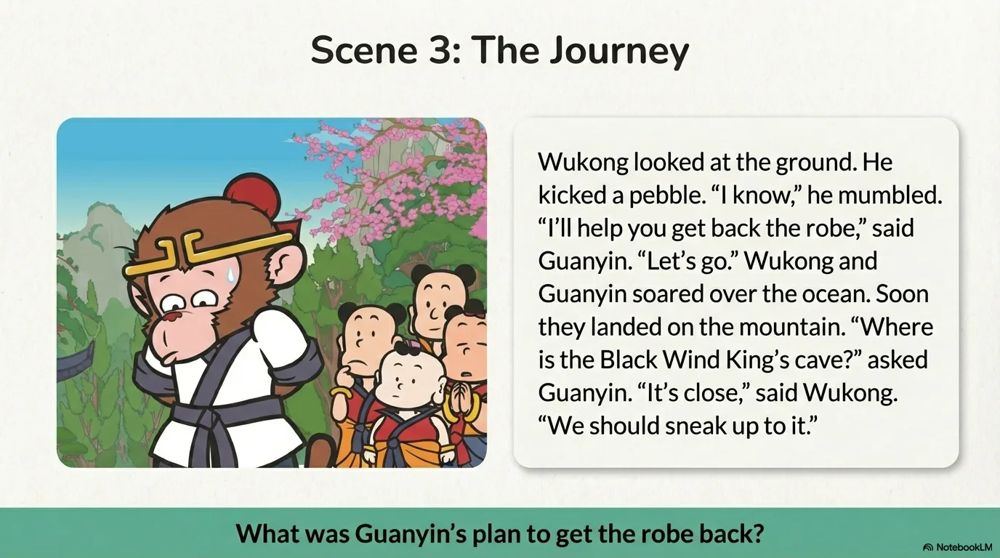

- 来源：`ppt/media/image9.png`（relationship `rId2`）
- 尺寸：1376×768
- 源 SHA-256：`e0bf3e1fc62f5f26096ff4669b227e5990f073fd1f6eaed3be53fa589c578271`
- 输出 SHA-256：`10190cf21f7edbf0cfe4205e4c738a3c8614fc82833c512150fc036ff7d9e019`
- 分类：unknown ｜ OCR：blocked ｜ 审核：unreviewed

## Slide 009

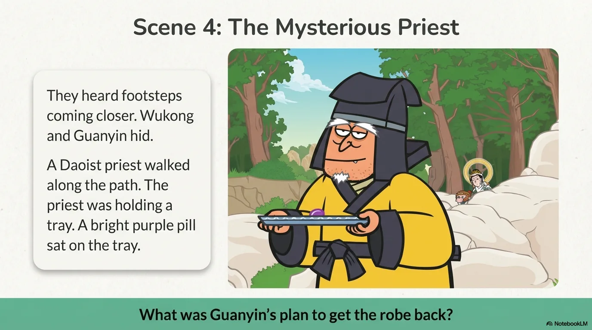

- 来源：`ppt/media/image10.png`（relationship `rId2`）
- 尺寸：1376×768
- 源 SHA-256：`2f9f8f9d472f72287be282eff1e713edfc01f97d7e2639a90c9ae29fca74964a`
- 输出 SHA-256：`4176cbed5b4af40a3729568638741fa633007cb4f5eaa26e14fd298c6bcd8ecb`
- 分类：unknown ｜ OCR：blocked ｜ 审核：unreviewed

## Slide 010

- 来源：`ppt/media/image11.png`（relationship `rId2`）
- 尺寸：1376×768
- 源 SHA-256：`5897bac768ced7ac9d4a2b94054a0e4a75b2d7b9a9715ad41687fc45344b7a41`
- 输出 SHA-256：`2872a553b625e9946aa77662644005ed45bca53b4744af58cc2de257fef3d367`
- 分类：unknown ｜ OCR：blocked ｜ 审核：unreviewed

## Slide 011

- 来源：`ppt/media/image12.png`（relationship `rId2`）
- 尺寸：1376×768
- 源 SHA-256：`0fa67dd6f0042e71cfe3f3862be1842e1692363f5383236441d6909efc866875`
- 输出 SHA-256：`943e8303eda235851e36472659ab92750476c7b2446a7510289e4fe16fab597a`
- 分类：unknown ｜ OCR：blocked ｜ 审核：unreviewed

## Slide 012

- 来源：`ppt/media/image13.png`（relationship `rId2`）
- 尺寸：1376×768
- 源 SHA-256：`3d735076a41017f3dea9028d9ace8408af5689d31230d65736e59591b7012b52`
- 输出 SHA-256：`56b6de8cf68df243c2cc277b97efc4b9fd65971597d5205cfd6fcad43e5e4c60`
- 分类：unknown ｜ OCR：blocked ｜ 审核：unreviewed

## Slide 013

- 来源：`ppt/media/image14.png`（relationship `rId2`）
- 尺寸：1376×768
- 源 SHA-256：`96efcba77c9c6fa5f7606b796948143189d2dc1947c229fb47f1c003ef919b65`
- 输出 SHA-256：`b4a3aa388e4f39cc9fe69bbb89f6dc8234897cb7272eefc09266dbb6de2de8c9`
- 分类：unknown ｜ OCR：blocked ｜ 审核：unreviewed

## Slide 014

- 来源：`ppt/media/image15.png`（relationship `rId2`）
- 尺寸：1376×768
- 源 SHA-256：`04c0438f16cbce54bbde6ec1717e386ca388554a105e74ce987d5bd26ccc44f9`
- 输出 SHA-256：`7faf059f7cbec208aee134f557824fcecab0aac06eb031885b4e18e9d409ed16`
- 分类：unknown ｜ OCR：blocked ｜ 审核：unreviewed

## Slide 015

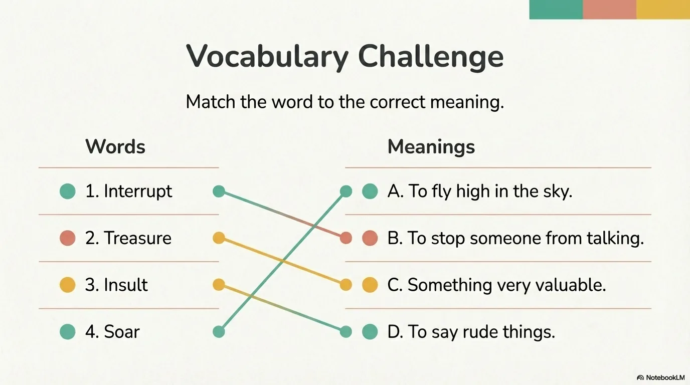

- 来源：`ppt/media/image16.png`（relationship `rId2`）
- 尺寸：1376×768
- 源 SHA-256：`8b2c754aed4537779a5c150a0b35fd4b6b6c865b7acbf9f75f8dd9fe5c4dc5dc`
- 输出 SHA-256：`cc4350a4ef4fd125b65439dd925aad30affefcf0e11816ace254b6adf55caa87`
- 分类：unknown ｜ OCR：blocked ｜ 审核：unreviewed

## Slide 016

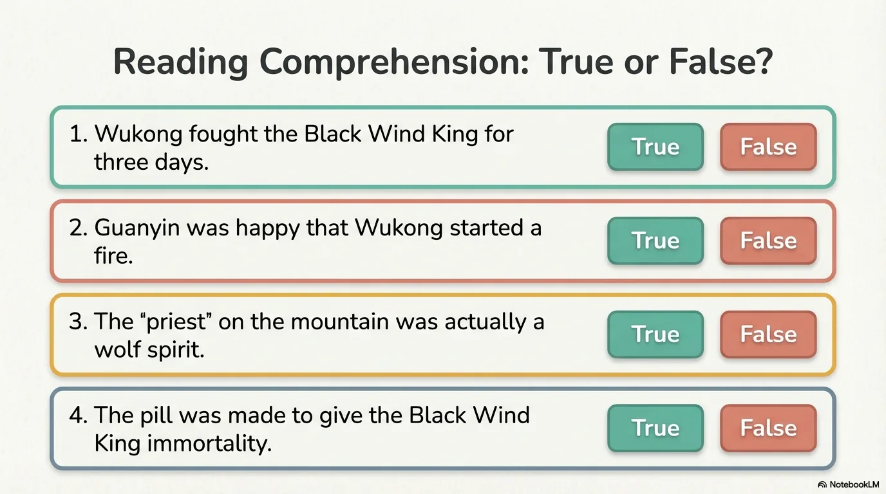

- 来源：`ppt/media/image17.png`（relationship `rId2`）
- 尺寸：1376×768
- 源 SHA-256：`5dd871c174083416510eb73cdaa48a6a11c36ce42727d7952463c935f7c93e23`
- 输出 SHA-256：`d22cd05dc50b3413f820c2e988215da01100804bb162118444f03d2f6f5c121d`
- 分类：unknown ｜ OCR：blocked ｜ 审核：unreviewed

## Slide 017

- 来源：`ppt/media/image18.png`（relationship `rId2`）
- 尺寸：1376×768
- 源 SHA-256：`a996d5d00cbf24c54b59f37f814f14bb062a714ca4b0ea906d69ee811a863c75`
- 输出 SHA-256：`76a590b743e411eb7c23731d0f4f6f179401ec19b3f93e5de6e1c43185b8d7c6`
- 分类：unknown ｜ OCR：blocked ｜ 审核：unreviewed

## Slide 018

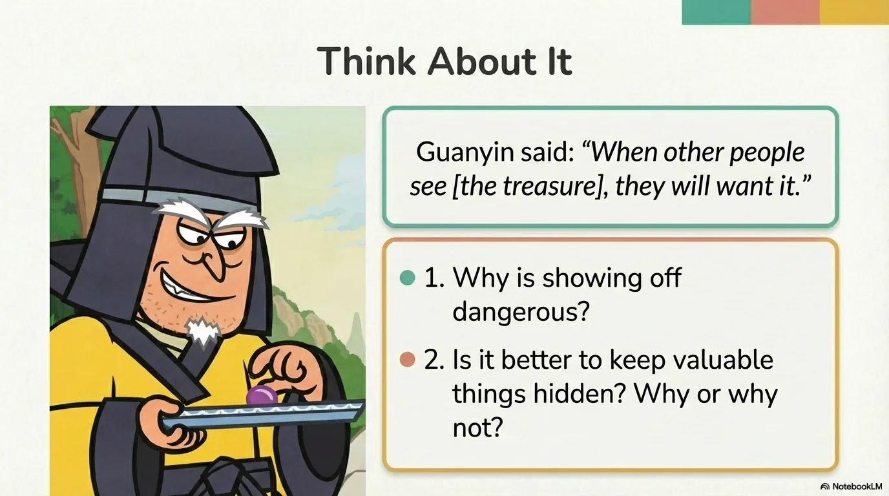

- 来源：`ppt/media/image19.png`（relationship `rId2`）
- 尺寸：1376×768
- 源 SHA-256：`c17f1562ef04d6f30821f77c3fcf9a3d15e6c3c4027472f033073ac2040579ee`
- 输出 SHA-256：`ed02d6b1e1447f41ed6289c48700dbd837a1a405e559996e4fbba74eea0f5c6f`
- 分类：unknown ｜ OCR：blocked ｜ 审核：unreviewed

## Slide 019

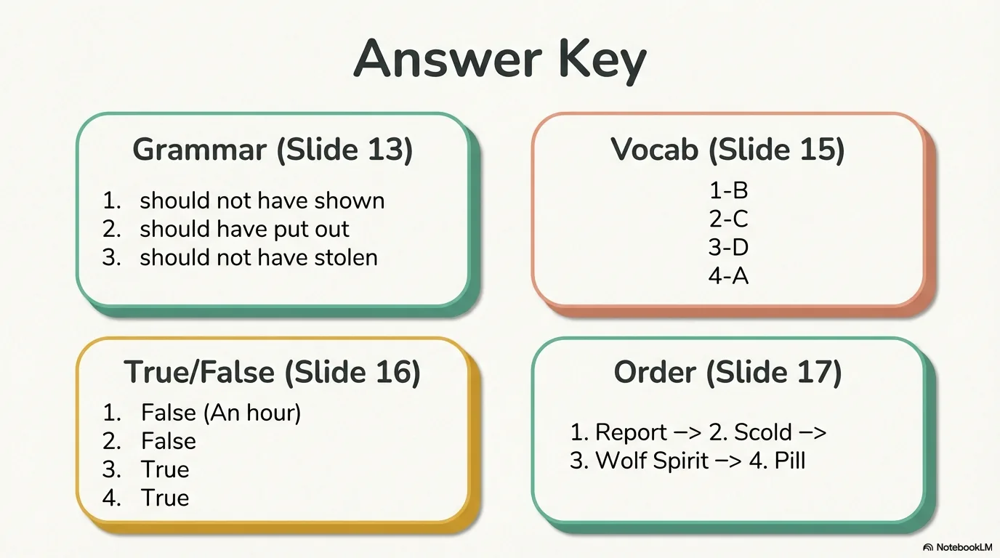

- 来源：`ppt/media/image20.png`（relationship `rId2`）
- 尺寸：1376×768
- 源 SHA-256：`457db89a6868906bcc6e8275c0a0facfceaaf4ea43b55631795fa4ca3740e664`
- 输出 SHA-256：`bc44f7a5f65b2ed1242302601edb4d06f2feaa9aad3e72a5a0c4a94830835a95`
- 分类：unknown ｜ OCR：blocked ｜ 审核：unreviewed

## Slide 020

- 来源：`ppt/media/image21.png`（relationship `rId2`）
- 尺寸：1376×768
- 源 SHA-256：`e718183d772fc66d3b795a5fed40dbfe12f68a394cefd37e6d6119d1b9896043`
- 输出 SHA-256：`5191b9a31c03ba56a4b79504395855e9b73b7ddde9eddbc44e33e65f62352239`
- 分类：unknown ｜ OCR：blocked ｜ 审核：unreviewed
