# 豆豆龙英语 · 第 22 集课件（EP022 草稿）

- 来源：`022_Journey to the West 22_A Very Strange Pill.pptx`（主课件，20 页）
- OCR：`blocked`（no local OCR provider importable (pytesseract missing): No module named 'pytesseract'）
- 分类：待人工审核（unknown）
- 审核状态：`unreviewed`

## Slide 001

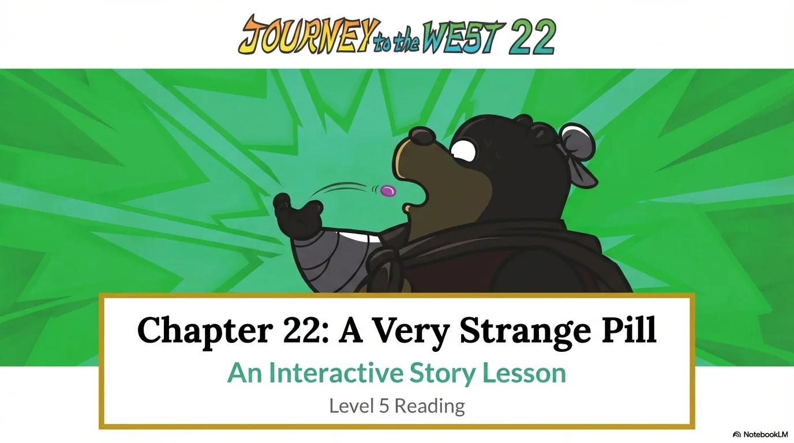

- 来源：`ppt/media/image1.png`（relationship `rId2`）
- 尺寸：1376×768
- 源 SHA-256：`fa207477ea30c9494cef1d85e3c8fa49c6c5204952094c40fc54e461efc97404`
- 输出 SHA-256：`250b6575da313e3c9c300ecadc192c5678810572db98aa908881b70adb6f341e`
- 分类：unknown ｜ OCR：blocked ｜ 审核：unreviewed

## Slide 002

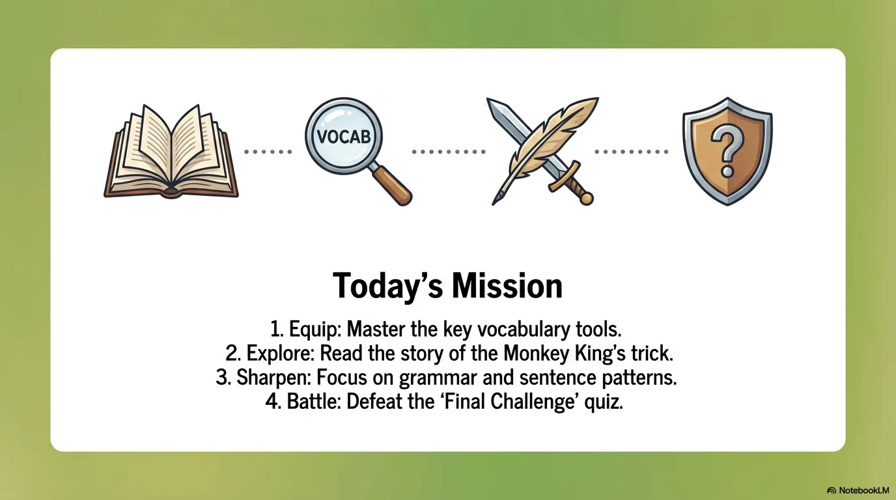

- 来源：`ppt/media/image3.png`（relationship `rId2`）
- 尺寸：1376×768
- 源 SHA-256：`27e069c16f1e9d871c2856ae50f150de540d7206d86174dff914f81e0f0c0405`
- 输出 SHA-256：`cb31667c7ceec5fb08def0ddf1fb0dde9f21de898d3d7e538aca79e5aadfa85b`
- 分类：unknown ｜ OCR：blocked ｜ 审核：unreviewed

## Slide 003

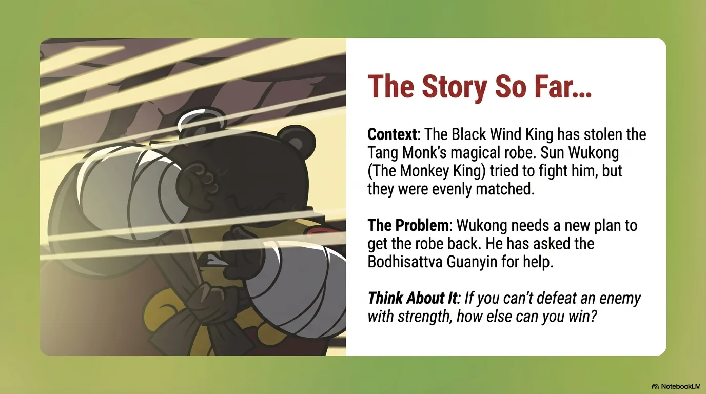

- 来源：`ppt/media/image4.png`（relationship `rId2`）
- 尺寸：1376×768
- 源 SHA-256：`ba3571c162b61a39ceb5d0410e143492ddf047a1eb2a1ceb4b93cf2d7dd02908`
- 输出 SHA-256：`d88b81e3bd33d5bf3caa5986f065ad018310de0d78ad982115c7a6df8ebe9636`
- 分类：unknown ｜ OCR：blocked ｜ 审核：unreviewed

## Slide 004

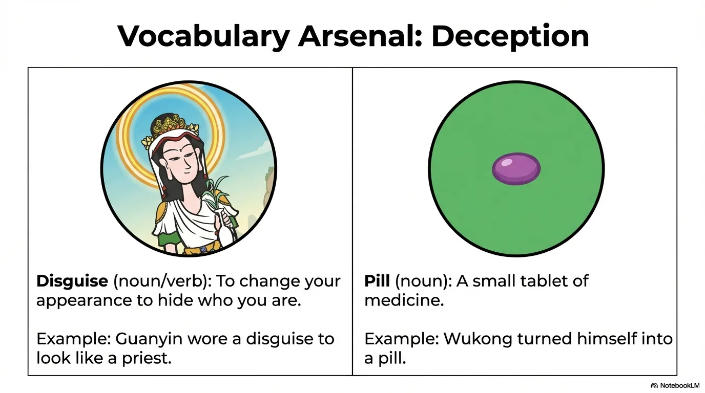

- 来源：`ppt/media/image5.png`（relationship `rId2`）
- 尺寸：1376×768
- 源 SHA-256：`61295a114b7651141206b1581f10ac6c5e6f6c4e728b578b41913569ad49343e`
- 输出 SHA-256：`7c2070b41aaa1013c40fadc0cf99dfd5992471b7bf530a2720d052f120b160d9`
- 分类：unknown ｜ OCR：blocked ｜ 审核：unreviewed

## Slide 005

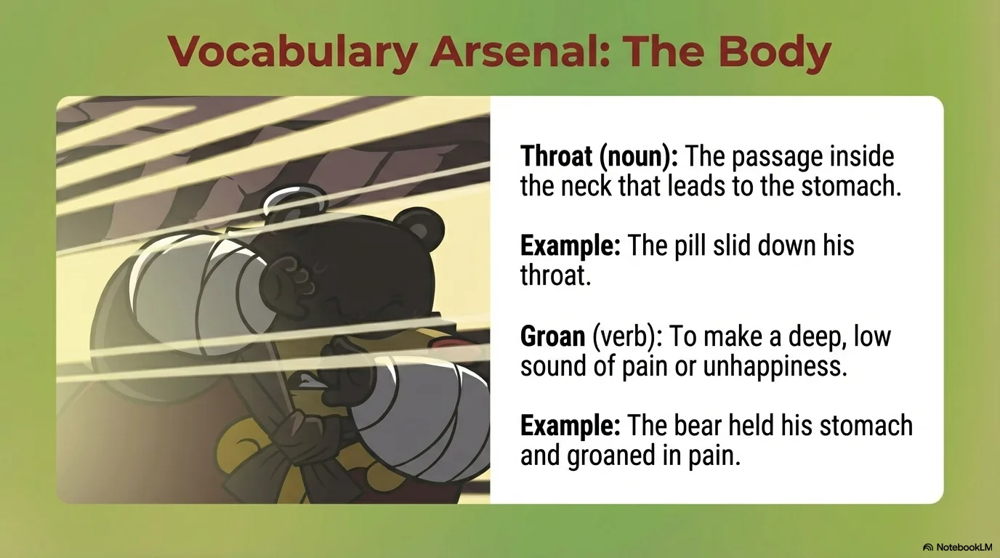

- 来源：`ppt/media/image6.png`（relationship `rId2`）
- 尺寸：1376×768
- 源 SHA-256：`cf1cbb553d85f824b01551b8f57d5a07344699e295553ed706efba2461561233`
- 输出 SHA-256：`09fdf17584d347597d6a9da97d13909061b9163c087933c07c1d48c0c4ca7406`
- 分类：unknown ｜ OCR：blocked ｜ 审核：unreviewed

## Slide 006

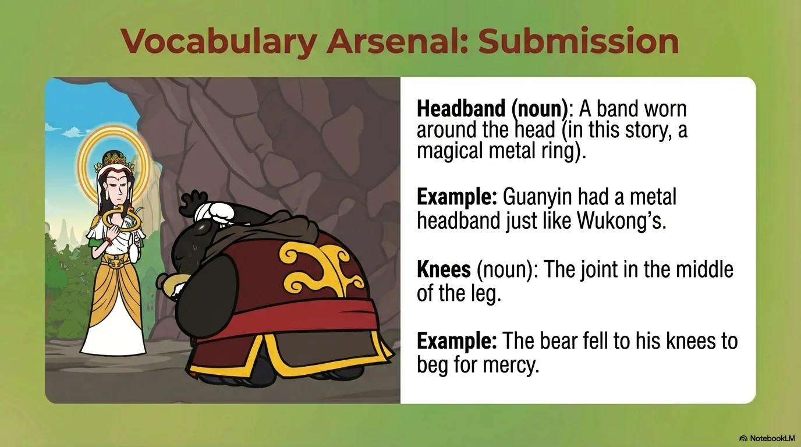

- 来源：`ppt/media/image7.png`（relationship `rId2`）
- 尺寸：1376×768
- 源 SHA-256：`b43c7f167fcdb8157d0b15d03c3d315af33e99c2065a0027ee2b388f6254afdf`
- 输出 SHA-256：`f08a2827a966b837deda346d5447d9a0b584cecf71a904ca539b00a54c609027`
- 分类：unknown ｜ OCR：blocked ｜ 审核：unreviewed

## Slide 007

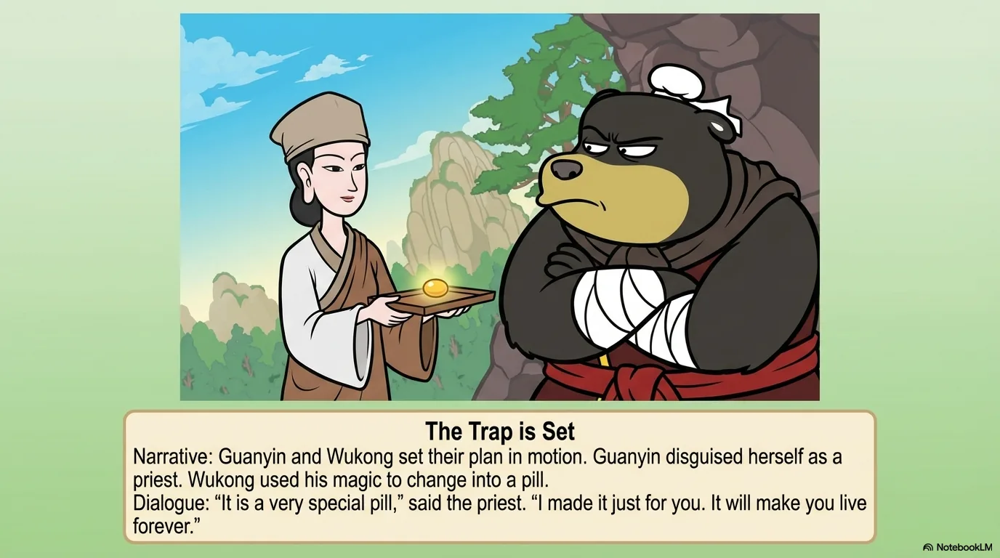

- 来源：`ppt/media/image8.png`（relationship `rId2`）
- 尺寸：1376×768
- 源 SHA-256：`e6fe7ac5629afb724930b7f6f60811e6af13d4cfeb7921d38d8eef427d6fd8f9`
- 输出 SHA-256：`94c44180c0d8f8165a158bf702725c043f95ce21e42ce97f57705a7d55e9ed15`
- 分类：unknown ｜ OCR：blocked ｜ 审核：unreviewed

## Slide 008

- 来源：`ppt/media/image9.png`（relationship `rId2`）
- 尺寸：1376×768
- 源 SHA-256：`971d2959d6d68a30d0ac6dc00b39d83860591628d4f67bce296962ea3edf3d07`
- 输出 SHA-256：`3db367d3e51a01aceb8a20ad177154fd7ee601717a52bd0477c79a98003b0a64`
- 分类：unknown ｜ OCR：blocked ｜ 审核：unreviewed

## Slide 009

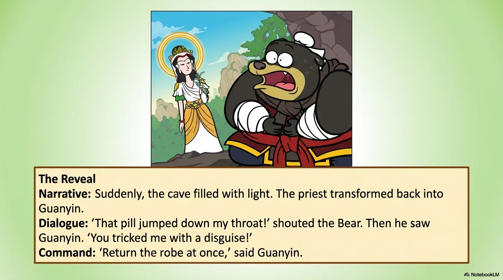

- 来源：`ppt/media/image10.png`（relationship `rId2`）
- 尺寸：1376×768
- 源 SHA-256：`40339831152b0acafa9f5c907c030c610e678c0ab86883763bde8b0f1df32ed8`
- 输出 SHA-256：`1561c3d266d9fe535a263d358dd5833ff167f0a6ee0765ec18270781214e2214`
- 分类：unknown ｜ OCR：blocked ｜ 审核：unreviewed

## Slide 010

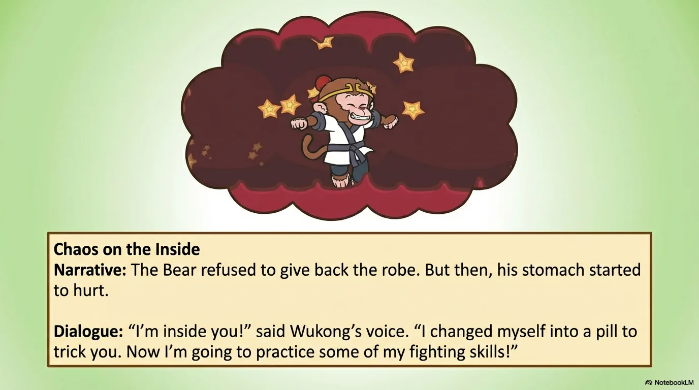

- 来源：`ppt/media/image11.png`（relationship `rId2`）
- 尺寸：1376×768
- 源 SHA-256：`c9b7a94be0f0eaf4e13fdf1f89765923bb79babf53dcd1f9f19ce0613c1d4472`
- 输出 SHA-256：`df8d2285b7bbad1735b7506a47b126e4c521200acfe65471b7b33b461f962bd9`
- 分类：unknown ｜ OCR：blocked ｜ 审核：unreviewed

## Slide 011

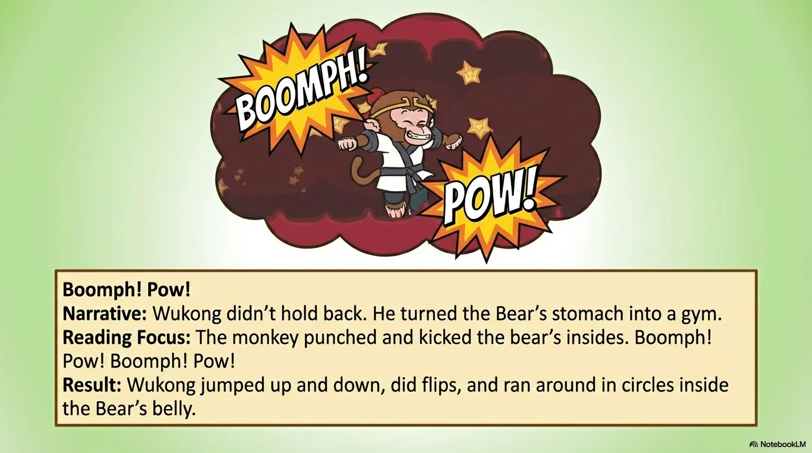

- 来源：`ppt/media/image12.png`（relationship `rId2`）
- 尺寸：1376×768
- 源 SHA-256：`491ac98451e7c7373ae073d67bbf455e024717b5d811c0f0c2361b2a024a177c`
- 输出 SHA-256：`dcfe52f6c4c98749d9406641fa07542c87fd88d8a3a3b686070cd8bac9efe747`
- 分类：unknown ｜ OCR：blocked ｜ 审核：unreviewed

## Slide 012

- 来源：`ppt/media/image13.png`（relationship `rId2`）
- 尺寸：1376×768
- 源 SHA-256：`b64ed9a0dc73ce216e09b2999e292fc50a193ed4e336bcffebb01ce98ee7dae2`
- 输出 SHA-256：`4504b8ea92a89871ad53d50a9ebd6ef3c87f50980c9d812fa4d4c59c97261530`
- 分类：unknown ｜ OCR：blocked ｜ 审核：unreviewed

## Slide 013

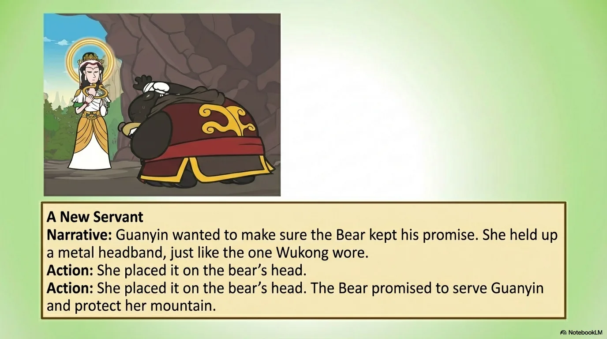

- 来源：`ppt/media/image14.png`（relationship `rId2`）
- 尺寸：1376×768
- 源 SHA-256：`0ab3e0e5200424234d924c6f0ee86a9d376750ca1766e41d202c5fa160930be3`
- 输出 SHA-256：`791ed0d8bf6863731de47280bb072480ad36c733a11df06c7bb0736eec9ef97e`
- 分类：unknown ｜ OCR：blocked ｜ 审核：unreviewed

## Slide 014

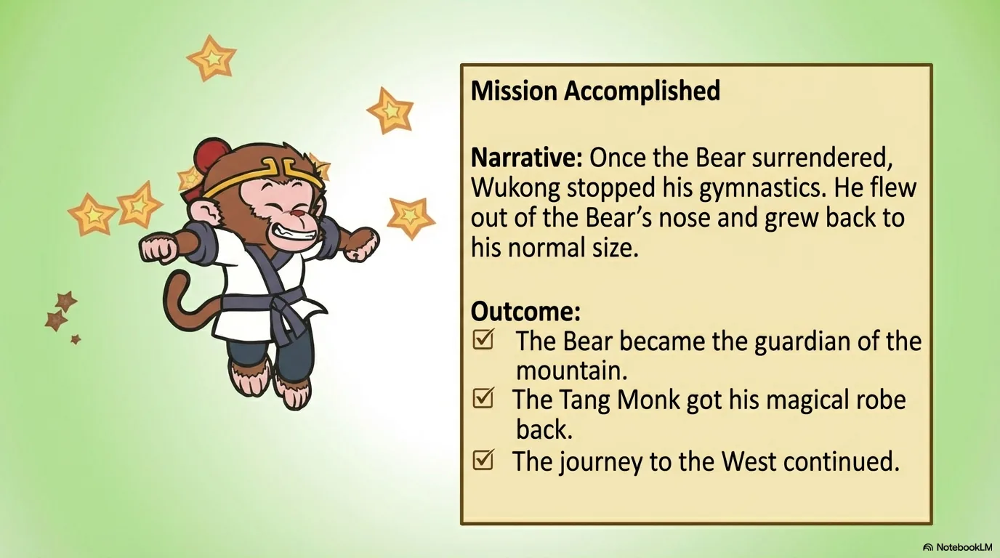

- 来源：`ppt/media/image15.png`（relationship `rId2`）
- 尺寸：1376×768
- 源 SHA-256：`0d5c8a4075c3def36c10610b43440c2553e96944bf4a1703e8e108817d63b181`
- 输出 SHA-256：`eab64b5204b18955906199aa07b6b146ab516305ab5fe3a623422ba54134d7ef`
- 分类：unknown ｜ OCR：blocked ｜ 审核：unreviewed

## Slide 015

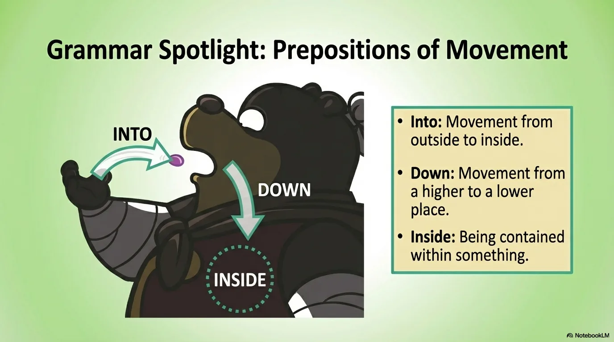

- 来源：`ppt/media/image16.png`（relationship `rId2`）
- 尺寸：1376×768
- 源 SHA-256：`96bf26dfade8bb2f27489dad20654e6853152929b972b4e8b75cc8df9ed5b5fd`
- 输出 SHA-256：`c764f8d9cceaff783ef156ad4f40050cee039b44902f508280ac257b47f980a2`
- 分类：unknown ｜ OCR：blocked ｜ 审核：unreviewed

## Slide 016

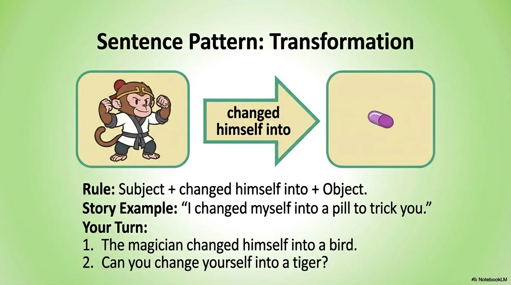

- 来源：`ppt/media/image17.png`（relationship `rId2`）
- 尺寸：1376×768
- 源 SHA-256：`8c464ccdb99686f546c3721aa6fd5243bc685284b51a70758b78bc2f6a189000`
- 输出 SHA-256：`05a50126c44b1ab06984469c743f190b98486a23a7476735936acc0fa7e6b985`
- 分类：unknown ｜ OCR：blocked ｜ 审核：unreviewed

## Slide 017

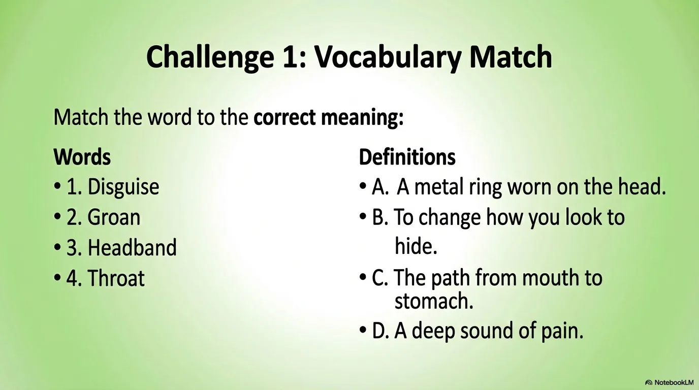

- 来源：`ppt/media/image18.png`（relationship `rId2`）
- 尺寸：1376×768
- 源 SHA-256：`8fa709f0d89ce00f619abfb43d354c4541651980601e7cda455529bc516b7cb0`
- 输出 SHA-256：`b5cd075cb8cf7c7973ef2bec6f033a1d413c75f5c736a81c7bf5662be382074b`
- 分类：unknown ｜ OCR：blocked ｜ 审核：unreviewed

## Slide 018

- 来源：`ppt/media/image19.png`（relationship `rId2`）
- 尺寸：1376×768
- 源 SHA-256：`e1ccc1b778f41ee54f671d19b264cce9700f5d8a83d02b4fffda1087fc9e69c7`
- 输出 SHA-256：`72073d35142648ba5a9a601b9597932cf32b105cdde1a33e8945ba9a9dddc42c`
- 分类：unknown ｜ OCR：blocked ｜ 审核：unreviewed

## Slide 019

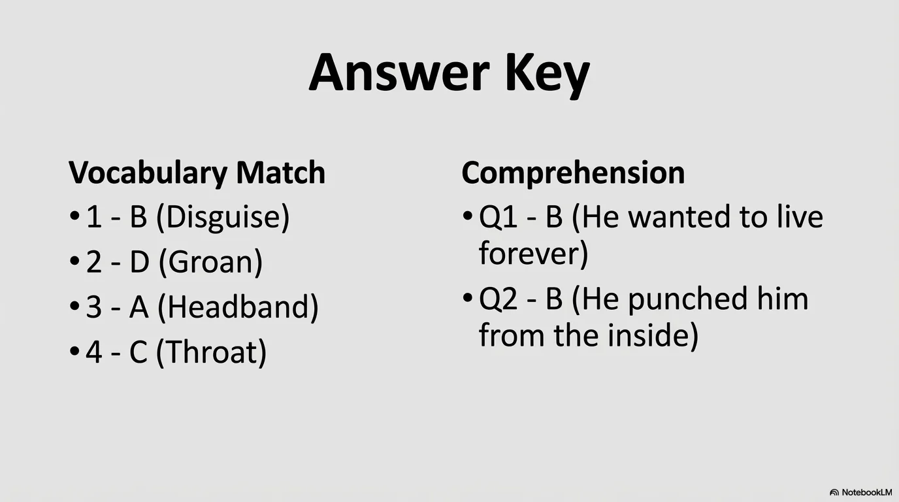

- 来源：`ppt/media/image20.png`（relationship `rId2`）
- 尺寸：1376×768
- 源 SHA-256：`36edc15109c19d2ff33540c8638797a8b833629d52743e038dbb102809b54a72`
- 输出 SHA-256：`f57159a2c1955f77761c1b1a126319773a7c11e0a883ad3b9d532e6f07499c5c`
- 分类：unknown ｜ OCR：blocked ｜ 审核：unreviewed

## Slide 020

- 来源：`ppt/media/image21.png`（relationship `rId2`）
- 尺寸：1376×768
- 源 SHA-256：`c913ec1ef731fba29ebba4d09de1e5b07bb29ccaf4202aba265ce02fd13b2b10`
- 输出 SHA-256：`f62b5e01f229ddd958d1374d7f07f8f4b62dbc8bfef49931a6dc32e5bc9515e3`
- 分类：unknown ｜ OCR：blocked ｜ 审核：unreviewed
