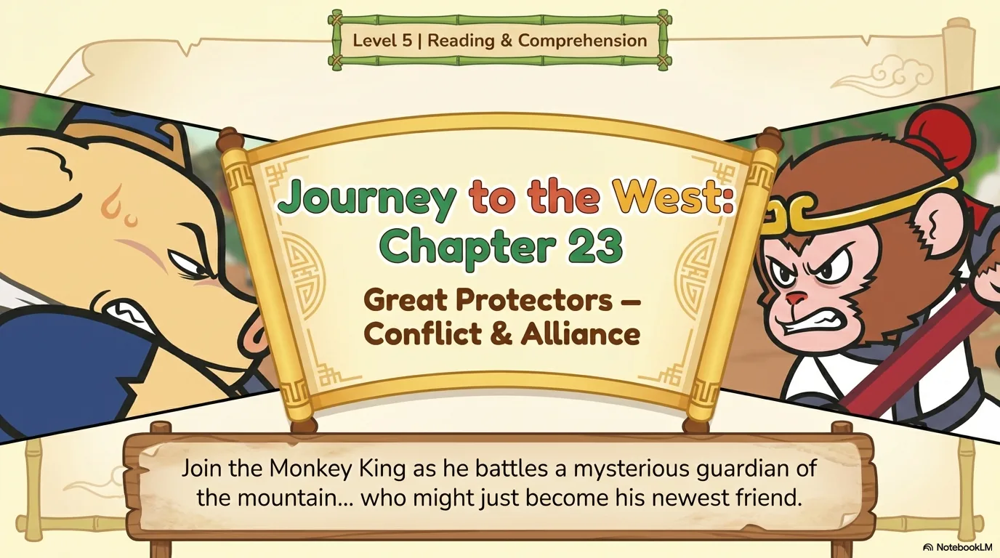
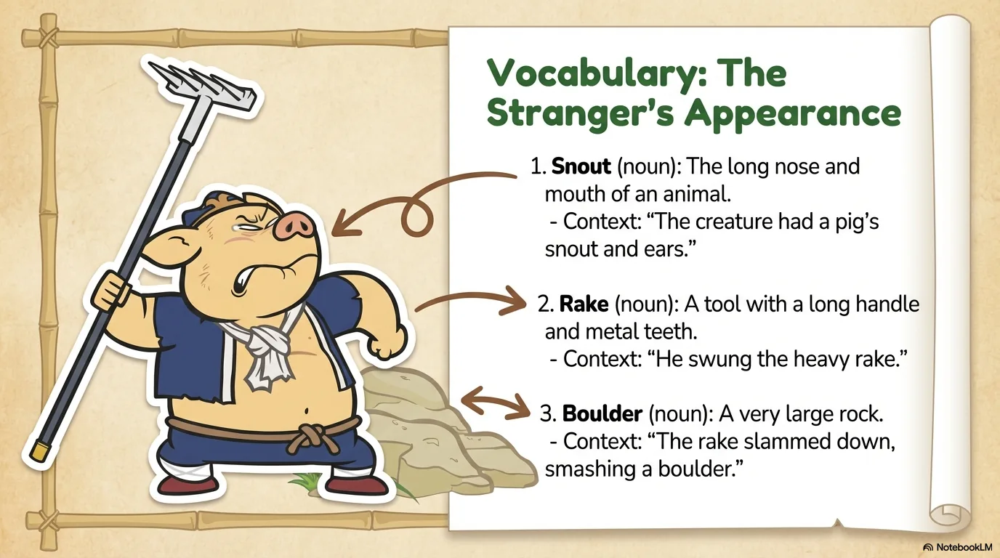
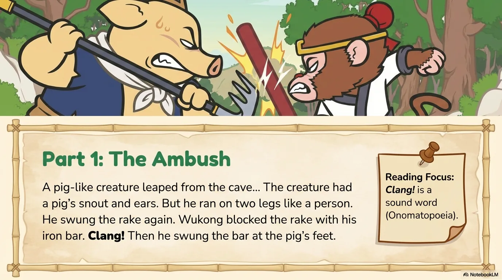
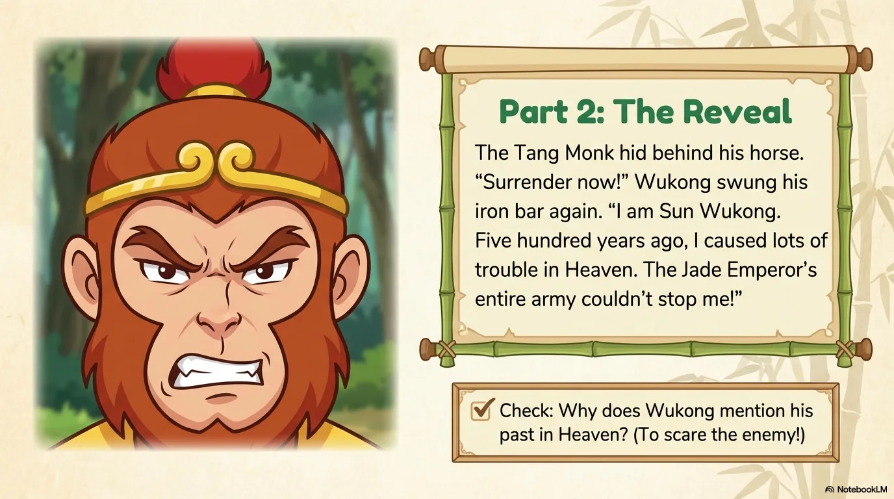
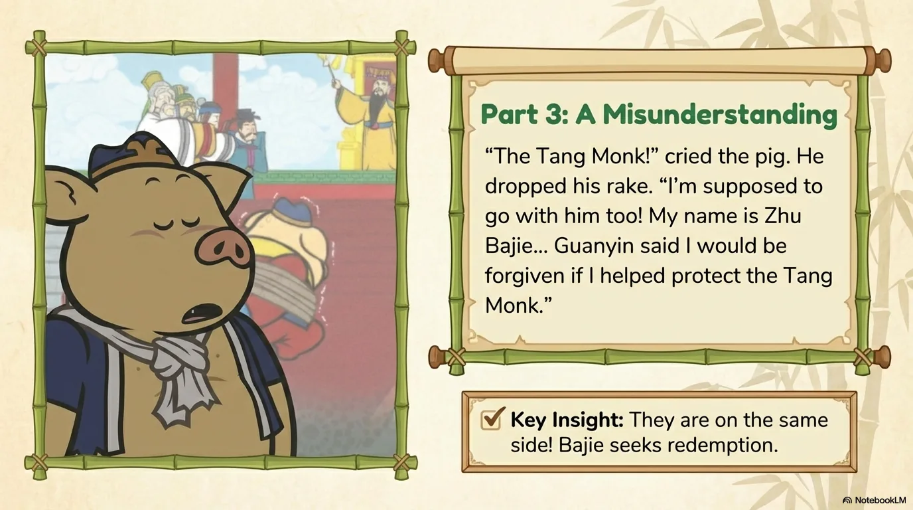
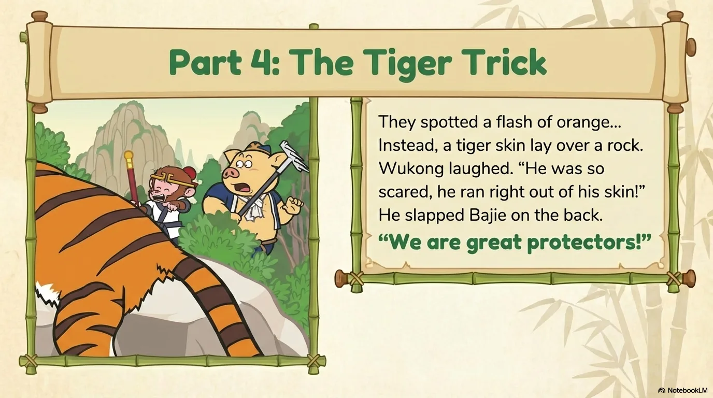
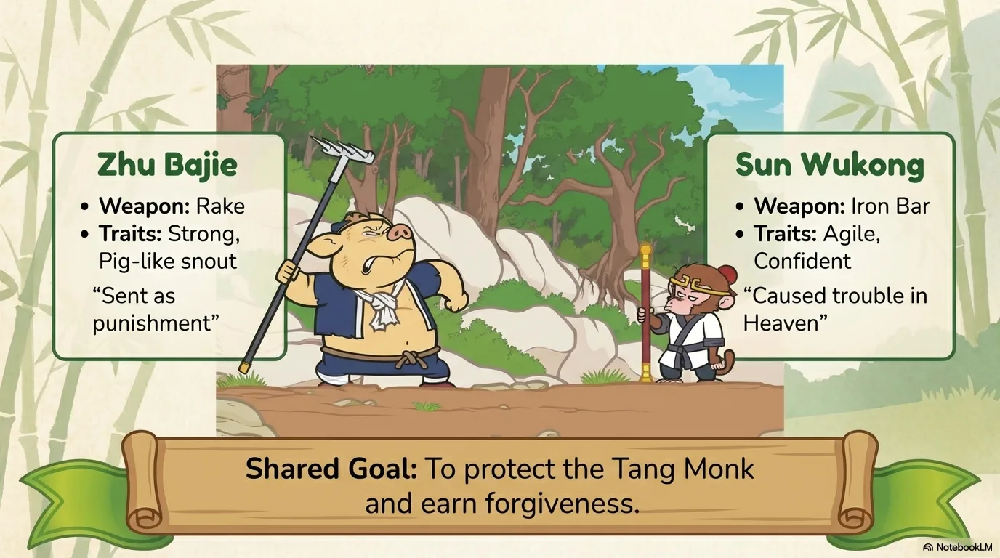
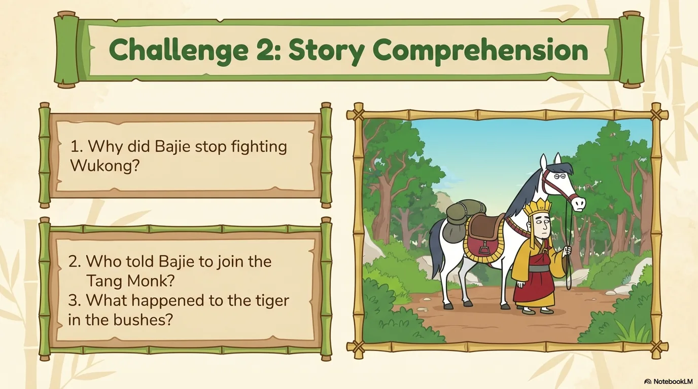
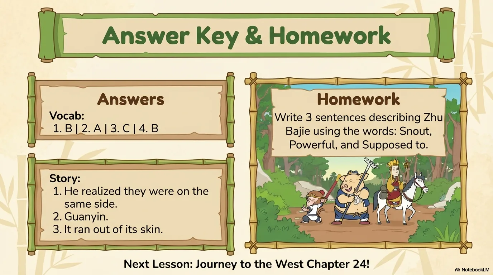

# 豆豆龙英语 · 第 23 集课件（EP023 草稿）

- 来源：`023_Journey to the West 23_Great Protectors.pptx`（主课件，15 页）
- OCR：`blocked`（no local OCR provider importable (pytesseract missing): No module named 'pytesseract'）
- 分类：待人工审核（unknown）
- 审核状态：`unreviewed`

## Slide 001

- 来源：`ppt/media/image1.png`（relationship `rId2`）
- 尺寸：1376×768
- 源 SHA-256：`41179ab566cbfd02f9763f0df5b5dd8670b1e2e4ced75e82fe7484c8de3ce682`
- 输出 SHA-256：`b99ba6a7fa8e2037b5755e07cbf347c211107336fc7f17da3aeef10d2d27aa97`
- 分类：unknown ｜ OCR：blocked ｜ 审核：unreviewed

## Slide 002

- 来源：`ppt/media/image3.png`（relationship `rId2`）
- 尺寸：1376×768
- 源 SHA-256：`7aea29d150cf0ad1a50f23f0a9f31f0fa12227cc71b03adea2833f8a9e2983cf`
- 输出 SHA-256：`bb91766f3c1393ef850a67071f20be1c935fe2dfa82622536b28e515c2e269a5`
- 分类：unknown ｜ OCR：blocked ｜ 审核：unreviewed

## Slide 003

- 来源：`ppt/media/image4.png`（relationship `rId2`）
- 尺寸：1376×768
- 源 SHA-256：`dcf4a37209a37d1ac503356128c1cb88507ea4da06b978ef86370553a28bc683`
- 输出 SHA-256：`87f0de1cee6e340fcb72e5951c2ca412953ff5397c5934577d9856490d475360`
- 分类：unknown ｜ OCR：blocked ｜ 审核：unreviewed

## Slide 004

- 来源：`ppt/media/image5.png`（relationship `rId2`）
- 尺寸：1376×768
- 源 SHA-256：`e1130a690f22b028f3112c4acf3df27f07ddbde0415c3ac1ffa38beaa3416a6d`
- 输出 SHA-256：`0f62a2f17ce4391be5ca0170bfe30ad9d1e31ecde3361837ac1a9f1544894511`
- 分类：unknown ｜ OCR：blocked ｜ 审核：unreviewed

## Slide 005

- 来源：`ppt/media/image6.png`（relationship `rId2`）
- 尺寸：1376×768
- 源 SHA-256：`6366b92698f4957c1b539176ced542d7dee41487c55f9f9499fc9088dbbcffe1`
- 输出 SHA-256：`c252fb042e1845bf32168645b9eb13fec7ba570e1f4c9ad78458261e8666e733`
- 分类：unknown ｜ OCR：blocked ｜ 审核：unreviewed

## Slide 006

- 来源：`ppt/media/image7.png`（relationship `rId2`）
- 尺寸：1376×768
- 源 SHA-256：`e3a2b70f65b6acb1726262cfd1cc4a11692956a8b35598ceae99bf546d332d01`
- 输出 SHA-256：`c0c1ad5e369b05453fbbee3047aa1233bf29d7c29fa2b83d314a5bf92b7c39cb`
- 分类：unknown ｜ OCR：blocked ｜ 审核：unreviewed

## Slide 007

- 来源：`ppt/media/image8.png`（relationship `rId2`）
- 尺寸：1376×768
- 源 SHA-256：`1730018414f58c8f0c754eee358d90b993367edbcde8eb9c3fe087b83c98e7ff`
- 输出 SHA-256：`5cd9eb4851170d107a1669f3f943ad1d6010ea5e6f90d5676f441fccaacd845f`
- 分类：unknown ｜ OCR：blocked ｜ 审核：unreviewed

## Slide 008

- 来源：`ppt/media/image9.png`（relationship `rId2`）
- 尺寸：1376×768
- 源 SHA-256：`7952735b1b4a9e5a61eb415d88a82843e7e283b513ec0c1bcac84130baa76e33`
- 输出 SHA-256：`d56fc1bbd89ca9daa003b6b7bf059b103ba620895759b6ec1b81e08c82d85b51`
- 分类：unknown ｜ OCR：blocked ｜ 审核：unreviewed

## Slide 009

- 来源：`ppt/media/image10.png`（relationship `rId2`）
- 尺寸：1376×768
- 源 SHA-256：`efcb287a5f3e2e27c2f96a8803480a16545dba2661db848a20375d60f71ae674`
- 输出 SHA-256：`2ac5ec901b3e7d24925cd1cda1573deb7a9e14fbb0d8c3344faf343a5a6f97f3`
- 分类：unknown ｜ OCR：blocked ｜ 审核：unreviewed

## Slide 010

- 来源：`ppt/media/image11.png`（relationship `rId2`）
- 尺寸：1376×768
- 源 SHA-256：`de965018c76e664dd22c8fdb8ead8c1d3a154575a59a37847637dada7c4c9003`
- 输出 SHA-256：`ad1421519878347524d7c4d043888c375e58c21104967a73736b21518c0cb68c`
- 分类：unknown ｜ OCR：blocked ｜ 审核：unreviewed

## Slide 011

- 来源：`ppt/media/image12.png`（relationship `rId2`）
- 尺寸：1376×768
- 源 SHA-256：`7d0c23394655671d8f7968e8cf9f347c128a37c27936966396810900f3e2ce70`
- 输出 SHA-256：`e74824a7372f1583fdf03de426eb904da4efe1a98948868e6241214901481a81`
- 分类：unknown ｜ OCR：blocked ｜ 审核：unreviewed

## Slide 012

- 来源：`ppt/media/image13.png`（relationship `rId2`）
- 尺寸：1376×768
- 源 SHA-256：`2f0e3a4775d2d364ef0f48a91a51396e6b4a9a31fdb31ac0fe941b0e71436c35`
- 输出 SHA-256：`d9e5c66fdc5c683cc86eb59fbd1c57941ba38384fe4ecf3df601edd7d054b50e`
- 分类：unknown ｜ OCR：blocked ｜ 审核：unreviewed

## Slide 013

- 来源：`ppt/media/image14.png`（relationship `rId2`）
- 尺寸：1376×768
- 源 SHA-256：`7bb81dfac83bd60ccb63169742d3e8e5457af2a80915a5b8760e39ce38282738`
- 输出 SHA-256：`3ba1c939ed58d8db4bd328bef4ddfb0c90994d7afc030130b5e278d935504dea`
- 分类：unknown ｜ OCR：blocked ｜ 审核：unreviewed

## Slide 014

- 来源：`ppt/media/image15.png`（relationship `rId2`）
- 尺寸：1376×768
- 源 SHA-256：`1210c45db87eafb92eb307594b2d0c08af5bb9095a4660a279c99210dc506b40`
- 输出 SHA-256：`38b068403acfceceaccee95de5c2b046d27529d363d1843f8773b44487c757f1`
- 分类：unknown ｜ OCR：blocked ｜ 审核：unreviewed

## Slide 015

- 来源：`ppt/media/image16.png`（relationship `rId2`）
- 尺寸：1376×768
- 源 SHA-256：`011a350be18dea6360ffe2be0428ac8aba130d0eabc488bcccd1cdb86b6cb76c`
- 输出 SHA-256：`c26f9eb7ad93e88cb000152cd4d7ed1bdcff7a61cf12efef8aa96f28597bab0e`
- 分类：unknown ｜ OCR：blocked ｜ 审核：unreviewed
