# 豆豆龙英语 · 第 24 集课件（EP024 草稿）

- 来源：`024_Journey to the West 24_The Great King Yellow Wind.pptx`（主课件，20 页）
- OCR：`blocked`（no local OCR provider importable (pytesseract missing): No module named 'pytesseract'）
- 分类：待人工审核（unknown）
- 审核状态：`unreviewed`

## Slide 001

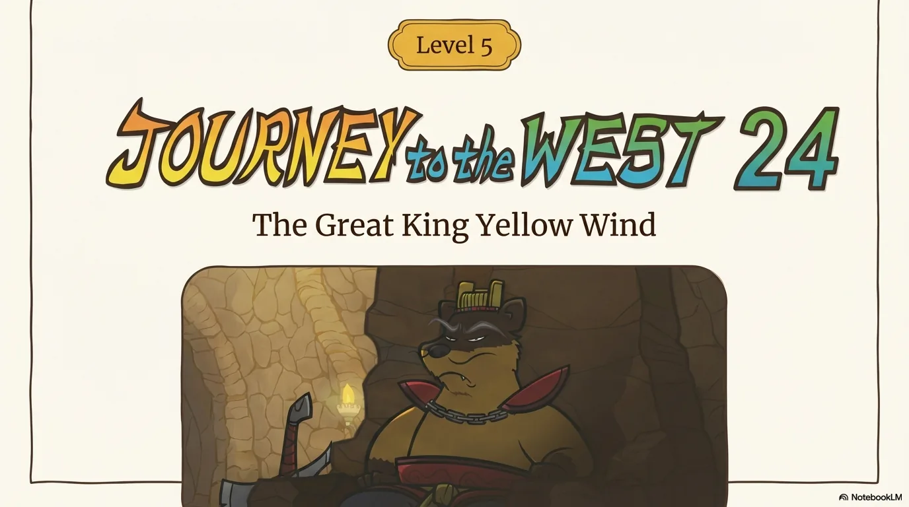

- 来源：`ppt/media/image1.png`（relationship `rId2`）
- 尺寸：1376×768
- 源 SHA-256：`9bfce72faae86e35e294392e38f30639bf17a1c822e568a26b104217b629eb93`
- 输出 SHA-256：`61d73e326afb85aa39daa5949e887d5f3d3694f8cd0d8c619fa7b9d50e53ad6d`
- 分类：unknown ｜ OCR：blocked ｜ 审核：unreviewed

## Slide 002

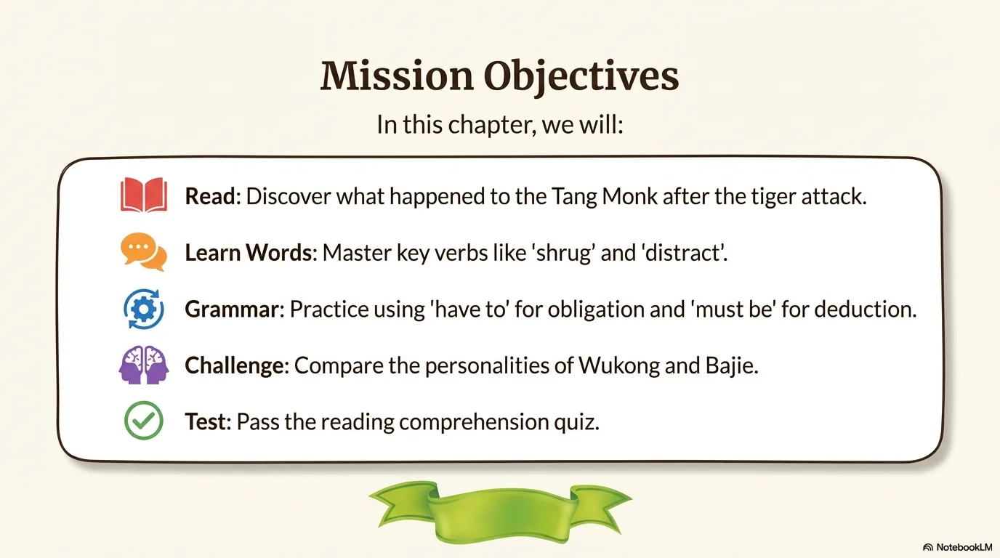

- 来源：`ppt/media/image3.png`（relationship `rId2`）
- 尺寸：1376×768
- 源 SHA-256：`41ef93bd3be8f58c96c60a2c02443b58b7dd173a599f9a012f6484acd7ec0f6f`
- 输出 SHA-256：`13dd0a3929fdafe9fed749807692bc620c7ef93a4a240565e3c9395f403bf782`
- 分类：unknown ｜ OCR：blocked ｜ 审核：unreviewed

## Slide 003

- 来源：`ppt/media/image4.png`（relationship `rId2`）
- 尺寸：1376×768
- 源 SHA-256：`698dea884d8bb5222c07823973516e158ecee8b43c3bcfb810fc7d65548748e9`
- 输出 SHA-256：`082f25b431349e3184bdd7f0accac7a2a8c0b110d7ef491585b0905ff925c4ed`
- 分类：unknown ｜ OCR：blocked ｜ 审核：unreviewed

## Slide 004

- 来源：`ppt/media/image5.png`（relationship `rId2`）
- 尺寸：1376×768
- 源 SHA-256：`e92c8efe0eef2661db1ca92d8f62dad8382d2bb81614acc2ab9c011f066ef9b6`
- 输出 SHA-256：`c55c73386ec90e0f2f7fe92a01ea2e08e6fb036db3a8b886730f9f27c9bf1cee`
- 分类：unknown ｜ OCR：blocked ｜ 审核：unreviewed

## Slide 005

- 来源：`ppt/media/image6.png`（relationship `rId2`）
- 尺寸：1376×768
- 源 SHA-256：`d1220b6b0a1f6cef60abd6db3bf7c50efa15b2324cccc0299620805535333a1c`
- 输出 SHA-256：`1541340f71a60703c44121da7dccf709920363163f1e3c236c9e7a7c94e8d960`
- 分类：unknown ｜ OCR：blocked ｜ 审核：unreviewed

## Slide 006

- 来源：`ppt/media/image7.png`（relationship `rId2`）
- 尺寸：1376×768
- 源 SHA-256：`47d2b2f370fa9b39d75486dec94c1d519f5091067bb1895ae2163fd97f0d9828`
- 输出 SHA-256：`184a8954a7846df66ed64e3fb536dd9040f00a9c9fdebf5cd8430fef2acbe9ec`
- 分类：unknown ｜ OCR：blocked ｜ 审核：unreviewed

## Slide 007

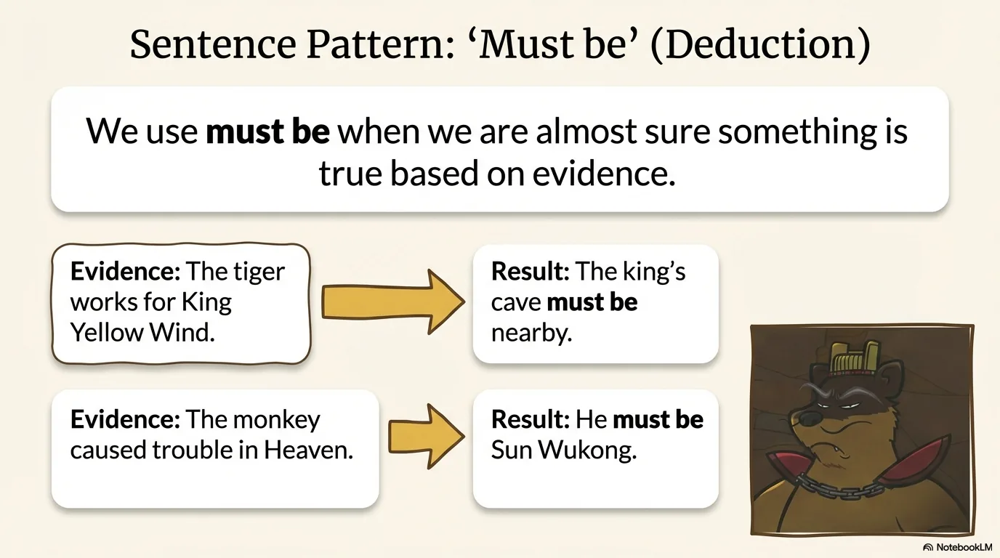

- 来源：`ppt/media/image8.png`（relationship `rId2`）
- 尺寸：1376×768
- 源 SHA-256：`ffc8cb67fe2af61d78b169de08e417cd67dbc693f8117018551cfe5d3e2d7098`
- 输出 SHA-256：`d8d3789133f404b390e05acd0d0999b3faf522966c9a1dfad77ca86d9936e08a`
- 分类：unknown ｜ OCR：blocked ｜ 审核：unreviewed

## Slide 008

- 来源：`ppt/media/image9.png`（relationship `rId2`）
- 尺寸：1376×768
- 源 SHA-256：`20706b409d2f351be7aa26f1ebb29119cecdfc7639be06f4505c3b1fa5e14d35`
- 输出 SHA-256：`ad61158554d9524c657fae5fd228bcef942231dd85faa7a61c659fcde739036c`
- 分类：unknown ｜ OCR：blocked ｜ 审核：unreviewed

## Slide 009

- 来源：`ppt/media/image10.png`（relationship `rId2`）
- 尺寸：1376×768
- 源 SHA-256：`9922cc8beb6d92f7f6106ee0e696aa4d3837b8993b3a179dd45fd98b446af768`
- 输出 SHA-256：`e6492de5663ef398b06b3f76b2f68fc05ed8ca2f63393fe37e2cf82b3bcdfcaf`
- 分类：unknown ｜ OCR：blocked ｜ 审核：unreviewed

## Slide 010

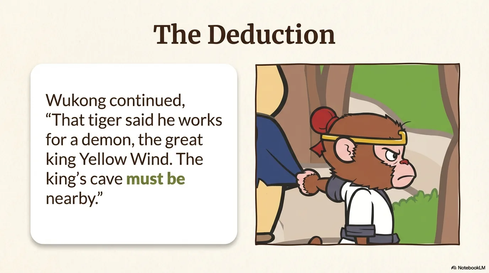

- 来源：`ppt/media/image11.png`（relationship `rId2`）
- 尺寸：1376×768
- 源 SHA-256：`be522e87ce1a6f89389e239fcaff103d2dc1d2bd5c5ff3847b9dffe1ab10b885`
- 输出 SHA-256：`4039b21a42fc3afa3d7e66855c2115454ac48f8f88de81e0252123446506713a`
- 分类：unknown ｜ OCR：blocked ｜ 审核：unreviewed

## Slide 011

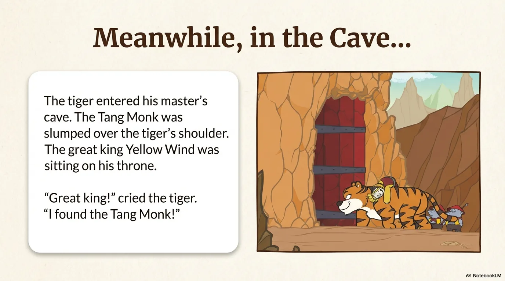

- 来源：`ppt/media/image12.png`（relationship `rId2`）
- 尺寸：1376×768
- 源 SHA-256：`c276ab05655d8e8e20bba5226ba9bdcc8d7684633e58e49a038ba7da48d9afac`
- 输出 SHA-256：`80d48d22650eaa830651abbdf730fe0ff0d38331a636af314fa9d560cb7ca50f`
- 分类：unknown ｜ OCR：blocked ｜ 审核：unreviewed

## Slide 012

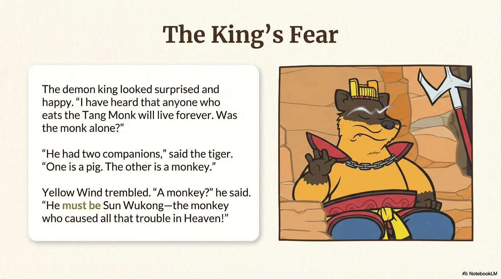

- 来源：`ppt/media/image13.png`（relationship `rId2`）
- 尺寸：1376×768
- 源 SHA-256：`a083ed11987aff2db162f7bbf713ea904e6e9a1806de8660c341af33684738b9`
- 输出 SHA-256：`c7395cf5b201b9fecf237b233063f49fe2a1027f744c6269e91c117c878a56ed`
- 分类：unknown ｜ OCR：blocked ｜ 审核：unreviewed

## Slide 013

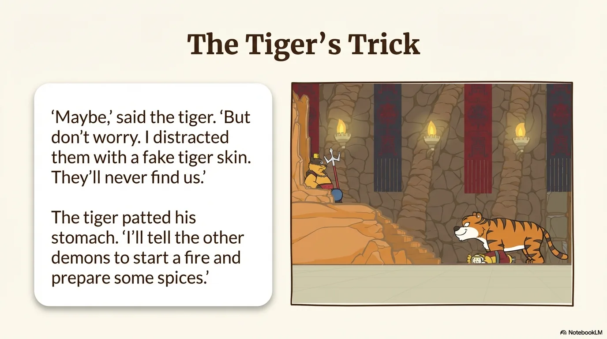

- 来源：`ppt/media/image14.png`（relationship `rId2`）
- 尺寸：1376×768
- 源 SHA-256：`350a2cf9514757b30a3c12b1cedc0ec48f80b0f982a1ceec18a2b5aa04d8c3dc`
- 输出 SHA-256：`eb2c006a157946ec4177f8f08fc7df58d5d7710aad135c8385db13a6f5ad03ac`
- 分类：unknown ｜ OCR：blocked ｜ 审核：unreviewed

## Slide 014

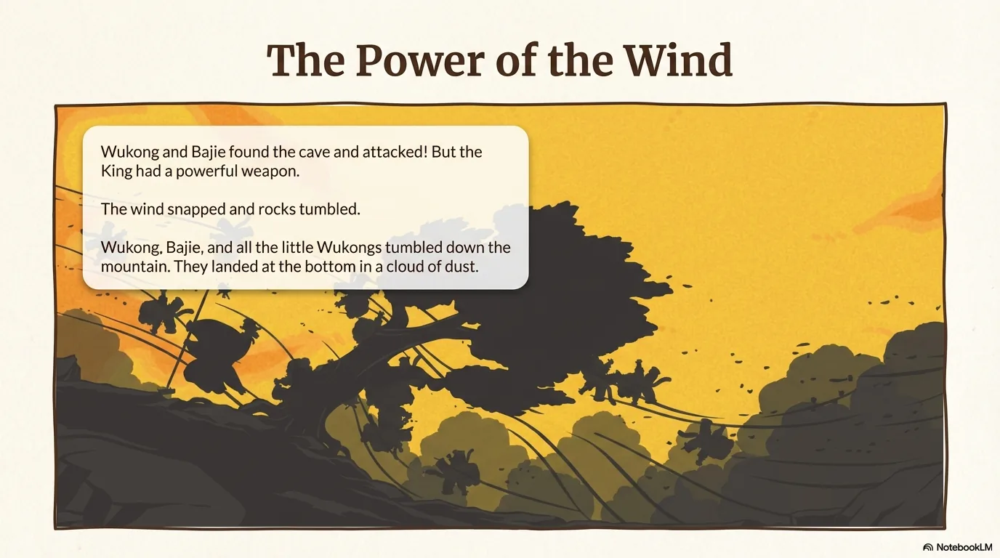

- 来源：`ppt/media/image15.png`（relationship `rId2`）
- 尺寸：1376×768
- 源 SHA-256：`be3af427d6aa2ddee1c17707fb4849f0bae0fdb12af7559ce22e61d093b87ce8`
- 输出 SHA-256：`013b37407f83430f868cff4e4ffa1d8f0aa15f7f3010413a4e00a7fe3e78f275`
- 分类：unknown ｜ OCR：blocked ｜ 审核：unreviewed

## Slide 015

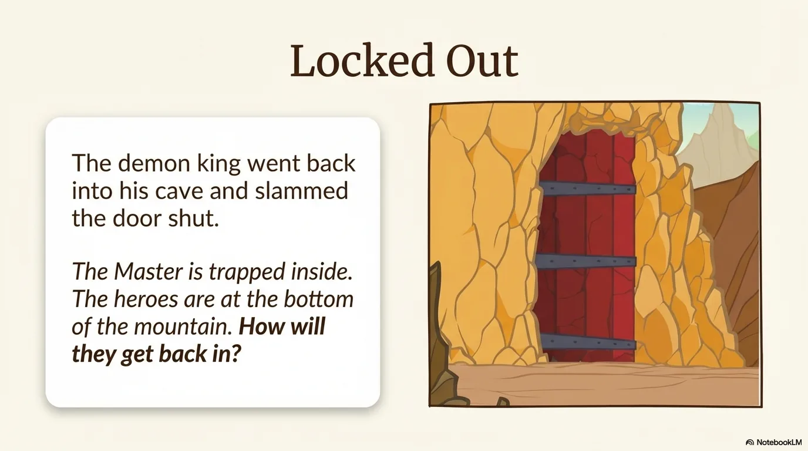

- 来源：`ppt/media/image16.png`（relationship `rId2`）
- 尺寸：1376×768
- 源 SHA-256：`4bcbe58f097705d46532e198b28371475b3af2f21968ddab89565f19329768f7`
- 输出 SHA-256：`5f1e08311be4c50e874c3105f3ba671778a590cdae9e9b6dfc28491a8c10b437`
- 分类：unknown ｜ OCR：blocked ｜ 审核：unreviewed

## Slide 016

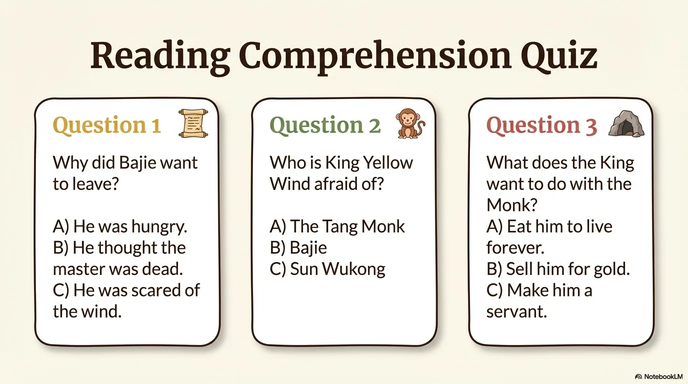

- 来源：`ppt/media/image17.png`（relationship `rId2`）
- 尺寸：1376×768
- 源 SHA-256：`b9924b763426fb5450836785cb581a1c16f107024c76f1fe15937dba4e6f00c6`
- 输出 SHA-256：`dda98e2cf41d2a56cb70fbb96f1e0db9d1f8cf1cb5d19a7534031c85131c493c`
- 分类：unknown ｜ OCR：blocked ｜ 审核：unreviewed

## Slide 017

- 来源：`ppt/media/image18.png`（relationship `rId2`）
- 尺寸：1376×768
- 源 SHA-256：`93a6ac5573fcc81d366992d86182f4fcb3d11f18d45862ea097874c9cdd13035`
- 输出 SHA-256：`0ff244a27105a4bb8fb4d5066e4bb6fbff25141745c6eed58522d44d187bbf2f`
- 分类：unknown ｜ OCR：blocked ｜ 审核：unreviewed

## Slide 018

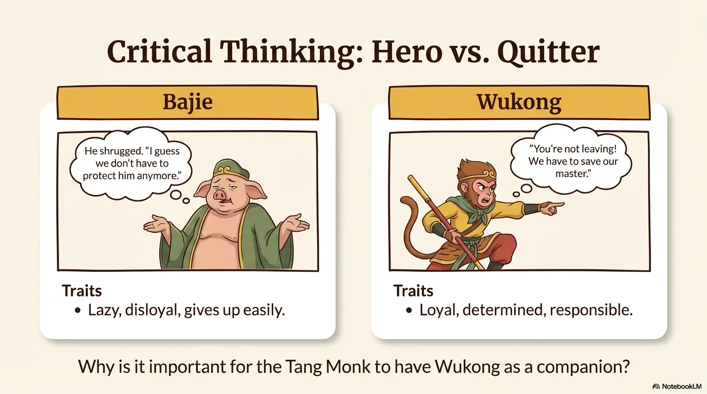

- 来源：`ppt/media/image19.png`（relationship `rId2`）
- 尺寸：1376×768
- 源 SHA-256：`7e36299e84f8fd7e2a634e35570d2ede3606254b76bd29724910ede1748b8b63`
- 输出 SHA-256：`ddb16ab77c812c90488d7ce0029b36756f334f0252e2a9699540cfc438b44af7`
- 分类：unknown ｜ OCR：blocked ｜ 审核：unreviewed

## Slide 019

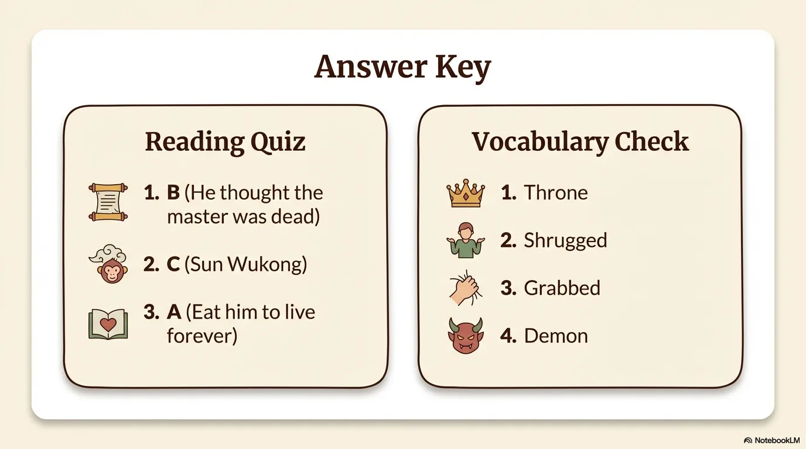

- 来源：`ppt/media/image20.png`（relationship `rId2`）
- 尺寸：1376×768
- 源 SHA-256：`b82d6b38a9d3dabf9236d6227b906461d9d84650761e65a2ff6f23c99c3adbab`
- 输出 SHA-256：`4a14a477276b7f7284778f313095e20130c66b3a98d3eecf1b7f3e1fd5adee94`
- 分类：unknown ｜ OCR：blocked ｜ 审核：unreviewed

## Slide 020

- 来源：`ppt/media/image21.png`（relationship `rId2`）
- 尺寸：1376×768
- 源 SHA-256：`54523a7080b6b23c3889ec04b837d9c15a63c6f506f31ca464a69df700557616`
- 输出 SHA-256：`0a95d9202a79164c5d6ab295bdcdd7f8f0fc2fcdb2f75c97735ded0be3e0164e`
- 分类：unknown ｜ OCR：blocked ｜ 审核：unreviewed
