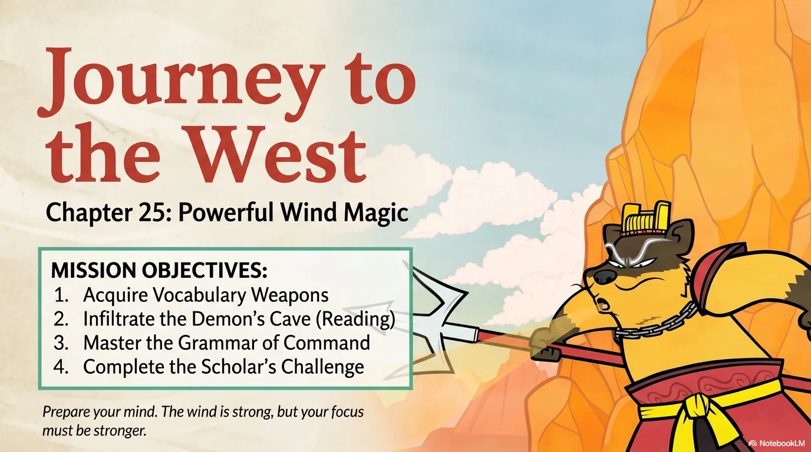
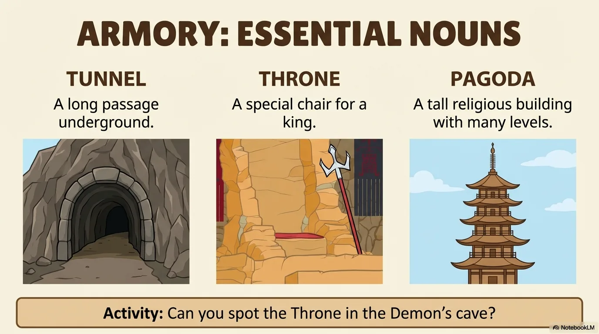
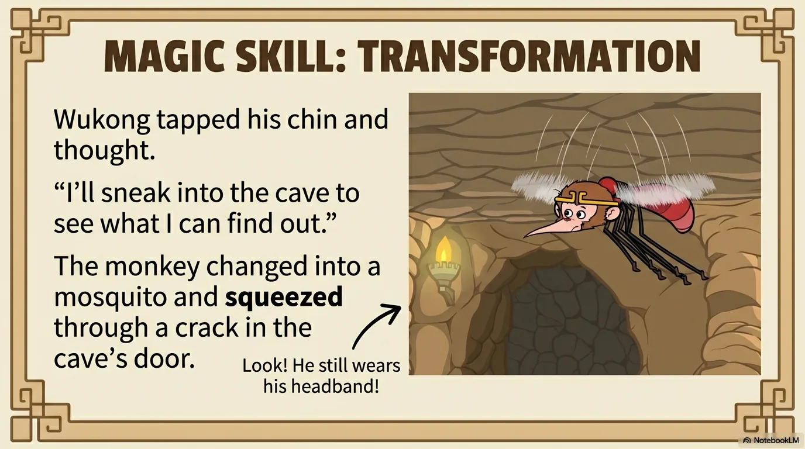
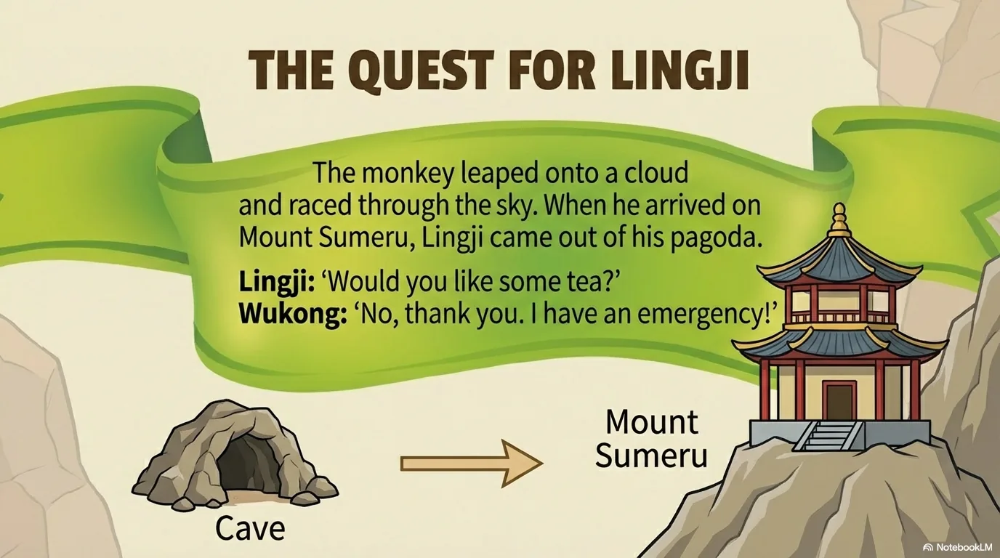
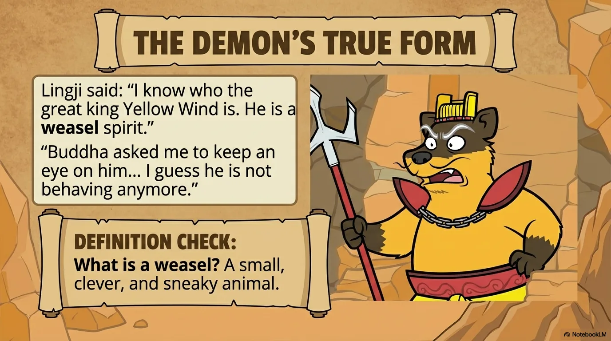
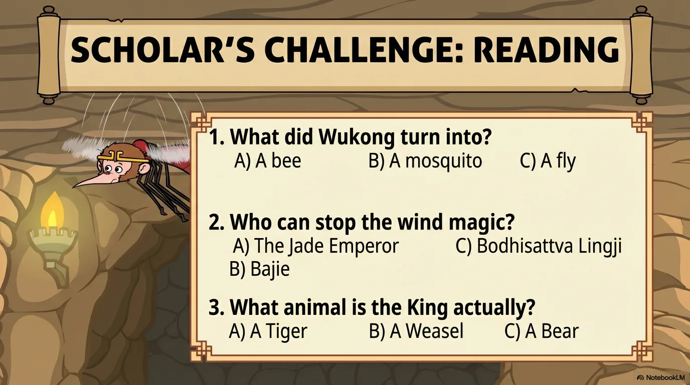
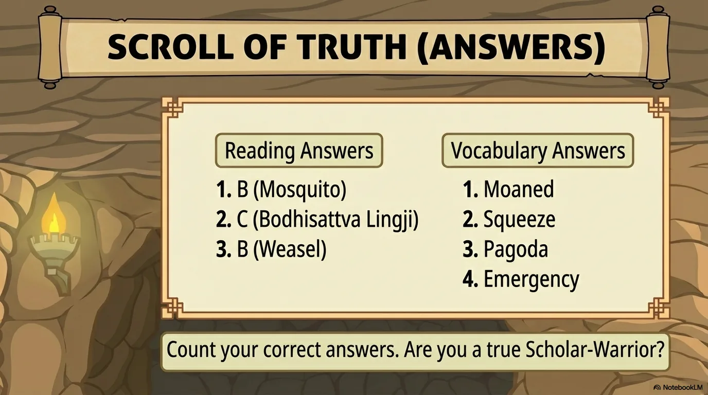

# 豆豆龙英语 · 第 25 集课件（EP025 草稿）

- 来源：`025_Journey to the West 25_Powerful Wind Magic.pptx`（主课件，20 页）
- OCR：`blocked`（no local OCR provider importable (pytesseract missing): No module named 'pytesseract'）
- 分类：待人工审核（unknown）
- 审核状态：`unreviewed`

## Slide 001

- 来源：`ppt/media/image1.png`（relationship `rId2`）
- 尺寸：1376×768
- 源 SHA-256：`ec5dc8f398750922d0c892e9b4e289ecfb8dc58e4515d6982a1c00a4bb54b479`
- 输出 SHA-256：`958f87f2dd5e60e73c6f0b35f39b92f1a58950f5d406e24e8d0e98b462cf8cae`
- 分类：unknown ｜ OCR：blocked ｜ 审核：unreviewed

## Slide 002

- 来源：`ppt/media/image3.png`（relationship `rId2`）
- 尺寸：1376×768
- 源 SHA-256：`f0d96dea5cf2c2cbb1768a22bd50af275afd915416733dd56cdaca7fb8b0abb3`
- 输出 SHA-256：`d6d79c39d63d1444f18f4cbafb35910721b4d2d103843c9bf5cce7473fa9e4e4`
- 分类：unknown ｜ OCR：blocked ｜ 审核：unreviewed

## Slide 003

- 来源：`ppt/media/image4.png`（relationship `rId2`）
- 尺寸：1376×768
- 源 SHA-256：`00fbe68717631952c65f7395f4c6380be959628a0e5b4e07b4fadd96fa312690`
- 输出 SHA-256：`9b1189c9df1961c16eca9f540806efd0ff93c94bbe05fc40f4141560be9fc62f`
- 分类：unknown ｜ OCR：blocked ｜ 审核：unreviewed

## Slide 004

- 来源：`ppt/media/image5.png`（relationship `rId2`）
- 尺寸：1376×768
- 源 SHA-256：`e5f410cba3b3766372aa8358b38181ce3e608818132ac154fb1b15ce0bd8089b`
- 输出 SHA-256：`1449a64b17005f29d685c7ad1f4464a5968e349e6659493afdb10a9194cb51c8`
- 分类：unknown ｜ OCR：blocked ｜ 审核：unreviewed

## Slide 005

- 来源：`ppt/media/image6.png`（relationship `rId2`）
- 尺寸：1376×768
- 源 SHA-256：`5ae1c7e754516f2b0e68c1368259c193ecdd5c55132a97bf8680eb275db1a9ee`
- 输出 SHA-256：`4f6646a294e75151ba06b3fbb9c02b0ad2f80c294bc9d742eca5bd8169e04b1a`
- 分类：unknown ｜ OCR：blocked ｜ 审核：unreviewed

## Slide 006

- 来源：`ppt/media/image7.png`（relationship `rId2`）
- 尺寸：1376×768
- 源 SHA-256：`1ed8f1849bc610e97940c08893e0aa91d4ee8f729806a53ea1723eb655ae38cf`
- 输出 SHA-256：`6609daa98f4a241b70acac43522be9d2640e359babc9714ed45cfb7d1cde22bb`
- 分类：unknown ｜ OCR：blocked ｜ 审核：unreviewed

## Slide 007

- 来源：`ppt/media/image8.png`（relationship `rId2`）
- 尺寸：1376×768
- 源 SHA-256：`5ed5628422e150012e7217d35983a266b3a006996307208a3a2f2d2f98eb9cc6`
- 输出 SHA-256：`735f74b75793c2034dd06f6a23ec2704b67f061e6a4ea3917c6995cc3bd10559`
- 分类：unknown ｜ OCR：blocked ｜ 审核：unreviewed

## Slide 008

- 来源：`ppt/media/image9.png`（relationship `rId2`）
- 尺寸：1376×768
- 源 SHA-256：`962264e8ae67d145e33941d533aa515fb88f806e397b2d4e7595925e2dbbf75f`
- 输出 SHA-256：`315fee414296483dd9e69bbbd0f54168c9001792f993be801a88d88fcbde934a`
- 分类：unknown ｜ OCR：blocked ｜ 审核：unreviewed

## Slide 009

- 来源：`ppt/media/image10.png`（relationship `rId2`）
- 尺寸：1376×768
- 源 SHA-256：`c6dcb1793a2737b6c1acded8c60e1ed336b4c798e12e9721af156209e4c0e11e`
- 输出 SHA-256：`930023f2d5c5bb1b50e7c163d17581f6893b74041d03fafadf2eb3dcb7f1cdaa`
- 分类：unknown ｜ OCR：blocked ｜ 审核：unreviewed

## Slide 010

- 来源：`ppt/media/image11.png`（relationship `rId2`）
- 尺寸：1376×768
- 源 SHA-256：`cf29a03a98ade470a8935a10e50f04f82d6b19b6ba22446e86f3c625888d732c`
- 输出 SHA-256：`497bda89cbc9135a0aee77578683e1644158078720991dfe41e6f9df28430627`
- 分类：unknown ｜ OCR：blocked ｜ 审核：unreviewed

## Slide 011

- 来源：`ppt/media/image12.png`（relationship `rId2`）
- 尺寸：1376×768
- 源 SHA-256：`c16412d53898f46934eab0d352a43af183e68009105e449a1baf9c806c9e962a`
- 输出 SHA-256：`204673ce82887b502566dd25826c1b434c90692151d69677cb756118cdff7444`
- 分类：unknown ｜ OCR：blocked ｜ 审核：unreviewed

## Slide 012

- 来源：`ppt/media/image13.png`（relationship `rId2`）
- 尺寸：1376×768
- 源 SHA-256：`109ef70fed34ef0d69ba5bf8f218ec27710ef9dcb401c338352079e30a47d1dd`
- 输出 SHA-256：`ecc672e54cd8d19ca8e5ff8d8a7f224ba64bd04f0747c1623a8f8e20deecef99`
- 分类：unknown ｜ OCR：blocked ｜ 审核：unreviewed

## Slide 013

- 来源：`ppt/media/image14.png`（relationship `rId2`）
- 尺寸：1376×768
- 源 SHA-256：`5e2c526b36838e677f16ee02e5d2dccebc4ae82ec3ade7bf21332304f2d68ee8`
- 输出 SHA-256：`bbd819b7e22f497361c954abc1e7a6c26fa6e2fe2b313f1be20f4e26943652d2`
- 分类：unknown ｜ OCR：blocked ｜ 审核：unreviewed

## Slide 014

- 来源：`ppt/media/image15.png`（relationship `rId2`）
- 尺寸：1376×768
- 源 SHA-256：`b1741328399373c060e67ce10fd57f8bece57decb5a92b72020d772c94473785`
- 输出 SHA-256：`8a23b829c41fb0ce505f08c014bd08f316d32a0ccfba87cb56554a3c306ce8e5`
- 分类：unknown ｜ OCR：blocked ｜ 审核：unreviewed

## Slide 015

- 来源：`ppt/media/image16.png`（relationship `rId2`）
- 尺寸：1376×768
- 源 SHA-256：`22621a1b420a0b41c478dd3113799d49d5f11f8dd3d33a5145120aa4a4eebab4`
- 输出 SHA-256：`0d118bc1b576f10796f7856eefea98db54fadc530ad7b34d6d99643a84fa0a03`
- 分类：unknown ｜ OCR：blocked ｜ 审核：unreviewed

## Slide 016

- 来源：`ppt/media/image17.png`（relationship `rId2`）
- 尺寸：1376×768
- 源 SHA-256：`113c7baacf6fee534156acc71fac623d68a5d7bfa1b88db766021ced9127dc46`
- 输出 SHA-256：`33b04d6c66dd4f6c50e93b0d44e6d30076f9d9d5626c286297192d89edbdc58e`
- 分类：unknown ｜ OCR：blocked ｜ 审核：unreviewed

## Slide 017

- 来源：`ppt/media/image18.png`（relationship `rId2`）
- 尺寸：1376×768
- 源 SHA-256：`165072c5a28a7c534cf338a6d51998842767a1550e2f9acd78c311376b67279d`
- 输出 SHA-256：`3a0373f6602db7efadb0b0960f1ec5b552b7ea5842e1afac3de2ea493594a2eb`
- 分类：unknown ｜ OCR：blocked ｜ 审核：unreviewed

## Slide 018

- 来源：`ppt/media/image19.png`（relationship `rId2`）
- 尺寸：1376×768
- 源 SHA-256：`45547b09801fd73a3523f38fe6475ea5761b4c96baffd72fc12df3a07e6f1c6b`
- 输出 SHA-256：`c4dd15308add5c3bc5b2d441f8d48bd3f5ce9630e38ee3f017f6e07f421b0072`
- 分类：unknown ｜ OCR：blocked ｜ 审核：unreviewed

## Slide 019

- 来源：`ppt/media/image20.png`（relationship `rId2`）
- 尺寸：1376×768
- 源 SHA-256：`17f5deebf5ab853dece5a4a3114db870eba88103136042efd23bb5674851f208`
- 输出 SHA-256：`52ef4332c3927c5b1477d7ae4103db958d2ad98021589b52ecfac4b109b2bdf1`
- 分类：unknown ｜ OCR：blocked ｜ 审核：unreviewed

## Slide 020

- 来源：`ppt/media/image21.png`（relationship `rId2`）
- 尺寸：1376×768
- 源 SHA-256：`9e3efd929263249290b232d4b20e58eda07bc6021702742dcad134ca49b59451`
- 输出 SHA-256：`72b5ee0797e3d3f995eb104a1ad30f91844997d7120a6096b1019216559ad6ac`
- 分类：unknown ｜ OCR：blocked ｜ 审核：unreviewed
