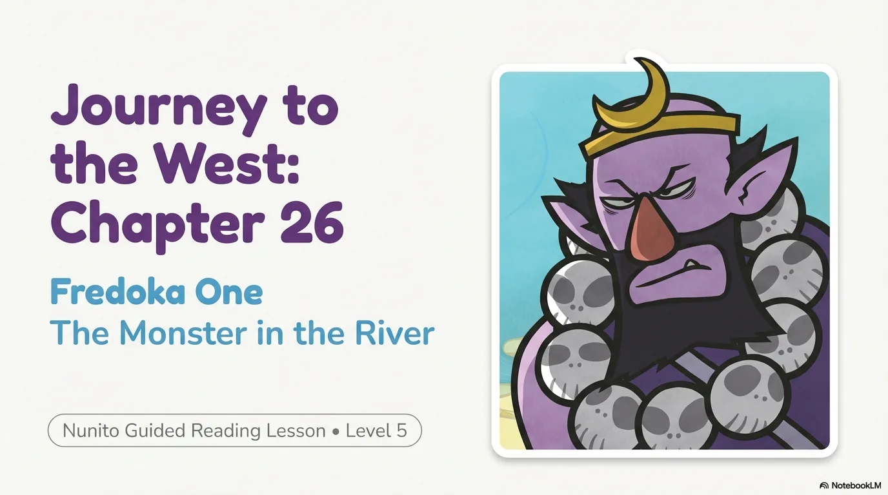
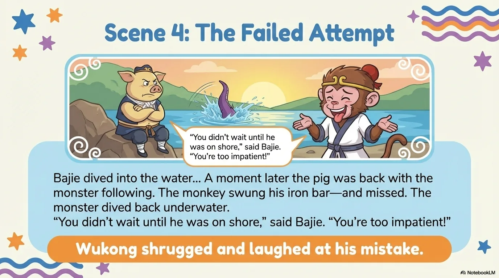
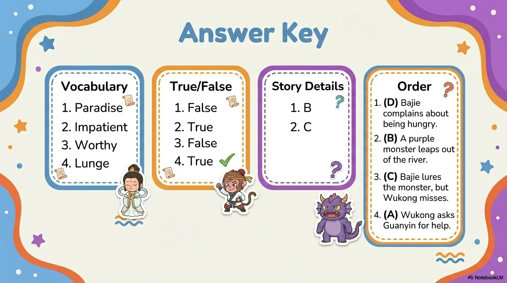

# 豆豆龙英语 · 第 26 集课件（EP026 草稿）

- 来源：`026_Journey to the West 26_The Monster in the River.pptx`（主课件，20 页）
- OCR：`blocked`（no local OCR provider importable (pytesseract missing): No module named 'pytesseract'）
- 分类：待人工审核（unknown）
- 审核状态：`unreviewed`

## Slide 001

- 来源：`ppt/media/image1.png`（relationship `rId2`）
- 尺寸：1376×768
- 源 SHA-256：`5f5eccd73312d11aca9a3e4e42dae9a3aa480ea99c5c08b0c3257c2de4e61dc0`
- 输出 SHA-256：`effa29f31c2d0d0930e16934d675b0f78c82633456d00529b756d977b6caed5c`
- 分类：unknown ｜ OCR：blocked ｜ 审核：unreviewed

## Slide 002

- 来源：`ppt/media/image3.png`（relationship `rId2`）
- 尺寸：1376×768
- 源 SHA-256：`7f49bc8c45a842fd156c80b42dab19ec8301613e678c1b9e05bbd86f5891c95b`
- 输出 SHA-256：`42f3d3cd7b4276c5a8f1b52769dc6537e340e1ff9ebca58264b7d5b6ab6456e3`
- 分类：unknown ｜ OCR：blocked ｜ 审核：unreviewed

## Slide 003

- 来源：`ppt/media/image4.png`（relationship `rId2`）
- 尺寸：1376×768
- 源 SHA-256：`33d310d6e0ed687853e5c931b875562ee2711100d74c22689c7d2c67d81596f7`
- 输出 SHA-256：`0db9fdaf4bbceef06d11499d9fa23edecd4bb15b119f158d08403f2bcb4512c2`
- 分类：unknown ｜ OCR：blocked ｜ 审核：unreviewed

## Slide 004

- 来源：`ppt/media/image5.png`（relationship `rId2`）
- 尺寸：1376×768
- 源 SHA-256：`e3b7f7ad964b191c115b9e9b17e5f05a7b11ce29a54e65ccd1bdf328ba8d4d28`
- 输出 SHA-256：`db1cc8c5e0dc627371d309dd6f2b19c71ba368424da8e689430bbaf5942b07dd`
- 分类：unknown ｜ OCR：blocked ｜ 审核：unreviewed

## Slide 005

- 来源：`ppt/media/image6.png`（relationship `rId2`）
- 尺寸：1376×768
- 源 SHA-256：`1fb293a82d1ec15f1a57ae8995f131aaf79ee70d2b09c3e38ff1c5cedb0c81cb`
- 输出 SHA-256：`5d6a22be32e88ed362614e5d9813443838690d242dde463c07f9dd500ec45525`
- 分类：unknown ｜ OCR：blocked ｜ 审核：unreviewed

## Slide 006

- 来源：`ppt/media/image7.png`（relationship `rId2`）
- 尺寸：1376×768
- 源 SHA-256：`452fbc219fafeb62ba613b243c19d2c0176ccba6a9b920d1b034a8b1bd26e194`
- 输出 SHA-256：`42b91c3a27f1968256afa068732f36b302826fd1c186735b447f8a400ccf7898`
- 分类：unknown ｜ OCR：blocked ｜ 审核：unreviewed

## Slide 007

- 来源：`ppt/media/image8.png`（relationship `rId2`）
- 尺寸：1376×768
- 源 SHA-256：`1e831ac077516e035d031e26227836241e7a52c814dd12ac37e8f415838d4622`
- 输出 SHA-256：`d7142fa8a5575f1d5a441e0686258265dad7c981a9bfeb98f43f13ad2360cc27`
- 分类：unknown ｜ OCR：blocked ｜ 审核：unreviewed

## Slide 008

- 来源：`ppt/media/image9.png`（relationship `rId2`）
- 尺寸：1376×768
- 源 SHA-256：`ac36f66a19851bad38e92f49b4bd1bc439231009da83552c61635289ab3903d8`
- 输出 SHA-256：`0c500a6c69b292ffdd3045b6b468e144f6587e6953b090b227b91a5310f20e1c`
- 分类：unknown ｜ OCR：blocked ｜ 审核：unreviewed

## Slide 009

- 来源：`ppt/media/image10.png`（relationship `rId2`）
- 尺寸：1376×768
- 源 SHA-256：`cb38491b1e276d6877e928201e971a5b2f41ac7ea8843751908e56da14f8083f`
- 输出 SHA-256：`e5715d00dadb5200f7ffa8cf6c03a39630448cb4cb2fe8215ec6e3cc8607fc38`
- 分类：unknown ｜ OCR：blocked ｜ 审核：unreviewed

## Slide 010

- 来源：`ppt/media/image11.png`（relationship `rId2`）
- 尺寸：1376×768
- 源 SHA-256：`87b8e7c5d46bda32a12ae5562efc4b9ac468f5592d463b812aab0d2c0d138148`
- 输出 SHA-256：`855b0c35a59f02e5671c3247820109d50081c237ba821abe9111e471f3a2405d`
- 分类：unknown ｜ OCR：blocked ｜ 审核：unreviewed

## Slide 011

- 来源：`ppt/media/image12.png`（relationship `rId2`）
- 尺寸：1376×768
- 源 SHA-256：`b03c25b084c61dd0640a52c4fc19b70cd3f4ebd48ea79b8ab3673e11568b4dd4`
- 输出 SHA-256：`0f17cf4bdb5c4c9e962eb6d1835546fa618b73c3e481d6ea2e9f6a4316749e99`
- 分类：unknown ｜ OCR：blocked ｜ 审核：unreviewed

## Slide 012

- 来源：`ppt/media/image13.png`（relationship `rId2`）
- 尺寸：1376×768
- 源 SHA-256：`e8e1d1cd95496dcad43c53825ac7c6bbe0b34dc33e77e2e5249d94928b614c9f`
- 输出 SHA-256：`8a2d438d0f7584f37103ae7dfc215e0c9eb821396fffff141b58da85e0b4aefd`
- 分类：unknown ｜ OCR：blocked ｜ 审核：unreviewed

## Slide 013

- 来源：`ppt/media/image14.png`（relationship `rId2`）
- 尺寸：1376×768
- 源 SHA-256：`685a27827b8e9508eec973c28b841c610e519e8f7109d4392d84a0f86f7689f4`
- 输出 SHA-256：`5de79a6af2653fcf86bbe7ff8b666b893376911786340246b20bb2e3448f71d4`
- 分类：unknown ｜ OCR：blocked ｜ 审核：unreviewed

## Slide 014

- 来源：`ppt/media/image15.png`（relationship `rId2`）
- 尺寸：1376×768
- 源 SHA-256：`8a820a154e4119c28391c3b0be10584c0f801e972866dbda3259762f4a22ab00`
- 输出 SHA-256：`81d6b519b3c165b9cb5231038412fd0197c33a59753ee62d6b7a2508364c1586`
- 分类：unknown ｜ OCR：blocked ｜ 审核：unreviewed

## Slide 015

- 来源：`ppt/media/image16.png`（relationship `rId2`）
- 尺寸：1376×768
- 源 SHA-256：`76fcaa8fd1e69f41422e961f1b7e2816f4b2310447b8f2d057587c7b9dbc114b`
- 输出 SHA-256：`5ce84eb8ba6e759914f72fbc3c3019e943d6e5364da9785d1902fb0ab4611274`
- 分类：unknown ｜ OCR：blocked ｜ 审核：unreviewed

## Slide 016

- 来源：`ppt/media/image17.png`（relationship `rId2`）
- 尺寸：1376×768
- 源 SHA-256：`090715b45fe2ff21f426b07b57b7b35ceef62b529bc75cb54e7d4d8617996422`
- 输出 SHA-256：`c09358e71f75b2abd0369eca217d0667cd5540371f043a600c1ff36e7d8f6447`
- 分类：unknown ｜ OCR：blocked ｜ 审核：unreviewed

## Slide 017

- 来源：`ppt/media/image18.png`（relationship `rId2`）
- 尺寸：1376×768
- 源 SHA-256：`ac05d6f008b4a697d0792700b944fb0106a47bcbb0694eb3478a3ac2bcf957a4`
- 输出 SHA-256：`e628e5700ee77d4a5699b809d6a3b24b645981ec67c09ce6c55a28c167657212`
- 分类：unknown ｜ OCR：blocked ｜ 审核：unreviewed

## Slide 018

- 来源：`ppt/media/image19.png`（relationship `rId2`）
- 尺寸：1376×768
- 源 SHA-256：`e86531374f9dd3aae669ea73620492a33c358dcc0c0ff179d8bb1222d1228372`
- 输出 SHA-256：`b3ac6647fd0ff6ae13b5acd1848ba74b117754724a304841becc48238501c1a6`
- 分类：unknown ｜ OCR：blocked ｜ 审核：unreviewed

## Slide 019

- 来源：`ppt/media/image20.png`（relationship `rId2`）
- 尺寸：1376×768
- 源 SHA-256：`55fe165a1f059b6021474d35d36b14c5d0d76870d9e1c14edeb80a0cfd661d66`
- 输出 SHA-256：`bb5e8ffe03e7e25be62a4a290b7def6d5b39d2ece209868020f2096d9b9156b0`
- 分类：unknown ｜ OCR：blocked ｜ 审核：unreviewed

## Slide 020

- 来源：`ppt/media/image21.png`（relationship `rId2`）
- 尺寸：1376×768
- 源 SHA-256：`09920752145a60069eeb2c398fb7c244d4cae8931169a2de9ffd172b38869056`
- 输出 SHA-256：`7f601ca46dde2358ad9f5b1773670eec703abe1d6f9898b7c2e31e20c99c2355`
- 分类：unknown ｜ OCR：blocked ｜ 审核：unreviewed
