# 豆豆龙英语 · 第 27 集课件（EP027 草稿）

- 来源：`027_Journey to the West 27_The Ginseng Fruit.pptx`（主课件，20 页）
- OCR：`blocked`（no local OCR provider importable (pytesseract missing): No module named 'pytesseract'）
- 分类：待人工审核（unknown）
- 审核状态：`unreviewed`

## Slide 001

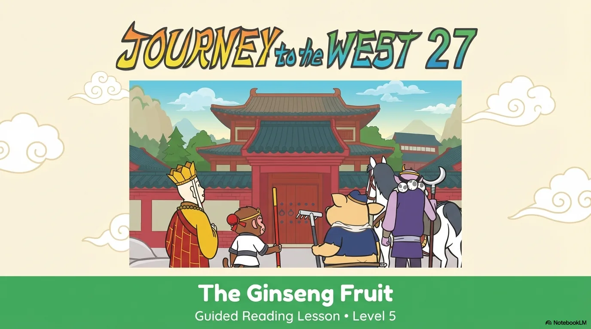

- 来源：`ppt/media/image1.png`（relationship `rId2`）
- 尺寸：1376×768
- 源 SHA-256：`c1942c3fc3f63bcc757c8427de8b8d159a7b37f217aa205fe14f85fcf6eb4b6f`
- 输出 SHA-256：`9df5f51612246d8e5f8128ebb81986a3c3b5658efc4099302cac56b08c559093`
- 分类：unknown ｜ OCR：blocked ｜ 审核：unreviewed

## Slide 002

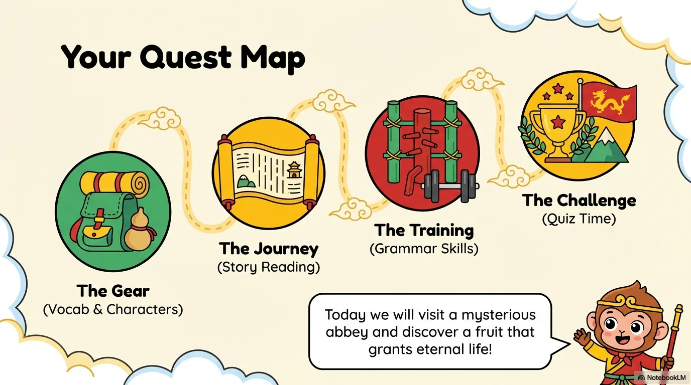

- 来源：`ppt/media/image3.png`（relationship `rId2`）
- 尺寸：1376×768
- 源 SHA-256：`ccdd7d9398cf4f6e76607a124241e89362310d4f18aa7ee9fa399421fa0db50d`
- 输出 SHA-256：`d330467cb2df1d0b17e4bca822ab3f6219d7ecef76c26eba3682b557e226ca1e`
- 分类：unknown ｜ OCR：blocked ｜ 审核：unreviewed

## Slide 003

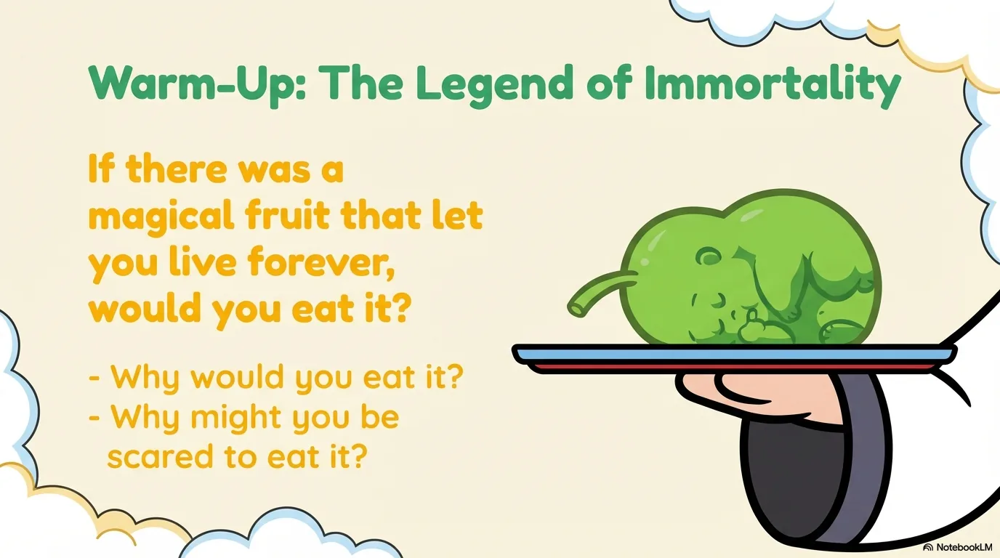

- 来源：`ppt/media/image4.png`（relationship `rId2`）
- 尺寸：1376×768
- 源 SHA-256：`410c1d7eb71683ace3584c65ff3f76cbe5e5feafc1cbf66d8b113b8431e7c0a5`
- 输出 SHA-256：`64f0afd251e9290796f2e6e411468231374c04d972b3995040fe4d18324d2d89`
- 分类：unknown ｜ OCR：blocked ｜ 审核：unreviewed

## Slide 004

- 来源：`ppt/media/image5.png`（relationship `rId2`）
- 尺寸：1376×768
- 源 SHA-256：`f227da1262ec0be7de16a23409914ca4ae82c88a833e4cb5818b5f004a549e1e`
- 输出 SHA-256：`5f43257d766a1fdeb6f3b0c8666ec326fb239141708e4b7073b5731bcebc61d8`
- 分类：unknown ｜ OCR：blocked ｜ 审核：unreviewed

## Slide 005

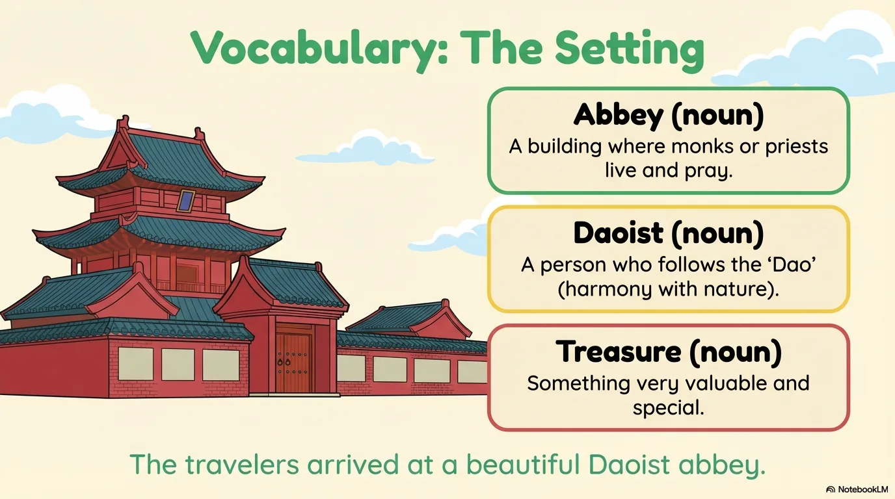

- 来源：`ppt/media/image6.png`（relationship `rId2`）
- 尺寸：1376×768
- 源 SHA-256：`9c7b3a4c546bf64aa162d65f71234119bd113333a5f221d4917541b714698aef`
- 输出 SHA-256：`db532dbe93fedeca67666e4a5fb9a3c4b77cfbc16dfe51476eda16a11479cbae`
- 分类：unknown ｜ OCR：blocked ｜ 审核：unreviewed

## Slide 006

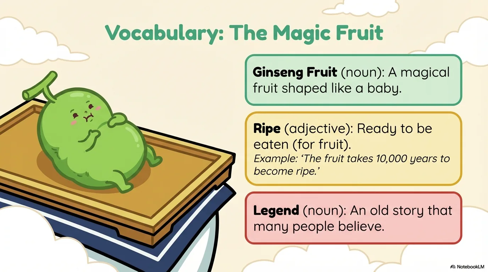

- 来源：`ppt/media/image7.png`（relationship `rId2`）
- 尺寸：1376×768
- 源 SHA-256：`db50e5f4df98b62ddb40d6ee96cb2c3b15470861209b7776036a2c0e857bb18e`
- 输出 SHA-256：`2a7063139710edcdbcd6ca734842617e4d09347277bf4603348233ca00aae38e`
- 分类：unknown ｜ OCR：blocked ｜ 审核：unreviewed

## Slide 007

- 来源：`ppt/media/image8.png`（relationship `rId2`）
- 尺寸：1376×768
- 源 SHA-256：`55b5aee8ba64a39f5d9b122ba320d1983a1ac0b433a8922ac2764b04d69dfb7e`
- 输出 SHA-256：`bd43f920e52b92c5f573b67455ec6a7dbf57721a67b778c619f47713aed45084`
- 分类：unknown ｜ OCR：blocked ｜ 审核：unreviewed

## Slide 008

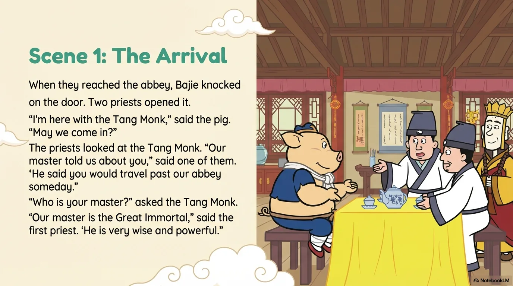

- 来源：`ppt/media/image9.png`（relationship `rId2`）
- 尺寸：1376×768
- 源 SHA-256：`e53e6f5f359dc0cd8ba521f019fe11a97d9176b7972b0d0884e5c8964dee72e2`
- 输出 SHA-256：`9590b5bd82d41a45ff96b3a0f93f300f00a86245e2ab112494db99741b30be84`
- 分类：unknown ｜ OCR：blocked ｜ 审核：unreviewed

## Slide 009

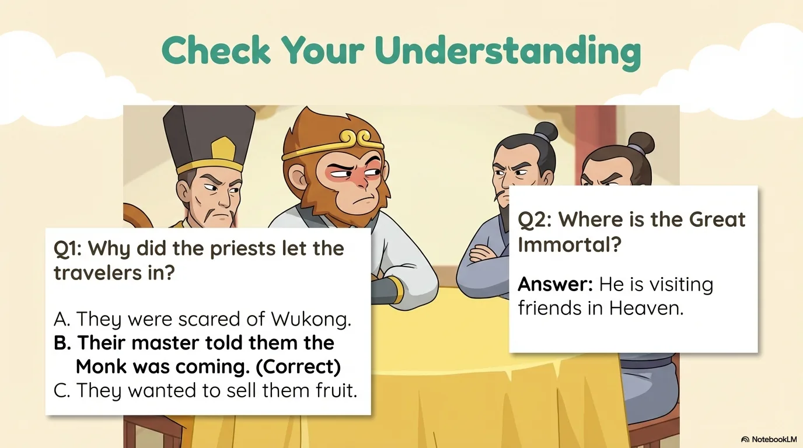

- 来源：`ppt/media/image10.png`（relationship `rId2`）
- 尺寸：1376×768
- 源 SHA-256：`4da3338bbf4f071de945ec6f1f9f7c80fc008c5a961932cf3814f49186d5afbf`
- 输出 SHA-256：`6a9c8f234318de0a3d64152da09a6fe1850c36f831325c4a1051a51ed7fa98a7`
- 分类：unknown ｜ OCR：blocked ｜ 审核：unreviewed

## Slide 010

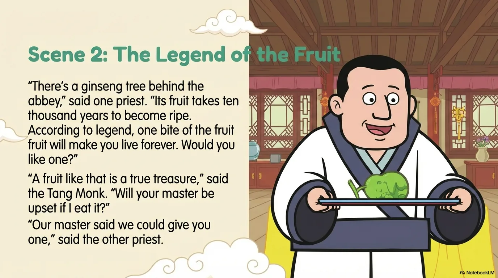

- 来源：`ppt/media/image11.png`（relationship `rId2`）
- 尺寸：1376×768
- 源 SHA-256：`d7734e7e00df99d9d2ea8c37059f8d252a497e531cfa3da71327b599782abd3a`
- 输出 SHA-256：`8ba3db05b101d09ee05794af0567611c6397ed850c99ac745075c547a61efa22`
- 分类：unknown ｜ OCR：blocked ｜ 审核：unreviewed

## Slide 011

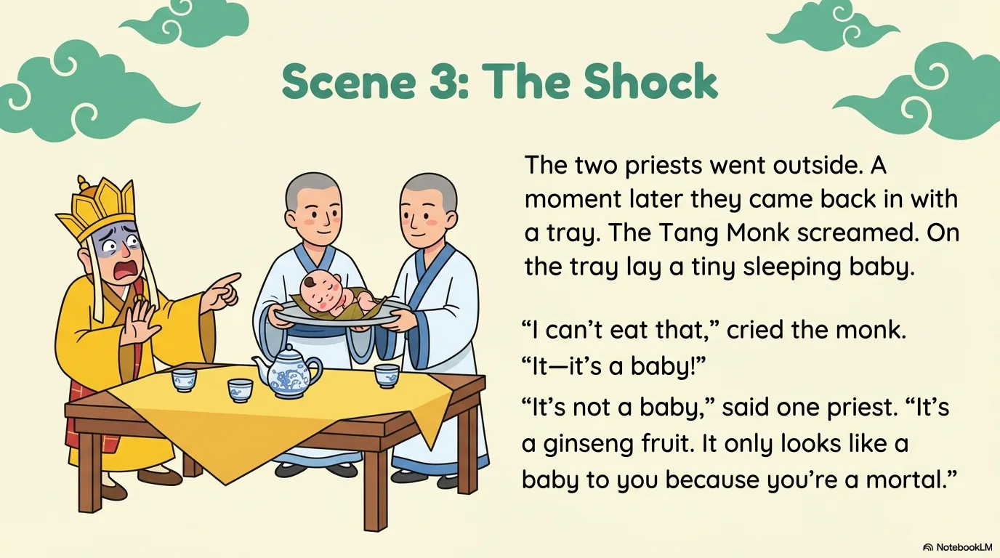

- 来源：`ppt/media/image12.png`（relationship `rId2`）
- 尺寸：1376×768
- 源 SHA-256：`5e3c1d57b9503b487c0186efa05626f671a3c1d207e503a785e48b4d7bd225cc`
- 输出 SHA-256：`fa5335b921eebfd8cc6a8e468df0effeabb4b41956b7e251e0552c4d80c84a3c`
- 分类：unknown ｜ OCR：blocked ｜ 审核：unreviewed

## Slide 012

- 来源：`ppt/media/image13.png`（relationship `rId2`）
- 尺寸：1376×768
- 源 SHA-256：`8e726d3d7d18e409aa9f6ac8eabd712eb6a2ac8f7f4a508ccd36c5cb19cb9587`
- 输出 SHA-256：`48da8cb55f7ff6ccb131b48efcf7bd33a3ee776f9917c10b703167fe51e3a9e7`
- 分类：unknown ｜ OCR：blocked ｜ 审核：unreviewed

## Slide 013

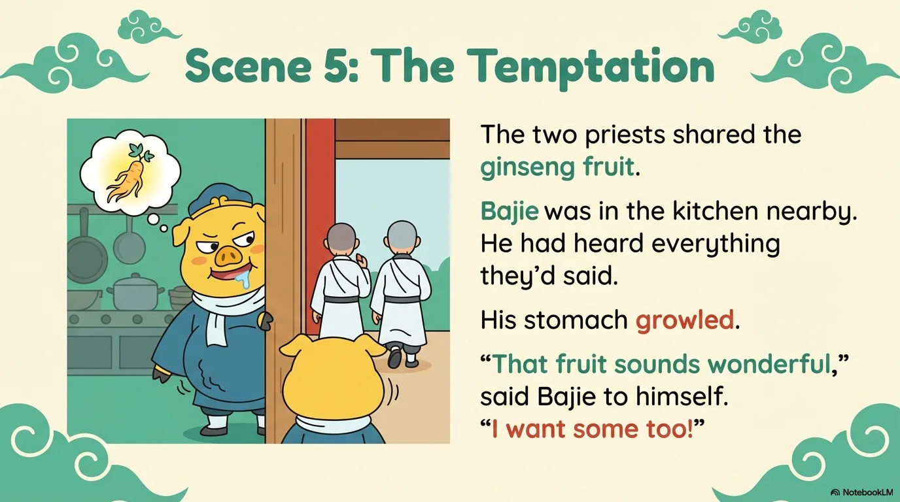

- 来源：`ppt/media/image14.png`（relationship `rId2`）
- 尺寸：1376×768
- 源 SHA-256：`26f752c384ef2f53619b77c7ef135063e352e29b8d409a664137dd8751fae56f`
- 输出 SHA-256：`3f6f5c093a16246b28955959d676f48c3764e4cd8efb219080a49799131fd670`
- 分类：unknown ｜ OCR：blocked ｜ 审核：unreviewed

## Slide 014

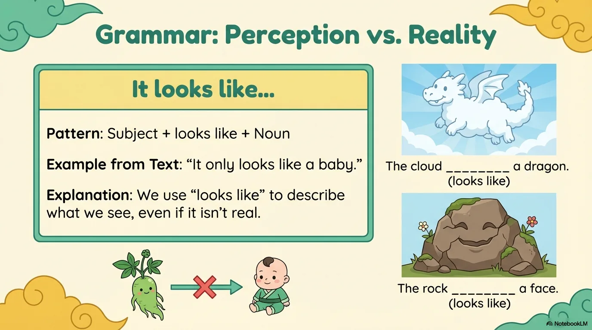

- 来源：`ppt/media/image15.png`（relationship `rId2`）
- 尺寸：1376×768
- 源 SHA-256：`b7fdce5cb6b251dbddf2f0d9594f042d9e56eb1f0bd34ef4dd430861a8dce1dc`
- 输出 SHA-256：`bc54183ac7b350e4fc7bb52714ecc465c9764d56dfcf17e6e69bbc993ab1abb8`
- 分类：unknown ｜ OCR：blocked ｜ 审核：unreviewed

## Slide 015

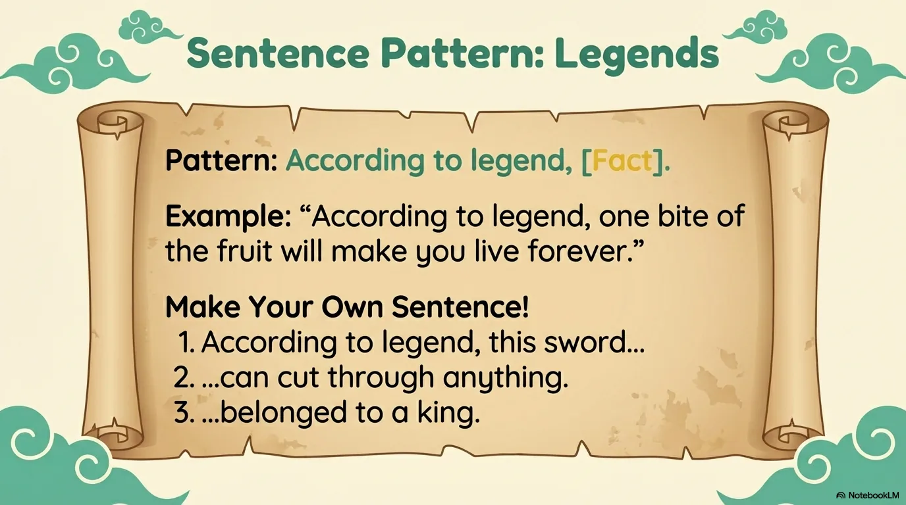

- 来源：`ppt/media/image16.png`（relationship `rId2`）
- 尺寸：1376×768
- 源 SHA-256：`8d8ba93098a04eb65689a73bf2ac2045d91a97d49eff02b1a7a91e9e87cd7f4e`
- 输出 SHA-256：`416d08a912442b60a1b458afe22653b915f3dd8af391e36939c8787e5f32db2b`
- 分类：unknown ｜ OCR：blocked ｜ 审核：unreviewed

## Slide 016

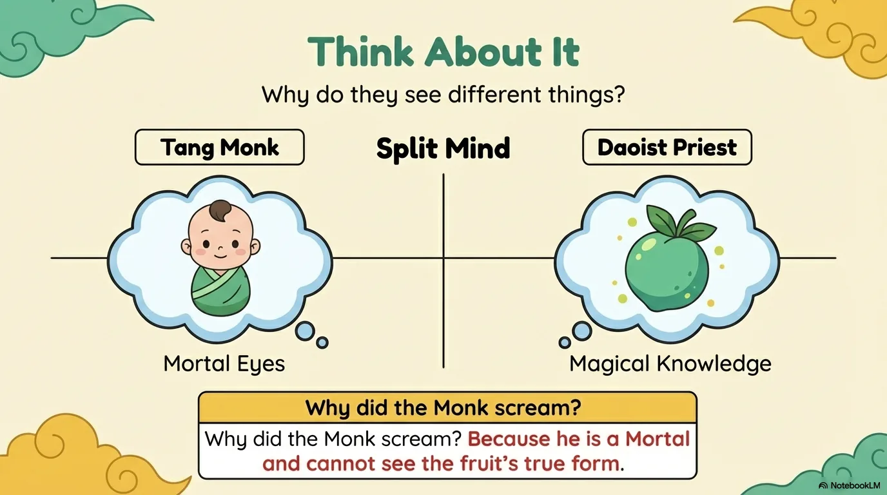

- 来源：`ppt/media/image17.png`（relationship `rId2`）
- 尺寸：1376×768
- 源 SHA-256：`1f78fdddea2875cfb5076fa0cf0b0000cb3cc8cf3d377b111e543e25a21b55ff`
- 输出 SHA-256：`1d47a9881d9df86c95d2c48491394cbfe36b1921623572618b745de9e183c322`
- 分类：unknown ｜ OCR：blocked ｜ 审核：unreviewed

## Slide 017

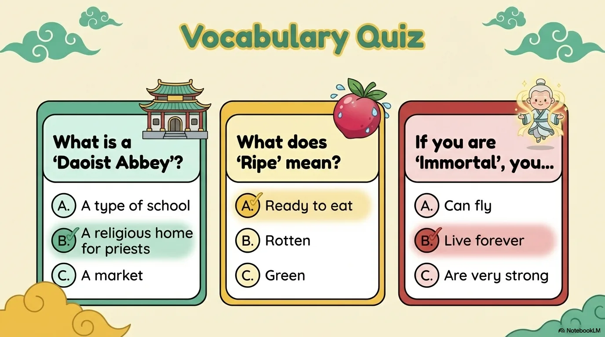

- 来源：`ppt/media/image18.png`（relationship `rId2`）
- 尺寸：1376×768
- 源 SHA-256：`2bb057e67b2d14b8426dc68867d73655c4f666d339b4a18aecdd5b28a3088b78`
- 输出 SHA-256：`e7eb8c73bdeb8b05a687cc6aa97d9896488de8a513adcb8a0cb81f1e7cc6ac9d`
- 分类：unknown ｜ OCR：blocked ｜ 审核：unreviewed

## Slide 018

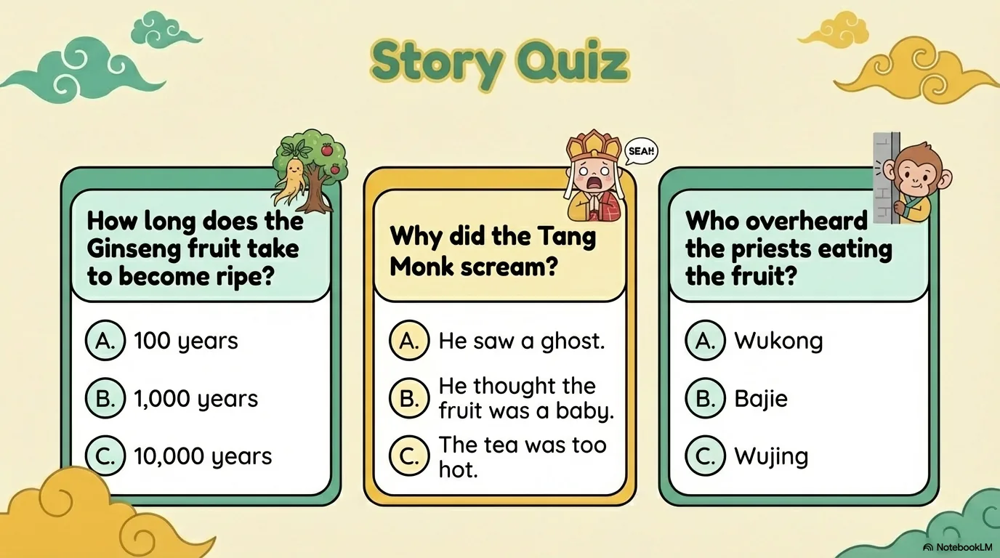

- 来源：`ppt/media/image19.png`（relationship `rId2`）
- 尺寸：1376×768
- 源 SHA-256：`f76e24b599fa8e836f85886bbca8aa9dc8ff7aab47ef3b98428876a3971a9218`
- 输出 SHA-256：`af4eb4cecd850599394faf55730cedec1a74f219a9bd643bc071f501081ac2b6`
- 分类：unknown ｜ OCR：blocked ｜ 审核：unreviewed

## Slide 019

- 来源：`ppt/media/image20.png`（relationship `rId2`）
- 尺寸：1376×768
- 源 SHA-256：`8694fcf03e52027ad93201cfc34f2a7cf0b523dd422a3f8a6ab0943c98a88be2`
- 输出 SHA-256：`1e07034ab88cb3f1017a305e6ba6dd323b5e3a46093e323d1ace76ede862eda6`
- 分类：unknown ｜ OCR：blocked ｜ 审核：unreviewed

## Slide 020

- 来源：`ppt/media/image21.png`（relationship `rId2`）
- 尺寸：1376×768
- 源 SHA-256：`b0b66c57a69c6e236bc8018ef4c732ce14feb98f33bbc1d3a038961f68890c70`
- 输出 SHA-256：`76698671ac3b69b4b7664a58e56d1fcc2b50bbb681f3366b1c1d6063bed38dd6`
- 分类：unknown ｜ OCR：blocked ｜ 审核：unreviewed
