# 豆豆龙英语 · 第 28 集课件（EP028 草稿）

- 来源：`028_Journey to the West 28_Wukong Leaves His Body.pptx`（主课件，20 页）
- OCR：`blocked`（no local OCR provider importable (pytesseract missing): No module named 'pytesseract'）
- 分类：待人工审核（unknown）
- 审核状态：`unreviewed`

## Slide 001

- 来源：`ppt/media/image1.png`（relationship `rId2`）
- 尺寸：1376×768
- 源 SHA-256：`4519bf1701b1f1327b8d4c38dfb5121b88413682fd776b5f5290708480b64121`
- 输出 SHA-256：`7ddab8ddbe84e396cab33a6c12ccb844ba5937aa3ef1fd1e4af9da3f20337e3c`
- 分类：unknown ｜ OCR：blocked ｜ 审核：unreviewed

## Slide 002

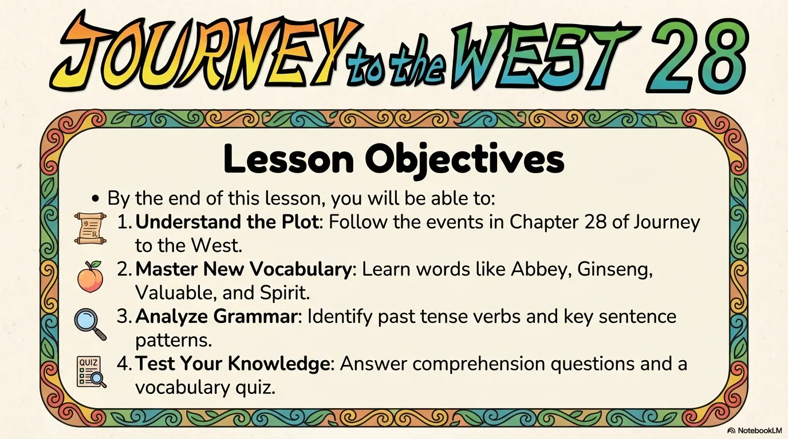

- 来源：`ppt/media/image3.png`（relationship `rId2`）
- 尺寸：1376×768
- 源 SHA-256：`503511e06d7b5723d699a4e354daea6305a63da0349bb3f36d3cbd3e19b50490`
- 输出 SHA-256：`6ef0dc0105a4b3819490fba5968c6d67aa5fca204fd8cc0344f61b694d5d0f98`
- 分类：unknown ｜ OCR：blocked ｜ 审核：unreviewed

## Slide 003

- 来源：`ppt/media/image4.png`（relationship `rId2`）
- 尺寸：1376×768
- 源 SHA-256：`f64083df1b10f079b6215331922d6fc8df93e0687841189a2ca7079375ee65e7`
- 输出 SHA-256：`1e588a8c823049f2eb664bcde71788cb521c26c817f47fdf13494f5e27e2d7e2`
- 分类：unknown ｜ OCR：blocked ｜ 审核：unreviewed

## Slide 004

- 来源：`ppt/media/image5.png`（relationship `rId2`）
- 尺寸：1376×768
- 源 SHA-256：`f830977449eb53fc02065bf70ca4279d23ef5c61fa682de010b28b4badfcc0e4`
- 输出 SHA-256：`6c5b079bf3528ffad333e9cf3da73f6a05f3654b134240940c325f287697fe9c`
- 分类：unknown ｜ OCR：blocked ｜ 审核：unreviewed

## Slide 005

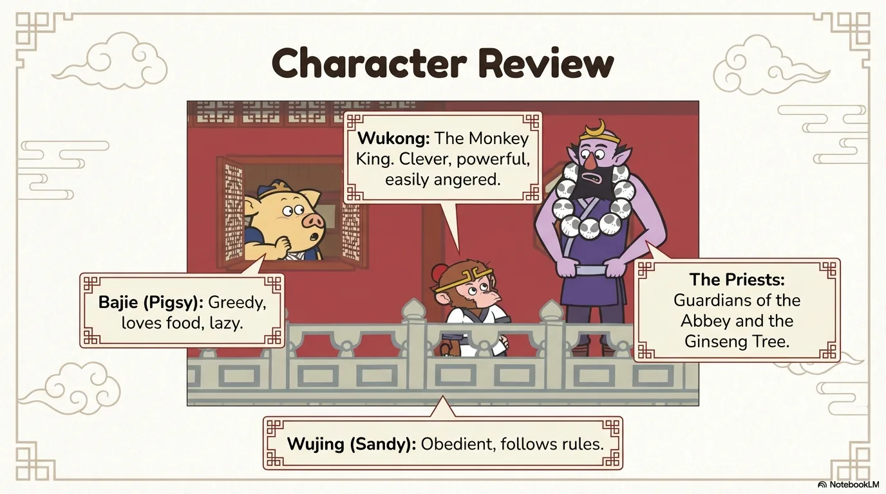

- 来源：`ppt/media/image6.png`（relationship `rId2`）
- 尺寸：1376×768
- 源 SHA-256：`a0f9a85cae0f0387606ce8d14db86591dcdd94cff932b19752556754ede9422d`
- 输出 SHA-256：`6cd4845be7e933e4f6ad3d3f85407e3fc487fa89cdc70460594f9a2c7cff7e57`
- 分类：unknown ｜ OCR：blocked ｜ 审核：unreviewed

## Slide 006

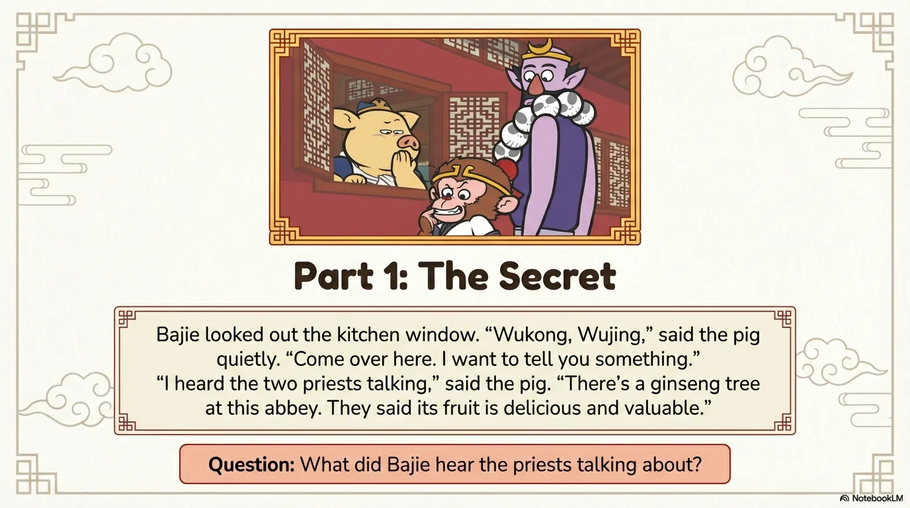

- 来源：`ppt/media/image7.png`（relationship `rId2`）
- 尺寸：1376×768
- 源 SHA-256：`8b233e8fe7cfecf2c5878ea80a0dcb37896c8a08a29d00354c51404e30b12103`
- 输出 SHA-256：`a8b2e50aee11dda16284d25dae4c15510be0b892a8d5b7bdefbc87b3ab3b403d`
- 分类：unknown ｜ OCR：blocked ｜ 审核：unreviewed

## Slide 007

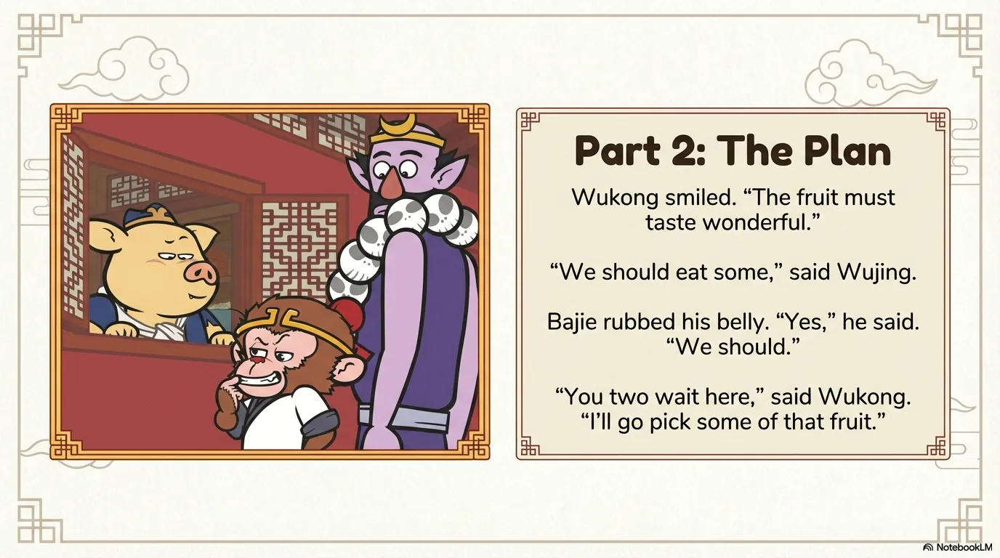

- 来源：`ppt/media/image8.png`（relationship `rId2`）
- 尺寸：1376×768
- 源 SHA-256：`59ee465c39b7d46214eb045f87558237642fd0ad8954db3f5c3e47ed3562f6ac`
- 输出 SHA-256：`e5e79239e4a25345907ca3e393eb639ab53e01b04fcf0b68f302824bfb6ca531`
- 分类：unknown ｜ OCR：blocked ｜ 审核：unreviewed

## Slide 008

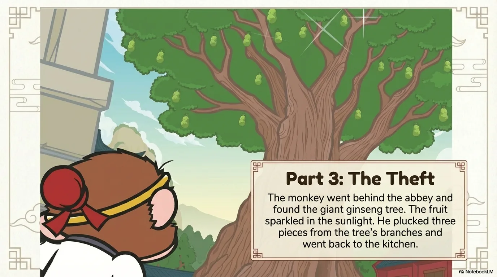

- 来源：`ppt/media/image9.png`（relationship `rId2`）
- 尺寸：1376×768
- 源 SHA-256：`34fccbc6422aa65f8ccf597a0d6e45d2fa3b84d5e1957b40a3cb1748e83c7ec1`
- 输出 SHA-256：`97669f0ed905687c54b8c1b8de99fa86b50ccb7ea70a035951afc244438008c3`
- 分类：unknown ｜ OCR：blocked ｜ 审核：unreviewed

## Slide 009

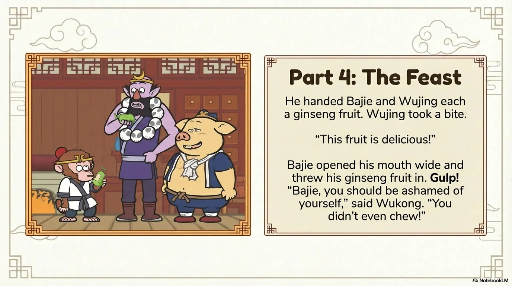

- 来源：`ppt/media/image10.png`（relationship `rId2`）
- 尺寸：1376×768
- 源 SHA-256：`4f87d24b9732c598f519634fcfe189a009b57f9f4e03d9053c5e0f21791ef928`
- 输出 SHA-256：`12184f2bcd6f276fad16bc464d2d6eea4e8f20a303d87e7bca378410e6901e79`
- 分类：unknown ｜ OCR：blocked ｜ 审核：unreviewed

## Slide 010

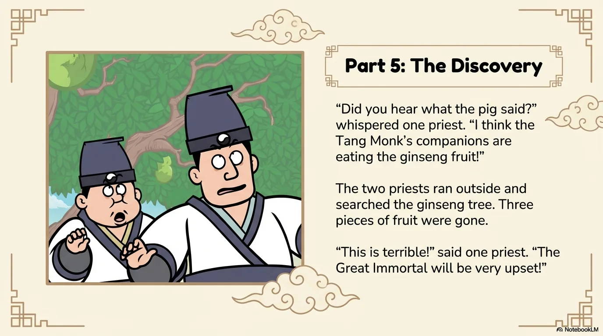

- 来源：`ppt/media/image11.png`（relationship `rId2`）
- 尺寸：1376×768
- 源 SHA-256：`e67d340320140a0e621240cfdac2b4d772e582fd6c880680655a8fa97dbb0173`
- 输出 SHA-256：`d47403c784a96b36068df119122804200c18ad11bfbb708b49f60ecb05a8b895`
- 分类：unknown ｜ OCR：blocked ｜ 审核：unreviewed

## Slide 011

- 来源：`ppt/media/image12.png`（relationship `rId2`）
- 尺寸：1376×768
- 源 SHA-256：`8e314037ac2fd0c4e5d4595e9196ff931fbf9300f74ebe1dc5c130bcc2b761a9`
- 输出 SHA-256：`612d68b277ed8ee65a9428b1eaf18560a59c867127f215682668d2c5124f4b54`
- 分类：unknown ｜ OCR：blocked ｜ 审核：unreviewed

## Slide 012

- 来源：`ppt/media/image13.png`（relationship `rId2`）
- 尺寸：1376×768
- 源 SHA-256：`4df6e5cc20e0e22dec7dc06e0f7eb2a9c71696a6eb05915f28c1813c3dbbdd4e`
- 输出 SHA-256：`638779e819a35f3bfd4b7ac29d860a5df22455593ac322bb42d9b6bd4fc5769c`
- 分类：unknown ｜ OCR：blocked ｜ 审核：unreviewed

## Slide 013

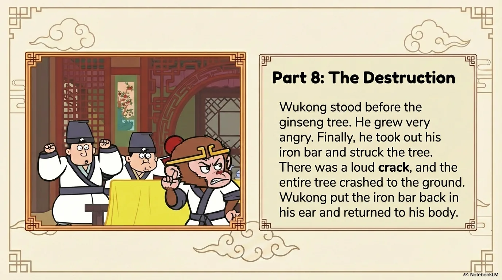

- 来源：`ppt/media/image14.png`（relationship `rId2`）
- 尺寸：1376×768
- 源 SHA-256：`413dc235d994b9aea625872dd5184fb4d78efb014f44f2151e92fd95418e6ca4`
- 输出 SHA-256：`7ca92e425ebf36a2d0617ac5c40ac40faf7dea4d2f495a066ea584e8eac4569f`
- 分类：unknown ｜ OCR：blocked ｜ 审核：unreviewed

## Slide 014

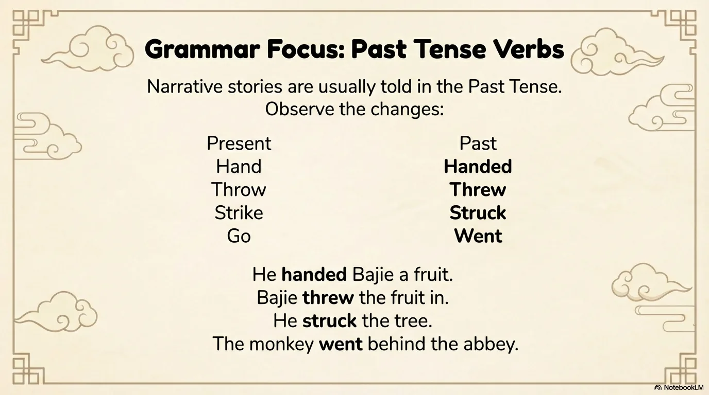

- 来源：`ppt/media/image15.png`（relationship `rId2`）
- 尺寸：1376×768
- 源 SHA-256：`0e1cab09db436bf23f9676c26def87ec646250a7fe946f6225368d3dc9204e42`
- 输出 SHA-256：`d20075c3ab1be2f3c8dd8819d7b3a31eb351d8d675c560fa6586a2fb42c096c3`
- 分类：unknown ｜ OCR：blocked ｜ 审核：unreviewed

## Slide 015

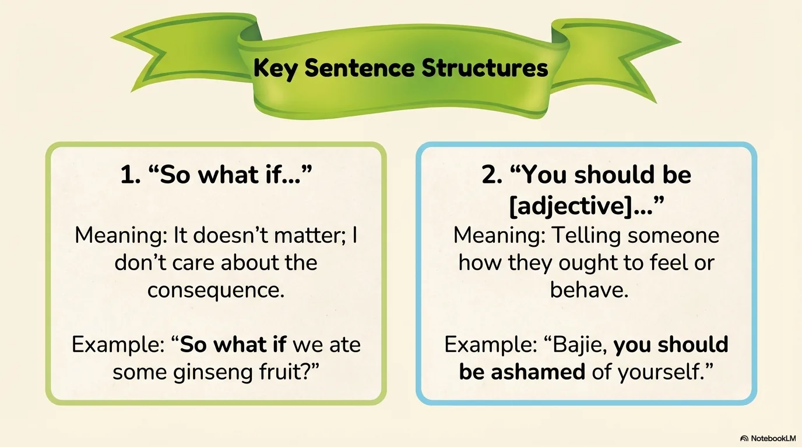

- 来源：`ppt/media/image16.png`（relationship `rId2`）
- 尺寸：1376×768
- 源 SHA-256：`3704cc7e8226d55eea67fa5b4394724c284ffe1220e878d751726460bab73ef7`
- 输出 SHA-256：`60715abe49e480666ffa1a2dc460e530c1dadd94badfc0abe73704014a23cbd7`
- 分类：unknown ｜ OCR：blocked ｜ 审核：unreviewed

## Slide 016

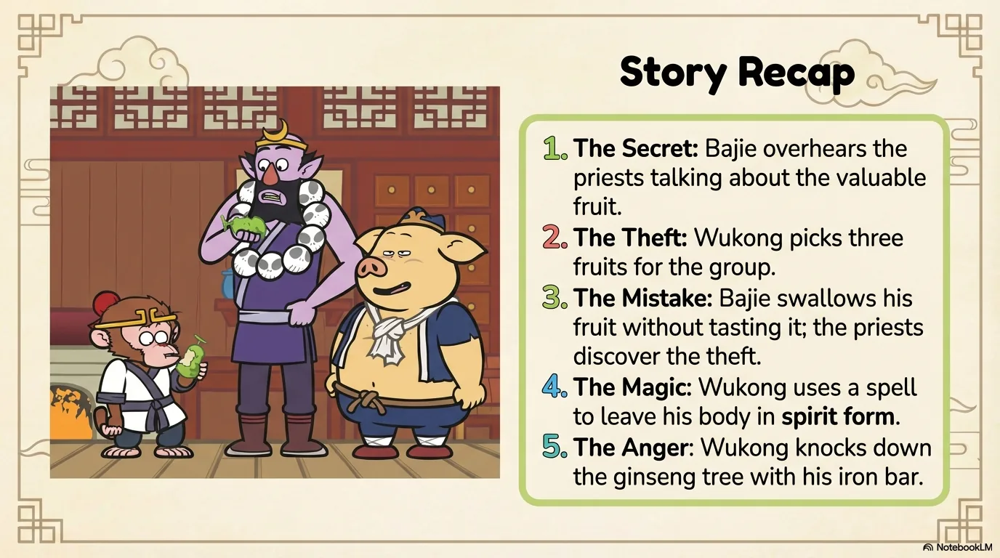

- 来源：`ppt/media/image17.png`（relationship `rId2`）
- 尺寸：1376×768
- 源 SHA-256：`e455a3d10ffbc35dbd9122583f28d18f5d9f667c4ddda1e7216cd4600319c9ca`
- 输出 SHA-256：`bfce4dd02cf21beb9eb24e4dd6aa31cf6b2d4cfe743e3fbce95583b5704e640d`
- 分类：unknown ｜ OCR：blocked ｜ 审核：unreviewed

## Slide 017

- 来源：`ppt/media/image18.png`（relationship `rId2`）
- 尺寸：1376×768
- 源 SHA-256：`7040058ec038cd1813ef2cb1e9090f0f44c61041f9121016d850cb371341e82b`
- 输出 SHA-256：`0452faa3cf696073e42035224a2d9ef8efb6aecb8cdf05d5572d969f4f9ff026`
- 分类：unknown ｜ OCR：blocked ｜ 审核：unreviewed

## Slide 018

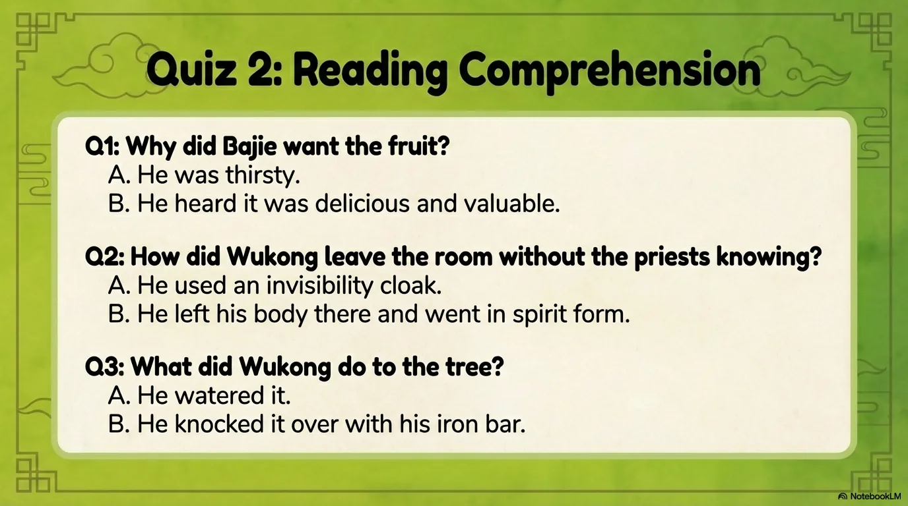

- 来源：`ppt/media/image19.png`（relationship `rId2`）
- 尺寸：1376×768
- 源 SHA-256：`79d9b628cf6d62dd2c58f315481f15e10d76e5e55a0c9d621df5ed8890ed6403`
- 输出 SHA-256：`50a23594201630711330fa4e82e421300b7151ae0ec816e6e92150ca5ca89317`
- 分类：unknown ｜ OCR：blocked ｜ 审核：unreviewed

## Slide 019

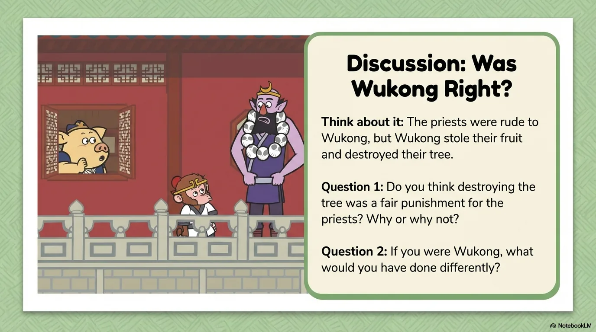

- 来源：`ppt/media/image20.png`（relationship `rId2`）
- 尺寸：1376×768
- 源 SHA-256：`b3140ded3c762b45f2e5515063e5939ec1b44d0b61fca3f207480131b5458f6d`
- 输出 SHA-256：`9488aece644d597747c7f4038d63efea2523d78ef9fe82129563d905c4b085aa`
- 分类：unknown ｜ OCR：blocked ｜ 审核：unreviewed

## Slide 020

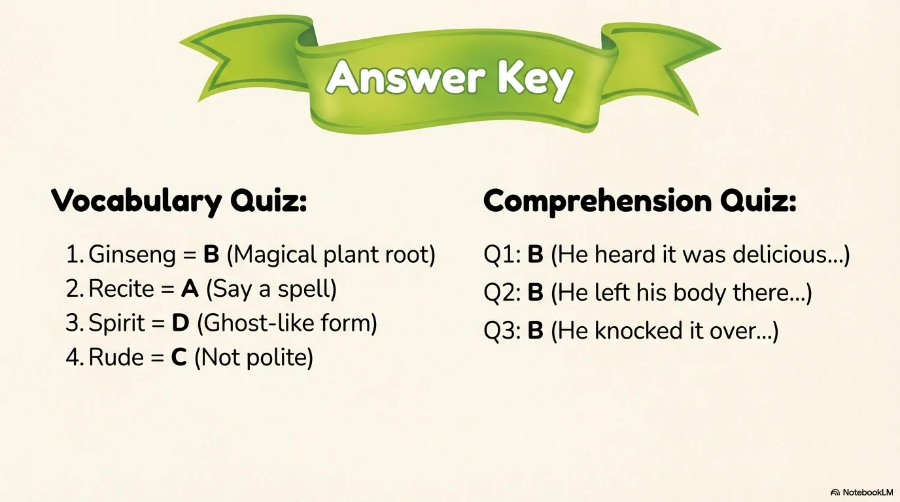

- 来源：`ppt/media/image21.png`（relationship `rId2`）
- 尺寸：1376×768
- 源 SHA-256：`243d9321333318efec82de6f3242f49086b6e832165062b809d4adc724bde1c2`
- 输出 SHA-256：`da572697b68398b45506edf34e837279aaf5876c2fcca0fe1e68df010acd313b`
- 分类：unknown ｜ OCR：blocked ｜ 审核：unreviewed
