# 豆豆龙英语 · 第 29 集课件（EP029 草稿）

- 来源：`029_Journey to the West 29_The Magic Sleeve.pptx`（主课件，20 页）
- OCR：`blocked`（no local OCR provider importable (pytesseract missing): No module named 'pytesseract'）
- 分类：待人工审核（unknown）
- 审核状态：`unreviewed`

## Slide 001

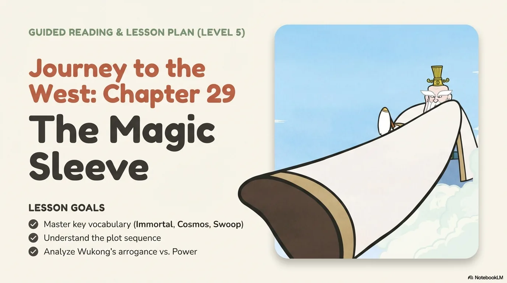

- 来源：`ppt/media/image1.png`（relationship `rId2`）
- 尺寸：1376×768
- 源 SHA-256：`98e1ea3dd6ce182d2275928190cc408addd81d2e287518928d1b19644e04ccee`
- 输出 SHA-256：`f21203abd4e31d1dda862e61e8272385592bac2b6f23bc69c8f6d40ec2226f22`
- 分类：unknown ｜ OCR：blocked ｜ 审核：unreviewed

## Slide 002

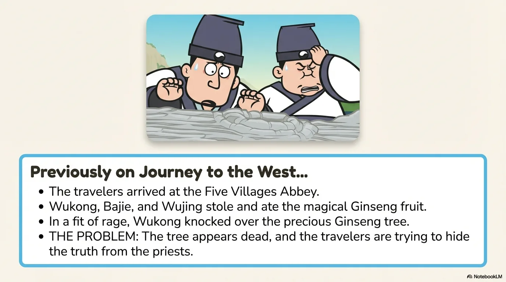

- 来源：`ppt/media/image3.png`（relationship `rId2`）
- 尺寸：1376×768
- 源 SHA-256：`f47ef4a62ae8d232c0b99915da537c21c6402d4724d5f238b20be5ea02c0a17c`
- 输出 SHA-256：`e9ec913609379318c91321c6c1bad6451ce2dd73ea51ca533b5907a5278ea022`
- 分类：unknown ｜ OCR：blocked ｜ 审核：unreviewed

## Slide 003

- 来源：`ppt/media/image4.png`（relationship `rId2`）
- 尺寸：1376×768
- 源 SHA-256：`1f85efd2dffba67c489699e5aacca47e2d92913b6a0dc833772f3df5959e9dce`
- 输出 SHA-256：`c7a012582bc868627986e4129cfc59ed06cf8d4690bdcf09ac98feaaa3e1473f`
- 分类：unknown ｜ OCR：blocked ｜ 审核：unreviewed

## Slide 004

- 来源：`ppt/media/image5.png`（relationship `rId2`）
- 尺寸：1376×768
- 源 SHA-256：`2b5627843648556a8f23f3f5e06d4909b6b35460050eed2d251fc56cbbcb3e27`
- 输出 SHA-256：`42508a48be455b42a29669d7e0596f89241d9d8f8e7881884888c77c2aa442a3`
- 分类：unknown ｜ OCR：blocked ｜ 审核：unreviewed

## Slide 005

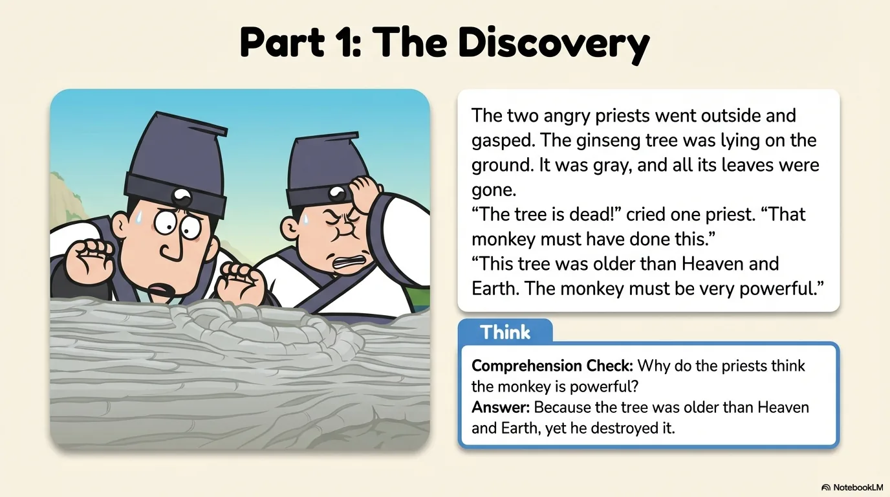

- 来源：`ppt/media/image6.png`（relationship `rId2`）
- 尺寸：1376×768
- 源 SHA-256：`42fefbcc1bfaf5755a00c8ce97125950459e97e562a0733eb66d71871680e0ba`
- 输出 SHA-256：`30b13a1dee71e56210f32bd9dbcdb121da8cd1f9a5f220b384990a8ee0dede8d`
- 分类：unknown ｜ OCR：blocked ｜ 审核：unreviewed

## Slide 006

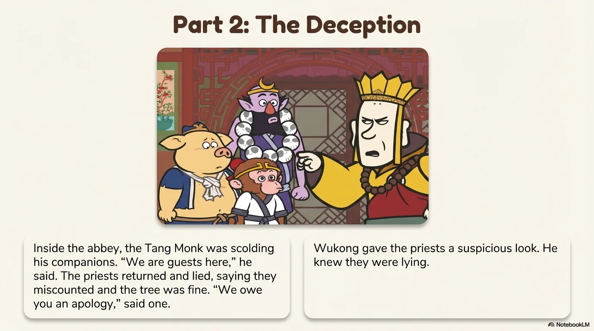

- 来源：`ppt/media/image7.png`（relationship `rId2`）
- 尺寸：1376×768
- 源 SHA-256：`274f67850d3bc8f20e1a626e4d64c68d2f1c0b779e94334f3bd4a92af6f1c5ba`
- 输出 SHA-256：`62060ad31d6edeb3fc27ca8dfca1d1f4e585488468a0f02d158a827e073853d9`
- 分类：unknown ｜ OCR：blocked ｜ 审核：unreviewed

## Slide 007

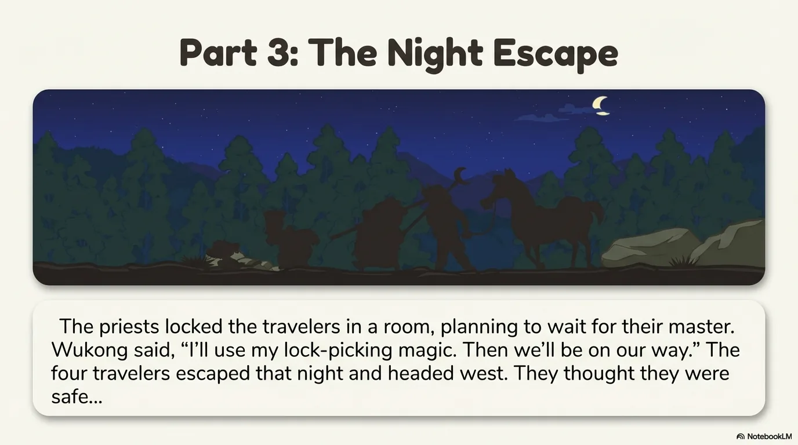

- 来源：`ppt/media/image8.png`（relationship `rId2`）
- 尺寸：1376×768
- 源 SHA-256：`ec63b4b52a47b29dcedb041509b2870f2a11072d88e89edcd80efc556286948e`
- 输出 SHA-256：`1fbd4e767c20a83bffe4dee6c9d6781654448a10b99e49184b64332ca589a7b8`
- 分类：unknown ｜ OCR：blocked ｜ 审核：unreviewed

## Slide 008

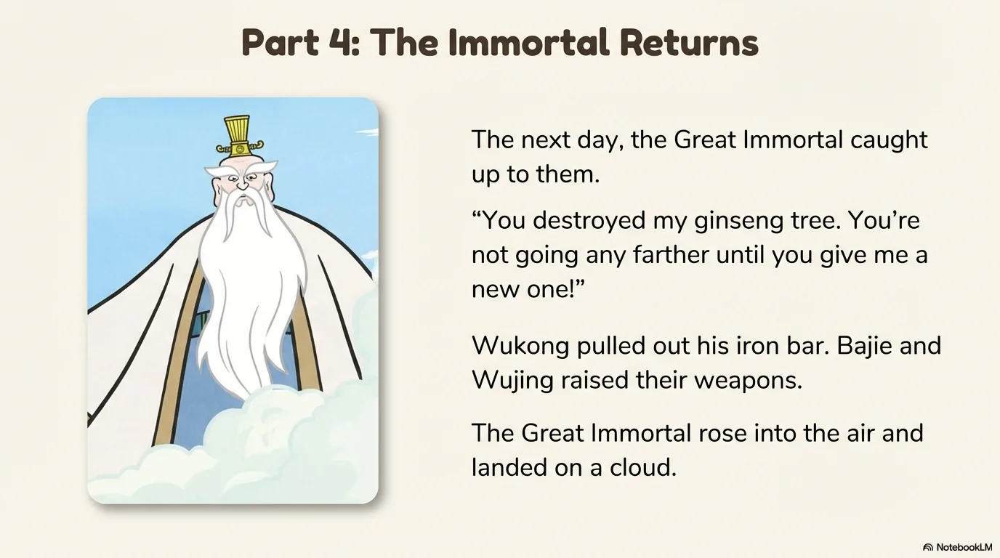

- 来源：`ppt/media/image9.png`（relationship `rId2`）
- 尺寸：1376×768
- 源 SHA-256：`c669bec6aff1580eaec104ee67e4cf53083e1f3dafd0f4711662a0e3ad457560`
- 输出 SHA-256：`07cce087b9ab1fa4dad7447ddb41514fde99c8a9f30698541418d46d80c53ff4`
- 分类：unknown ｜ OCR：blocked ｜ 审核：unreviewed

## Slide 009

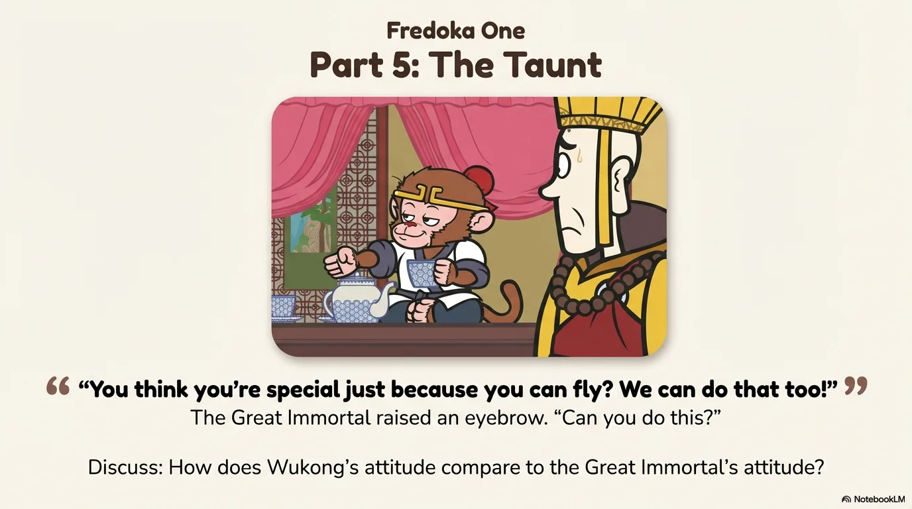

- 来源：`ppt/media/image10.png`（relationship `rId2`）
- 尺寸：1376×768
- 源 SHA-256：`31e480e229faaffa5c84c5ad4d5006d980e2fed77cccc15d394d13ef69f55d51`
- 输出 SHA-256：`6adb5b7e1ee55b7d26bb1650214c3cba5c938704fa09b8a196d671cdffc331ec`
- 分类：unknown ｜ OCR：blocked ｜ 审核：unreviewed

## Slide 010

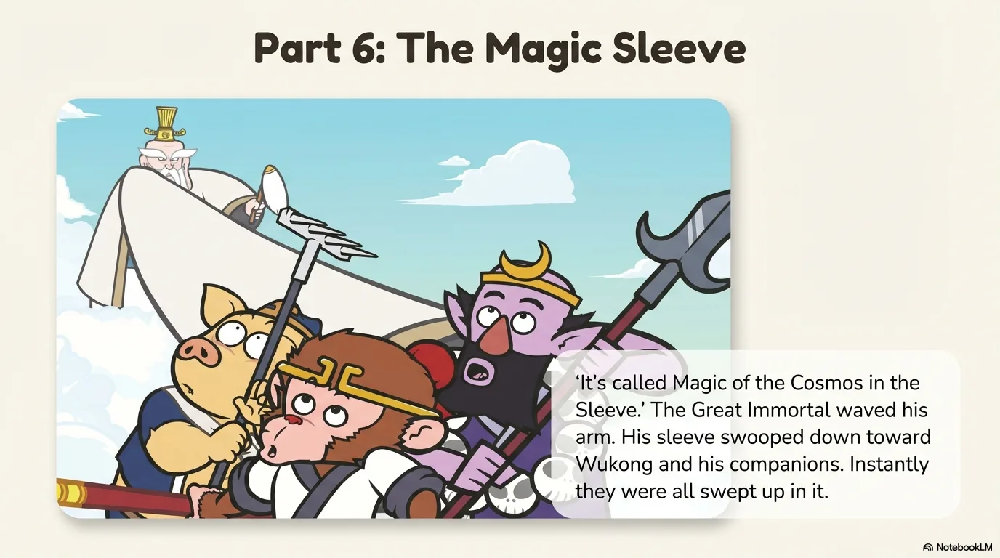

- 来源：`ppt/media/image11.png`（relationship `rId2`）
- 尺寸：1376×768
- 源 SHA-256：`bc4287195cd4492e210935dfd67712155fa7d0ea437bcd80e2de3e098c1918a2`
- 输出 SHA-256：`07a7c6f937088f4879631c6c1aef62b85bef3612b5f25ea29a00bcb92d3c0d5c`
- 分类：unknown ｜ OCR：blocked ｜ 审核：unreviewed

## Slide 011

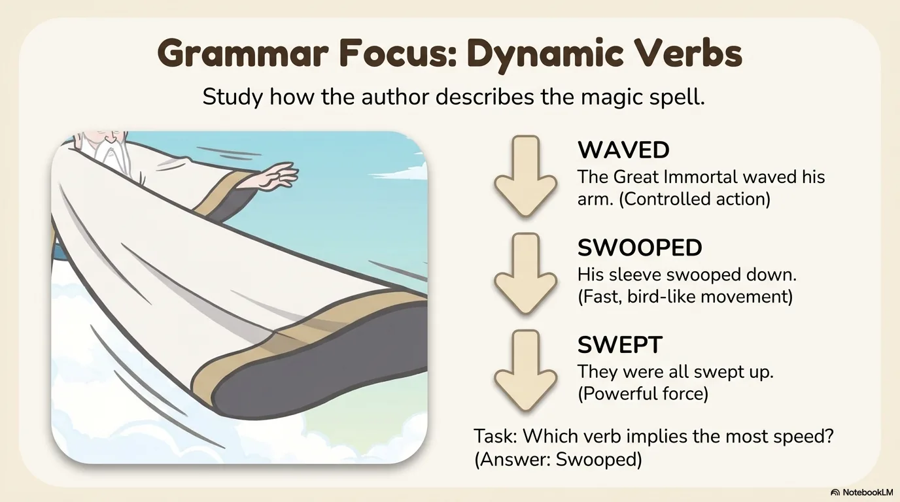

- 来源：`ppt/media/image12.png`（relationship `rId2`）
- 尺寸：1376×768
- 源 SHA-256：`fa52744d965a33f0739408b7b6e83660d6e5f6f234907058c7879aee6eb4b6d2`
- 输出 SHA-256：`9067ca064aa5a9ef7cfcbac308d7652de2269aecb89d5f7d65b43d7d8d957fd5`
- 分类：unknown ｜ OCR：blocked ｜ 审核：unreviewed

## Slide 012

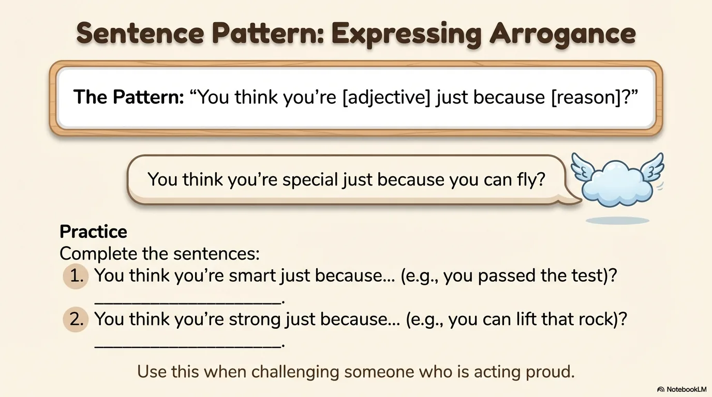

- 来源：`ppt/media/image13.png`（relationship `rId2`）
- 尺寸：1376×768
- 源 SHA-256：`c9e594c7ea268b8065398881167b608dab43ec2948586686b69ab0e6ee26eb26`
- 输出 SHA-256：`5b841eda22c3c348ec43e07cf926a7417d5dd8b42c13ebaf6f7de475fe77539c`
- 分类：unknown ｜ OCR：blocked ｜ 审核：unreviewed

## Slide 013

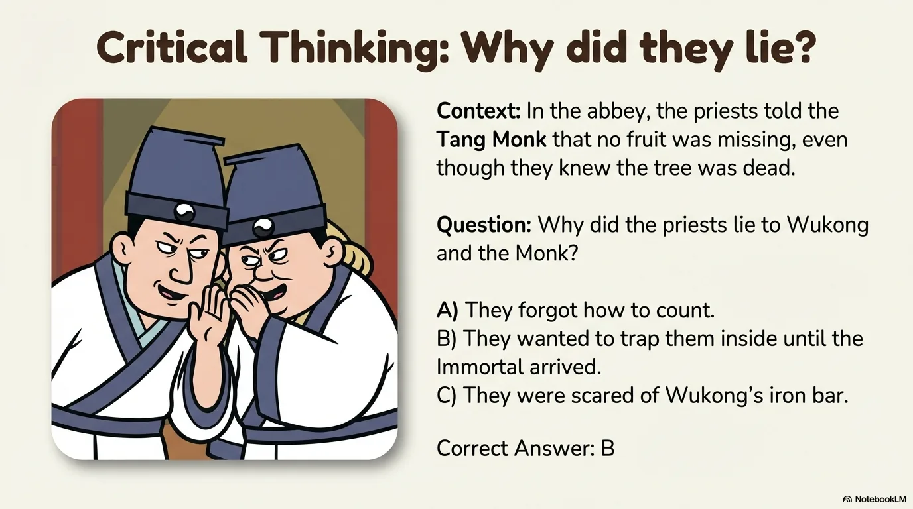

- 来源：`ppt/media/image14.png`（relationship `rId2`）
- 尺寸：1376×768
- 源 SHA-256：`88aebaad9e67d62c22a09deb71ae65c55e8a2113ded286ebe93083a518eb8024`
- 输出 SHA-256：`38a44aa88ed82dc224d79620afc17529c9d8542742b6d79f6d58d68a6871fda2`
- 分类：unknown ｜ OCR：blocked ｜ 审核：unreviewed

## Slide 014

- 来源：`ppt/media/image15.png`（relationship `rId2`）
- 尺寸：1376×768
- 源 SHA-256：`1516d66c3edeaf8065964c6d7c62edf94091016e71c2f856bff10a937d916880`
- 输出 SHA-256：`441a6fab3643428c054c3e54138edb4935cce6ad244ca4e4aebb6acbee2023ed`
- 分类：unknown ｜ OCR：blocked ｜ 审核：unreviewed

## Slide 015

- 来源：`ppt/media/image16.png`（relationship `rId2`）
- 尺寸：1376×768
- 源 SHA-256：`79bb84653d97813a86c3aeb420efb871464655493b46e6c5f3e3a62300967377`
- 输出 SHA-256：`f5bc23ab85eab4b449a8bead9480bd1963b019542ab433471a03587280923c66`
- 分类：unknown ｜ OCR：blocked ｜ 审核：unreviewed

## Slide 016

- 来源：`ppt/media/image17.png`（relationship `rId2`）
- 尺寸：1376×768
- 源 SHA-256：`f2933dc39cc7838c0aa6369aba5f423c7158ef9ebeec5cac741486da9fe23be8`
- 输出 SHA-256：`318f88c12df29e27e40ce0500a2a5ef3ef3d19b67822989f9361f9ce4f622a10`
- 分类：unknown ｜ OCR：blocked ｜ 审核：unreviewed

## Slide 017

- 来源：`ppt/media/image18.png`（relationship `rId2`）
- 尺寸：1376×768
- 源 SHA-256：`d49e8f10b3a12e694d025c88d25670d5e8087a81d77c29b7ab8e872107653ab5`
- 输出 SHA-256：`33e1d2ecb0873fff4a5f6f720a338bc277ea674b56aa38447a389345b868558e`
- 分类：unknown ｜ OCR：blocked ｜ 审核：unreviewed

## Slide 018

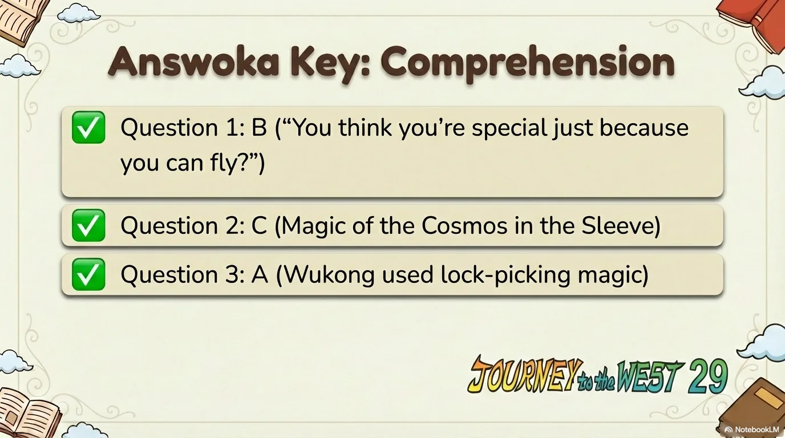

- 来源：`ppt/media/image19.png`（relationship `rId2`）
- 尺寸：1376×768
- 源 SHA-256：`74bb2455eab47c8f1f4011d978585ea5a29bd83d1510394d59f3cca138bb6156`
- 输出 SHA-256：`24315effc8eac1f5a7d063365e4398f0a83cc7a13548253cfc31becf457ecbe7`
- 分类：unknown ｜ OCR：blocked ｜ 审核：unreviewed

## Slide 019

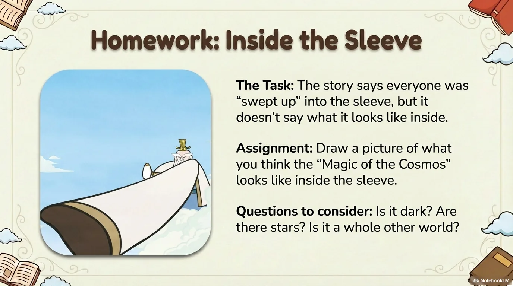

- 来源：`ppt/media/image20.png`（relationship `rId2`）
- 尺寸：1376×768
- 源 SHA-256：`67d775f7f3a78762ee57f10144dabff878730b75dd27497b89244863b651276f`
- 输出 SHA-256：`b7fe50e5580848203b26a1e453c7a7f418ccd3f6d106d389d2d9a88ea83f5cc8`
- 分类：unknown ｜ OCR：blocked ｜ 审核：unreviewed

## Slide 020

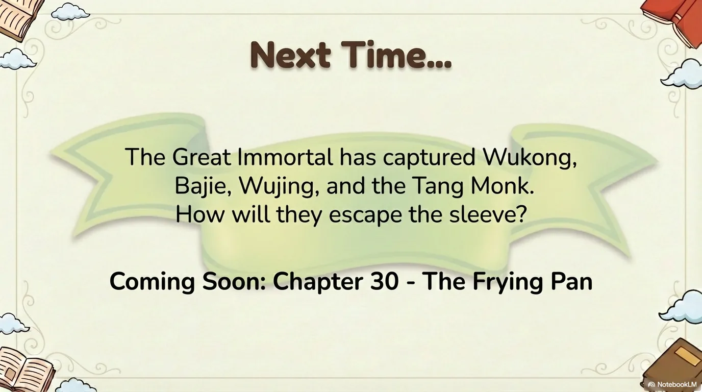

- 来源：`ppt/media/image21.png`（relationship `rId2`）
- 尺寸：1376×768
- 源 SHA-256：`bbecbefea0dde2da2857b9563dcdc8ad0be802991bbc774357d21be78a2d46e1`
- 输出 SHA-256：`0cc6892320ba47ef19f064cc0e67d9d33247a26d24937c5991c6ae26dac37f6d`
- 分类：unknown ｜ OCR：blocked ｜ 审核：unreviewed
