# 豆豆龙英语 · 第 30 集课件（EP030 草稿）

- 来源：`030_Journey to the West 30_The Frying Pan.pptx`（主课件，20 页）
- OCR：`blocked`（no local OCR provider importable (pytesseract missing): No module named 'pytesseract'）
- 分类：待人工审核（unknown）
- 审核状态：`unreviewed`

## Slide 001

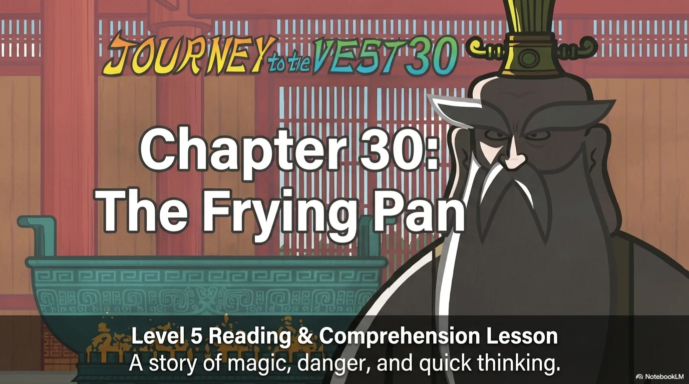

- 来源：`ppt/media/image1.png`（relationship `rId2`）
- 尺寸：1376×768
- 源 SHA-256：`74a01f2f3ce87e4c142cd4af2569c0204407694a6ff6154cd4bf0da75c1f7425`
- 输出 SHA-256：`75085c45e7b46ad88a7152ebd59e3c999496ef5b30c723e137224f02ed7bfcfa`
- 分类：unknown ｜ OCR：blocked ｜ 审核：unreviewed

## Slide 002

- 来源：`ppt/media/image3.png`（relationship `rId2`）
- 尺寸：1376×768
- 源 SHA-256：`38db244e69ebff4bcc13c29f4dbc77ee307d71434557214eb27343ae19a20d4c`
- 输出 SHA-256：`8addccb041e4aee40a0e6674d443fe7aeee190710d85d6e9d9698ec0f4f175b2`
- 分类：unknown ｜ OCR：blocked ｜ 审核：unreviewed

## Slide 003

- 来源：`ppt/media/image4.png`（relationship `rId2`）
- 尺寸：1376×768
- 源 SHA-256：`da9ef50eb306a3dcf37ae43af824dbb98c0774d00378cfae454b8bf01e930179`
- 输出 SHA-256：`77fbdb16cf3159bfa14ac63148b592b1bf81d219462dbbe3cc7a1cae77acbb99`
- 分类：unknown ｜ OCR：blocked ｜ 审核：unreviewed

## Slide 004

- 来源：`ppt/media/image5.png`（relationship `rId2`）
- 尺寸：1376×768
- 源 SHA-256：`968461fe23579d45702870fa1078edd368f28259445ac01c0aef67bccde1661f`
- 输出 SHA-256：`aca86d5bcfbf1549f1a9671355304164146fe4e8830b5a54b4bdfdcf0e23abb1`
- 分类：unknown ｜ OCR：blocked ｜ 审核：unreviewed

## Slide 005

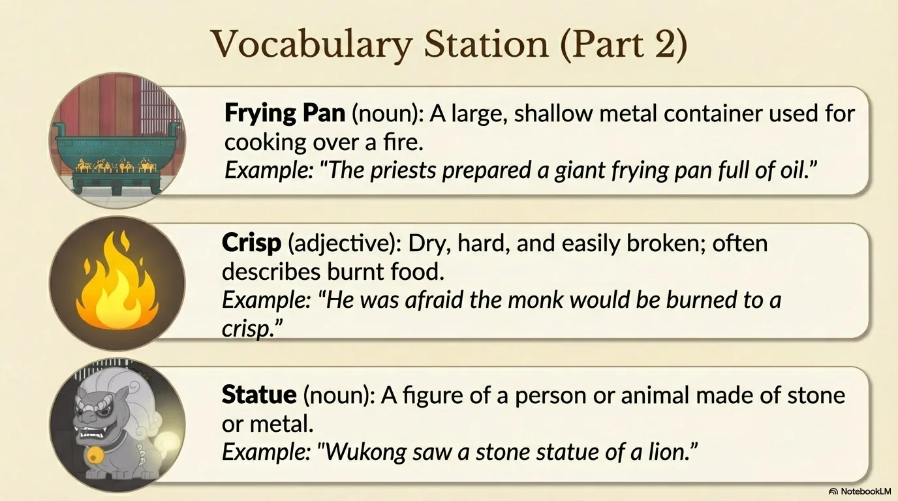

- 来源：`ppt/media/image6.png`（relationship `rId2`）
- 尺寸：1376×768
- 源 SHA-256：`c18e6c10ed06a3b23179a2d3e2a6d9e85078bbee1347bad32f9980a4cbdd2fde`
- 输出 SHA-256：`a0f601a2b456af0c7349ca08e9762f67666d1a82e65d797b5c4b427583a80d6f`
- 分类：unknown ｜ OCR：blocked ｜ 审核：unreviewed

## Slide 006

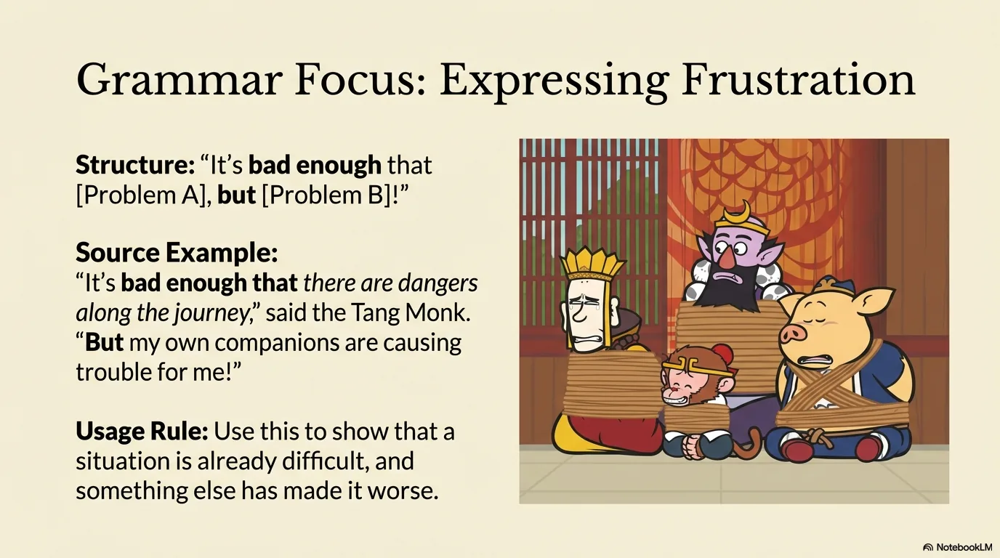

- 来源：`ppt/media/image7.png`（relationship `rId2`）
- 尺寸：1376×768
- 源 SHA-256：`e4e6433b9480a806420bd8fa198de31e8cd76c1f487dc955257a923e7cf69ad0`
- 输出 SHA-256：`4a965a144ea3e4ad7055baa5f627b8c180f42a771beae92d4a207edfe90af2fa`
- 分类：unknown ｜ OCR：blocked ｜ 审核：unreviewed

## Slide 007

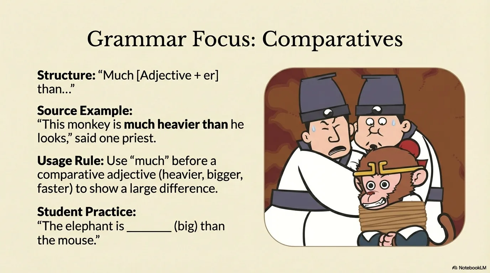

- 来源：`ppt/media/image8.png`（relationship `rId2`）
- 尺寸：1376×768
- 源 SHA-256：`29292c6aa31ef72f6e530cc3cec13e9f08c3e417558b6cac413e4ef5f7327ace`
- 输出 SHA-256：`67a42282ef47f9b8eb17524c56d7c03ff8d50a6c851c19bc5ef78c3c4977e52f`
- 分类：unknown ｜ OCR：blocked ｜ 审核：unreviewed

## Slide 008

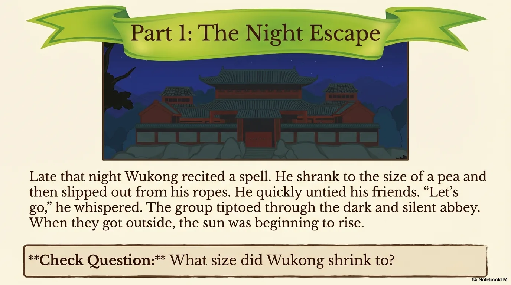

- 来源：`ppt/media/image9.png`（relationship `rId2`）
- 尺寸：1376×768
- 源 SHA-256：`82bb68ce86487fbe839da553aa60fa2715d8a70dd534124664552272f7269813`
- 输出 SHA-256：`816329ac6c213901f03c0e07482c90f598a18aaca1b67b2f1a16efe3c1ead5d8`
- 分类：unknown ｜ OCR：blocked ｜ 审核：unreviewed

## Slide 009

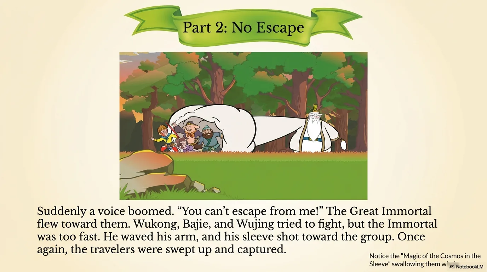

- 来源：`ppt/media/image10.png`（relationship `rId2`）
- 尺寸：1376×768
- 源 SHA-256：`3dcf7cab3aa1eb7bd71db66552f38b62d886c3149b0c297b9db57096c35699b6`
- 输出 SHA-256：`0c2ca5fb09e1cb3f9be359aebb6e9a55b5e5793b74ed84f394dc0df51d8333b9`
- 分类：unknown ｜ OCR：blocked ｜ 审核：unreviewed

## Slide 010

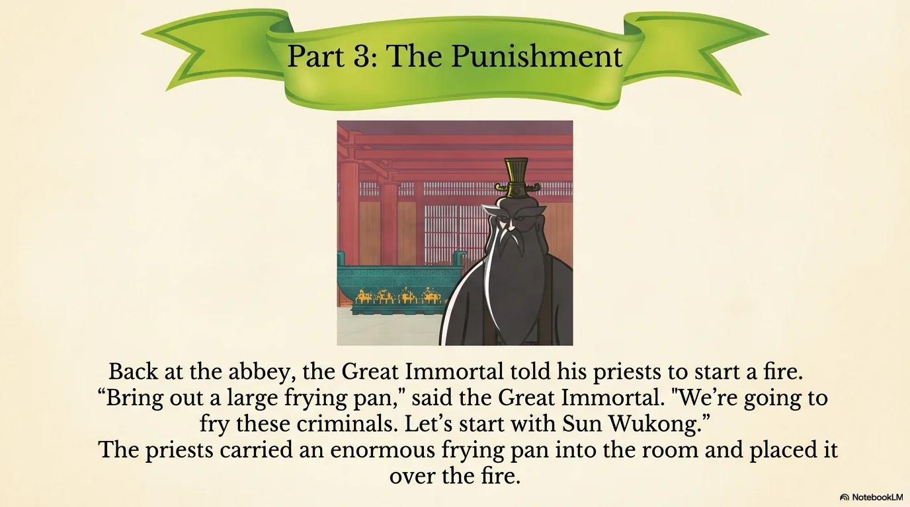

- 来源：`ppt/media/image11.png`（relationship `rId2`）
- 尺寸：1376×768
- 源 SHA-256：`b7b2db4df1cb8e7d23eb74c7278a64118e12ecddbba37b95e95defee08c1bbff`
- 输出 SHA-256：`69fa6a762638a58891735080a1c020b9a1d8fe6f3bd9035ef4ab000b3123de8e`
- 分类：unknown ｜ OCR：blocked ｜ 审核：unreviewed

## Slide 011

- 来源：`ppt/media/image12.png`（relationship `rId2`）
- 尺寸：1376×768
- 源 SHA-256：`bf48eec0e918bd1b02d2d1f0454334b11ab8ef3c13b8ef02dc06f124af4e0145`
- 输出 SHA-256：`7e9fbeaac55b9338c0902b09c1276573c4aa39320fd8fcc10a02185f501b9304`
- 分类：unknown ｜ OCR：blocked ｜ 审核：unreviewed

## Slide 012

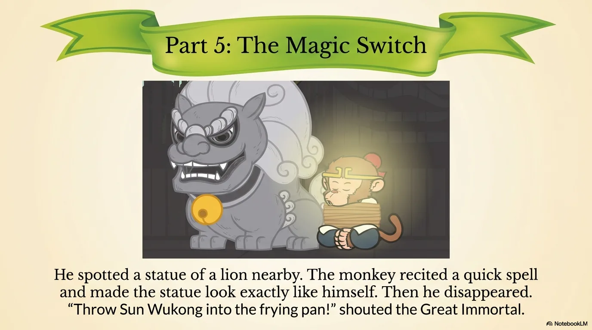

- 来源：`ppt/media/image13.png`（relationship `rId2`）
- 尺寸：1376×768
- 源 SHA-256：`849f6ed69ac4c4029e15da31bbefc79c14859ebbfd42b592e4aa9cb949197ace`
- 输出 SHA-256：`7a19cae5e6891e9252e843b03234d7498a9f18105922066ec770552df93c9e92`
- 分类：unknown ｜ OCR：blocked ｜ 审核：unreviewed

## Slide 013

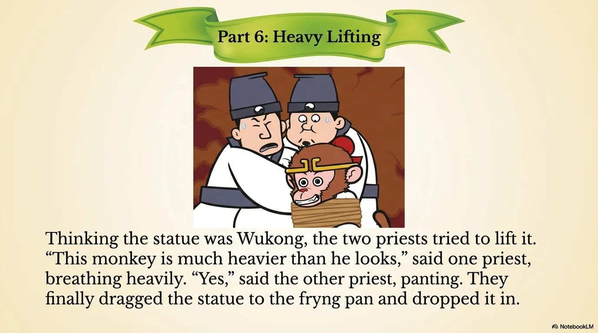

- 来源：`ppt/media/image14.png`（relationship `rId2`）
- 尺寸：1376×768
- 源 SHA-256：`05923fb0765b7153487cebde5f04a1259d5d71f84c34c13adb2dc9bfa5cc8a54`
- 输出 SHA-256：`1e3017a924373e9f8515e39efbd27950df89b5c0d76d0cd505536c4f0bfd9d8e`
- 分类：unknown ｜ OCR：blocked ｜ 审核：unreviewed

## Slide 014

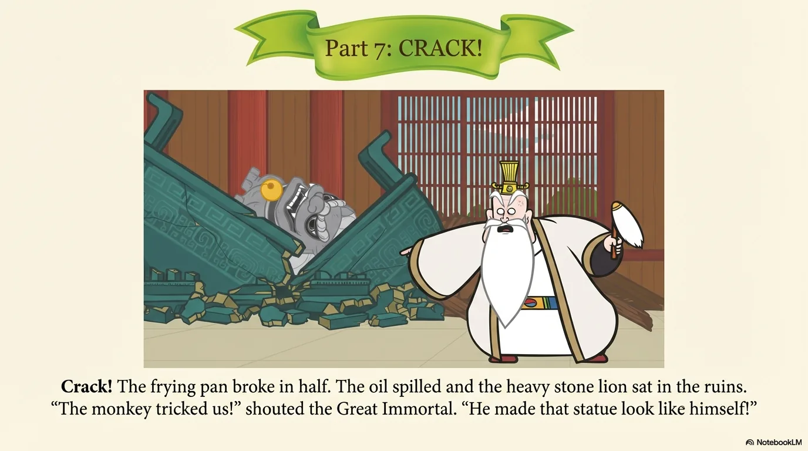

- 来源：`ppt/media/image15.png`（relationship `rId2`）
- 尺寸：1376×768
- 源 SHA-256：`a1f852a7ea12069ab7d96d6ba61b49d1d3aad6391380eacaf347ef9db76d36da`
- 输出 SHA-256：`8d8c16039b56ea598c7424d674edd52b3c64fef517f4b12b73ac00fe8c36b4d5`
- 分类：unknown ｜ OCR：blocked ｜ 审核：unreviewed

## Slide 015

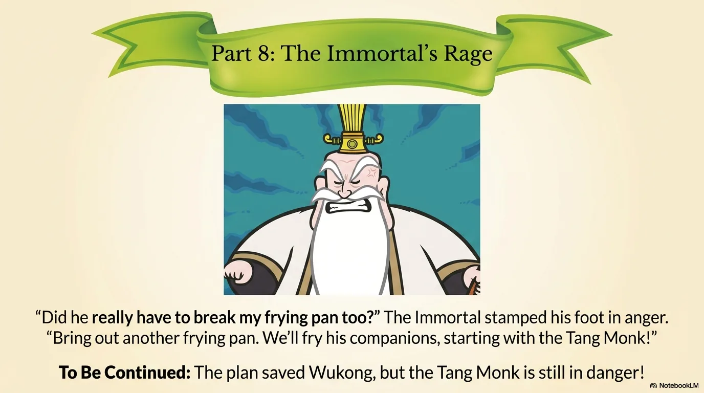

- 来源：`ppt/media/image16.png`（relationship `rId2`）
- 尺寸：1376×768
- 源 SHA-256：`3f7cbd343dff07a910d612b860cacad594fa2f843b672a1c0000a263892a0cc7`
- 输出 SHA-256：`9a942304b10bacd11914b110266d942177d0b66eb487044c29734d14cdf9121d`
- 分类：unknown ｜ OCR：blocked ｜ 审核：unreviewed

## Slide 016

- 来源：`ppt/media/image17.png`（relationship `rId2`）
- 尺寸：1376×768
- 源 SHA-256：`0d34018f6bd83e794c00e3b8114586237efcb56de26f4f6e06939e38626b7ea9`
- 输出 SHA-256：`f7b321fa738e1806794492a6bfd106b0293829001bed3211dbf239c6b18b16d5`
- 分类：unknown ｜ OCR：blocked ｜ 审核：unreviewed

## Slide 017

- 来源：`ppt/media/image18.png`（relationship `rId2`）
- 尺寸：1376×768
- 源 SHA-256：`76c55ae5b0b7722ebeb9140c6131fbb20ecdb95b26117f2e40d49303c329fda6`
- 输出 SHA-256：`295da7d9bd7198daa47ea33ffb515759a5fd2ce120819f68639552bd7507821c`
- 分类：unknown ｜ OCR：blocked ｜ 审核：unreviewed

## Slide 018

- 来源：`ppt/media/image19.png`（relationship `rId2`）
- 尺寸：1376×768
- 源 SHA-256：`7344be4651fb89e1b02c1d72a8c833037aeb902065536d2007207f68adf8d17d`
- 输出 SHA-256：`8aae1ff328ab293eb9e8ad93c9ed3c7efac7c0ec6f96d2650f86d44738235166`
- 分类：unknown ｜ OCR：blocked ｜ 审核：unreviewed

## Slide 019

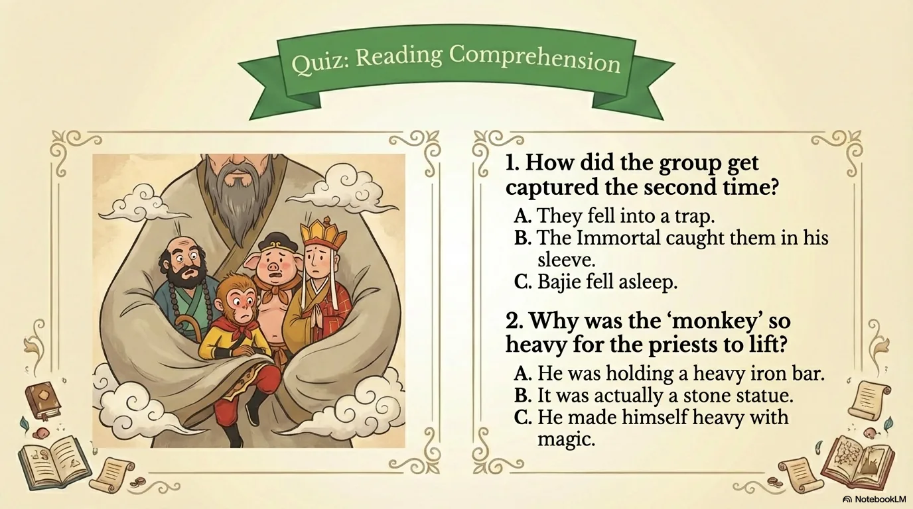

- 来源：`ppt/media/image20.png`（relationship `rId2`）
- 尺寸：1376×768
- 源 SHA-256：`ea11677a1fdc5b35b5490c94e5da9cbac1726c2f9f9698867dfe348835fddd06`
- 输出 SHA-256：`dc1ac831c4722459c3d66b259909157429454ce422d478180609ea6452aee217`
- 分类：unknown ｜ OCR：blocked ｜ 审核：unreviewed

## Slide 020

- 来源：`ppt/media/image21.png`（relationship `rId2`）
- 尺寸：1376×768
- 源 SHA-256：`23051a3f0dcca4d5d4d36dd525bcf07c7b48a396ffbdec49b0249df3b741c9c5`
- 输出 SHA-256：`0a3b9bff360948f0d971928de170fdfa521d5db31cd4ff5a21db1f8bd6235820`
- 分类：unknown ｜ OCR：blocked ｜ 审核：unreviewed
