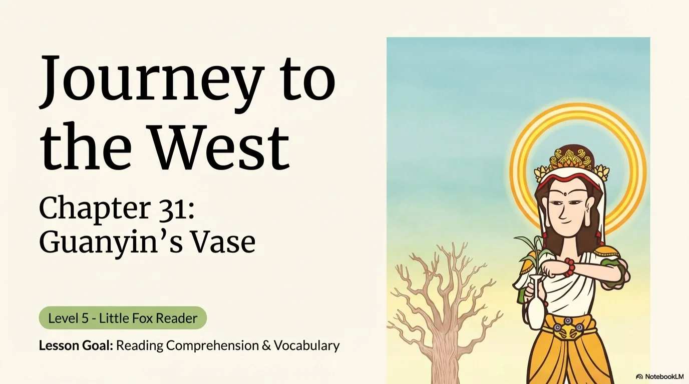
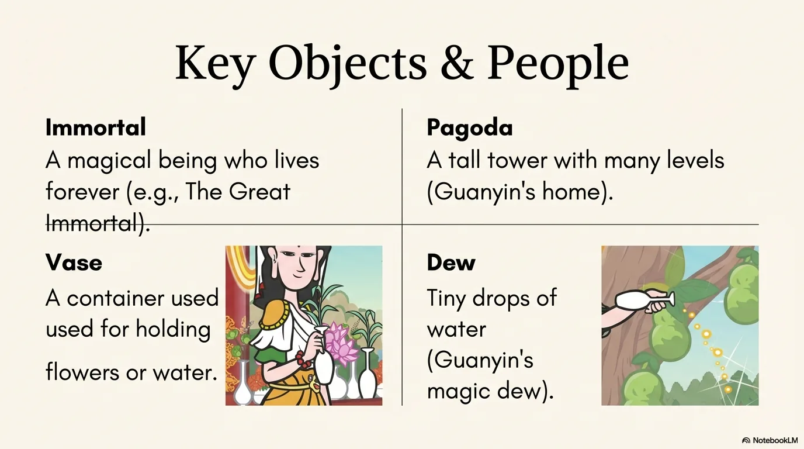
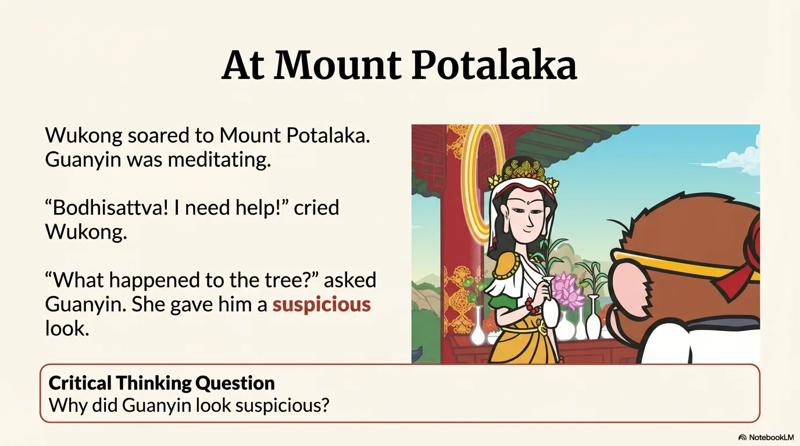
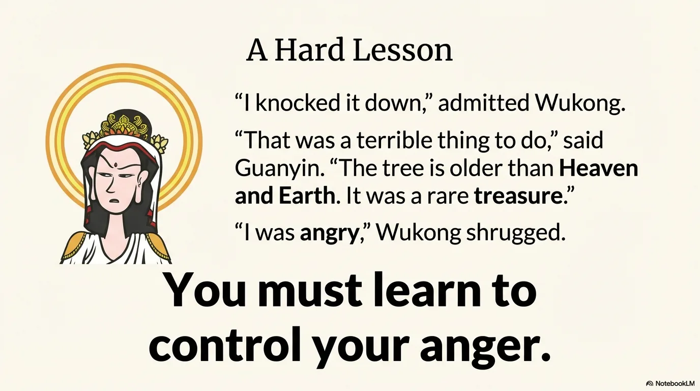
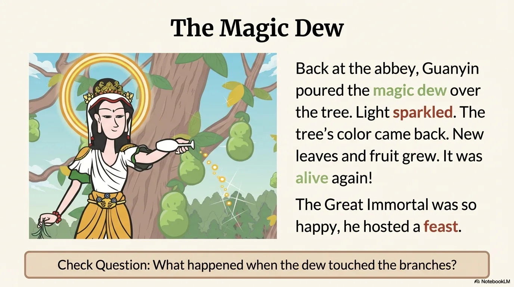
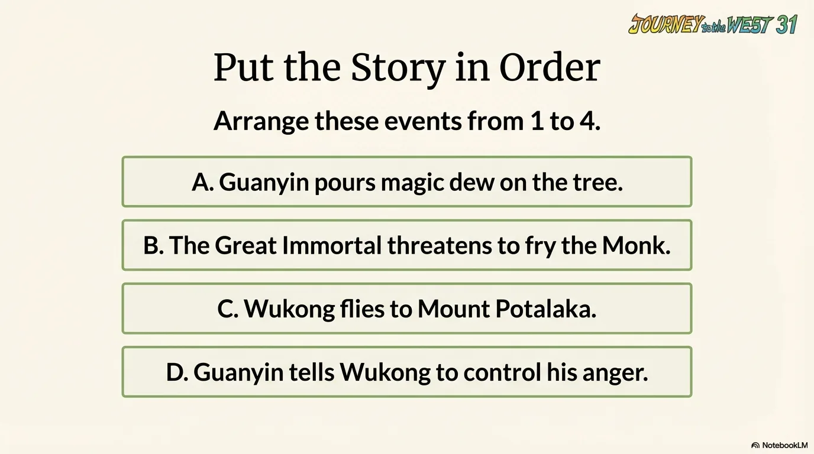
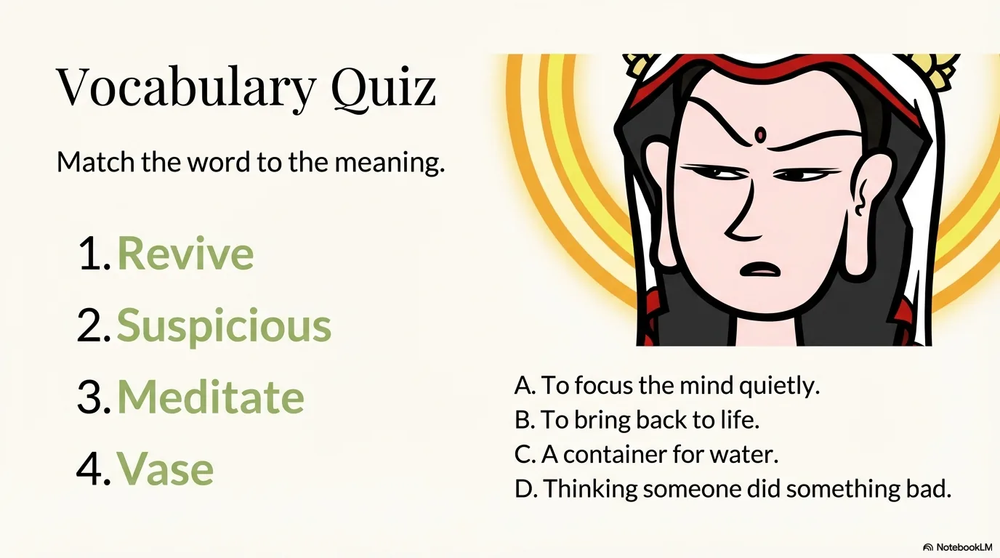
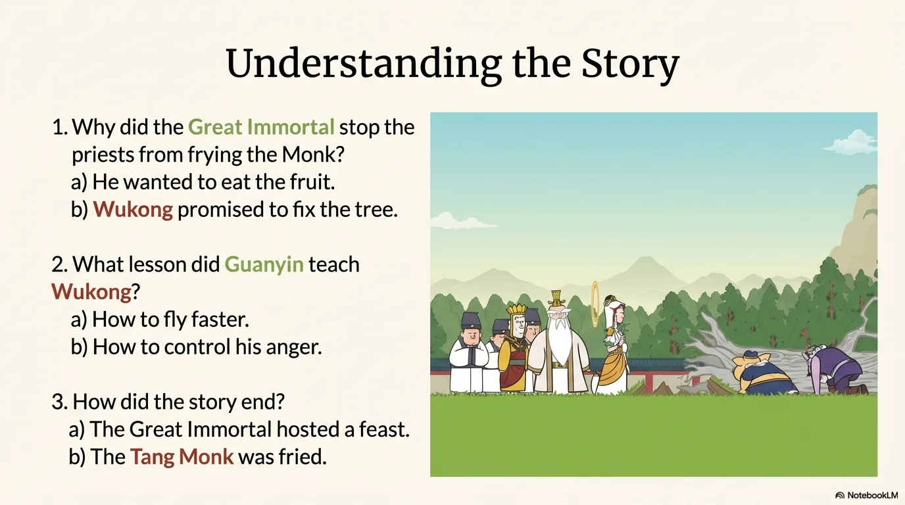
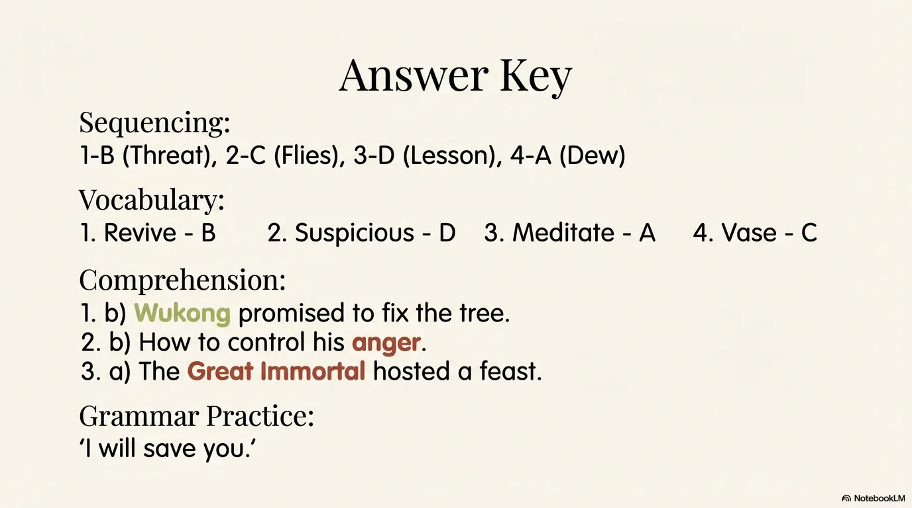

# 豆豆龙英语 · 第 31 集课件（EP031 草稿）

- 来源：`031_Journey to the West 31_Guanyin's Vase.pptx`（主课件，16 页）
- OCR：`blocked`（no local OCR provider importable (pytesseract missing): No module named 'pytesseract'）
- 分类：待人工审核（unknown）
- 审核状态：`unreviewed`

## Slide 001

- 来源：`ppt/media/image1.png`（relationship `rId2`）
- 尺寸：1376×768
- 源 SHA-256：`6688f2c02828ac45d8a8b75fe2a4d86caffa5e96839707f414999d237cefbaef`
- 输出 SHA-256：`1fe44cec7bf40fcbf31c05014097c3e645a74bbf59128c2fa667e1d50dbf707e`
- 分类：unknown ｜ OCR：blocked ｜ 审核：unreviewed

## Slide 002

- 来源：`ppt/media/image3.png`（relationship `rId2`）
- 尺寸：1376×768
- 源 SHA-256：`44e34487d8f545b8306d090b143203705719bf5c58f14b7610fc2638eb6345ba`
- 输出 SHA-256：`6863982b0bd7df4e5d56e01453f41835487e38f577178f032d2d5752ceea5886`
- 分类：unknown ｜ OCR：blocked ｜ 审核：unreviewed

## Slide 003

- 来源：`ppt/media/image4.png`（relationship `rId2`）
- 尺寸：1376×768
- 源 SHA-256：`f2cb1e7e874d47797ddcba1ca5ecb3fe5c7cdf9c5b05fe65cf352f6f11e488ac`
- 输出 SHA-256：`b0dd5948a5fbe0ae08266a0ee117107d40b999a7bf0a9df0a45f5fc244d5461f`
- 分类：unknown ｜ OCR：blocked ｜ 审核：unreviewed

## Slide 004

- 来源：`ppt/media/image5.png`（relationship `rId2`）
- 尺寸：1376×768
- 源 SHA-256：`641a8271d268f36a453d3e92ee0dae5737a30a7ba2e11166eb6802930008ce8f`
- 输出 SHA-256：`fdac13ce7bac8b98f772019e4f66ab9b641bf8f1da7a32c80a41da4258a47267`
- 分类：unknown ｜ OCR：blocked ｜ 审核：unreviewed

## Slide 005

- 来源：`ppt/media/image6.png`（relationship `rId2`）
- 尺寸：1376×768
- 源 SHA-256：`97835eb0e5cd9a8df70cc67da3f4d6e3976bb34c52df0f3fad3ceba15dcc090a`
- 输出 SHA-256：`3d608a5470a567f0ad73b82d1193399459c497fd8fc5281a9f5185c2414d98ef`
- 分类：unknown ｜ OCR：blocked ｜ 审核：unreviewed

## Slide 006

- 来源：`ppt/media/image7.png`（relationship `rId2`）
- 尺寸：1376×768
- 源 SHA-256：`358def94a07acb40c61428d4896731e4803f817a2e679b9ce0f331ebef37d950`
- 输出 SHA-256：`35372782c2262f4d4f21755ac8708ba2d8680805460d3d4321619f97aed0df52`
- 分类：unknown ｜ OCR：blocked ｜ 审核：unreviewed

## Slide 007

- 来源：`ppt/media/image8.png`（relationship `rId2`）
- 尺寸：1376×768
- 源 SHA-256：`120b289f3c1670f3b315a00641660239dbd3a354c0290db1f2dd23483e0ffe3d`
- 输出 SHA-256：`40be50076185b8672230f6ae564f63cbe2642f07d9deb1f8d9cf928d5e8c5feb`
- 分类：unknown ｜ OCR：blocked ｜ 审核：unreviewed

## Slide 008

- 来源：`ppt/media/image9.png`（relationship `rId2`）
- 尺寸：1376×768
- 源 SHA-256：`b80fec6fc79f2e8fbd9ebfa29f1d9877e3c0219f29724a2218dab15632b8d201`
- 输出 SHA-256：`d6bbad1a536873a6ee03061bc931f6168be25ab3f9629cf9dfab56587cd1bf4e`
- 分类：unknown ｜ OCR：blocked ｜ 审核：unreviewed

## Slide 009

- 来源：`ppt/media/image10.png`（relationship `rId2`）
- 尺寸：1376×768
- 源 SHA-256：`4f061aed4f8ad894554cc7dae6b316d799a7f469878c1557c8f574f588060a02`
- 输出 SHA-256：`275a3f97a5d78968cbb94da3163ff79e59d6fd2c01cda7697e762a26ca5c7347`
- 分类：unknown ｜ OCR：blocked ｜ 审核：unreviewed

## Slide 010

- 来源：`ppt/media/image11.png`（relationship `rId2`）
- 尺寸：1376×768
- 源 SHA-256：`5e47e12760d8dcf5b62991e1677369ab00ed1ce0086a7f7080deb2571b06ca3b`
- 输出 SHA-256：`ad66a8b4edf755e0a19893de8fbeca9d556c09a1bf66220dab78b9ad02383c72`
- 分类：unknown ｜ OCR：blocked ｜ 审核：unreviewed

## Slide 011

- 来源：`ppt/media/image12.png`（relationship `rId2`）
- 尺寸：1376×768
- 源 SHA-256：`bd2b7609c4d1163d023141dc0f40d0d04344ff320ca195f38b161b0d984384d6`
- 输出 SHA-256：`5fcd64712feb1a5cda355723b3d9508aff007f7cec7ae4cd7ac2a3555861adff`
- 分类：unknown ｜ OCR：blocked ｜ 审核：unreviewed

## Slide 012

- 来源：`ppt/media/image13.png`（relationship `rId2`）
- 尺寸：1376×768
- 源 SHA-256：`f090c5a9a1627efa0eaa1fb7272435900bae5c383263186b40a4dd0a4d1d436d`
- 输出 SHA-256：`ebf4f4671b037f87a0b6f3871d31c4f342d7be26b3652e51f12b7420632d38fb`
- 分类：unknown ｜ OCR：blocked ｜ 审核：unreviewed

## Slide 013

- 来源：`ppt/media/image14.png`（relationship `rId2`）
- 尺寸：1376×768
- 源 SHA-256：`fc5b34e075ad8cf49ce143f7a189e6678982d85eb8d6e9582973a10b44961744`
- 输出 SHA-256：`77e572a780726a45747c36bab3ce4f6439c66b1eb129706c60e7df6074a82752`
- 分类：unknown ｜ OCR：blocked ｜ 审核：unreviewed

## Slide 014

- 来源：`ppt/media/image15.png`（relationship `rId2`）
- 尺寸：1376×768
- 源 SHA-256：`35371357f9c2ccb84bf4777c526614d94865abf797595e355385f2a8dcd28e48`
- 输出 SHA-256：`6edef7504a83ffcf4def1d42fa689fac5de09acf1a9d2acab7d240994c9af63d`
- 分类：unknown ｜ OCR：blocked ｜ 审核：unreviewed

## Slide 015

- 来源：`ppt/media/image16.png`（relationship `rId2`）
- 尺寸：1376×768
- 源 SHA-256：`f66d58e4f438c2792b9aff7a831604ee90efabbb4796176a02ae8c0f33232b79`
- 输出 SHA-256：`ec7012b57c4ee645f458965d6b273125450867c5dd8e49dcbed7d076486d5a97`
- 分类：unknown ｜ OCR：blocked ｜ 审核：unreviewed

## Slide 016

- 来源：`ppt/media/image17.png`（relationship `rId2`）
- 尺寸：1376×768
- 源 SHA-256：`0d2fa4f0f839ae443808126d7f6e7408aa1fb5b21bc708bc77b1ee3a61599f56`
- 输出 SHA-256：`78d5b3552f99b61399a11a970a26612bf88c2a08553d58a57c5b11fafb09da02`
- 分类：unknown ｜ OCR：blocked ｜ 审核：unreviewed
