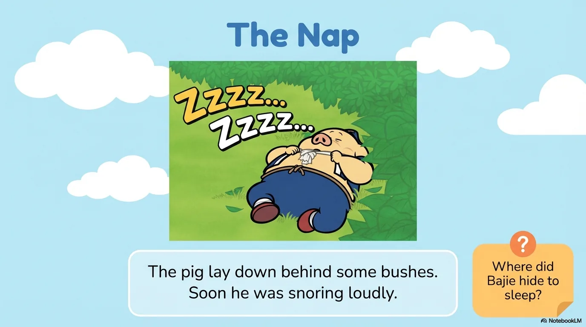
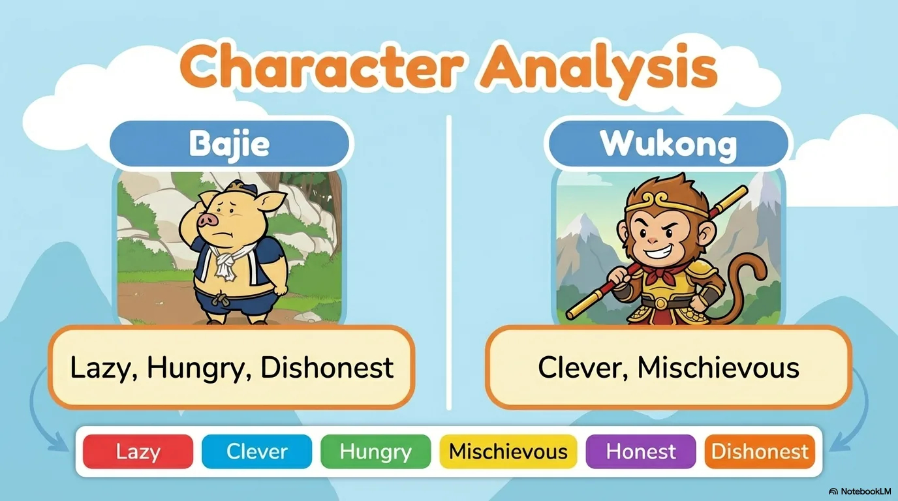
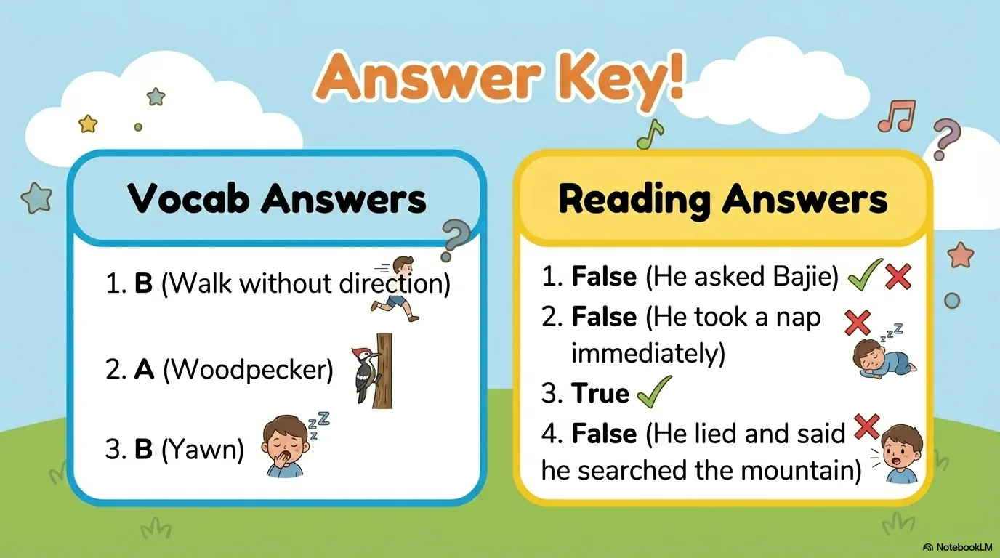

# 豆豆龙英语 · 第 33 集课件（EP033 草稿）

- 来源：`033_Journey to the West 33_Bajie Takes a Nap.pptx`（主课件，20 页）
- OCR：`blocked`（no local OCR provider importable (pytesseract missing): No module named 'pytesseract'）
- 分类：待人工审核（unknown）
- 审核状态：`unreviewed`

## Slide 001

- 来源：`ppt/media/image1.png`（relationship `rId2`）
- 尺寸：1376×768
- 源 SHA-256：`9591d76124ef867814cab53fe5fa99b14f140773ee528d576bc230b7863a366f`
- 输出 SHA-256：`198f901b79ed2f67d368021215b2c6c3e17885495f9b817ace3c6f627bf845fa`
- 分类：unknown ｜ OCR：blocked ｜ 审核：unreviewed

## Slide 002

- 来源：`ppt/media/image3.png`（relationship `rId2`）
- 尺寸：1376×768
- 源 SHA-256：`2fed0179b49047e927f9565793acca06d16320b680d783365091eb207c8adf2a`
- 输出 SHA-256：`5136e3ae2fe5d229d2eb55f7415580360033cd164a54b43ad7c7f011aeb9b730`
- 分类：unknown ｜ OCR：blocked ｜ 审核：unreviewed

## Slide 003

- 来源：`ppt/media/image4.png`（relationship `rId2`）
- 尺寸：1376×768
- 源 SHA-256：`d95a74cb0838acadea5180aca05226995782d60b07942a627ed24c004cd2d730`
- 输出 SHA-256：`a3db939c055e8dabedd08cc04813a2f7099ba818c573c344a66e47a3054dc243`
- 分类：unknown ｜ OCR：blocked ｜ 审核：unreviewed

## Slide 004

- 来源：`ppt/media/image5.png`（relationship `rId2`）
- 尺寸：1376×768
- 源 SHA-256：`e6cb2f65c873697094579c3f139bce2e23b2beaa013725dbd0e54a977e85fb85`
- 输出 SHA-256：`3843a48eb8f825e3e61e97e5a480de514211702c988df98790a92d880193f248`
- 分类：unknown ｜ OCR：blocked ｜ 审核：unreviewed

## Slide 005

- 来源：`ppt/media/image6.png`（relationship `rId2`）
- 尺寸：1376×768
- 源 SHA-256：`73f768e769e93b9968b8881f6c960b1fff81ee699e13669e27dfe3a28ca66c15`
- 输出 SHA-256：`98f9f4d74d8a46d061be48103e4dd4699ed1ea50c362323e6664136fa436b8e7`
- 分类：unknown ｜ OCR：blocked ｜ 审核：unreviewed

## Slide 006

- 来源：`ppt/media/image7.png`（relationship `rId2`）
- 尺寸：1376×768
- 源 SHA-256：`325f163dc3f3893b2cf470a48b26bbdcd275b06f5ec6ca284e928523990db87f`
- 输出 SHA-256：`0eddf6ccc4b8f529e4fdaa2c7cfd3573b2d216a7544995cd8341409f0333f189`
- 分类：unknown ｜ OCR：blocked ｜ 审核：unreviewed

## Slide 007

- 来源：`ppt/media/image8.png`（relationship `rId2`）
- 尺寸：1376×768
- 源 SHA-256：`4ebe1291037ce004d0edae5fe445a2bb4bec3eb805196ee0b36bb4a329e24c23`
- 输出 SHA-256：`422efcad5946d1e76d553d4fd35db4dbf632783ef10df333899adcebdd149161`
- 分类：unknown ｜ OCR：blocked ｜ 审核：unreviewed

## Slide 008

- 来源：`ppt/media/image9.png`（relationship `rId2`）
- 尺寸：1376×768
- 源 SHA-256：`1f3ec204d4f36ff665f70d566fe38ed87bbcee17efb46ee6e95b598441c5822b`
- 输出 SHA-256：`5534ee3680fc0ef07108b587f31f8ca9fef0feacac39877fd1e26b64b54c02b0`
- 分类：unknown ｜ OCR：blocked ｜ 审核：unreviewed

## Slide 009

- 来源：`ppt/media/image10.png`（relationship `rId2`）
- 尺寸：1376×768
- 源 SHA-256：`a09f9ebddf2cdf01f5412a523054607360933daa534a6ecb41b0bfb72c6e91db`
- 输出 SHA-256：`94b0456433d7a3ec05c2554cf65cc074bca5de4991ef13be35eb35330d448284`
- 分类：unknown ｜ OCR：blocked ｜ 审核：unreviewed

## Slide 010

- 来源：`ppt/media/image11.png`（relationship `rId2`）
- 尺寸：1376×768
- 源 SHA-256：`92bed5dec8d6e0e24f1821d8b47bd5ea617f25ffbef4d57cced002438319f56c`
- 输出 SHA-256：`84e086ee422f2153629b6040ff3fc9127d8e39e59fde30ad74abf32fb58ff58a`
- 分类：unknown ｜ OCR：blocked ｜ 审核：unreviewed

## Slide 011

- 来源：`ppt/media/image12.png`（relationship `rId2`）
- 尺寸：1376×768
- 源 SHA-256：`5083f59a99cba133a132d88499ec1cb257d15241e8df76ddc37e1f1fd9cb9f88`
- 输出 SHA-256：`44955b1c9a7341bc1ff2c651930ae5a6e172162078b7ffdc5186ab4c1902ab0b`
- 分类：unknown ｜ OCR：blocked ｜ 审核：unreviewed

## Slide 012

- 来源：`ppt/media/image13.png`（relationship `rId2`）
- 尺寸：1376×768
- 源 SHA-256：`c37933f598b06a4d5274712fba85517a4cbd4d39c49b722f99dd386419e6993b`
- 输出 SHA-256：`4733d3b2fbbdafe87877fbac7b9ea5ade56a1f1fc3831388dcfbe687482dc2f9`
- 分类：unknown ｜ OCR：blocked ｜ 审核：unreviewed

## Slide 013

- 来源：`ppt/media/image14.png`（relationship `rId2`）
- 尺寸：1376×768
- 源 SHA-256：`775f3d2b8dc4e6e1dd2d6828a83be8137f95bb1188015cf95fceb9339e6b4b04`
- 输出 SHA-256：`5f3f229bef7b299fc81822fa157e687186c063a8ec2d6e04f73ca61febfb7111`
- 分类：unknown ｜ OCR：blocked ｜ 审核：unreviewed

## Slide 014

- 来源：`ppt/media/image15.png`（relationship `rId2`）
- 尺寸：1376×768
- 源 SHA-256：`b435032d260e1603268b41bd974555f5b1a6cc453bb37916c434cd98b7ff1498`
- 输出 SHA-256：`8a8c9a3c093ac89d00f4bdce697880753bd5496e7d7d1455296186f29a093842`
- 分类：unknown ｜ OCR：blocked ｜ 审核：unreviewed

## Slide 015

- 来源：`ppt/media/image16.png`（relationship `rId2`）
- 尺寸：1376×768
- 源 SHA-256：`4397de8cd57526642a1279679cd12454e4e7871c107b4b9d3ed789fc8ddeb367`
- 输出 SHA-256：`142b5551a0a05381a69c1ae19a6fcf3dc9bff38d0f8365c74f08bbfc3f401aa8`
- 分类：unknown ｜ OCR：blocked ｜ 审核：unreviewed

## Slide 016

- 来源：`ppt/media/image17.png`（relationship `rId2`）
- 尺寸：1376×768
- 源 SHA-256：`526c20fa8de5bb4a157a13d718690ab6f814949da99accd78b707f8126bc5322`
- 输出 SHA-256：`9cf13e58fd7a7cbf0ded08084bb228bbccbde4b3e9a4a59034710783b93d9e29`
- 分类：unknown ｜ OCR：blocked ｜ 审核：unreviewed

## Slide 017

- 来源：`ppt/media/image18.png`（relationship `rId2`）
- 尺寸：1376×768
- 源 SHA-256：`44f439d1bf0d809e8df116b7275dbc77b416c4f26ef87484dc1e01c3ba2ee9f1`
- 输出 SHA-256：`f0f995c5fb2eab50240f21c43fae807afbcbc3697a01542aa23b59b21bb80e34`
- 分类：unknown ｜ OCR：blocked ｜ 审核：unreviewed

## Slide 018

- 来源：`ppt/media/image19.png`（relationship `rId2`）
- 尺寸：1376×768
- 源 SHA-256：`fb68650f27e5836ee31d02fd10f6023b27a8391eb529cb88482d154e96b99fe4`
- 输出 SHA-256：`c3b00205a4c4ac41adfd4e5005b95b12109bf9e6bb85f4798b63e12799790137`
- 分类：unknown ｜ OCR：blocked ｜ 审核：unreviewed

## Slide 019

- 来源：`ppt/media/image20.png`（relationship `rId2`）
- 尺寸：1376×768
- 源 SHA-256：`d3f6369fe39db9192a973812e04cdc013fcee0028340726de52cc7a26359965e`
- 输出 SHA-256：`95aa0b6beb5f93fcb9494448a6cb91c4e1e604d9c85baff6228abd7dc547c1a7`
- 分类：unknown ｜ OCR：blocked ｜ 审核：unreviewed

## Slide 020

- 来源：`ppt/media/image21.png`（relationship `rId2`）
- 尺寸：1376×768
- 源 SHA-256：`54752349e248c6b4f7b3fba1c06f5594defa08e8e3900656ba6764f599ce9112`
- 输出 SHA-256：`08832757478bca215702253625d4b59082b594f36d3fe7f7e4e17faf25fab66d`
- 分类：unknown ｜ OCR：blocked ｜ 审核：unreviewed
