# 豆豆龙英语 · 第 34 集课件（EP034 草稿）

- 来源：`034_Journey to the West 34_Tricked by the Princess.pptx`（主课件，20 页）
- OCR：`blocked`（no local OCR provider importable (pytesseract missing): No module named 'pytesseract'）
- 分类：待人工审核（unknown）
- 审核状态：`unreviewed`

## Slide 001

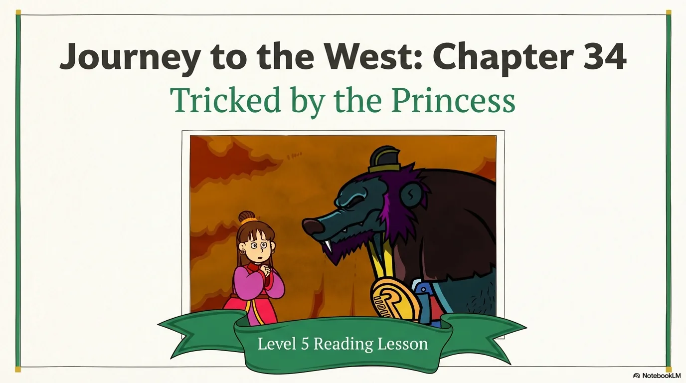

- 来源：`ppt/media/image1.png`（relationship `rId2`）
- 尺寸：1376×768
- 源 SHA-256：`2c3451df193325bdca69034ec67077e8a6520f4a70bd03e0766cc688cabc9b81`
- 输出 SHA-256：`0726eb0b30e984698685faeff1d1c9c2e779dde56e9a7bddb7f1368ba5e817fc`
- 分类：unknown ｜ OCR：blocked ｜ 审核：unreviewed

## Slide 002

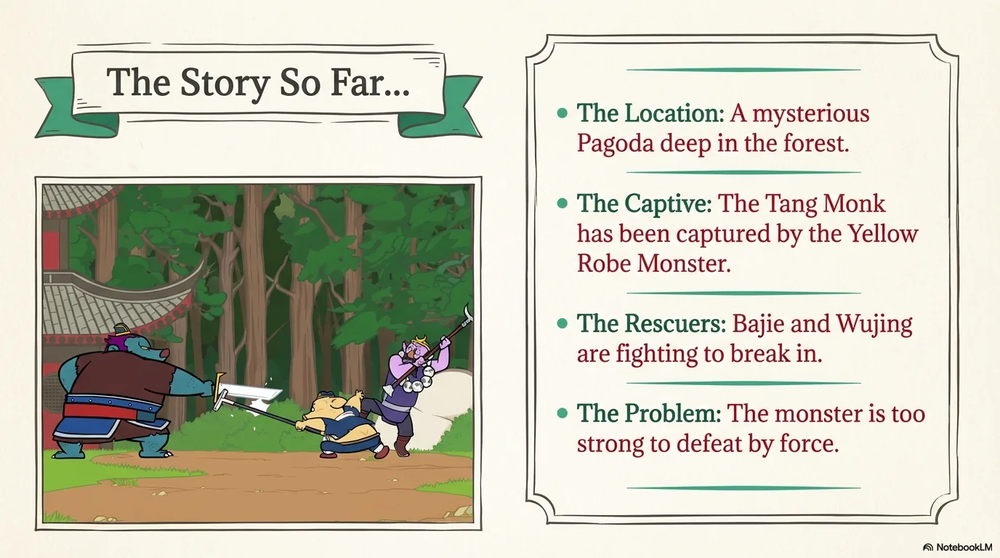

- 来源：`ppt/media/image3.png`（relationship `rId2`）
- 尺寸：1376×768
- 源 SHA-256：`5250b705d2003ac4627115b3e41a667f6cbbbb85e4f5ab9362c120595aea3508`
- 输出 SHA-256：`ed3f8853aeae5029e9eb6e2da14222dcf7e318ab844248b6bafbdface7527a08`
- 分类：unknown ｜ OCR：blocked ｜ 审核：unreviewed

## Slide 003

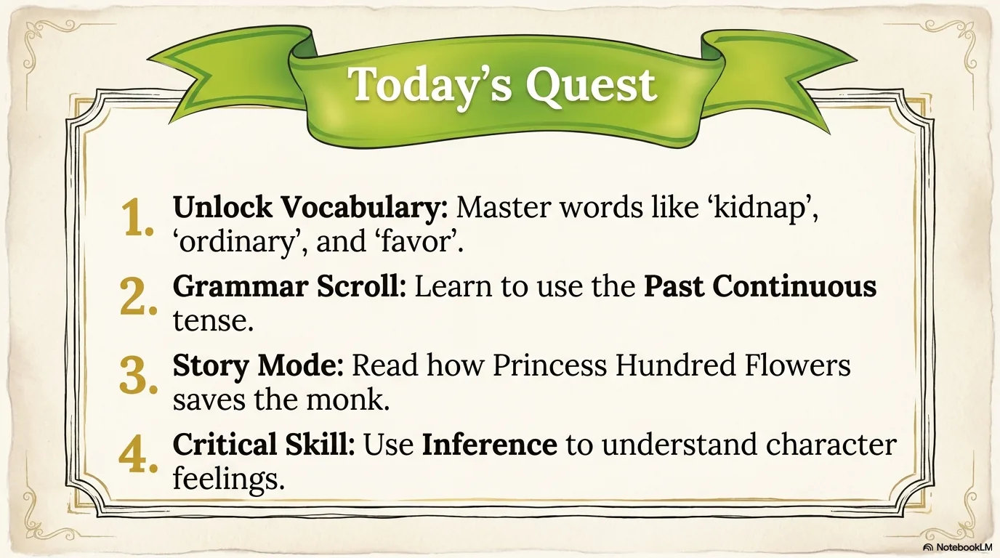

- 来源：`ppt/media/image4.png`（relationship `rId2`）
- 尺寸：1376×768
- 源 SHA-256：`6a23210109a5b5c63c394fbfbe645e006cb6375b362c211055c8fb02baf5c7e6`
- 输出 SHA-256：`67db5d6f142624925417426e14727871b1705f0354e065c248bfcc0dd24e4b34`
- 分类：unknown ｜ OCR：blocked ｜ 审核：unreviewed

## Slide 004

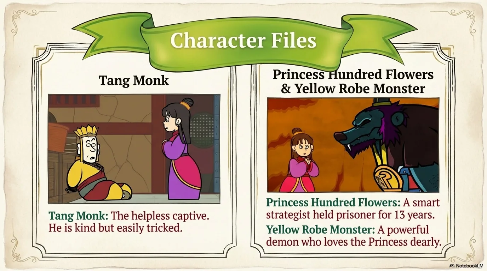

- 来源：`ppt/media/image5.png`（relationship `rId2`）
- 尺寸：1376×768
- 源 SHA-256：`a0f64ed925d15a51b9c7b4c5f3d8f17c3abcce6d0802f40462f4e2aff00558b8`
- 输出 SHA-256：`9143eab120d876426011b8adb1bd62004ad4366cba55f97a4105c9bab22b7464`
- 分类：unknown ｜ OCR：blocked ｜ 审核：unreviewed

## Slide 005

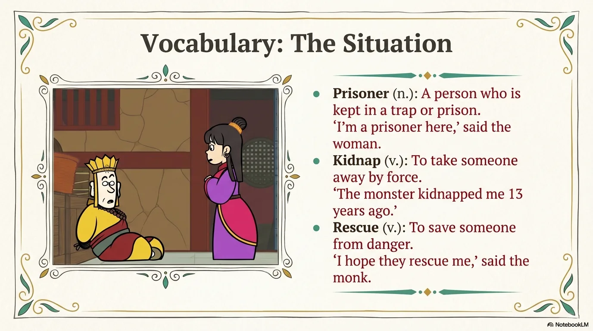

- 来源：`ppt/media/image6.png`（relationship `rId2`）
- 尺寸：1376×768
- 源 SHA-256：`e0c67e11c583ef412a8868ade82fa0e9d678a05219b3ee957ae9721dcc8b5afe`
- 输出 SHA-256：`5ecf6533c02d50246a22814a247ce41a3c7bf05007f0633e8e39ecaed9b83690`
- 分类：unknown ｜ OCR：blocked ｜ 审核：unreviewed

## Slide 006

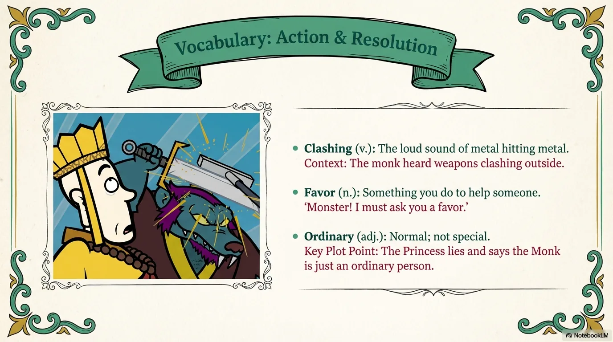

- 来源：`ppt/media/image7.png`（relationship `rId2`）
- 尺寸：1376×768
- 源 SHA-256：`588753328917d64b46695e008cf313cea81ff8c7727a6628e9498fa4148396f3`
- 输出 SHA-256：`32b8007ba69076578395d42004281a3a66f7c3dcdbe8d5f4a3613987230142e1`
- 分类：unknown ｜ OCR：blocked ｜ 审核：unreviewed

## Slide 007

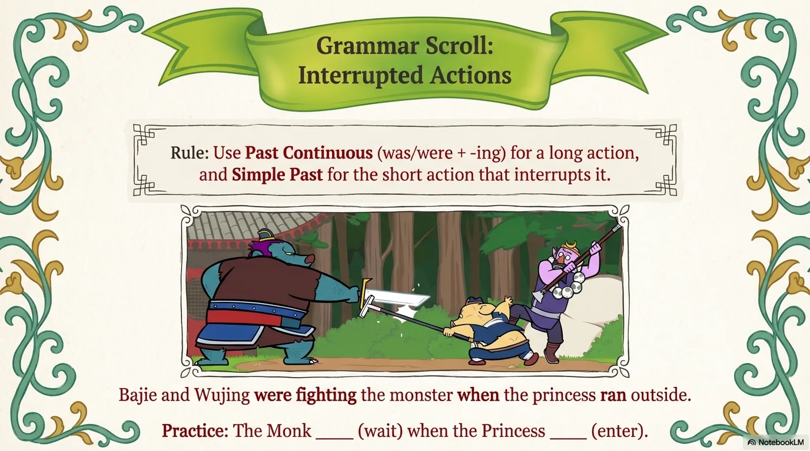

- 来源：`ppt/media/image8.png`（relationship `rId2`）
- 尺寸：1376×768
- 源 SHA-256：`40e1c8206c3dd8cc307025033da7dd1744147c05e280953666d762499f8fa144`
- 输出 SHA-256：`4d9c9208741e9d222a63328e2b05d0a9ba01cfa7404557c84f2cc4c59d162744`
- 分类：unknown ｜ OCR：blocked ｜ 审核：unreviewed

## Slide 008

- 来源：`ppt/media/image9.png`（relationship `rId2`）
- 尺寸：1376×768
- 源 SHA-256：`0a62ee6ee02a021ad73de9cdffc595ee7c81127a1f140274272fbf4dcb2258fa`
- 输出 SHA-256：`c3c94e141fbed834236612264127a467698bcd60880be96341d45803731f7742`
- 分类：unknown ｜ OCR：blocked ｜ 审核：unreviewed

## Slide 009

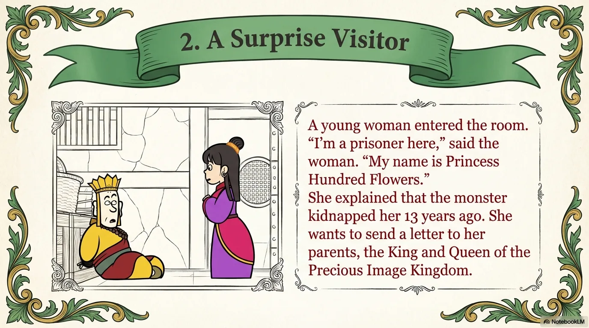

- 来源：`ppt/media/image10.png`（relationship `rId2`）
- 尺寸：1376×768
- 源 SHA-256：`63eb8f68e02c514a46558de23bca96f0e04ca9a3223e05fe618e56156eaf16b4`
- 输出 SHA-256：`a652e47cb061d5b300c0e8f58d37b69dd89a43fca6e5f2413f99408d0289237e`
- 分类：unknown ｜ OCR：blocked ｜ 审核：unreviewed

## Slide 010

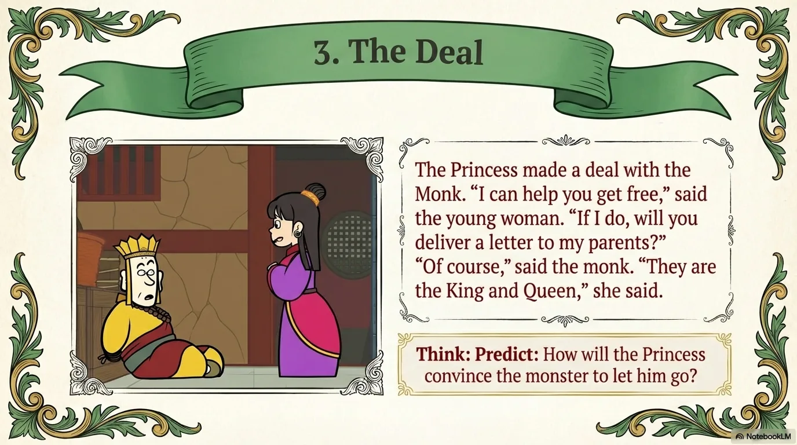

- 来源：`ppt/media/image11.png`（relationship `rId2`）
- 尺寸：1376×768
- 源 SHA-256：`b15cc83ed2a49668ec3b1ead7e70586b25d6cc9f0df6533344111ec1b33828e3`
- 输出 SHA-256：`95e20b831943a65795cc1f709331c343446848736121ecd9726066260ba3c08f`
- 分类：unknown ｜ OCR：blocked ｜ 审核：unreviewed

## Slide 011

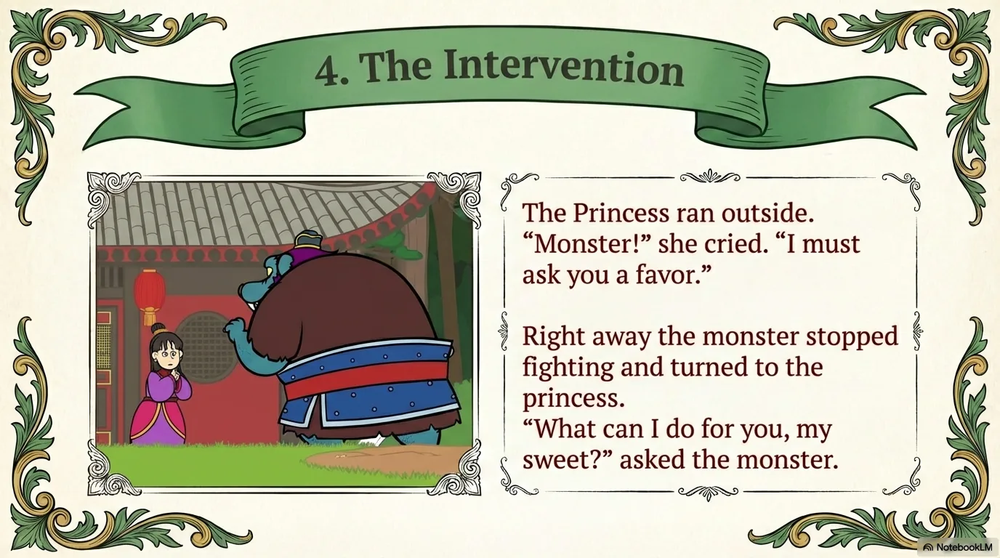

- 来源：`ppt/media/image12.png`（relationship `rId2`）
- 尺寸：1376×768
- 源 SHA-256：`e2e5e260675c0429a165f188141b226d1422a0b8f41794dcee188e69a517e2fa`
- 输出 SHA-256：`a40b87b83bc818cc4acfb15ef9c290e21a54bf4537d80fb012ee7a3b8f3c1a38`
- 分类：unknown ｜ OCR：blocked ｜ 审核：unreviewed

## Slide 012

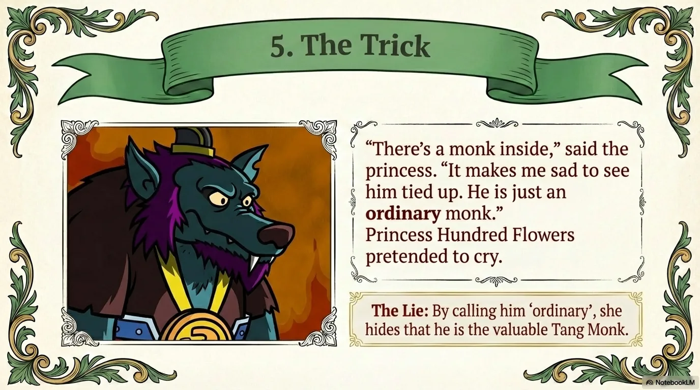

- 来源：`ppt/media/image13.png`（relationship `rId2`）
- 尺寸：1376×768
- 源 SHA-256：`74479abdadfbb462f1bd253f93c8fbf177066213234ee18e572fb5216de741a8`
- 输出 SHA-256：`acd1d099e99a4ff6d826d8de067e133bf5e5e8e1edf4a25c0087dd7619797e9d`
- 分类：unknown ｜ OCR：blocked ｜ 审核：unreviewed

## Slide 013

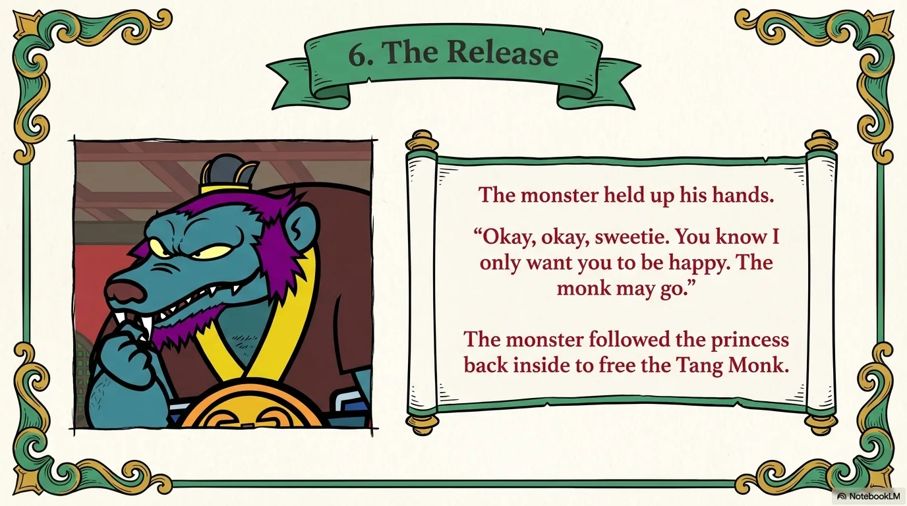

- 来源：`ppt/media/image14.png`（relationship `rId2`）
- 尺寸：1376×768
- 源 SHA-256：`c93b37e9566cb69571fce77c253eb979288695e692298d81559b023279bcc67d`
- 输出 SHA-256：`1cac701766f9ab2a06570f075aa12fcbc978d901aa3dc7efdf0ba70a89983c44`
- 分类：unknown ｜ OCR：blocked ｜ 审核：unreviewed

## Slide 014

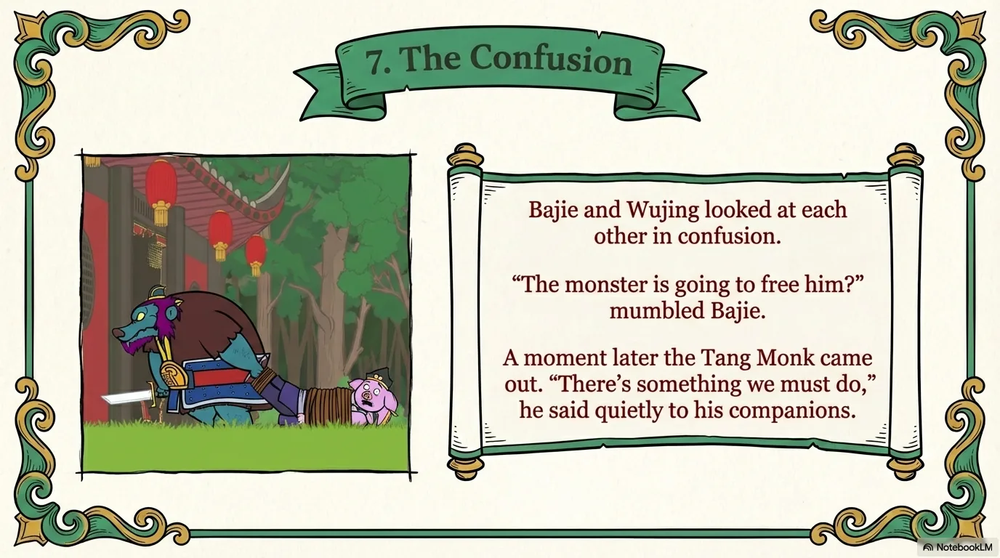

- 来源：`ppt/media/image15.png`（relationship `rId2`）
- 尺寸：1376×768
- 源 SHA-256：`ebaec8fdf332c219f2bce04f786f3842de5973930b51ef8e5bb7a3466cfd4b52`
- 输出 SHA-256：`b08508cb2cb4780a610e6e266f4de672999849e14d1d9942e64cf323a70f3d05`
- 分类：unknown ｜ OCR：blocked ｜ 审核：unreviewed

## Slide 015

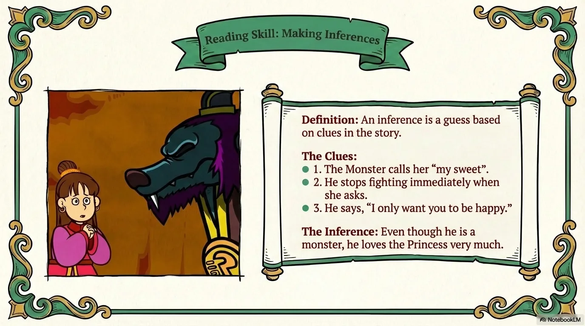

- 来源：`ppt/media/image16.png`（relationship `rId2`）
- 尺寸：1376×768
- 源 SHA-256：`16853f2c1baaf21b70d291599f1de355d7080d6b827ba7722d75a5fb57840e59`
- 输出 SHA-256：`780ef3432ed9e2591beb8a48998a3c0d290c959eab552f7d4948d1a2f4094eb6`
- 分类：unknown ｜ OCR：blocked ｜ 审核：unreviewed

## Slide 016

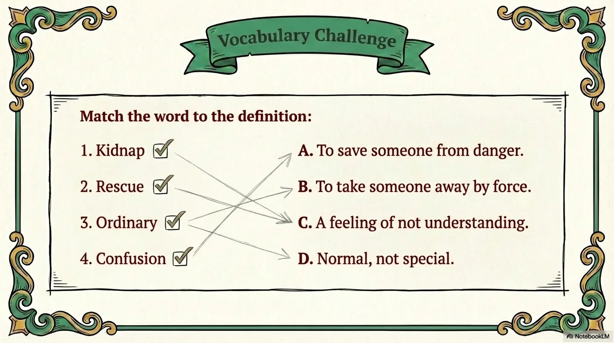

- 来源：`ppt/media/image17.png`（relationship `rId2`）
- 尺寸：1376×768
- 源 SHA-256：`c67b02f8e011e43c378d9820d6849e077b38c54138d1e872445ff61f4767865d`
- 输出 SHA-256：`76ed36bc85f6c5e62cf4e886a7307719f043ec84450f6aa5c42cfc01d1c9c92b`
- 分类：unknown ｜ OCR：blocked ｜ 审核：unreviewed

## Slide 017

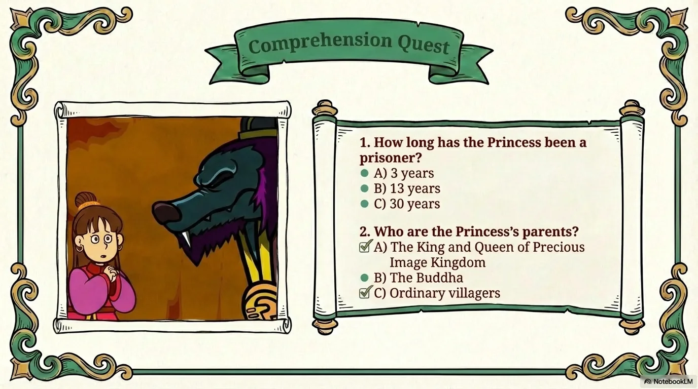

- 来源：`ppt/media/image18.png`（relationship `rId2`）
- 尺寸：1376×768
- 源 SHA-256：`b8f62d6c1ad4faba728fa0344152d13b6da2ecb4bfbc2e6f39ed84a848deaad0`
- 输出 SHA-256：`53c839b20d311e508646fe5e5d89e92814d0c8624177ecadb813092ee42a7bc7`
- 分类：unknown ｜ OCR：blocked ｜ 审核：unreviewed

## Slide 018

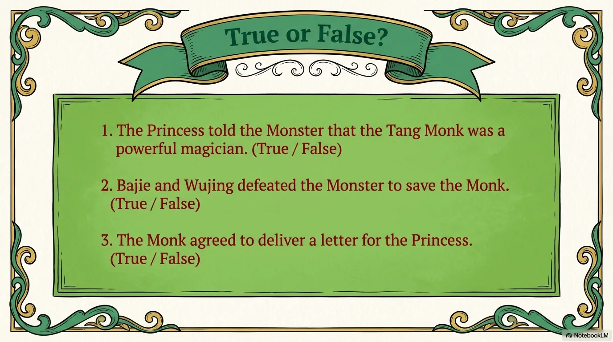

- 来源：`ppt/media/image19.png`（relationship `rId2`）
- 尺寸：1376×768
- 源 SHA-256：`2e56213a4f9716129e93b77e782a0338caad7e4400a8b6fd7b2c1f38fbb1590d`
- 输出 SHA-256：`1fa146910d1777cae3e76d23d76bf6d2d8c0e3976223f773188c0a97a1f19e17`
- 分类：unknown ｜ OCR：blocked ｜ 审核：unreviewed

## Slide 019

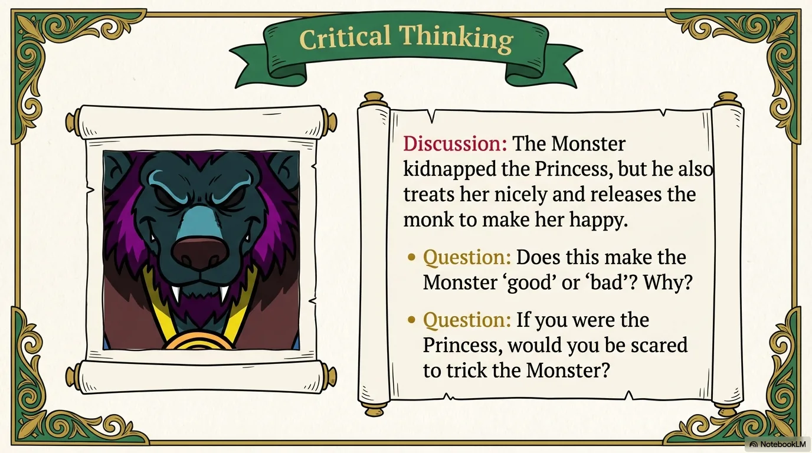

- 来源：`ppt/media/image20.png`（relationship `rId2`）
- 尺寸：1376×768
- 源 SHA-256：`10521362189fc7d1d2140b41dabf4de929593bbd8f369d8d70dc8ae5329111fa`
- 输出 SHA-256：`7db3a2223856f09d033da1a8c85c98e67cb5221caa20f346a46cb99626e7ca07`
- 分类：unknown ｜ OCR：blocked ｜ 审核：unreviewed

## Slide 020

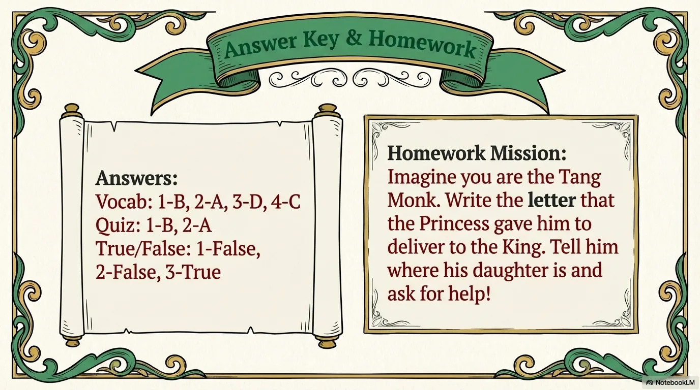

- 来源：`ppt/media/image21.png`（relationship `rId2`）
- 尺寸：1376×768
- 源 SHA-256：`c14007c151c802c24897f3abe83363bbcadd760ffc9041b608b54a52a02a972d`
- 输出 SHA-256：`7530d138f553e1c26d7ba7dadd711ff63d17f3c4c726782ed0b6fcdf9ad0b974`
- 分类：unknown ｜ OCR：blocked ｜ 审核：unreviewed
