# 豆豆龙英语 · 第 35 集课件（EP035 草稿）

- 来源：`035_Journey to the West 35_A Visit to the King.pptx`（主课件，15 页）
- OCR：`blocked`（no local OCR provider importable (pytesseract missing): No module named 'pytesseract'）
- 分类：待人工审核（unknown）
- 审核状态：`unreviewed`

## Slide 001

- 来源：`ppt/media/image1.png`（relationship `rId2`）
- 尺寸：1376×768
- 源 SHA-256：`66781a23145fba21e34c4f6aeda4a937d6a072d953b28d21c164c4931422336a`
- 输出 SHA-256：`23968ac7dd66e57ce8a1256ba619cd4a60176ec1f27849b251253a96caccc79b`
- 分类：unknown ｜ OCR：blocked ｜ 审核：unreviewed

## Slide 002

- 来源：`ppt/media/image3.png`（relationship `rId2`）
- 尺寸：1376×768
- 源 SHA-256：`235758301ff45d3559f7480a25423de5304ef5db2b403db4c865e34c33e699b9`
- 输出 SHA-256：`872744b544971a110c2f68b2171cffcd7ee18a69370e373707731dcc7ae72579`
- 分类：unknown ｜ OCR：blocked ｜ 审核：unreviewed

## Slide 003

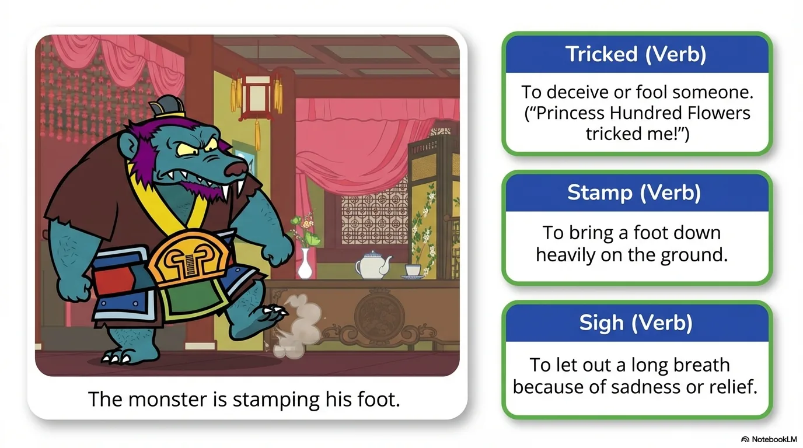

- 来源：`ppt/media/image4.png`（relationship `rId2`）
- 尺寸：1376×768
- 源 SHA-256：`c9195fa39c0ac3a0c4328bbc4815972ccdc417a78a5d29f3e3f323e14a846dcc`
- 输出 SHA-256：`24baf6a50ed4e30e30ff34484b48f89ffe2469cb1aedd8781471430c29ff635d`
- 分类：unknown ｜ OCR：blocked ｜ 审核：unreviewed

## Slide 004

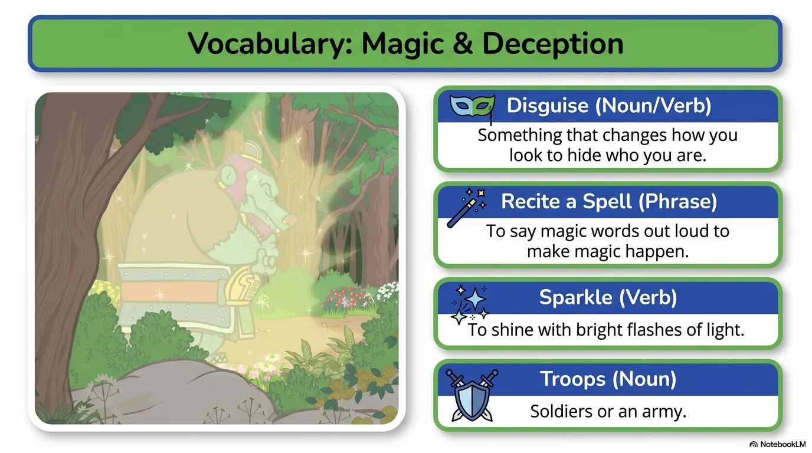

- 来源：`ppt/media/image5.png`（relationship `rId2`）
- 尺寸：1376×768
- 源 SHA-256：`266a5b0daf1763df661a2c0d578d9e7d4a10316b53bf0074420ee49dd7d46516`
- 输出 SHA-256：`ec36ca1b7a0ad2c037507efa95c36927a8ffb2b4b392b3a4dcf2079cfc6bba8a`
- 分类：unknown ｜ OCR：blocked ｜ 审核：unreviewed

## Slide 005

- 来源：`ppt/media/image6.png`（relationship `rId2`）
- 尺寸：1376×768
- 源 SHA-256：`0f75abed1a8c627c88fecd16b3c0639d45cb3c919b13139e0b832330c57b6343`
- 输出 SHA-256：`2d4b41f9b447f20f93ebcaf8129d5fd05ed47933d90de28f7800875cf98670a3`
- 分类：unknown ｜ OCR：blocked ｜ 审核：unreviewed

## Slide 006

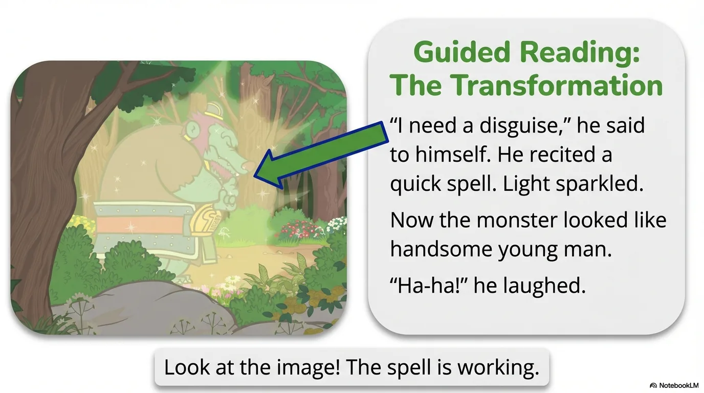

- 来源：`ppt/media/image7.png`（relationship `rId2`）
- 尺寸：1376×768
- 源 SHA-256：`cccd275db2418845615566b6ed17870b18ecd6ad9e3e85ad046ee7e42d6153cd`
- 输出 SHA-256：`3a22be676620a22c960ad91f3c5bd2c6943a3e5b4a2f0c14b03f630113235e9d`
- 分类：unknown ｜ OCR：blocked ｜ 审核：unreviewed

## Slide 007

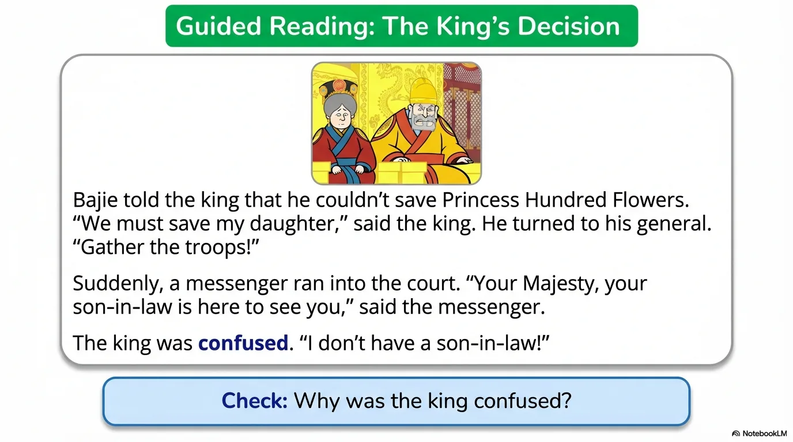

- 来源：`ppt/media/image8.png`（relationship `rId2`）
- 尺寸：1376×768
- 源 SHA-256：`8a02e4eb1d28a5bfd55a51e62bb5310af04f1e50072240e7eb76052c3ddc9ba3`
- 输出 SHA-256：`10c09e22e8a0fb936058b04828158e672199276b5b9581bcdb10ce063cdd83b3`
- 分类：unknown ｜ OCR：blocked ｜ 审核：unreviewed

## Slide 008

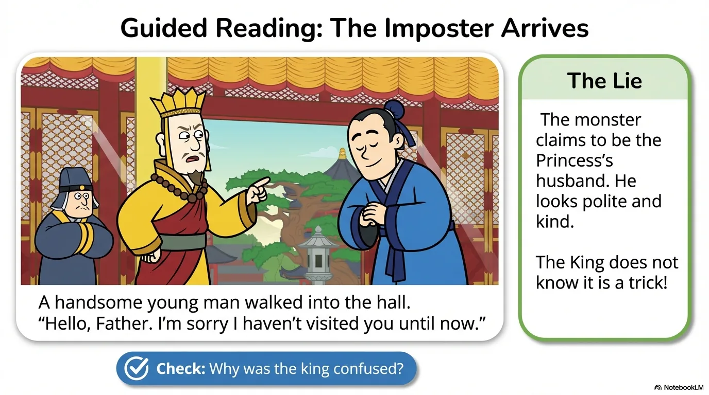

- 来源：`ppt/media/image9.png`（relationship `rId2`）
- 尺寸：1376×768
- 源 SHA-256：`79117f67262a7ba0f44266920093b224eb062a1dff9806f277052adf234952a0`
- 输出 SHA-256：`10e5a02a996b496728741af17fc73222d7021de15ffe94e7b2ebfee4a9a04f33`
- 分类：unknown ｜ OCR：blocked ｜ 审核：unreviewed

## Slide 009

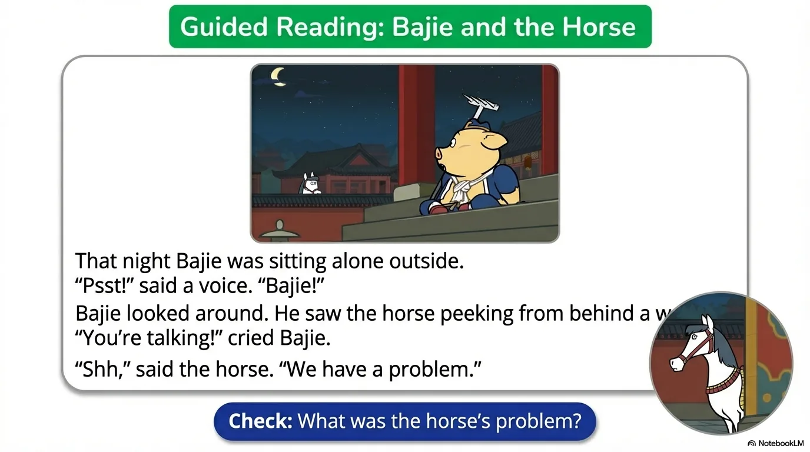

- 来源：`ppt/media/image10.png`（relationship `rId2`）
- 尺寸：1376×768
- 源 SHA-256：`9d43a930c76638008f71feb8a9eee5212b0a3270caf17e4e1de28ad5172cc0d1`
- 输出 SHA-256：`f851288363aadfed2a09e52a0efeec9475a143ab04288b774b2ab19cb765608b`
- 分类：unknown ｜ OCR：blocked ｜ 审核：unreviewed

## Slide 010

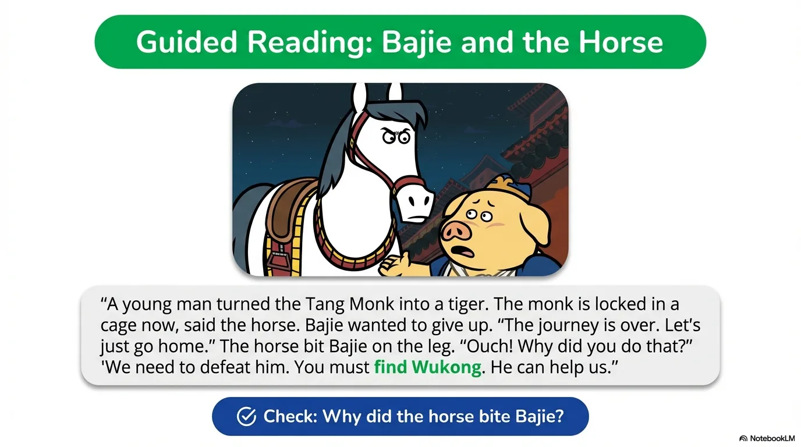

- 来源：`ppt/media/image11.png`（relationship `rId2`）
- 尺寸：1376×768
- 源 SHA-256：`9634e39b475c1ffbca45900f480f412f8c69891d61cd7acee72f8e4e1969a58c`
- 输出 SHA-256：`81eafba4726e446fdff43273c503150ecc2c4b2d7fe155709290676a92461e2f`
- 分类：unknown ｜ OCR：blocked ｜ 审核：unreviewed

## Slide 011

- 来源：`ppt/media/image12.png`（relationship `rId2`）
- 尺寸：1376×768
- 源 SHA-256：`b181475dce6f3442d5b75b3ac63dbf94a2ccd3cf97cd9122758d8d234c32bb1b`
- 输出 SHA-256：`a19da62724dbdb197a53287ec2e3344fb3304b833da8fc2c8fdf011566cdd4cc`
- 分类：unknown ｜ OCR：blocked ｜ 审核：unreviewed

## Slide 012

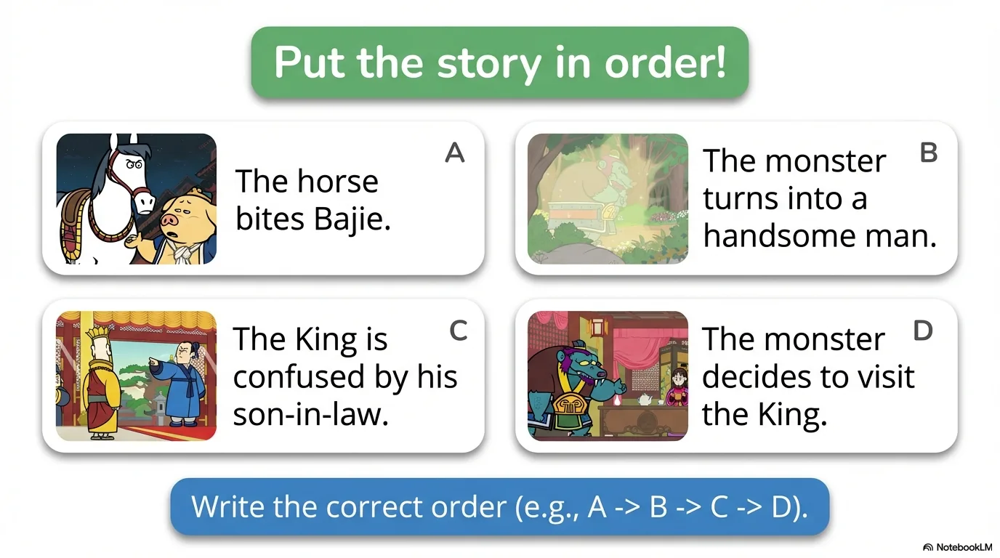

- 来源：`ppt/media/image13.png`（relationship `rId2`）
- 尺寸：1376×768
- 源 SHA-256：`2548232fefde484f94486ad921dfa882dc0cfaa06f032dbf54e20f0a25901311`
- 输出 SHA-256：`bdfeae89ed7456d3b0b3c1c58330f81e50be19f5d12d050afedb52733e232c2e`
- 分类：unknown ｜ OCR：blocked ｜ 审核：unreviewed

## Slide 013

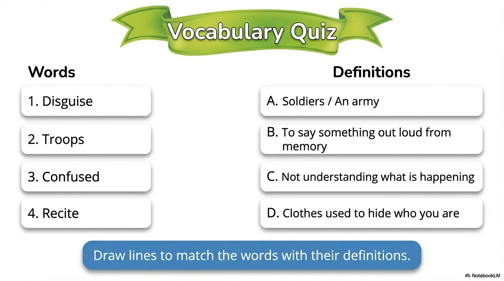

- 来源：`ppt/media/image14.png`（relationship `rId2`）
- 尺寸：1376×768
- 源 SHA-256：`5fd64471a79808042f684d39bf74c33ecbfffdfa21b67c06eb3605636ddbfdcb`
- 输出 SHA-256：`e6ac2d090b5ccfa482c3780d0d5d20247d6188f0d08a6bdba7c420eed87d6c16`
- 分类：unknown ｜ OCR：blocked ｜ 审核：unreviewed

## Slide 014

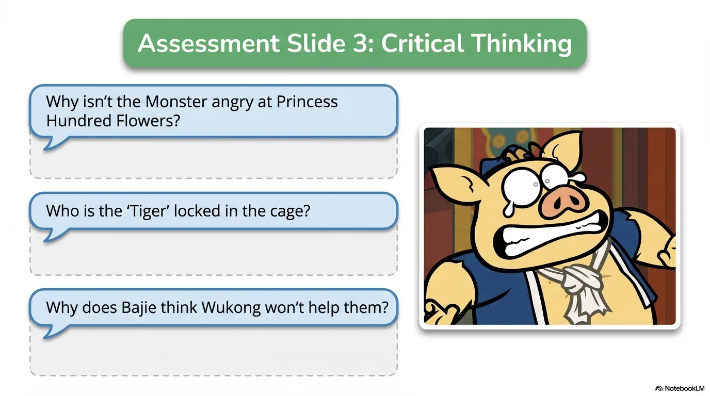

- 来源：`ppt/media/image15.png`（relationship `rId2`）
- 尺寸：1376×768
- 源 SHA-256：`3a92c0ea703d2b49de5802f81b64e3b82924d5550a3716ca591e1f4404a37b01`
- 输出 SHA-256：`db0825febf9a053f1e3b289ebe4bdc6bd97cfb09f9de1df9201fc15fc50303e3`
- 分类：unknown ｜ OCR：blocked ｜ 审核：unreviewed

## Slide 015

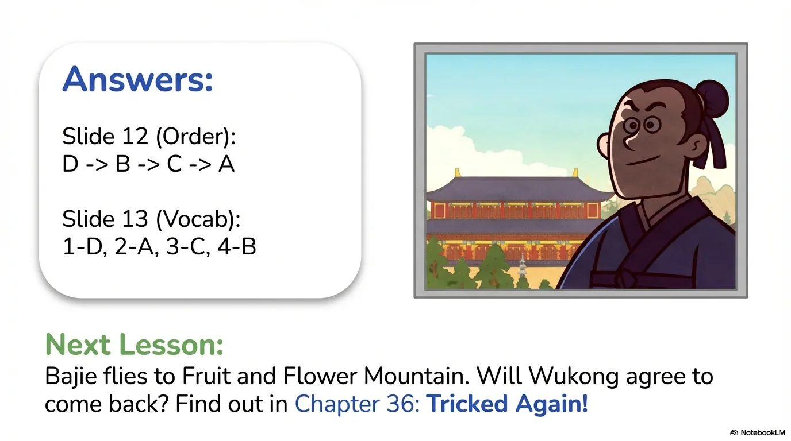

- 来源：`ppt/media/image16.png`（relationship `rId2`）
- 尺寸：1376×768
- 源 SHA-256：`176d192e4c8551dc75bad1252408f5994ff50281f5da049c5f3e6878f7cbabb5`
- 输出 SHA-256：`1909c9e9513b600f9dd31b33085c384d42d1d1b1ea815d140914f47d757f7979`
- 分类：unknown ｜ OCR：blocked ｜ 审核：unreviewed
