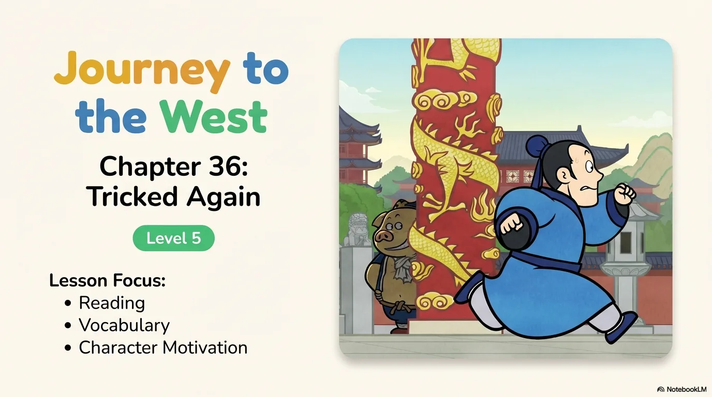
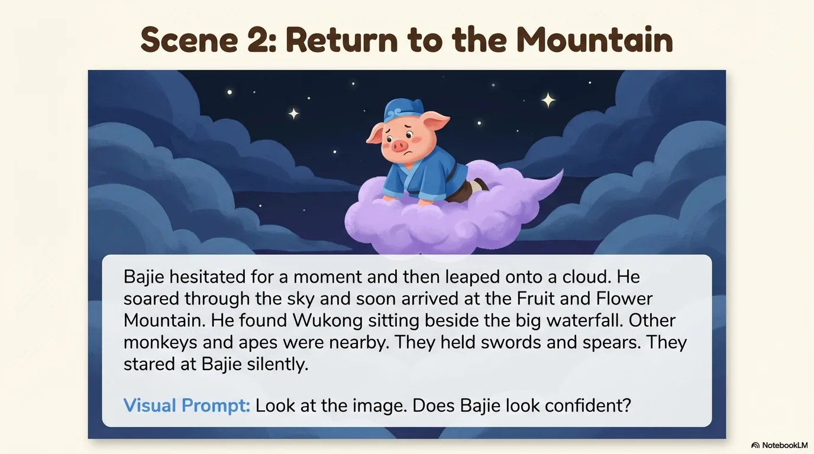
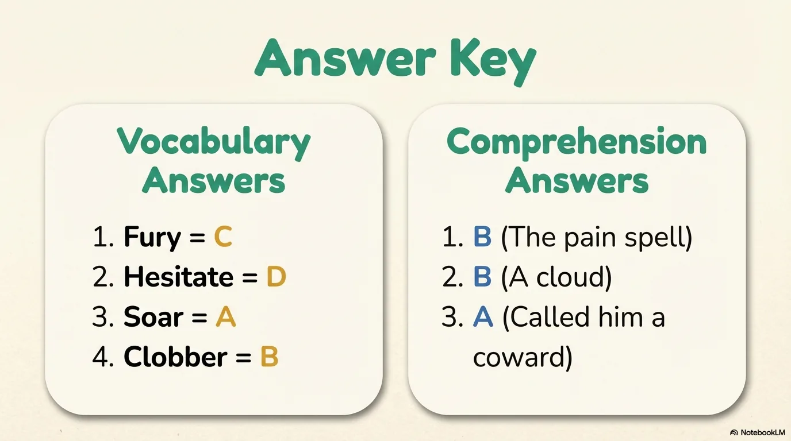

# 豆豆龙英语 · 第 36 集课件（EP036 草稿）

- 来源：`036_Journey to the West 36_Tricked Again.pptx`（主课件，20 页）
- OCR：`blocked`（no local OCR provider importable (pytesseract missing): No module named 'pytesseract'）
- 分类：待人工审核（unknown）
- 审核状态：`unreviewed`

## Slide 001

- 来源：`ppt/media/image1.png`（relationship `rId2`）
- 尺寸：1376×768
- 源 SHA-256：`398bd0b7848040f119ebc704cddef9cd12370d66cd844c73d701512ce9ef5248`
- 输出 SHA-256：`24d6c89edc0ad416c8f11531928281d120385f5f33c6314ec159815800c8f5d4`
- 分类：unknown ｜ OCR：blocked ｜ 审核：unreviewed

## Slide 002

- 来源：`ppt/media/image3.png`（relationship `rId2`）
- 尺寸：1376×768
- 源 SHA-256：`71d11219601b7812a043b16c99c3140f3c8c49c96ce8f886e55fd5c758ba678c`
- 输出 SHA-256：`7787662755c36facc0733842a1f5c5150c29ce59fec3af3bcfaa0f9dcdac646f`
- 分类：unknown ｜ OCR：blocked ｜ 审核：unreviewed

## Slide 003

- 来源：`ppt/media/image4.png`（relationship `rId2`）
- 尺寸：1376×768
- 源 SHA-256：`25fb8bb0f4b281fd78c8fe6ac79096bd9ecbd0f6fcefb8c0e682cdd9485bc2ed`
- 输出 SHA-256：`b8afaf166a8071c8625ff060702b032038c7b9f470ac90616dc48d736326c027`
- 分类：unknown ｜ OCR：blocked ｜ 审核：unreviewed

## Slide 004

- 来源：`ppt/media/image5.png`（relationship `rId2`）
- 尺寸：1376×768
- 源 SHA-256：`7b2390b20453aea369a3545783cd95a761023637a681ed643320b4b33c5af1d0`
- 输出 SHA-256：`8ac419dcb0eacc6cd4144a8ca5513c4e934ba89398d552503dc2fdea310da2ea`
- 分类：unknown ｜ OCR：blocked ｜ 审核：unreviewed

## Slide 005

- 来源：`ppt/media/image6.png`（relationship `rId2`）
- 尺寸：1376×768
- 源 SHA-256：`13bcd2b4a960f5ca7cb4277ab7096753d01f483859149c6e7f848c909115f64c`
- 输出 SHA-256：`2a14ad5088818515e0e2902fca3f0580f7e4ad900b3fc160eeb7f0d08bbe6732`
- 分类：unknown ｜ OCR：blocked ｜ 审核：unreviewed

## Slide 006

- 来源：`ppt/media/image7.png`（relationship `rId2`）
- 尺寸：1376×768
- 源 SHA-256：`f295cfc85e0398071327451a561aa52f3394958812945d457cb55671d8958c12`
- 输出 SHA-256：`a1e7db25838c6ff6a98d9f9ce9cb9549df5c930da01f0fd67d8a6eec968fe4b4`
- 分类：unknown ｜ OCR：blocked ｜ 审核：unreviewed

## Slide 007

- 来源：`ppt/media/image8.png`（relationship `rId2`）
- 尺寸：1376×768
- 源 SHA-256：`4d860bf2c938e114fd4d3035ccfd21e7ed565e634384b2e536df11db68f07d4a`
- 输出 SHA-256：`3f2e49ef12049eb76ee6b6a2e653c2f9b8daca5a026d37fe3a7fe2f03c33fe79`
- 分类：unknown ｜ OCR：blocked ｜ 审核：unreviewed

## Slide 008

- 来源：`ppt/media/image9.png`（relationship `rId2`）
- 尺寸：1376×768
- 源 SHA-256：`255f2d7668afa0d5d73ca421dfc337250a5394523aced8a822c0c06a20a3ec50`
- 输出 SHA-256：`e733d0c4153f2b5b0ee363bb9d1728f99b1eadf61f544a94b5a1c6acc9aaaf9d`
- 分类：unknown ｜ OCR：blocked ｜ 审核：unreviewed

## Slide 009

- 来源：`ppt/media/image10.png`（relationship `rId2`）
- 尺寸：1376×768
- 源 SHA-256：`4f6c6a95caed139b56e5cc81c56801bc0620320a3c257347eaed370f25fb1a73`
- 输出 SHA-256：`5e6f2914534f74397045ef83b0de53d746b3d854ee77215612d3dfadf2239850`
- 分类：unknown ｜ OCR：blocked ｜ 审核：unreviewed

## Slide 010

- 来源：`ppt/media/image11.png`（relationship `rId2`）
- 尺寸：1376×768
- 源 SHA-256：`983d27e2db1843d7cc2176317249e3e0db3160f26a4d7079a0109d51430d2dbe`
- 输出 SHA-256：`344c75225a02b2a58c4e172a72bc7eace40047458540d928f47f3f75d5a8a076`
- 分类：unknown ｜ OCR：blocked ｜ 审核：unreviewed

## Slide 011

- 来源：`ppt/media/image12.png`（relationship `rId2`）
- 尺寸：1376×768
- 源 SHA-256：`2c9de517596999d6595d33df922a7e975a0e24d3544cfc34a2e7a8db5766c271`
- 输出 SHA-256：`29360dfd7371d3cbdef5b0876e61f7a6c267b488bee10f5ae2edc0db7044d8bd`
- 分类：unknown ｜ OCR：blocked ｜ 审核：unreviewed

## Slide 012

- 来源：`ppt/media/image13.png`（relationship `rId2`）
- 尺寸：1376×768
- 源 SHA-256：`cf8c69a012b1137acd7ee56db29737c156c9545bf017b10c425e76e748da7e6b`
- 输出 SHA-256：`1e21ead0d603f452b30b00c8ea806b9233183ec4d200397f3d41d824e126c162`
- 分类：unknown ｜ OCR：blocked ｜ 审核：unreviewed

## Slide 013

- 来源：`ppt/media/image14.png`（relationship `rId2`）
- 尺寸：1376×768
- 源 SHA-256：`d2164f2d5f36996aa972167fa80adc79bd6ec97007f3fe9ad55f82cb319130e0`
- 输出 SHA-256：`2ddb3a7050a545460e595f7fb789abd967234cf9128f63cd60f7e0678969b6a9`
- 分类：unknown ｜ OCR：blocked ｜ 审核：unreviewed

## Slide 014

- 来源：`ppt/media/image15.png`（relationship `rId2`）
- 尺寸：1376×768
- 源 SHA-256：`f02a7a7da0e36653fb0b717ae9712b344818c31acb43cca697154743291d867f`
- 输出 SHA-256：`604fbe8c20330325c37b424ce082957f6af4fb169bef42b5bc02980046d4a168`
- 分类：unknown ｜ OCR：blocked ｜ 审核：unreviewed

## Slide 015

- 来源：`ppt/media/image16.png`（relationship `rId2`）
- 尺寸：1376×768
- 源 SHA-256：`ec6e6c3a92c3c8be726769565c26b7da2788c72023838db7505a0fd28b1146be`
- 输出 SHA-256：`397873002bf3716635d46baf5b327720d98a346f02f0da153562ef5e5bebfae9`
- 分类：unknown ｜ OCR：blocked ｜ 审核：unreviewed

## Slide 016

- 来源：`ppt/media/image17.png`（relationship `rId2`）
- 尺寸：1376×768
- 源 SHA-256：`76703600133a147021c08637d700c4e94f2ea667a08a33f05f259678c741f0c0`
- 输出 SHA-256：`e86bcd454c79d9f00167e65cf8456428b5ddd6d408ded31f25d04bb48358e4f1`
- 分类：unknown ｜ OCR：blocked ｜ 审核：unreviewed

## Slide 017

- 来源：`ppt/media/image18.png`（relationship `rId2`）
- 尺寸：1376×768
- 源 SHA-256：`a7141d3d9e01cea5833da4a506caf7d38a47783e1180f89f6035b04884f5f4d8`
- 输出 SHA-256：`a1f319b23d3c8fd2bf45cb15696dd26c5f38c3477e4da826d6ef35b19e2a116a`
- 分类：unknown ｜ OCR：blocked ｜ 审核：unreviewed

## Slide 018

- 来源：`ppt/media/image19.png`（relationship `rId2`）
- 尺寸：1376×768
- 源 SHA-256：`2a977e2a0cf339620605d21da4f45e2c5267144d7cd8e4c6305e20fe3dcbaa8e`
- 输出 SHA-256：`557f283f2d09b49510453c2cdfb0fffc7847bd03734a3effdbc1f4eb007fa6d4`
- 分类：unknown ｜ OCR：blocked ｜ 审核：unreviewed

## Slide 019

- 来源：`ppt/media/image20.png`（relationship `rId2`）
- 尺寸：1376×768
- 源 SHA-256：`1139840f49d4857417c2707f8dde9b1b618a7ecd2e4909b34cf60c2ba008003e`
- 输出 SHA-256：`92184c89a48fb788ac805864c19231dcd4247bfb94bcd945b6338d55c1e55907`
- 分类：unknown ｜ OCR：blocked ｜ 审核：unreviewed

## Slide 020

- 来源：`ppt/media/image21.png`（relationship `rId2`）
- 尺寸：1376×768
- 源 SHA-256：`c89562789f7ce90213340563366b6f690ca0b349f5b0b8b912bb3bcfd1b6c193`
- 输出 SHA-256：`4593a5a058c78640e9bfcb8025889ea29de86bc09bf0b162b6a098e4efbf0e08`
- 分类：unknown ｜ OCR：blocked ｜ 审核：unreviewed
