# 豆豆龙英语 · 第 37 集课件（EP037 草稿）

- 来源：`037_Journey to the West 37_Missing from Heaven.pptx`（主课件，20 页）
- OCR：`blocked`（no local OCR provider importable (pytesseract missing): No module named 'pytesseract'）
- 分类：待人工审核（unknown）
- 审核状态：`unreviewed`

## Slide 001

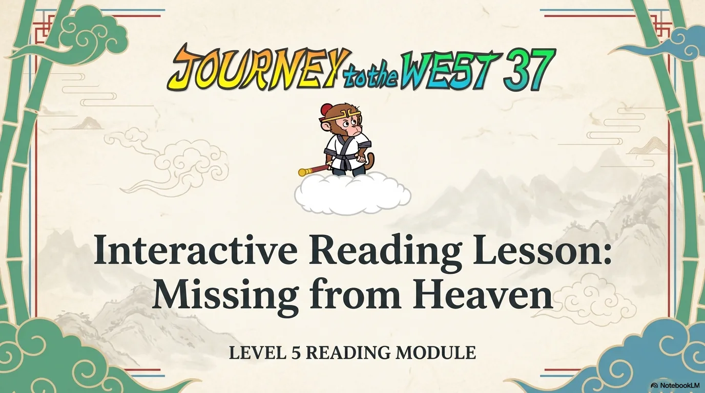

- 来源：`ppt/media/image1.png`（relationship `rId2`）
- 尺寸：1376×768
- 源 SHA-256：`ec60fa655bfb92b1fdca912b1b636e8eae378a871e29207b1e8fb7a328b8173f`
- 输出 SHA-256：`6547dbd8df557f59c4406ed99ef4b26c9b8d019eb556f2f8a3f57f8f400074a3`
- 分类：unknown ｜ OCR：blocked ｜ 审核：unreviewed

## Slide 002

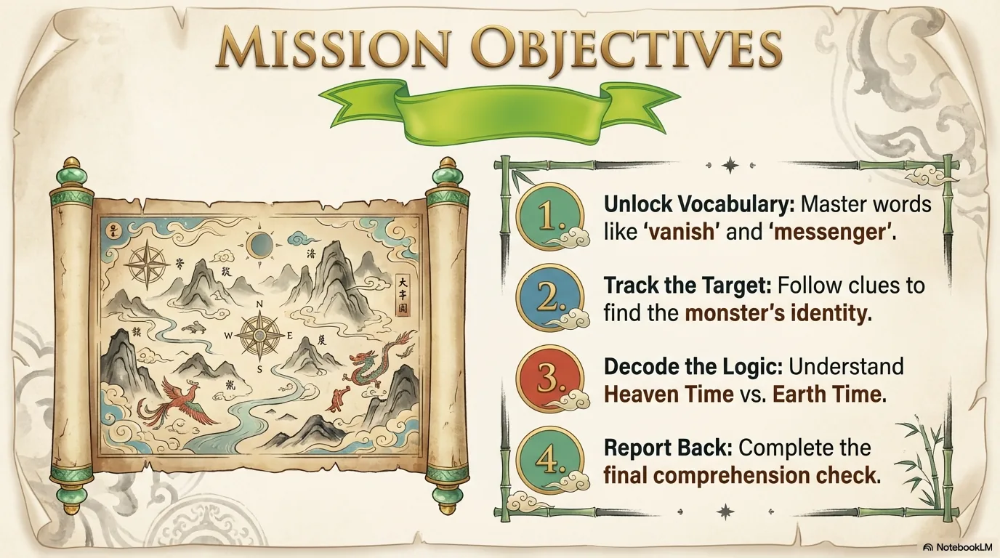

- 来源：`ppt/media/image3.png`（relationship `rId2`）
- 尺寸：1376×768
- 源 SHA-256：`07f2bc34f0e29e340a6e81bb1d6cc8e5de70c9c197786d012d9eb146e9130a55`
- 输出 SHA-256：`8825d2549d899a4e4c843dff4775ed579c678415ecda66568fdf20b7bb86f916`
- 分类：unknown ｜ OCR：blocked ｜ 审核：unreviewed

## Slide 003

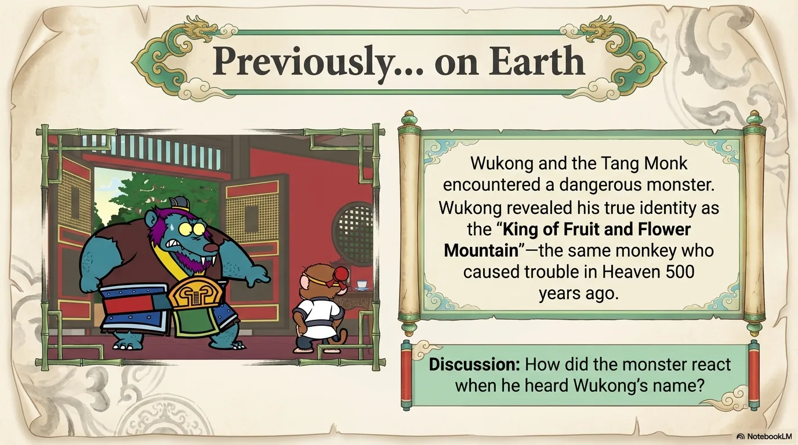

- 来源：`ppt/media/image4.png`（relationship `rId2`）
- 尺寸：1376×768
- 源 SHA-256：`f9798597f1e4873b13af7b3c6f10d7fac89c7db9103e4809e79e1ee62f914ebe`
- 输出 SHA-256：`39c5804029f3bcef7759e9a3bdcbba035a3bf0e05ede28b7900288f158f5014e`
- 分类：unknown ｜ OCR：blocked ｜ 审核：unreviewed

## Slide 004

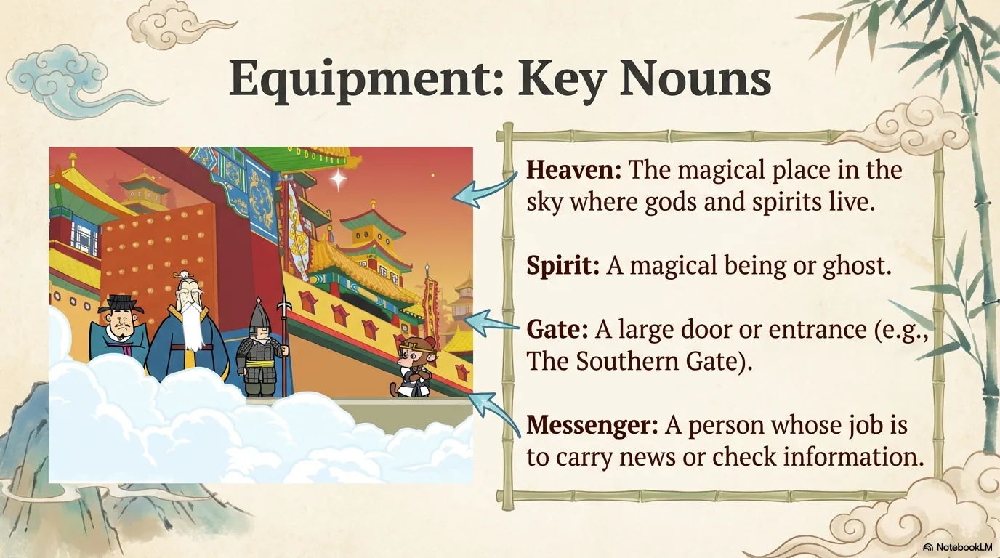

- 来源：`ppt/media/image5.png`（relationship `rId2`）
- 尺寸：1376×768
- 源 SHA-256：`0e62f0039c03f720a1c03a863fa3ce58dfddd257261534e92b71e4cc08a0c4e7`
- 输出 SHA-256：`d567570e63d843590ee3e7404cdea9cc5de0783eb1bd9ffc2e7ad1d89b2484f3`
- 分类：unknown ｜ OCR：blocked ｜ 审核：unreviewed

## Slide 005

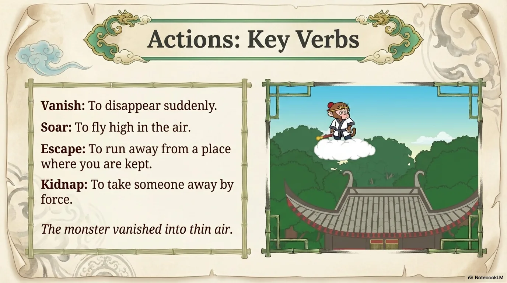

- 来源：`ppt/media/image6.png`（relationship `rId2`）
- 尺寸：1376×768
- 源 SHA-256：`b56fa4da0d22b8f67455f5a4c391720dc1ead153e658786b5472582033f88a72`
- 输出 SHA-256：`694c378a71a017ed4218059199249ec3f664fd028bab8e43361599281e0cffac`
- 分类：unknown ｜ OCR：blocked ｜ 审核：unreviewed

## Slide 006

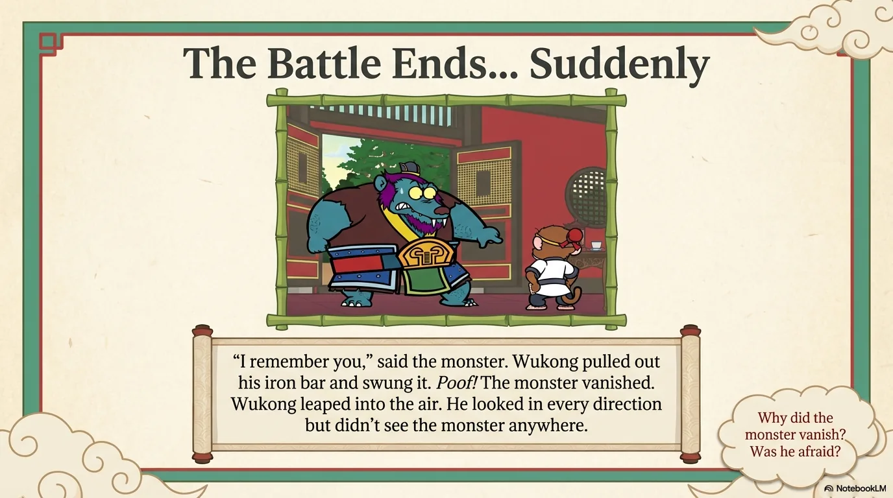

- 来源：`ppt/media/image7.png`（relationship `rId2`）
- 尺寸：1376×768
- 源 SHA-256：`76aa529481f576567992e45f707746a4c3568545c99c0e9b7b71f8715448b5b0`
- 输出 SHA-256：`388b479edbd9614b8622f25127a3eec434c0fb0477db0001717fc250dae6ce53`
- 分类：unknown ｜ OCR：blocked ｜ 审核：unreviewed

## Slide 007

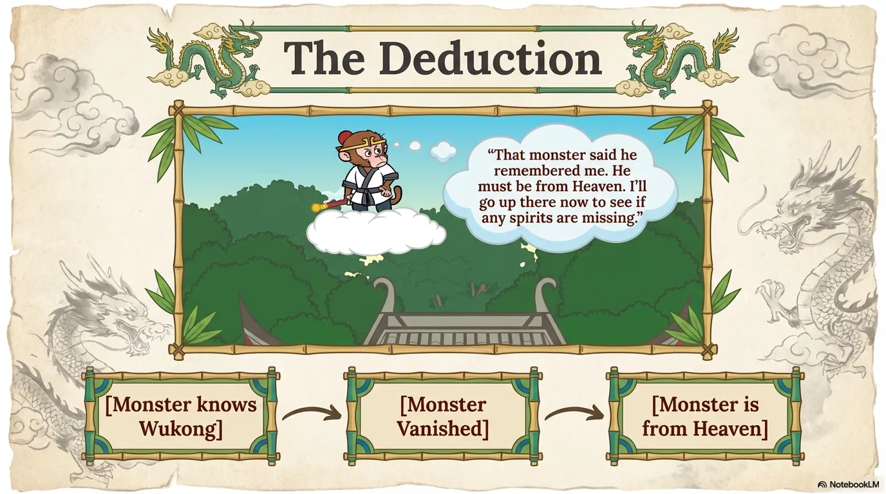

- 来源：`ppt/media/image8.png`（relationship `rId2`）
- 尺寸：1376×768
- 源 SHA-256：`162fe6e41d31c07ba56970c409e7f38fe6cb3b4c0618a4e41ab974e51a90490b`
- 输出 SHA-256：`91382f6a2cdcf6463cf8f4cce147be7addf873cc669be6bcd0d2ed91e084fc62`
- 分类：unknown ｜ OCR：blocked ｜ 审核：unreviewed

## Slide 008

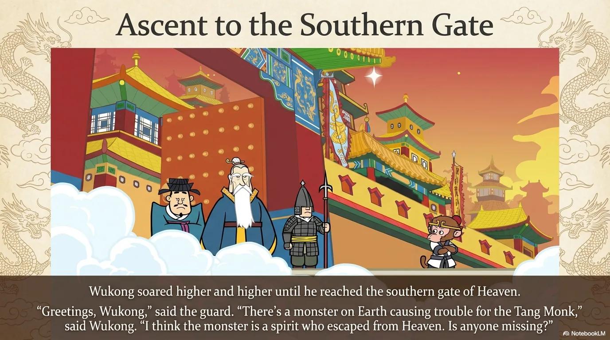

- 来源：`ppt/media/image9.png`（relationship `rId2`）
- 尺寸：1376×768
- 源 SHA-256：`42da8dd25743808bb1eedeefbac9cf4ba3e9c67edcba105060d8524fa9085541`
- 输出 SHA-256：`0f47a08aec0d07310d67d0dc1a8df06e2213bd1bf9a88cba6b3b662a1799076c`
- 分类：unknown ｜ OCR：blocked ｜ 审核：unreviewed

## Slide 009

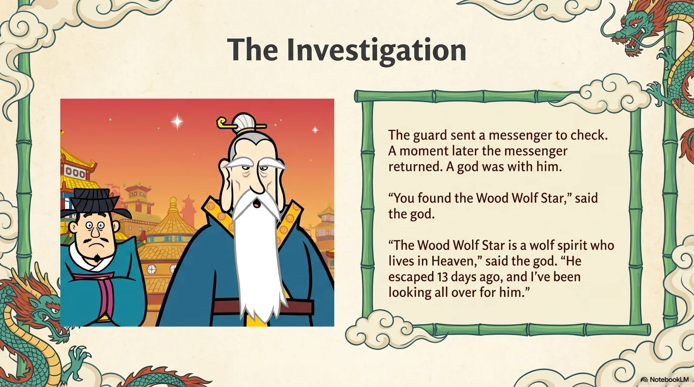

- 来源：`ppt/media/image10.png`（relationship `rId2`）
- 尺寸：1376×768
- 源 SHA-256：`191bf4b817a10354ce57a6509f01ae38b8e0aac59615bf8e928c5d58941c29c4`
- 输出 SHA-256：`e3bd810ea69da4f654ace4c5cc127619ccaf80ab09213954d98955637530caf5`
- 分类：unknown ｜ OCR：blocked ｜ 审核：unreviewed

## Slide 010

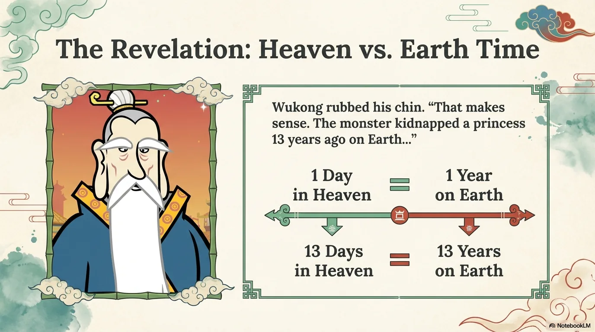

- 来源：`ppt/media/image11.png`（relationship `rId2`）
- 尺寸：1376×768
- 源 SHA-256：`f886d9a7b3514d1ebb5f00c3b812d786f031474319c0e801ebca86cb87c7b211`
- 输出 SHA-256：`11ff09277d3962cfabc43d589e5110e0f8650c7d59baa396085dc06fdd3229dd`
- 分类：unknown ｜ OCR：blocked ｜ 审核：unreviewed

## Slide 011

- 来源：`ppt/media/image12.png`（relationship `rId2`）
- 尺寸：1376×768
- 源 SHA-256：`3d85fb7139241bb4ea6d2287a1f66f51f07e2b6a117db352bd1e316648ee7eed`
- 输出 SHA-256：`cfa5c5e5f6eabd8ebcf0c63283335c444d46dd665768dc9e5ab8d3ebb7d43ce0`
- 分类：unknown ｜ OCR：blocked ｜ 审核：unreviewed

## Slide 012

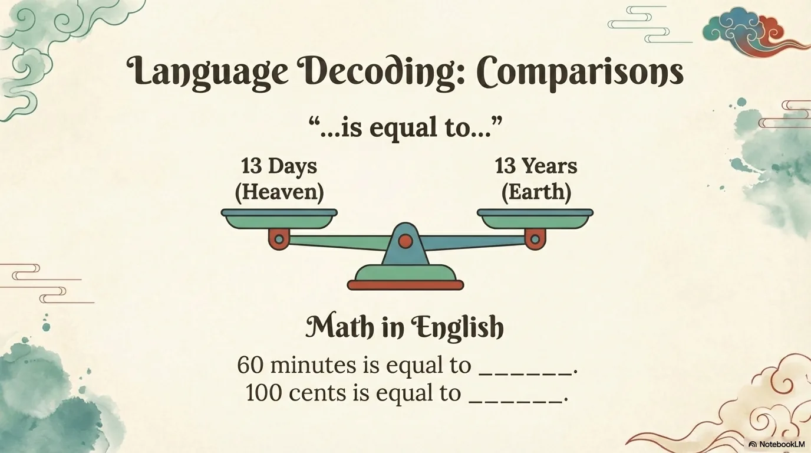

- 来源：`ppt/media/image13.png`（relationship `rId2`）
- 尺寸：1376×768
- 源 SHA-256：`8731fdea0409f02d2192186dd67ec23d061fa881c05eb96719318551c04a2ec1`
- 输出 SHA-256：`045619493067293bf021dabf8f2cbeddc033c248ff6153bd2c96b04e0191edab`
- 分类：unknown ｜ OCR：blocked ｜ 审核：unreviewed

## Slide 013

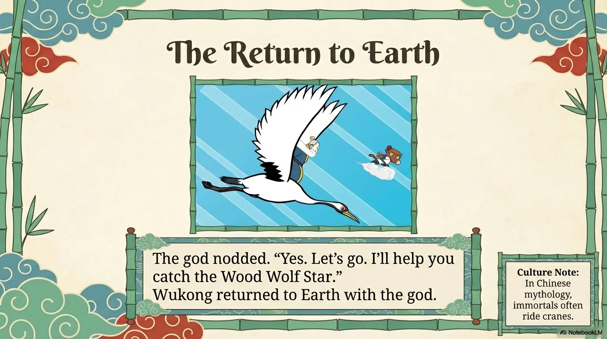

- 来源：`ppt/media/image14.png`（relationship `rId2`）
- 尺寸：1376×768
- 源 SHA-256：`a2144401dd117debbb0e8bc2f9aea152aaa0d9486f3fe85f324b331e53070fb7`
- 输出 SHA-256：`ce67949ba2c235eee15d1783954c1046d69709978c9d275ad4ed827a2120c4da`
- 分类：unknown ｜ OCR：blocked ｜ 审核：unreviewed

## Slide 014

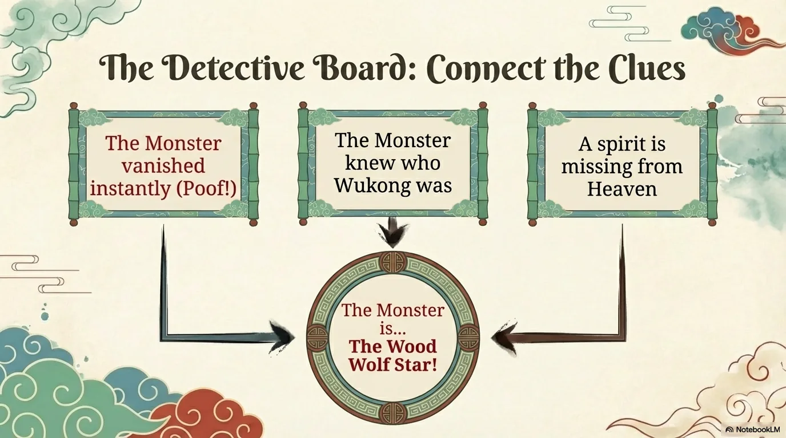

- 来源：`ppt/media/image15.png`（relationship `rId2`）
- 尺寸：1376×768
- 源 SHA-256：`1502bae0c914ead553c1476c35b3c9870a8723515182ae2b53ec338424f67087`
- 输出 SHA-256：`0a473b0ed3823ed391f2d90b5b6d0b21d6b69ceb0ce0cde03563c9b64da71814`
- 分类：unknown ｜ OCR：blocked ｜ 审核：unreviewed

## Slide 015

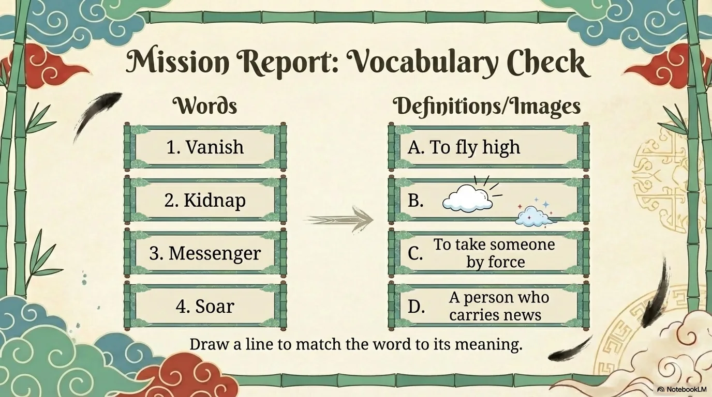

- 来源：`ppt/media/image16.png`（relationship `rId2`）
- 尺寸：1376×768
- 源 SHA-256：`643534194a3ec671fd44b0b69dc0a5ac1c28be1ad6b95d262acfaecd5248cbff`
- 输出 SHA-256：`80fd9752dbd27572f21be84b93491777cd54b6b531304023c9922e12fb01f8d1`
- 分类：unknown ｜ OCR：blocked ｜ 审核：unreviewed

## Slide 016

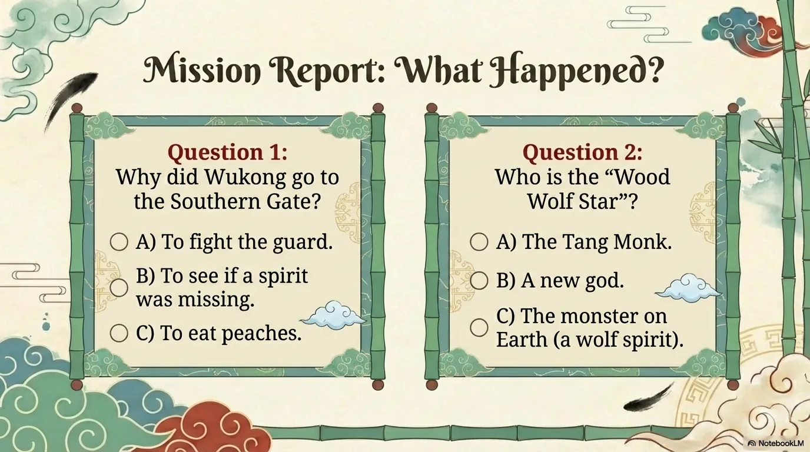

- 来源：`ppt/media/image17.png`（relationship `rId2`）
- 尺寸：1376×768
- 源 SHA-256：`88f56c2d6394f1c696650b6811a54307d5ae5c25099bbe879db8f2707cf964c4`
- 输出 SHA-256：`41529b2ebd21455d112416d018bd9b591874f4f434a0aca536180f4fbb4906ca`
- 分类：unknown ｜ OCR：blocked ｜ 审核：unreviewed

## Slide 017

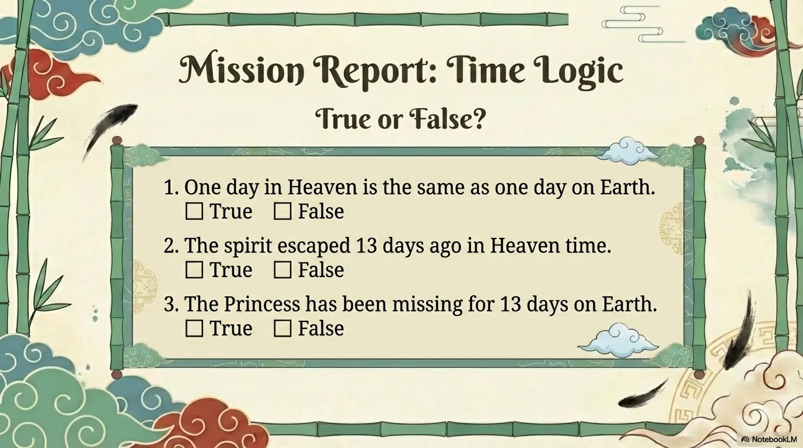

- 来源：`ppt/media/image18.png`（relationship `rId2`）
- 尺寸：1376×768
- 源 SHA-256：`fe1dc3cfebe8f19a73f0b70b93fe3b49009faced8cf4b4cdf7011f77f8f80575`
- 输出 SHA-256：`0320039d9fd1dd374cbfcab07eb1b6c604d6ad261d21545af5ebae00693d8a2e`
- 分类：unknown ｜ OCR：blocked ｜ 审核：unreviewed

## Slide 018

- 来源：`ppt/media/image19.png`（relationship `rId2`）
- 尺寸：1376×768
- 源 SHA-256：`0f326315e1cca2344205124d3ce65c5a30148f132a4c4c6e584bf35103167473`
- 输出 SHA-256：`4db997cfc1f824723fb6f3e6779c0b8de355bbcf6c34c802aa4ad7841d1b2538`
- 分类：unknown ｜ OCR：blocked ｜ 审核：unreviewed

## Slide 019

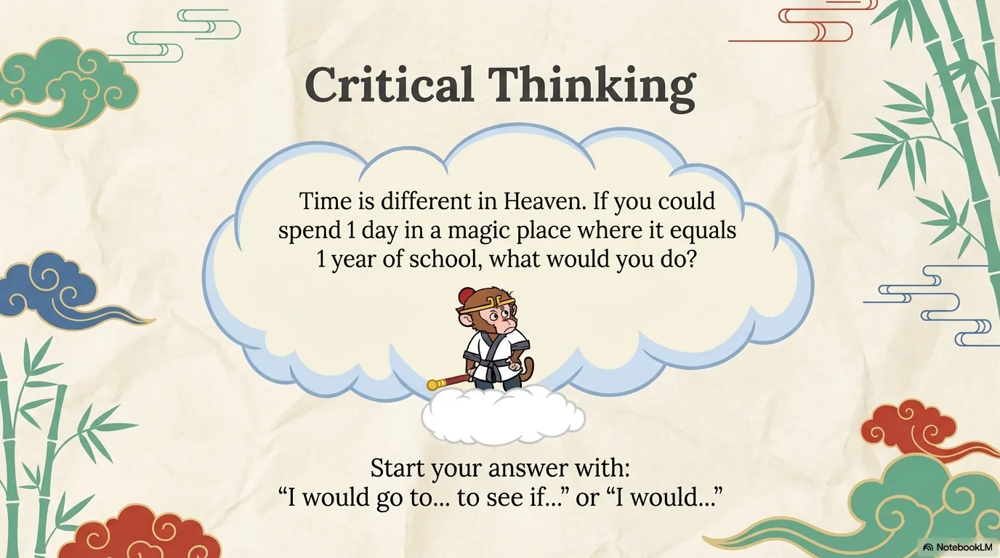

- 来源：`ppt/media/image20.png`（relationship `rId2`）
- 尺寸：1376×768
- 源 SHA-256：`df99feb7d6c3b4e642dea07ea32047a956bd67ba9e37dfb1a329822079589fe5`
- 输出 SHA-256：`8a6c2bbeb4259393ad2ce4811ecc56b90e656ba6bed1a639ea3a6e0cecacc592`
- 分类：unknown ｜ OCR：blocked ｜ 审核：unreviewed

## Slide 020

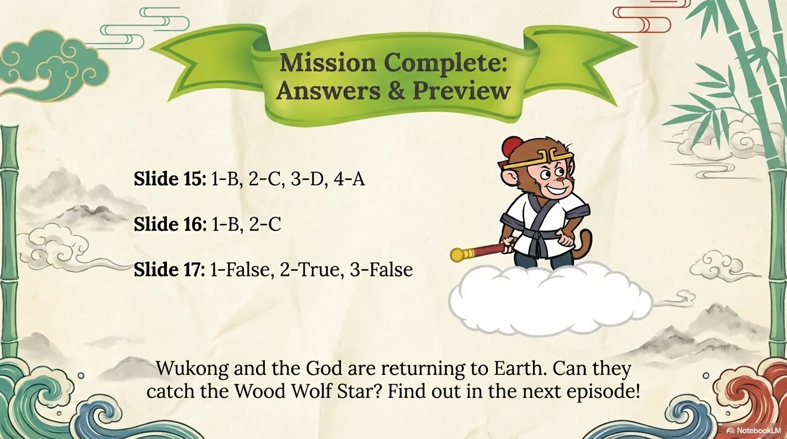

- 来源：`ppt/media/image21.png`（relationship `rId2`）
- 尺寸：1376×768
- 源 SHA-256：`a1db6e64659a77200e8880b0c962733c2f1c71e843b69c43cb8533d160012128`
- 输出 SHA-256：`fc212cfa7677218895c7997defa33b55fc3c65e1e9c081e3ceba34c3f8909ab7`
- 分类：unknown ｜ OCR：blocked ｜ 审核：unreviewed
