# 豆豆龙英语 · 第 38 集课件（EP038 草稿）

- 来源：`038_Journey to the West 38_Bajie Tries to Sleep.pptx`（主课件，20 页）
- OCR：`blocked`（no local OCR provider importable (pytesseract missing): No module named 'pytesseract'）
- 分类：待人工审核（unknown）
- 审核状态：`unreviewed`

## Slide 001

- 来源：`ppt/media/image1.png`（relationship `rId2`）
- 尺寸：1376×768
- 源 SHA-256：`36077bee53adc8f75467d1ac92f0bb3348a6ed8df56b34b64648b4586b962576`
- 输出 SHA-256：`446ba51ae05862e69631363ab7e138fb4a9fa5d2296bb356009d1aa139e33894`
- 分类：unknown ｜ OCR：blocked ｜ 审核：unreviewed

## Slide 002

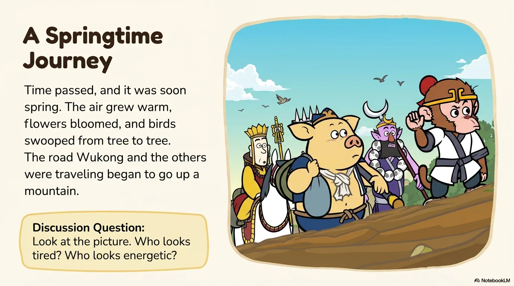

- 来源：`ppt/media/image3.png`（relationship `rId2`）
- 尺寸：1376×768
- 源 SHA-256：`df0c1c91811a3f13c7cb6c130d577eca744672e460f68efda3f325615c76c701`
- 输出 SHA-256：`e2eaee625d0c975ebfea5cc5a4554a79c26b9728385f28749dfb4fbce9249573`
- 分类：unknown ｜ OCR：blocked ｜ 审核：unreviewed

## Slide 003

- 来源：`ppt/media/image4.png`（relationship `rId2`）
- 尺寸：1376×768
- 源 SHA-256：`af0cb9e724fc219913edee12a32dd208b7855e3cbacbb2a07002a99e580cad0c`
- 输出 SHA-256：`6ca0a9d57553c88341e6f597087729afe6b3843beb322dad62194eecaae7f3d8`
- 分类：unknown ｜ OCR：blocked ｜ 审核：unreviewed

## Slide 004

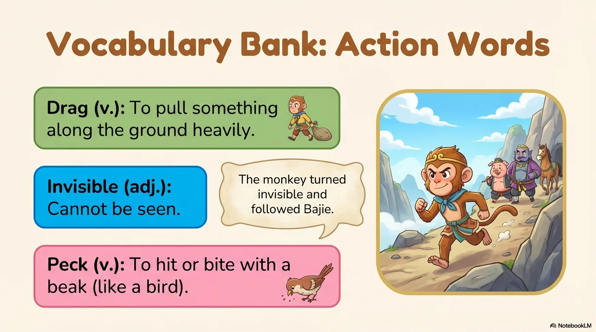

- 来源：`ppt/media/image5.png`（relationship `rId2`）
- 尺寸：1376×768
- 源 SHA-256：`e25c4fd9f9f42e1d19d0389c30b5b34208de38bf408419fa4f61bd222fa3ff6f`
- 输出 SHA-256：`8915ad22d660db4b40229442396b4272fb62867414a33442400f90616f3ab865`
- 分类：unknown ｜ OCR：blocked ｜ 审核：unreviewed

## Slide 005

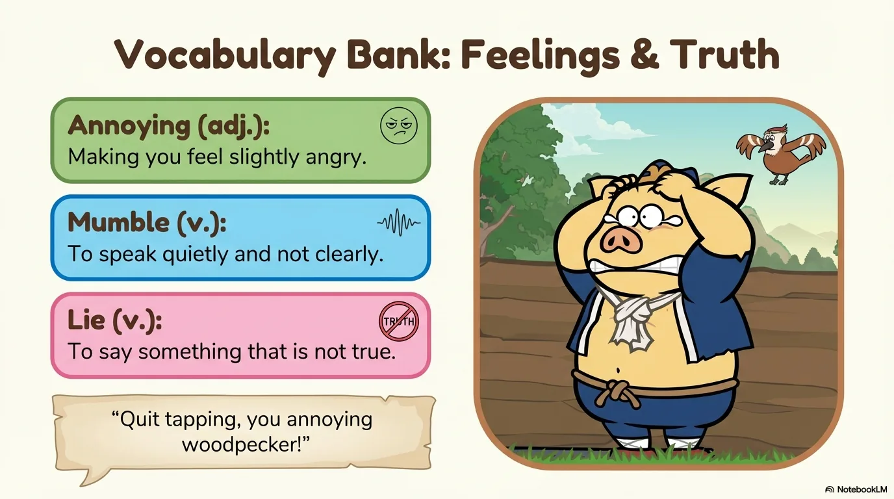

- 来源：`ppt/media/image6.png`（relationship `rId2`）
- 尺寸：1376×768
- 源 SHA-256：`4b36e2c2345c931eb85f822f2bc013855b48f1a24f3aeec99a410af007052787`
- 输出 SHA-256：`2edd068252a5fd1d6dd210493ecc7574ff46692c7c2037d7dfd2614588793765`
- 分类：unknown ｜ OCR：blocked ｜ 审核：unreviewed

## Slide 006

- 来源：`ppt/media/image7.png`（relationship `rId2`）
- 尺寸：1376×768
- 源 SHA-256：`477dccd278fe3b633ddff53be9c79eae6e3d2c59172e4be2476ecf00dedc35ec`
- 输出 SHA-256：`b3238a303de2afecd4556e01abcdacef75dae35bf3c66e22f5c6cd3bf15074d5`
- 分类：unknown ｜ OCR：blocked ｜ 审核：unreviewed

## Slide 007

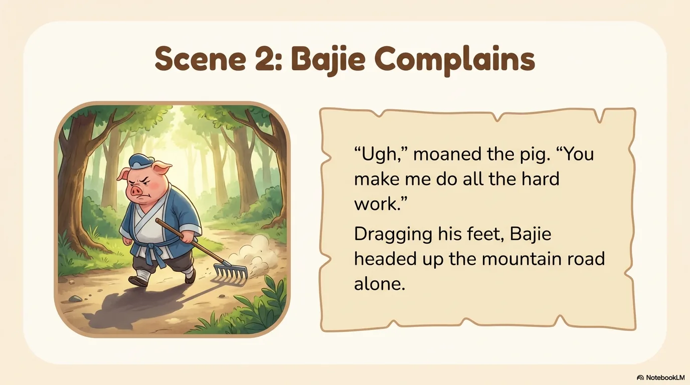

- 来源：`ppt/media/image8.png`（relationship `rId2`）
- 尺寸：1376×768
- 源 SHA-256：`24b66e6737a5ff2d29ad6707f7faf256e7409f236a010e6d124101c4f8cc643c`
- 输出 SHA-256：`060b47674808b84cd15c36b2bb229030c8a8da348db1f2d68cb1c670f35afb68`
- 分类：unknown ｜ OCR：blocked ｜ 审核：unreviewed

## Slide 008

- 来源：`ppt/media/image9.png`（relationship `rId2`）
- 尺寸：1376×768
- 源 SHA-256：`8b9b12d2ed9f8eaf85272379c52b70a213d75fdecde3891ae1d78b79c8d16236`
- 输出 SHA-256：`60d01814476bb3501be2ff1361f5e7af548be98a590e0a1b60c744cd0ff68aa2`
- 分类：unknown ｜ OCR：blocked ｜ 审核：unreviewed

## Slide 009

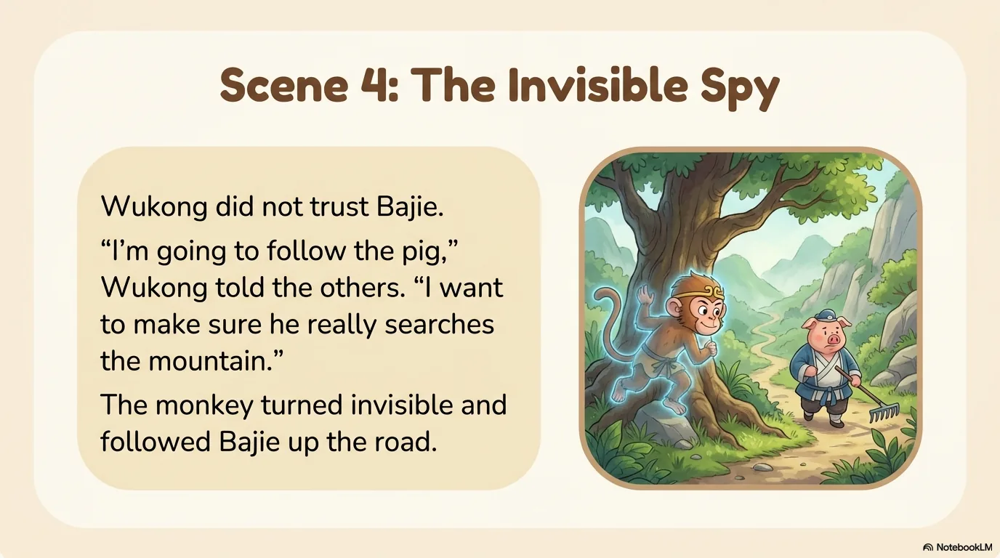

- 来源：`ppt/media/image10.png`（relationship `rId2`）
- 尺寸：1376×768
- 源 SHA-256：`adb67dfdfb06e187d04a0ce9681a78299af758fd34b1b459ec89ed113ad60b10`
- 输出 SHA-256：`730a1da11b229f285ac2a944e818cfac1e346f8652ac62909ba84c2ef739069d`
- 分类：unknown ｜ OCR：blocked ｜ 审核：unreviewed

## Slide 010

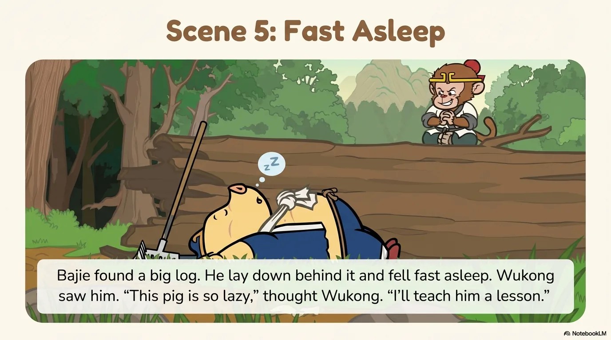

- 来源：`ppt/media/image11.png`（relationship `rId2`）
- 尺寸：1376×768
- 源 SHA-256：`d12cd5103b737d6f1ea51c5ff596b1e8f55e892dde313461bb0db2d528107121`
- 输出 SHA-256：`888f69aee0a8f945d53015be1f92814dfc39f5e53cadab6d533092a6aa9d3f56`
- 分类：unknown ｜ OCR：blocked ｜ 审核：unreviewed

## Slide 011

- 来源：`ppt/media/image12.png`（relationship `rId2`）
- 尺寸：1376×768
- 源 SHA-256：`739bdc88bd5879dcce5a77ed2f079834626e4cf5285b5cb99699cf28b5a86854`
- 输出 SHA-256：`162e9e14fb95814b8b2ce8f0c085e993ead3e4101f35ec6b59194804b9ea9bed`
- 分类：unknown ｜ OCR：blocked ｜ 审核：unreviewed

## Slide 012

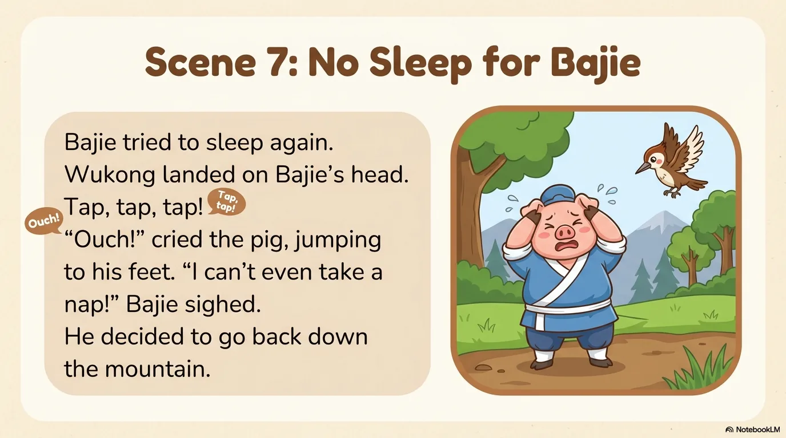

- 来源：`ppt/media/image13.png`（relationship `rId2`）
- 尺寸：1376×768
- 源 SHA-256：`4cc2aa5ce6f4d846a85def6c03e6ea6ba5aeacdc29b3428c9742ab4f31dea769`
- 输出 SHA-256：`f8ac0ec8a74e1d916da8061c2c74d3f1095d081ed752eeafea9ecf48fafba236`
- 分类：unknown ｜ OCR：blocked ｜ 审核：unreviewed

## Slide 013

- 来源：`ppt/media/image14.png`（relationship `rId2`）
- 尺寸：1376×768
- 源 SHA-256：`7f9be9ddb803c608c067c96eeea26725285f355b19a1b055ed3aae03c48252d9`
- 输出 SHA-256：`a23a362b8b92e704f241cfa1103c53ccd461b3774a59c83fbb0283cfb0943027`
- 分类：unknown ｜ OCR：blocked ｜ 审核：unreviewed

## Slide 014

- 来源：`ppt/media/image15.png`（relationship `rId2`）
- 尺寸：1376×768
- 源 SHA-256：`9d88f1832df0f07fdaa38621b77f4312a0d43a48c5bf1a0fca725fbda3da35e1`
- 输出 SHA-256：`995ff737dfb7c4d54e96e974d479d10abe10f29d845158a4a90504bad585be18`
- 分类：unknown ｜ OCR：blocked ｜ 审核：unreviewed

## Slide 015

- 来源：`ppt/media/image16.png`（relationship `rId2`）
- 尺寸：1376×768
- 源 SHA-256：`d4c4eb52cf57bb4144b79c4ef60cb120b9f9029c76033a9c4215943b8cdfaa82`
- 输出 SHA-256：`d3b39af7dc2e588ce94dbd173a0b5ebedfaca551f706c0ce6e0d88b2c34adc0c`
- 分类：unknown ｜ OCR：blocked ｜ 审核：unreviewed

## Slide 016

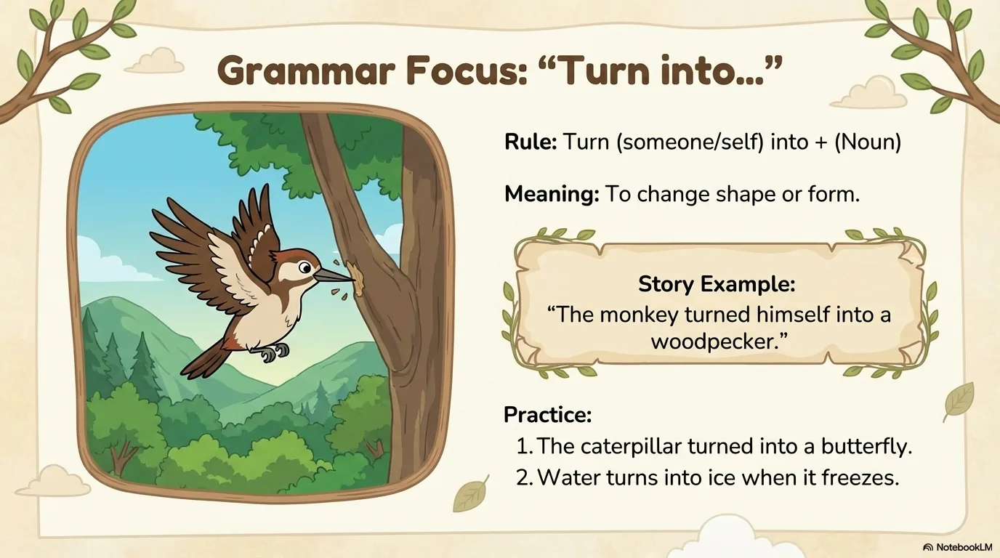

- 来源：`ppt/media/image17.png`（relationship `rId2`）
- 尺寸：1376×768
- 源 SHA-256：`2d1cf8310eb95df5480e37116aee0dccf6a7e0cf67c341fda9f57e028f42f07e`
- 输出 SHA-256：`5c9c7b8481c53ed755b74a98261721ae9cec22413a7732ee7cb4e5049d02641e`
- 分类：unknown ｜ OCR：blocked ｜ 审核：unreviewed

## Slide 017

- 来源：`ppt/media/image18.png`（relationship `rId2`）
- 尺寸：1376×768
- 源 SHA-256：`fa1468a257133dc56227b43a391a15d748e51a1df92a05fe6d2b3ccbfef63e9c`
- 输出 SHA-256：`165f5a6abe32b7b1b4de32d1c651c114518448b66f38d46a6fe9821f314f313c`
- 分类：unknown ｜ OCR：blocked ｜ 审核：unreviewed

## Slide 018

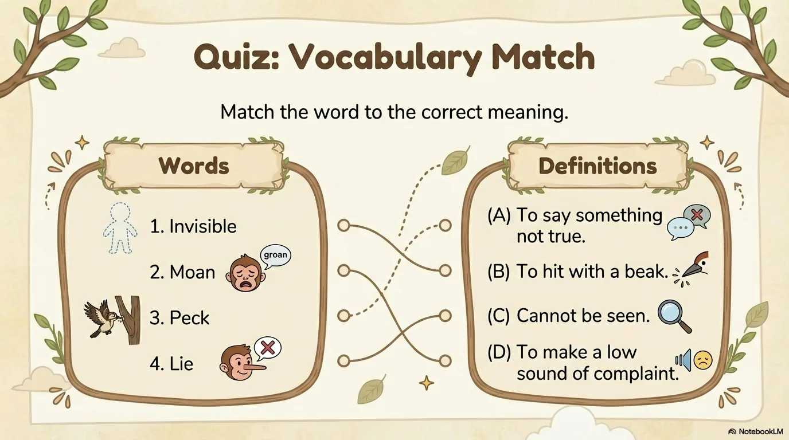

- 来源：`ppt/media/image19.png`（relationship `rId2`）
- 尺寸：1376×768
- 源 SHA-256：`30362023f62b52fc49b2dac0ba23ef15c223d46dddabf1f7092c5e8144b3e3ad`
- 输出 SHA-256：`bb177f5821b319acc9c7daf9af380566ac4b7f6d619553137492b4255ac6630a`
- 分类：unknown ｜ OCR：blocked ｜ 审核：unreviewed

## Slide 019

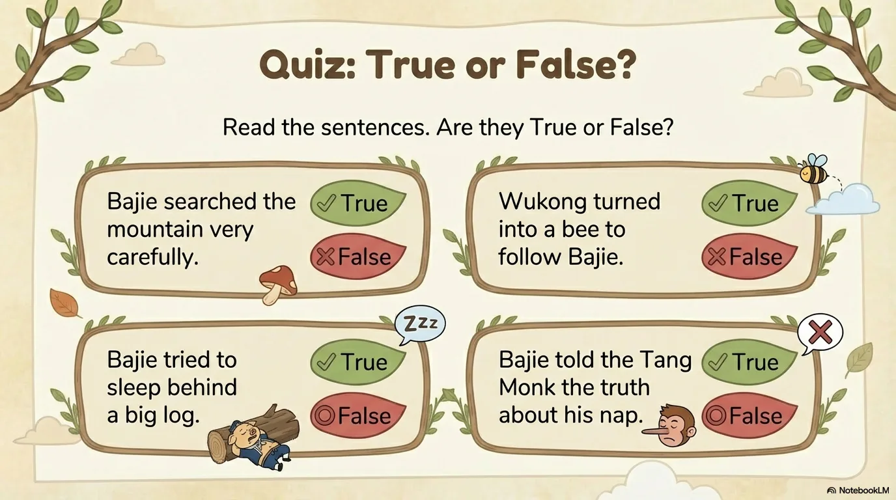

- 来源：`ppt/media/image20.png`（relationship `rId2`）
- 尺寸：1376×768
- 源 SHA-256：`905c4f3155f372efcc0b83350d928af692fc62667cb9de22152068829792ec81`
- 输出 SHA-256：`be63577cfb537313a2bc9b0ae2486c70b30e928b161a3db82ba5badc8de02f8f`
- 分类：unknown ｜ OCR：blocked ｜ 审核：unreviewed

## Slide 020

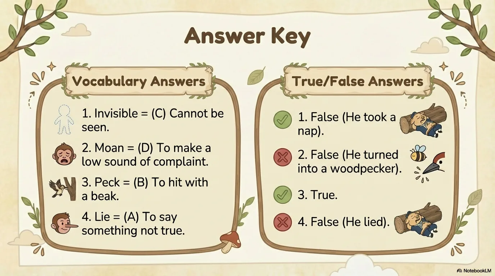

- 来源：`ppt/media/image21.png`（relationship `rId2`）
- 尺寸：1376×768
- 源 SHA-256：`b9b5924c9aa8e60988ffa66253530f84fdf13df6fc30e3b504b6bb32240dd7e2`
- 输出 SHA-256：`aebc48d975b65d974a14c855d7177e6354e16a7981fbe55cef34de5fc49e932f`
- 分类：unknown ｜ OCR：blocked ｜ 审核：unreviewed
