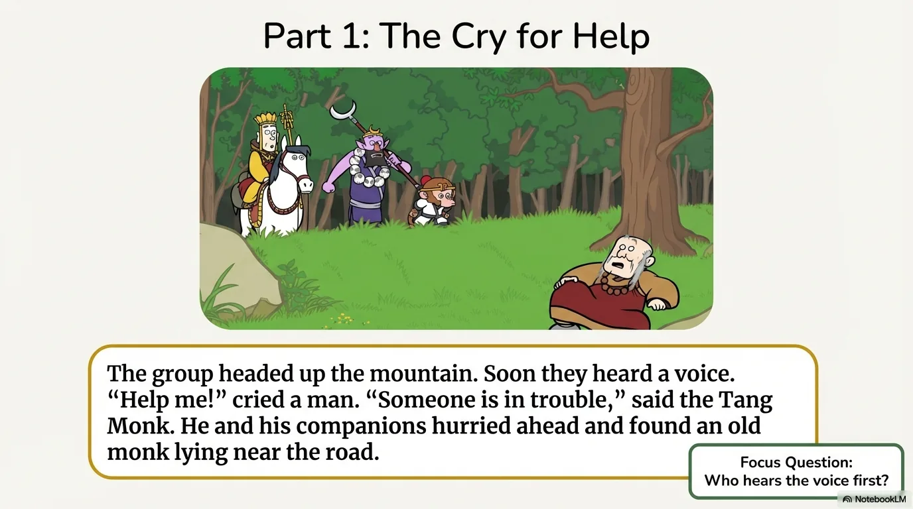
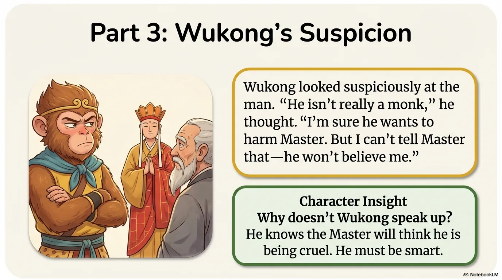
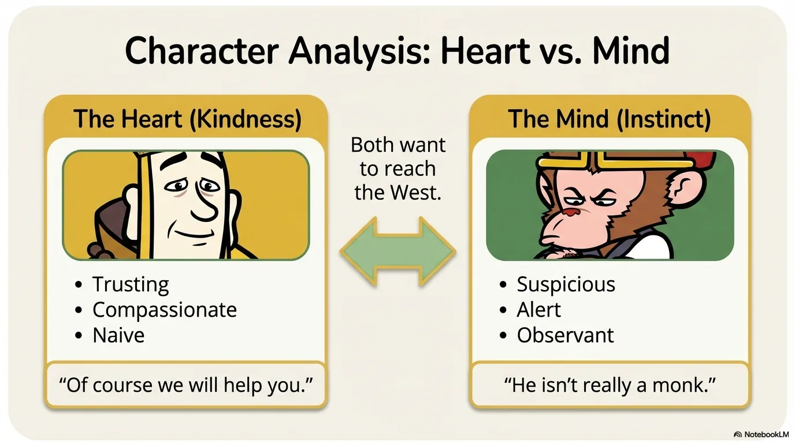
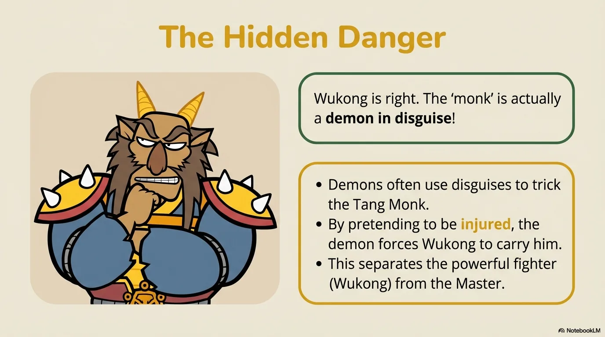
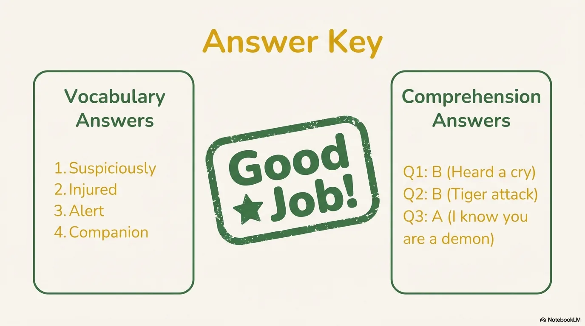

# 豆豆龙英语 · 第 39 集课件（EP039 草稿）

- 来源：`039_Journey to the West 39_The Injured Monk.pptx`（主课件，20 页）
- OCR：`blocked`（no local OCR provider importable (pytesseract missing): No module named 'pytesseract'）
- 分类：待人工审核（unknown）
- 审核状态：`unreviewed`

## Slide 001

- 来源：`ppt/media/image1.png`（relationship `rId2`）
- 尺寸：1376×768
- 源 SHA-256：`530374fc532353d16d3b6659ad5d6bd055ff3b56b8a74b03dcb592b75d380133`
- 输出 SHA-256：`f4b0be4edeabf0a49ad0ee38a4dba81243b0f8a952093386e7cec6847dcc47e9`
- 分类：unknown ｜ OCR：blocked ｜ 审核：unreviewed

## Slide 002

- 来源：`ppt/media/image3.png`（relationship `rId2`）
- 尺寸：1376×768
- 源 SHA-256：`61741765679b3bc3c1383041f2fc158204bae855ac38d743b6f702f6cf23addf`
- 输出 SHA-256：`e1381f7f51c2605a6a6f434b8175ab8541de4723949aae4809987986ed840d3b`
- 分类：unknown ｜ OCR：blocked ｜ 审核：unreviewed

## Slide 003

- 来源：`ppt/media/image4.png`（relationship `rId2`）
- 尺寸：1376×768
- 源 SHA-256：`f3d4318ca32287c42af835b7d88dc74ecf0491fa279a0e6496b095e59eff117b`
- 输出 SHA-256：`4c698be1492cae4c21545ac31d773bf3514b0ea0152018ac797c711d17509839`
- 分类：unknown ｜ OCR：blocked ｜ 审核：unreviewed

## Slide 004

- 来源：`ppt/media/image5.png`（relationship `rId2`）
- 尺寸：1376×768
- 源 SHA-256：`84a80913148a2fb44cfbc35a91bc6120217e34a075b682cca829eede34017ecd`
- 输出 SHA-256：`ee09778559ffc322e18125465280d46318a129ee5766db6a41267e48071295c6`
- 分类：unknown ｜ OCR：blocked ｜ 审核：unreviewed

## Slide 005

- 来源：`ppt/media/image6.png`（relationship `rId2`）
- 尺寸：1376×768
- 源 SHA-256：`c07749012d8672b28c3ce374dcaf6383e3c5240edcb8773d37055bb7dba418a3`
- 输出 SHA-256：`aeb2be66f3bcd1116ac789f2589cfa3487ea1a40c49e8c45ace216fa0567df61`
- 分类：unknown ｜ OCR：blocked ｜ 审核：unreviewed

## Slide 006

- 来源：`ppt/media/image7.png`（relationship `rId2`）
- 尺寸：1376×768
- 源 SHA-256：`0182c148ea8b58b42e48e51004fa200212188e05bfce962e8097cc3ca01c5c5f`
- 输出 SHA-256：`20a601e83cf7a0b0b65b3267c46cfa7fea49bb9f383d46440eccb8727bb72032`
- 分类：unknown ｜ OCR：blocked ｜ 审核：unreviewed

## Slide 007

- 来源：`ppt/media/image8.png`（relationship `rId2`）
- 尺寸：1376×768
- 源 SHA-256：`d5091a2eabf198d0b9aa59deef0182f3a7e4ee1abf20b3354fc11ec549edade2`
- 输出 SHA-256：`772c7459e66555778760311ef2d1436f3fb9ae5dc24f84e759e15c804d6bdf68`
- 分类：unknown ｜ OCR：blocked ｜ 审核：unreviewed

## Slide 008

- 来源：`ppt/media/image9.png`（relationship `rId2`）
- 尺寸：1376×768
- 源 SHA-256：`893719604611a6ccf9394648b07b4c4eed91fbfd06c27833c00315c92916210a`
- 输出 SHA-256：`ae77c04b881db032fe02c4f7ada363426520f7c42742535ef11726030090016b`
- 分类：unknown ｜ OCR：blocked ｜ 审核：unreviewed

## Slide 009

- 来源：`ppt/media/image10.png`（relationship `rId2`）
- 尺寸：1376×768
- 源 SHA-256：`2fa0aa5bc88474a6d5c43202c07eefb43f66243c7df52295af1073b7818c6bc4`
- 输出 SHA-256：`f5e396855000a3ca9125bb8d8b2fbd64cc813227fe78d56eff9c81f644204214`
- 分类：unknown ｜ OCR：blocked ｜ 审核：unreviewed

## Slide 010

- 来源：`ppt/media/image11.png`（relationship `rId2`）
- 尺寸：1376×768
- 源 SHA-256：`25e1748fd893addd61ac675fb8f97c37a048f4d168b78d4b0d56a91b26693280`
- 输出 SHA-256：`738248bbf6b0b3834ae96c745ac7bb996040ae8bf80bbfb976b3fd108989f595`
- 分类：unknown ｜ OCR：blocked ｜ 审核：unreviewed

## Slide 011

- 来源：`ppt/media/image12.png`（relationship `rId2`）
- 尺寸：1376×768
- 源 SHA-256：`d109042bfe7e4b26d72cc9773c514a1b6454f1b6df6fc04ab8b4f35f14879ccc`
- 输出 SHA-256：`5fc8a3efa464fd44dcc2813459369997b14308d388c14ff6f680a71e033af451`
- 分类：unknown ｜ OCR：blocked ｜ 审核：unreviewed

## Slide 012

- 来源：`ppt/media/image13.png`（relationship `rId2`）
- 尺寸：1376×768
- 源 SHA-256：`76b48b2bdf8b9a2fdd4bf68687d12b0db5c3513c70289640500c1b3bcc6da5a3`
- 输出 SHA-256：`145b3d339430bd0c0c0fe808393eb0a47e51c9733b25f5bc8b58dfebfd1b8c85`
- 分类：unknown ｜ OCR：blocked ｜ 审核：unreviewed

## Slide 013

- 来源：`ppt/media/image14.png`（relationship `rId2`）
- 尺寸：1376×768
- 源 SHA-256：`1abc932888784845cf927a71fa7eedef233309947671615de1c0d363fb01e887`
- 输出 SHA-256：`087bf043dfc2010912d2a6cac463d8914ab30748b3ac9fee24d4bc2e96ced3a5`
- 分类：unknown ｜ OCR：blocked ｜ 审核：unreviewed

## Slide 014

- 来源：`ppt/media/image15.png`（relationship `rId2`）
- 尺寸：1376×768
- 源 SHA-256：`815a238eef2c7d3b7c231d13cd8c373b96998a509168b2ae201610f758fcc9e1`
- 输出 SHA-256：`64a5705964279770e0fd7a40ef38883a39aec7bdd7f32b384c64e606f0ad5215`
- 分类：unknown ｜ OCR：blocked ｜ 审核：unreviewed

## Slide 015

- 来源：`ppt/media/image16.png`（relationship `rId2`）
- 尺寸：1376×768
- 源 SHA-256：`760c32d1127f5829004c784774d4a1b4eec4e7e519b8942f315545c192d72505`
- 输出 SHA-256：`78f085e3e6c2aac4488a00851f08fddfda327d00c6519668d4083735f9628f8c`
- 分类：unknown ｜ OCR：blocked ｜ 审核：unreviewed

## Slide 016

- 来源：`ppt/media/image17.png`（relationship `rId2`）
- 尺寸：1376×768
- 源 SHA-256：`33046e964d7ffe55a92a92f7e47ef744619857b595706f3c3821729cc3231b24`
- 输出 SHA-256：`e139e6ee049231634ea42e3d5be64d1d649a9e27b109dee01ef85888dcbf4acd`
- 分类：unknown ｜ OCR：blocked ｜ 审核：unreviewed

## Slide 017

- 来源：`ppt/media/image18.png`（relationship `rId2`）
- 尺寸：1376×768
- 源 SHA-256：`3b818f84cf4548f956044563393b2132e55ddcb089a41068246a8f00e63113a5`
- 输出 SHA-256：`74084f3a06b059fceeaf50b67a6b57f3cbcb4afc04a7c3d7cf9e320bba7daa83`
- 分类：unknown ｜ OCR：blocked ｜ 审核：unreviewed

## Slide 018

- 来源：`ppt/media/image19.png`（relationship `rId2`）
- 尺寸：1376×768
- 源 SHA-256：`779baa16e66d385e057ee778e2ea11458df368c627f8aabecb63592dba56cc6f`
- 输出 SHA-256：`83b657a0fc13cfb813096b471c56e5976dac4423e95d79fa1dc6cdef7c0000db`
- 分类：unknown ｜ OCR：blocked ｜ 审核：unreviewed

## Slide 019

- 来源：`ppt/media/image20.png`（relationship `rId2`）
- 尺寸：1376×768
- 源 SHA-256：`3486d48f3b807951869ae92e3e4dacb374159e53ab22ed280a9959d47f8c3384`
- 输出 SHA-256：`67d3ffce8cb8dc65d20f24eb85b017ab8346b8e96d6cbd06d3b7122120e17d51`
- 分类：unknown ｜ OCR：blocked ｜ 审核：unreviewed

## Slide 020

- 来源：`ppt/media/image21.png`（relationship `rId2`）
- 尺寸：1376×768
- 源 SHA-256：`fad338861d71274eb6c1c3a18ef259b182075f81b81925436b99bc3857b8df3b`
- 输出 SHA-256：`1743ed39f2ddc0b0740a17f9963ee590a46d213b88bdea1ecff6118721a4783c`
- 分类：unknown ｜ OCR：blocked ｜ 审核：unreviewed
