# 豆豆龙英语 · 第 40 集课件（EP040 草稿）

- 来源：`040_Journey to the West 40_The Magic Gourd.pptx`（主课件，20 页）
- OCR：`blocked`（no local OCR provider importable (pytesseract missing): No module named 'pytesseract'）
- 分类：待人工审核（unknown）
- 审核状态：`unreviewed`

## Slide 001

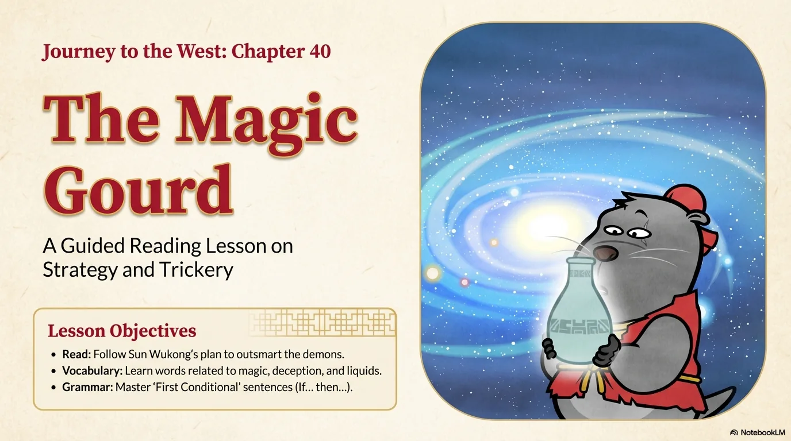

- 来源：`ppt/media/image1.png`（relationship `rId2`）
- 尺寸：1376×768
- 源 SHA-256：`7163aee9812c81d13d708d5ba589c5dd66a10025bf38184d8984027584da689a`
- 输出 SHA-256：`4ec9b7e4bbf120dc60de9658e0b6e6f1e685b43129ec033880b026b1b2e9b4ee`
- 分类：unknown ｜ OCR：blocked ｜ 审核：unreviewed

## Slide 002

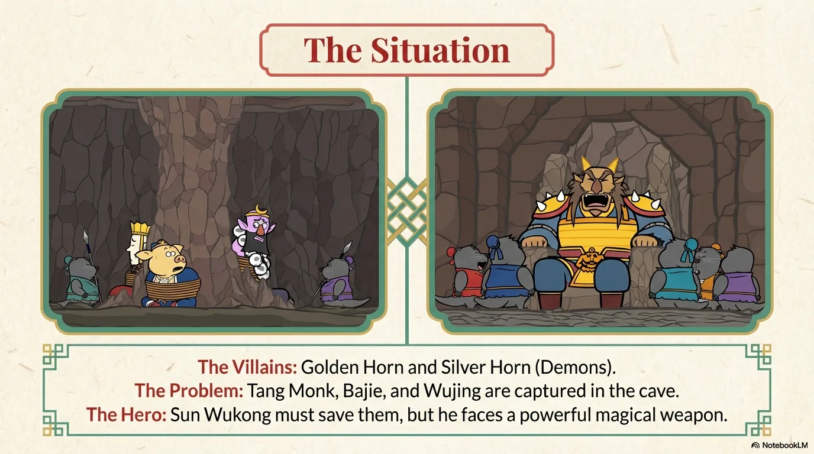

- 来源：`ppt/media/image3.png`（relationship `rId2`）
- 尺寸：1376×768
- 源 SHA-256：`98289b0de667608553312b3c5f412b39263f63d3baff5e576dc78bf4ba405077`
- 输出 SHA-256：`68184618ebeb0e4e5e9b2c583c17b63f1ac5150da3748b104894275ebc8c3849`
- 分类：unknown ｜ OCR：blocked ｜ 审核：unreviewed

## Slide 003

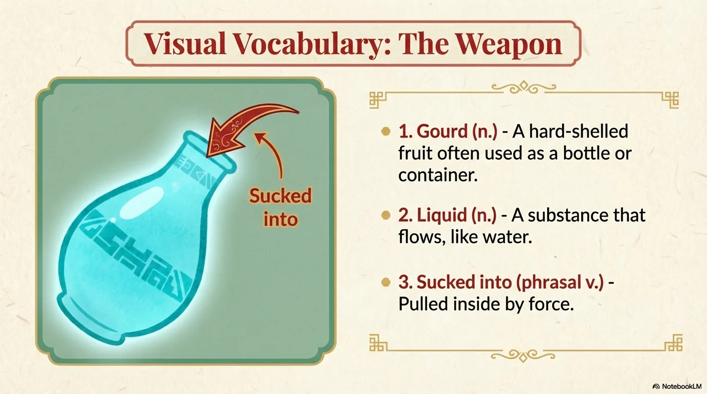

- 来源：`ppt/media/image4.png`（relationship `rId2`）
- 尺寸：1376×768
- 源 SHA-256：`8216cbff5de824567ec35ddc1da7857f4af3d2d9fb9371da7397ca945f32e302`
- 输出 SHA-256：`12e9ec03b6bd7c3984b9d96ed26f5c88d6577ff9c58ab832b1805a5837e0bc77`
- 分类：unknown ｜ OCR：blocked ｜ 审核：unreviewed

## Slide 004

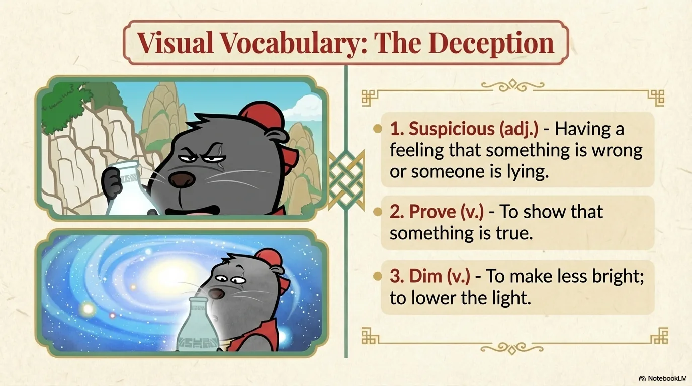

- 来源：`ppt/media/image5.png`（relationship `rId2`）
- 尺寸：1376×768
- 源 SHA-256：`6b80ca5f6ad0e4180130fd4f060dd9ed857b25c67b8f11cca0463a3118c1900b`
- 输出 SHA-256：`60610f58afdfb6ecdc9c21f0afe073c23b0819f8d4607db6b9bb27a4514a7087`
- 分类：unknown ｜ OCR：blocked ｜ 审核：unreviewed

## Slide 005

- 来源：`ppt/media/image6.png`（relationship `rId2`）
- 尺寸：1376×768
- 源 SHA-256：`24656c97fe7010a7c4ae3eeb7213e81a2212e1360705dd01f6e7b98024f19ad4`
- 输出 SHA-256：`ee5a760fbdcd6ba07602b91b47bb91a97db700bbd9cdfd96a6aa694f6939e264`
- 分类：unknown ｜ OCR：blocked ｜ 审核：unreviewed

## Slide 006

- 来源：`ppt/media/image7.png`（relationship `rId2`）
- 尺寸：1376×768
- 源 SHA-256：`2c91f3de01caba4f2669c537fd4c721efff6edd49ad233cf2483187837c607c0`
- 输出 SHA-256：`8de24000ccb7a11c6dd634da747fbb148c4b26677aa6ac82afc2b4063e41e4c3`
- 分类：unknown ｜ OCR：blocked ｜ 审核：unreviewed

## Slide 007

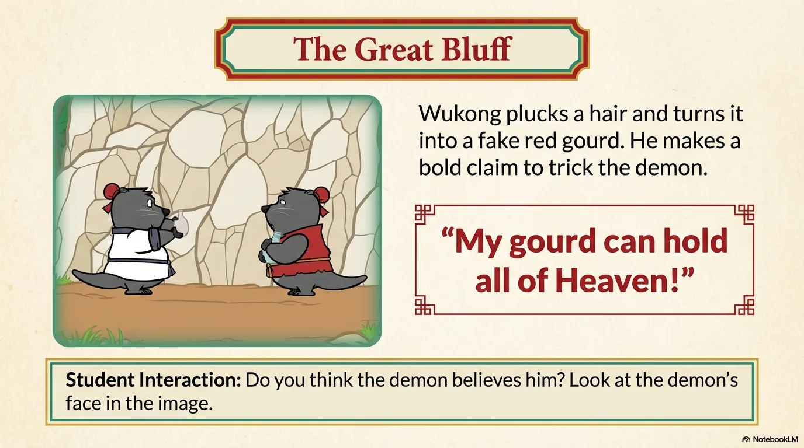

- 来源：`ppt/media/image8.png`（relationship `rId2`）
- 尺寸：1376×768
- 源 SHA-256：`7b88e2041a468b9fb2506bfe0e9d3c9f1c19441886cfb915bbaa598e9b156558`
- 输出 SHA-256：`9b5eca3ba0daa6cc855f5134e012dd784f36105ebe525437000c675eee521dbd`
- 分类：unknown ｜ OCR：blocked ｜ 审核：unreviewed

## Slide 008

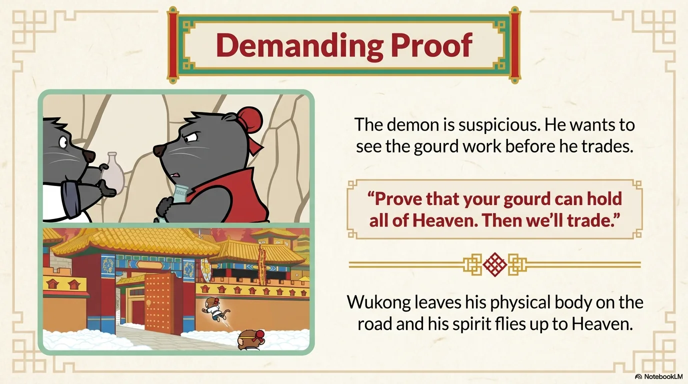

- 来源：`ppt/media/image9.png`（relationship `rId2`）
- 尺寸：1376×768
- 源 SHA-256：`fa8e44b62014fce0d3045f450a9789db70b4ecb09cd117742a0d882a9c7d3c3a`
- 输出 SHA-256：`d03b4a22e8704b58de2975674ab0284f21263c0065d7a1bad8280716b8b99788`
- 分类：unknown ｜ OCR：blocked ｜ 审核：unreviewed

## Slide 009

- 来源：`ppt/media/image10.png`（relationship `rId2`）
- 尺寸：1376×768
- 源 SHA-256：`6a499e538e01a34bc691173be91702a80ef7f9356998f6a441b93dee1bb4fa5c`
- 输出 SHA-256：`9b5d8cb5b2801c7f8fa7a9d70d6d8a501fd2cf1bea2daaaae11b18dc4c0c4e4d`
- 分类：unknown ｜ OCR：blocked ｜ 审核：unreviewed

## Slide 010

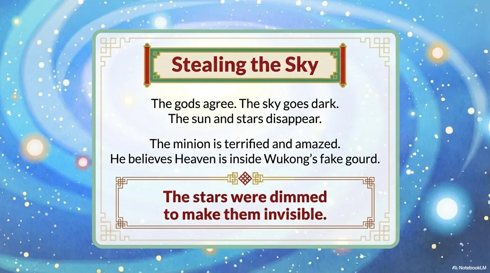

- 来源：`ppt/media/image11.png`（relationship `rId2`）
- 尺寸：1376×768
- 源 SHA-256：`e85c48af0a196cc762fc93576783f6a6ef03c3d3c737fa6a611e6e85e0d192e8`
- 输出 SHA-256：`edae4389a66e36184c0d344732192029319244945bb468833b42204cd5fc3630`
- 分类：unknown ｜ OCR：blocked ｜ 审核：unreviewed

## Slide 011

- 来源：`ppt/media/image12.png`（relationship `rId2`）
- 尺寸：1376×768
- 源 SHA-256：`da8d2a30555e438ac0a961d48ecdc63da767b4db7ac9361f02b73243d8de13b6`
- 输出 SHA-256：`745052b976cfb8b4848b47ad51b62bb0dbe88928313c9bd2e80aaa6c08289df1`
- 分类：unknown ｜ OCR：blocked ｜ 审核：unreviewed

## Slide 012

- 来源：`ppt/media/image13.png`（relationship `rId2`）
- 尺寸：1376×768
- 源 SHA-256：`93dd09fc76f307745deeabf9537d4350d24fad93d5a0cbcf2b3aa9cdbcaf8036`
- 输出 SHA-256：`3af5bf7b311399a4ad16f5ccc902999a63da7249240c777775d3488853b06ef8`
- 分类：unknown ｜ OCR：blocked ｜ 审核：unreviewed

## Slide 013

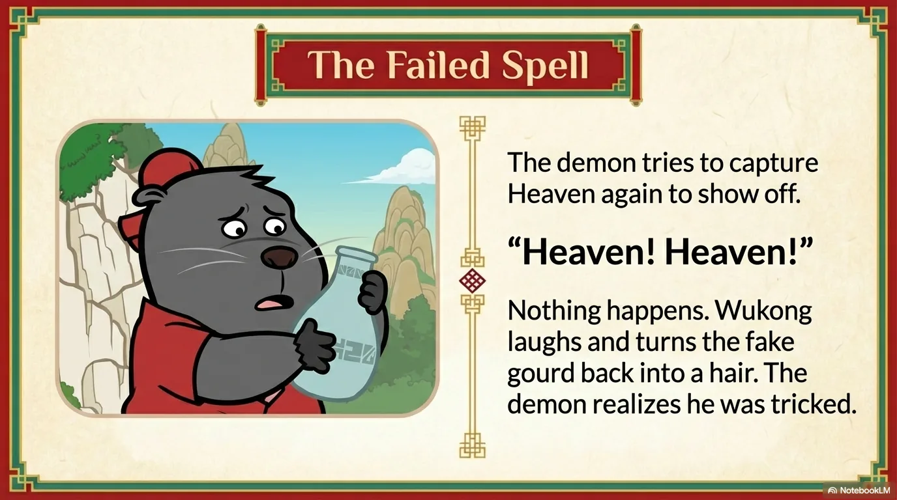

- 来源：`ppt/media/image14.png`（relationship `rId2`）
- 尺寸：1376×768
- 源 SHA-256：`bc9ed9b32692ae78dc063c4048f412e97211f7f84b8ab81fb6e3cc21926c2d6f`
- 输出 SHA-256：`2b977180d6c739d9b4b0b2d99c977ec984c78e8d46b93f57e507dceb27f763e8`
- 分类：unknown ｜ OCR：blocked ｜ 审核：unreviewed

## Slide 014

- 来源：`ppt/media/image15.png`（relationship `rId2`）
- 尺寸：1376×768
- 源 SHA-256：`42d2ce1167cff91c1fe93b16da238635952e6b0f562404a49e578b6e5ed13605`
- 输出 SHA-256：`b69351310543477a394e57123c825332fd164a711c03e6a263431e4f40d5e8c4`
- 分类：unknown ｜ OCR：blocked ｜ 审核：unreviewed

## Slide 015

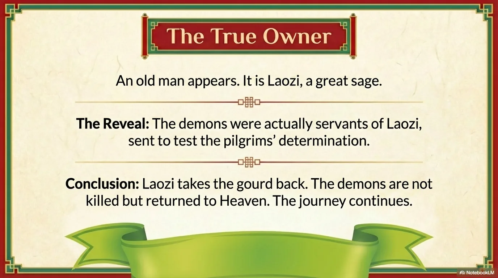

- 来源：`ppt/media/image16.png`（relationship `rId2`）
- 尺寸：1376×768
- 源 SHA-256：`12e08e8928ec4168164af44c1bd4202e0cc9d3bf225f0acde495102e3d1297d0`
- 输出 SHA-256：`821d301078aab7d7ba978ba4c3241161e28b89139bd11c0bd45d6bb01ca42ee5`
- 分类：unknown ｜ OCR：blocked ｜ 审核：unreviewed

## Slide 016

- 来源：`ppt/media/image17.png`（relationship `rId2`）
- 尺寸：1376×768
- 源 SHA-256：`8305a70a4bcbe8732c485b560f2b359250e3078a4b951ee326ce871d02ac3c55`
- 输出 SHA-256：`5a4ee5f54a1fb1a64d39a6a5aba902d07de5ebe780c6c877a9fd2507e579d65e`
- 分类：unknown ｜ OCR：blocked ｜ 审核：unreviewed

## Slide 017

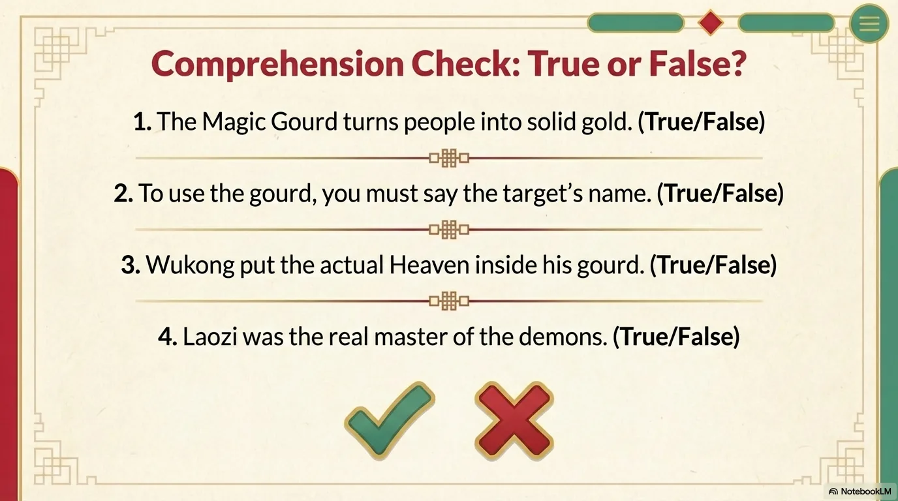

- 来源：`ppt/media/image18.png`（relationship `rId2`）
- 尺寸：1376×768
- 源 SHA-256：`fc2becf65146befeb3eb417491ecf61bc26afb887ea4ed1c401ee1e0cf0d1e64`
- 输出 SHA-256：`6ee665243c4edaa1cc0ac61d257419f527d512996fc28ca6e18aaf8da08cb6c9`
- 分类：unknown ｜ OCR：blocked ｜ 审核：unreviewed

## Slide 018

- 来源：`ppt/media/image19.png`（relationship `rId2`）
- 尺寸：1376×768
- 源 SHA-256：`7f5df73a5532ca5db32c8493e021532887c48062b69a4b4581f7993f49f5e1c5`
- 输出 SHA-256：`f46c45f65c6af0fb1e6c20b549d37021a26ed4b85521ad2d081b4e101ea08b82`
- 分类：unknown ｜ OCR：blocked ｜ 审核：unreviewed

## Slide 019

- 来源：`ppt/media/image20.png`（relationship `rId2`）
- 尺寸：1376×768
- 源 SHA-256：`1dd4d1a1a77b250038c9515730ac954372a2d041b8381959649c3527c5b99999`
- 输出 SHA-256：`9951ab20129d2e1ca9dddaa4de6930443df13c71fbd7fbd7b80c8f02af9415c8`
- 分类：unknown ｜ OCR：blocked ｜ 审核：unreviewed

## Slide 020

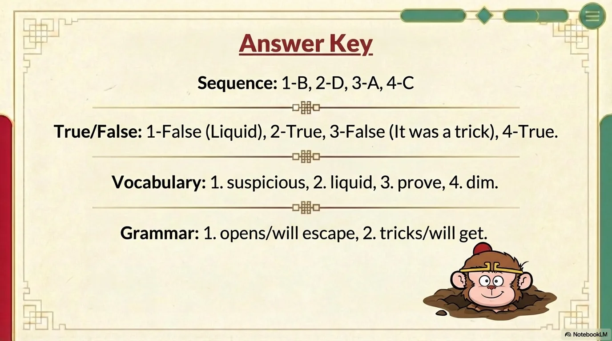

- 来源：`ppt/media/image21.png`（relationship `rId2`）
- 尺寸：1376×768
- 源 SHA-256：`b56b82c912aa4a440fc98defd5a34053bbd86b87cd305bbb811290e2c3be9fe1`
- 输出 SHA-256：`0354ec019b44e7daa7deaf4ee87e17d04f0994ace97b765fcce838195d149ce3`
- 分类：unknown ｜ OCR：blocked ｜ 审核：unreviewed
