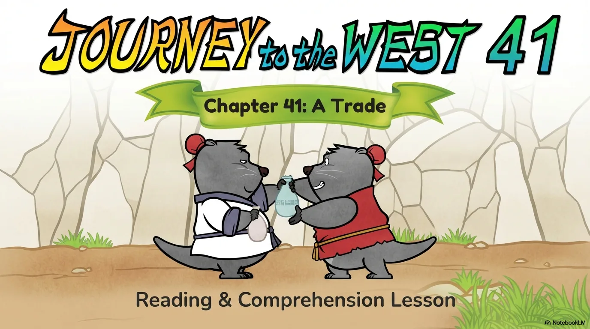
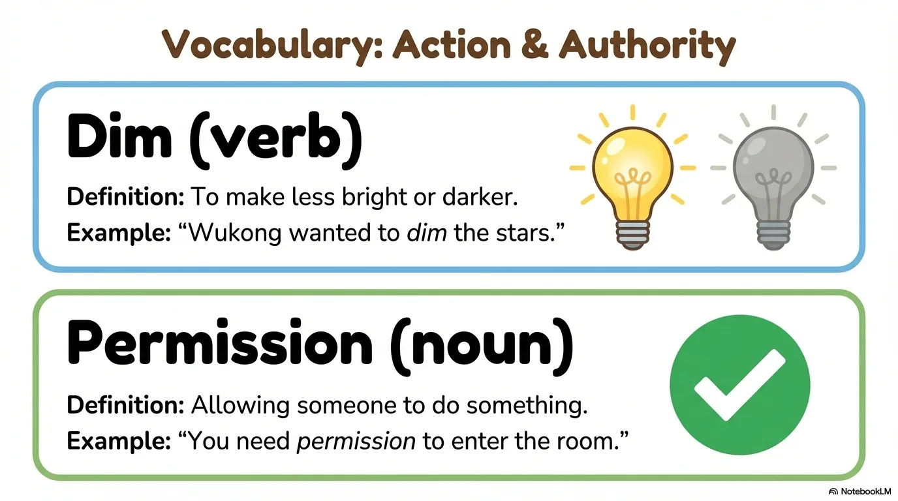
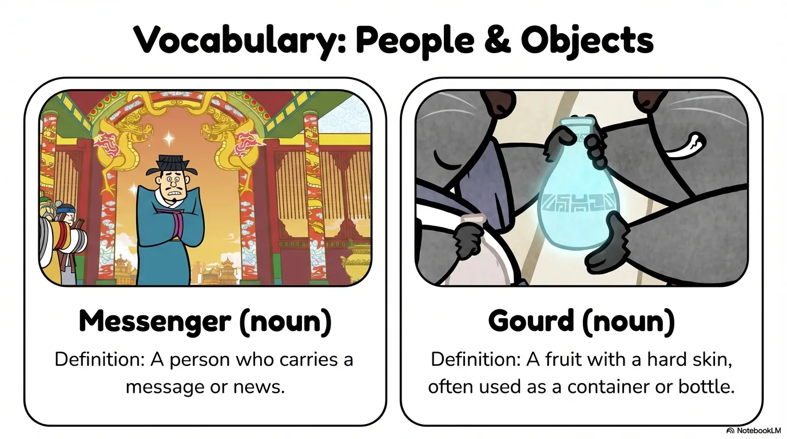
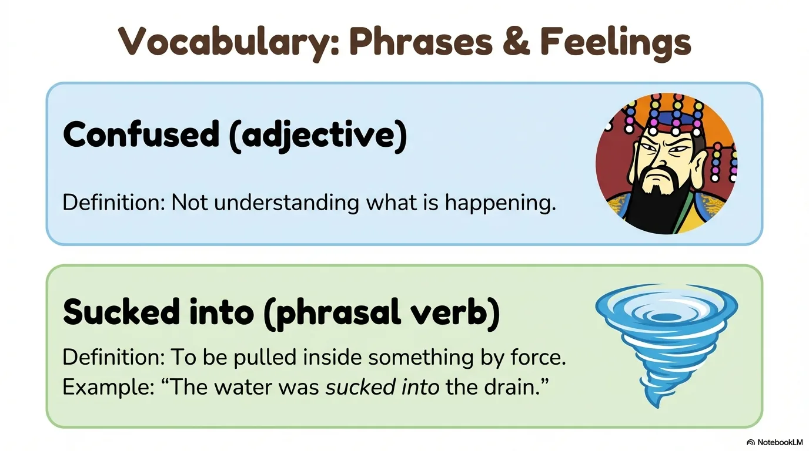
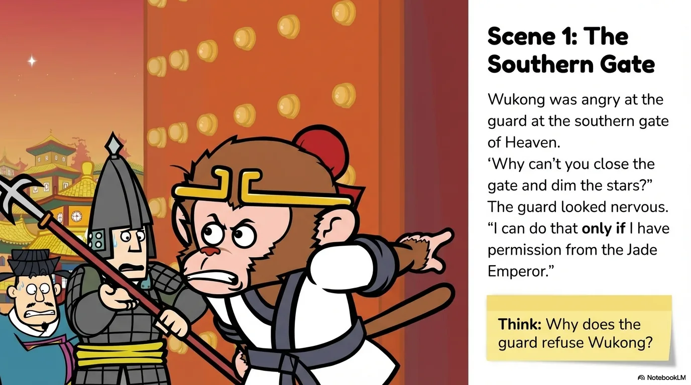
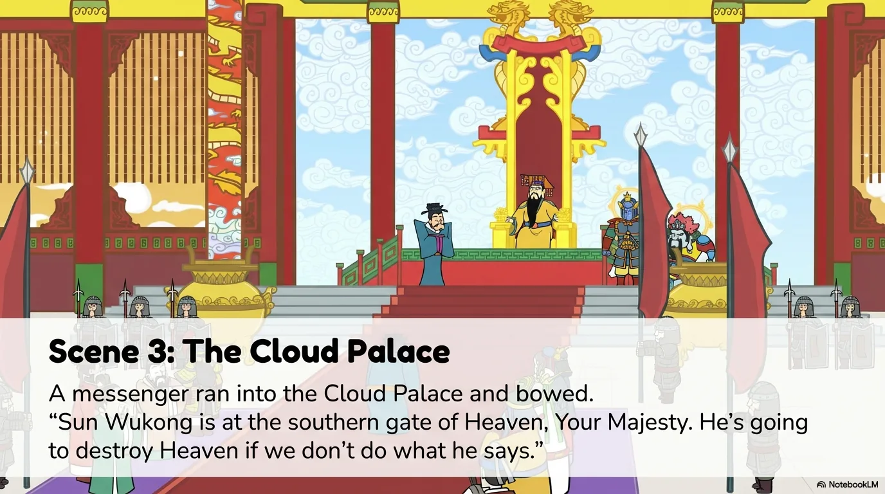
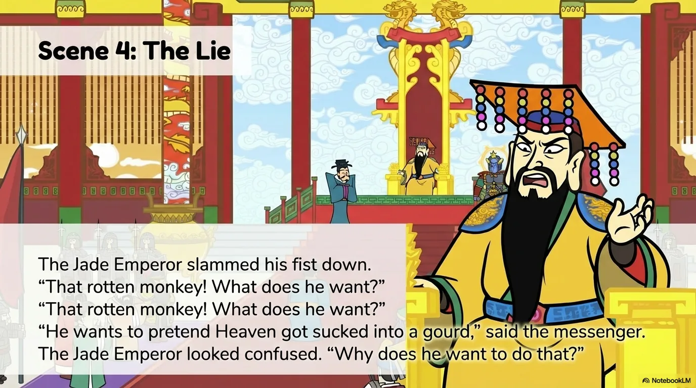
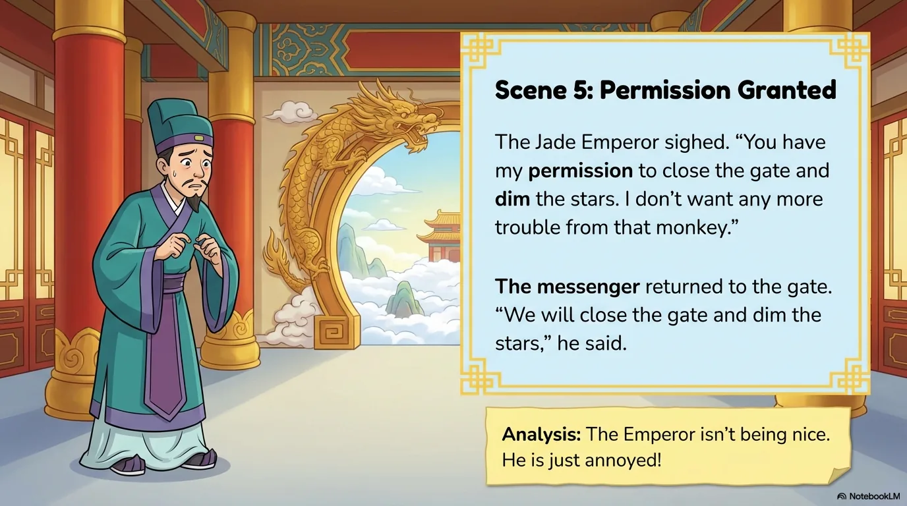
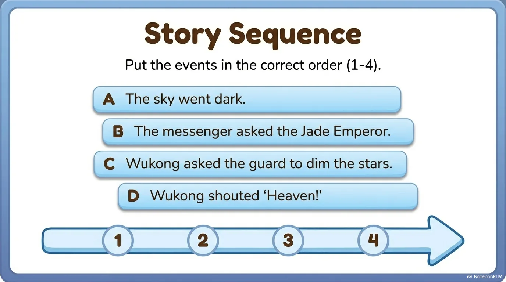
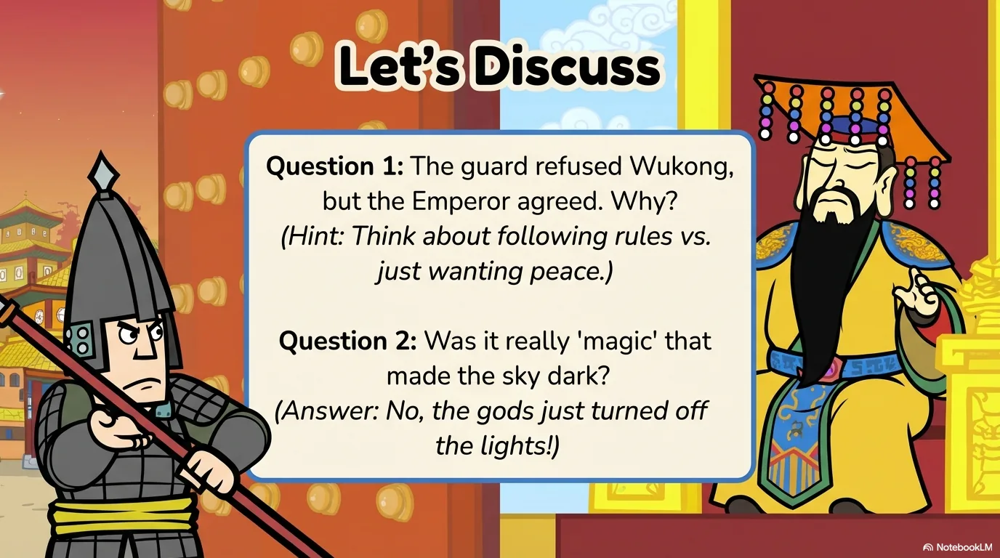

# 豆豆龙英语 · 第 41 集课件（EP041 草稿）

- 来源：`041_Journey to the West 41_A Trade.pptx`（主课件，20 页）
- OCR：`blocked`（no local OCR provider importable (pytesseract missing): No module named 'pytesseract'）
- 分类：待人工审核（unknown）
- 审核状态：`unreviewed`

## Slide 001

- 来源：`ppt/media/image1.png`（relationship `rId2`）
- 尺寸：1376×768
- 源 SHA-256：`40d7ff7894f2667659cac60d27904e288501cdc12ed7c0da9b45f78fa06a74d7`
- 输出 SHA-256：`f95da6291788b1d1868b766ca73aa386c1992f132560e3318689ee0ce4432261`
- 分类：unknown ｜ OCR：blocked ｜ 审核：unreviewed

## Slide 002

- 来源：`ppt/media/image3.png`（relationship `rId2`）
- 尺寸：1376×768
- 源 SHA-256：`8bb5bc1f51169755db36ebe677d6b461a21474c5a9194389eab6301b4ecacb7d`
- 输出 SHA-256：`d694ed76237bad4c6549c4ea8b63a9351c5cb6e53be0acd1211d2094d0d75c24`
- 分类：unknown ｜ OCR：blocked ｜ 审核：unreviewed

## Slide 003

- 来源：`ppt/media/image4.png`（relationship `rId2`）
- 尺寸：1376×768
- 源 SHA-256：`75b77ad0a4be90d8e30207df2ea094fc7494dbfe8277d45f32a812be6f1f2e6c`
- 输出 SHA-256：`cb0db17cbb6cf9dcccbba7194e52237d13252218774169d952b7b0bced5fa0ac`
- 分类：unknown ｜ OCR：blocked ｜ 审核：unreviewed

## Slide 004

- 来源：`ppt/media/image5.png`（relationship `rId2`）
- 尺寸：1376×768
- 源 SHA-256：`f7df0329ce443f0b9e345a5c2776530ecb8905aeac255a7e9395cc60bc2c9da0`
- 输出 SHA-256：`183b13c77fac32a06251da4417892d3043146879a3f5ae38c9c332214a445ad0`
- 分类：unknown ｜ OCR：blocked ｜ 审核：unreviewed

## Slide 005

- 来源：`ppt/media/image6.png`（relationship `rId2`）
- 尺寸：1376×768
- 源 SHA-256：`601cda7013580ca3cf0528e1ce3a61556a51075d8f0b4c987fa74707acede6de`
- 输出 SHA-256：`527ddc1eb3c5fb88a09198856fbdb899bd4a2a89cad64613d3a553bd86656a82`
- 分类：unknown ｜ OCR：blocked ｜ 审核：unreviewed

## Slide 006

- 来源：`ppt/media/image7.png`（relationship `rId2`）
- 尺寸：1376×768
- 源 SHA-256：`54bd8cdef352561adb692b10881b59211995be4f0b075303c7f265dc1de8a2da`
- 输出 SHA-256：`4a8ab58f5b9c6d8663eaff6bfe67d1e69eb3641ddd2bd32acabe8bc76c8f125c`
- 分类：unknown ｜ OCR：blocked ｜ 审核：unreviewed

## Slide 007

- 来源：`ppt/media/image8.png`（relationship `rId2`）
- 尺寸：1376×768
- 源 SHA-256：`03bdc7cf18b862b936b793f041473c2b4270e7b4979588ad16513b358e9ad022`
- 输出 SHA-256：`c42dfbe0eb797c7ecf0c6cb1916a42f43ac3957e650cfc7de03f1ebff5e8bc69`
- 分类：unknown ｜ OCR：blocked ｜ 审核：unreviewed

## Slide 008

- 来源：`ppt/media/image9.png`（relationship `rId2`）
- 尺寸：1376×768
- 源 SHA-256：`e737dfb34faea98b0b9ac5bfd73e43a49976e9e146300b4669440113924dbeae`
- 输出 SHA-256：`b4edcdaea92cb84bc8726d4803d295f9e600d5ea8c2e24e4646a9a0fc034c3fe`
- 分类：unknown ｜ OCR：blocked ｜ 审核：unreviewed

## Slide 009

- 来源：`ppt/media/image10.png`（relationship `rId2`）
- 尺寸：1376×768
- 源 SHA-256：`f6fc14a724d392423bb86c14d9a55d3aea92a7fc578b8f212253c641d4da1856`
- 输出 SHA-256：`7c2a4028d8b8f50e95ba3ff202dff1ee3f9207e3a21d19212ea378478eee4053`
- 分类：unknown ｜ OCR：blocked ｜ 审核：unreviewed

## Slide 010

- 来源：`ppt/media/image11.png`（relationship `rId2`）
- 尺寸：1376×768
- 源 SHA-256：`55b6e3e3e06b7450e02dc8200a00d056b6b5bcba93495d7ab8d6837b2336d47c`
- 输出 SHA-256：`e0f19dc6ec4c2af6504352677aa1f36320fe94a19a799e74b094027222f3b196`
- 分类：unknown ｜ OCR：blocked ｜ 审核：unreviewed

## Slide 011

- 来源：`ppt/media/image12.png`（relationship `rId2`）
- 尺寸：1376×768
- 源 SHA-256：`dc695acee7852edb2905c093450aeb00651e392bce3c70c58202bda2ddf3a9f9`
- 输出 SHA-256：`dd8e3f152537268ca0b1a2264edb1eb057a15e4785dd02c05222bc4fad61d854`
- 分类：unknown ｜ OCR：blocked ｜ 审核：unreviewed

## Slide 012

- 来源：`ppt/media/image13.png`（relationship `rId2`）
- 尺寸：1376×768
- 源 SHA-256：`748d8ec860a323b0720dfa934beeccd480e0ac6a8c675ae41e87ebf569ce2b6c`
- 输出 SHA-256：`6d4e34146537c31aeb36ece344bd52e04adfdcbe5a58de022adf85b838c19b63`
- 分类：unknown ｜ OCR：blocked ｜ 审核：unreviewed

## Slide 013

- 来源：`ppt/media/image14.png`（relationship `rId2`）
- 尺寸：1376×768
- 源 SHA-256：`346b1158f673d2ec6a409a4842429ac9aad95c338319e98b525af5903721d5e0`
- 输出 SHA-256：`07463e7f5657fd66b46274cbb7cfceb53a71d254aa11502e6846cb7efd1b6c0d`
- 分类：unknown ｜ OCR：blocked ｜ 审核：unreviewed

## Slide 014

- 来源：`ppt/media/image15.png`（relationship `rId2`）
- 尺寸：1376×768
- 源 SHA-256：`fb78bfffb9247ed6bce444c9f3581e6ee1ea00a51a5bdf6ab4841313251b97f5`
- 输出 SHA-256：`231107d51d7019e185a7afa1e19f7a81e2dd8ddc25a2cde56bafb4d68fa3c6ad`
- 分类：unknown ｜ OCR：blocked ｜ 审核：unreviewed

## Slide 015

- 来源：`ppt/media/image16.png`（relationship `rId2`）
- 尺寸：1376×768
- 源 SHA-256：`94cd331ab8cc67a79e6cb714ecebb40fdc935eb254f3383c409aab7ece6a313e`
- 输出 SHA-256：`7cc4c356bdfb5421afa8e3b20e7b4960667ef7cfdd20db9a6e6e81119392a1c6`
- 分类：unknown ｜ OCR：blocked ｜ 审核：unreviewed

## Slide 016

- 来源：`ppt/media/image17.png`（relationship `rId2`）
- 尺寸：1376×768
- 源 SHA-256：`16858685bd9c77a29299682236a383044f68bca7af1448d136551c355e2546c0`
- 输出 SHA-256：`14d5ac910c4cfb20260517cc0e0655b2f00c2bb53c3e4f6a5585f7b5cde1bd64`
- 分类：unknown ｜ OCR：blocked ｜ 审核：unreviewed

## Slide 017

- 来源：`ppt/media/image18.png`（relationship `rId2`）
- 尺寸：1376×768
- 源 SHA-256：`018a50f055420bce786a574b56573f489e2e3653dfd339cb3439aa3d400f5cd0`
- 输出 SHA-256：`ba67f036aff15ddf9b7ca18c710bdd13bc8d1e674ecab19646e18684f79c6da9`
- 分类：unknown ｜ OCR：blocked ｜ 审核：unreviewed

## Slide 018

- 来源：`ppt/media/image19.png`（relationship `rId2`）
- 尺寸：1376×768
- 源 SHA-256：`90331d01337881c929cfcfe27ec926551a765e9f0ba165bbbbe853724c3cd979`
- 输出 SHA-256：`90de88fcec84e0f235832e58569492790172a087a28daaf1dd1989ffef29fbae`
- 分类：unknown ｜ OCR：blocked ｜ 审核：unreviewed

## Slide 019

- 来源：`ppt/media/image20.png`（relationship `rId2`）
- 尺寸：1376×768
- 源 SHA-256：`2e2027b888cedf9a0f4accad1aba6ed5024a7cd6d333ade8be772995cbca0825`
- 输出 SHA-256：`0a10c10acc2c9f1973fed30c4934ffb968c76a1d346ea4f502197f350c9fc756`
- 分类：unknown ｜ OCR：blocked ｜ 审核：unreviewed

## Slide 020

- 来源：`ppt/media/image21.png`（relationship `rId2`）
- 尺寸：1376×768
- 源 SHA-256：`d730579baf5f52e6674b38ed6f839d7f4670d3e9af7fae709a1dc055ff51ffd2`
- 输出 SHA-256：`ec11886c375aad4927d4f45bca16602ae65916929d9c2c893731046d2694c466`
- 分类：unknown ｜ OCR：blocked ｜ 审核：unreviewed
