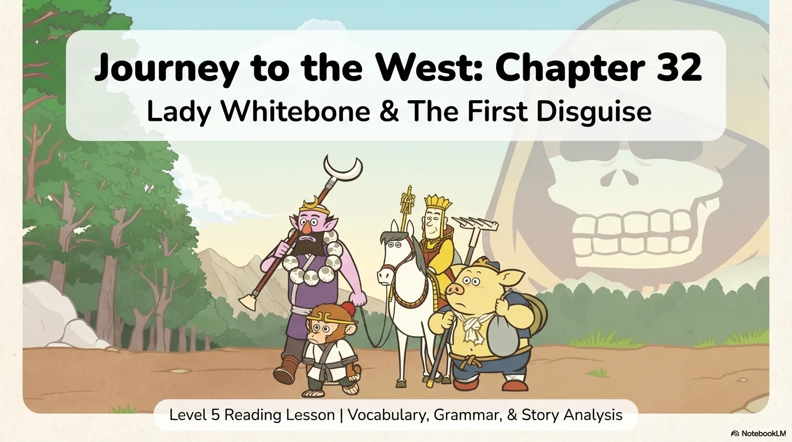
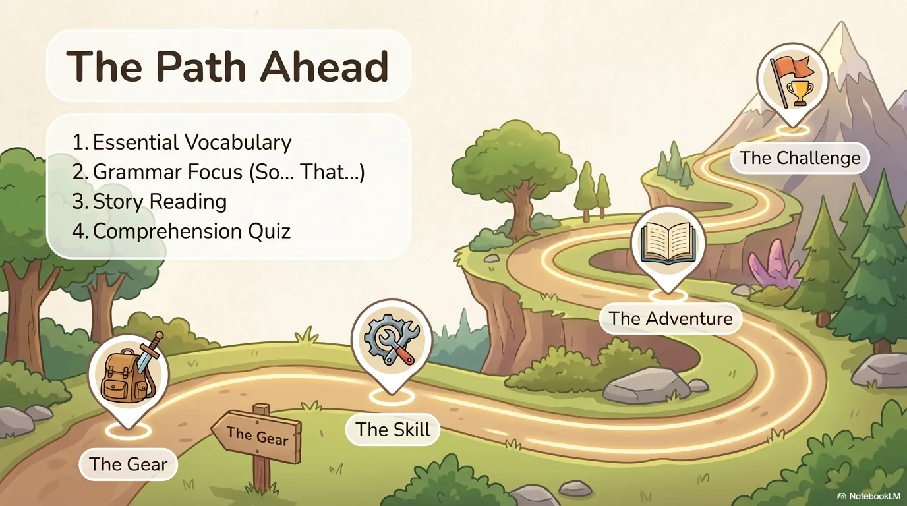
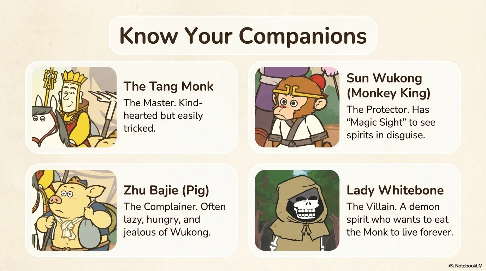
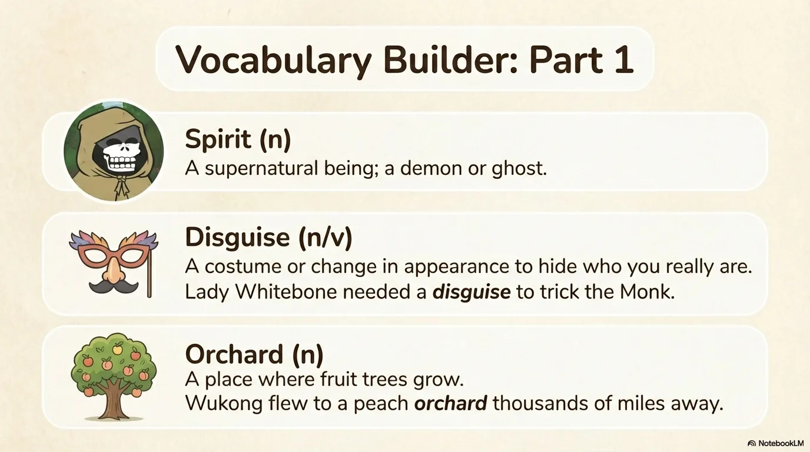
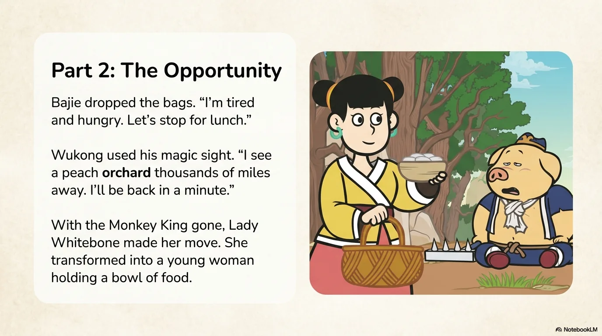
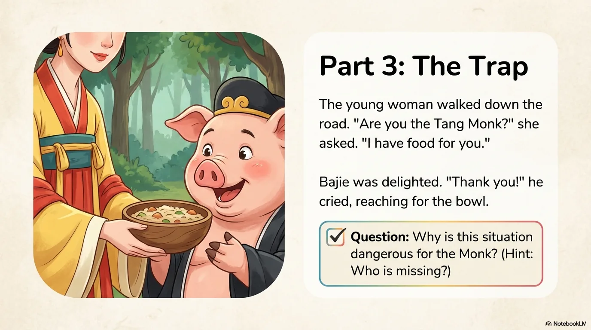
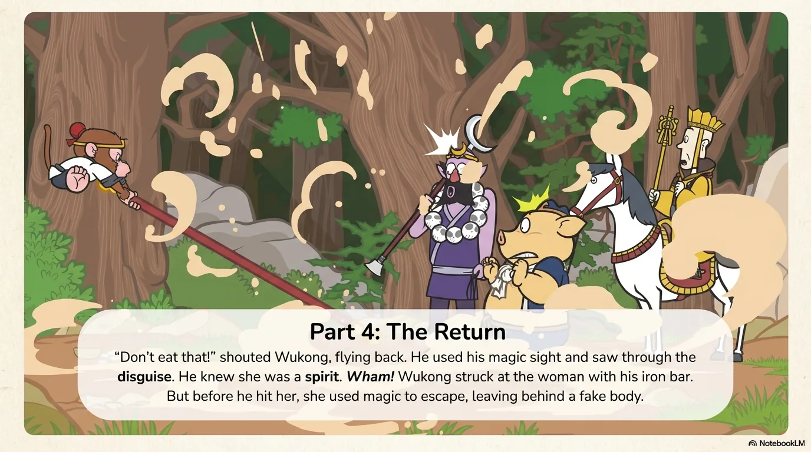
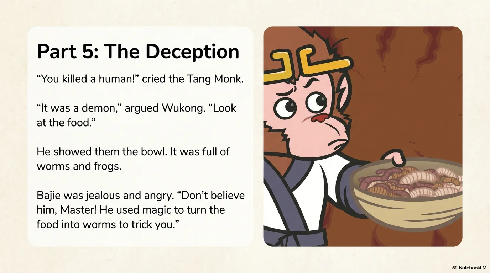
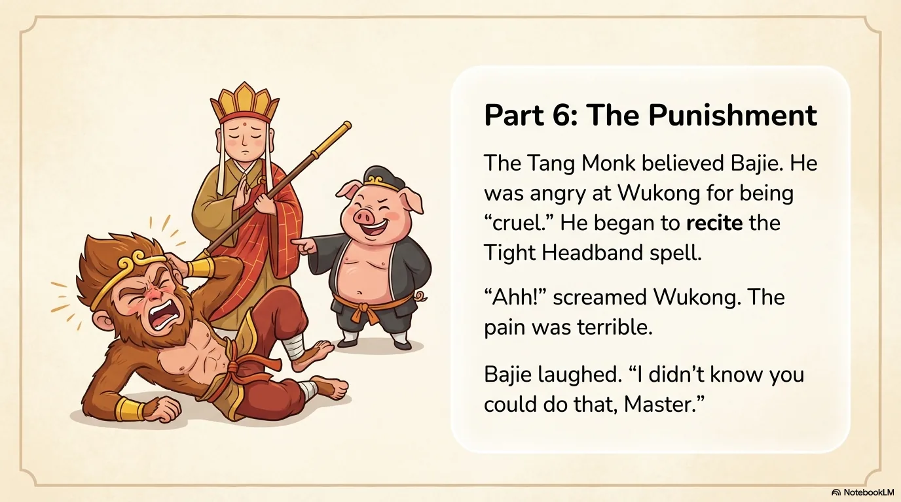
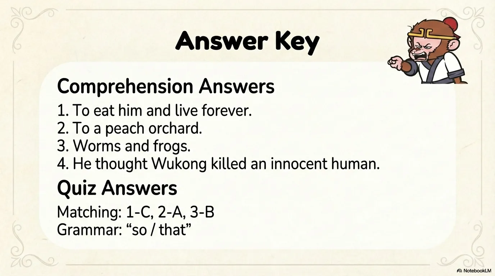

# 豆豆龙英语 · 第 42 集课件（EP042 草稿）

- 来源：`042_Journey to the West 42_Sun Kongwu.pptx`（主课件，16 页）
- OCR：`blocked`（no local OCR provider importable (pytesseract missing): No module named 'pytesseract'）
- 分类：待人工审核（unknown）
- 审核状态：`unreviewed`

## Slide 001

- 来源：`ppt/media/image1.png`（relationship `rId2`）
- 尺寸：1376×768
- 源 SHA-256：`15937ed55f0ca7b39a78fe70b915378ac5695b9a16e7e639ed6629508dac8f90`
- 输出 SHA-256：`21987b47301834efb544988aba9e8eb284fcad7e37131b5d0bbdd5d6acb2fbba`
- 分类：unknown ｜ OCR：blocked ｜ 审核：unreviewed

## Slide 002

- 来源：`ppt/media/image3.png`（relationship `rId2`）
- 尺寸：1376×768
- 源 SHA-256：`d35c9c2cf66ecd33ca36bb671c3e8bf0aba9e874dd7d34d48da8ce00933ff6ab`
- 输出 SHA-256：`896c252887e7e655ec2d54bd333bf8afdc50889d3ccdde08e8b6ce618bce93fd`
- 分类：unknown ｜ OCR：blocked ｜ 审核：unreviewed

## Slide 003

- 来源：`ppt/media/image4.png`（relationship `rId2`）
- 尺寸：1376×768
- 源 SHA-256：`01b1fbb6827b2dc8c8c6c45943d60d5ea0f319801edf3b9a69790544724e289d`
- 输出 SHA-256：`161c05b7ef52e3eeeaa937ca7232bf961940a6af4dfabaa33ba16a90326b3986`
- 分类：unknown ｜ OCR：blocked ｜ 审核：unreviewed

## Slide 004

- 来源：`ppt/media/image5.png`（relationship `rId2`）
- 尺寸：1376×768
- 源 SHA-256：`8c67d280ec197657276361a115aca962c231fc397927d7bc23c41fb01f8a0ef8`
- 输出 SHA-256：`72ee407233bddf0f0e65a3f6f9296693a14698eb715f353fccee5e7affabdceb`
- 分类：unknown ｜ OCR：blocked ｜ 审核：unreviewed

## Slide 005

- 来源：`ppt/media/image6.png`（relationship `rId2`）
- 尺寸：1376×768
- 源 SHA-256：`c053d1cee9e47458dba5df177599dbaa6b604ff68ecc6bb94243ea254b42b54a`
- 输出 SHA-256：`fb7f9f4299e602d6733db01772992fedaacf652d2536c8b43c952d0228a25c0e`
- 分类：unknown ｜ OCR：blocked ｜ 审核：unreviewed

## Slide 006

- 来源：`ppt/media/image7.png`（relationship `rId2`）
- 尺寸：1376×768
- 源 SHA-256：`69c052210dbce1935ec57f5f7fd1e3f9a986d634aaa2c3b22c36cd48a18842b9`
- 输出 SHA-256：`b8eb15a970751578f113cde7985d5d10cfd6a26a5a34adede84266d4891ba333`
- 分类：unknown ｜ OCR：blocked ｜ 审核：unreviewed

## Slide 007

- 来源：`ppt/media/image8.png`（relationship `rId2`）
- 尺寸：1376×768
- 源 SHA-256：`a863cfa65f3666089c16b2b852fe33a0f7396a39accff2f3444b56f0360b6a71`
- 输出 SHA-256：`ed7c8d0b3a57d3ffd1c83e78d6d28ae2a19cf890205881330a9a762843602339`
- 分类：unknown ｜ OCR：blocked ｜ 审核：unreviewed

## Slide 008

- 来源：`ppt/media/image9.png`（relationship `rId2`）
- 尺寸：1376×768
- 源 SHA-256：`bbe95547d98271a2c2af351b60a91c8e656bbe20067df553339390fa9696ded4`
- 输出 SHA-256：`fa6df7f8149e54595944cbbcef5b53e52108489e71f859c4a063e03ea6cf0334`
- 分类：unknown ｜ OCR：blocked ｜ 审核：unreviewed

## Slide 009

- 来源：`ppt/media/image10.png`（relationship `rId2`）
- 尺寸：1376×768
- 源 SHA-256：`9b9de3f561415ed868ae5be8b6428de83fb78b2b08bf1dacff7d84363c761244`
- 输出 SHA-256：`415adb3d82c7b85b98775acc5921917f3b0840f85f6386c6e804811e3a180b2f`
- 分类：unknown ｜ OCR：blocked ｜ 审核：unreviewed

## Slide 010

- 来源：`ppt/media/image11.png`（relationship `rId2`）
- 尺寸：1376×768
- 源 SHA-256：`45c578e496dc75adf739c52665be7e5e5e3d182215540cdb61c894233604d0cf`
- 输出 SHA-256：`084e2b091d7acefe17673098ae131385de2277f32d459d4ab1618d50e8611402`
- 分类：unknown ｜ OCR：blocked ｜ 审核：unreviewed

## Slide 011

- 来源：`ppt/media/image12.png`（relationship `rId2`）
- 尺寸：1376×768
- 源 SHA-256：`9e01ec554b726d187df6e62e83639542b125d38312a9966a478c08e89207e929`
- 输出 SHA-256：`bff76f3b19cff73a9ddc40057478be940e08853a2637a66034e7209895c6dff4`
- 分类：unknown ｜ OCR：blocked ｜ 审核：unreviewed

## Slide 012

- 来源：`ppt/media/image13.png`（relationship `rId2`）
- 尺寸：1376×768
- 源 SHA-256：`747e38f42bc26ca2e5011d1971347dbc3075a916dd5b4d45d4524ec49051c07f`
- 输出 SHA-256：`2c9d6585ff40636351290297b823e55c4c427682cd8cdc34fdb66c8f3ac957e6`
- 分类：unknown ｜ OCR：blocked ｜ 审核：unreviewed

## Slide 013

- 来源：`ppt/media/image14.png`（relationship `rId2`）
- 尺寸：1376×768
- 源 SHA-256：`5b04c78d1f0ea6a6e5d41ae1cf66e183e9468bc82cfa7a7658850a95eca00874`
- 输出 SHA-256：`e60928039bd6715c5f5ac6f58e1605fa059f0a10e3458651861569fe16dd68d9`
- 分类：unknown ｜ OCR：blocked ｜ 审核：unreviewed

## Slide 014

- 来源：`ppt/media/image15.png`（relationship `rId2`）
- 尺寸：1376×768
- 源 SHA-256：`169a3d4504b9c7803566028beec61398058b99f05a57d29ec33fbfd0a3757701`
- 输出 SHA-256：`ec63452a55d05346c5c2da7da53b658fdce4be12cc898b0209142a2c024c6326`
- 分类：unknown ｜ OCR：blocked ｜ 审核：unreviewed

## Slide 015

- 来源：`ppt/media/image16.png`（relationship `rId2`）
- 尺寸：1376×768
- 源 SHA-256：`218d5dc9d2d661b21e038fafe41c464ec0cb78dc622b9100f96efb44c23c0e19`
- 输出 SHA-256：`59c42d277a708a57764f592f7311252399d91e0436b8efd63279e8b9d306bfc4`
- 分类：unknown ｜ OCR：blocked ｜ 审核：unreviewed

## Slide 016

- 来源：`ppt/media/image17.png`（relationship `rId2`）
- 尺寸：1376×768
- 源 SHA-256：`01cf04bdaf49437a831a6e6928de08a340aaf5567b7dc901bacd3fbd2ebd97c0`
- 输出 SHA-256：`8efb15aa762d767b2b05094641c00c0d3e4a29253c22c247095f2c92fb635880`
- 分类：unknown ｜ OCR：blocked ｜ 审核：unreviewed
