# 豆豆龙英语 · 第 43 集课件（EP043 草稿）

- 来源：`043_Journey to the West 43_A Visit from Laozi.pptx`（主课件，17 页）
- OCR：`blocked`（no local OCR provider importable (pytesseract missing): No module named 'pytesseract'）
- 分类：待人工审核（unknown）
- 审核状态：`unreviewed`

## Slide 001

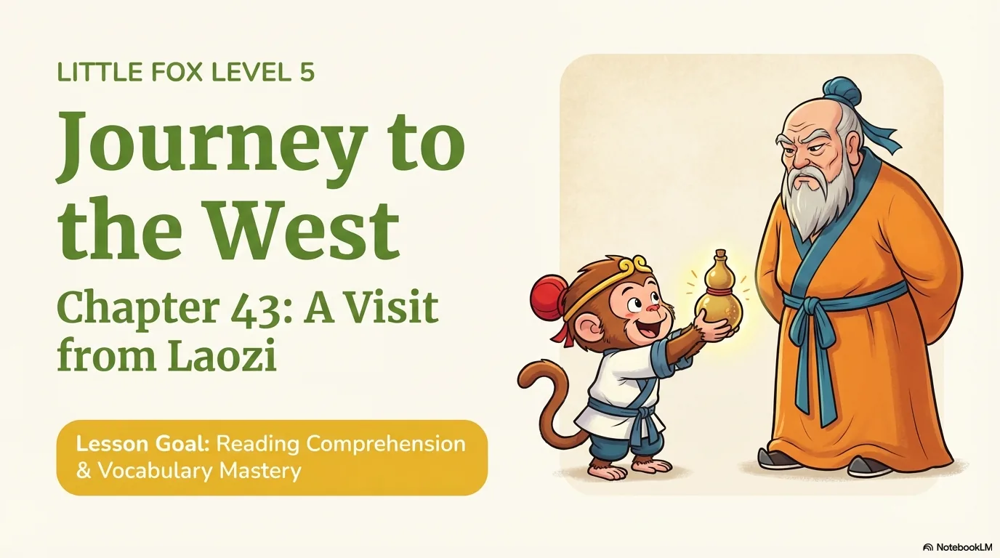

- 来源：`ppt/media/image1.png`（relationship `rId2`）
- 尺寸：1376×768
- 源 SHA-256：`52ea27b844cf0b8ac4a9ce12f8aef865e73a462787a7b512f37ce31e515480ff`
- 输出 SHA-256：`8c161fbb2eabf54998d5b4c4c0fa6862cd668d8b30cf5487e83e2689a809ea4f`
- 分类：unknown ｜ OCR：blocked ｜ 审核：unreviewed

## Slide 002

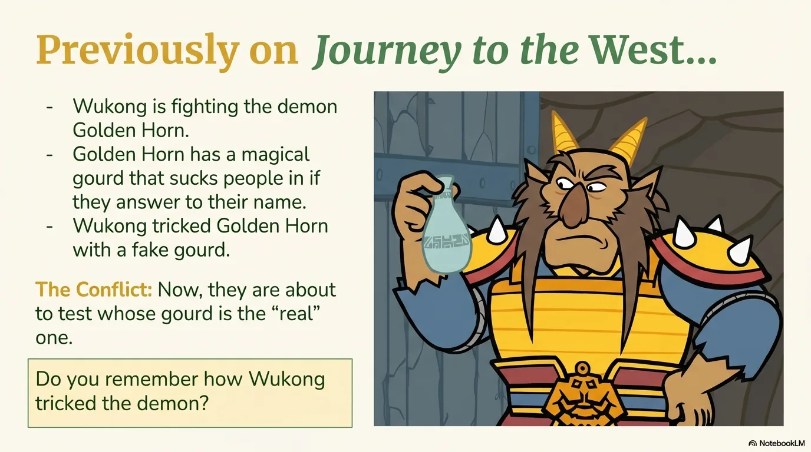

- 来源：`ppt/media/image3.png`（relationship `rId2`）
- 尺寸：1376×768
- 源 SHA-256：`b742f1027e64f1380c00ba032277a1d771cb1c96d6098b3adbea2fadbf279245`
- 输出 SHA-256：`d26d3d4e7fcf8c641c4863166b333868bd017fd17d48bef6d0bfcf41a0ce5f0c`
- 分类：unknown ｜ OCR：blocked ｜ 审核：unreviewed

## Slide 003

- 来源：`ppt/media/image4.png`（relationship `rId2`）
- 尺寸：1376×768
- 源 SHA-256：`4ec6498062da833c32b4595ef4575433e300355d998e6043e1dcbb76447c52d8`
- 输出 SHA-256：`84f01c95a466948e053f10bb4c2a492145fd66decf28b2c0ad74031103ba8c0b`
- 分类：unknown ｜ OCR：blocked ｜ 审核：unreviewed

## Slide 004

- 来源：`ppt/media/image5.png`（relationship `rId2`）
- 尺寸：1376×768
- 源 SHA-256：`ac7041aa6701374700b33dcd2d1e4e00836469b3a09b23985a29b7f6cd55a263`
- 输出 SHA-256：`74c0d83faf6d1189d8d04817cf11cd436e0ba192a3c4ae9c90530d2c63525b37`
- 分类：unknown ｜ OCR：blocked ｜ 审核：unreviewed

## Slide 005

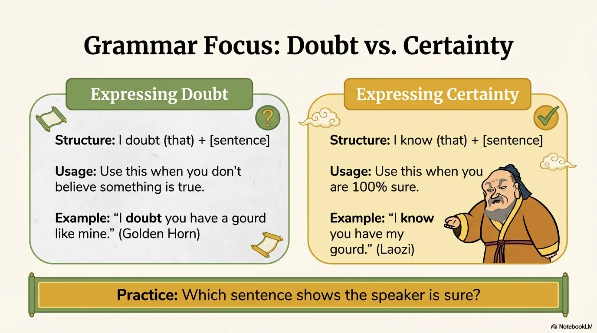

- 来源：`ppt/media/image6.png`（relationship `rId2`）
- 尺寸：1376×768
- 源 SHA-256：`4bff2356c760868ac270835ae7951342b386163f3b4e71030a090187021c4f62`
- 输出 SHA-256：`83ddbf402fc5ade1f177c0503eec5c19d6fae300145230276fb6169a6d0c1d2c`
- 分类：unknown ｜ OCR：blocked ｜ 审核：unreviewed

## Slide 006

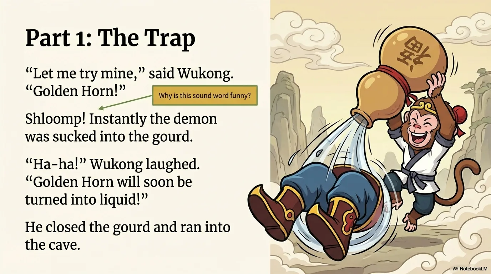

- 来源：`ppt/media/image7.png`（relationship `rId2`）
- 尺寸：1376×768
- 源 SHA-256：`833d33a76b3b273835baf0cf909ee62785b7e9c5a30a5119b8db582cc101c5b9`
- 输出 SHA-256：`80463c3ab45e664fe9894435b74624f51483493a7e6a82990a5108ae3161b121`
- 分类：unknown ｜ OCR：blocked ｜ 审核：unreviewed

## Slide 007

- 来源：`ppt/media/image8.png`（relationship `rId2`）
- 尺寸：1376×768
- 源 SHA-256：`3e3a554d9e0bcc98294dbdaed1708032f45c139fa7d4e5a789215b38069bef04`
- 输出 SHA-256：`3aff7fa9a5d94fe7148fbc1e464af765fe12dbd4957f6d91de0e63b163633e56`
- 分类：unknown ｜ OCR：blocked ｜ 审核：unreviewed

## Slide 008

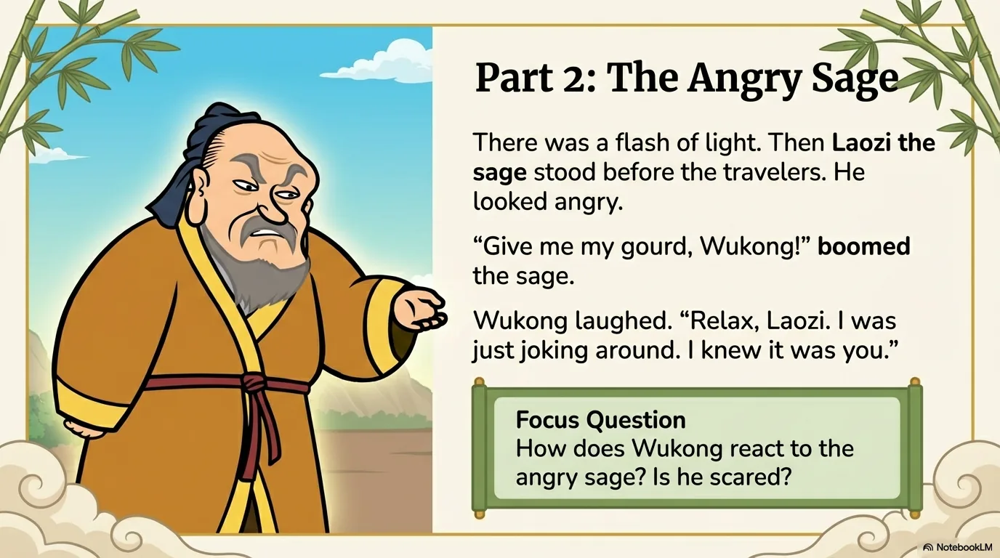

- 来源：`ppt/media/image9.png`（relationship `rId2`）
- 尺寸：1376×768
- 源 SHA-256：`8013a9dc2bde3f1c322d718d6f55db3f5a61e80586c723a7396424d5b389800d`
- 输出 SHA-256：`c6649ca4e9b51187fe2b1cbaa19658658fea7c83fe96639c073f6d23df87eed6`
- 分类：unknown ｜ OCR：blocked ｜ 审核：unreviewed

## Slide 009

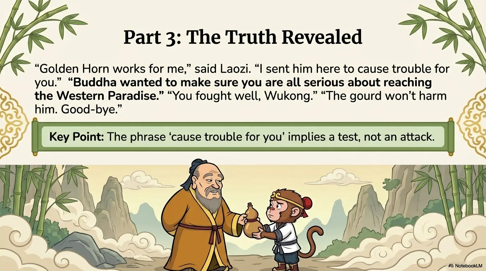

- 来源：`ppt/media/image10.png`（relationship `rId2`）
- 尺寸：1376×768
- 源 SHA-256：`b9f0d9fbca4303ac91f4c44280365d53368747617bc962e6d4d972270950fe99`
- 输出 SHA-256：`015326c6b6725584b3292d79823e3c793f8c3ea3c51266dcdbc0bfcb049457a7`
- 分类：unknown ｜ OCR：blocked ｜ 审核：unreviewed

## Slide 010

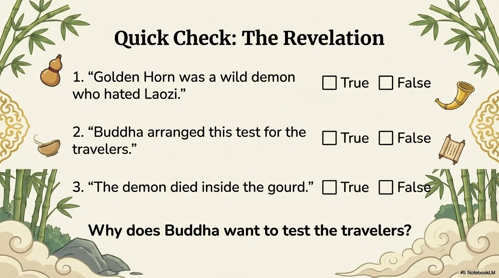

- 来源：`ppt/media/image11.png`（relationship `rId2`）
- 尺寸：1376×768
- 源 SHA-256：`e34c96cb5fcdb0805f180719d6c9225a80283346188068a013f0ab5839c91a26`
- 输出 SHA-256：`68ef6f9010a6084e428ccdc002d114edcfec5091e0394e746c59d06c2e8f6d45`
- 分类：unknown ｜ OCR：blocked ｜ 审核：unreviewed

## Slide 011

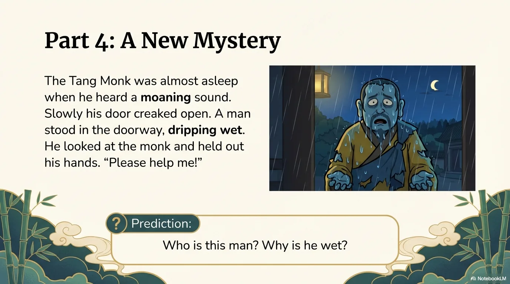

- 来源：`ppt/media/image12.png`（relationship `rId2`）
- 尺寸：1376×768
- 源 SHA-256：`6d52ab5b8e2e401566e9c7fd79049463060b8043c1967df328166b1dcafe2dc7`
- 输出 SHA-256：`a925414ba7408cfc1b567f6b40ab4a9f5cbc7e01592103732158579422e3aac1`
- 分类：unknown ｜ OCR：blocked ｜ 审核：unreviewed

## Slide 012

- 来源：`ppt/media/image13.png`（relationship `rId2`）
- 尺寸：1376×768
- 源 SHA-256：`6ae9730ee89ee5869049bc27e780566512c16c5a8e0afae1555d39705d45fad8`
- 输出 SHA-256：`6ccc135db7ed2619a04c0ef8a270ea1cc571ad0193ef7a507b9acc51b95a98e5`
- 分类：unknown ｜ OCR：blocked ｜ 审核：unreviewed

## Slide 013

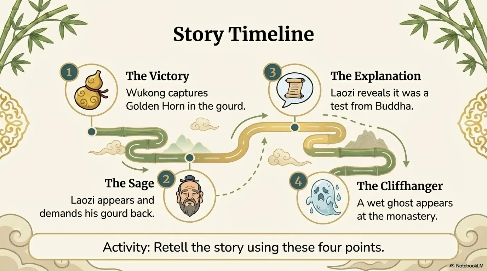

- 来源：`ppt/media/image14.png`（relationship `rId2`）
- 尺寸：1376×768
- 源 SHA-256：`fcbbef630120f38bc7b3d022cd38bb23feadb5553e36a37f69951f7358464bd4`
- 输出 SHA-256：`6ba9d31d063eac021e21668568e2fdfef991c7554552ff1b74448b26cb1a36f0`
- 分类：unknown ｜ OCR：blocked ｜ 审核：unreviewed

## Slide 014

- 来源：`ppt/media/image15.png`（relationship `rId2`）
- 尺寸：1376×768
- 源 SHA-256：`2e6bb661c5b4f0c138313dca13775ef360fe5764d8221f132de2deb48fa24c56`
- 输出 SHA-256：`74b0b21bdcc674c886b7330aaad68564a1992b8e2ab5001d1b41ddbadf21e097`
- 分类：unknown ｜ OCR：blocked ｜ 审核：unreviewed

## Slide 015

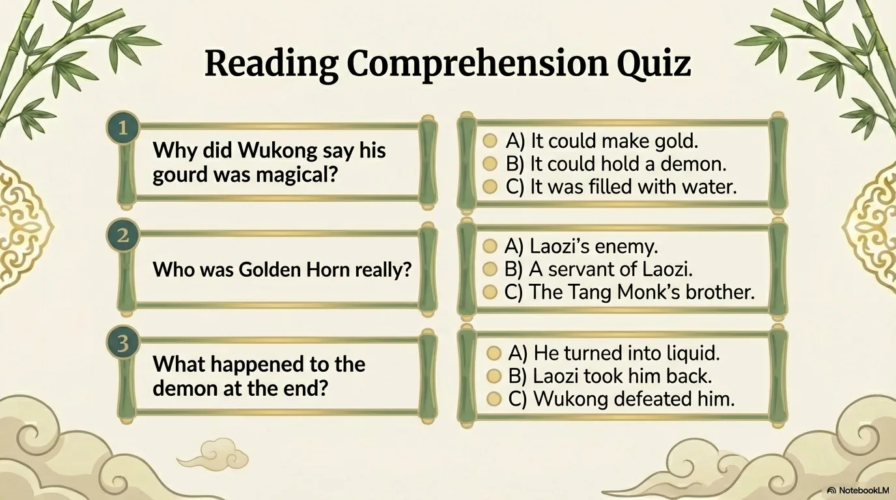

- 来源：`ppt/media/image16.png`（relationship `rId2`）
- 尺寸：1376×768
- 源 SHA-256：`b9ec818e43635d3f237f114ea40c7d15426a9133a4fbd5b066ba7f7ca691e165`
- 输出 SHA-256：`5505370bc34eb60869b956b1588bdfb19dcaa20878668e66eb88030fd98495f1`
- 分类：unknown ｜ OCR：blocked ｜ 审核：unreviewed

## Slide 016

- 来源：`ppt/media/image17.png`（relationship `rId2`）
- 尺寸：1376×768
- 源 SHA-256：`77ebf9c0fb6a202696a9ed391e98d41c288aa028d38ac082e680fc97c887ff4e`
- 输出 SHA-256：`8aa734b485b1aebd14bfa649e9821979b56b0e68b7f98ebdc8e4d7297a0c35ab`
- 分类：unknown ｜ OCR：blocked ｜ 审核：unreviewed

## Slide 017

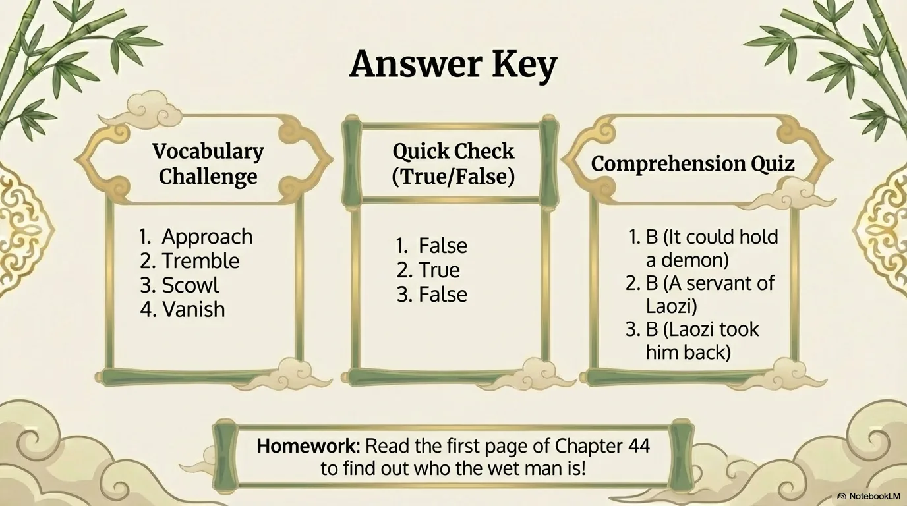

- 来源：`ppt/media/image18.png`（relationship `rId2`）
- 尺寸：1376×768
- 源 SHA-256：`b3fd623dbccbe80d36f0c507908c76ec823121fe9f3706d37d5337f7034d5739`
- 输出 SHA-256：`18e3e18ec794b1d6a96d97abf9decc9227904f9b605c3eb3d38d0f36fd07d675`
- 分类：unknown ｜ OCR：blocked ｜ 审核：unreviewed
