# 豆豆龙英语 · 第 44 集课件（EP044 草稿）

- 来源：`044_Journey to the West 44_The King's Ghost.pptx`（主课件，20 页）
- OCR：`blocked`（no local OCR provider importable (pytesseract missing): No module named 'pytesseract'）
- 分类：待人工审核（unknown）
- 审核状态：`unreviewed`

## Slide 001

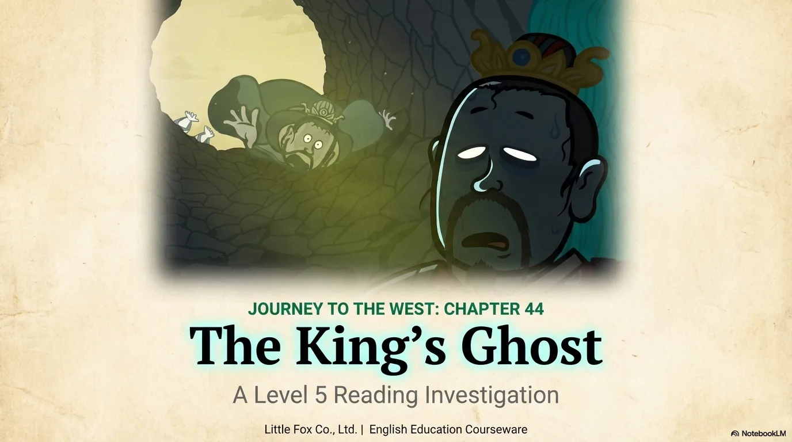

- 来源：`ppt/media/image1.png`（relationship `rId2`）
- 尺寸：1376×768
- 源 SHA-256：`67ec0171d2b3d74e6e177ba52cf5242a0412951c228ca956d685f8acea038697`
- 输出 SHA-256：`7bbcfa97ec14cfe881b3dee921f874bd4e83802b322a30ef8972ffeacd7b1a58`
- 分类：unknown ｜ OCR：blocked ｜ 审核：unreviewed

## Slide 002

- 来源：`ppt/media/image3.png`（relationship `rId2`）
- 尺寸：1376×768
- 源 SHA-256：`fd7e43e3eaa2fe0e955ad143a47bee93c3cdf1430cf9655c8de89e103ace7c95`
- 输出 SHA-256：`dcd1635f11cdbc0b9fe10998f634fb27c53a4d98b2bcba3d50ed4aa5a3e9695e`
- 分类：unknown ｜ OCR：blocked ｜ 审核：unreviewed

## Slide 003

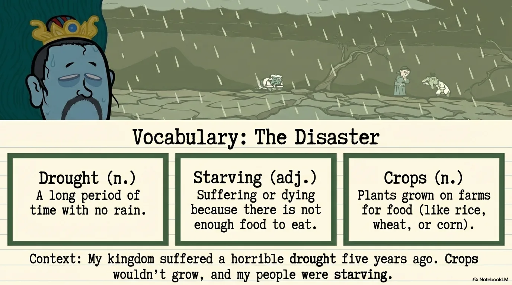

- 来源：`ppt/media/image4.png`（relationship `rId2`）
- 尺寸：1376×768
- 源 SHA-256：`e71f975b3faa9c5c6cb35e3609d8f20e42e8007c995d35d94b47be040d3d7491`
- 输出 SHA-256：`29ef7362a3cbb42ea33a6044767fa73f04f026cf9ed09a8f6d73af44678612fa`
- 分类：unknown ｜ OCR：blocked ｜ 审核：unreviewed

## Slide 004

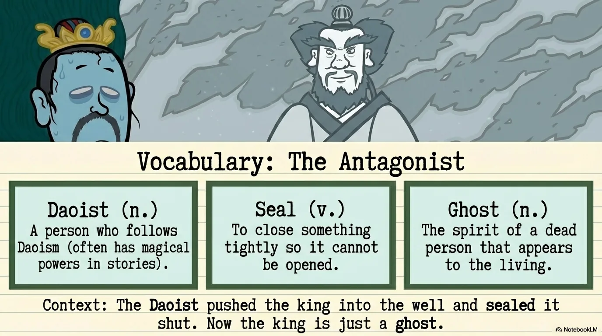

- 来源：`ppt/media/image5.png`（relationship `rId2`）
- 尺寸：1376×768
- 源 SHA-256：`79fd43e29d89db4e3e508c3c417feefe23762c02c90172903eb8ee832f090342`
- 输出 SHA-256：`5caa6c2f94d91bb62c1e1e0fbce5934c22226b8911db010bddf7e8fc460cf9e0`
- 分类：unknown ｜ OCR：blocked ｜ 审核：unreviewed

## Slide 005

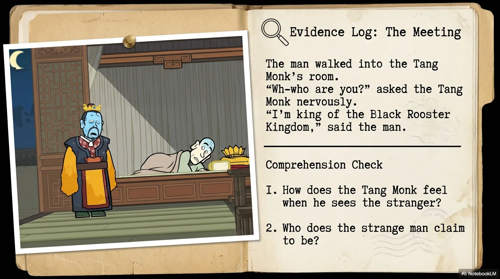

- 来源：`ppt/media/image6.png`（relationship `rId2`）
- 尺寸：1376×768
- 源 SHA-256：`ae228bdca1c51671812d84e7e419a6c4f664cd3470f2661cad76e8fc52f7ad82`
- 输出 SHA-256：`78957c47bcc70c56a46d7cc1005f84514fcb64a6298745c163a5189afca6dd42`
- 分类：unknown ｜ OCR：blocked ｜ 审核：unreviewed

## Slide 006

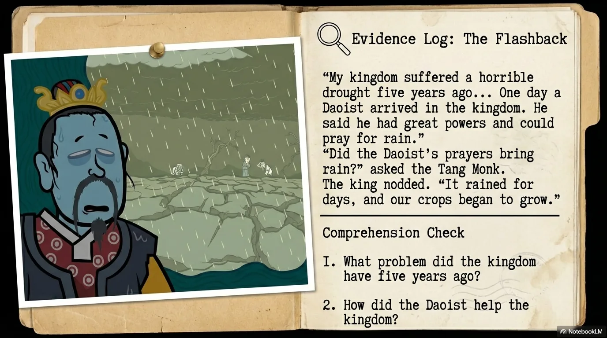

- 来源：`ppt/media/image7.png`（relationship `rId2`）
- 尺寸：1376×768
- 源 SHA-256：`f0da69257dfad58bf853c7916b7892250acf53074c57da72c1957759ac43b355`
- 输出 SHA-256：`07899e1cbdff110b1bf4cfa916038d5b7508f594ebfb983873616ee2ff272549`
- 分类：unknown ｜ OCR：blocked ｜ 审核：unreviewed

## Slide 007

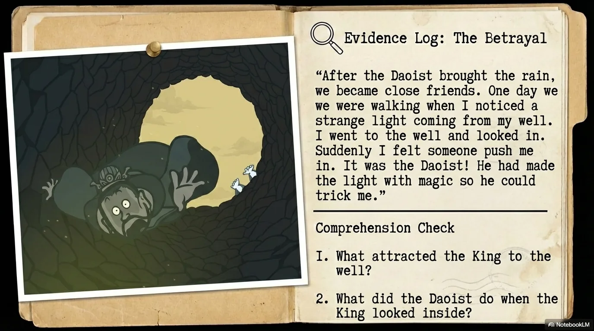

- 来源：`ppt/media/image8.png`（relationship `rId2`）
- 尺寸：1376×768
- 源 SHA-256：`370eeb244e55242d2112710178c454c886b2f27726194f252e3d56754c09a814`
- 输出 SHA-256：`afb9e9cadcc6ca00e7187cef208e00b91d38663145adbfaeddb27926ffed075a`
- 分类：unknown ｜ OCR：blocked ｜ 审核：unreviewed

## Slide 008

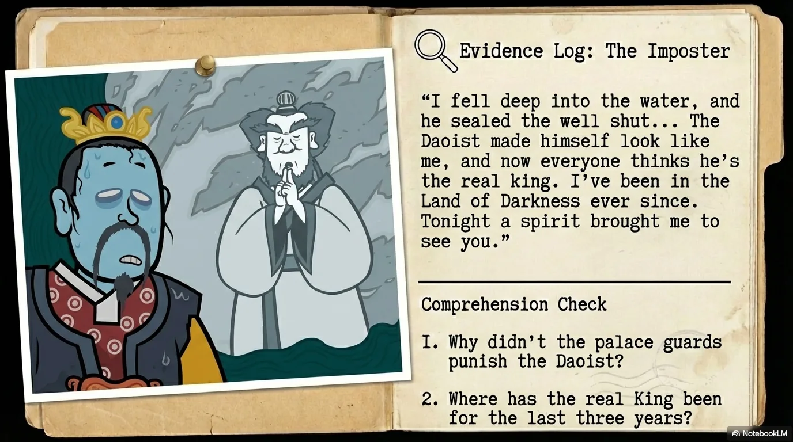

- 来源：`ppt/media/image9.png`（relationship `rId2`）
- 尺寸：1376×768
- 源 SHA-256：`998a8b115f304804adaa014bcc31060d34e12c50b35459ed359fa2fc7bf81e6e`
- 输出 SHA-256：`bdb8b592f86827353cc3c7b89bc1b356da7f44b4dc0b5f5e041c9676ed4c4782`
- 分类：unknown ｜ OCR：blocked ｜ 审核：unreviewed

## Slide 009

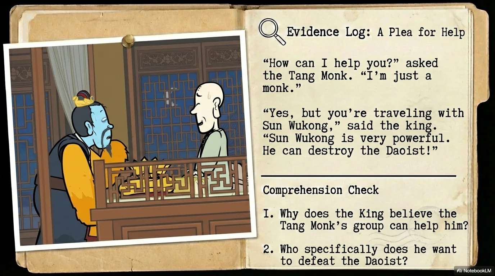

- 来源：`ppt/media/image10.png`（relationship `rId2`）
- 尺寸：1376×768
- 源 SHA-256：`22181e908eb7ebb0ac5d3dabea5e1b0568f511aaba98edeb973e998f93182ba3`
- 输出 SHA-256：`619a96a95b5e76105621092e0ea4e47fe3c4ba3fcd4bbf202bd2a865f27d8fd0`
- 分类：unknown ｜ OCR：blocked ｜ 审核：unreviewed

## Slide 010

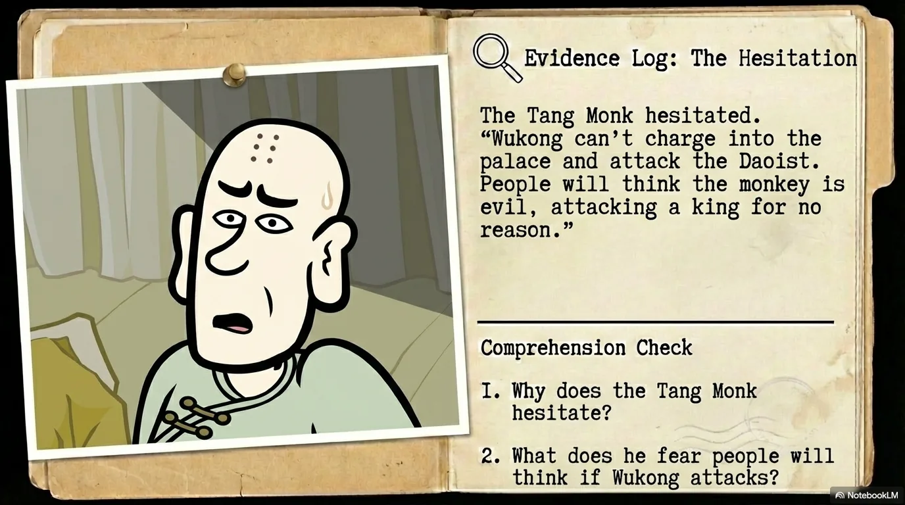

- 来源：`ppt/media/image11.png`（relationship `rId2`）
- 尺寸：1376×768
- 源 SHA-256：`c6755d1e62ebde8cac4ad79841ab31b132fa86811465c02a7769b787664581be`
- 输出 SHA-256：`670105a68c390e5ac1873524825242a36b0ad2bdf08d82fa7aa14d487b4b3d17`
- 分类：unknown ｜ OCR：blocked ｜ 审核：unreviewed

## Slide 011

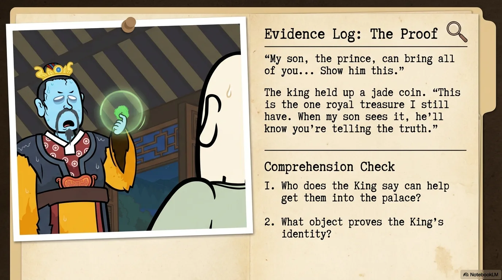

- 来源：`ppt/media/image12.png`（relationship `rId2`）
- 尺寸：1376×768
- 源 SHA-256：`afbb484d119f751b63d527752949c52a689d2ad36b9db56946683736d78b2445`
- 输出 SHA-256：`b6e2d81c813c69700a89903d32c7f38a6a6e2d9e27c14c67347af35f8f411862`
- 分类：unknown ｜ OCR：blocked ｜ 审核：unreviewed

## Slide 012

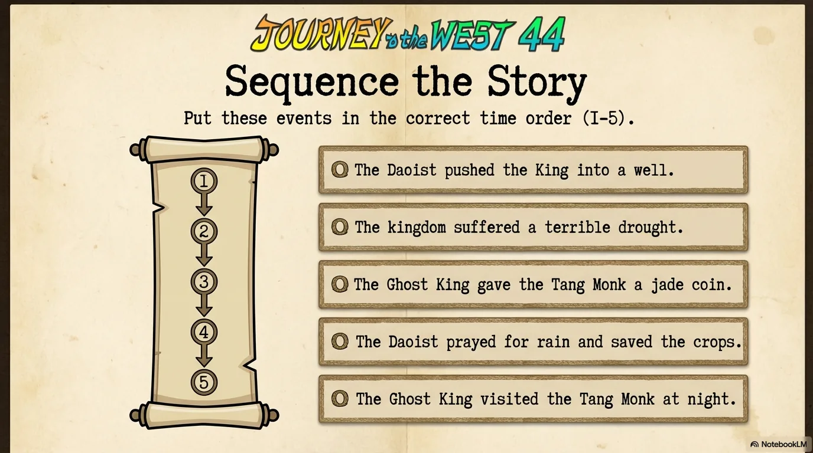

- 来源：`ppt/media/image13.png`（relationship `rId2`）
- 尺寸：1376×768
- 源 SHA-256：`181bc80295a774c3361cb5dcbf7db8ee603fd3cd03e6a24c8985f5ca437a8a89`
- 输出 SHA-256：`535651bfedad761e3201677fb9fd92106a07a5f35fbf403cc4419a25a83de4da`
- 分类：unknown ｜ OCR：blocked ｜ 审核：unreviewed

## Slide 013

- 来源：`ppt/media/image14.png`（relationship `rId2`）
- 尺寸：1376×768
- 源 SHA-256：`14cc8cdb7d3995413e4b5ef73ffc70544f70587d89ae6637164e03318f5af8d8`
- 输出 SHA-256：`aaee43688f111c9e31787317121e2b6097903dd9dc26ecb7dab0521baebe8665`
- 分类：unknown ｜ OCR：blocked ｜ 审核：unreviewed

## Slide 014

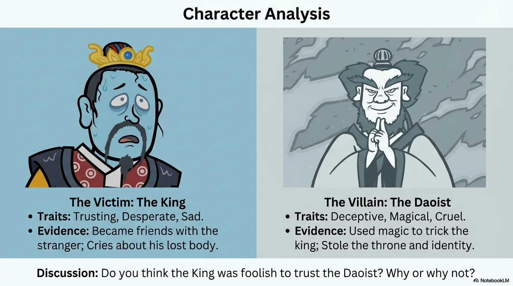

- 来源：`ppt/media/image15.png`（relationship `rId2`）
- 尺寸：1376×768
- 源 SHA-256：`e51f412e5ca6891d92fe8a05d5545fcfd4d03d99e903087dba7b1a1b29b25036`
- 输出 SHA-256：`33fdb2bebdee314860b3ca5a97822be0c9aa2c0b2ab9666cfbf1107d621cebf7`
- 分类：unknown ｜ OCR：blocked ｜ 审核：unreviewed

## Slide 015

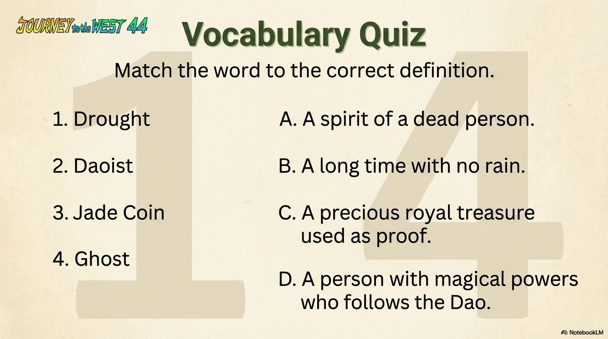

- 来源：`ppt/media/image16.png`（relationship `rId2`）
- 尺寸：1376×768
- 源 SHA-256：`9c5ca81d36cccaa721cb1787f563d442331f9beb9a6c3d3e9c2406c575c23ac9`
- 输出 SHA-256：`84264251e66d487d8388585e45dd2eaf234cc8544978563cd36658e3fe9c06b7`
- 分类：unknown ｜ OCR：blocked ｜ 审核：unreviewed

## Slide 016

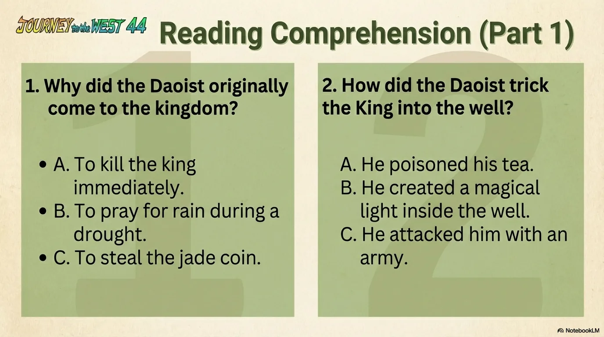

- 来源：`ppt/media/image17.png`（relationship `rId2`）
- 尺寸：1376×768
- 源 SHA-256：`1c1a482610b7e33e2bb0b49222db40ee3fb9b370fb5a5c206eb6e86ff18a4136`
- 输出 SHA-256：`065c5688c66343cb2149b7501c403351f8c94120211975c8ae79c618c32dc15d`
- 分类：unknown ｜ OCR：blocked ｜ 审核：unreviewed

## Slide 017

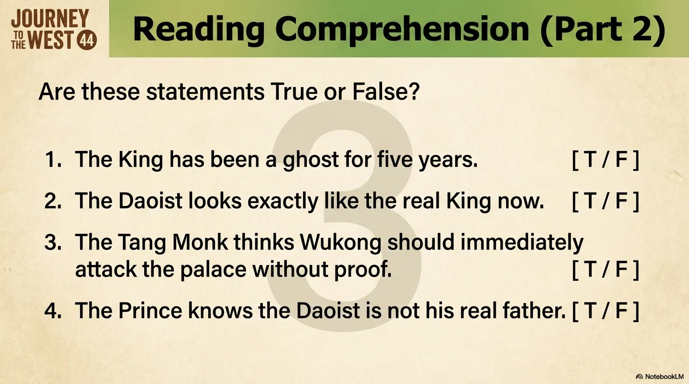

- 来源：`ppt/media/image18.png`（relationship `rId2`）
- 尺寸：1376×768
- 源 SHA-256：`f8265c80f419ae4cd5556ea8da6e6faa20632cfb5103cb7ab55c2f5cbd78c502`
- 输出 SHA-256：`195a4518af32eb971ca2f634d4aaff1d59c5324b326bd7800f6ab6173da32d31`
- 分类：unknown ｜ OCR：blocked ｜ 审核：unreviewed

## Slide 018

- 来源：`ppt/media/image19.png`（relationship `rId2`）
- 尺寸：1376×768
- 源 SHA-256：`085b5825743adce5ec2fb35b7a4dd403c2fa3486ca6096c3881317657729d777`
- 输出 SHA-256：`de67a93158d1b0bd21eb28b7d813f0b42f1887d78fbb5b9474bc92e6b8774cc9`
- 分类：unknown ｜ OCR：blocked ｜ 审核：unreviewed

## Slide 019

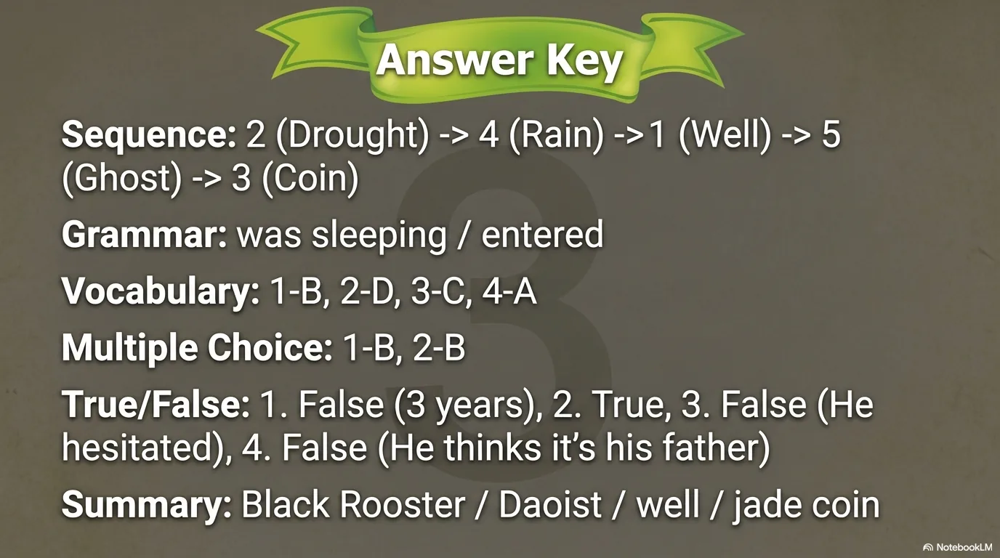

- 来源：`ppt/media/image20.png`（relationship `rId2`）
- 尺寸：1376×768
- 源 SHA-256：`f87f5160cb4d166540d6998a8b9dcfaeb8bcab2e2d18771bc45019441f00e6ee`
- 输出 SHA-256：`568c9232c5cb8b8658593017698d3b8facfa19d57d7b648e96518c722b0741fa`
- 分类：unknown ｜ OCR：blocked ｜ 审核：unreviewed

## Slide 020

- 来源：`ppt/media/image21.png`（relationship `rId2`）
- 尺寸：1376×768
- 源 SHA-256：`1d11e97c4ab0d1b66accb53ab7f28836429cefabc26c742a14c78de93f02047f`
- 输出 SHA-256：`727cbf558c4148adea57dd6785ea7452d18bb686ef884c75411f4e0a4baa13b4`
- 分类：unknown ｜ OCR：blocked ｜ 审核：unreviewed
