# 豆豆龙英语 · 第 45 集课件（EP045 草稿）

- 来源：`045_Journey to the West 45_The Treasure in the Well.pptx`（主课件，20 页）
- OCR：`blocked`（no local OCR provider importable (pytesseract missing): No module named 'pytesseract'）
- 分类：待人工审核（unknown）
- 审核状态：`unreviewed`

## Slide 001

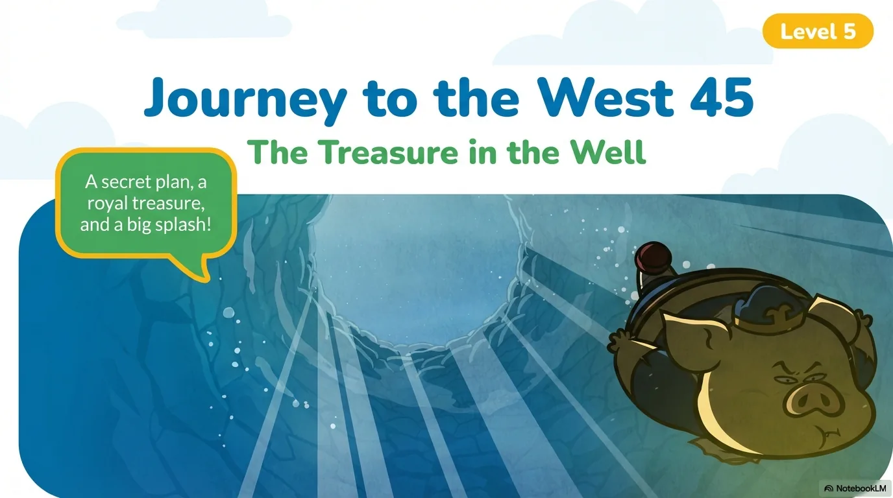

- 来源：`ppt/media/image1.png`（relationship `rId2`）
- 尺寸：1376×768
- 源 SHA-256：`0f391d91751d0fec2d78644ad608a769ad41f934774be492ba3e0412ad79ae0e`
- 输出 SHA-256：`fd22a9345ecafee9ded9c462398dabd05642ea84a6d319ff7aea87fa139d9567`
- 分类：unknown ｜ OCR：blocked ｜ 审核：unreviewed

## Slide 002

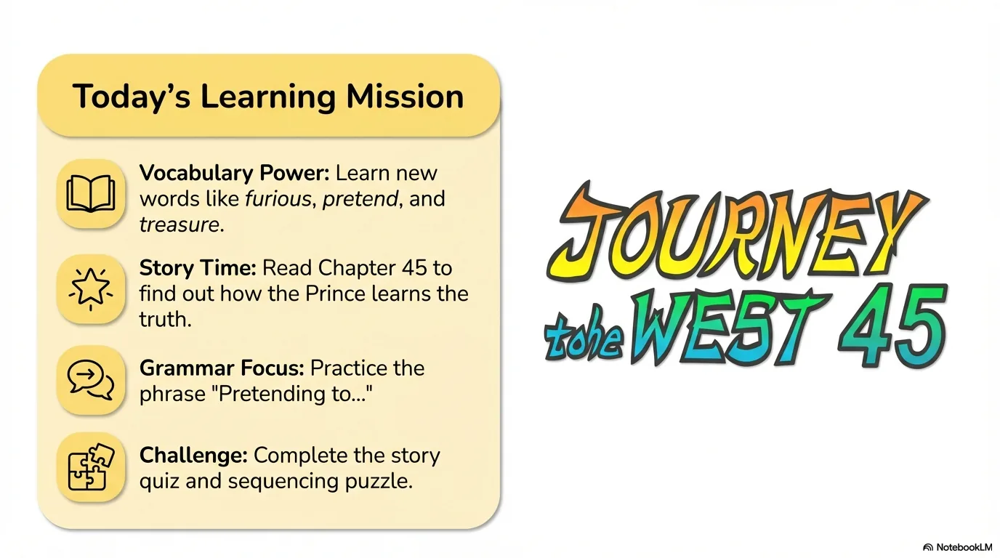

- 来源：`ppt/media/image3.png`（relationship `rId2`）
- 尺寸：1376×768
- 源 SHA-256：`8b19a46d210c10f7b69d5e63e5fcd37313debb940877fb0e06054a9d4c830f85`
- 输出 SHA-256：`e67bc9caa3a2d5bc08fd0b8bec8d58e3f7f3ce30a8577e3d2e5aa8b7e1fbf79e`
- 分类：unknown ｜ OCR：blocked ｜ 审核：unreviewed

## Slide 003

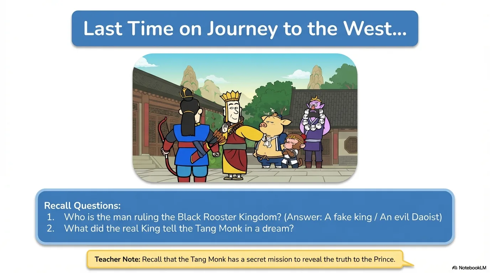

- 来源：`ppt/media/image4.png`（relationship `rId2`）
- 尺寸：1376×768
- 源 SHA-256：`1bfbd966a015779b4d13b1eb5e3e397f5fcacf5b53af74309d585fe0bda00c4f`
- 输出 SHA-256：`070c2964c3bce15944ac0ba41fc0312ab623a1d76efea4e9a720866f5bf8584b`
- 分类：unknown ｜ OCR：blocked ｜ 审核：unreviewed

## Slide 004

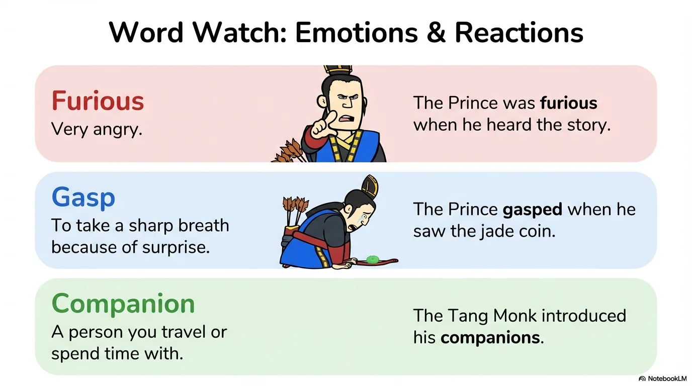

- 来源：`ppt/media/image5.png`（relationship `rId2`）
- 尺寸：1376×768
- 源 SHA-256：`9047be8cc854fcd7f5f0b2c9297f0987a2f780ef1f9bc4f1f0ae5ee744fd76b1`
- 输出 SHA-256：`792a16baaa47f821bc9ecc51e5c0650a118790d83072f3a357f4fc0494f5d9cb`
- 分类：unknown ｜ OCR：blocked ｜ 审核：unreviewed

## Slide 005

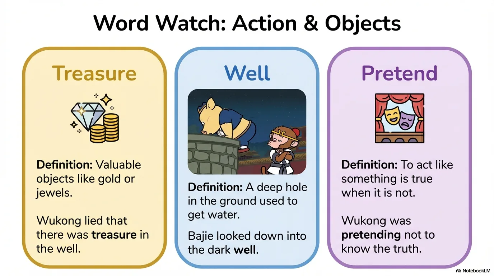

- 来源：`ppt/media/image6.png`（relationship `rId2`）
- 尺寸：1376×768
- 源 SHA-256：`90379b12ea78ad3aa80e35a41068a5162565cd405aae50c52b9efaa992525a51`
- 输出 SHA-256：`e3f0a385c870099da519f78affc09bc46e7c75d44645a48c0cf84db31a997bad`
- 分类：unknown ｜ OCR：blocked ｜ 审核：unreviewed

## Slide 006

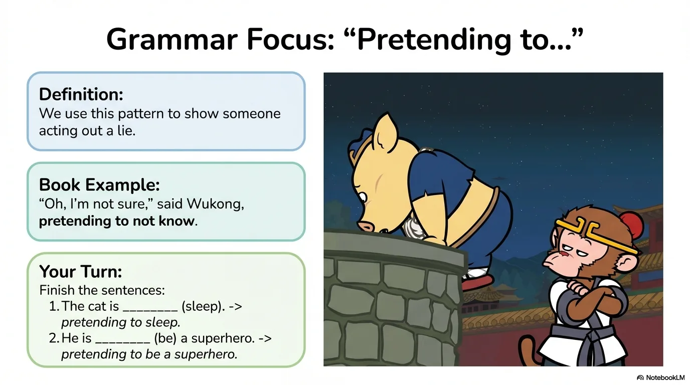

- 来源：`ppt/media/image7.png`（relationship `rId2`）
- 尺寸：1376×768
- 源 SHA-256：`e65783db065040af060d8b9f60795c3539097c1c01eeaa20688ec37a960cebab`
- 输出 SHA-256：`e3adcca7836d3512c130fd772e3e70d1b2d597feb6146a5d7f05b6dc5a063c36`
- 分类：unknown ｜ OCR：blocked ｜ 审核：unreviewed

## Slide 007

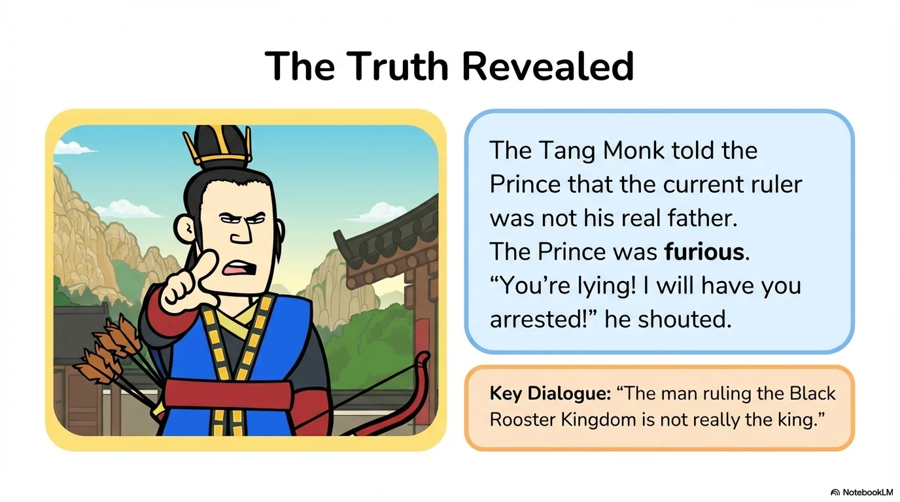

- 来源：`ppt/media/image8.png`（relationship `rId2`）
- 尺寸：1376×768
- 源 SHA-256：`cbf8c60eedd3715504f8ea66b8a5bced4bf87baafb7e8c45a0fac33fafd974e8`
- 输出 SHA-256：`79d088bceb7e6efde68d1d432944d46e657889313b11d3b40e6281a40557fc5b`
- 分类：unknown ｜ OCR：blocked ｜ 审核：unreviewed

## Slide 008

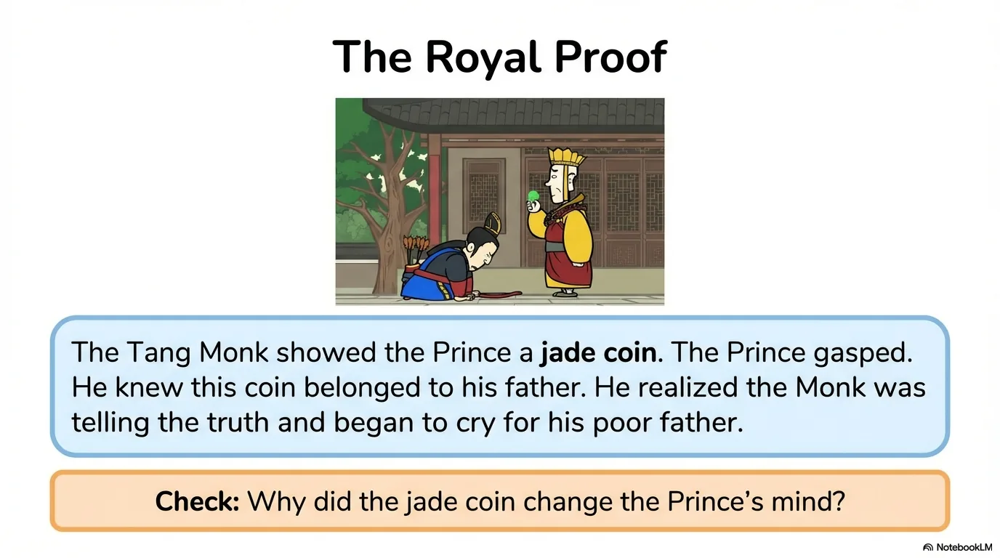

- 来源：`ppt/media/image9.png`（relationship `rId2`）
- 尺寸：1376×768
- 源 SHA-256：`7fbc9b470e23df0d5fbe0b9426fe1af33cd2fe30fa7c690f9d468dabf40c7dca`
- 输出 SHA-256：`0c169f4e06a549444e45d1a76bf392463b5649180c5734872c6fe350af6e1ade`
- 分类：unknown ｜ OCR：blocked ｜ 审核：unreviewed

## Slide 009

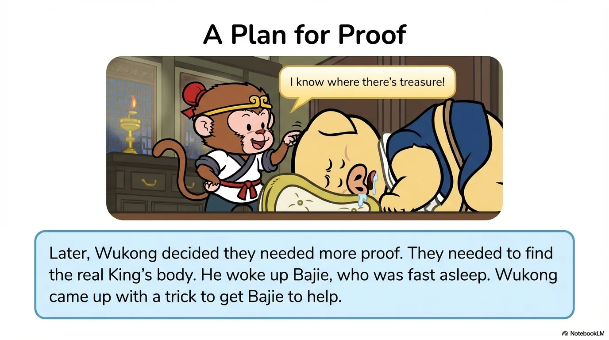

- 来源：`ppt/media/image10.png`（relationship `rId2`）
- 尺寸：1376×768
- 源 SHA-256：`40c94ced6ade3311f8847207dd2e3333d3dad464950c40a8e9b4644b2c836735`
- 输出 SHA-256：`673094cf202fb983b0e35b62a05da2333ce08cb16ff66b5c79a59d9c4fb846d9`
- 分类：unknown ｜ OCR：blocked ｜ 审核：unreviewed

## Slide 010

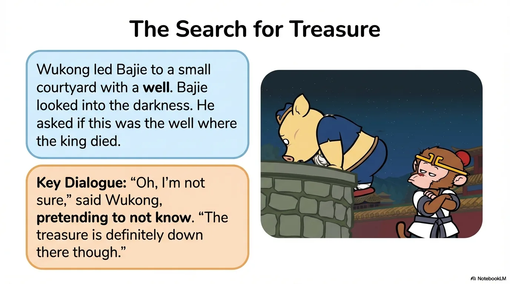

- 来源：`ppt/media/image11.png`（relationship `rId2`）
- 尺寸：1376×768
- 源 SHA-256：`30bd74f84a6e91f3fefef1a302cc43f24e179d0611b44d9a9dcf485eef722a8c`
- 输出 SHA-256：`9f6a38423f0275526ff18ceb0414dddb104dcbc13c434bf5f75e0793ac8dfed1`
- 分类：unknown ｜ OCR：blocked ｜ 审核：unreviewed

## Slide 011

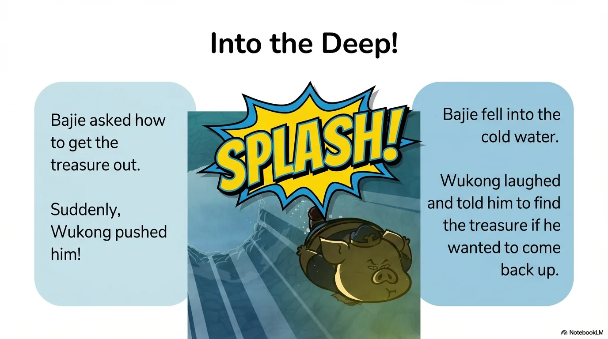

- 来源：`ppt/media/image12.png`（relationship `rId2`）
- 尺寸：1376×768
- 源 SHA-256：`624b112ed590e82c7d439d061fc71d7394777cad8b5ff7131c16d093a49ccbef`
- 输出 SHA-256：`6aaaa92b02b2d3dc3d192fee4c7aaec8d264c271bb8e22e65a161a96e8268cd5`
- 分类：unknown ｜ OCR：blocked ｜ 审核：unreviewed

## Slide 012

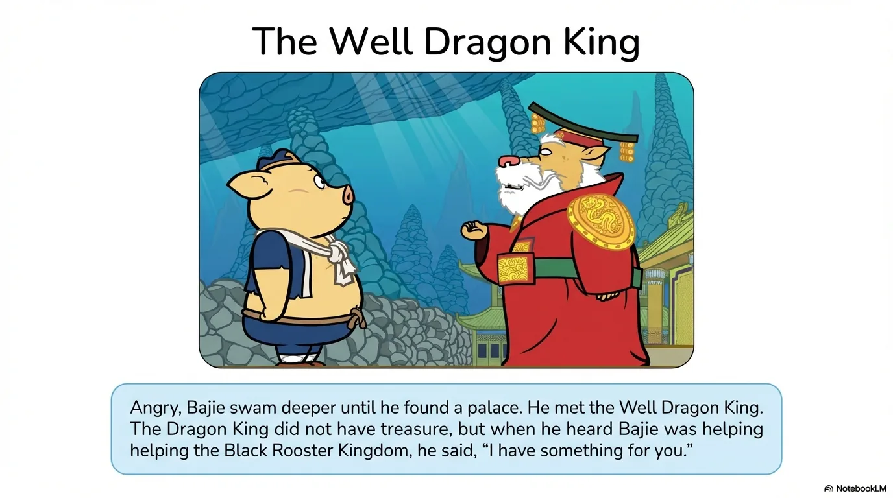

- 来源：`ppt/media/image13.png`（relationship `rId2`）
- 尺寸：1376×768
- 源 SHA-256：`370135aa472019783501a9b795e9ded396812960c91370b187a68a0cae7970c7`
- 输出 SHA-256：`b2a2787bec8b2bea0e2d0edc81e750739b9a3534b5116981b68ec47b4ca9ccc5`
- 分类：unknown ｜ OCR：blocked ｜ 审核：unreviewed

## Slide 013

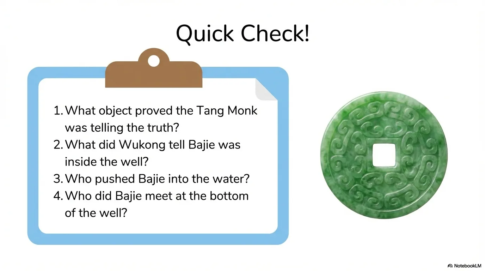

- 来源：`ppt/media/image14.png`（relationship `rId2`）
- 尺寸：1376×768
- 源 SHA-256：`e79735709190b3aa013928d58e5c919959ebc208771d8e47d6c93f484cd28c52`
- 输出 SHA-256：`a7470f7de90a6c335182378309ba13f45198f7beafe95a5861091f85485325c8`
- 分类：unknown ｜ OCR：blocked ｜ 审核：unreviewed

## Slide 014

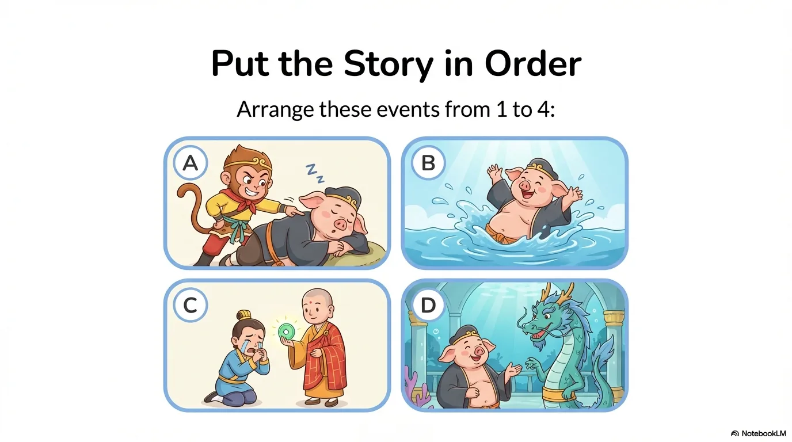

- 来源：`ppt/media/image15.png`（relationship `rId2`）
- 尺寸：1376×768
- 源 SHA-256：`415d837685e3d40093343fec913d60f388eafd19a137c83919546e54fd1e3af7`
- 输出 SHA-256：`60ec79c143f3a548044d14a36128c1c73d21802e1cf3324eabff21ebde92a48a`
- 分类：unknown ｜ OCR：blocked ｜ 审核：unreviewed

## Slide 015

- 来源：`ppt/media/image16.png`（relationship `rId2`）
- 尺寸：1376×768
- 源 SHA-256：`96ead99a0b22b966ac713fad7f24633ca74f8dfdf8f76ae740f03c6fb4912f4d`
- 输出 SHA-256：`f958d41e6c0ce51bbb9d30368277c36c4f0f858ebe4a5b610b9ff9c7429423a8`
- 分类：unknown ｜ OCR：blocked ｜ 审核：unreviewed

## Slide 016

- 来源：`ppt/media/image17.png`（relationship `rId2`）
- 尺寸：1376×768
- 源 SHA-256：`0e51627e65f4262cfed36b5c65e974b38f2c4bbb84afe88c943a15fd6decc808`
- 输出 SHA-256：`e50214f2684352059600fb23b2de1ba8d195d598a8952cf61bf88aac48b85a2f`
- 分类：unknown ｜ OCR：blocked ｜ 审核：unreviewed

## Slide 017

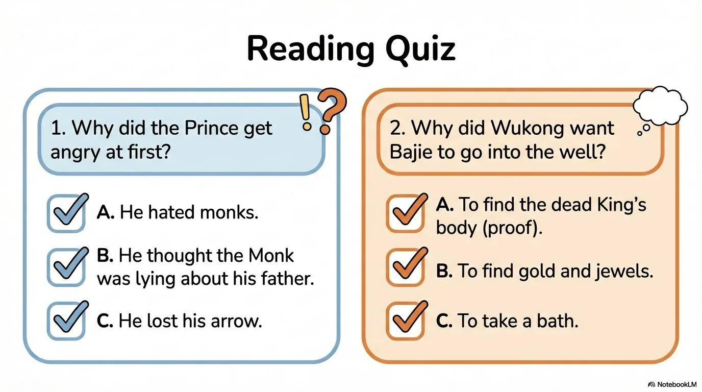

- 来源：`ppt/media/image18.png`（relationship `rId2`）
- 尺寸：1376×768
- 源 SHA-256：`8ce71f7e7b1ba6d19967cccde364fa78a1ea488e21373783cf14b44b393c9874`
- 输出 SHA-256：`1909517bfa672f39da935b89832021f48f4a41c6930768c43388a4fce7d68ea8`
- 分类：unknown ｜ OCR：blocked ｜ 审核：unreviewed

## Slide 018

- 来源：`ppt/media/image19.png`（relationship `rId2`）
- 尺寸：1376×768
- 源 SHA-256：`2872316fb3a95ffe62ce0ee81897442458ea0826a8db2be414a2f086bd8f79a5`
- 输出 SHA-256：`a668c05f4eeb6849e10a24a8ead8a40ce4b33f43d3f8cc79f6da794fecf7143c`
- 分类：unknown ｜ OCR：blocked ｜ 审核：unreviewed

## Slide 019

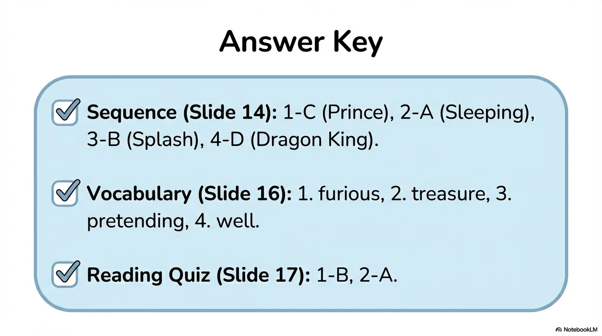

- 来源：`ppt/media/image20.png`（relationship `rId2`）
- 尺寸：1376×768
- 源 SHA-256：`f0d53c0b2c7182ca91149a37d9482e81ee39a91e5588514e8be5544561b86aa6`
- 输出 SHA-256：`48bdc344aad9c2caf62e6bef4411e46cef8e3757618a099bda77abef185254a2`
- 分类：unknown ｜ OCR：blocked ｜ 审核：unreviewed

## Slide 020

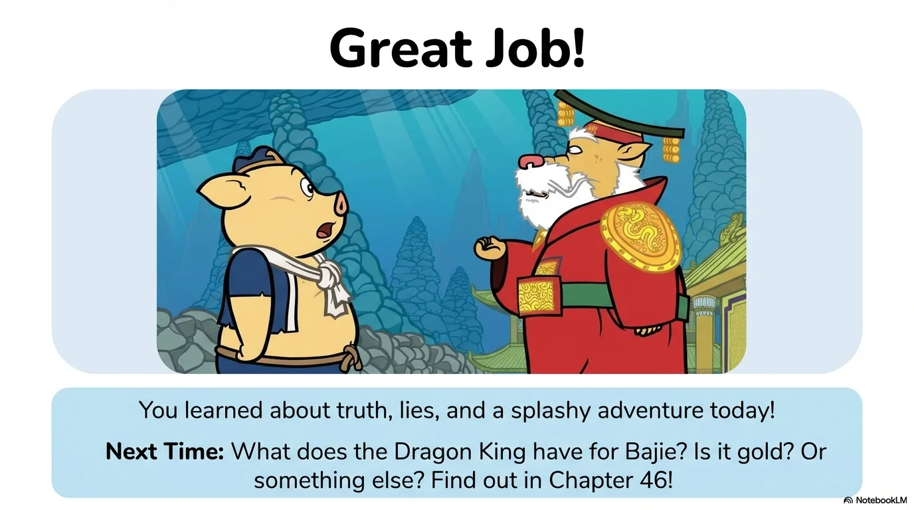

- 来源：`ppt/media/image21.png`（relationship `rId2`）
- 尺寸：1376×768
- 源 SHA-256：`4e4a7c4dfabe3930344b4ce5b5fbd05ba941ba465f9642ad88e6fa1688c5bb71`
- 输出 SHA-256：`7b9c23ade1416b2a611e7f30e222c3bbc76f68b3b2d4e85521913384ad3eafce`
- 分类：unknown ｜ OCR：blocked ｜ 审核：unreviewed
