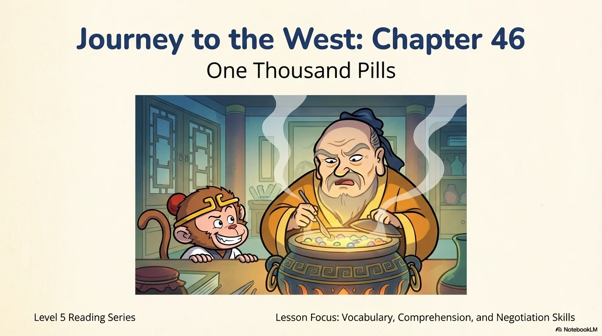
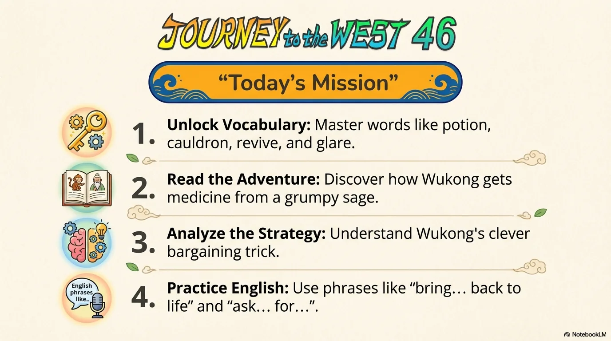
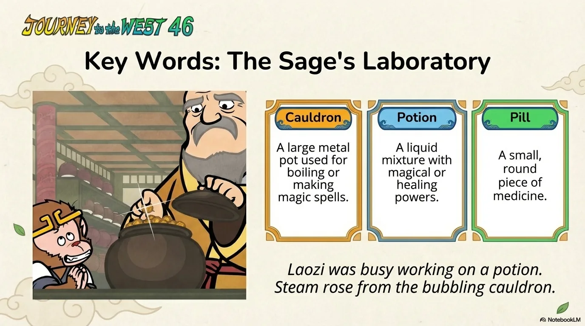
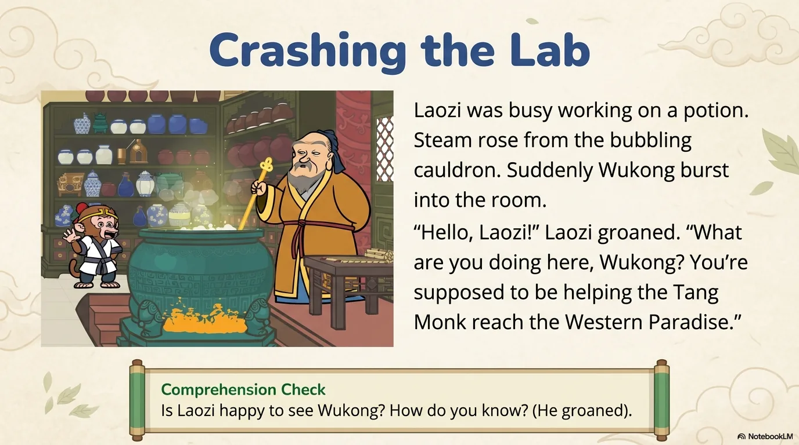
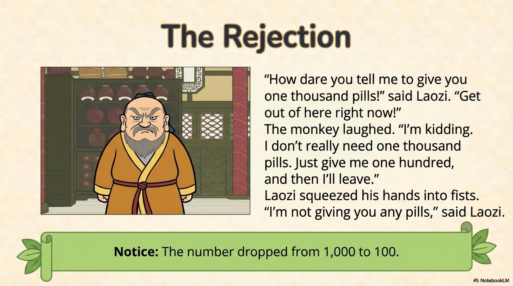
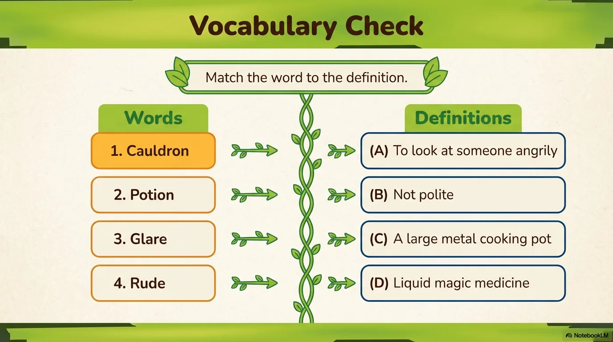
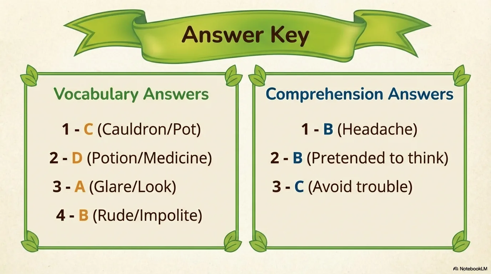

# 豆豆龙英语 · 第 46 集课件（EP046 草稿）

- 来源：`046_Journey to the West 46_One Thousand Pills.pptx`（主课件，20 页）
- OCR：`blocked`（no local OCR provider importable (pytesseract missing): No module named 'pytesseract'）
- 分类：待人工审核（unknown）
- 审核状态：`unreviewed`

## Slide 001

- 来源：`ppt/media/image1.png`（relationship `rId2`）
- 尺寸：1376×768
- 源 SHA-256：`d02349ec24eca98fe84e0835376dba9721e0c3130884d7e9966ebe02fc79c1e7`
- 输出 SHA-256：`f78caacb9c4a4cbf5a5c1885ef5031b193df258a70402b0173faeb51fe53ee09`
- 分类：unknown ｜ OCR：blocked ｜ 审核：unreviewed

## Slide 002

- 来源：`ppt/media/image3.png`（relationship `rId2`）
- 尺寸：1376×768
- 源 SHA-256：`9386ab7f52ce75b4ab753dabb7360c31e11405b87d575c115b4d6e26125c0f26`
- 输出 SHA-256：`14fa6f2146e76768735f263a0c7e205edaf1d4a64fa7d6121ec50b30e78984a3`
- 分类：unknown ｜ OCR：blocked ｜ 审核：unreviewed

## Slide 003

- 来源：`ppt/media/image4.png`（relationship `rId2`）
- 尺寸：1376×768
- 源 SHA-256：`7545072e19d6640fd4b66fc4a6da9c29b3f52f54fe7657ed28ca3b348d996358`
- 输出 SHA-256：`9be40469dbccf5c96f56efef88c9f2cf4adb37ed17950365cdc7f51e17f05b38`
- 分类：unknown ｜ OCR：blocked ｜ 审核：unreviewed

## Slide 004

- 来源：`ppt/media/image5.png`（relationship `rId2`）
- 尺寸：1376×768
- 源 SHA-256：`38b73031b289ab7032d6e087ecf1050cfd2fd66cdbc4e0190123f913c42da420`
- 输出 SHA-256：`e970c5fe7875a7445f72b31f90ff616ed2025d03121cc86a85d663f05fd4aa9e`
- 分类：unknown ｜ OCR：blocked ｜ 审核：unreviewed

## Slide 005

- 来源：`ppt/media/image6.png`（relationship `rId2`）
- 尺寸：1376×768
- 源 SHA-256：`9a97f088224a3e8357af2867dda010a0ed66e278fc35a591e52f85c57ff1ad1b`
- 输出 SHA-256：`09d956ab2786dc514edeb2708597c5a2976e1bfdba20b81d155e1c7918d652f1`
- 分类：unknown ｜ OCR：blocked ｜ 审核：unreviewed

## Slide 006

- 来源：`ppt/media/image7.png`（relationship `rId2`）
- 尺寸：1376×768
- 源 SHA-256：`101b8d04e67b6e800aa9623eb8084a69b09a1e3066a0ad3358fbdfc70f0f7a39`
- 输出 SHA-256：`d920753d884976b442d5438167c430fb6572d53a17fe5822129e3a50ed19bdb8`
- 分类：unknown ｜ OCR：blocked ｜ 审核：unreviewed

## Slide 007

- 来源：`ppt/media/image8.png`（relationship `rId2`）
- 尺寸：1376×768
- 源 SHA-256：`f37f133c48a2d6d7e1c9aab71238c8f199546bdc91174514915af2395d2d769a`
- 输出 SHA-256：`bab5dc9b137c20e9f49df40cc679fbdf87fefef4c91176f34f4c760d10d3cfd2`
- 分类：unknown ｜ OCR：blocked ｜ 审核：unreviewed

## Slide 008

- 来源：`ppt/media/image9.png`（relationship `rId2`）
- 尺寸：1376×768
- 源 SHA-256：`2263b1555f9fb227b7a84219bd4b8bae5d292ae00fcc6aeae821c0df9a2129ab`
- 输出 SHA-256：`41246d50a21e1f47df576ad9622797a60340817f144f173fb497bb06022ada2d`
- 分类：unknown ｜ OCR：blocked ｜ 审核：unreviewed

## Slide 009

- 来源：`ppt/media/image10.png`（relationship `rId2`）
- 尺寸：1376×768
- 源 SHA-256：`2f5483564c98f0a094b455a7ff7df14e08fb37cb4eadb0d36d1bc275db88ba37`
- 输出 SHA-256：`08b3e84b367bc30b4cac6e84fa796826aab48932205af4abf22d7c134fded667`
- 分类：unknown ｜ OCR：blocked ｜ 审核：unreviewed

## Slide 010

- 来源：`ppt/media/image11.png`（relationship `rId2`）
- 尺寸：1376×768
- 源 SHA-256：`f1af0e4d55c3c547cbd28c9be70384ddfb444e76d4869f7eaf8b763bf18a0f28`
- 输出 SHA-256：`5a10eb7edad3df99430bea03151daaa052b79669c26d458a1fdea7c8106624e1`
- 分类：unknown ｜ OCR：blocked ｜ 审核：unreviewed

## Slide 011

- 来源：`ppt/media/image12.png`（relationship `rId2`）
- 尺寸：1376×768
- 源 SHA-256：`a33bb6380948e9937632ccef33fa9b442929d380198d7addb999f6b254f581c2`
- 输出 SHA-256：`b869edf3d19afae35e875c924cd6fd371912bd78ed0e51285b0b6673bcb74fbd`
- 分类：unknown ｜ OCR：blocked ｜ 审核：unreviewed

## Slide 012

- 来源：`ppt/media/image13.png`（relationship `rId2`）
- 尺寸：1376×768
- 源 SHA-256：`f9ad288773769a20b44a96ec0dde0fb3ccf2316eafd17d32ffbc1d4982edffaa`
- 输出 SHA-256：`6b468f8174a5b8d28848f04e6041f988e2796350b9e516ab0aa75049b72cc54c`
- 分类：unknown ｜ OCR：blocked ｜ 审核：unreviewed

## Slide 013

- 来源：`ppt/media/image14.png`（relationship `rId2`）
- 尺寸：1376×768
- 源 SHA-256：`92e24bdf98a10eee36d55b1106bb8ad51047816a52b2ddeda29214d68f6a0ea5`
- 输出 SHA-256：`1bcdd5108d348d6c446fcb04776b089edfcfe125189661ff40a640bb5bd5cc7b`
- 分类：unknown ｜ OCR：blocked ｜ 审核：unreviewed

## Slide 014

- 来源：`ppt/media/image15.png`（relationship `rId2`）
- 尺寸：1376×768
- 源 SHA-256：`91d10063c50734a90940f244344483ef173a47d20b19c15460b8de357b2d8305`
- 输出 SHA-256：`a39d997175be14f523951fe46ac66e91fceed4851092591bdb2fa47eddb1d128`
- 分类：unknown ｜ OCR：blocked ｜ 审核：unreviewed

## Slide 015

- 来源：`ppt/media/image16.png`（relationship `rId2`）
- 尺寸：1376×768
- 源 SHA-256：`7f8fe1d0f2979d611565b572e70c52a8d5b206e708944c229bc46795593f38e5`
- 输出 SHA-256：`673f535de6f1d704c0f99ced9ea0a5378b7d3eafa7c9d8656a336f6b16029b44`
- 分类：unknown ｜ OCR：blocked ｜ 审核：unreviewed

## Slide 016

- 来源：`ppt/media/image17.png`（relationship `rId2`）
- 尺寸：1376×768
- 源 SHA-256：`6b64ae81a898a108e01a03b9e540e39a357b162fc27cc3966812d0b1c40a3822`
- 输出 SHA-256：`4305cc79b497affc7ab6df02c2f7af257f15a71af407d6bd20c950abfea17f12`
- 分类：unknown ｜ OCR：blocked ｜ 审核：unreviewed

## Slide 017

- 来源：`ppt/media/image18.png`（relationship `rId2`）
- 尺寸：1376×768
- 源 SHA-256：`c998405d7804d1dfdd8194f591b413cccc8f0c8d985fb267d3a069ffe214a131`
- 输出 SHA-256：`1a3ef6976cedcbe6970816f172c56ed8532fa61e77be7e721a593fa67d76b122`
- 分类：unknown ｜ OCR：blocked ｜ 审核：unreviewed

## Slide 018

- 来源：`ppt/media/image19.png`（relationship `rId2`）
- 尺寸：1376×768
- 源 SHA-256：`c81a50cda95d1425f22a701d416ac103a2003446fc4c8bf31c32421125ad4346`
- 输出 SHA-256：`d981eec3e4f1a970189590bc543cfa9e7aef9148bcdab89f98b37e1bbd9c9cfb`
- 分类：unknown ｜ OCR：blocked ｜ 审核：unreviewed

## Slide 019

- 来源：`ppt/media/image20.png`（relationship `rId2`）
- 尺寸：1376×768
- 源 SHA-256：`8b91414a96bfedb693c7f277b0a50a872886d64e4f6eac00275abd406f2feb2b`
- 输出 SHA-256：`3e5b75b58a65436984beee66272128dec622773560d76f739a42116a43cb9069`
- 分类：unknown ｜ OCR：blocked ｜ 审核：unreviewed

## Slide 020

- 来源：`ppt/media/image21.png`（relationship `rId2`）
- 尺寸：1376×768
- 源 SHA-256：`b30fead0992e62fdbc59ac32785a756ab2714e891ae157b490cf6f44e9e576f4`
- 输出 SHA-256：`fafecc26a7c0bd9d62088bf3ae9e2becfa7a055020f42298df3866bce821a9c1`
- 分类：unknown ｜ OCR：blocked ｜ 审核：unreviewed
