# 豆豆龙英语 · 第 47 集课件（EP047 草稿）

- 来源：`047_Journey to the West 47_Two Tang Monks.pptx`（主课件，20 页）
- OCR：`blocked`（no local OCR provider importable (pytesseract missing): No module named 'pytesseract'）
- 分类：待人工审核（unknown）
- 审核状态：`unreviewed`

## Slide 001

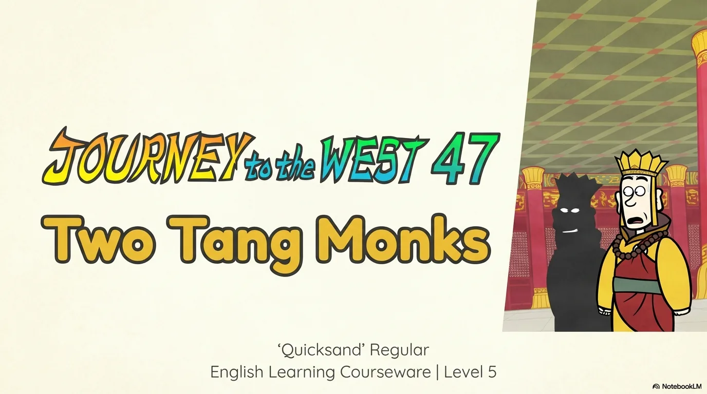

- 来源：`ppt/media/image1.png`（relationship `rId2`）
- 尺寸：1376×768
- 源 SHA-256：`b26d2e7ab9cf80a34f1fbfaabd68a0c1d29517a3a7f8ce3e6728c939550b4944`
- 输出 SHA-256：`adaabd1181052f5bdc37d55fefdf41fdae22a9bebac05623da3a4b9048c0c94b`
- 分类：unknown ｜ OCR：blocked ｜ 审核：unreviewed

## Slide 002

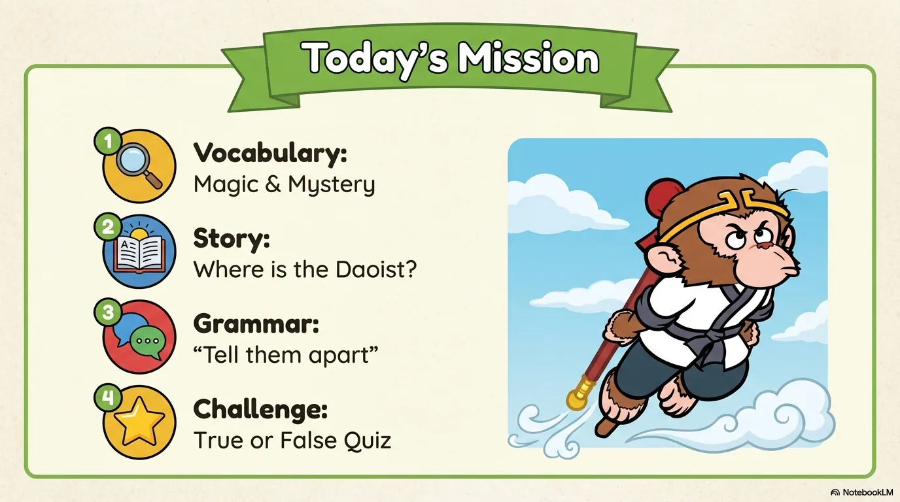

- 来源：`ppt/media/image3.png`（relationship `rId2`）
- 尺寸：1376×768
- 源 SHA-256：`1b5deb79e1981640497d864f52346d4dfc4c4028194c6058239884c13c7ca09a`
- 输出 SHA-256：`9acb71c207b590ca9afd458a76f558987c9e0147792210b43ed7f98b5dbf3779`
- 分类：unknown ｜ OCR：blocked ｜ 审核：unreviewed

## Slide 003

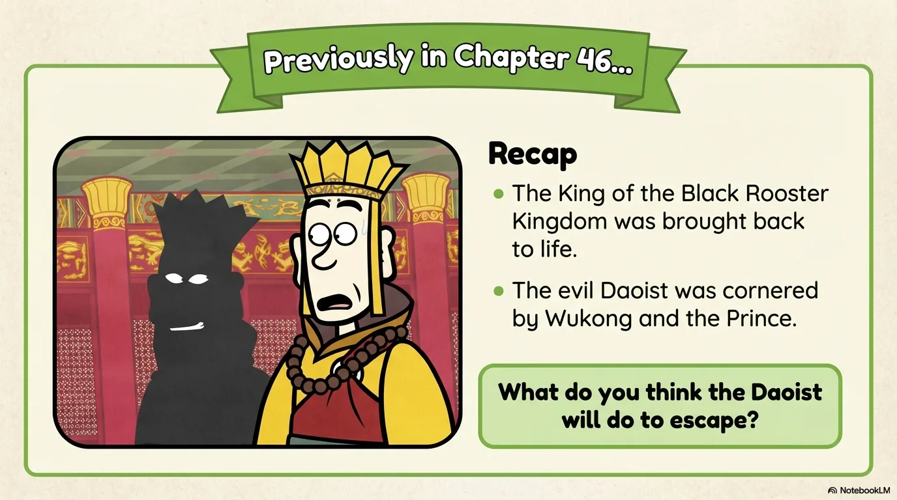

- 来源：`ppt/media/image4.png`（relationship `rId2`）
- 尺寸：1376×768
- 源 SHA-256：`5fff60eaec1d0c428153d326dc798db1e777f8d6c636cfead42551d604fb3ea3`
- 输出 SHA-256：`7c957f02a9bca755a878bdb6ae11fb9237752e8ed7d6e2745513cdff63d60678`
- 分类：unknown ｜ OCR：blocked ｜ 审核：unreviewed

## Slide 004

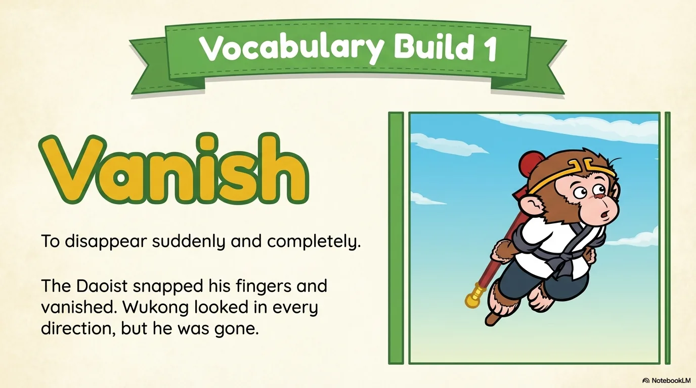

- 来源：`ppt/media/image5.png`（relationship `rId2`）
- 尺寸：1376×768
- 源 SHA-256：`e323ba7b36ed31c7b3b7137d9af6b804511f6b5417178f1b29460ec031bcd544`
- 输出 SHA-256：`96921639e4ccebf9c7527220654c2a119e8026c799a5ee5f811c88693c98b61a`
- 分类：unknown ｜ OCR：blocked ｜ 审核：unreviewed

## Slide 005

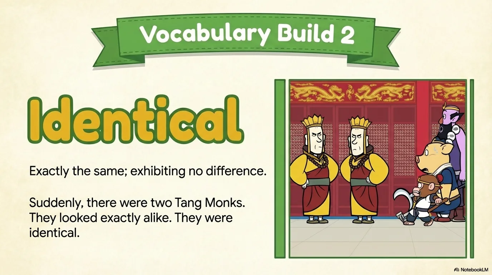

- 来源：`ppt/media/image6.png`（relationship `rId2`）
- 尺寸：1376×768
- 源 SHA-256：`a97b277c1b345b22ce4cfd81fb4e8940e8acb2fc20c4ca7bad3651f55e1b3105`
- 输出 SHA-256：`42eab5fac481378bd4d0e14aa0a79bc05f561b6e6822aaec7cea122ef385d5a4`
- 分类：unknown ｜ OCR：blocked ｜ 审核：unreviewed

## Slide 006

- 来源：`ppt/media/image7.png`（relationship `rId2`）
- 尺寸：1376×768
- 源 SHA-256：`b562377d604ccc976238bf4765562fb8abc484e67da29cdaf2c97a0e1bb54832`
- 输出 SHA-256：`89da8fcd72f378741ca5108a6e191ad4e5593135ed22fe73a6bf35827d31b043`
- 分类：unknown ｜ OCR：blocked ｜ 审核：unreviewed

## Slide 007

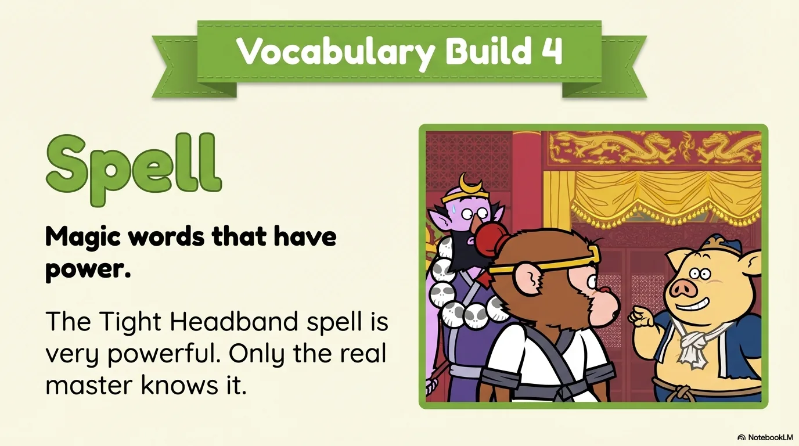

- 来源：`ppt/media/image8.png`（relationship `rId2`）
- 尺寸：1376×768
- 源 SHA-256：`5853c8c06000a4ebeb5fd015dfa8cc3cd2099fd6241647bca0b84c3f9d2720a4`
- 输出 SHA-256：`d43e52dc734ae58414360787123094127a1ea6d67dd4d9f683880c0503179852`
- 分类：unknown ｜ OCR：blocked ｜ 审核：unreviewed

## Slide 008

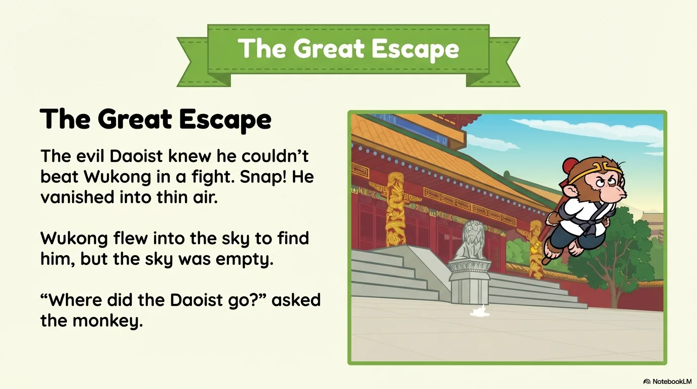

- 来源：`ppt/media/image9.png`（relationship `rId2`）
- 尺寸：1376×768
- 源 SHA-256：`aa6626c4bf3209f9adc150a75c9c04408685f45ff800a89c6f7d134501ead7fa`
- 输出 SHA-256：`ef8657ad88d7e56f63de83a587607aafb65f9ab8711d36a5a89c1aab5a523732`
- 分类：unknown ｜ OCR：blocked ｜ 审核：unreviewed

## Slide 009

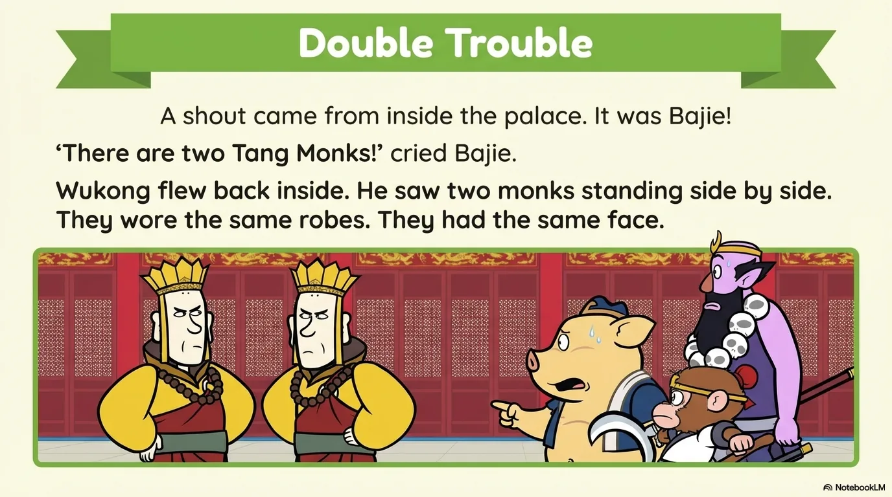

- 来源：`ppt/media/image10.png`（relationship `rId2`）
- 尺寸：1376×768
- 源 SHA-256：`0099104801b61e544349f5a8a2cd093496d127c09aadbdbd29d2e7b8329d3f9f`
- 输出 SHA-256：`f78a3dd0f377a997ac94a1b6efe113cf6ddc66131634b835da2b65560df79d0d`
- 分类：unknown ｜ OCR：blocked ｜ 审核：unreviewed

## Slide 010

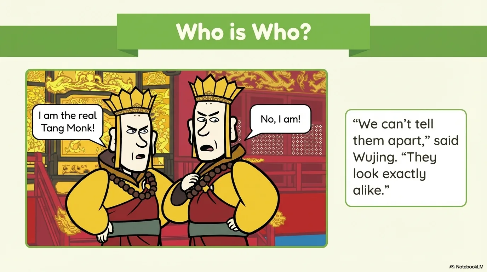

- 来源：`ppt/media/image11.png`（relationship `rId2`）
- 尺寸：1376×768
- 源 SHA-256：`c3adc589c6bef70b615a9a47a5683c5a40f61df037a1143f43ed042975019e72`
- 输出 SHA-256：`1fca8624964e6c503e1f00e10e306e33b0d69eaa7776828332afc721e7266306`
- 分类：unknown ｜ OCR：blocked ｜ 审核：unreviewed

## Slide 011

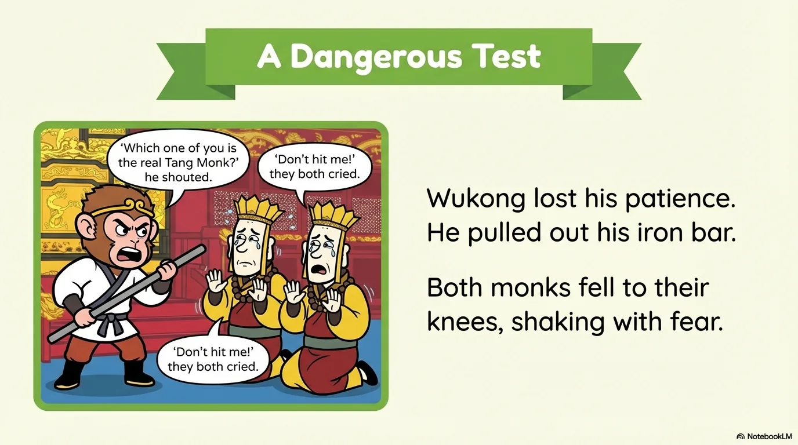

- 来源：`ppt/media/image12.png`（relationship `rId2`）
- 尺寸：1376×768
- 源 SHA-256：`5004e512771367b7f9a41113d75b00a3bf2d342ba57aacbdf8e54a237d3f7003`
- 输出 SHA-256：`5afa5b40f76290615e22eea3ee982aa5a1e20b413907676f9c908db2094b71f5`
- 分类：unknown ｜ OCR：blocked ｜ 审核：unreviewed

## Slide 012

- 来源：`ppt/media/image13.png`（relationship `rId2`）
- 尺寸：1376×768
- 源 SHA-256：`6aa53d5615e66e5d21b4a6411241666660de1602a2643826f4f1bd27057c3334`
- 输出 SHA-256：`893add5da67315feda1c5635f245b5ef1703a6e5133f9c9d3ce32db7a4180467`
- 分类：unknown ｜ OCR：blocked ｜ 审核：unreviewed

## Slide 013

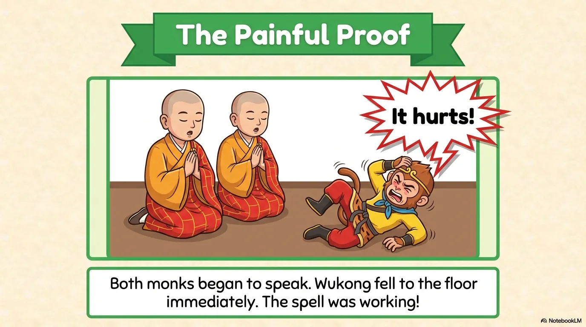

- 来源：`ppt/media/image14.png`（relationship `rId2`）
- 尺寸：1376×768
- 源 SHA-256：`ec9b6253d69b0d9954572af3b3e86885a78ea6e798a3bdb7060a1b8394b5627b`
- 输出 SHA-256：`dbdf25169f9368fac25169388bd87618904d54eff40ae19ae0d4937b4cc98190`
- 分类：unknown ｜ OCR：blocked ｜ 审核：unreviewed

## Slide 014

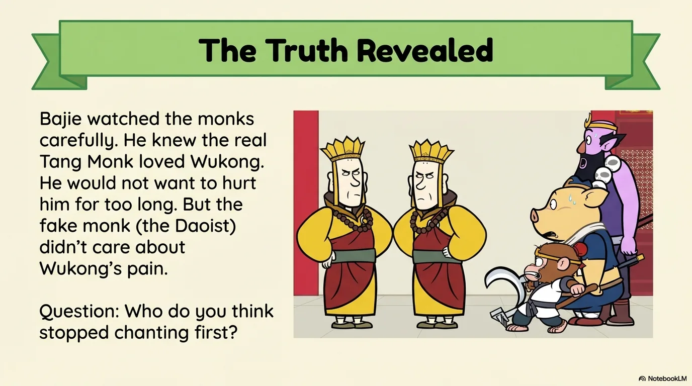

- 来源：`ppt/media/image15.png`（relationship `rId2`）
- 尺寸：1376×768
- 源 SHA-256：`148f354b2e2a5f304e0f710062d9a809dc2b5d9d2e04c5bfc60e101d43b4cf76`
- 输出 SHA-256：`023c038f3e52f75b53bc8c3563b9bd9af6b42ee13179c32946c8cbdbefab4e79`
- 分类：unknown ｜ OCR：blocked ｜ 审核：unreviewed

## Slide 015

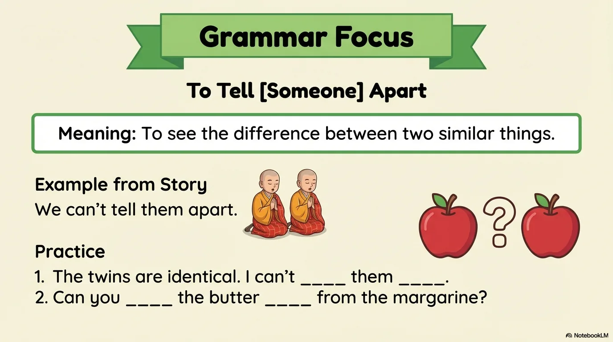

- 来源：`ppt/media/image16.png`（relationship `rId2`）
- 尺寸：1376×768
- 源 SHA-256：`34f3eeed7a5e117f3e85e4929088154eaaf729c1833f510b0d460fd89903171f`
- 输出 SHA-256：`4a4ecadb1638b291e52806138f2a9c60e50c2407ff639abdcfe2bea460e35e74`
- 分类：unknown ｜ OCR：blocked ｜ 审核：unreviewed

## Slide 016

- 来源：`ppt/media/image17.png`（relationship `rId2`）
- 尺寸：1376×768
- 源 SHA-256：`c318f50da5ef04474f54b89e2aafee6132c335b943816b6a2f99d8f4f7fcd476`
- 输出 SHA-256：`e5cbefb359f4d8bf77b692f90bbebd881c17ee2d3a41babfb7dfa7ef75550c0f`
- 分类：unknown ｜ OCR：blocked ｜ 审核：unreviewed

## Slide 017

- 来源：`ppt/media/image18.png`（relationship `rId2`）
- 尺寸：1376×768
- 源 SHA-256：`17b7fe7fb570c1f41d90f39edb7e4e7e4d7feb581285087af2e9d395a72946eb`
- 输出 SHA-256：`78ed189cad43866c9342c718279cec81da616ae81b414952bce6aa7d6d8730fe`
- 分类：unknown ｜ OCR：blocked ｜ 审核：unreviewed

## Slide 018

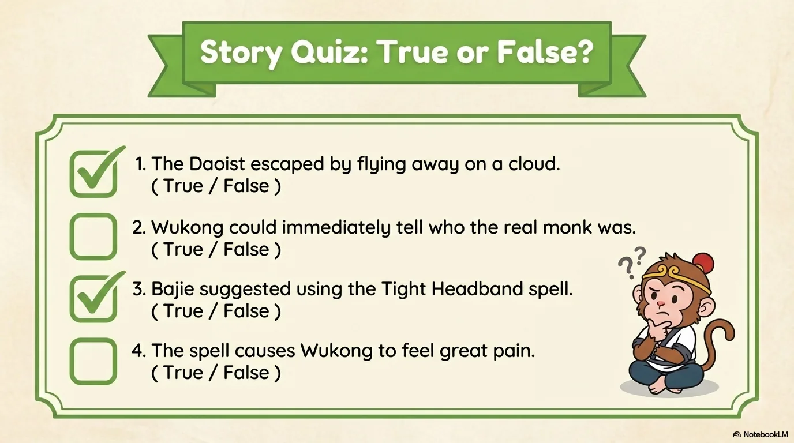

- 来源：`ppt/media/image19.png`（relationship `rId2`）
- 尺寸：1376×768
- 源 SHA-256：`2e68c41abcdd85ff79f0782cf06449ae506f80b1be89968ba2a953ae65aab513`
- 输出 SHA-256：`7adc75631399cb171a28a962b3b313ea68e90851ba6577d6db9705337cc8fd3d`
- 分类：unknown ｜ OCR：blocked ｜ 审核：unreviewed

## Slide 019

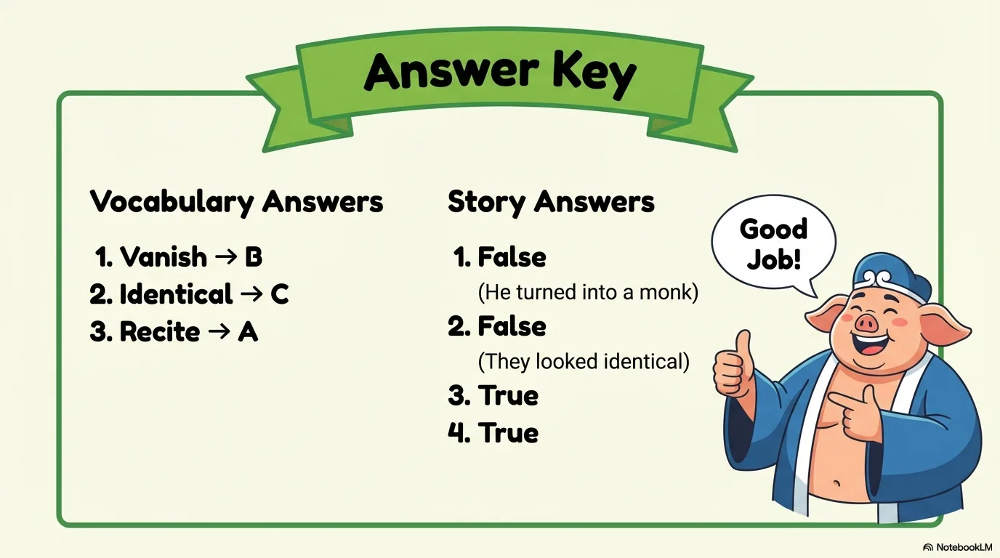

- 来源：`ppt/media/image20.png`（relationship `rId2`）
- 尺寸：1376×768
- 源 SHA-256：`cf6cfef38f1523066e1fb2c52481ded0e933fe06c10691fc7997a3f4ca542e1d`
- 输出 SHA-256：`06c54b95a7b2e887450fc4257071ebfc770078461c82b843023e2995f11eb7c4`
- 分类：unknown ｜ OCR：blocked ｜ 审核：unreviewed

## Slide 020

- 来源：`ppt/media/image21.png`（relationship `rId2`）
- 尺寸：1376×768
- 源 SHA-256：`b7aa8c07d785de1e1918fcea77c86f9db7de0dd9675e48f20070dda0f2f66235`
- 输出 SHA-256：`0e0729feb3f7c8973afe745188e10afa8f6f7185a7c4ae34e5b8eab99400a172`
- 分类：unknown ｜ OCR：blocked ｜ 审核：unreviewed
