# 豆豆龙英语 · 第 48 集课件（EP048 草稿）

- 来源：`048_Journey to the West 48_The Scared Boy.pptx`（主课件，20 页）
- OCR：`blocked`（no local OCR provider importable (pytesseract missing): No module named 'pytesseract'）
- 分类：待人工审核（unknown）
- 审核状态：`unreviewed`

## Slide 001

- 来源：`ppt/media/image1.png`（relationship `rId2`）
- 尺寸：1376×768
- 源 SHA-256：`57efef5023bcb7ffdc28af8993ebf33d0b8a9390f4af66b88af2d7fac8ee3cfb`
- 输出 SHA-256：`8cc3f7ca166f3e47b0fe10494a9d1767b66fbf441328493cedd179c7eba75a1f`
- 分类：unknown ｜ OCR：blocked ｜ 审核：unreviewed

## Slide 002

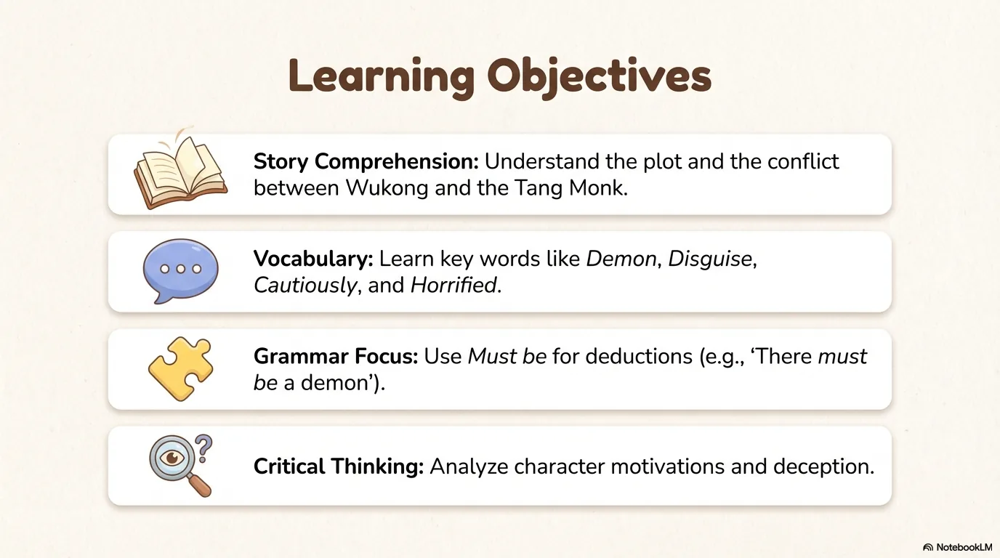

- 来源：`ppt/media/image3.png`（relationship `rId2`）
- 尺寸：1376×768
- 源 SHA-256：`4c029fdcd0563496506d152fb3c0db998800a9f2ef7a6b5c33ccb5237bbb0c66`
- 输出 SHA-256：`fa695e485e77216c947660deb601deda67a44ea88304a9eb50514b11e27095f5`
- 分类：unknown ｜ OCR：blocked ｜ 审核：unreviewed

## Slide 003

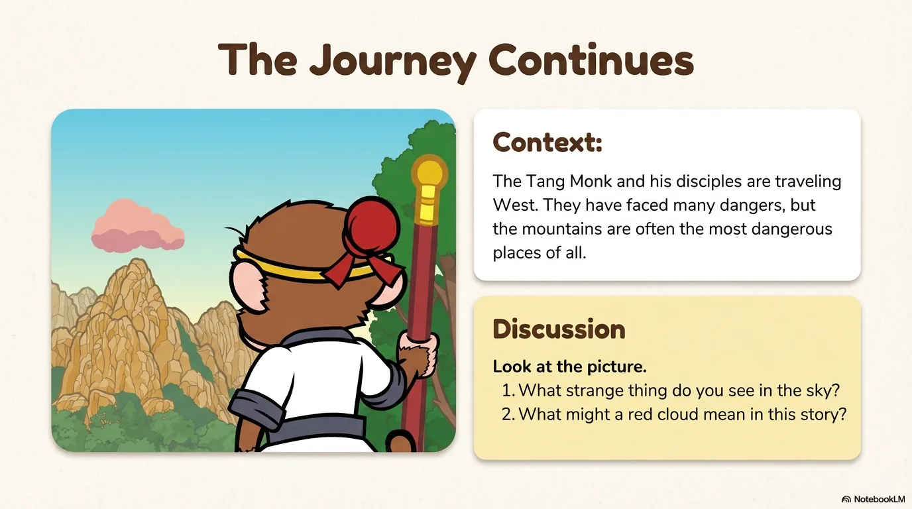

- 来源：`ppt/media/image4.png`（relationship `rId2`）
- 尺寸：1376×768
- 源 SHA-256：`885409a52fdfbcf5f4c684a40d986f7f544edda6b5cf916c092543dec6587f5c`
- 输出 SHA-256：`3f94877fcf72075d6158e8345badf0746692d51f7a88e0fb374c03a5d2250e45`
- 分类：unknown ｜ OCR：blocked ｜ 审核：unreviewed

## Slide 004

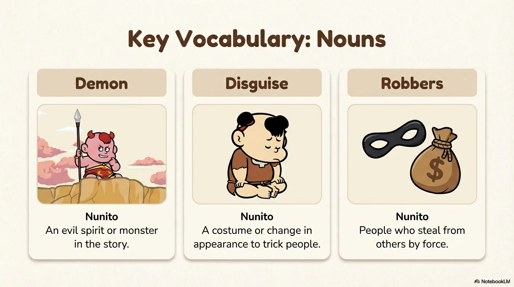

- 来源：`ppt/media/image5.png`（relationship `rId2`）
- 尺寸：1376×768
- 源 SHA-256：`6f31ed7bbdc20dbfbff932ab545684a0a48c91d221b4e372694eaddc3356fde5`
- 输出 SHA-256：`e2451a74014f97ac8119f495f48fa663dbf785b6665c624bd54c9296c5ee2989`
- 分类：unknown ｜ OCR：blocked ｜ 审核：unreviewed

## Slide 005

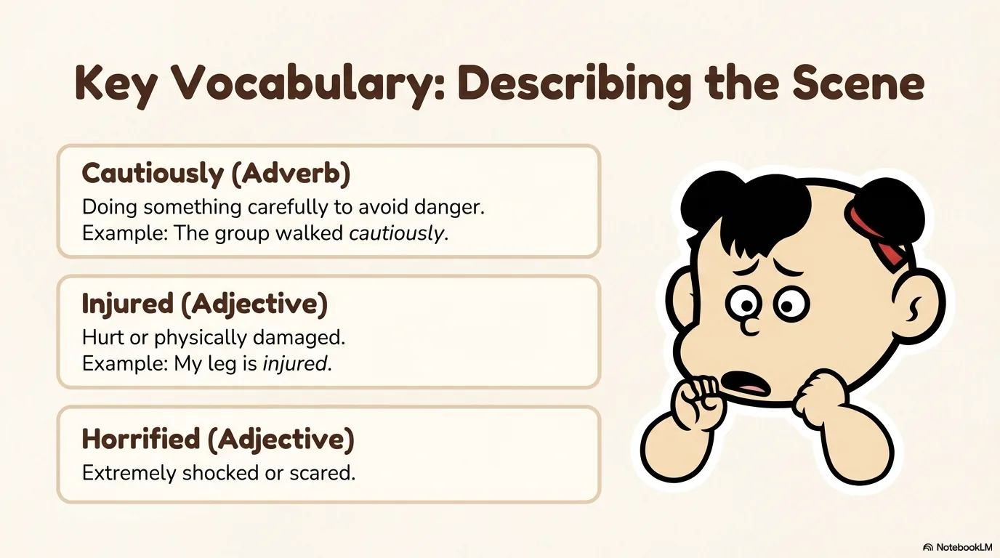

- 来源：`ppt/media/image6.png`（relationship `rId2`）
- 尺寸：1376×768
- 源 SHA-256：`f8025420c0a9be0f9d7f66fb883bd71c20e8400dbc806f528d172b38396c0c8d`
- 输出 SHA-256：`bba5d24e73f382ec66bbd452ee365dd0eabb6faabe093887a0ddd540af3119b6`
- 分类：unknown ｜ OCR：blocked ｜ 审核：unreviewed

## Slide 006

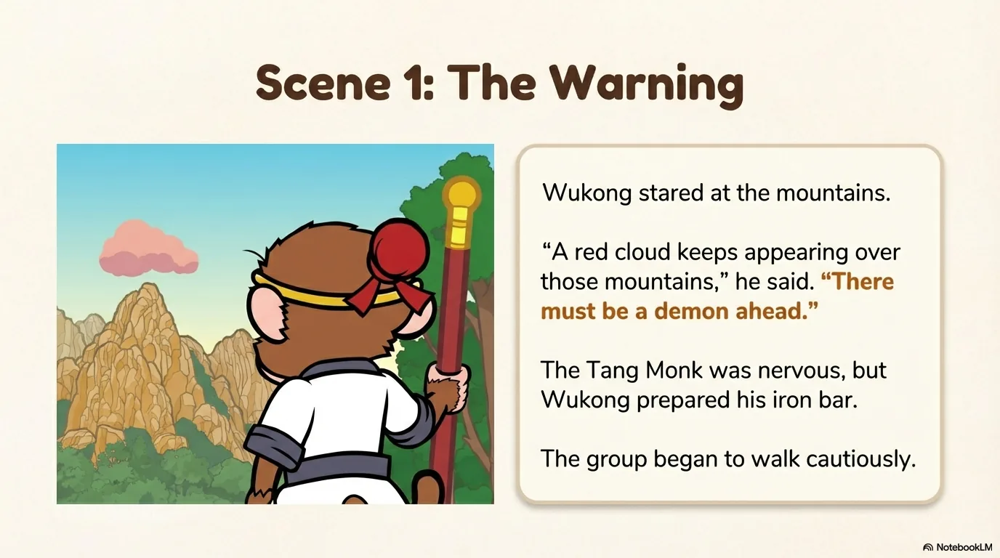

- 来源：`ppt/media/image7.png`（relationship `rId2`）
- 尺寸：1376×768
- 源 SHA-256：`27c1d69cefb5a666321e927e11327f02fcea02452a6eb93a4b1cab06045cdad8`
- 输出 SHA-256：`9c036f4beb6ac3dcbed1097622ea12ac4138c1b4e9eefd597bfdd8e500caeb14`
- 分类：unknown ｜ OCR：blocked ｜ 审核：unreviewed

## Slide 007

- 来源：`ppt/media/image8.png`（relationship `rId2`）
- 尺寸：1376×768
- 源 SHA-256：`13a1c847ce2bdd6bde01f9166a39ae22ae67a01ca3d2f87d3677b91b6a5c5666`
- 输出 SHA-256：`09783b9bcc2a2ec002c0d92d86514d1f53cf7c8257e7a36395a7d14b7b8ae387`
- 分类：unknown ｜ OCR：blocked ｜ 审核：unreviewed

## Slide 008

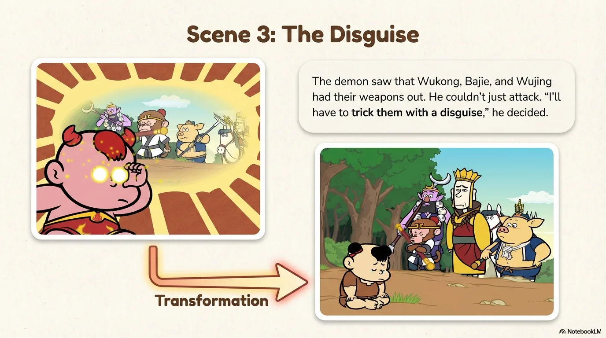

- 来源：`ppt/media/image9.png`（relationship `rId2`）
- 尺寸：1376×768
- 源 SHA-256：`be156d928a1ac043b1300f81a6312430e355ba2da66366ec7b2772bcf7dd5dc1`
- 输出 SHA-256：`8c5f81aba01f37326d599a59835d489b3c2e1afb6280d8f8d284af83108a4b1d`
- 分类：unknown ｜ OCR：blocked ｜ 审核：unreviewed

## Slide 009

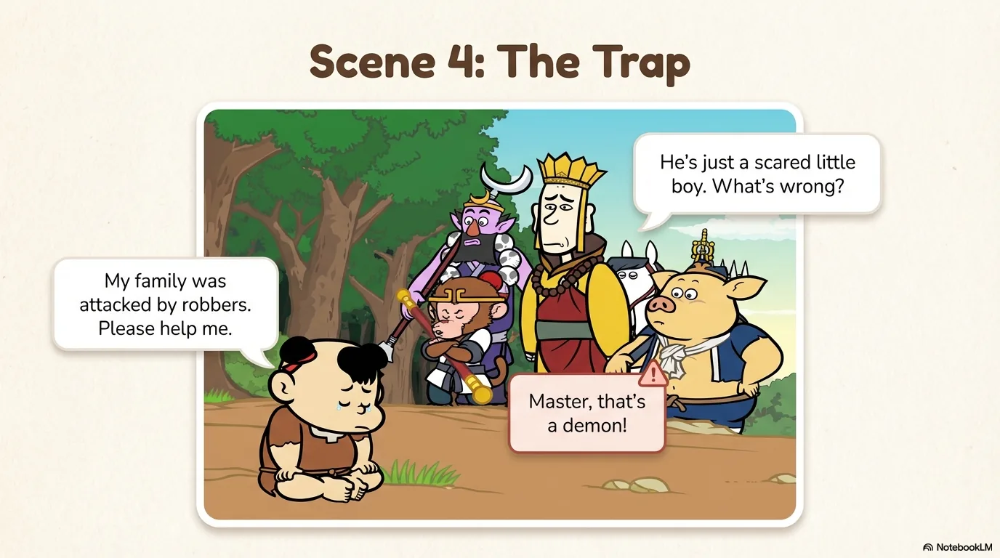

- 来源：`ppt/media/image10.png`（relationship `rId2`）
- 尺寸：1376×768
- 源 SHA-256：`8af72190203304332ac6016620e53d4b36df248f053ce617f0125094f598ed8f`
- 输出 SHA-256：`daa97ef1861a3ef8fe0f41f54c52f0ebe42bdc0504f0127403ed059110215743`
- 分类：unknown ｜ OCR：blocked ｜ 审核：unreviewed

## Slide 010

- 来源：`ppt/media/image11.png`（relationship `rId2`）
- 尺寸：1376×768
- 源 SHA-256：`4985fde1448de7d9f190e4cbba378cb0933fa478b4198b5efbe19340cbfc19c5`
- 输出 SHA-256：`2aca618052be85275d380bebe77ed1f25b43b6952985de3a0bcb8ea572ffdd8f`
- 分类：unknown ｜ OCR：blocked ｜ 审核：unreviewed

## Slide 011

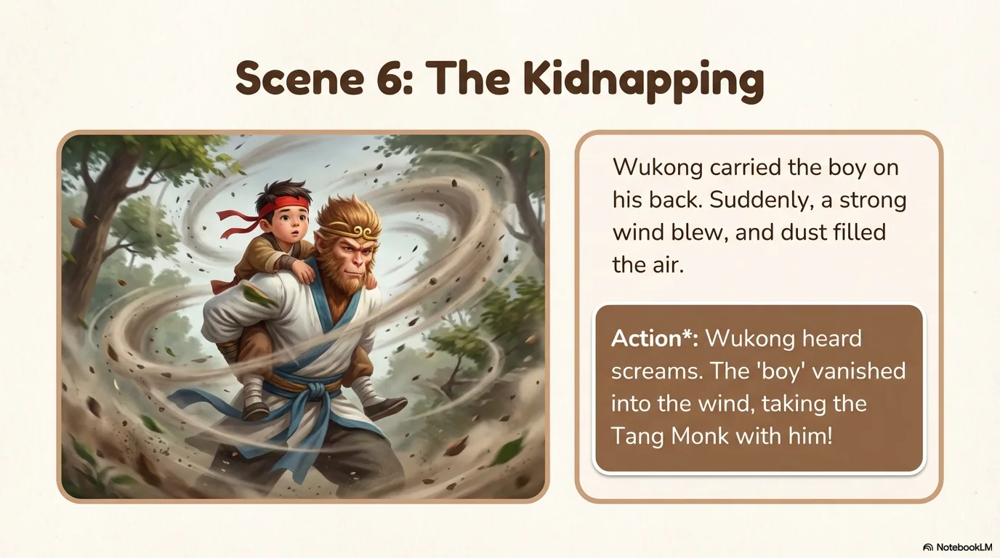

- 来源：`ppt/media/image12.png`（relationship `rId2`）
- 尺寸：1376×768
- 源 SHA-256：`9f0423706c58ac3bb777c43e593d278e186cb5aa883669302f6b561b1f63a270`
- 输出 SHA-256：`382bb29594e046ae01ce870d8777176bed7cdbfbf33f61355d66beba84c7ba9a`
- 分类：unknown ｜ OCR：blocked ｜ 审核：unreviewed

## Slide 012

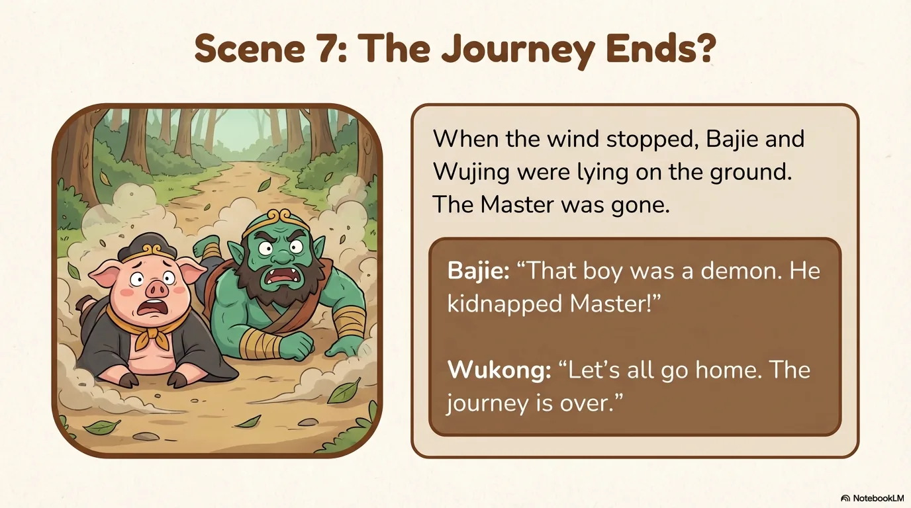

- 来源：`ppt/media/image13.png`（relationship `rId2`）
- 尺寸：1376×768
- 源 SHA-256：`e120cddd8ba33568d243ea79378a8ef0a639f93e7b304dc10ba0469cdf5022b3`
- 输出 SHA-256：`8d8369815cd055ee79443bd39034061e977ae5a746dde19bdece047b6d014ce3`
- 分类：unknown ｜ OCR：blocked ｜ 审核：unreviewed

## Slide 013

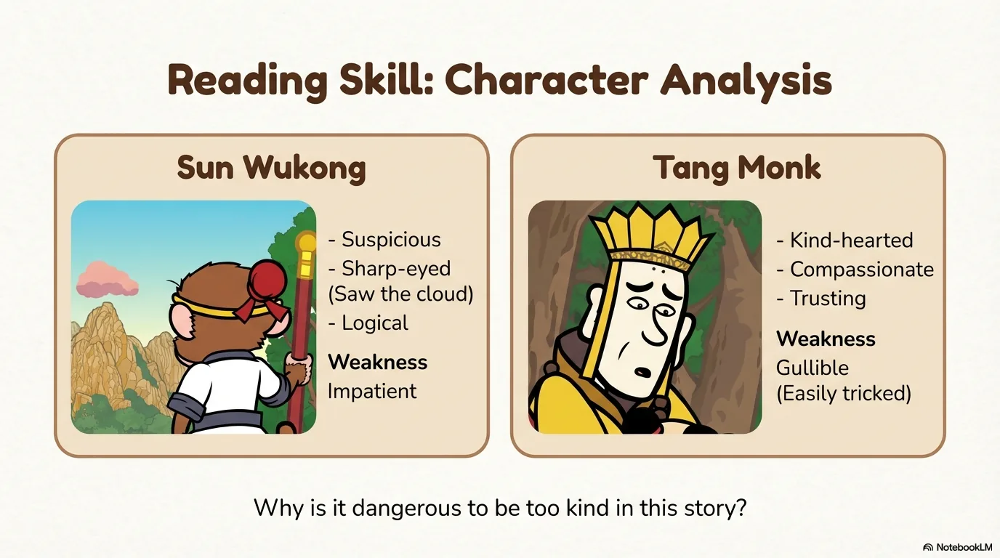

- 来源：`ppt/media/image14.png`（relationship `rId2`）
- 尺寸：1376×768
- 源 SHA-256：`c1c128b62ba6ceff2106da11b9e55a5dc462f3fdcee4edf9e2061f5869c50cc6`
- 输出 SHA-256：`7904ed7c2d38998c34a4cd7c13438fe50b30ca07344ac5e60a4a0611b3fac493`
- 分类：unknown ｜ OCR：blocked ｜ 审核：unreviewed

## Slide 014

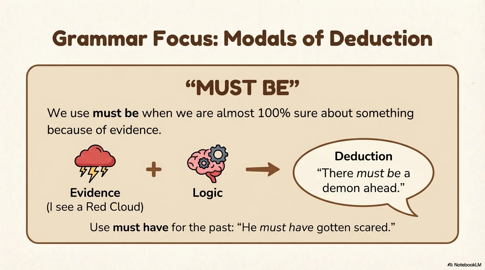

- 来源：`ppt/media/image15.png`（relationship `rId2`）
- 尺寸：1376×768
- 源 SHA-256：`a046fdcd86717095d578c7d6b57495ae0ca02a22f470b09b3eec7a5ce9eeeb54`
- 输出 SHA-256：`3eb1e91c7512815e8724ab62da539254be7250865ee8f722322e2749cc8442fc`
- 分类：unknown ｜ OCR：blocked ｜ 审核：unreviewed

## Slide 015

- 来源：`ppt/media/image16.png`（relationship `rId2`）
- 尺寸：1376×768
- 源 SHA-256：`65f584c2d4ebfdab10bc1b9acae68b0c3dcff9d42b8390d4c2748be06348f69e`
- 输出 SHA-256：`6f9ddd788fbace5b76a6bae285b7778948e29487ef3b8251af2745474d6ab8c8`
- 分类：unknown ｜ OCR：blocked ｜ 审核：unreviewed

## Slide 016

- 来源：`ppt/media/image17.png`（relationship `rId2`）
- 尺寸：1376×768
- 源 SHA-256：`cf325df3facc431907be43953cefa56e3d34624c8429d842ac58c33e88a5d994`
- 输出 SHA-256：`f1058d38c0cb292b3b6c130c33c4fdfd96e1117417e79169639f0e88d25f6ca9`
- 分类：unknown ｜ OCR：blocked ｜ 审核：unreviewed

## Slide 017

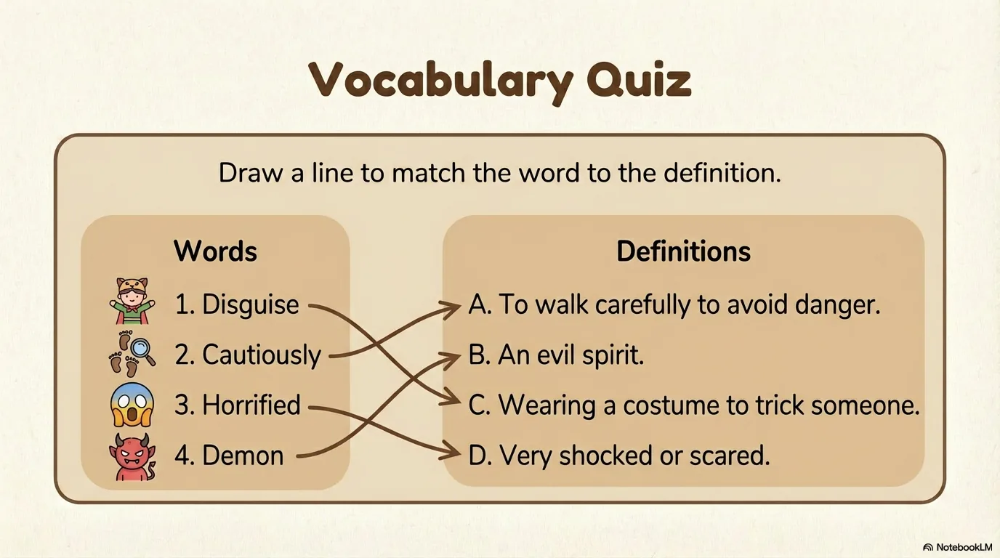

- 来源：`ppt/media/image18.png`（relationship `rId2`）
- 尺寸：1376×768
- 源 SHA-256：`ddc70fc9802b758f5fb56090e91810a586b7ed00ed84553a034c9b0c173f926b`
- 输出 SHA-256：`46ebb7f71643cc33dcf4ddf8fdd38e60ddb8e3561d5ed28f819f9e3fb34edb0f`
- 分类：unknown ｜ OCR：blocked ｜ 审核：unreviewed

## Slide 018

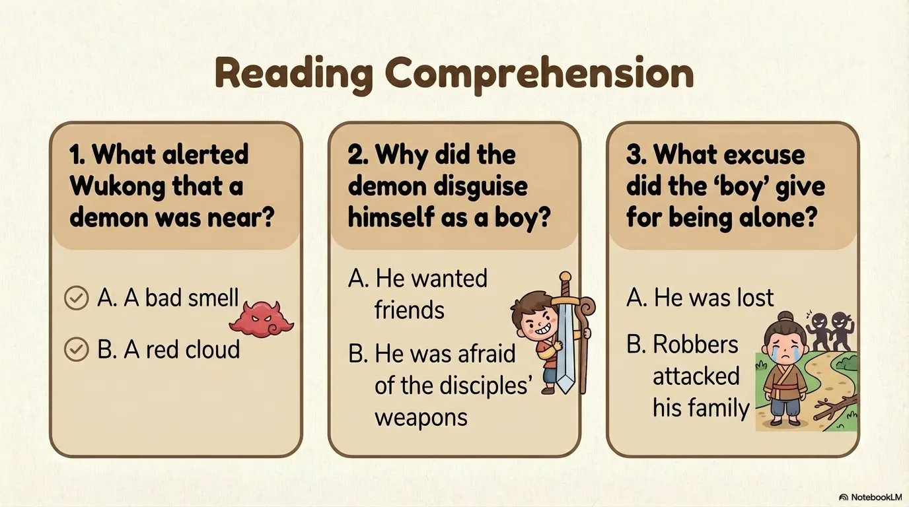

- 来源：`ppt/media/image19.png`（relationship `rId2`）
- 尺寸：1376×768
- 源 SHA-256：`4f8d2e0e75f29b94bda3b80bb2f5adaa05e4368fe1c2744383fb3ab0747f4116`
- 输出 SHA-256：`bf28f2ce11f4df6461b5c0faa5c8201318c8f2c4e10529781705d87676dcd723`
- 分类：unknown ｜ OCR：blocked ｜ 审核：unreviewed

## Slide 019

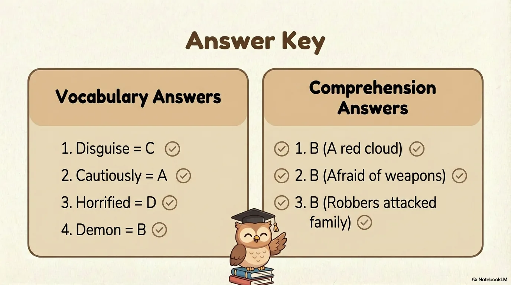

- 来源：`ppt/media/image20.png`（relationship `rId2`）
- 尺寸：1376×768
- 源 SHA-256：`51ac87a5e3ba35e5394f0274b61bf0e5bb47ba2bf91296885794e190061b3cae`
- 输出 SHA-256：`62bb718843970c53922fa10678d2f6ceeeb1c0c549a6a1a9a92cdc8f674413f5`
- 分类：unknown ｜ OCR：blocked ｜ 审核：unreviewed

## Slide 020

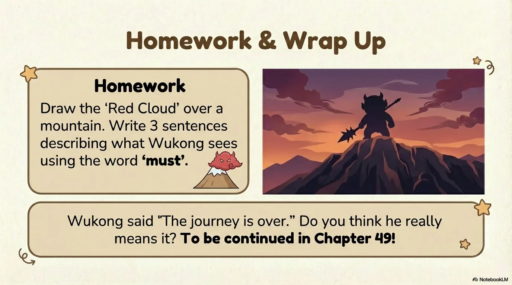

- 来源：`ppt/media/image21.png`（relationship `rId2`）
- 尺寸：1376×768
- 源 SHA-256：`5e99ea5f29a02d84b4bb3d01fc54b2e2c28db894fee462ef634611ae4be68c33`
- 输出 SHA-256：`078ea3814ccbe0c43146237d83033f9d5ce2622c5943507d6a43c4ff64f5dcae`
- 分类：unknown ｜ OCR：blocked ｜ 审核：unreviewed
