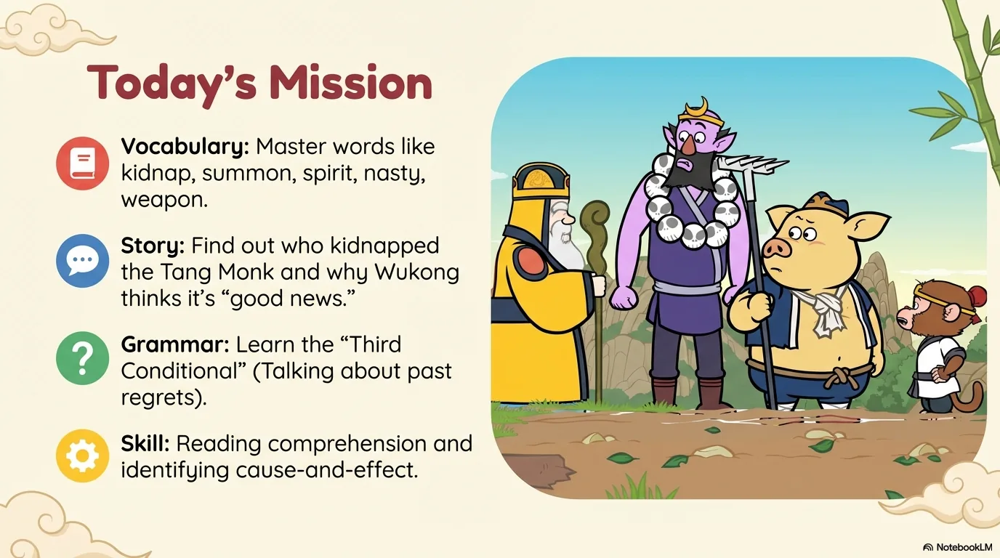
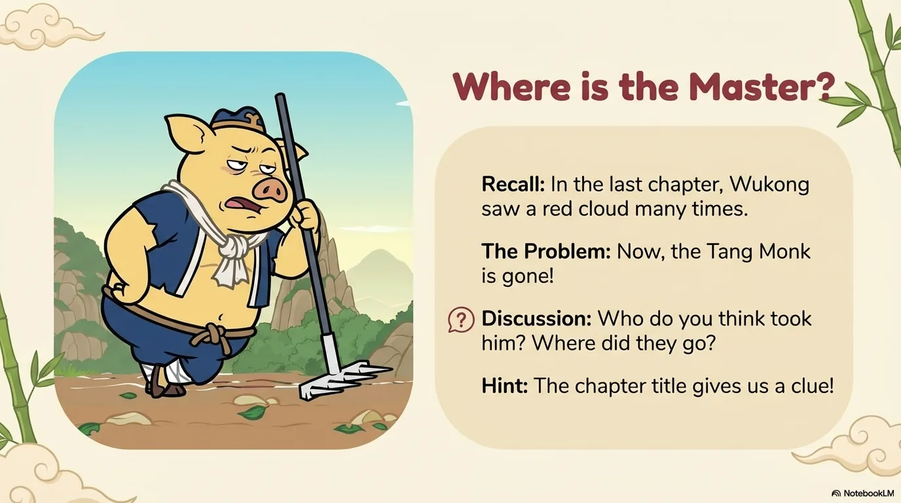
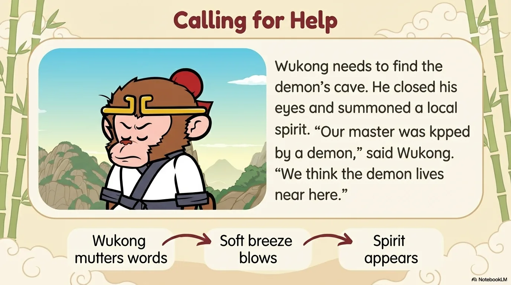
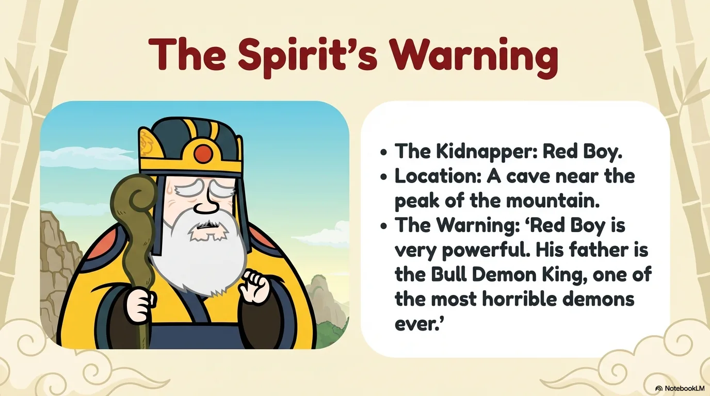
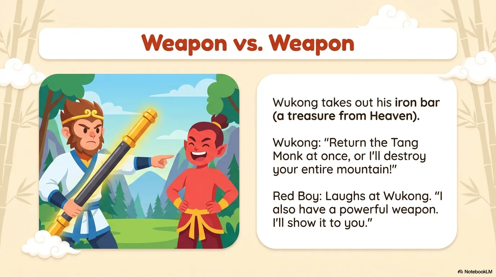
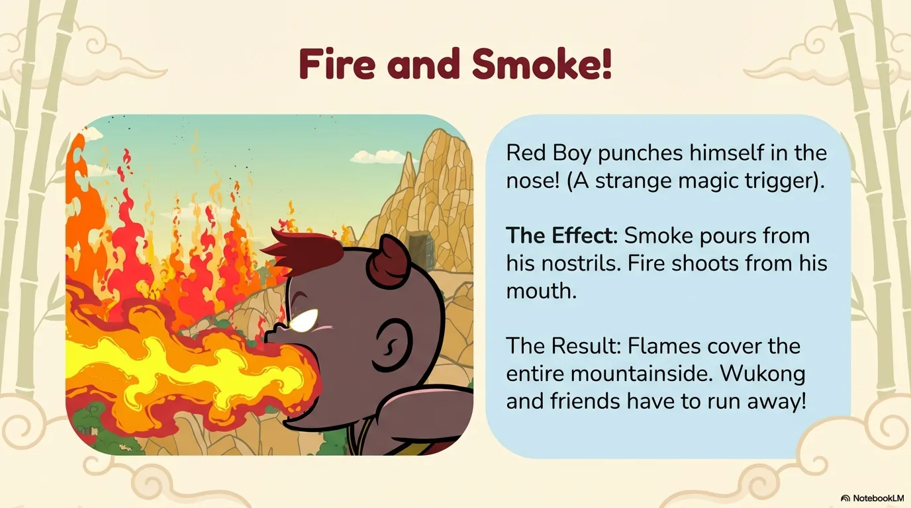
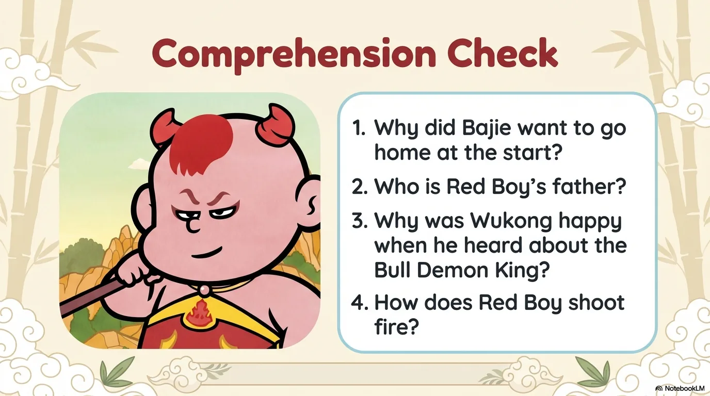
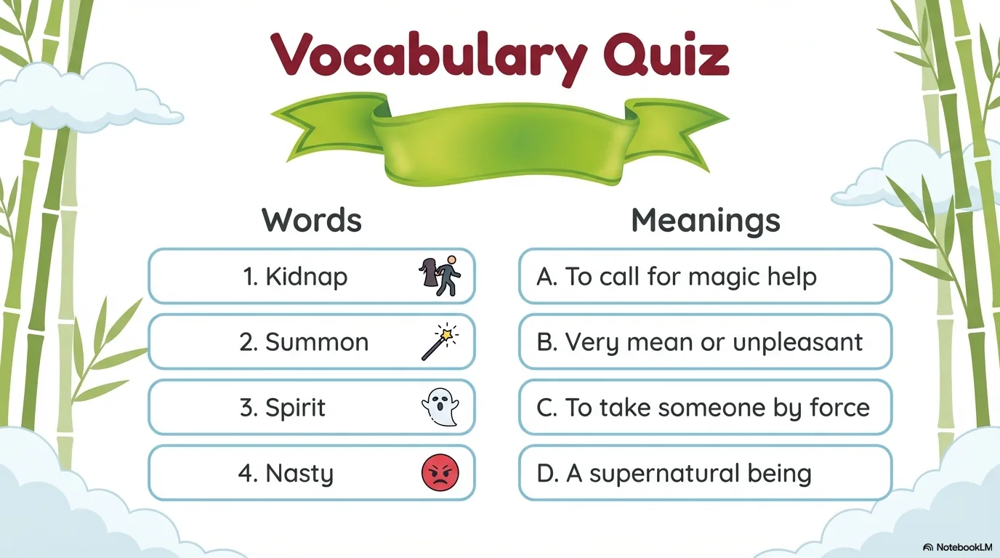
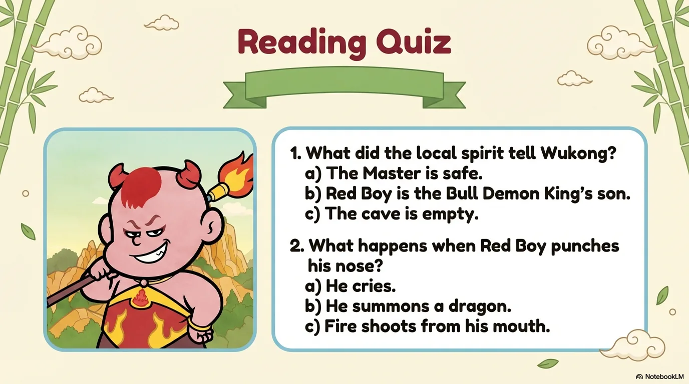
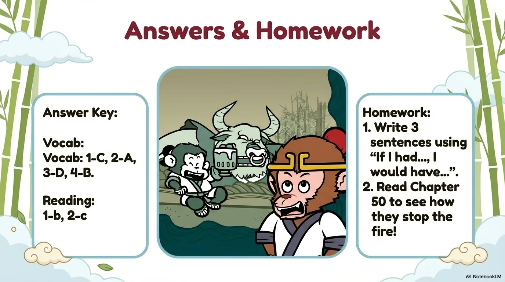

# 豆豆龙英语 · 第 49 集课件（EP049 草稿）

- 来源：`049_Journey to the West 49_Red Boy.pptx`（主课件，20 页）
- OCR：`blocked`（no local OCR provider importable (pytesseract missing): No module named 'pytesseract'）
- 分类：待人工审核（unknown）
- 审核状态：`unreviewed`

## Slide 001

- 来源：`ppt/media/image1.png`（relationship `rId2`）
- 尺寸：1376×768
- 源 SHA-256：`bba88dbcd235cc9f5aa2da8538b461b974478e7dd66ca6d3a86e747036f8956d`
- 输出 SHA-256：`f6838fc2c0ae245b0dbfee5bf9ab5883eb83aefd842ee85b6128edf7b7a6d7cf`
- 分类：unknown ｜ OCR：blocked ｜ 审核：unreviewed

## Slide 002

- 来源：`ppt/media/image3.png`（relationship `rId2`）
- 尺寸：1376×768
- 源 SHA-256：`f36438902e2f91761736cd9df967c035133905298d37ac9828508f9b2b2419cb`
- 输出 SHA-256：`504505898f8c0ae55532f46657be1d8c25b4a5c6d4ff63064ae1e12a42beccee`
- 分类：unknown ｜ OCR：blocked ｜ 审核：unreviewed

## Slide 003

- 来源：`ppt/media/image4.png`（relationship `rId2`）
- 尺寸：1376×768
- 源 SHA-256：`4b096573c9a0d46dc5472839ef810ec4afa95747bb37ecc7f302372e7b490829`
- 输出 SHA-256：`dd6429cdf0ef50429520eefbb2579edcc0cfc51dbb6ce06d66fde44446495a00`
- 分类：unknown ｜ OCR：blocked ｜ 审核：unreviewed

## Slide 004

- 来源：`ppt/media/image5.png`（relationship `rId2`）
- 尺寸：1376×768
- 源 SHA-256：`34ac3d092e061a8619304c87aaa48100f6486bfef62960afa8b5eb9c78cc4340`
- 输出 SHA-256：`df7b04068c2342d3ebdd0be434be22fea7dc25e31dc4ec07bcd1e2fb5596561b`
- 分类：unknown ｜ OCR：blocked ｜ 审核：unreviewed

## Slide 005

- 来源：`ppt/media/image6.png`（relationship `rId2`）
- 尺寸：1376×768
- 源 SHA-256：`e05d450fedad38d11cc191b6c10a8767eeb467ac2deeddacf0b39361ba2a74a6`
- 输出 SHA-256：`b47713535f9c21c50bf2e99ffdb2f16302e4fa05e9e1d310458f6e8e31e746d7`
- 分类：unknown ｜ OCR：blocked ｜ 审核：unreviewed

## Slide 006

- 来源：`ppt/media/image7.png`（relationship `rId2`）
- 尺寸：1376×768
- 源 SHA-256：`04bc26c81d893de6d53c625cbdcd2388abf09f9b8f60b43e09bdcb1ac867e43c`
- 输出 SHA-256：`7da584e7860c5ff8dc042fd3cf459499e091500853915ffe0391f557d08be52e`
- 分类：unknown ｜ OCR：blocked ｜ 审核：unreviewed

## Slide 007

- 来源：`ppt/media/image8.png`（relationship `rId2`）
- 尺寸：1376×768
- 源 SHA-256：`f0fc3e447370c12c285d3316b3d89d77f16d0c003162cc955c2e201f0f479762`
- 输出 SHA-256：`9a0ab9ba58f61ed691a92cb5f5f9f84944ba42d7119dee5584f6153fed6165fe`
- 分类：unknown ｜ OCR：blocked ｜ 审核：unreviewed

## Slide 008

- 来源：`ppt/media/image9.png`（relationship `rId2`）
- 尺寸：1376×768
- 源 SHA-256：`5942e6f199ee273213daf2a0a712e8c28d3cd1b7139d673be6de620308db42e2`
- 输出 SHA-256：`64d76bab90fe1de95aa95803db340f3ad27a9ee9f1a869eaead5a5f87e3f8ee2`
- 分类：unknown ｜ OCR：blocked ｜ 审核：unreviewed

## Slide 009

- 来源：`ppt/media/image10.png`（relationship `rId2`）
- 尺寸：1376×768
- 源 SHA-256：`74b26f8d8ae105204a36cf89beb87b0ff0322ce864db89ca43c3fe96d48ebbcf`
- 输出 SHA-256：`cd9863b2e09774e46c10b5212838bfa72e31ecb3639e7bb924316f1ba6fe43f7`
- 分类：unknown ｜ OCR：blocked ｜ 审核：unreviewed

## Slide 010

- 来源：`ppt/media/image11.png`（relationship `rId2`）
- 尺寸：1376×768
- 源 SHA-256：`4de97f88c98633d277af016de75c62bc5461cf935af2dffbb091e5d5993ead0d`
- 输出 SHA-256：`b5e635dd38bf63107ff875cf9f10ef753e9c21ad5ae594183d85c852cc6c06e4`
- 分类：unknown ｜ OCR：blocked ｜ 审核：unreviewed

## Slide 011

- 来源：`ppt/media/image12.png`（relationship `rId2`）
- 尺寸：1376×768
- 源 SHA-256：`684a75613924a21770e4c94f7aeab15115acdf18f64f068e34d2d0ceaa97f51b`
- 输出 SHA-256：`2a5f41fc0aa74e6ffc0b137a291798c8197a0111707bdb72c5d0292e92997714`
- 分类：unknown ｜ OCR：blocked ｜ 审核：unreviewed

## Slide 012

- 来源：`ppt/media/image13.png`（relationship `rId2`）
- 尺寸：1376×768
- 源 SHA-256：`29d9562b5a071e685e644a1cce3b3bfa6db92e2509b835609bc6f994c2b1bfc0`
- 输出 SHA-256：`1a30f039934a915dd20daa1c64d64729b29bdbc888b4dff3bf02882b2032a9ad`
- 分类：unknown ｜ OCR：blocked ｜ 审核：unreviewed

## Slide 013

- 来源：`ppt/media/image14.png`（relationship `rId2`）
- 尺寸：1376×768
- 源 SHA-256：`9931906f898053c21b01529cbab3caeda95342899890bca2852672cdf2c61d79`
- 输出 SHA-256：`2e49aa4137638f76409a333dc425d147627648676fd419ef23aa0782e6d5a356`
- 分类：unknown ｜ OCR：blocked ｜ 审核：unreviewed

## Slide 014

- 来源：`ppt/media/image15.png`（relationship `rId2`）
- 尺寸：1376×768
- 源 SHA-256：`cb25c9fb441152c662fb42619f3f56dcaae7f905218e0e591e6b75ffb468a37d`
- 输出 SHA-256：`7712cfd7ed09b9561a4637e46e8ec6268bb11a17daabe6103c4975f7dab8f4ce`
- 分类：unknown ｜ OCR：blocked ｜ 审核：unreviewed

## Slide 015

- 来源：`ppt/media/image16.png`（relationship `rId2`）
- 尺寸：1376×768
- 源 SHA-256：`235de3f030d0f71620abb8893cc74edc574fc5434bcfb18b87808ffb9ec8ea49`
- 输出 SHA-256：`16404d29f1d293ec24c286008a195ce9b8a8016a05d2746434623b36406d850f`
- 分类：unknown ｜ OCR：blocked ｜ 审核：unreviewed

## Slide 016

- 来源：`ppt/media/image17.png`（relationship `rId2`）
- 尺寸：1376×768
- 源 SHA-256：`fa99d6e62410e08b7741d7ade80854c57571f461baeadb8414d3a61c1d4a5ffa`
- 输出 SHA-256：`30865eaa0dec7b7ca3496893f54a6a8e9b8105fc428e05cbb368607bb4e42648`
- 分类：unknown ｜ OCR：blocked ｜ 审核：unreviewed

## Slide 017

- 来源：`ppt/media/image18.png`（relationship `rId2`）
- 尺寸：1376×768
- 源 SHA-256：`955e0a5828882847830f22f143577f3bc252c79d2654be1cd9482a7009a3d841`
- 输出 SHA-256：`9eaaee15d494a3ca894e2e1866625fda6829799a3cf9f011f9931a3c6a4a01ae`
- 分类：unknown ｜ OCR：blocked ｜ 审核：unreviewed

## Slide 018

- 来源：`ppt/media/image19.png`（relationship `rId2`）
- 尺寸：1376×768
- 源 SHA-256：`f6d0b38e601d47c92fc5e96ce5d7263d4c05e0ff2862701ccbcb6973b8aaa214`
- 输出 SHA-256：`b23fd70fa0d47d84fe8c83d8df57fcc21d933da45d029c61779ca81be0c6521c`
- 分类：unknown ｜ OCR：blocked ｜ 审核：unreviewed

## Slide 019

- 来源：`ppt/media/image20.png`（relationship `rId2`）
- 尺寸：1376×768
- 源 SHA-256：`10aaa6081f994ed63aebb5ac0bc2f32eea6143a7ee11ed96d457ad5a1ae68413`
- 输出 SHA-256：`a16727530dcb76b7249482c9181af80d775e170c2d4c9a7401e63498b926dad5`
- 分类：unknown ｜ OCR：blocked ｜ 审核：unreviewed

## Slide 020

- 来源：`ppt/media/image21.png`（relationship `rId2`）
- 尺寸：1376×768
- 源 SHA-256：`043ec514aaec601113c92ecbe5685ed10c5f748f894c2971638c4a47bbd21439`
- 输出 SHA-256：`c7ff07cb832e6bb04a15c38ddd2c561487163e0a3a25c84f757034b0a7326b47`
- 分类：unknown ｜ OCR：blocked ｜ 审核：unreviewed
