# 豆豆龙英语 · 第 50 集课件（EP050 草稿）

- 来源：`050_Journey to the West 50_Magic Fire.pptx`（主课件，20 页）
- OCR：`blocked`（no local OCR provider importable (pytesseract missing): No module named 'pytesseract'）
- 分类：待人工审核（unknown）
- 审核状态：`unreviewed`

## Slide 001

- 来源：`ppt/media/image1.png`（relationship `rId2`）
- 尺寸：1376×768
- 源 SHA-256：`ad30eb0a70e471b790a8c4ed1b9e51a7eb12c76769dabbe364ffae87d3f79429`
- 输出 SHA-256：`cbe63bba44d1c0eb8dc700736a94f6ba34429a258f0b9abe59b62b99b3a0b299`
- 分类：unknown ｜ OCR：blocked ｜ 审核：unreviewed

## Slide 002

- 来源：`ppt/media/image3.png`（relationship `rId2`）
- 尺寸：1376×768
- 源 SHA-256：`a39f9b9ce4530fcb081efe3c752d61c75761db1253321ad8c84bbff625f54873`
- 输出 SHA-256：`227a8e5bb5bed3eae58003c21e67f7ba30fe241e38645bcd43c3c9985533f342`
- 分类：unknown ｜ OCR：blocked ｜ 审核：unreviewed

## Slide 003

- 来源：`ppt/media/image4.png`（relationship `rId2`）
- 尺寸：1376×768
- 源 SHA-256：`c91800c6f19be2cf4bf0e0a61dd08030bcaa1a7bf80bce4e5472136aea40368b`
- 输出 SHA-256：`f6934aee8a8fc55aa356f76085dcdba642a8080601b6a7003dff074b36971f44`
- 分类：unknown ｜ OCR：blocked ｜ 审核：unreviewed

## Slide 004

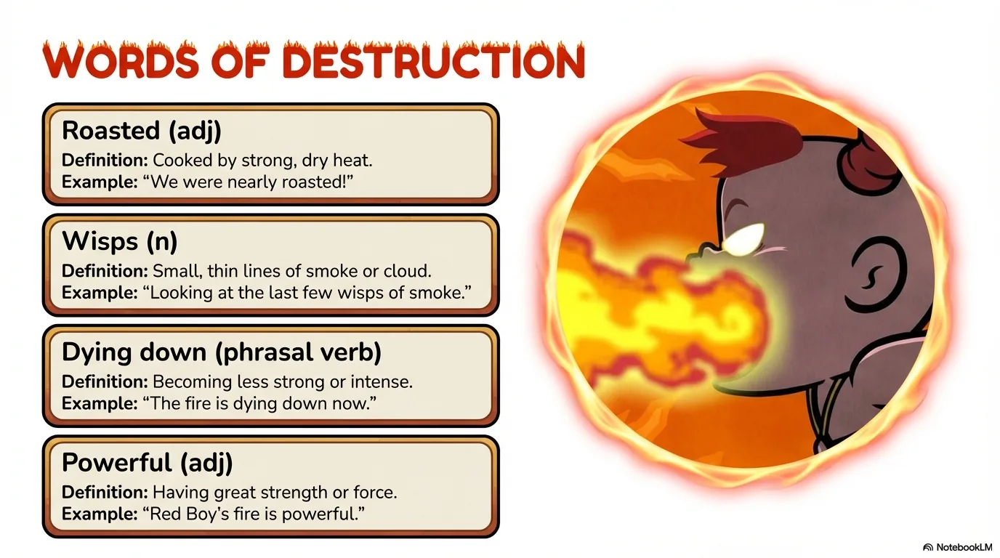

- 来源：`ppt/media/image5.png`（relationship `rId2`）
- 尺寸：1376×768
- 源 SHA-256：`3386947f7b955687f0cb10c6d9cab6a2a7e4290e17a8ab64020a12803c675888`
- 输出 SHA-256：`25cd4417935605f60c973248c500f922d12803c5da895c55b53431faa834997c`
- 分类：unknown ｜ OCR：blocked ｜ 审核：unreviewed

## Slide 005

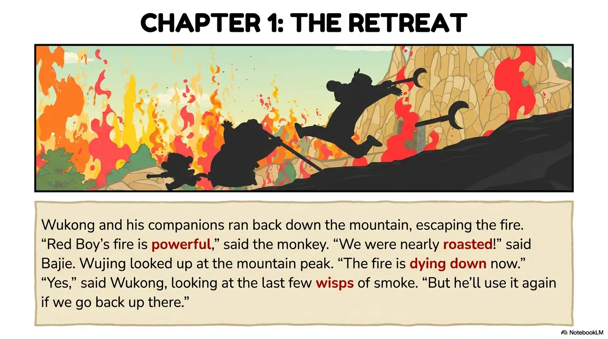

- 来源：`ppt/media/image6.png`（relationship `rId2`）
- 尺寸：1376×768
- 源 SHA-256：`634e125ffdcf4aff1067b3d5bf7ab00ba8b3178e23e613ad735b83dcb242774c`
- 输出 SHA-256：`2b346c62766b09eb27d67be95d81715c3401c4b4683effbab863634abb3ef2f5`
- 分类：unknown ｜ OCR：blocked ｜ 审核：unreviewed

## Slide 006

- 来源：`ppt/media/image7.png`（relationship `rId2`）
- 尺寸：1376×768
- 源 SHA-256：`9a65611aba825e5c05481df951068ddc1c639a31f589a5f3d425440bc5817100`
- 输出 SHA-256：`b1eb114b98bc167d22d79a6ff8bfe8284849d930055562ba039a7f60f1f27279`
- 分类：unknown ｜ OCR：blocked ｜ 审核：unreviewed

## Slide 007

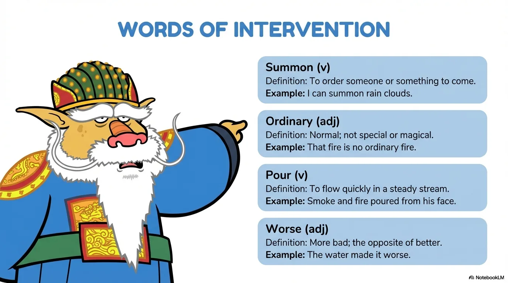

- 来源：`ppt/media/image8.png`（relationship `rId2`）
- 尺寸：1376×768
- 源 SHA-256：`191def934664c9fcced6e22590596487a39d75977a97332610dea303ae0145d0`
- 输出 SHA-256：`062ed985326ec89de48feedfdf73a33e3d30a0413f128e3d76f32e5046ff8ea9`
- 分类：unknown ｜ OCR：blocked ｜ 审核：unreviewed

## Slide 008

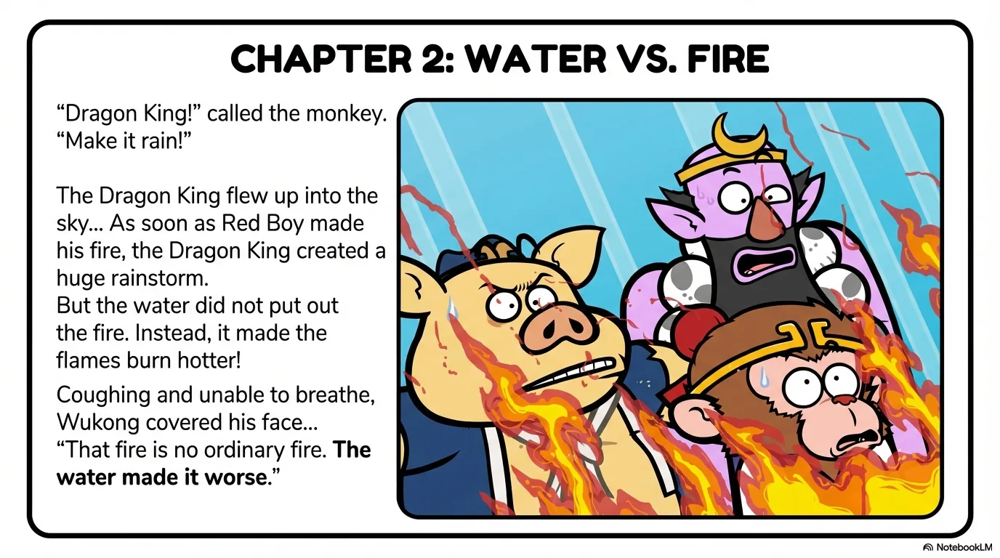

- 来源：`ppt/media/image9.png`（relationship `rId2`）
- 尺寸：1376×768
- 源 SHA-256：`02679667e58ab856229843b03a55c8aeb4094e07f16b4b4f5ad2c42a390da571`
- 输出 SHA-256：`8aa3a90bb251b0b1db9b5b3d4a278797215c60c909f100033e909622bf2c51c8`
- 分类：unknown ｜ OCR：blocked ｜ 审核：unreviewed

## Slide 009

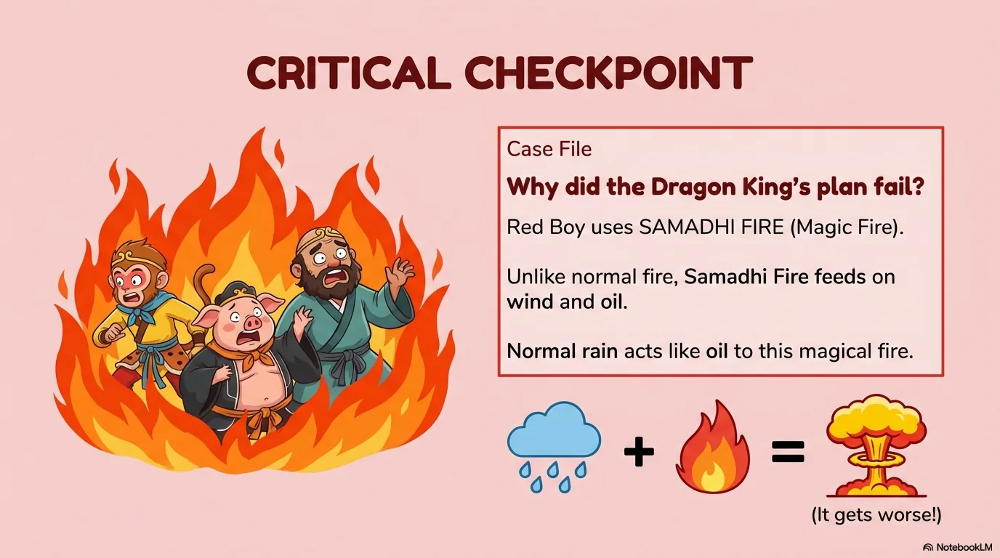

- 来源：`ppt/media/image10.png`（relationship `rId2`）
- 尺寸：1376×768
- 源 SHA-256：`8093da169e2b6adc2547c89aa62a54a4c97e024addeaca9595ff6bbdb74df161`
- 输出 SHA-256：`5b4e446edfbdc33bfe4596141be66fea05f41b88eba0ec3ec410c8d67150ddd1`
- 分类：unknown ｜ OCR：blocked ｜ 审核：unreviewed

## Slide 010

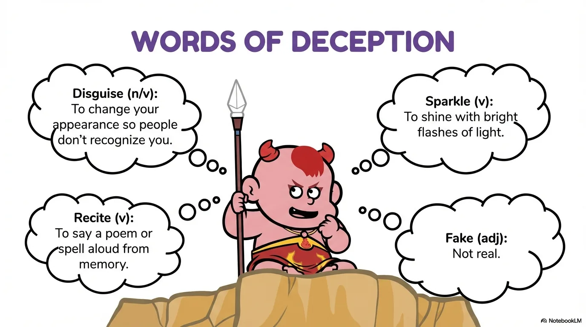

- 来源：`ppt/media/image11.png`（relationship `rId2`）
- 尺寸：1376×768
- 源 SHA-256：`f8561c61cccef063b13ed7cc4b099ba724531ba271842b00b3521bd3d6c8b48e`
- 输出 SHA-256：`e420fe2efe6ecad8d346300cee9a235ccd16cbcc8f05c6290e95ced15227b829`
- 分类：unknown ｜ OCR：blocked ｜ 审核：unreviewed

## Slide 011

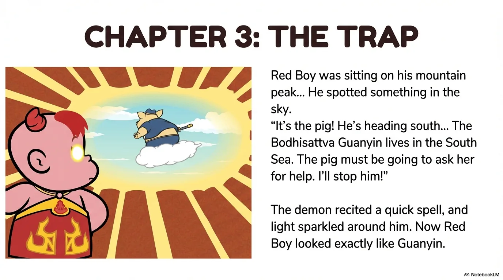

- 来源：`ppt/media/image12.png`（relationship `rId2`）
- 尺寸：1376×768
- 源 SHA-256：`8ce53c8dbc76f2ffaaf3075993f48a9da7aa86692f915d5884dac8c890a6b2ef`
- 输出 SHA-256：`3647c02d9a553c44e3d17eebaa14cb40ab98d93eb3c63ae25edeabf903f1e27e`
- 分类：unknown ｜ OCR：blocked ｜ 审核：unreviewed

## Slide 012

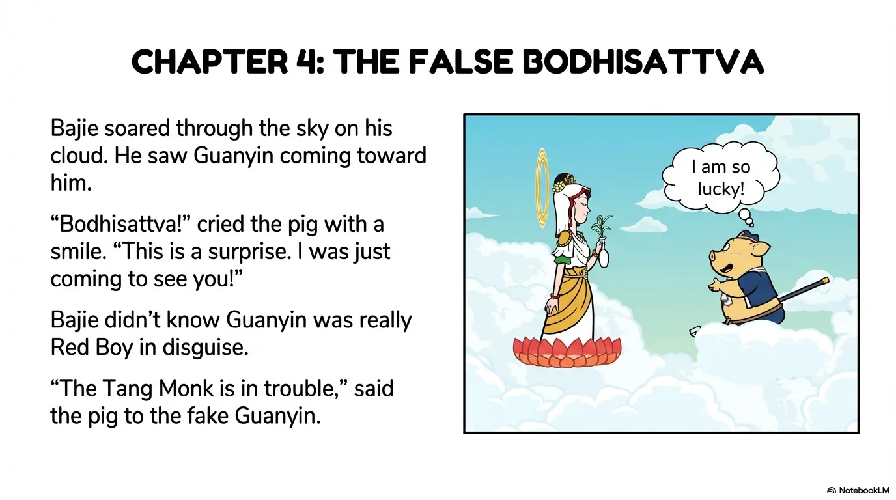

- 来源：`ppt/media/image13.png`（relationship `rId2`）
- 尺寸：1376×768
- 源 SHA-256：`5f1ce9a07bed19a7aa7855fde856b0a142c31635b35c10137ae45e8fdba398b1`
- 输出 SHA-256：`8e9d5ee2e65351a776d31a2f068fdd383bb83c41b3097e4e69d92ac2cfb01db2`
- 分类：unknown ｜ OCR：blocked ｜ 审核：unreviewed

## Slide 013

- 来源：`ppt/media/image14.png`（relationship `rId2`）
- 尺寸：1376×768
- 源 SHA-256：`e0b5976fc1036b41daa30c36fe8e2b0f78442a8575a0d8543cdd33aff1717485`
- 输出 SHA-256：`b2a17006945cdb6599a01b15f1647d847f0638f5c77174cc9d9ef3f4cc7b0826`
- 分类：unknown ｜ OCR：blocked ｜ 审核：unreviewed

## Slide 014

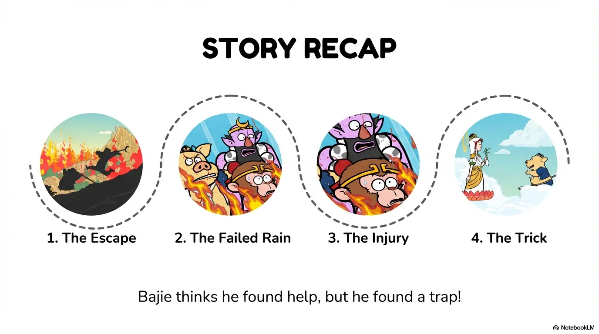

- 来源：`ppt/media/image15.png`（relationship `rId2`）
- 尺寸：1376×768
- 源 SHA-256：`06086deefddc599b30d9a8b71c32b75f24dff05742794163d05d68b68b15e771`
- 输出 SHA-256：`289e93653fadb5d9be857eb4ef72a79f44fb3953d11bd5574c6b76f06dd5d712`
- 分类：unknown ｜ OCR：blocked ｜ 审核：unreviewed

## Slide 015

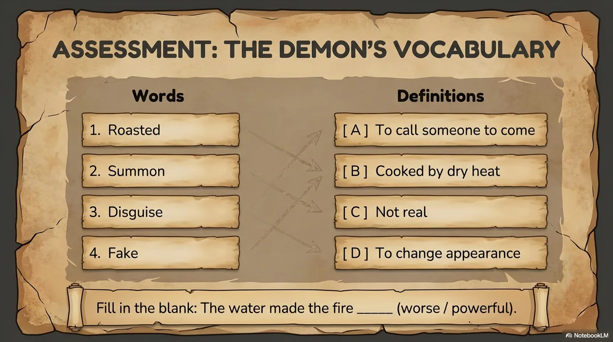

- 来源：`ppt/media/image16.png`（relationship `rId2`）
- 尺寸：1376×768
- 源 SHA-256：`c1edc9dd0ca3ab85fb5bff8726fafc2e8f1d0b314c43c4ddca038d8237b15a6a`
- 输出 SHA-256：`0d7f3de36c9cefa427690b220e320f5b1f02e201c45b4b23fd3d6c8315f7fc04`
- 分类：unknown ｜ OCR：blocked ｜ 审核：unreviewed

## Slide 016

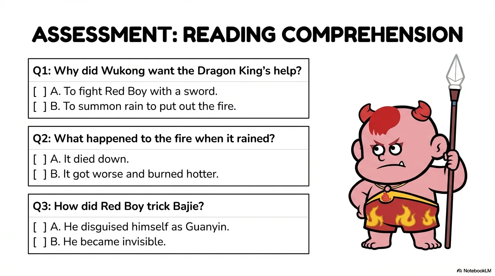

- 来源：`ppt/media/image17.png`（relationship `rId2`）
- 尺寸：1376×768
- 源 SHA-256：`266497136528e17e76a3652b3d651a09ca98a11a2e3bd2076f05cebaa55c45f4`
- 输出 SHA-256：`afe093ab8a72376ea31885e71c05c5912d7734efa6183650712b68dede546d54`
- 分类：unknown ｜ OCR：blocked ｜ 审核：unreviewed

## Slide 017

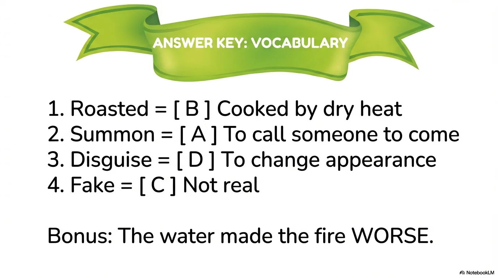

- 来源：`ppt/media/image18.png`（relationship `rId2`）
- 尺寸：1376×768
- 源 SHA-256：`1ebe7d1cfacd5e8e0c8a76895a0622feb0f516f6132a8c104820bf423b1fb76c`
- 输出 SHA-256：`a41debbd5aa229b00083a732fe3da0fe8ef6869775c6efd80181e03757b8d21f`
- 分类：unknown ｜ OCR：blocked ｜ 审核：unreviewed

## Slide 018

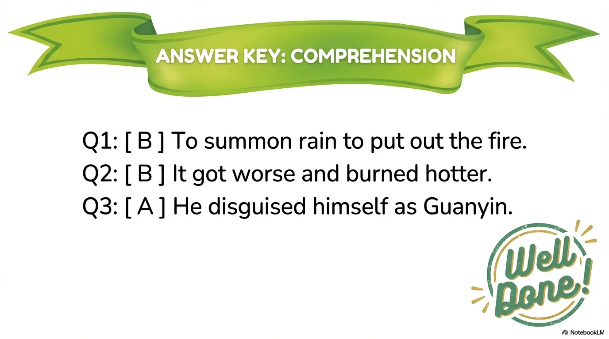

- 来源：`ppt/media/image19.png`（relationship `rId2`）
- 尺寸：1376×768
- 源 SHA-256：`f4d099abc5e6903dc1cd0e022fdc80f824ca45c3ce8b0c1f021aec92f05d2cc8`
- 输出 SHA-256：`e130187b163b8e33c7dcdded1fbdfb1882185bde97e4dc01914bac9078d7b9e6`
- 分类：unknown ｜ OCR：blocked ｜ 审核：unreviewed

## Slide 019

- 来源：`ppt/media/image20.png`（relationship `rId2`）
- 尺寸：1376×768
- 源 SHA-256：`d03f2ef37432dc22f6822f3ddcd89a80b5af5a40079003fb9878413307d1632e`
- 输出 SHA-256：`4db4f6cafa8495512d5173738c8f7e479b5125dfdd51c96ce9659bab3c8f7c71`
- 分类：unknown ｜ OCR：blocked ｜ 审核：unreviewed

## Slide 020

- 来源：`ppt/media/image21.png`（relationship `rId2`）
- 尺寸：1376×768
- 源 SHA-256：`8e82c753af65bd4a49b0bf9cdcb80131a0d4753708a84cdf5edaa02f71aeb124`
- 输出 SHA-256：`3640335fe6c8dafcadbbcdcdd458ea3b6b935face18e8ea69cc99a2ceec700e0`
- 分类：unknown ｜ OCR：blocked ｜ 审核：unreviewed
