# 豆豆龙英语 · 第 51 集课件（EP051 草稿）

- 来源：`051_Journey to the West 51_Guanyin Becomes Angry.pptx`（主课件，15 页）
- OCR：`blocked`（no local OCR provider importable (pytesseract missing): No module named 'pytesseract'）
- 分类：待人工审核（unknown）
- 审核状态：`unreviewed`

## Slide 001

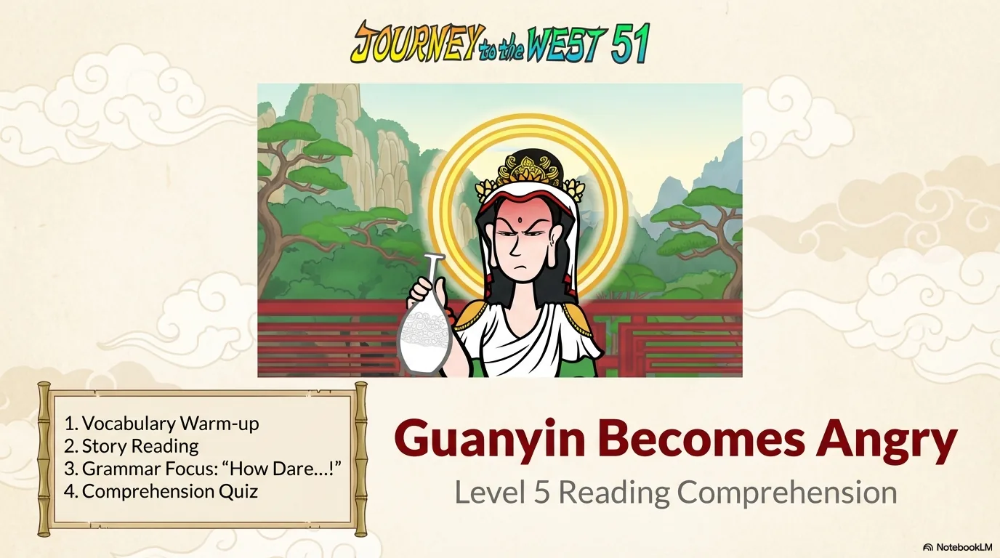

- 来源：`ppt/media/image1.png`（relationship `rId2`）
- 尺寸：1376×768
- 源 SHA-256：`edf8e24cd28ccbec5aa618a2aed3aeeee27a8c1801f45d4e70365c803c0dbfad`
- 输出 SHA-256：`86ceb0efa0dc477e545445fa2f912c8747c41860afb74726866ff1633cfdb819`
- 分类：unknown ｜ OCR：blocked ｜ 审核：unreviewed

## Slide 002

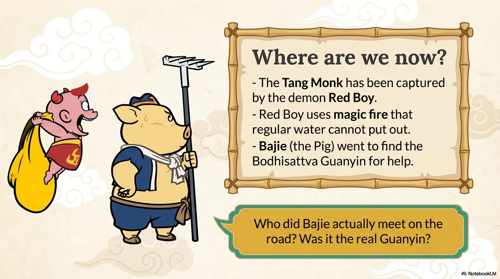

- 来源：`ppt/media/image3.png`（relationship `rId2`）
- 尺寸：1376×768
- 源 SHA-256：`7e9bd10434c7d47a67ec01d5dbadcdfa2afecb09497e230abb809f8c555d4145`
- 输出 SHA-256：`15bf12c70d70b6128e1d1aada73ffecce67f835d596e60ed4500a6cb69c0ec95`
- 分类：unknown ｜ OCR：blocked ｜ 审核：unreviewed

## Slide 003

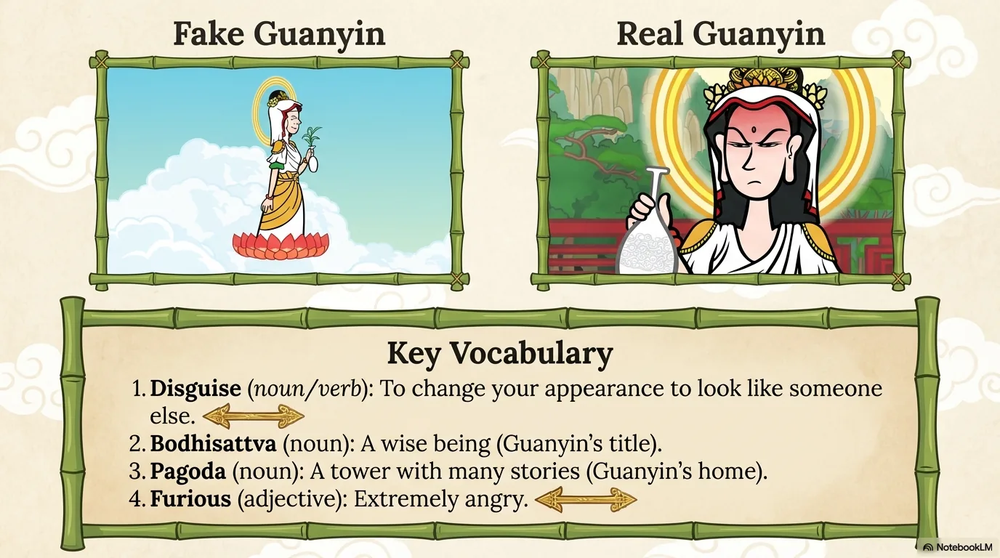

- 来源：`ppt/media/image4.png`（relationship `rId2`）
- 尺寸：1376×768
- 源 SHA-256：`8acb8a6a8f946dea5f22a1084800c89316e2b57fe1a335dfadc159fc72a6d04d`
- 输出 SHA-256：`77ac3482df5221fd147dfd720fe73f2646ea9959a5020e4cdec28768f7902bc8`
- 分类：unknown ｜ OCR：blocked ｜ 审核：unreviewed

## Slide 004

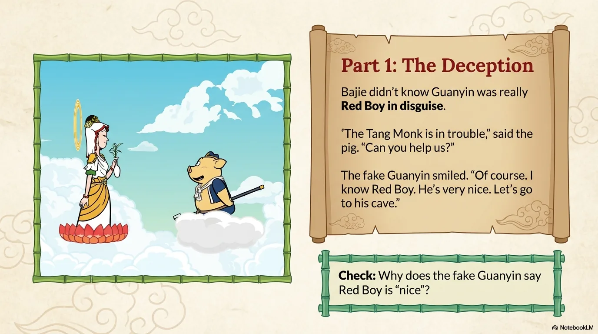

- 来源：`ppt/media/image5.png`（relationship `rId2`）
- 尺寸：1376×768
- 源 SHA-256：`ca72b76d1d785c80f492374d633b0a0e8cb13e2febd10c0f2283cba9767cc113`
- 输出 SHA-256：`944640f13f8671b676af84fedebb5bdf3eb78ae08b66434db016ad32eda18fa8`
- 分类：unknown ｜ OCR：blocked ｜ 审核：unreviewed

## Slide 005

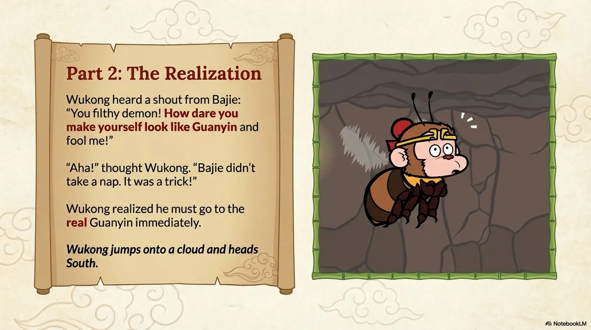

- 来源：`ppt/media/image6.png`（relationship `rId2`）
- 尺寸：1376×768
- 源 SHA-256：`8cb93d1a3e7862680275268ffe4d9ff74cfe1faf623c7e9f7384282cd9de45ae`
- 输出 SHA-256：`0c083cc20c9e6875e6c413dc282a25bca7736998211062580d7bc43b6642d430`
- 分类：unknown ｜ OCR：blocked ｜ 审核：unreviewed

## Slide 006

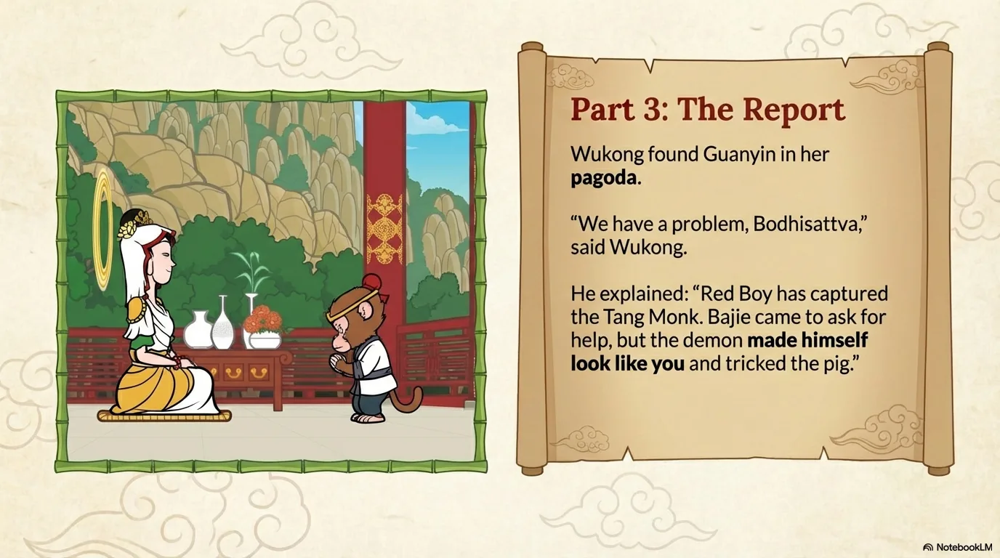

- 来源：`ppt/media/image7.png`（relationship `rId2`）
- 尺寸：1376×768
- 源 SHA-256：`94654aaa51317fd80147a14e9b39d9d2487270b5ac63a655449cb503c47a6615`
- 输出 SHA-256：`df00c49e110677c1ab5a87d0a55b32733351713c099c9f90ad9432bb8b064cb7`
- 分类：unknown ｜ OCR：blocked ｜ 审核：unreviewed

## Slide 007

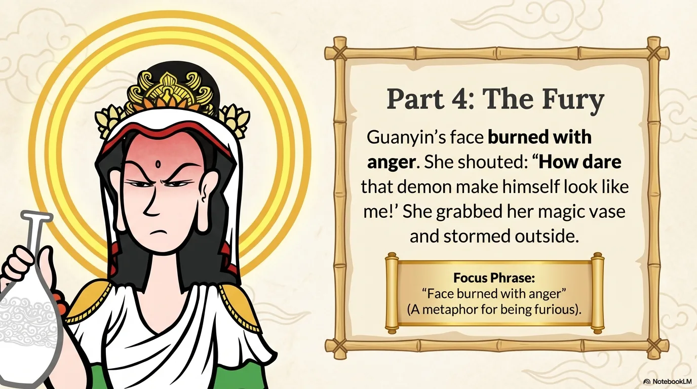

- 来源：`ppt/media/image8.png`（relationship `rId2`）
- 尺寸：1376×768
- 源 SHA-256：`16f4788c642853a6e2858cda695d1823201e94a5d7c7cc37f27e2520d5809833`
- 输出 SHA-256：`cc35897e6aabcdb86bbe89903050e696c7d981ecd509aa04ed59a837338c5455`
- 分类：unknown ｜ OCR：blocked ｜ 审核：unreviewed

## Slide 008

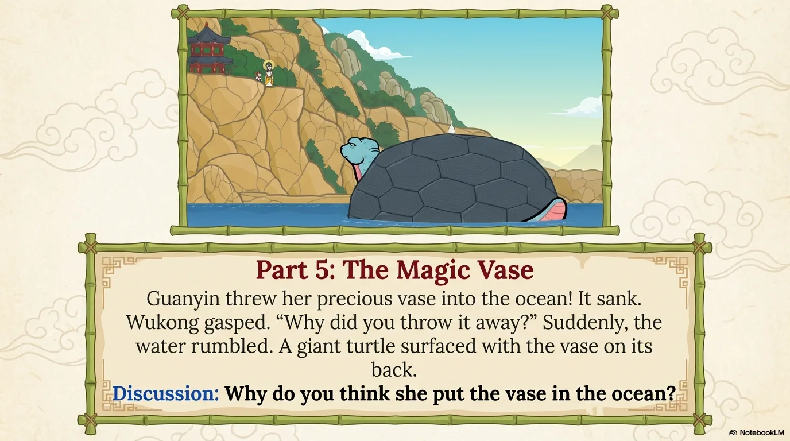

- 来源：`ppt/media/image9.png`（relationship `rId2`）
- 尺寸：1376×768
- 源 SHA-256：`ff4baa6fdbb52e2d97b4ca53f7f3b3545399c48c73a0a3335d92d1655733d015`
- 输出 SHA-256：`c0e38654500986255a4b4045a51314fcb40dfaa1b6526cf1c25572deaa94a639`
- 分类：unknown ｜ OCR：blocked ｜ 审核：unreviewed

## Slide 009

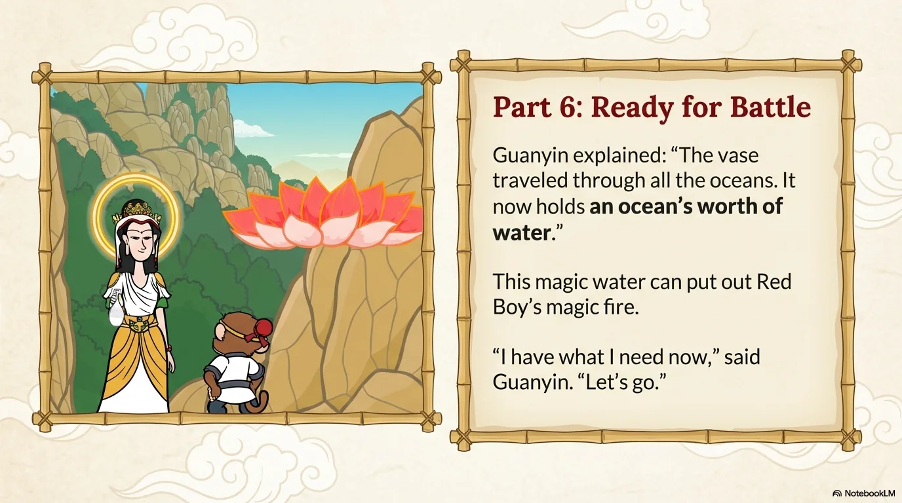

- 来源：`ppt/media/image10.png`（relationship `rId2`）
- 尺寸：1376×768
- 源 SHA-256：`c15c915c6c5315519e1d89a8eac541b8decdbefbe6e2e0da302b7cb598f05b37`
- 输出 SHA-256：`de01c5f3c69996252a05ac8622efa13e509994f13a2713274de83806923405b0`
- 分类：unknown ｜ OCR：blocked ｜ 审核：unreviewed

## Slide 010

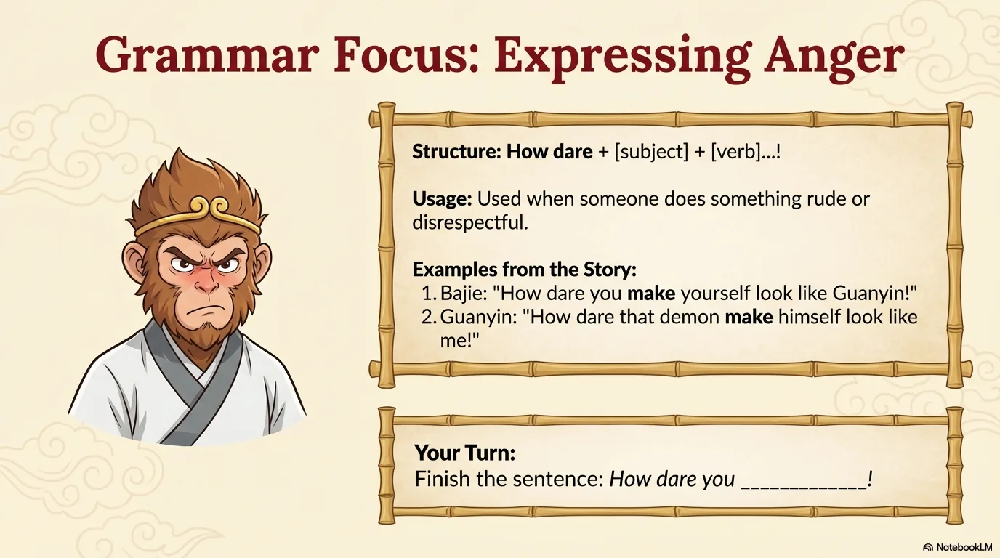

- 来源：`ppt/media/image11.png`（relationship `rId2`）
- 尺寸：1376×768
- 源 SHA-256：`634ead0769bd635fcc4caacd1bcdcb7e89a3d34c2d205b4de09f44c9aebe8991`
- 输出 SHA-256：`bf55ada82e31117494654b74b2b19d9831197d1c79b39d7ca995d0b5c6923c6e`
- 分类：unknown ｜ OCR：blocked ｜ 审核：unreviewed

## Slide 011

- 来源：`ppt/media/image12.png`（relationship `rId2`）
- 尺寸：1376×768
- 源 SHA-256：`87b1171f119a7ba4a24501f3bf43b80951b2248be35a18c9995a6b94db4b3416`
- 输出 SHA-256：`75813d638208ee8b26d3a06250e99f4e52bc55d31599d956e084ba1556dc3056`
- 分类：unknown ｜ OCR：blocked ｜ 审核：unreviewed

## Slide 012

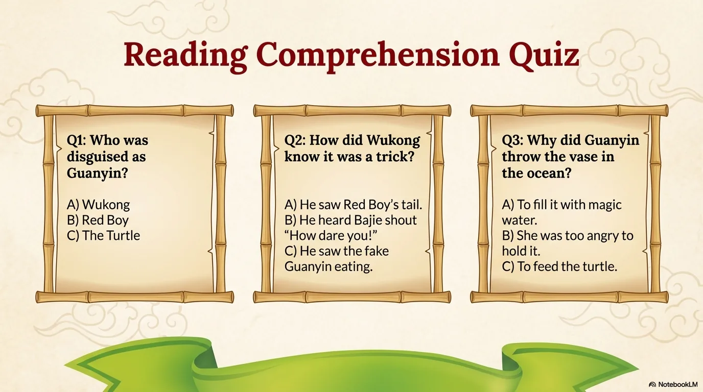

- 来源：`ppt/media/image13.png`（relationship `rId2`）
- 尺寸：1376×768
- 源 SHA-256：`b671a23fd1bc12e826318a23a39235a63dcd5a30bc86ba09f25dcaaf18cac399`
- 输出 SHA-256：`4f77fe1d8b66b686be879c5c62690dcccb78a33c4b188616497362e295b1bc1b`
- 分类：unknown ｜ OCR：blocked ｜ 审核：unreviewed

## Slide 013

- 来源：`ppt/media/image14.png`（relationship `rId2`）
- 尺寸：1376×768
- 源 SHA-256：`416858ebd2598795010f8351140e2fa86b4d6487e106b5fd381320f6d37c5318`
- 输出 SHA-256：`db20c6618ae49a228bf0dc2ec6cd49bad56a47b93786cab6efe896c6a0500924`
- 分类：unknown ｜ OCR：blocked ｜ 审核：unreviewed

## Slide 014

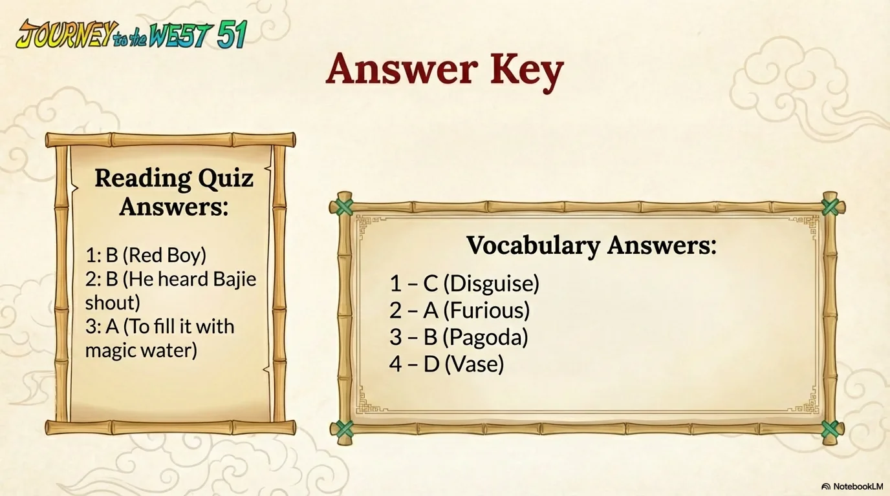

- 来源：`ppt/media/image15.png`（relationship `rId2`）
- 尺寸：1376×768
- 源 SHA-256：`00ad8d60ca34f4543bbe278c648509ce3836648dcc4518b82f0c7ae8a1d5fc0f`
- 输出 SHA-256：`ed8aa3abbd968bc5a92762f3b0031e1cda04239977f53f9cfd724dedfbffeb0d`
- 分类：unknown ｜ OCR：blocked ｜ 审核：unreviewed

## Slide 015

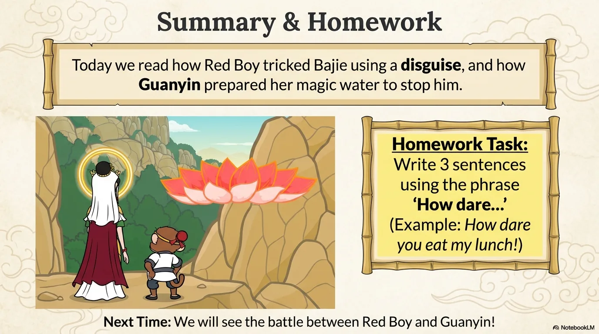

- 来源：`ppt/media/image16.png`（relationship `rId2`）
- 尺寸：1376×768
- 源 SHA-256：`d97c83479e454da7847b80b0216373a2151bdf8bbad4b8215fb5290dcbf1e343`
- 输出 SHA-256：`0b0969d5afb1c54c59a4ec38b675f3faccc1f69ccf98f3f5b3187790a7a620fc`
- 分类：unknown ｜ OCR：blocked ｜ 审核：unreviewed
